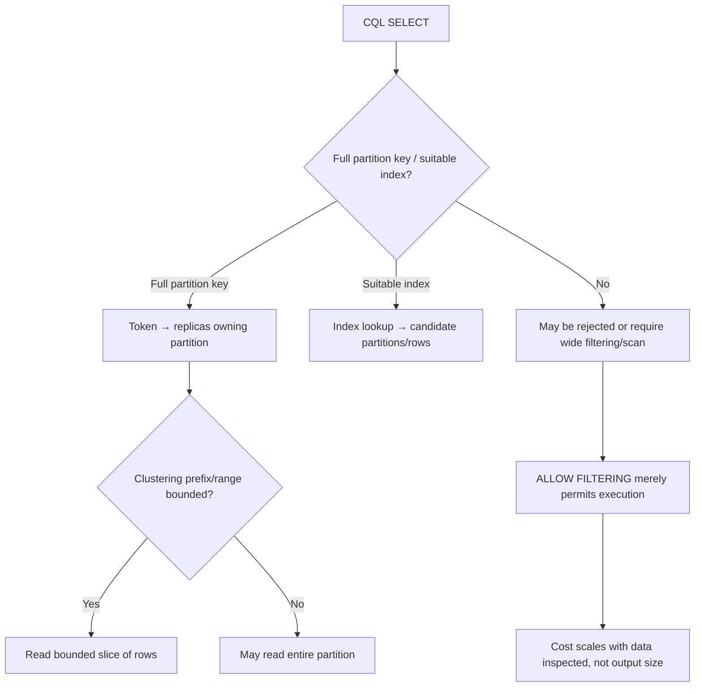
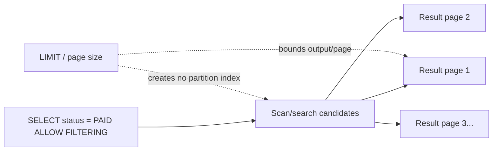
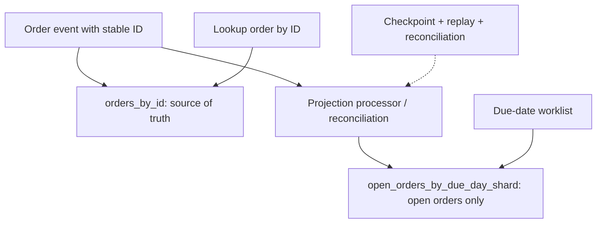
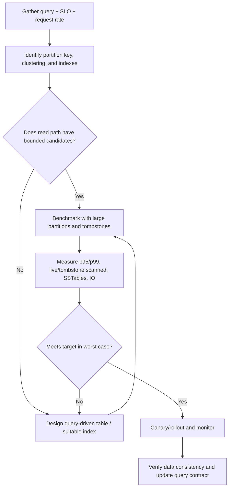

# Avoiding Wide Scans and Understanding ALLOW FILTERING Cost

> **Chapter:** Query Tuning  
> **Module:** `DATABASE_ENGINE_WIDE_COLUMN_CASSANDRA` — Apache Cassandra

An Apache Cassandra table storing millions of orders can return **10 results** while still examining **millions of candidate records**. The cause rarely lies in the number of returned rows—it lies in how the `SELECT` statement accesses data. In a distributed **wide-column** store, the partition key routes queries to replicas, clustering columns order rows within a partition, and compaction/SSTables plus tombstones determine actual read cost.

`ALLOW FILTERING` is a CQL directive that permits certain queries Cassandra would normally reject because **the amount of data read cannot be predicted**. It **creates no index**, does not make a partition key more selective, and guarantees no optimization. Misused, it turns a small-result query into a wide scan that drives up CPU, disk I/O, network traffic, GC, p99 latency, and timeout risk. The **preferred fix** is query-driven table design, bounding partition scope first, and only considering `ALLOW FILTERING` for strictly bounded cases.

This lesson shows how to evaluate scan scope, understand `LIMIT` and paging semantics, write primary-keyed CQL reads, model a table for a new query, evaluate Storage-Attached Indexing (SAI), and measure impact from a Java application. Concepts apply to Apache Cassandra; verify index features and operational thresholds against your deployed version.

**Objectives**

- Distinguish **partition lookup**, **bounded clustering-range scan**, **in-partition filtering**, and **wide multi-partition scans**.
- Explain why `ALLOW FILTERING` does not make a query cheap even with `LIMIT 10`.
- Redesign schemas around queries, pick buckets, and bound partition sizes.
- Know when to test SAI vs. using a projection/materialized read model or a separate search/analytics system.
- Measure query latency, scan amplification, tombstones, SSTables, and Java Driver paging boundaries.
- Apply a pre-production checklist before shipping any `ALLOW FILTERING` query.

## 1. How Does Cassandra Locate Data?

### 1.1. The Partition Key Is the Starting Point

Cassandra hashes the partition key into a **token** and uses that token with the replication strategy (typically `NetworkTopologyStrategy`) to locate the partition's replicas. A query supplying the full partition key usually has a well-defined routing target. Conversely, filtering solely on a regular column such as `status` or `region` usually provides **insufficient information** to pinpoint the owning partitions.

Consider this CQL table:

```sql
-- Assumes keyspace commerce already exists with appropriate replication.
CREATE TABLE commerce.orders_by_customer_month (
    tenant_id text,
    customer_id uuid,
    order_month text,
    placed_at timestamp,
    order_id uuid,
    status text,
    region text,
    total_amount decimal,
    PRIMARY KEY ((tenant_id, customer_id, order_month),
                 placed_at, order_id)
) WITH CLUSTERING ORDER BY (placed_at DESC, order_id DESC);
```

- **Composite partition key:** `(tenant_id, customer_id, order_month)`. Normally, all components must be constrained to address a specific partition. Certain index features alter queryability, but that follows a separate read path.
- **Clustering columns:** `placed_at` then `order_id`. Rows inside each partition are ordered by the declared clustering order, enabling time-range reads favoring newer records.
- **Regular columns:** `status`, `region`, and `total_amount` are not indexed by default. Cassandra cannot directly locate all rows with `status = 'PAID'` from this schema alone.
- `order_month` is an application-computed bucket derived from the order timestamp, e.g., `2026-11`. If a single customer places huge numbers of orders per month, consider smaller buckets or deterministic sharding included in the key.



### 1.2. Clustering Keys Enable Contiguous Reads, Not Arbitrary Indexing

Once the partition key is known, Cassandra can read contiguous leading prefixes of the clustering key. For example, fetching a customer's orders across a date range:

```sql
SELECT order_id, placed_at, total_amount, status
FROM commerce.orders_by_customer_month
WHERE tenant_id = 'tenant-a'
  AND customer_id = 11111111-1111-4111-8111-111111111111
  AND order_month = '2026-11'
  AND placed_at >= '2026-11-01T00:00:00Z'
  AND placed_at < '2026-12-01T00:00:00Z'
LIMIT 25;
```

This query pinpoints **one partition** and a clustering slice on `placed_at`; rows read are further capped by the result limit and range bounds. Partition size, overlapping SSTables, and tombstones still affect cost, yet the access path is far more predictable than a cluster-wide search.

By contrast, specifying only `WHERE order_id = ...` cannot leverage the partition key, even though `order_id` sits in the primary key as a **clustering column**. Being part of the primary key does not turn every column into an independent global index.

**Case requiring care:** with a composite partition key, omitting any component typically prevents direct routing. With multiple clustering columns, predicates must respect prefix order and contiguity. You cannot arbitrarily add `WHERE region = ...` or skip leading columns assuming B-tree-like SQL lookups.

## 2. What Does `ALLOW FILTERING` Actually Do?

CQL rejects queries whose execution may require **filtering an unbounded number of candidates**. Adding `ALLOW FILTERING` tells Cassandra: *execute this query anyway even though filtering overhead may be very large or unpredictable*.

Suppose the table above has no index on `status`:

```sql
-- No partition key or index on status.
-- Query may be rejected by Cassandra because it requires filtering/scanning.
SELECT order_id, status
FROM commerce.orders_by_customer_month
WHERE status = 'PAID';
```

Adding the directive:

```sql
-- Dangerous query illustration: DO NOT run on large production tables.
SELECT order_id, status
FROM commerce.orders_by_customer_month
WHERE status = 'PAID'
ALLOW FILTERING;
```

Cassandra may have to examine data across numerous partitions and replicas just to determine which rows match. In a multi-node cluster, cost spans not only filtering CPU, but disk reads, SSTable lookups, coordinator fan-out, network traffic, and garbage collection.

**Important nuances:**

- `ALLOW FILTERING` **does not always mean a full-table scan**. If the partition key already restricts the query to one small partition, filtering a regular column only scans rows within that partition.
- However, **if the partition key is missing or predicates lack index support**, the candidate set can span many partitions. Certain index + regular-column combinations also perform **post-filtering** on candidate rows returned by the index.
- `ALLOW FILTERING` **does not turn an unsupported predicate into an index** and does not guarantee every CQL shape will be accepted.
- `SELECT * FROM table` without `WHERE` still performs a full-table scan **without needing `ALLOW FILTERING`**. The real culprit is *wide scanning*, not merely the presence of the keyword.

### 2.1. Filtering Inside a Small Partition vs. Full-Table Scan

Compare two queries:

```sql
-- A: reads a single partition by customer + month,
-- then filters regular column status.
SELECT order_id, status
FROM commerce.orders_by_customer_month
WHERE tenant_id = 'tenant-a'
  AND customer_id = 11111111-1111-4111-8111-111111111111
  AND order_month = '2026-11'
  AND status = 'PAID'
ALLOW FILTERING;

-- B: no partition restriction; risks traversing most of the table.
SELECT order_id, status
FROM commerce.orders_by_customer_month
WHERE status = 'PAID'
ALLOW FILTERING;
```

In A, candidates **stay inside the specified partition**. If a typical partition has 30–100 orders without heavy tombstones, filtering may fit a measurable budget. If one customer has **two million orders in a month**, A can still perform terribly. In B, candidate count can grow with total cluster data.

Do not judge by "having a partition key is always safe"—check the **partition size distribution (p95/p99/max)**. Bounded bucketing ensures A stays within finite cost as the system scales.

### 2.2. Cost Model: Candidates vs. Output

Let:

- `N` = candidate rows/cells inspected during execution;
- `M` = rows returned;
- `S` = actual bytes read, influenced by compression, caching, and SSTables;
- `F` = nodes/replicas involved and requests/round-trips;
- `T` = tombstones and data versions reconciled.

A mental model for work:

\[
\text{Work} \approx
\text{lookup/scan}(N, S, T)
+ \text{coordination}(F)
+ \text{network}(M, F)
\]

Under filtering, there is no forced relationship `N ≈ M`. Suppose a query returns **10** failed orders while examining **1,000,000** candidates:

\[
\text{Scan amplification} = \frac{N}{\max(M,1)} =
\frac{1{,}000{,}000}{10} = 100{,}000
\]

This is an **illustrative logical ratio**, not exact I/O bytes (caches, SSTable indexes, and early termination alter physical reads). Still, it explains why a query returning minimal output can consume massive work.

| Scenario | What `N` can scale with | Consequence |
| --- | --- | --- |
| Full partition + clustering range | A slice inside one partition | Predictable when partition and time span are bounded. |
| Full partition + regular-column filter | Size of the partition or selected slice | Tolerable for small partitions, degrades on hot partitions. |
| Unindexed regular-column filter only | Data across many partitions / entire table | Unpredictable cost scaling with cluster size. |
| Selective index + post-filter | Candidates returned by the index | Often better than table scan; still measure selectivity and skew. |
| Multi-partition scan with heavy tombstones | Live candidates + tombstones reconciled | Latency and read amplification spike even when `M` is small. |

## 3. `LIMIT`, `PER PARTITION LIMIT`, and Paging Are Not "Magic Fixes"

### 3.1. `LIMIT 10` Caps Only Output Rows

```sql
-- Still dangerous if PAID rows are rare in the scanned space.
SELECT order_id
FROM commerce.orders_by_customer_month
WHERE status = 'PAID'
LIMIT 10 ALLOW FILTERING;
```

`LIMIT 10` caps **returned rows**, not rows/cells read. If matching rows are rare, Cassandra may examine huge numbers of candidates before collecting 10 matches—and if none match, cost reaches the worst case. A few tests on tiny datasets or warm caches showing low p50 prove nothing about p99 as data grows.

That **does not mean** `LIMIT` is useless: when paired with the right partition key and clustering order, `LIMIT` enables early termination, shrinking bytes and read work. It simply cannot fix a **bad access path**.

### 3.2. `PER PARTITION LIMIT` Does Not Bound Partitions Touched

`PER PARTITION LIMIT` caps **rows returned per partition**. When a query still scans many partitions, this clause does not route to fewer partitions. Combining it with `LIMIT` caps output size, but never replaces asking: *how many partitions and candidates were inspected?*

### 3.3. Driver Paging Bounds Each Page, Not Total Scan Work

The Java Driver uses page sizes so the server streams results in chunks, curbing client memory and network bursts. However:

- `setPageSize(50)` is a **page-size hint**; the server does not guarantee exactly 50 rows in every situation.
- Iterating through the `ResultSet` **automatically fetches subsequent pages** in synchronous APIs.
- Paging **does not convert a full-table scan into a partition lookup**. It only slices result delivery into chunks and spreads work over time.
- Paging state is not a safe offset-based analytics mechanism or an absolute transactional snapshot under concurrent updates/deletes. Never pass paging state across different clients or mismatched CQL statements.



## 4. Query-Driven Data Modeling Instead of Filtering

In Cassandra, the right question is rarely "how do I add another `WHERE` clause to the existing table?", and more often **"which key does this query need to access by?"** Establish the maximum partitions and rows a request may touch.

Suppose an e-commerce app needs three screens:

| Query ID | Business requirement | Known inputs | Design approach |
| --- | --- | --- | --- |
| Q1 | Customer's monthly orders, newest first | Tenant, customer ID, month, date range | `orders_by_customer_month` with composite partition and time clustering. |
| Q2 | Fetch 25 **open orders due today** for a tenant to process | Tenant, due date, shard | Projection `open_orders_by_due_day_shard`, storing open orders only. |
| Q3 | View a single order by ID | Tenant and order ID | `orders_by_id` table as the stable-keyed source of truth. |

Forcing one table to serve every filter pushes applications into scanning irrelevant rows. **Multiple query-specific tables are intentional** in Cassandra, trading higher write/reconciliation cost to eliminate unbounded read costs.

### 4.1. Q1: Monthly Customer History

The earlier `orders_by_customer_month` table serves this query directly via partition key and clustering prefix:

```sql
SELECT order_id, placed_at, status, total_amount
FROM commerce.orders_by_customer_month
WHERE tenant_id = 'tenant-a'
  AND customer_id = 11111111-1111-4111-8111-111111111111
  AND order_month = '2026-11'
  AND placed_at >= '2026-11-01T00:00:00Z'
  AND placed_at < '2026-12-01T00:00:00Z'
LIMIT 25;
```

When paging backward to the prior month, the app explicitly switches **partitions/buckets** (e.g., `2026-10`) rather than scanning all months for `tenant_id`. If order counts surge, move to weekly/daily buckets or shards with a bounded fan-out and merge plan.

### 4.2. Q3: Lookup by ID from the Source Table

```sql
CREATE TABLE commerce.orders_by_id (
    tenant_id text,
    order_id uuid,
    customer_id uuid,
    placed_at timestamp,
    status text,
    total_amount decimal,
    due_at timestamp,
    PRIMARY KEY ((tenant_id, order_id))
);

SELECT order_id, status, total_amount
FROM commerce.orders_by_id
WHERE tenant_id = 'tenant-a'
  AND order_id = 33333333-3333-4333-8333-333333333333;
```

This is a **stable-key lookup**. Updating `status` does not require relocating the row to a different status partition; it updates a regular column in place. Overwrites still create data versions compacted later, yet avoid the `DELETE + INSERT` churn that occurs when `status` sits in the primary key.

### 4.3. Q2: Projection Containing Only Open Work Items

If the product genuinely requires "25 due orders for a tenant today," build a dedicated query model instead of filtering past all completed orders:

```sql
CREATE TABLE commerce.open_orders_by_due_day_shard (
    tenant_id text,
    due_day date,
    shard smallint,
    due_at timestamp,
    order_id uuid,
    customer_id uuid,
    total_amount decimal,
    PRIMARY KEY ((tenant_id, due_day, shard), due_at, order_id)
) WITH CLUSTERING ORDER BY (due_at ASC, order_id ASC);

SELECT order_id, customer_id, due_at, total_amount
FROM commerce.open_orders_by_due_day_shard
WHERE tenant_id = 'tenant-a'
  AND due_day = '2026-11-21'
  AND shard = 3
  AND due_at < '2026-11-22T00:00:00Z'
LIMIT 25;
```

Only **open orders** live in this projection; upon completion, a synchronized workflow deletes the row from the projection. `shard` is computed **deterministically from `order_id`** or another logical key; the app queries a **bounded set of shards** (e.g., 16) and merges by `due_at` for a tenant-wide "top 25." Never take 25 rows from one shard and treat it as the tenant-wide top 25.

Practical trade-offs:

- **Extra writes:** creating an order updates both the source table and the projection.
- **Deletes still occur:** closing an order creates a tombstone in the projection. Still, you avoid scanning millions of closed orders just to find a few open ones.
- **Cross-table consistency:** Cassandra does not automatically make two writes across different partitions an isolated global transaction. Use event IDs, idempotent outbox/queue/consumers, retries, and projection reconciliation.
- **Late data / due-date changes:** apply projection updates in deterministic order per business rules so an order never lingers under two due days.
- **Do not overuse projections:** if status flips hundreds of times per second, evaluate a dedicated queue/scheduler and control hot partitions.



**Principle:** eliminate a 10-million-candidate scan by actively maintaining a read model; account for the **full** cost of write amplification, storage, and eventual consistency to confirm the new design wins overall.

## 5. When to Use Indexes Instead of a Projection Table?

Not every query outside the primary key demands a new table. Cassandra offers **secondary indexing**, though costs and supported operators depend on the version.

### 5.1. SAI and Version Requirements

**Storage-Attached Indexing (SAI)** arrived in Apache Cassandra **5.0**, providing SSTable-attached indexes supporting various predicates on non-partition-key columns. Standard Apache Cassandra 4.1 **does not include SAI**; verify your distribution/binary before using SAI syntax.

Example strictly for Cassandra 5.0+ where supported:

```sql
-- Create only after benchmarking and approving write/storage overhead.
CREATE INDEX orders_status_sai
ON commerce.orders_by_customer_month (status)
USING 'sai';

-- Can use the status index instead of a pure full-table scan.
SELECT order_id, status
FROM commerce.orders_by_customer_month
WHERE status = 'FAILED'
LIMIT 25;
```

**However:** a low-cardinality value like `PAID` can match millions of orders. An index locates candidates—it does not shrink a massive match set or turn a multi-node query into a single-partition lookup. SAI consumes CPU, disk, and maintenance work during writes, flushes, and compactions. Under data skew or unindexed extra predicates, Cassandra may still perform **post-filtering**.

Example with SAI on `status` plus an unindexed `region` filter:

```sql
-- Post-filter illustration only; do not assume optimal performance.
SELECT order_id
FROM commerce.orders_by_customer_month
WHERE status = 'FAILED'
  AND region = 'APAC'
ALLOW FILTERING;
```

Here, the engine can use the index to find candidates matching `status` and then filter `region` across those candidates; actual candidate volume must still be measured. Adding a second index on `region` may help combined predicates **if supported by the version and operators**, yet you should never blindly index every column.

### 5.2. Legacy Secondary Indexes and Dedicated Search/Analytics Systems

- **2i (legacy secondary index)** in older Cassandra versions generally operates as a replica-local index. Effectiveness hinges on cardinality, fan-out, and partition scope; never assume a global RDBMS B-tree.
- **SAI (5.0+)** fits a broader range of column lookups, yet still requires measuring query cost, match counts, selectivity, disk/CPU, write load, and topology.
- **Query-specific projection tables** usually excel when an access pattern is critical, stable, and demands very low p99 with predictable read bounds.
- **Dedicated search/analytics engines** suit flexible multi-filter ad hoc search, global sorting, or large-table aggregations, accepting cross-system replication/sync overhead.

Nothing is free. Design starts from the **query contract**: allowed filters, target latency, consistency level, result sizes, ordering, retention, and read/write ratio.

## 6. Measuring Real Cost Instead of Guessing from Returned Row Counts

### 6.1. Signal Groups to Collect

| Layer | Metrics / signals | Question answered |
| --- | --- | --- |
| **Java/API** | p50/p95/p99 by query ID, errors, request rate, timeouts, retries, result size, paging count | What latency do users see, and which query path is failing? |
| **Cassandra coordinator** | `ClientRequest.Read.Latency`, timeouts, failures; per-table `CoordinatorReadLatency`/`CoordinatorScanLatency` where available | Is latency spent on coordinator read or scan handling? |
| **Table/partition** | `ReadLatency`, `RangeLatency`, `LiveScannedHistogram`, `TombstoneScannedHistogram` | Are many live cells or tombstones being inspected? |
| **SSTable** | `SSTablesPerReadHistogram`, `LiveSSTableCount`, `PendingCompactions` | How many SSTables does a read touch, and is compaction backlogged? |
| **Node resources** | Disk I/O/await, CPU, GC, network, memory pressure, pending read tasks | Are scans starving other requests of resources? |
| **Routing & topology** | RF/CL, partition replicas, DC/rack, hot keys, load skew | Is traffic crossing nodes/remote DCs or hitting hot partitions? |

The metric names above reflect **logical/JMX names in Cassandra documentation**, not guaranteed Prometheus metric names after export. Metrics are emitted per node; aggregate carefully, distinguish **counters, gauges, and histograms**, and **never compute cluster-wide p99 by averaging per-node p99**.

### 6.2. Selective CQL Tracing

In `cqlsh`:

```sql
TRACING ON;

SELECT order_id, placed_at, total_amount
FROM commerce.orders_by_customer_month
WHERE tenant_id = 'tenant-a'
  AND customer_id = 11111111-1111-4111-8111-111111111111
  AND order_month = '2026-11'
LIMIT 25;

TRACING OFF;
```

Tracing reveals execution phases and participating nodes for one run, yet **is not an RDBMS EXPLAIN PLAN**. Never enable tracing on all production requests: it adds overhead and may log statement/partition details requiring strict access control and retention limits.

Inspect nodes and tables via read-only commands:

```bash
nodetool status
nodetool tpstats
nodetool compactionstats
nodetool tablestats commerce.orders_by_customer_month
nodetool proxyhistograms
```

When investigating wide scans:

1. Record query ID, CQL, sanitized bind parameters, CL, concurrency/load, page count, and `LIMIT`.
2. Compare the **exact same query pattern** across small/large datasets and varying partition sizes.
3. Measure **p95/p99 under realistic load**, not just a single successful trace.
4. Correlate `LiveScannedHistogram`/`TombstoneScannedHistogram`, read latency, and disk I/O; check impact on peer queries sharing replicas.
5. Re-test after changing the data model or index under comparable workload and cache warmup.

### 6.3. An Illustrative Experiment

Suppose a single table holds 10 million rows distributed as follows:

| Test | Query shape | Output | Cost to suspect |
| --- | --- | --- | --- |
| T1 | Exact partition, narrow clustering range, `LIMIT 25` | Returns 25 rows | Low if partition size and SSTables/tombstones stay reasonable. |
| T2 | Exact partition, unindexed `status`, `ALLOW FILTERING` | Returns 10 rows | May scan most of the partition; high p99 for "whale" customers. |
| T3 | Only `status`, no index, `ALLOW FILTERING LIMIT 10` | Returns 10 rows | May scan many partitions despite tiny payload; worsens as data grows. |
| T4 | `status` backed by SAI | Returns 10 rows | Index shrinks candidate space when selective; common values still incur fan-out/IO. |
| T5 | Projection holding open orders only, partitioned by day/shard | Returns 10 rows | Bounded query scope in exchange for projection maintenance cost. |

**Do not benchmark only with `LIMIT 10` on tiny datasets.** Include **very rare** predicates or **zero-match** cases, hot partitions, dense tombstones, replicas mid-compaction, and high disk I/O windows. Those conditions expose scan amplification.

## 7. Java Driver 4.x: Keyed Queries, Result Limits, and Paging

This Java example queries a customer's history using a **prepared statement with a full partition key**, time range, and `LIMIT 25`. With Java Driver 4.x, Cassandra `timestamp` maps to `java.time.Instant`; here `order_month` is a bucket string deterministically computed from the event timestamp.

```java
import java.time.Instant;
import java.util.ArrayList;
import java.util.List;
import java.util.UUID;

import com.datastax.oss.driver.api.core.CqlSession;
import com.datastax.oss.driver.api.core.DefaultConsistencyLevel;
import com.datastax.oss.driver.api.core.cql.BoundStatement;
import com.datastax.oss.driver.api.core.cql.PreparedStatement;
import com.datastax.oss.driver.api.core.cql.Row;

public final class OrdersReader {
    private final CqlSession session;
    private final PreparedStatement byCustomerMonth;

    public OrdersReader(CqlSession session) {
        this.session = session;
        this.byCustomerMonth = session.prepare(
            "SELECT order_id FROM commerce.orders_by_customer_month " +
            "WHERE tenant_id = ? AND customer_id = ? AND order_month = ? " +
            "AND placed_at >= ? AND placed_at < ? " +
            "LIMIT 25");
    }

    public List<UUID> recentIds(String tenantId, UUID customerId,
                                String month, Instant from, Instant until) {
        BoundStatement stmt = byCustomerMonth.bind(
                tenantId, customerId, month, from, until)
            .setConsistencyLevel(DefaultConsistencyLevel.LOCAL_QUORUM)
            .setPageSize(25)
            .setIdempotent(true);

        List<UUID> result = new ArrayList<>();
        for (Row row : session.execute(stmt)) {
            result.add(row.getUuid("order_id"));
        }
        return result;
    }
}
```

Because the query enforces `LIMIT 25`, iterating the result set reads at most 25 valid rows; page size is a **hint**, does not guarantee "server read only 25 cells," and does not alter execution planning. `setIdempotent(true)` is safe for this read-only query.

Practical production safeguards:

- **Never dynamically append `ALLOW FILTERING` from user input** to bypass "Invalid query" errors. Pre-approve permitted query templates.
- If paging through 100 screens of history in a UI, **enforce page/request caps in the application** rather than iterating a `ResultSet` over millions of rows.
- When spanning multiple months/buckets, cap how many buckets one request can touch, enforce merge order, and cap total work.
- Choose local DC/CL per replication and business requirements; CL never turns a wide scan into a selective lookup.
- Never mask filtering timeouts with retries; retrying wide scans compounds replica pressure and spreads outages.

### A Safer API Query Contract

| Component | Recommended rule |
| --- | --- |
| `tenantId`, `customerId` | Required and access-authorized; forms part of the partition key. |
| `month` | Required valid bucket, capped months per request. |
| `from`/`until` | Accept only valid ranges within the designed window. |
| `limit` | Sensible server-side ceiling; never trust arbitrary client limits. |
| `cursor/paging` | Validated against matching statement and user; no offset scans. |
| Query template | Benchmarked with large partitions, tombstones, and representative throughput. |

## 8. Is `ALLOW FILTERING` Ever Acceptable?

Yes, under **strictly bounded conditions**. For example, a configuration table storing only a few settings per tenant where partition size is strictly tiny and bounded, the maximum size is well-understood, and the query is off the hot path. Filtering a regular column **inside that single partition** can be acceptable once benchmarked.

Evaluation checklist:

| Question | Criteria to weigh |
| --- | --- |
| Is the full partition key provided? | Strongly preferred; otherwise index/scan scope must be explicit. |
| Is there a physical cap on candidates? | Enforced quota/bucket/cap, not merely output `LIMIT`. |
| Worst-case partition size and tombstones? | Measured at p99/max, not just average. |
| Query execution rate (QPS)? | Will not starve critical queries of shared resources. |
| Skew or very rare matches? | Tested including "zero results" scenarios. |
| Are redesign/index options available? | Compared across latency, write cost, consistency, and ops. |
| Circuit breakers/timeouts/monitoring? | Application guardrails exist, without substituting for design. |
| Future data volume growth? | Growth forecast and scheduled re-benchmarking exist. |

A **throttled offline batch** query can tolerate broader scans than an online API, yet still needs quotas, throttling, bounded execution windows, work partitioning, and kill switches. Server-side filtering over an unbounded dataset triggered directly by user requests almost always calls for a data model review.

## 9. Step-by-Step Optimization Workflow



**Step 1 — Define the query contract.** Capture inputs guaranteed at call time, ordering needs, max pages, result size, latency SLO, CL, and DC scope.

**Step 2 — Inspect the primary key.** Is the full partition key supplied? Does the clustering prefix/range match the query? Is a single oversized partition or excessive bucket fan-out occurring?

**Step 3 — Choose the remedy.** Refine partition/buckets; add a projection table; evaluate SAI on 5.0+; offload ad hoc search/analytics externally. Never default to enabling `ALLOW FILTERING` or indexing every column.

**Step 4 — Generate representative data.** Include p99-volume customers, varied statuses, TTLs, tombstones, concurrent inserts/updates, realistic node count/RF, and query throughput.

**Step 5 — Measure and canary.** Track client p99, errors, and server scan/I/O alongside running compaction/repair. Roll out to a small slice while monitoring write latency and projection/index maintenance overhead.

**Step 6 — Reconcile and document.** When adding a query-driven table, validate old/new keys, backfill, dual-write or event processor lag, idempotence, and rollback plans. Never drop the old table before every consumer has migrated and data is verified.

## 10. Common Misconceptions

**"Adding `ALLOW FILTERING` turns on the optimizer."**  
No. It permits executing a potentially scan-heavy query; it adds no index and does not tell the database which partition holds the values.

**"`LIMIT 10` means only 10 rows are read."**  
No. It caps **returned** rows; Cassandra may still inspect massive numbers of rows/cells to find enough matches.

**"Having a partition key is always fast."**  
No. A partition can be huge, span many SSTables/tombstones, or become a hot partition. Use buckets/quotas and inspect data distributions.

**"A small page size reduces the cost of any scan."**  
No. Page size controls per-page delivery, not total candidates inspected for the full result. Synchronous Java Driver iteration automatically fetches subsequent pages.

**"Secondary indexes turn Cassandra into a SQL database."**  
No. Indexes remain bound by selectivity, operators, distributed fan-out, and overhead; Cassandra has no general-purpose RDBMS join/query optimizer.

**"One table should serve every screen."**  
Not in Cassandra. Query-driven tables and denormalization are standard practice—paying explicit write, storage, and sync costs to prevent unpredictable scans.

**"`ALLOW FILTERING` always scans the whole table."**  
Not always. With a valid partition key or selective index, filtering may run over a bounded candidate set. What matters is **how big that set can get**; without keys or indexes, wide scans become a real hazard.

## 11. Exercises and Self-Check

**Q1.** On `orders_by_customer_month` from Section 1, why is querying by `customer_id` and `order_month` **without `tenant_id`** not a normal single-partition lookup?

**Q2.** `SELECT ... WHERE status='FAILED' LIMIT 10 ALLOW FILTERING` returns 10 rows in staging. Production has 500 million rows where `FAILED` is 0.001%. Can you conclude the query will always be fast? Why?

**Q3.** Two customers run the same "PAID orders in November" query: one has 30 orders, the other has 2 million orders. Even with the full partition key plus `AND status='PAID' ALLOW FILTERING`, why does p99 diverge sharply?

**Q4.** Product asks for "the 25 earliest-due OPEN orders for a tenant today," while the existing table is `orders_by_customer_month`. Propose a partition key and clustering key for a new read-model table and name one trade-off.

**Q5.** On Cassandra 4.1, a team wants to run `CREATE INDEX ... USING 'sai'`. Does that work? What alternatives should be evaluated?

**Q6.** A Java service calls `setPageSize(50)` and iterates all rows of a multi-million-row scan. Why does page size fail to save this query, and where must bounds be applied?

**Q7.** Why can `SELECT COUNT(*) FROM commerce.orders_by_customer_month` with no `WHERE` clause be expensive even though it contains no `ALLOW FILTERING`?

**Q8.** When benchmarking a new query, name four signals beyond returned row count needed to prove proper optimization.

<details>
<summary>Answer hints</summary>

1. A composite partition key requires all of `tenant_id, customer_id, order_month` to compute the token/partition. Missing any part prevents direct routing; an appropriate index or redesigned table is needed.
2. No. Returning 10 rows does not cap scanned candidates; large datasets, rare matches, and skew make latency unpredictable.
3. The query must still inspect rows inside the partition to filter the regular column. A 2-million-row partition has vastly worse scan amplification and SSTables/tombstones than a 30-row partition.
4. Use `((tenant_id, due_day, shard), due_at, order_id)` holding only `OPEN` orders; query a fixed number of shards and merge by `due_at`. Trade-offs include extra writes, tombstones upon closure, and projection reconciliation.
5. SAI was introduced in Apache Cassandra 5.0. On 4.1, evaluate query-driven tables, suitable 2i patterns, or a planned upgrade; CQL cannot backport SAI.
6. Page size only chunks transmission; full iteration keeps fetching pages while total scan work remains huge. Bound partitions/buckets, page counts, result `LIMIT`, quotas/load, and above all design keyed queries.
7. The entire table may have to be scanned and counted because no predicate narrows it to a small subset. `ALLOW FILTERING` is not the only indicator of a wide scan.
8. Options include client p95/p99, server Read/RangeLatency, LiveScanned/TombstoneScanned histograms, SSTablesPerRead, disk I/O, CPU, coordinator fan-out, timeout rate, and per-partition skew.

</details>

## Key Takeaways

- **Partition keys** route to replicas; **clustering keys** enable ordered range reads within a partition. Model schemas around *real queries* before tuning configs.
- `ALLOW FILTERING` **permits filtering**, without creating an index or bounding work. It may filter within a small partition or scan many partitions; the deciding factor is **candidate scope**.
- **`LIMIT` and page size** govern output/page sizing, not the volume of underlying records scanned.
- When querying outside the primary key, evaluate **projections**, indexes (SAI from Cassandra 5.0), or dedicated search/analytics engines, accounting for write, storage, and sync costs.
- Benchmarks must cover **large partitions, zero-match predicates, heavy tombstones, and peak hours**, tracking latency, scan amplification, disk/network I/O, and error rates.
- Query tuning never replaces RF/CL design, repair, compaction, or safe retries from Java; all of these still shape correctness and p99.

### References

- [Apache Cassandra — Data Manipulation: WHERE, LIMIT, ALLOW FILTERING](https://cassandra.apache.org/doc/stable/cassandra/developing/cql/dml.html)
- [Apache Cassandra — Indexing concepts (2i, SAI, and versions)](https://cassandra.apache.org/doc/stable/cassandra/developing/cql/indexing/indexing-concepts.html)
- [Apache Cassandra — Working with SAI](https://cassandra.apache.org/doc/stable/cassandra/developing/cql/indexing/sai/sai-working-with.html)
- [Apache Cassandra — SAI FAQ: post-filtering](https://cassandra.apache.org/doc/stable/cassandra/developing/cql/indexing/sai/sai-faq.html)
- [Apache Cassandra — Metrics: read/scan, SSTable, and tombstones](https://cassandra.apache.org/doc/stable/cassandra/managing/operating/metrics.html)
- [DataStax Java Driver 4.x — Paging](https://docs.datastax.com/en/developer/java-driver/4.17/manual/core/paging/index.html)
