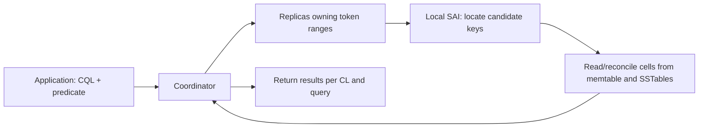
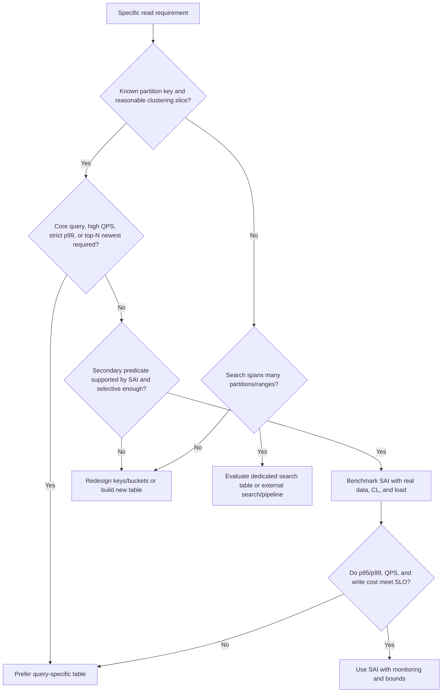

# Choosing a Query-Specific Table vs. SAI When Predicates Fit in Cassandra

## 1. Design Question: Which Read Path to Optimize and Where to Pay?

Apache Cassandra is a **distributed wide-column** database management system. Data is partitioned by **partition key**, rows within a partition are ordered by **clustering key**, and partitions are replicated across **replicas** according to the replication factor (RF). A CQL query runs fastest when Cassandra pinpoints the target partition and reads a small clustering slice, rather than scattering across nodes or reading huge amounts of data to filter.

Consider an e-commerce application requiring these APIs:

- `GET /tenants/{tenant}/orders?month=2026-11` — view the newest orders in a month.
- `GET /tenants/{tenant}/orders?month=2026-11&status=PAID` — view paid orders.
- `GET /tenants/{tenant}/orders?month=2026-11&status=REVIEW&minTotal=1000000` — find high-value orders needing review.

These three APIs read similar data yet have different **query shapes**. Two primary options emerge:

1. **Query-specific table (*table-per-query*):** intentionally duplicate a subset of data into a table whose partition/clustering keys match a critical read pattern.
2. **Storage-Attached Index (SAI):** create indexes on supported columns to enable extra filter predicates without maintaining a separate table for every combination.

**Neither option wins in every scenario.** A dedicated table delivers a predictable read path and intra-partition sort order at the cost of extra writes and data synchronization; SAI offers greater filter flexibility at the cost of index maintenance, potential fan-out, and does not replace sound partitioning.

This lesson teaches **when to choose each approach**, how to validate with CQL, and how to measure p95/p99 latency from a Java application. Never use `ALLOW FILTERING` as the default answer for an unmodeled query.

## 2. Start from the Query Contract, Not from the Schema

Before creating tables or indexes, specify each query using an explicit contract:

| Property | Question to answer |
| --- | --- |
| Tenant scope | Do all queries include `tenant_id`, or are there system-wide searches? |
| Time scope | One day, one month, or unbounded? |
| Predicates | Equality, numeric ranges, `AND` combinations, or free-text search? |
| Cardinality | How many distinct values does the column have? |
| Selectivity | Within the search scope, what percentage of rows match? |
| Ordering | Do you need the `20 newest orders`, or any `20 matching orders`? |
| Result size | A few rows, thousands, or full data exports? |
| Frequency | 1 request/day or thousands of requests/second? |
| Mutation rate | Does `status` change constantly or stay mostly immutable? |
| SLA | Target p95/p99, timeouts, peak QPS, and permitted consistency level? |

**Cardinality differs from selectivity.** Cardinality is the number of distinct values—for example, `status` has five states; selectivity is the fraction of records matching a predicate—for example, `status = 'REVIEW'` makes up only 0.4% of the search scope. A low-cardinality column can still have **one highly selective value**; conversely, a high-cardinality column does not guarantee every range query returns few rows.

Suppose a month has 5 million orders:

| Hypothetical predicate | Matching rows | Selectivity | What to watch? |
| --- | ---: | ---: | --- |
| `status = 'PAID'` | 3,750,000 | 75% | Very broad; an index still yields a huge candidate set |
| `status = 'REVIEW'` | 20,000 | 0.4% | More selective; may be worth testing SAI |
| `total_cents >= 1000000` | 250,000 | 5% | Range may help, but inspect row-retrieval cost |
| `status = 'REVIEW' AND total_cents >= 1000000` | 900 | 0.018% | Combined filter can be selective if supported by index/version |

These are **hypothetical numbers**, not Cassandra benchmarks. In practice, measure selectivity within the **query scope and per-tenant distribution**, since one tenant might have 90% `REVIEW` orders even when the global average is 0.4%.

## 3. Quick Comparison: Dedicated Table vs. SAI

| Criterion | Query-specific table | SAI on existing table |
| --- | --- | --- |
| Known upfront queries | Ideal, especially for core APIs | Suitable if predicates are supported |
| Many optional filter combinations | Can explode table count and write paths | Generally more flexible across indexed columns |
| Single-partition read | Uses partition/clustering key directly | Can assist filtering within that partition scope |
| Multi-partition read | Partition can be keyed to search criteria | May search across multiple replicas/token ranges |
| Ordering, top-N newest | Clustering order handles this natively in-partition | Indexes are not an arbitrary global sorting engine |
| Strict p99 at high QPS | Usually easier to bound with good partitioning | Must benchmark selectivity, fan-out, and resource cost |
| Write cost | Multi-table writes / denormalization | Index writes and maintenance on replicas |
| Data state | Application keeps tables synchronized | Index stays attached to base table data on replicas |
| Disk footprint | Stores duplicated view records | Consumes extra disk for index structures |
| Changing filter criteria | Needs a new table or backfill pipeline | Can add a supported index, but requires build & monitoring |
| Version dependency | Core Cassandra data modeling pattern | Requires Apache Cassandra 5.x / SAI-enabled distribution |

**Starting principle:** favor partition and clustering keys for critical, predictable queries. Consider SAI when you need **bounded auxiliary filtering**, where avoiding extra tables outweighs index overhead and measured performance meets SLOs.

## 4. Designing the Base Table to Bound Read Scope

Lab examples assume a DC named `dc1` with at least three available replicas. On a single-node cluster, adjust RF and consistency level to match your real infrastructure before running:

```sql
CREATE KEYSPACE IF NOT EXISTS sales_lab
WITH replication = {
    'class': 'NetworkTopologyStrategy',
    'dc1': 3
}
AND durable_writes = true;

CREATE TABLE IF NOT EXISTS sales_lab.orders_by_tenant_month (
    tenant_id text,
    month_bucket text,
    created_at timestamp,
    order_id uuid,
    customer_id text,
    status text,
    total_cents bigint,
    PRIMARY KEY ((tenant_id, month_bucket), created_at, order_id)
) WITH CLUSTERING ORDER BY (
    created_at DESC,
    order_id ASC
);
```

The partition key is `(tenant_id, month_bucket)`. Orders inside each partition are ordered by descending `created_at`, then ascending `order_id` for tie-breaking. Well-aligned query:

```sql
SELECT created_at, order_id, customer_id, status, total_cents
FROM sales_lab.orders_by_tenant_month
WHERE tenant_id = 'tenant-01'
  AND month_bucket = '2026-11'
LIMIT 20;
```

This read path has a clear partition boundary and clustering order within the partition. No SAI is needed here. Monthly bucketing works only when per-tenant/month partition sizes stay bounded; large tenants may need daily buckets or deliberate sharding, requiring the app to fan out across those buckets.

### Harder Query: Adding Status

The app wants the `20 PAID orders in the month`:

```sql
-- Illustrates business intent; without an index on status,
-- this is not an inherently valid or optimal CQL query.
SELECT created_at, order_id, total_cents
FROM sales_lab.orders_by_tenant_month
WHERE tenant_id = 'tenant-01'
  AND month_bucket = '2026-11'
  AND status = 'PAID'
LIMIT 20;
```

Because `status` is not part of the primary key, Cassandra cannot use clustering order alone to jump straight to matching rows. Either design a **new table** or evaluate **SAI**, provided predicates are supported and costs fit.

`ALLOW FILTERING` does not make filtering efficient; it merely permits queries Cassandra normally rejects for scanning too much data. Never add `ALLOW FILTERING` to dodge designing a proper read path.

## 5. Option A: Query-Specific Table

For a heavily used API returning "the 20 newest orders by status in a month," place `status` into the partition key:

```sql
CREATE TABLE IF NOT EXISTS sales_lab.orders_by_tenant_status_month (
    tenant_id text,
    status text,
    month_bucket text,
    created_at timestamp,
    order_id uuid,
    customer_id text,
    total_cents bigint,
    PRIMARY KEY (
        (tenant_id, status, month_bucket),
        created_at, order_id
    )
) WITH CLUSTERING ORDER BY (
    created_at DESC,
    order_id ASC
);
```

Query:

```sql
SELECT created_at, order_id, customer_id, total_cents
FROM sales_lab.orders_by_tenant_status_month
WHERE tenant_id = 'tenant-01'
  AND status = 'PAID'
  AND month_bucket = '2026-11'
LIMIT 20;
```

Here, the **status predicate narrows the partition**, while **clustering order** returns the newest rows without scanning `PENDING` or `CANCELLED` orders from the base partition. That is why query-specific tables shine for frequent endpoints with tight SLAs and strict ordering.

### Cost of Option A: Updating Two Data Representations

Cassandra **does not automatically keep two tables in sync** just because both store the same `order_id`. When an order transitions from `PENDING` to `PAID`:

1. Update `status` in the base table.
2. Delete the row from the projection partition `(tenant-01, PENDING, 2026-11)`.
3. Insert the row into the projection partition `(tenant-01, PAID, 2026-11)`.
4. Track each write outcome and reconcile on timeouts or failures.

Illustrative CQL operations:

```sql
UPDATE sales_lab.orders_by_tenant_month
SET status = 'PAID'
WHERE tenant_id = 'tenant-01'
  AND month_bucket = '2026-11'
  AND created_at = '2026-11-20 09:00:00+0000'
  AND order_id = 11111111-1111-4111-8111-111111111111;

DELETE FROM sales_lab.orders_by_tenant_status_month
WHERE tenant_id = 'tenant-01'
  AND status = 'PENDING'
  AND month_bucket = '2026-11'
  AND created_at = '2026-11-20 09:00:00+0000'
  AND order_id = 11111111-1111-4111-8111-111111111111;

INSERT INTO sales_lab.orders_by_tenant_status_month (
    tenant_id, status, month_bucket, created_at,
    order_id, customer_id, total_cents
) VALUES (
    'tenant-01', 'PAID', '2026-11',
    '2026-11-20 09:00:00+0000',
    11111111-1111-4111-8111-111111111111,
    'customer-42', 125000
);
```

This illustrates the **update sequence**, not an atomic cross-table transaction. A logged batch provides batchlog delivery under specific conditions, yet **does not grant arbitrary ACID isolation/transactions across tables and partitions**. Single-row LWT likewise does not make two tables atomic together. Production requires:

- Recording mutations with an **operation ID** and idempotent semantics.
- Synchronous or asynchronous orchestration (event/CDC/outbox) handling retries and duplicate delivery.
- Ordering updates and tracking prior state so the exact old projection row is deleted; concurrent transitions need explicit rules.
- Reconciliation/replay if one table updated while the other failed.
- Aligning TTLs, deletes/tombstones, and retention across representations.

A dedicated table speeds up reads yet can substantially increase **write amplification**, storage footprint, and operational complexity.

## 6. Option B: What Is Storage-Attached Index (SAI)?

**SAI** is a storage-attached indexing mechanism introduced in **Apache Cassandra 5.x** (and present in certain distributions on their own release schedules). Do not assume an Apache Cassandra 3.x/4.x cluster supports SAI just because it supports legacy *secondary indexes*.

Conceptually:

- Indexes are maintained **locally on each replica**, attached to table/SSTable storage rather than a single global index server.
- Cassandra tracks index data across memtables/SSTables per the version's implementation, updating index structures during flushes and compactions.
- Queries with SAI-supported predicates locate matching **candidates**, then read and reconcile actual rows via Cassandra's read path.
- Multiple indexed predicates can intersect to narrow candidates where supported by the version.
- Index structures cost **disk space, CPU, memory, I/O, and build time**—nothing is free.



This diagram is **conceptual**, not a fixed internal protocol spec. If a query omits the partition key, the coordinator may contact multiple replicas/token ranges. A local index **does not convert a cluster-wide search into a single-node lookup**.

SAI differs from:

- **Query-specific tables:** feature application-designed primary keys and clustering order.
- **Legacy secondary indexes (2i):** older mechanism with different on-disk structures and capabilities than SAI.
- **Materialized views:** a separate view-maintenance feature with its own trade-offs; not another name for SAI.
- **Search engines / full-text / ranked search:** SAI does not replace arbitrary joins, relevance scoring, natural-language search, or OLAP aggregations.

### Version-Specific Limits

`CREATE INDEX` syntax, indexable column types, `=`/range operators, predicate combinations, collections/text analyzers, maximum index counts, build processes, and observability tools **vary across versions and distributions**. Check your cluster's exact Cassandra version and test CQL statements in a **lab** before rollout.

## 7. CQL with SAI: Conditional Filtering Without Changing the Primary Key

In an **Apache Cassandra 5.x lab with SAI**, common illustrative syntax is:

```sql
CREATE INDEX IF NOT EXISTS idx_orders_status_sai
ON sales_lab.orders_by_tenant_month (status)
USING 'sai';

CREATE INDEX IF NOT EXISTS idx_orders_total_sai
ON sales_lab.orders_by_tenant_month (total_cents)
USING 'sai';
```

Some distributions or versions use `CREATE CUSTOM INDEX ... USING 'StorageAttachedIndex'`; **do not execute both forms on the same index**. Pick the syntax verified for your running Cassandra release rather than mixing snippets from different docs.

Once index building completes per your version's lifecycle, test:

```sql
-- With partition key: scoped to a specific tenant and month.
SELECT created_at, order_id, customer_id, status, total_cents
FROM sales_lab.orders_by_tenant_month
WHERE tenant_id = 'tenant-01'
  AND month_bucket = '2026-11'
  AND status = 'REVIEW'
LIMIT 20;

-- Two indexed predicates within a bounded partition scope.
SELECT created_at, order_id, customer_id, status, total_cents
FROM sales_lab.orders_by_tenant_month
WHERE tenant_id = 'tenant-01'
  AND month_bucket = '2026-11'
  AND status = 'REVIEW'
  AND total_cents >= 1000000
LIMIT 20;
```

SAI avoids creating a dedicated `orders_by_tenant_review_high_value_month` table for that combination alone. Still:

1. Every predicate, data type, and combination must fall within your **version's supported feature set**.
2. SAI identifies candidates; the query still pays row-retrieval and replica-reconciliation costs for those candidates.
3. `LIMIT 20` **does not guarantee the 20 newest rows across the system**; separate filtering predicates from ordering guarantees.
4. Unindexed or incompatible predicates can cause query rejection; `ALLOW FILTERING` is not a performance fix.
5. Evaluate indexes only after the **initial build over existing data** completes and nodes are healthy.

### Missing Partition Key: Fan-Out Risk

Consider searching for `REVIEW` orders across all tenants:

```sql
-- Illustrates a query with wide/fan-out risk.
SELECT tenant_id, month_bucket, order_id, total_cents
FROM sales_lab.orders_by_tenant_month
WHERE status = 'REVIEW'
LIMIT 20;
```

By intent this is a table-wide search; when SAI supports the predicate, Cassandra uses the index yet must still distribute work across many token ranges and replicas. If candidate sets are large or SLOs are tight, this can be far less predictable than a well-partitioned query table.

**Never rely on a table-wide index as a tenant access-control mechanism.** Multi-tenant applications must enforce `tenant_id` in the data model and authorization layer, never treating SAI as a security boundary.

## 8. Selectivity, Cardinality, and Result Retrieval Cost

To evaluate a predicate, estimate:

```text
N = rows within the actual search scope
M = rows matching the predicate
s = M / N  (selectivity as match fraction)

Example: N = 100,000, M = 250
s = 250 / 100,000 = 0.0025 = 0.25%
```

Note that many texts say "high selectivity" to mean a predicate **filters out most rows**, i.e., a low `s` in the notation above. Always clarify whether you mean **match rate** or **filtering power**.

Conceptual cost comparison:

| Read path | Main operations |
| --- | --- |
| Dedicated table with full partition key | Locate replicas/partition → read clustering slice → return page |
| SAI with partition key | Locate partition → find candidates via local index → fetch rows/cells → return page |
| SAI without partition key | Scatter search across token ranges → index lookups across replicas → merge results |
| Filtering without aligned model/index | May be rejected or scan/filter vast amounts of data |

This is not an execution-time formula: SSTable counts, row byte sizes, caches, token distribution, required replica responses, compaction, tombstones, and network conditions govern real cost.

### Three Different Workload Examples

**A — Fetching newest orders by status.** A tenant has 100,000 orders/month, 75,000 of them `PAID`. The API fetches the 20 newest `PAID` orders at 1,000 QPS. Test `orders_by_tenant_status_month` first because direct partitioning and clustering order avoid broad index work at high QPS.

**B — Rare admin screen filter.** `REVIEW` is 0.4%, and `total_cents >= 1000000` shrinks candidates further; the API runs a few times per minute scoped by tenant and month. SAI is worth testing here to avoid maintaining separate view tables per filter combination.

**C — Exporting 10 million orders across months.** Even with SAI, this is an **export/analytics** workload, not a 20-row lookup. Multi-range reads, heavy paging, and aggregation exceed interactive query SLAs; build a dedicated export/pipeline instead.

Base decisions on **p95/p99 latency and read/write throughput under realistic load**, not merely on `CREATE INDEX` succeeding.

## 9. Result Ordering: "Newest First" Changes the Choice

Cassandra orders rows **within each partition** by clustering order; it does not provide an arbitrary global `ORDER BY` like an RDBMS across distributed queries.

With a query-specific table:

```sql
SELECT created_at, order_id, total_cents
FROM sales_lab.orders_by_tenant_status_month
WHERE tenant_id = 'tenant-01'
  AND status = 'PAID'
  AND month_bucket = '2026-11'
LIMIT 20;
```

The partition matches `tenant+status+month`; the clustering key gives newest-first ordering by date. The read path takes a slice from the head of the partition.

With SAI, indexing `status` does not automatically create a **globally sorted `created_at` list**. Queries spanning multiple partitions, tenants, or months need explicit fan-out and client/service merging if business logic demands global chronological order.

Never claim `LIMIT 20` always reduces work to "reading exactly 20 cells." Depending on the query, the engine may still evaluate candidates, skip tombstones, reconcile replicas, or read extra rows before yielding 20 valid rows.

### When Spanning Multiple Months

Querying the past 3 months on a monthly-bucketed table touches **3 partitions**. A common approach issues bounded concurrent requests taking the top slice from each bucket and **merges by timestamp** in the service, handling global ordering, pagination, duplicates, consistency, and concurrency limits.

Never collapse **all months for a tenant** into one unbounded partition solely to avoid merging if partition growth becomes unbounded.

## 10. Decision Tree for Selecting an Approach



This decision tree is not a Cassandra internal algorithm. It reminds you that **an index is an execution capability**, whereas design quality is judged by business and operational outcomes.

## 11. Operational Cost: Faster Reads, but Who Pays?

### Query-Specific Table

- **Write fan-out:** one business event can emit multiple CQL mutations.
- **Larger storage footprint:** duplicates selected columns/rows across views and RF replicas.
- **Cross-table drift:** non-simultaneous updates can show new status in one API and old status in another.
- **TTLs and tombstones:** removing old statuses, switching partitions, and expirations must stay synchronized; excessive tombstones degrade read paths.
- **Repair/backup:** every table holds live data requiring replication, repair, and restore policies.
- **Application complexity:** needs event/CDC/reconciliation pipelines and projection liveness monitoring.

### SAI

- **Index footprint:** consumes disk and auxiliary resources on every replica.
- **Write/flush/compaction cost:** mutating data requires updating index structures per version mechanics.
- **Index build load:** adding an index to a large existing table processes existing SSTables, creating background load; monitor build completion and readiness.
- **Selectivity-sensitive latency:** broad predicates returning many candidates burn I/O, CPU, and merge time.
- **Fan-out:** local indexes do not eliminate multi-token-range searches when partition keys are omitted.
- **Schema/index limits:** not every data type, operator, or predicate combination is supported.

Never assume SAI has **zero write cost** simply because no extra table exists; likewise, never assume a dedicated table **always uses more disk** without factoring in duplicated columns, index size, update churn, and RF.

### Choose by Total Cost, Not One SELECT's Latency

A practical holistic cost view:

```text
Operational cost =
  read latency + read CPU/I/O
  + write amplification + index/projection maintenance
  + disk/network/repair/backup
  + complexity of preserving correctness and deploying changes
```

This is a **qualitative evaluation framework**, not a physical formula. Weight factors according to your organization's SLAs and resource budgets.

## 12. Fair Comparison Lab on Cassandra 5.x

### Step 1 — Verify Version and Topology

```bash
nodetool version
nodetool status
nodetool help tablestats
nodetool help tablehistograms
```

Confirm SAI availability before testing `CREATE INDEX ... USING 'sai'`, and keep CL consistent across measurements. On clusters without SAI, run only the dedicated-table portion—**never substitute legacy 2i and treat the results as equivalent to SAI**.

### Step 2 — Create Representative Sample Data

After creating the schemas from Sections 4, 5, and 7, insert test records:

```sql
INSERT INTO sales_lab.orders_by_tenant_month (
    tenant_id, month_bucket, created_at, order_id,
    customer_id, status, total_cents
) VALUES (
    'tenant-01', '2026-11',
    '2026-11-20 09:00:00+0000',
    11111111-1111-4111-8111-111111111111,
    'customer-42', 'PAID', 125000
);

INSERT INTO sales_lab.orders_by_tenant_status_month (
    tenant_id, status, month_bucket, created_at, order_id,
    customer_id, total_cents
) VALUES (
    'tenant-01', 'PAID', '2026-11',
    '2026-11-20 09:00:00+0000',
    11111111-1111-4111-8111-111111111111,
    'customer-42', 125000
);
```

Two rows are a **sanity check**, not a benchmark. In a lab cluster, generate data matching projected tenant skew, status ratios, partition sizes, TTL/delete rates, update frequency, and row counts. Use deterministic IDs so retries do not create unintended duplicate records.

### Step 3 — Measure Both Read and Write Paths

In `cqlsh`:

```text
CONSISTENCY LOCAL_QUORUM;
TRACING ON;
```

Run a query on the projection table and an equivalent SAI query against the same dataset, payload, and `LIMIT`; inspect traces, then disable:

```text
TRACING OFF;
```

Measure additionally:

```bash
nodetool tablestats sales_lab.orders_by_tenant_month
nodetool tablehistograms sales_lab orders_by_tenant_month
nodetool tablestats sales_lab.orders_by_tenant_status_month
nodetool tablehistograms sales_lab orders_by_tenant_status_month
nodetool tpstats
nodetool compactionstats
```

These commands reflect the **queried node**; gather stats across participating replicas alongside app/driver latencies. Tracing adds overhead, so enable it selectively. Metric names and outputs differ across versions; avoid blindly copying metric queries across releases.

### Step 4 — Minimum Experiment Matrix

| Experiment | Variable changed | Outputs to measure |
| --- | --- | --- |
| Q1: `status = PAID` (broad match) | Projection vs. SAI | p50/p95/p99, rows, disk/CPU, request fan-out |
| Q2: `status = REVIEW` (rare match) | Projection vs. SAI | Latency and candidates inspected |
| Q3: `status + total_cents` | Two indexed predicates | Filtering reduction and stability |
| Q4: Missing bucket/tenant query | Very broad scope | Nodes/ranges contacted, p99, load |
| Q5: Continuous `PENDING → PAID` updates | Write-heavy | Write throughput, compaction, index/projection cost |
| Q6: One slow replica | `LOCAL_QUORUM` CL | Latency, timeouts, replica divergence |

Perform fault injection only in an **isolated lab**—never intentionally degrade production nodes.

### Step 5 — Interpreting Results

Do not draw conclusions from a single `SELECT` on freshly inserted data. Measure across multiple windows—warm vs. cold cache, after index build completion, under concurrent requests, and alongside background writes. Hold hardware, RF, CL, page size, returned rows/columns, compaction state, and key distribution steady.

**Never average per-node p99 values to compute application p99.** Use client/API histograms for end-to-end latency and compare with replica metrics/traces to pinpoint where time is spent.

## 13. Java Driver 4.x: Two PreparedStatements, Same CL

The application selects the read path per API without letting callers pass arbitrary CQL. Here are two repository methods using `LOCAL_QUORUM` and bounded pagination:

```java
import java.util.ArrayList;
import java.util.List;
import java.util.UUID;

import com.datastax.oss.driver.api.core.CqlSession;
import com.datastax.oss.driver.api.core.DefaultConsistencyLevel;
import com.datastax.oss.driver.api.core.cql.BoundStatement;
import com.datastax.oss.driver.api.core.cql.PreparedStatement;
import com.datastax.oss.driver.api.core.cql.ResultSet;
import com.datastax.oss.driver.api.core.cql.Row;

public final class OrderQueryRepository {
    private final CqlSession session;
    private final PreparedStatement byStatusTable;
    private final PreparedStatement bySai;

    public OrderQueryRepository(CqlSession session) {
        this.session = session;
        this.byStatusTable = session.prepare(
            "SELECT order_id FROM sales_lab.orders_by_tenant_status_month " +
            "WHERE tenant_id = ? AND status = ? AND month_bucket = ? " +
            "LIMIT 20"
        );
        this.bySai = session.prepare(
            "SELECT order_id FROM sales_lab.orders_by_tenant_month " +
            "WHERE tenant_id = ? AND month_bucket = ? AND status = ? " +
            "LIMIT 20"
        );
    }

    // Read from projection table: results sit in one partition
    // ordered by the declared created_at clustering key.
    public List<UUID> newestByStatus(
            String tenantId, String month, String status) {
        BoundStatement statement = byStatusTable.bind(tenantId, status, month)
            .setConsistencyLevel(DefaultConsistencyLevel.LOCAL_QUORUM)
            .setPageSize(20)
            .setIdempotent(true);
        return collectIds(session.execute(statement));
    }

    // Read via SAI: useful when predicate/index is supported;
    // do not use this method to promise global newest-first ordering.
    public List<UUID> findBySai(
            String tenantId, String month, String status) {
        BoundStatement statement = bySai.bind(tenantId, month, status)
            .setConsistencyLevel(DefaultConsistencyLevel.LOCAL_QUORUM)
            .setPageSize(20)
            .setIdempotent(true);
        return collectIds(session.execute(statement));
    }

    private static List<UUID> collectIds(ResultSet result) {
        List<UUID> ids = new ArrayList<>();
        for (Row row : result) {
            ids.add(row.getUuid("order_id"));
        }
        return ids;
    }
}
```

This assumes schemas and indexes are properly deployed. `setIdempotent(true)` suits **side-effect-free `SELECT`s**, not automatically every write mutation. If pagination tokens are required, design a dedicated paging API rather than trying SQL-style `OFFSET`.

In production:

- Reuse `CqlSession` and `PreparedStatement`s; never open a new session per request.
- Measure p95/p99, timeouts, retries, speculative executions, rows per request, and pages.
- Tag metrics by **query template**, never exposing raw `tenant_id` in high-cardinality labels.
- Enforce deadlines, concurrency limits, and conditional retries; never weaken CL to mask a fan-out query.
- Never treat both methods returning `20` IDs as equivalent if one guarantees "newest" order while the other only filters.

## 14. Consistency, Replicas, and Index/Projection Freshness

### SAI Still Follows Cassandra Replication and Consistency Levels

Replica-local SAI **is not an independent search service holding one cluster-wide truth**. Mutations applied on a replica participate in that replica's index maintenance per version rules. If a replica misses a mutation, its data and local index lag behind.

When reading at `LOCAL_QUORUM`, the coordinator still applies standard CL/reconciliation semantics. **Having SAI does not synchronize replicas instantaneously**, nor does it replace anti-entropy repair, hinted handoff, or tombstone rules.

### Projection Tables Are Two Physical Data Sources to Manage

A query-specific table is an independent table. If a status-change event succeeds on one table while the projection lags, users may observe:

- `orders_by_tenant_month` already shows `PAID`.
- `orders_by_tenant_status_month` still lists the row under `PENDING`.
- Quorum reads on **each table independently** do not keep the two tables consistent with each other.

This is why you need **reconciliation jobs**, projection-lag monitoring, and update pipelines supporting replay and idempotency. If SLAs require immediate cross-representation consistency, revisit business design within Cassandra's transaction model.

### Status Transitions and Tombstones

When `status` is part of the projection's partition key, changing status means **deleting the old row and inserting the new row**, producing tombstones. With SAI on `status` in the base table, the app avoids manually moving rows across partitions, yet Cassandra still processes mutations, tombstones/TTLs, and index updates.

In both designs, **never slash `gc_grace_seconds` recklessly** just to "clean indexes faster"; delete and repair rules remain vital to prevent zombie data resurrection.

## 15. Rolling Out from Lab to Production

Never create a new index on a multi-TB table and flip 100% of traffic immediately. A safer rollout plan:

1. **Classify query shapes:** endpoint, predicates, ordering, tenant skew, QPS, and SLOs.
2. **Build a representative lab:** include hot tenants, broad and rare matches, TTLs, status updates, and paging.
3. **Measure both options:** p95/p99, read amplification, write latency/throughput, disk/CPU/network, and repair/compaction.
4. **Define success criteria:** e.g., API p99 stays under SLO at peak load and index/projection overhead keeps write p99 within bounds.
5. **Run controlled build/backfill:** monitor index build for SAI; for projections, backfill history while capturing in-flight mutations cleanly.
6. **Verify parity:** shadow-query a small sample, comparing row counts, ordering, paging, and update/delete reflection.
7. **Ramp traffic in stages:** use canaries, dashboards, abort thresholds, and a fallback path to the old query.
8. **Monitor long term:** compaction, data growth, node failures, or RF changes can shift p99 over time.

Note: **building an index over existing data** consumes time and resources. Schema metadata propagating does not guarantee index building or backfill is complete and ready for benchmarking; verify via logs, metrics, and version-specific tools.

### Changes Not to Bundle Together

Avoid combining in one change window: changing partition keys, changing RF, adding SAI, swapping compaction strategies, running heavy repairs, and upgrading Cassandra versions. If p99 regresses, isolating root cause and rolling back safely becomes nearly impossible.

## 16. Self-Assessment Scenarios

**A — "20 newest PAID orders" API at 2,000 QPS.** Within a tenant/month, 80% of orders are `PAID`. Which do you choose first?

**Guidance:** Test `orders_by_tenant_status_month` clustered by time; the predicate matches most rows and requires strict newest-first ordering, making SAI a poor first choice for tight low p99. Account for projection sync cost.

**B — Admin dashboard occasionally filters `REVIEW` and `total_cents >= ...`.** Both predicates return small sets and queries always include tenant/month. What do you pick?

**Guidance:** Benchmark SAI on the version-supported columns and operators. Avoid building a new table per combination if projection overhead outweighs gains, yet do not ship if p99 or write overhead breaches SLOs.

**C — Operator sees `CREATE INDEX` succeed.** The API immediately runs cluster-wide searches and times out. Can you conclude the index is broken?

**Guidance:** Not yet. Check index build status, missing partition keys, token ranges/replicas contacted, selectivity, candidate counts, CL, and disk/CPU load. The index may be working fine while the query itself is too broad.

**D — Two tables report conflicting statuses.** Base table says `PAID`; projection still says `PENDING`. Does raising CL to `ALL` fix this automatically?

**Guidance:** No. Two tables are written/synced separately; higher CL per table does not create a cross-table transaction. You need proper projection updates and reconciliation.

**E — SAI on a column with millions of distinct values.** Every query is a range matching 40% of the table. Does high cardinality guarantee index efficiency?

**Guidance:** No. A range matching 40% has low filtering selectivity. Bound partition/time buckets or revisit the query shape or pipeline.

**F — Projection table accumulates tombstones after frequent status changes.** Should you set `gc_grace_seconds = 0` to stop slow reads?

**Guidance:** No. Review update design, TTL/delete patterns, repair schedules, and compaction; never break the tombstone safety window just to beautify one metric.

## 17. Decision Checklist

- [ ] Document **which query**, QPS, p95/p99, and required business ordering.
- [ ] Know the partition key, clustering key, and expected partition sizes.
- [ ] Distinguish **cardinality** from **match rate (selectivity)**.
- [ ] If `N newest` is required on a very hot endpoint, evaluate a query-specific table first.
- [ ] If many rare secondary filter combinations exist, evaluate SAI where version and operators permit.
- [ ] Never treat `ALLOW FILTERING` or `LIMIT` as fixes for fan-out queries.
- [ ] Never assume SAI is a global index or delivers arbitrary `ORDER BY`.
- [ ] Verify exact version: Apache Cassandra 5.x and your distribution's SAI support.
- [ ] Measure index build, disk footprint, write amplification, and compaction alongside read p99.
- [ ] For projection tables, handle stale state cleanup, deletes, TTLs, replay, and idempotent writes.
- [ ] Use `LOCAL_QUORUM`/business-appropriate CL; never alter CL just for faster benchmarks.
- [ ] Use prepared statements, bound pages/rows, and monitor attempts and timeouts in Java.
- [ ] Compare approaches on **representative data and load**, never from one sample query.
- [ ] Deploy with canaries, rollback path, reconciliation, and ongoing monitoring as data grows.

**Takeaway:** **Query-specific tables** excel when a critical read path is known upfront, demands exact partition/clustering order, and needs predictable p99—at the price of data duplication and projection maintenance. **SAI** helps when you need flexible filtering on supported columns with a small candidate set, especially inside bounded partition/tenant/time scopes—at the price of index overhead and potential fan-out. Cassandra tuning must rest on **query shape, selectivity, RF/CL, read/write load, and end-to-end benchmarks**, not simply whether a `SELECT` executes without error.
