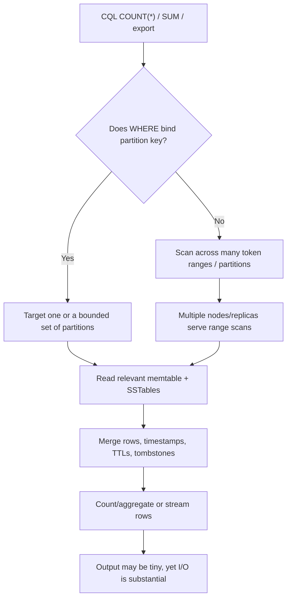
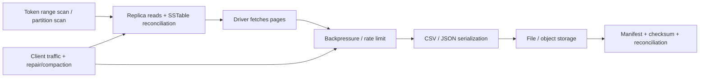
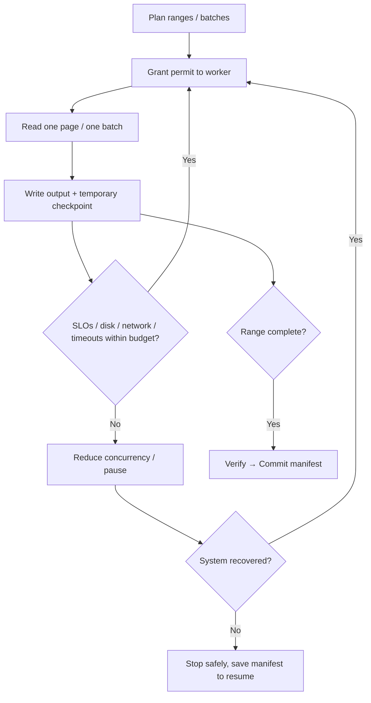

# Bounding the Load of COUNT, Aggregations, and Data Exports

> **Chapter:** Query Tuning  
> **Module:** `DATABASE_ENGINE_WIDE_COLUMN_CASSANDRA` — Apache Cassandra, a distributed wide-column database.  
> **Topic:** When `COUNT(*)`, `SUM`, `AVG`, `GROUP BY`, or full-table exports become heavy scans; setting resource budgets, designing query-specific tables, rate limiting, token-range splitting, and verifying results.

A CQL query returning **a single number** can still force Cassandra to read **millions of rows**. A classic example:

```sql
SELECT COUNT(*) FROM app.events;
```

The output is just one cell, yet Cassandra maintains no always-ready, zero-scan exact row counter for every table at every moment. On a large table, a full-table count triggers read work spanning multiple token ranges, nodes, and SSTables.

Likewise, `GROUP BY` or `SUM(amount)` does not turn Cassandra into an OLAP warehouse; the engine still processes **all rows covered by the query**. Paginated CSV/JSON export jobs can also exert sustained load for hours, competing for disk, CPU, network, and replicas against live transactional traffic.

**Core principle throughout this lesson:** Evaluate cost by **partitions touched, rows/bytes physically read, token span, participating replicas, duration, and concurrency**, never by final output size.

## 1. Learning Objectives

After this lesson, you will be able to:

1. Distinguish **single-partition `COUNT(*)`** from **full-table `COUNT(*)`** in terms of read path and performance risk.
2. Explain why CQL `GROUP BY` is bound by **primary key** constraints and does not replace arbitrary relational SQL analytics.
3. Build alternatives to repeated counts/aggregates: query-specific summary tables, event processing, counters with caveats, batch analytics, or approximate metrics.
4. Compute read/write, bandwidth, runtime, and concurrency budgets for exports from workload figures.
5. Understand pagination, token-range scans, retries/deduplication, checkpoints, TTLs, and consistency semantics during long scans.
6. Use `cqlsh COPY TO`, bulk export tools, and the Java Driver within strict bounds, and know when to offload to analytics infrastructure.
7. Set up metrics and alerts covering read latency, range scans, tombstones, SSTables, GC, disk I/O, network, and client SLOs.
8. Write a safe runbook: preflight → load test → throttling → reconciliation → safe job closure.

## 2. Why Doesn't Cassandra Offer "Free" Full-Table COUNT?

### 2.1. LSM-Tree Storage and Distributed Data

Cassandra appends to the commit log and memtable, then flushes to **immutable SSTables**. Subsequent updates and deletes land in newer SSTables carrying timestamps, TTLs, and tombstones; the read path must **reconcile versions** to determine live state.

In addition:

- Each **partition key** hashes to a token and distributes across the ring.
- With replication factor RF, each partition resides on multiple replicas.
- Each node owns assigned token ranges; a table can span the entire cluster.
- Live row counts fluctuate with writes, deletes, TTL expirations, and repairs; a raw file-size counter cannot accurately answer "how many live rows match this query right now?"

Therefore, obtaining an **exact point-in-time query count** requires determining which rows **actually satisfy the read**. When the scope is the entire table, total work can be massive even though the answer is one integer.



This diagram shows read-path tendencies; request coordination, CL behavior, and optimizations vary by Cassandra version, query, and data layout.

### 2.2. Output Size Differs from Data Processed

Two queries that both return **one row**:

```sql
-- Safe in lab: covers only rows within a single partition.
SELECT COUNT(*)
FROM lab_tuning.events_by_tenant_day
WHERE tenant_id = 11111111-1111-1111-1111-111111111111
  AND event_day = '2026-11-21';

-- DANGEROUS on large production tables: no partition key.
SELECT COUNT(*)
FROM lab_tuning.events_by_tenant_day;
```

| Characteristic | Single-partition COUNT | Full-table COUNT |
|---|---|---|
| Token scope | One token/partition | All token ranges of the table |
| Participating nodes | Replicas owning that partition per CL | Many nodes/ranges across the cluster |
| Rows examined | Rows inside the selected partition | All live rows across the scope |
| Latency | Scales with partition size, SSTables/tombstones | Can be huge; scales with entire table size |
| Production risk | Large/hot partitions remain costly | Fan-out, read I/O, timeouts, and p99 impact |
| Suitable for | Bounded counts in lab or sized small partitions | Rare offline jobs with explicit budgets/bounds |

**Even a single-partition `COUNT` is not O(1).** If a partition holds millions of clustering rows or heavy tombstones, counting it still consumes significant I/O.

### 2.3. "Partition Count" Is Not "Row Count"

Metrics such as `EstimatedPartitionCount` or estimates in `nodetool tablestats` track **partition counts**, not exact clustering row counts.

For example, if one partition holds 30,000 event rows:

\[
\text{partition count}=1,\qquad
\text{live row count}=30{,}000.
\]

Never use partition counts as "total events" on multi-row partitions. Similarly, dividing SSTable disk usage by average row size is only a **rough estimate**, skewed by compression, tombstones, metadata, data skew, and variable row sizes.

## 3. Query-Driven Sample Schema for Measurement

### 3.1. Tenant/Day-Bucketed Event Table

In a lab with datacenter `dc1` and at least three full replicas if using RF=3:

```sql
CREATE KEYSPACE IF NOT EXISTS lab_tuning
WITH replication = {
  'class': 'NetworkTopologyStrategy',
  'dc1': 3
};

CREATE TABLE IF NOT EXISTS lab_tuning.events_by_tenant_day (
    tenant_id uuid,
    event_day date,
    hour_bucket tinyint,
    event_time timestamp,
    event_id timeuuid,
    event_type text,
    amount_cents bigint,
    payload text,
    PRIMARY KEY (
        (tenant_id, event_day),
        hour_bucket, event_time, event_id
    )
) WITH CLUSTERING ORDER BY (
    hour_bucket ASC,
    event_time DESC,
    event_id DESC
);
```

Design details:

- `(tenant_id, event_day)` is the **partition key**. All events for a tenant on one day live in one partition.
- `hour_bucket` is the first clustering column, grouping events by hour within the day.
- `event_time, event_id` follow for chronological queries and uniqueness.
- `event_type, amount_cents, payload` are regular columns; running `GROUP BY event_type` directly is **not** an arbitrary grouping supported like a SQL warehouse.

A daily partition can still grow too large for hyper-active tenants. Consider smaller buckets such as tenant/hour or controlled sharding, trading off **app-side fan-out and merging** on multi-hour/day reads.

### 3.2. Loading a Small Dataset

```sql
CONSISTENCY LOCAL_QUORUM;

INSERT INTO lab_tuning.events_by_tenant_day (
    tenant_id, event_day, hour_bucket, event_time,
    event_id, event_type, amount_cents, payload
) VALUES (
    11111111-1111-1111-1111-111111111111,
    '2026-11-21', 8, '2026-11-21 08:00:00+0000',
    7c627d5a-a6b0-11ef-8ae8-0242ac120002,
    'checkout', 2500, 'demo-a'
);

INSERT INTO lab_tuning.events_by_tenant_day (
    tenant_id, event_day, hour_bucket, event_time,
    event_id, event_type, amount_cents, payload
) VALUES (
    11111111-1111-1111-1111-111111111111,
    '2026-11-21', 8, '2026-11-21 08:02:00+0000',
    8c627d5a-a6b0-11ef-8ae8-0242ac120002,
    'checkout', 3200, 'demo-b'
);

INSERT INTO lab_tuning.events_by_tenant_day (
    tenant_id, event_day, hour_bucket, event_time,
    event_id, event_type, amount_cents, payload
) VALUES (
    11111111-1111-1111-1111-111111111111,
    '2026-11-21', 9, '2026-11-21 09:10:00+0000',
    9c627d5a-a6b0-11ef-8ae8-0242ac120002,
    'browse', 0, 'demo-c'
);
```

These UUIDs and timestamps are strictly for lab testing. While `timeuuid` values normally encode creation time, this is synthetic test data—do not rely on embedded `timeuuid` bits to define business time windows. In production, derive `event_time` and buckets cleanly in a controlled pipeline.

### 3.3. From Narrow Queries to Expensive Ones

A query matching partition and clustering bounds:

```sql
SELECT hour_bucket, event_time, event_id, event_type, amount_cents
FROM lab_tuning.events_by_tenant_day
WHERE tenant_id = 11111111-1111-1111-1111-111111111111
  AND event_day = '2026-11-21'
  AND hour_bucket = 8
LIMIT 50;
```

Full key constraints keep scope tight. By contrast, a full-table `COUNT(*)` traverses many ranges. Putting `LIMIT 50` on a **row-fetching query** only caps rows returned per CQL semantics; it **neither creates a summary index** nor makes poorly filtered queries cheap on I/O.

## 4. Scoped COUNT: Estimating Load and Limits

### 4.1. Rough Read Cost Formula

For a scan processing:

- \(R\): number of **live rows examined**.
- \(b\): average bytes scanned/decoded per row, per your measurement definition.
- \(A\): adjustment factor for tombstones, SSTable overlap, index/metadata, and write versions (**not a fixed Cassandra constant**).
- \(B_{\mathrm{phys}}\): rough estimated bytes read/decoded.

\[
B_{\mathrm{phys}}\approx R\times b\times A.
\]

**This is a capacity-planning model, not an internal read-path formula.** Compression blocks, Bloom-filter skips, and stale versions alter physical disk reads. Validate against **disk read bytes, latency, and actual partitions/rows**.

Suppose a `COUNT` traverses 200 million rows at an effective \(b=300\) bytes/row and hypothetical \(A=1.5\):

\[
B_{\mathrm{phys}}\approx
200{,}000{,}000\times300\times1.5
=90\ \text{GB (decimal)}
\]

That is massive even though the query outputs only `200000000`. Without a partition key, work spreads across replicas and nodes, adding coordination CPU, connection pressure, and tombstone reconciliation.

### 4.2. Counting a Single Large Partition Can Still Take Minutes

Suppose one tenant stores 2 million event rows in a daily partition with frequent updates:

```sql
SELECT COUNT(*)
FROM lab_tuning.events_by_tenant_day
WHERE tenant_id = 11111111-1111-1111-1111-111111111111
  AND event_day = '2026-11-21';
```

The partition key **pinpoints the right partition**, yet does not reduce how many rows must be counted. For an oversized partition, inspect:

- Partition size and the actual clustering slice counted.
- SSTables-per-read and read amplification.
- Tombstones scanned, expired TTLs, and cell deletions.
- Client page size/timeouts, GC, and disk stats.
- Concurrent queries hitting the same hot partition.

If business logic only needs event counts for **one hour**, add the clustering restriction:

```sql
SELECT COUNT(*)
FROM lab_tuning.events_by_tenant_day
WHERE tenant_id = 11111111-1111-1111-1111-111111111111
  AND event_day = '2026-11-21'
  AND hour_bucket = 8;
```

Narrowing the range cuts work when hourly buckets distribute data evenly. It remains a scan of that hour's rows, not a materialized counter lookup.

### 4.3. Why Raising Timeouts Does Not Fix Expensive COUNTs

When requests routinely miss deadlines:

- **Raising timeouts** may let slow scans finish, while tying up cluster resources even longer.
- **Raising concurrency** makes multiple heavy scans contend for I/O, triggering worse cascading timeouts.
- **Changing CL** alters replica participation and read consistency guarantees, without making `COUNT` O(1).
- **Adding nodes** improves aggregate capacity over time, yet full-table jobs still process massive data and touch more ranges/peers.

Prioritize **changing the question or data model** before tuning cluster-wide timeouts.

### 4.4. Do Not Use LIMIT to Optimize Exact Counting

There is no `SELECT COUNT(*) ... LIMIT n` trick that simultaneously **reads very little** and returns the **exact total of a large dataset**. `LIMIT`, `PER PARTITION LIMIT`, and grouping follow specific CQL rules; restricting scanned rows means the output is no longer the full count.

Clarify the real requirement:

- **Exact full count:** pay the scan cost or maintain a dedicated rollup.
- **Count up to N / check "at least N rows":** rewrite the query/API to check only up to that bound.
- **Size estimation:** use metrics/sampling with stated error bounds.
- **Hourly reports:** pre-aggregate per hour instead of scanning raw history on every page load.

## 5. CQL GROUP BY Is Not Free-Form SQL GROUP BY

### 5.1. Key Rules

CQL supports `GROUP BY`, but only along **valid primary key column order**; primary-key columns fixed by equality restrictions need not be repeated in `GROUP BY`. `GROUP BY` cannot group arbitrarily by a regular column like `event_type` on an arbitrary table.

Since `hour_bucket` is the first clustering column:

```sql
SELECT hour_bucket, COUNT(*) AS events_count
FROM lab_tuning.events_by_tenant_day
WHERE tenant_id = 11111111-1111-1111-1111-111111111111
  AND event_day = '2026-11-21'
GROUP BY hour_bucket;
```

This groups by `hour_bucket` values inside the **selected partition**. It still inspects all rows in that range to compute each group; returning a few summary rows does not mean few input rows were read.

By contrast, this **is not supported arbitrary grouping** on the schema above:

```sql
-- Do not run: event_type is a regular column, not part of the primary key.
SELECT event_type, COUNT(*)
FROM lab_tuning.events_by_tenant_day
GROUP BY event_type;
```

The right solution is **designing a query-specific auxiliary table** or aggregating outside Cassandra—never adding `ALLOW FILTERING` to force `event_type` into an ad hoc grouping key.

### 5.2. Multi-Partition GROUP BY Still Risks Wide Scans

Even when syntactically valid, grouping across many partitions/ranges incurs heavy distributed reads. Checklist:

1. Bind the **partition key** in `WHERE`.
2. Estimate how many **partitions/rows** will be traversed.
3. Remember grouping shrinks **output rows**, not necessarily **input rows**.
4. When grouping by a business field outside the primary key, build a matching schema or external aggregation pipeline.

### 5.3. Aggregate Functions Still Scan Input Data

Cassandra includes native aggregates `COUNT`, `MIN`, `MAX`, `SUM`, and `AVG`, plus optional user-defined aggregates where permitted. Example:

```sql
SELECT
    COUNT(*) AS events_count,
    SUM(CAST(amount_cents AS VARINT)) AS amount_total
FROM lab_tuning.events_by_tenant_day
WHERE tenant_id = 11111111-1111-1111-1111-111111111111
  AND event_day = '2026-11-21';
```

`CAST(amount_cents AS VARINT)` avoids integer overflow that `SUM` can hit when returning the same `bigint` type as its input. Counting and summing still process every selected row.

A subtle detail: selecting **non-aggregated columns** alongside `GROUP BY` returns values from the first encountered row in the group per CQL semantics—**not a statistically meaningful or deterministic selection**. Never use that for reporting latest status, amounts, or categories without explicit design.

### 5.4. User-Defined Aggregates Are Not Free

Enabling UDFs/UDAs carries deployment, sandboxing/security, and node CPU risks; they are often disabled by default. A custom `median()` or `count_distinct()` does not eliminate scanning or turn an OLTP cluster into a data warehouse.

For large-scale analytics, extract data in a controlled manner and process it in an analytics system.

## 6. Choosing the Right Approach for Counts and Aggregations

| Requirement | Preferred approach | Trade-offs to accept |
|---|---|---|
| Check row count of a small partition | Scoped `COUNT(*)` on a sized partition | Still reads the rows counted |
| Minute-by-minute dashboard event counts | Summary table by tenant/time bucket | Sync/reconciliation, update lag |
| Deep historical analytics | Batch/Spark/warehouse/OLAP | Pipeline overhead, storage cost, freshness |
| Rough sizing / capacity | `EstimatedPartitionCount`, metrics, sampling | Approximate, differs from exact row count |
| Exact audit at a fixed cutoff | Snapshot/cutoff job + source of truth + reconciliation | Needs formal snapshot/cutoff protocol and proof |
| Rare one-off full-table COUNT | Budgeted scan job with cluster monitoring | Still expensive; must be scheduled and throttled |
| Totals by a non-PK category | Category-keyed table or projection | Write amplification, update consistency |
| Order counts requiring zero loss/duplication | Event log + idempotent aggregator + reconciliation | More complex than a single CQL `COUNT` |

**No option is "best" without context.** Decisions hinge on **query frequency, acceptable latency, accuracy, dataset size, and the serving cluster's SLOs**.

## 7. Pre-Aggregation: Trading Read Cost for Writes and Operations

### 7.1. Tenant/Day Summary Table

For a dashboard displaying only daily event counts and totals, create a summary table:

```sql
CREATE TABLE IF NOT EXISTS lab_tuning.daily_summary_by_tenant (
    tenant_id uuid,
    event_day date,
    event_count bigint,
    amount_total_cents varint,
    source_watermark timestamp,
    updated_at timestamp,
    PRIMARY KEY ((tenant_id, event_day))
);
```

An external job consumes uniquely identified events, aggregates them, and **writes computed snapshots**:

```sql
INSERT INTO lab_tuning.daily_summary_by_tenant (
    tenant_id, event_day, event_count, amount_total_cents,
    source_watermark, updated_at
) VALUES (
    11111111-1111-1111-1111-111111111111,
    '2026-11-21', 3, 5700,
    '2026-11-21 09:10:00+0000',
    '2026-11-21 09:11:00+0000'
);

SELECT event_count, amount_total_cents, source_watermark
FROM lab_tuning.daily_summary_by_tenant
WHERE tenant_id = 11111111-1111-1111-1111-111111111111
  AND event_day = '2026-11-21';
```

Reads now hit **one partition containing one row**, avoiding scanning three—or three million—events. However:

- **There are no automatic multi-table transactions** linking raw events and summaries.
- With multiple writers, stale snapshots can arrive out of order; enforce monotonic ordering via workflow or LWT where appropriate.
- Event replays, retries, or duplicate deliveries cause **double counting** unless the aggregator is idempotent.
- Deletes, TTL expirations, and event edits must be explicitly reflected by business logic—nothing updates summaries automatically.
- `source_watermark` records processed progress, not a guarantee that upstream sources are complete without an explicit protocol.

### 7.2. Should You Use CQL Counter Columns?

CQL supports `counter` columns, e.g.:

```sql
CREATE TABLE IF NOT EXISTS lab_tuning.daily_event_counter (
    tenant_id uuid,
    event_day date,
    event_count counter,
    PRIMARY KEY ((tenant_id, event_day))
);

UPDATE lab_tuning.daily_event_counter
SET event_count = event_count + 1
WHERE tenant_id = 11111111-1111-1111-1111-111111111111
  AND event_day = '2026-11-21';
```

Counters follow specialized semantics unlike regular columns: increments/decrements are not idempotent assignments, retrying after a timeout can over-count, and consistency/deletion/reset behavior requires great care. They are not an out-of-the-box "exactly-once counter."

**Use CQL counters only when their semantics are acceptable** alongside duplicate/drop handling and reconciliation. For financial totals, audits, or strict quotas, rely on an **authoritative event source**, idempotent processing, and independent verification.

### 7.3. Windowed Aggregations

Instead of one ever-growing tenant total, aggregate by:

- Tenant + day.
- Tenant + hour.
- Tenant + event type + day.
- Tenant + shard + time bucket.

Pick bounded buckets aligned with queries. Sharding relieves hot partitions at the cost of forcing dashboards to read and sum across multiple shards. Measure and fix shard counts rather than increasing them arbitrarily.

**LSM trade-off:** summary tables add write amplification, SSTables, repair, and backup footprint. Still, if they eliminate thousands of full-table scans per hour, net cluster load drops dramatically.

## 8. Data Exports: "Paginated" Does Not Mean "Lightweight"

### 8.1. End-to-End Cost of an Export

Exporting a large table involves:

1. Locating and reading partitions across selected token ranges.
2. Reconciling live data against SSTables/tombstones per CL.
3. Streaming pages/rows over the network to the exporter.
4. Serializing CSV/JSON, compressing, encrypting, and writing to disk/object storage.
5. Retrying failed pages/ranges, reconciling, and finalizing a manifest.



**Output size can be smaller or larger than SSTable disk usage:** CSV/JSON adds text formatting overhead and compresses differently than SSTables; row count alone cannot predict output bytes. For sensitive data, exports also require encryption, retention policies, access control, and auditing.

### 8.2. Paging Bounds Memory, Not Total Load

Suppose an export spans 50 million rows at `page size = 500`. Page count (assuming 500 rows/page for a rough estimate):

\[
N_{\mathrm{pages}}=50{,}000{,}000/500=100{,}000.
\]

The driver buffers only a small window of pages in RAM instead of all 50 million rows, **yet must still request and process ~100,000 pages** to finish. Page size neither caps **total rows** nor controls bandwidth on its own.

- Large pages: fewer per-request overheads, higher response size, memory spikes, and timeout risk.
- Small pages: smaller responses, more round-trips and state overhead.
- Optimal page size depends on row width, network RTT, token ranges, latency, GC, and driver version.
- To reduce **total load**, narrow exported data, rate-limit throughput, schedule off-peak windows, or move analytics to a separate system.

### 8.3. No Traditional SQL OFFSET Pagination

Cassandra CQL does not support `OFFSET 100000` to jump arbitrarily across a table. For queries with partition keys and clustering order, use **keyset pagination** on clustering bounds or driver paging state. For full-table exports, split by **token ranges** instead of repeatedly scanning from the start and skipping N rows.

**Note:** Paging state is tied to query/schema/protocol and live state; never treat a single token/offset as a universal checkpoint across failures. For resumable jobs, maintain range manifests with explicit retry and deduplication rules.

## 9. Exporting with `cqlsh COPY TO` in a Lab

`cqlsh` offers `COPY TO` to export CSV from a table. Official docs describe options including `PAGESIZE`, `MAXREQUESTS`, `BEGINTOKEN`, `ENDTOKEN`, and `MAXOUTPUTSIZE`.

**Lab-only** example:

```sql
COPY lab_tuning.events_by_tenant_day (
    tenant_id, event_day, hour_bucket, event_time, event_id,
    event_type, amount_cents
) TO '/tmp/lab-tuning-events.csv'
WITH HEADER = TRUE
AND PAGESIZE = 500
AND MAXREQUESTS = 2;
```

Notes:

- `PAGESIZE=500`: target rows per page; does **not** mean export only 500 rows.
- `MAXREQUESTS=2`: limits concurrent token-range fetch requests inside `COPY TO`, not 2 rows or 2 pages total.
- `HEADER=TRUE`: writes the CSV header line.
- Omitting explicit columns exports `payload` too, inflating file size and PII exposure.
- The file path resides on the **machine running `cqlsh`**, not automatically on Cassandra server nodes.

For large datasets or recurring jobs, `cqlsh COPY TO` is rarely the best orchestrator. Verify failure handling, range splits, output chunking, checkpointing, and throttling for your version.

### 9.1. Limits to Observe

During testing:

1. Start on a small table and **keep concurrency low**.
2. Record start/end times, file size, exported rows, QPS, and cluster read latency.
3. Watch network, CPU, and disk on both Cassandra nodes and the exporter host.
4. Project only needed columns to cut wire bytes.
5. Check for timeouts or malformed CSV; **never infer completion just because an output file exists**.
6. Write to storage with sufficient free space and proper permissions.

`cqlsh COPY TO` uses its own scanning mechanics; do not assume identical CL, retry behavior, or consistency as manual `SELECT` statements. Verify behavior on your exact tool version.

### 9.2. Mutating Data and Consistency

A single-pass full-table scan provides **no cluster-wide transactional snapshot** while applications continue writing and deleting. Rows read early vs. late can reflect **different points in time**.

If an audit requires a "strict snapshot as of 12:00 UTC":

- Use an event log, snapshot, or backup mechanism designed for point-in-time capture.
- Optionally **close time windows** and export immutable historical buckets.
- Or pair a full export with CDC/change logs and a reconcilable **cutoff watermark**.
- Document consistency semantics explicitly; `LOCAL_QUORUM` does not provide table-wide snapshot isolation.

## 10. DSBulk and Bulk Export Tools

For large exports, a dedicated tool like **DataStax Bulk Loader (DSBulk)**—where approved, version-compatible, and lab-tested—supports `unload`, token-range splitting, and concurrent query limits.

Baseline syntax illustration:

```bash
# Illustrative on a host with dsbulk; configure connection/auth per environment.
dsbulk unload \
  -k lab_tuning \
  -t events_by_tenant_day \
  -url /exports/lab-tuning \
  --engine.maxConcurrentQueries 4
```

Caveats:

- `-url` sets the output directory/destination; verify permissions and security.
- `--engine.maxConcurrentQueries` caps concurrent queries; `4` is **only a lab starting point**, not a universal default.
- `--schema.splits` controls token-range splitting; more splits must not mean blindly raising parallelism.
- Connectivity, TLS, authentication, and driver settings must match your cluster; the snippet above **will not run on secured clusters** as-is.
- Features like continuous paging depend on backend/protocol support; never assume every Apache Cassandra version supports them.
- DSBulk flags vary by version; verify exact parameters before production use.

### 10.1. Why Is Concurrency a "Risk Switch"?

If each page averages 512 KiB read and disk/network budgets **40 MiB/s** for exports:

\[
\text{page throughput budget}
\approx\frac{40\times1024\ \mathrm{KiB/s}}{512\ \mathrm{KiB/page}}
=80\ \mathrm{pages/s}.
\]

If each page averages 250 ms end-to-end (0.25 s), Little's Law in steady state gives in-flight queries/pages around:

\[
C\approx80\times0.25=20.
\]

This is a **budget estimate**, not a guarantee that 20 concurrent queries are safe for Cassandra. Disk reads may exceed **512 KiB** per page due to tombstones and SSTable overlap; tail latency, retries, and per-node bottlenecks can make concurrency 20 too aggressive.

Start small, measure empirically, ramp gradually, and watch **client SLOs**. Never size concurrency solely by exporter CPU cores.

### 10.2. When to Move to a Dedicated Analytics System?

If queries require:

- `GROUP BY` across multiple regular columns.
- Joins across multiple tables or data sources.
- `COUNT DISTINCT`, percentiles, top-K, or window functions over billions of events.
- Repeated daily full-history scans.
- Reproducible, snapshot-consistent aggregations for audits.

Evaluate the **Spark Cassandra Connector**, stream processing, a data lake/warehouse, or an OLAP engine. Cassandra can stay the high-speed operational serving store while analytics runs outside the serving cluster or over extracted, reconciled datasets.

**Offloading compute to Spark does not spare Cassandra** if Spark still hammers Cassandra directly at high concurrency. You still need partitioning, rate limits, off-peak scheduling, token-aware reads, and impact monitoring.

## 11. Token-Range Scans: Splitting Work to Manage Load

### 11.1. Why Use Token Ranges?

Instead of one uncheckpointed job scanning the entire ring, split the token space into **disjoint intervals covering the full ring**. Each worker processes one range with its own manifest and checkpoint.

Under `Murmur3Partitioner` (the common default), tokens are signed 64-bit integers. Conceptual query for a **non-wrapping** interval:

```sql
-- Use only inside batch jobs with a valid token-range planner.
-- ? binds two partitioner-appropriate token/bigint bounds.
SELECT tenant_id, event_day, hour_bucket, event_time,
       event_id, event_type, amount_cents
FROM lab_tuning.events_by_tenant_day
WHERE token(tenant_id, event_day) > ?
  AND token(tenant_id, event_day) <= ?;
```

Both bounds pass the **entire composite partition key** in exact order. Never pass only `tenant_id` when the partition key is `(tenant_id, event_day)`. Never mix token bounds generated for a different partitioner.

### 11.2. Covering Without Gaps or Overlaps

Splitting a span into:

\[
(a,b],\quad(b,c],\quad(c,d]
\]

places every token into exactly one interval when boundaries align. Still:

- The ring **wraps around**, requiring careful handling of min/max token boundaries.
- Distinct partition keys can **collide on the same token**; mid-range token checkpoints can skip rows.
- Topology, partitioner, or ring metadata changes mid-job can skew work splits.
- Ranges do not hold equal bytes or partitions; **8 arithmetic slices do not mean 8 equal workloads**.
- Retrying a range can emit **duplicate rows**; outputs must support idempotency/dedup by full primary key.

**Durability recommendation:** treat **one complete range** as the unit of work with manifest states `PENDING → RUNNING → VERIFIED`, marking `VERIFIED` only after output and checksum/reconciliation finish. On retry, write to a fresh temp file and atomically commit rather than appending blindly to partial files.

### 11.3. Token-Range Bounds Do Not Provide a Snapshot

If worker A reads range R1 at 10:00 and worker B reads R2 at 10:30, the two slices reflect different writes and TTL expirations. Range splitting manages **resources and retries**, not point-in-time isolation across rows.

For exact cutoff reporting, use **logical watermarks**, immutable buckets, or snapshot/CDC pipelines. Whenever data mutates during export, state semantics explicitly ("best-effort at read time," "closed-day snapshot," etc.).

## 12. Java Driver: Paginated Exports with Bounded Memory

This **Java Driver 4.x** snippet scans one lab token range and streams to CSV. It demonstrates:

- Valid token-range querying without `ALLOW FILTERING` on regular columns.
- Small `pageSize` to cap per-page payload.
- **Sequential** `ResultSet` iteration streaming each row immediately rather than buffering into a `List`.
- Explicit CL without pretending to deliver a global snapshot.
- Note that temp files, manifests, retries, and cancellation are omitted here for brevity and must be added for production.

```java
import com.datastax.oss.driver.api.core.CqlSession;
import com.datastax.oss.driver.api.core.DefaultConsistencyLevel;
import com.datastax.oss.driver.api.core.cql.BoundStatement;
import com.datastax.oss.driver.api.core.cql.PreparedStatement;
import com.datastax.oss.driver.api.core.cql.ResultSet;
import com.datastax.oss.driver.api.core.cql.Row;

import java.io.BufferedWriter;
import java.net.InetSocketAddress;
import java.nio.charset.StandardCharsets;
import java.nio.file.Files;
import java.nio.file.Path;
import java.time.LocalDate;
import java.util.UUID;

public final class TokenRangeCsvExport {
    private static String csv(String value) {
        if (value == null) return "";
        return "\"" + value.replace("\"", "\"\"") + "\"";
    }

    public static void main(String[] args) throws Exception {
        // Lab example only. Choose two bounds from a valid token-range plan.
        long startToken = -100000000000L;
        long endToken   =  100000000000L;
        Path output = Path.of("events-range-01.csv");

        try (CqlSession session = CqlSession.builder()
                .addContactPoint(new InetSocketAddress("127.0.0.1", 9042))
                .withLocalDatacenter("dc1")
                .build();
             BufferedWriter writer = Files.newBufferedWriter(
                output, StandardCharsets.UTF_8)) {

            PreparedStatement scan = session.prepare(
                "SELECT tenant_id, event_day, hour_bucket, event_time, " +
                "event_id, event_type, amount_cents " +
                "FROM lab_tuning.events_by_tenant_day " +
                "WHERE token(tenant_id, event_day) > ? " +
                "AND token(tenant_id, event_day) <= ?"
            );

            BoundStatement statement = scan.bind(startToken, endToken)
                .setConsistencyLevel(DefaultConsistencyLevel.LOCAL_QUORUM)
                .setPageSize(500);

            writer.write(
                "tenant_id,event_day,hour_bucket,event_time," +
                "event_id,event_type,amount_cents\n");

            ResultSet result = session.execute(statement);
            long exportedRows = 0;
            for (Row row : result) {
                UUID tenant = row.getUuid("tenant_id");
                LocalDate day = row.getLocalDate("event_day");
                String eventTime = String.valueOf(
                    row.getInstant("event_time"));

                String line =
                    csv(String.valueOf(tenant)) + "," +
                    csv(String.valueOf(day)) + "," +
                    row.getByte("hour_bucket") + "," +
                    csv(eventTime) + "," +
                    csv(String.valueOf(row.getUuid("event_id"))) + "," +
                    csv(row.getString("event_type")) + "," +
                    (row.isNull("amount_cents")
                        ? "" : row.getLong("amount_cents"));

                writer.write(line);
                writer.newLine();
                exportedRows++;
            }

            writer.flush();
            System.out.println("Exported " + exportedRows + " rows");
        }
    }
}
```

**Technical notes:** Java Driver 4.x maps `date` → `LocalDate`, `timestamp` → `Instant`, `timeuuid` → `UUID`, and `tinyint` → `byte`. Assumes a cluster in `dc1`, an initialized keyspace, and enough replicas for `LOCAL_QUORUM`. The two token bounds cover a **small lab slice**, not the full ring. Production code must add progress manifests, timeout retries, disk-full guards, atomic upload, CSV injection protection, PII controls, and cross-worker backpressure.

### 12.1. Even a Single Loop Can Overload the Cluster

The driver fetches pages incrementally, yet an unthrottled loop can still overwhelm nodes:

- Total pages can be huge.
- A worker can pull pages faster than the cluster's spare capacity allows.
- Slow disk writes or full disks on the exporter stall consumers.
- One scan request can incur heavy physical I/O from tombstones and SSTable overlap.

In production, add a **token-bucket / permit-based rate limiter**, concurrency caps, byte quotas, runtime windows, and range-level pause/resume. Setting `pageSize = 500` alone **is not enough** to protect the cluster.

### 12.2. Avoid `all()` or Buffering Everything in RAM

A common bug collects millions of rows from `ResultSet` into a `List` before writing CSV at the end. That explodes RAM, risks OOM, and defeats paging's memory benefit.

Instead:

- Stream rows into chunked buffers and file/object storage.
- Retain only a small active page/batch, never the entire dataset.
- With async paging, **call `fetchNextPage()` only after processing the current page**, and bound in-flight futures.
- Implement timeouts/backoff, checkpoints, retries + dedup, logging, and per-range metrics.
- On cancellation, record which files/ranges completed and which must be cleaned up or re-exported.

### 12.3. CSV Formatting and Data Correctness

CSV output must properly escape commas, quotes, and newlines. The example quotes every text field to avoid corruption; additionally ensure:

- Documented null vs. empty-string representation.
- Consistent UTF-8 encoding, timezone formatting, and decimal/locale rules.
- Column/record size bounds and newline handling.
- Protection against **CSV formula injection** if user-supplied text will be opened in spreadsheets.
- Row/primary-key validation and file checksums before committing output.
- Secure PII retention cleanup; avoid exporting `payload` if unnecessary.

## 13. Budgeting and Scheduling Exports

### 13.1. Simple Time Formula

Let:

- \(B_{\mathrm{out}}\): total output size in MiB.
- \(v_{\mathrm{effective}}\): sustainable effective output throughput in MiB/s.
- \(T\): minimum time spent transmitting/writing output.

\[
T\approx\frac{B_{\mathrm{out}}}{v_{\mathrm{effective}}}.
\]

For example, exporting 100 GiB capped at 80 MiB/s to protect live clients:

\[
T\approx\frac{100\times1024}{80}
=1{,}280\ \text{seconds}\approx21.3\text{ minutes}.
\]

This is an **idealized lower bound for one bottleneck**, before scan amplification, compaction, setup, retries, serialization, and verification. If peak traffic only leaves 30 MiB/s of headroom, the job runs much longer.

**Protecting SLOs matters more than an optimistic ETA.** Schedule off-peak and calibrate real throughput from small trials.

### 13.2. Budgeting by Page Count

Suppose:

- Average page holds 500 rows.
- Page response size averages 300 KiB.
- 8 million rows must be exported.

\[
N_{\mathrm{pages}}=8{,}000{,}000/500=16{,}000.
\]

With a 30 MiB/s output budget:

\[
\text{max page rate by output}
=\frac{30\times1024}{300}\approx102\ \text{pages/s}.
\]

This is **not** a physical disk-read budget, since read amplification, metadata, and page sizes vary. Protect the cluster by binding to the **tightest** constraint across disk reads, CPU, network, CL replicas, p99/timeouts, and output storage.

### 13.3. Keeping Pace with Growing Data

When new data arrives during an export, clarify:

- **Cutoff:** rows existing before which timestamp belong in the export?
- **Lag:** is omitting post-cutoff rows acceptable?
- **Catch-up:** will CDC/event logs append new rows and deletes after the full scan?
- **Retention:** could TTLs expire rows before the scan reaches them?
- **Topology changes:** if nodes move, do replica sources or scan plans shift?

If a strict snapshot is mandatory, never merely crank throughput hoping to "finish fast enough." Design a stateful protocol.

## 14. SLOs, Tracing, and Metrics to Measure Before Running

### 14.1. Cassandra-Side Metrics

Per Apache Cassandra documentation, especially useful metric groups include:

| Group | Example metrics / views | What to watch |
|---|---|---|
| **Read latency** | Table `ReadLatency`, coordinator latency | p95/p99, local vs. coordinator |
| **Range scans** | `RangeLatency`, `CoordinatorScanLatency` | Do token-range scans inflate tail latency? |
| **SSTable reads** | `SSTablesPerReadHistogram` | Partition read amplification |
| **Tombstones** | `TombstoneScannedHistogram`, `TombstoneWarnings`, `TombstoneFailures` | Scan hitting deleted/expired data |
| **Live cells** | `LiveScannedHistogram` | Cells examined/returned |
| **Disk** | OS disk read/write throughput, queue depth, await, free space | Contention with compaction/repair? |
| **Compaction** | `PendingCompactions`, bytes compacted, failures | Is compaction backlog climbing? |
| **Thread pools / GC** | `nodetool tpstats`, JVM GC stats | Saturation, dropped tasks/messages |
| **Client** | Driver timeouts/unavailables/retries, p99 | Are business SLOs impacted? |
| **Range requests** | ClientRequest `RangeSlice` metrics where available | Sudden scan-load spikes |
| **Network** | NIC bytes/packets, retransmits, cross-DC traffic | Export competing with replication/repair |

Metric names and types vary across Cassandra 4.x/5.x and exporters; note that metrics named "Count" may be cumulative counters requiring **rate calculation over an interval** while accounting for restarts. Never sum raw counters from nodes with different process uptimes.

### 14.2. Nodetool and Tracing

Relevant node observation commands:

```bash
nodetool status
nodetool tablestats lab_tuning.events_by_tenant_day
nodetool tablehistograms lab_tuning events_by_tenant_day
nodetool tpstats
nodetool compactionstats
nodetool netstats
```

Measure timing/latency in the app or `cqlsh`:

```sql
-- Enable tracing only for small, controlled lab/diagnostic queries.
TRACING ON;

SELECT event_time, event_type
FROM lab_tuning.events_by_tenant_day
WHERE tenant_id = 11111111-1111-1111-1111-111111111111
  AND event_day = '2026-11-21'
  AND hour_bucket = 8
LIMIT 20;

TRACING OFF;
```

**Never enable 100% tracing on an export reading millions of pages.** Tracing writes metadata and adds overhead; sample strictly per policy. `cqlsh TRACING` helps inspect individual queries, not long-running aggregate costs.

### 14.3. Establish a Production-Like Baseline

Compare across four phases:

1. **Baseline without export:** read/write QPS, p50/p95/p99, timeouts, disk I/O, compaction, GC, tombstones.
2. **Small trial export:** rows/bytes moved, throughput, page latency, token ranges, concurrency, SLO impact.
3. **Step-up export:** monitor as concurrency or page size increases, changing only one variable at a time.
4. **Post-export recovery:** verify compaction backlog, latency, and free disk recover; check read-repair/TTL side effects.

Track both **relative increases** and **absolute thresholds**. A 30% p99 jump is notable even if still below SLO; conversely, if baseline already breaches SLO, never run an export claiming "it barely made things worse."

## 15. Load Guardrails for Periodic Jobs

A well-behaved export/aggregation job implements a "throttling loop":



### 15.1. Limits to Enforce

| Limit | Purpose | How to monitor |
|---|---|---|
| **Concurrent ranges/workers** | Prevent firing too many simultaneous scans | Active jobs / in-flight page requests |
| **Rows/pages/s** | Prevent bursts | Measured rate, backpressure |
| **MiB/s read/output** | Preserve bandwidth for clients and replication | NIC/disk counters |
| **Page size / max row bytes** | Bound response memory | Driver heap, GC, timeouts |
| **Runtime window** | Stay clear of peak hours | Job scheduler and clean shutdown checkpoints |
| **Max retries/backoff** | Prevent retry storms | Attempts/range, timeout ratio |
| **Free disk / output quota** | Prevent filling exporter disk | Filesystem / object storage metrics |
| **Client SLO guard** | Halt before impacting live traffic | Driver p99 / timeouts |
| **Repair/topology guard** | Avoid colliding with ring changes or repairs | `nodetool status/netstats`, maintenance calendar |

### 15.2. Alert Thresholds Are Illustrative Only

Suppose an SLA sets read p99 ≤ 80 ms:

- If export pushes p99 from a 35 ms baseline to 65 ms: raise a warning and **do not raise concurrency**.
- If p99 exceeds 80 ms, timeouts rise, or disk queues saturate: **pause/throttle down per runbook**.
- If a node is down or running major bootstrap/repair: defer full-table scans unless explicitly authorized.
- If monitoring goes dark (scrape down): **fail safe** based on criticality—never assume "0 errors seen, keep going."

Replace all sample numbers with your cluster's real SLOs and capacity limits.

## 16. Preventing Data Loss and Duplication on Export Failure

### 16.1. Failure Mid-Token-Range

A worker exporting `R=(a,b]` writes 1 million rows and times out. Rerunning the range and **appending directly** to the same CSV creates duplicate rows. "Resuming from the last token" risks **skipping** other partitions sharing that token or unfinished rows within a partition.

Remediation by strictness required:

1. **Retry the entire range** into a fresh temp file and atomically swap/commit on completion—never append blindly.
2. If resuming mid-range is required, checkpoint the **full primary key, position, and protocol-verified page state**, still followed by deduplication/verification.
3. Maintain a manifest recording `range_id`, token bounds, checksum, row count, filename, attempt, and status.
4. Validate final output for duplicate **full primary keys** where pipeline formats permit.
5. Reconcile against an appropriate authoritative source; never treat a full-table `COUNT(*)` as a lightweight check.
6. After repairs or topology changes, recompute splits against the current token plan and version so stale checkpoints do not corrupt coverage.

### 16.2. Sample Manifest

```yaml
job_id: export-events-2026-11-21
source:
  keyspace: lab_tuning
  table: events_by_tenant_day
  cluster: lab
  consistency: LOCAL_QUORUM
scope:
  cutoff: "closed-day-2026-11-21"
  partitioner: Murmur3Partitioner
ranges:
  - id: r01
    start_exclusive: "-100000000000"
    end_inclusive: "100000000000"
    attempt: 2
    status: VERIFIED
    rows: 1200
    file: "r01.csv"
    checksum_sha256: "<computed-when-exported>"
  - id: r02
    status: PENDING
```

This is an **illustrative manifest format**, not a Cassandra-native file. `r02` lacks token bounds and the job does not yet cover the entire ring; never treat this example as a complete export. Production manifests must track every range, state, and real checksum atomically in durable storage.

### 16.3. Verification Does Not Require a Full-Table COUNT

Sound reconciliation methods include:

- Verifying manifest range coverage against the token ring plan: zero gaps, zero overlaps.
- Checking per-file row counts, checksums, and parse errors.
- Spot-checking sample partitions/primary keys in CSV against CQL over immutable windows.
- Comparing totals against an **authoritative event log or reliable summary** when exact parity is required.
- Checking counts per closed bucket rather than firing full-table `COUNT(*)` against the live OLTP cluster.
- For legal/audit exports, define "point-in-time snapshot" semantics explicitly instead of running best-effort counts while writes continue.

## 17. Common Traps

### 17.1. "COUNT Returns One Row, So It's Lightweight"

False: output size does not reflect rows or SSTables scanned. Measure query scope and read I/O.

### 17.2. "COUNT with a Partition Key Is Always Fast"

False if the partition holds millions of rows, heavy stale data/tombstones, or receives concurrent hits.

### 17.3. "GROUP BY event_type Works Just Like PostgreSQL"

Not when `event_type` is a regular column. CQL grouping follows primary key order; use a query-specific table or external processing.

### 17.4. "Add ALLOW FILTERING to Handle Any Analytics Query"

`ALLOW FILTERING` enables filter queries that may scan broadly; it **creates no index** and risks unpredictable latency.

### 17.5. "LIMIT 100 / Page Size 100 Caps Total Cost"

`LIMIT` caps output/selected rows per query semantics; paging sets per-page chunks. Neither guarantees an **exact full count** or low-I/O full-table export.

### 17.6. "Raise Timeouts and Run 100 Parallel COUNTs to Finish Faster"

That saturates disk, GC, and network, triggering timeouts on live reads and writes. Use budgets and incremental scaling.

### 17.7. "Treat EstimatedPartitionCount as Exact Row Count"

Partition count estimates are not row counts and are not exact snapshots.

### 17.8. "COPY TO Created a File, So Everything Exported"

The file may be partial or cover only some ranges; verify exit status, manifest, checksums, and reconciliation.

### 17.9. "Paging State or Token Alone Is a Complete Checkpoint"

Mid-partition/token failures or concurrent writes can cause lost or duplicate rows under naive checkpoints. Use range-level commits and idempotent output.

### 17.10. "Switch CL to ONE for an Exact Export"

CL sets replica read quorum, creates no global snapshot, and can return stale data; confirm consistency requirements first.

### 17.11. "Pre-Computed Summaries Are Always Exact"

Non-idempotent updates or unhandled deletes, TTLs, and late events cause drift; implement reconciliation and watermarks.

### 17.12. "Spark Handles Compute, So Cassandra Is Unaffected"

If Spark still scans Cassandra at high concurrency, replicas still pay the read cost. Enforce budgets or read from extracted storage.

## 18. Incident Scenarios

### Scenario A — Dashboard Runs Full-Table COUNT Every Minute, p99 Spikes

**Symptoms:** periodic `COUNT(*)` queries without `WHERE` appear; client read p99 and range-scan latency climb.

**Response:**

1. Identify the query source, schedule, and concurrency.
2. Temporarily throttle or pause the dashboard job per SLO.
3. Inspect range requests, disk reads, tombstones, compaction backlog, and driver timeouts.
4. Migrate to an event-pipeline summary table with watermarks and reconciliation.
5. Verify p99 returns to baseline before closing the incident.

### Scenario B — 500 GiB Nightly Export Still Running in the Morning

**Symptoms:** output files grow slowly, retries climb, disk or network saturates.

**Response:**

1. Measure effective MiB/s instead of assuming NIC line rate.
2. Check per-range progress, peer health, page latency, timeouts, and compaction.
3. Verify whether excessive concurrency is causing contention.
4. Throttle down, save manifest state, and pause cleanly before peak traffic arrives.
5. Never spike page size or timeouts to mask the bottleneck.

### Scenario C — Export Finishes, Yet CSV Row Count Differs from Cassandra COUNT

Possible causes:

- Concurrent writes, deletes, or TTL expirations during the scan.
- Duplicate appends on retries or skipped token ranges.
- CSV parsing/escaping bugs or mismatched filtering/column selection.
- Different CL, DC, or timestamps between `COUNT` and export.
- Partial query/copy failures marked as successful by the pipeline.

**Never** assume Cassandra lost data from two mismatched numbers alone. Verify point-in-time semantics, manifest coverage, primary-key deduplication, and row identities first.

### Scenario D — One Tenant Has an Oversized Partition

`COUNT` inside that partition causes severe tail latency while small tenants remain fast. Tenant+day bucketing may still be insufficient for hyper-active tenants; adopt hourly/sharded buckets, cap dashboard fan-out, and avoid scanning full history.

### Scenario E — Repair Is Running While Export Saturates Disk Reads

Pause or throttle the export per runbook and monitor repair progress, `gc_grace_seconds`, and node health. Lagging repairs endanger correctness (missed tombstones); never sacrifice essential repairs just to finish an export early.

## 19. Runbook for Authorizing a Large COUNT, Aggregation, or Export

**Preflight**

- [ ] Clarify goal: exact count, estimate, dashboard, snapshot, or data export.
- [ ] Document keyspace/table, partition key, token ranges, RF/CL, DC, and query shape.
- [ ] Estimate partitions, rows, bytes, and compaction/tombstone amplification.
- [ ] Define budgets for MiB/s, concurrent requests, disk, memory, output size, and runtime window.
- [ ] Confirm client SLOs, repair/topology calendar, node availability, and monitoring sources.
- [ ] For sensitive data, verify authorization, encryption, retention, and audit trails.
- [ ] Prepare range-level pause/resume and idempotent retries.

**Load Testing**

- [ ] Test on a small repeatable subset.
- [ ] Capture baseline metrics before and during job execution.
- [ ] Measure reads/s, bytes/s, p95/p99, timeouts, tombstones, GC, and compaction.
- [ ] Ramp concurrency gradually; halt if guardrails trip.
- [ ] Record page size, tool/version, output format, and retry settings.

**Execution**

- [ ] Monitor nodes/DCs/ranges, exported rows/bytes, output files, and checksums.
- [ ] Never let exports exceed budget as live client load rises.
- [ ] Avoid overlapping with heavy streaming or repair without capacity planning.
- [ ] Never retry infinitely or silently weaken CL on errors.
- [ ] On pause, preserve clear manifest state and never treat temp files as final deliverables.

**Wrap-Up**

- [ ] Confirm every range/task reached verified completion.
- [ ] Attach manifest/checksums, schema/cutoff/CL, and version metadata to output.
- [ ] Reconcile row identities or authoritative counts per accuracy requirements.
- [ ] Remove temporary files containing sensitive data per retention rules.
- [ ] Confirm Cassandra p99, compaction, disk/network, and error rates recovered.
- [ ] Archive post-run report: runtime, peak load, output size, retries, limits hit, and follow-ups.

## 20. Calculation and Design Exercises

### Exercise 1 — COUNT Scope

Table `events_by_tenant_day` holds 120 million rows across 10,000 partitions. Compare expected load of:

1. Full-table `COUNT(*)`.
2. `COUNT(*)` for a `(tenant_id, event_day)` partition with 500 rows.
3. `COUNT(*)` for a hot partition with 2 million rows.

Explain why two queries both supplying the full partition key can differ dramatically in performance.

### Exercise 2 — Tiny Output, Huge Load

A `COUNT` processes 200 million rows at an effective 300 bytes/row and hypothetical amplification factor 1.5. Estimate bytes read/decoded using Section 4's formula.

### Exercise 3 — Checking GROUP BY

Given PK `((tenant_id, event_day), hour_bucket, event_time, event_id)`, evaluate:

- `GROUP BY hour_bucket` with tenant/day fixed.
- `GROUP BY event_type` on the regular column.
- `GROUP BY hour_bucket` without constraining the partition key.

Which are valid in what scope, and where are the wide-scan risks?

### Exercise 4 — Choosing a Summary Table

A dashboard needs daily transaction counts and totals per tenant, refreshed every minute. Would you pick direct `COUNT` or `daily_summary_by_tenant`? What extra metadata helps detect summary lag or miscounts?

### Exercise 5 — Export Tool Settings

`COPY TO` uses `PAGESIZE=500` and `MAXREQUESTS=2`. Do these two options cap total exported rows at 1,000? If a full-table export reads 50 million rows, what risks remain?

### Exercise 6 — Export ETA

Expected output is 100 GiB; effective export rate is 80 MiB/s. Compute idealized transfer/write time. List at least four real-world reasons it can take longer.

### Exercise 7 — Concurrency Budget

Average page size is 512 KiB; output budget is 40 MiB/s; per-page latency is ~250 ms. Estimate pages/s and in-flight page requests. Why is that not yet the safe production concurrency setting?

### Exercise 8 — Token Ranges

A job splits `(a,d]` into `(a,b]`, `(b,c]`, `(c,d]`. Why do bracket types matter? When a timeout hits inside `(b,c]`, which retry approach minimizes loss and duplication?

### Exercise 9 — Counter Tables

A client increments `event_count = event_count + 1`, receives a timeout, and retries. Why can the counter drift? How should summaries protect financial figures?

### Exercise 10 — Tracing and Monitoring

An export pushes read p99 from 35 ms to 120 ms; `compactionstats` shows a backlog and `TombstoneWarnings` rise. What extra metrics do you check and what action comes first?

### Exercise 11 — Data Consistency

A full export runs from 10:00 to 12:00 while writers keep mutating rows and TTLs expire. Can you call it a 10:00 snapshot? If an exact 10:00 report is required, propose a protocol.

### Exercise 12 — Do Not Default to COUNT as Validator

After an export, an operator runs a full-table `COUNT` to verify row count, overloading the cluster again. Propose a scalable verification plan that avoids re-scanning live production.

### Answer Hints

1. Full-table spans many token ranges; a 500-row partition is small; a 2M-row partition still incurs heavy scanning/tombstones.
2. `200,000,000 × 300 × 1.5 = 90,000,000,000 bytes = 90 GB` decimal; model estimate only.
3. Grouping by `hour_bucket` inside a pinned partition works; regular column `event_type` cannot be grouped arbitrarily; unpartitioned grouping risks wide scans or requires schema/query changes per CQL rules.
4. Pick a summary table for recurring dashboards; add source watermarks, idempotency, delete/late-event handling, and reconciliation.
5. No; page size and max concurrent range requests control per-page size and parallelism, not total dataset size.
6. `100 × 1024 / 80 = 1,280 s ≈ 21.3 min`; real overhead adds scan amplification, network/disk contention, serialization, retries, verification, and storage latency.
7. `40 × 1024 / 512 = 80 pages/s`; \(80\times0.25=20\) in-flight. Ignores disk read amplification, p99 tail, node skew, and competing live traffic.
8. Prevents gaps or overlaps at token boundaries. Retry the entire range into a new temp file, verify, and atomically commit; deduplicate by primary key if needed.
9. A timeout can occur after the increment was applied; retrying risks double counting. Use event IDs, an authoritative source, idempotent aggregators, and reconciliation.
10. Inspect disk read IOPS/latency, range-scan/coordinator latency, SSTables-per-read, GC, timeouts, and per-node load; throttle down or pause the export per SLO—never raise concurrency.
11. No. Close time buckets, enforce logical cutoffs, or pair full scan + CDC/change replay with watermarks; define and verify accuracy explicitly.
12. Check manifest range coverage, checksums, primary-key identity/dedup, authoritative source counts, and spot sampling on closed buckets—avoid repeated full-table `COUNT`s.

## 21. Version-Specific References

Useful references to cross-check against your deployed Cassandra and tooling versions:

- [Apache Cassandra — CQL Data Manipulation (SELECT, WHERE, GROUP BY, LIMIT, ALLOW FILTERING)](https://cassandra.apache.org/doc/latest/cassandra/developing/cql/dml.html).
- [Apache Cassandra — CQL Functions (COUNT, MIN, MAX, SUM, AVG)](https://cassandra.apache.org/doc/latest/cassandra/developing/cql/functions.html).
- [Apache Cassandra — cqlsh (COPY TO and PAGESIZE, MAXREQUESTS options)](https://cassandra.apache.org/doc/latest/cassandra/managing/tools/cqlsh.html).
- [Apache Cassandra — Monitoring metrics (RangeLatency, CoordinatorScanLatency, Tombstone, and SSTable stats)](https://cassandra.apache.org/doc/latest/cassandra/managing/operating/metrics.html).
- [DataStax Bulk Loader — Unload data](https://docs.datastax.com/en/dsbulk/developing/simple-unload.html).
- [DataStax Bulk Loader — Engine options, maxConcurrentQueries](https://docs.datastax.com/en/dsbulk/reference/engine-options.html).
- [DataStax Bulk Loader — Schema options, token range splits](https://docs.datastax.com/en/dsbulk/reference/schema-options.html).

Public docs may reflect a different version than your running cluster. In production, confirm syntax with local tools (`cqlsh HELP`, `nodetool help`, `dsbulk --help`) and follow internal runbooks.

## 22. Key Takeaways

- **A single-cell `COUNT` result does not mean tiny work**; rows, partitions, and SSTables read determine actual load.
- **Counting a single partition is still a scan.** When partitions grow huge, narrow the clustering range or change storage/aggregation design.
- **CQL `GROUP BY` is bound by the primary key**, not a general SQL analytics engine over regular columns. `SUM`, `AVG`, and UDAs still process input rows.
- Use **summary tables, event aggregation, and watermarks** for recurring reports, while handling idempotency, deletes, TTLs, and eventual consistency.
- **Paging caps data per fetch, not total data scanned.** Full-table exports need token-range plans, concurrency/rate limits, backpressure, and safe checkpoints.
- **Exports are not global snapshots** while mutations continue; define cutoffs and reconciliation protocols when point-in-time accuracy matters.
- **Monitor client SLOs and Cassandra health:** read/range latency, tombstones, SSTables-per-read, disk I/O, GC, compaction, repair, and network.
- **Do not reflexively run full-table `COUNT` to validate every export**; verify manifests, checksums, primary keys, and authoritative event sources instead.
- **Favor query-driven schemas and dedicated analytics tools** over raising timeouts or parallelizing queries ill-suited for Cassandra.
