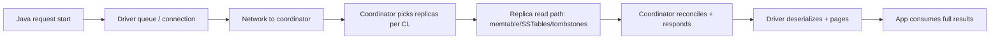
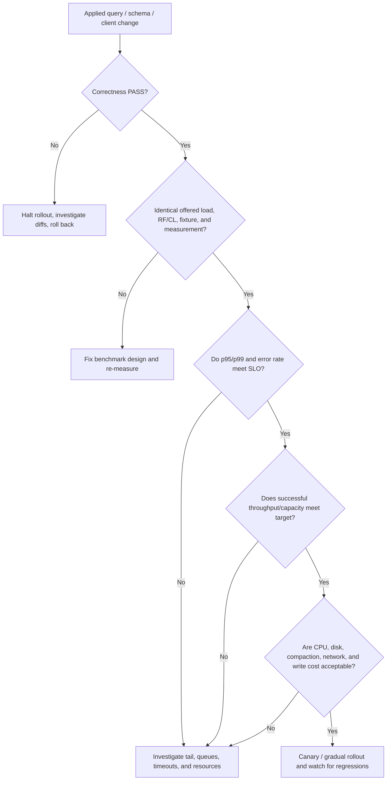

# Re-Measuring Correctness, Latency, and Throughput After Changes

## 1. Query Tuning Only Succeeds When Data Is Correct and Load Targets Are Met

In Apache Cassandra, a CQL query routes by **partition key** to natural replicas per the replication strategy, executed by a coordinator at the request's **consistency level (CL)**. Latency depends on partition size, SSTables read, tombstones, paging, network, CPU/disk load, compaction, repair, and Java Driver configuration. Therefore, after changing a CQL statement, schema, page size, or read path, **you cannot look at a single lower latency number** and declare victory.

A trustworthy re-measurement must prove **three independent properties**:

1. **Correctness:** the returned records, values, guaranteed ordering, filter scope, TTLs, and consistency match the business contract.
2. **Latency:** client-observed operation duration, p50/p95/p99 distributions, timeouts, retries, and the distinction between *first page* and *full page consumption*.
3. **Throughput:** **successful** operations per second under a defined load, resource cost, and the saturation knee.

This lesson belongs to the **Query Tuning** chapter in `DATABASE_ENGINE_WIDE_COLUMN_CASSANDRA`. Its scope ties directly to distributed wide-column architecture, query-driven table modeling, partition keys, replication/CL, CQL, compaction, repair, failure handling, and Java client integration.

**Required deliverable:** a before/after report containing the output contract, reproducible input fixtures, equivalent test load, latency histograms, achieved QPS, error rate, per-node resources, and a clear decision to **keep or roll back**.

## 2. Three Mandatory Questions After Every Change

| Question | Evidence to collect | Warning signs |
| --- | --- | --- |
| **Did it return the right data?** | Compare primary keys, required columns, values, counts, guaranteed ordering, and all pages; test edge cases | New query uses `LIMIT`/different filter and drops rows; page 1 matches while later pages miss rows; needed API column removed |
| **Where did it get faster?** | End-to-end client p50/p95/p99, first-page vs. full iteration, sample traces, coordinator/replica metrics | Comparing one `cqlsh` run, comparing mean without tail, tracing slowing down the workload |
| **How much load can it handle?** | Offered QPS, achieved successful QPS, concurrency, errors/timeouts, CPU, network, disk, and saturation point | Running lower load after the change, counting only sent requests, omitting timeouts from latency |

### Example of a "Fake Optimization"

Previously an application fetched the 500 latest events for a device. After editing, the query fetches 20 events with `LIMIT 20` and p99 drops 80%. If the business contract **still requires all 500 rows**, this is a **correctness regression**, not a successful optimization.

Similarly, lowering CL from `LOCAL_QUORUM` to `ONE` may cut wait time, yet alters the **consistency contract** and stale-read exposure. That must be approved explicitly as a semantics change, never slipped into a "result-preserving query tuning" benchmark.

## 3. Identifying Change Types and Invariants to Protect

| Planned change | Correctness invariants to verify | Expected performance effect |
| --- | --- | --- |
| Replace `SELECT *` with explicit columns | Omitted columns are **not in the API contract**; retained columns match identically | Shrinks payload bytes and deserialization; may not proportionally cut read I/O |
| Adjust `LIMIT` | Row-count/ordering contract unchanged, or change explicitly approved | Cuts returned rows; can silently truncate required data |
| Adjust driver `page size` | Iterating **all pages** yields the exact same row set on a stable fixture | Trades off round-trips, memory, first-page latency, and full-read latency |
| Add `event_ts` / time bucket filter | New time bounds match business rules; no late-arriving data dropped | Shrinks rows/partitions read |
| Migrate to new denormalized query table | Complete backfill; dual-write/CDC, TTL, tombstones, timestamps, and cutover aligned | Aligns query to partition key instead of broad scan/filtering |
| Change partition key / bucket | Same events remain uniquely accessible per contract; no gaps or duplicates across multi-bucket merges | Reduces hot/wide partitions and fan-out when well designed |
| Add index/SAI on supported version | Filter predicates and results match contract; results accurate while index builds | Can speed up certain selective reads, while adding write/disk overhead |
| Tune cache or compaction | Results must remain identical; zero semantic changes | May reduce latency while adding memory or background I/O |
| Change RF, CL, or DC routing | **This alters consistency/availability**, requiring separate risk sign-off | Latency shifts due to replica count, WAN, and sync state |

**Hold comparison assumptions constant** in performance tests unless an approved business change dictates otherwise: identical/equivalent keyspace and dataset, RF, CL, local DC routing, TTL timing, healthy node count, result sizes, workload, and Java Driver settings. If any baseline assumption must change, explicitly flag it as a **confounding variable**.

## 4. Preparing Reproducible CQL Fixtures

The lab example assumes a single-DC cluster named `dc1` with at least three nodes so RF = 3 applies. Adjust DC name and RF to match your test environment. Never create lab keyspaces or write lab fixtures in production.

```sql
CREATE KEYSPACE tuning_lab_ks
WITH replication = {'class': 'NetworkTopologyStrategy', 'dc1': 3}
AND durable_writes = true;

CREATE TABLE tuning_lab_ks.events_by_device (
    device_id text,
    bucket_day date,
    event_ts timestamp,
    event_id uuid,
    event_type text,
    payload text,
    PRIMARY KEY ((device_id, bucket_day), event_ts, event_id)
) WITH CLUSTERING ORDER BY (event_ts DESC, event_id DESC);

INSERT INTO tuning_lab_ks.events_by_device
    (device_id, bucket_day, event_ts, event_id, event_type, payload)
VALUES
    ('sensor-7', '2026-11-21', '2026-11-21T08:00:00+0000',
     11111111-2222-4333-8444-555555555555, 'HEARTBEAT', 'v1');

INSERT INTO tuning_lab_ks.events_by_device
    (device_id, bucket_day, event_ts, event_id, event_type, payload)
VALUES
    ('sensor-7', '2026-11-21', '2026-11-21T08:05:00+0000',
     22222222-3333-4444-8555-666666666666, 'ALERT', 'v2');

INSERT INTO tuning_lab_ks.events_by_device
    (device_id, bucket_day, event_ts, event_id, event_type, payload)
VALUES
    ('sensor-7', '2026-11-21', '2026-11-21T08:10:00+0000',
     33333333-4444-4555-8666-777777777777, 'HEARTBEAT', 'v3');
```

**Schema and intent:** `(device_id, bucket_day)` is the partition key; `(event_ts, event_id)` are clustering columns. Reading one bucket over a fixed window uses the partition key so Cassandra avoids scanning all devices or the whole table. Clustering order is declared descending on both timestamp and UUID for deterministic ordering checks in the lab.

### An Intentional Projection Change

Before the change, suppose API code runs:

```sql
SELECT event_ts, event_id, event_type, payload
FROM tuning_lab_ks.events_by_device
WHERE device_id = 'sensor-7'
  AND bucket_day = '2026-11-21'
  AND event_ts >= '2026-11-21T08:00:00+0000'
  AND event_ts < '2026-11-21T09:00:00+0000'
LIMIT 100;
```

After the change, when the endpoint **does not need `payload`**:

```sql
SELECT event_ts, event_id, event_type
FROM tuning_lab_ks.events_by_device
WHERE device_id = 'sensor-7'
  AND bucket_day = '2026-11-21'
  AND event_ts >= '2026-11-21T08:00:00+0000'
  AND event_ts < '2026-11-21T09:00:00+0000'
LIMIT 100;
```

**Do not expect identical raw result sets**, because the old query returned `payload` while the new one does not. Here the test contract verifies **identical row count, identical `(event_ts, event_id)` keys, identical `event_type`, and identical order**, paired with explicit **API sign-off to drop `payload`**. If any client still relies on `payload`, this optimization is a breaking change.

Never use a tiny three-row fixture to claim production p99 gains. Those rows are a **correctness fixture**; latency and throughput benchmarks need representative partition counts, row counts, values, TTLs, and tombstones compliant with data policies.

## 5. Correctness Matrix: Beyond Row Counts

| Test case | What to verify? | Why is it needed? |
| --- | --- | --- |
| Partitions with 1, many, or 0 rows | All expected rows returned; no leakage from other partitions | Catches wrong partition keys/buckets or key encoding bugs |
| Two rows sharing `event_ts` | Full key including `event_id`; stable clustering tie-breaking | Comparing timestamps alone can miss or double-count rows |
| Time interval [start, end) | Inclusive start, exclusive end; catches late-arriving events per contract | Wrong `>=` vs. `<` alters boundary results |
| More than one page | Iterate entire `ResultSet`, not just page 1 | Page size is not `LIMIT`; stopping early drops rows |
| Matches equal to or exceeding `LIMIT` | "Top N" contract and clustering order | Capping rows is only valid when business agrees on N |
| Rows with `null` / empty values | Distinguish null, unset/absent, and client defaults | Projection/deserialization can shift null semantics |
| Near-expiry TTL / newly expired rows | Consistent observation clock; TTL accounted for in contract | Data can vanish naturally without any query bug |
| Updates / deletes / tombstones | New versions win, deleted rows stay gone, accurate backfill | Denormalized tables/migrations commonly break on DELETE/TTL |
| Multiple partitions / buckets | Complete key set, no duplicates on client fan-out | Cassandra gives no global order when merging partitions client-side |
| Slow / down replica | CL, timeouts, retries, acceptable staleness per chosen CL | Correctness testing must cover degraded cluster states too |

### Mutating Data: What Does "Same Results" Mean?

Cassandra does not provide a **cross-request snapshot transaction** just because two CQL queries run seconds apart. If before/after queries run while writes, TTL expirations, or compaction/repair occur, outputs can differ **without any query bug**.

To verify cleanly:

1. Use an **immutable lab fixture** with no TTLs—or TTLs safely beyond the test window.
2. Query identical partition keys and time windows with a fixed cutoff timestamp.
3. Keep CL and local DC constant; never compare `ONE` against `LOCAL_QUORUM` and blame the new query.
4. Compare primary keys and retained business fields; within one partition, verify **clustering order** if promised by the API.
5. When comparing multi-partition reads, canonicalize rows **by primary key** on the client before hashing/comparing; never assume Cassandra sorts globally across partitions.
6. For migrations/dual writes, run dedicated tests for **backfill completeness, update sync, deletes, TTLs, and cutover**. One single-row query returning correctly never proves historical backfill succeeded.

### Why Checksums Are Necessary Yet Insufficient

A digest/hash of a **canonicalized** row set verifies large outputs without printing raw payloads, but only means something when:

- Both runs cover the **exact same scope and agreed projection**.
- Serialization formats (timestamps, decimals, nulls, text, UUIDs) and ordering are identical and deterministic.
- Every page was consumed completely rather than stopping after page 1.
- The fixture was not mutated mid-comparison.

Mismatched hashes definitely warrant investigating data, scope, or serialization; matching hashes build confidence yet **do not prove** performance, freshness, or replica parity. Never log raw payloads or PII into benchmark reports.

## 6. Measuring Latency: From Client to Coordinator and Replicas



At least **three clocks** matter:

| Measurement | Start → end | Blind spot |
| --- | --- | --- |
| **First-page latency** in Java Driver | Before `execute()` until `ResultSet` for page 1 arrives | Excludes subsequent page fetches and full row processing |
| **Full-consumption latency** | Before `execute()` until all pages and rows are iterated | Includes client deserialization/iteration; varies with app logic |
| **Server request latency / CQL tracing** | Coordinator/replica view of a single CQL request | Misses client connection queueing, app processing, and other page requests |

An operation returning 10,000 rows can show **great first-page p99** yet terrible total runtime across 100 round-trips. Conversely, huge page sizes can spike first-page latency, heap/GC, and network bursts. Know whether your endpoint SLO measures **first page**, **full result**, or **HTTP response completion**.

### Percentiles and Tail Latency

Let \(L_1, L_2, ..., L_n\) be durations of **identical-type** operations in a test window:

- **p50**: half of operations finish at or below this bound; tracks typical behavior.
- **p95/p99**: captures the tail users experience under load, sensitive to GC, compaction, disk awaits, and retries.
- **Timeout/error rate**: track separately. **Never compute percentiles over successful requests alone by dropping slow timeouts** to make p99 look better.

Percentiles **are not linearly additive**: HTTP p99 + Cassandra p99 does not equal end-to-end p99. Likewise, averaging per-node p99 values does not yield cluster-wide p99. Aggregate compatible histograms/samples properly, tagging node/DC and sample counts.

### Watch Out for Measurement Bias

- **Warm cache:** a second run runs faster due to OS/page/key caches even with zero code change. Alternate A/B order or warm up both evenly.
- **JIT, connection pools, prepared caches:** initial driver calls pay startup/prepare overhead; separate warmup from steady-state measurements.
- **Background compaction/repair:** SSTables per read, disk I/O, and GC shift independently of query rewrites.
- **Tracing overhead:** capture small trace samples for diagnosis, then run main throughput/latency benchmarks **with tracing off**.
- **Coordinated omission:** a load generator waiting for slow responses before scheduling the next request hides queueing delays real users suffer; report offered rate and latency against intended schedule using an open-loop/proper load generator.
- **Client bottleneck:** CPU/GC/network on the load-generator host itself may throttle throughput before Cassandra saturates.

## 7. Throughput: Distinguishing Offered, Achieved, and Successful

Throughput is not "how many requests did the client try to send?"

Over a window \(\Delta t\):

\[
\text{Offered QPS} = \frac{\text{scheduled/sent requests}}{\Delta t}
\]

\[
\text{Successful QPS} = \frac{\text{contract-compliant successful operations}}{\Delta t}
\]

\[
\text{Error rate} = \frac{\text{failed + timed-out operations}}{\text{total accounted operations}} \times 100\%
\]

Keep the **exact same operation definition** between before and after. Reading 1 page differs from "reading all 10 pages." Changing page size changes server-side CQL fetch count even when **business operations** stay constant; report **operations/s**, **pages/s**, and **bytes/s** clearly rather than mixing them.

**Offered load** is input pressure; **achieved/completed throughput** is actual work finished. Past saturation, achieved QPS plateaus or drops while latency, queues, and timeouts climb.

```text
Offered QPS --> [Driver / Coordinator / Replicas] --> Successful QPS
                         |
                         +--> Timeouts / failures / retries
                         |
                         +--> Growing queue depth, CPU, disk, network
```

Throughput tests should step through **multiple load levels**, not just one "max-out" blast. Each step needs warmup plus a steady measurement window; stop stepping up once agreed p99, error, disk, or CPU thresholds trip rather than driving into collapse.

### Concurrency and Little's Law

In a stable system, approximately:

\[
\text{Mean in-flight} \approx
\text{Completed throughput (ops/s)} \times
\text{Mean response time (s)}
\]

Use this as an **order-of-magnitude sanity check**, not a replacement for p99 histograms—and note it breaks down while backlogs are actively growing. Raising concurrency boosts throughput while headroom remains, yet past saturation mainly inflates queues, retries, and timeouts.

## 8. Designing Fair Before/After Benchmarks

### 8.1. Build a "What Must Stay Fixed" Table

| Category | Must hold constant / document |
| --- | --- |
| **Dataset** | Partition count, rows/partition, bucket spread, payload bytes, TTL/tombstones, hot-key ratio |
| **Query mix** | `SELECT`/`INSERT`/`UPDATE`/`DELETE` ratios, query shapes, limits/ranges, page counts, scan patterns |
| **Topology** | Cassandra version, node count, per-DC RF, racks, driver local DC, CL |
| **Client** | Java Driver version, prepared statements, page size, concurrency, pooling, retry/timeout policies |
| **Load** | Offered QPS, per-tenant/partition distribution, random seed, concurrency, and duration |
| **Load generator** | CPU, network, region placement, generator count; ensure generators never bottleneck |
| **Cluster state** | Free disk, compaction backlog, repair/streaming, GC, cache warmth, node health |
| **Accounting** | First-page vs. full-op boundaries, success/error inclusion, percentile method, units, sample counts |

When a schema change requires backfill, never benchmark while **only 40% of data is migrated** and draw final conclusions. Measure the **migration phase** and **post-cutover steady state** separately, since dual-writes and backfills alter cluster load.

### 8.2. Minimum Repeatable Procedure

1. **Baseline:** measure the current query on the fixed workload/fixture, recording correctness and metrics.
2. **Warmup:** prime connection pools, driver prepared cache, JIT, and table/OS caches consistently.
3. **Multiple runs:** execute several independent runs over long enough windows for reliable p99; alternate run order if feasible.
4. **Single change:** hold all other variables fixed; vary only the stated projection, page size, schema, or parameter.
5. **Correctness gate first:** if data is wrong or rows are missing, **stop**—never cite latency as proof of success.
6. **Latency/throughput:** compare at matching offered QPS and up to saturation against SLOs and error budgets.
7. **Resource cost:** compare read/write CPU, disk, bytes sent/received, pending tasks, and tombstones/SSTables per read.
8. **Rollback decision:** accept, tune, or roll back against pre-agreed thresholds.

**Never hide errors behind prettier dashboards.** Lower p99 paired with timeouts climbing from 0.1% to 2% or missing rows is a clear regression.

### 8.3. Avoid Invalid Comparisons Across Unequal Loads

If baseline ran at 700 ops/s while after ran at 200 ops/s, lower latency **proves nothing**. Compare at **identical offered rates**, key distributions, and operation mixes. If the new version handles higher load, find the **maximum SLO-compliant throughput** instead of directly comparing p99s measured at different load levels.

## 9. Example Before/After Results Table and How to Read It

**Completely synthetic numbers for reading practice, not actual Cassandra benchmark outputs.** Assume identical RF3, `LOCAL_QUORUM`, read-only workload, and 60-second steady-state windows per step:

| Run | Offered ops/s | Success ops/s | p50 (ms) | p95 (ms) | p99 (ms) | Error/timeout |
| --- | ---: | ---: | ---: | ---: | ---: | ---: |
| Before — 400 | 400 | 399 | 21 | 64 | 130 | 0.25% |
| After — 400 | 400 | 400 | 18 | 48 | 86 | 0% |
| Before — 800 | 800 | 680 | 87 | 360 | 620 | 15% |
| After — 800 | 800 | 794 | 31 | 116 | 198 | 0.75% |

**Conditional** conclusions:

- At 400 offered ops/s, "After" cuts p99 from 130 to 86 ms while serving full throughput—a clear improvement **provided correctness passed**.
- At 800 offered ops/s, "After" achieves higher successful ops/s and far fewer errors; however, **0.75% error rate** may still breach SLOs. Never declare "production ready" without checking the error budget.
- Never use this table alone to claim lower disk I/O: verify disk, CPU, SSTables, and configs separately.
- If "Before" returned `payload` while "After" dropped it, compare only after API approval of the **new projection**; shrinking payloads **never automatically implies identical correctness**.

### Set Acceptance Thresholds Upfront

For example, an experiment contract might require **full-operation p99 ≤ 200 ms, error rate ≤ 0.1%, and successful throughput ≥ 600 ops/s at matching offered load**, with zero data discrepancy. These are **illustrative thresholds**, not universal defaults.

Under those rules, "After — 800" **fails** because 0.75% exceeds the 0.1% error cap—even though p99 = 198 ms passes. You must reject rolling out at that load until timeouts are fixed or targets are formally revised.

## 10. Measuring in Cassandra: CQL, Tracing, and Node Metrics

### 10.1. Verifying Data with cqlsh

```sql
CONSISTENCY LOCAL_QUORUM
PAGING 2
ELAPSED ON

SELECT event_ts, event_id, event_type
FROM tuning_lab_ks.events_by_device
WHERE device_id = 'sensor-7'
  AND bucket_day = '2026-11-21'
LIMIT 100;
```

`PAGING 2` intentionally triggers multi-page output on the three-row fixture to demonstrate that **page 1 is not the entire result**. In `cqlsh`, advance through remaining pages at the prompt before comparing outputs. `CONSISTENCY`, `PAGING`, and `ELAPSED` are **cqlsh** directives and need no trailing semicolons.

For a few slow requests needing deeper clues, enable tracing **selectively**:

```sql
TRACING ON

SELECT event_ts, event_id, event_type
FROM tuning_lab_ks.events_by_device
WHERE device_id = 'sensor-7'
  AND bucket_day = '2026-11-21'
LIMIT 100;

TRACING OFF
```

Traces reveal the coordinator, replicas, and read-path events, yet **tracing itself adds overhead**. Never treat traced runs as representative p99 for normal traffic, never enable tracing across full benchmarks, and never copy raw traces containing sensitive partition keys into unapproved locations.

### 10.2. Node/Table Metrics

```bash
nodetool status
nodetool tablestats tuning_lab_ks.events_by_device
nodetool tablehistograms tuning_lab_ks events_by_device
nodetool proxyhistograms
nodetool tpstats
nodetool compactionstats
```

Interpret scopes carefully:

- `tablestats` reports SSTable count, disk usage, tombstones/cells, and read estimates **for that table on the queried node**.
- `tablehistograms` reports read/write/table distributions per version support; check syntax with `nodetool help tablehistograms`.
- `proxyhistograms` tracks latency from the **coordinator/node** viewpoint, not Java HTTP latency.
- `tpstats` and `compactionstats` surface queues, thread pools, and compaction/validation interference.

Monitor version-appropriate **JMX/Prometheus** metrics for `ClientRequest.Read/Write.Latency`, `Table.CoordinatorReadLatency/ReadLatency`, `SSTablesPerReadHistogram`, `TombstoneScannedHistogram`, key/row caches, dropped messages, GC, disk await, and network throughput.

Never compare a cumulative counter from a freshly restarted node against a long-uptime node; compute **deltas/rates**, use matching histogram windows, and state units. Since RF and CL govern which replicas answer, metrics from **a single node** do not represent the entire cluster.

## 11. Java Driver 4.x: Timing First Page, Full Consumption, and Result Fingerprinting

This snippet uses **Java Driver 4.x** and the fixture data, assuming an initialized `session` and standard imports (`java.time.*`, `java.util.*`, `java.nio.charset.StandardCharsets`, `java.security.MessageDigest`, and Driver APIs). Run it repeatedly in a lab to **practice the measurement pattern**—never treat a single run as p99.

```java
PreparedStatement ps = session.prepare(
    "SELECT event_ts, event_id, event_type " +
    "FROM tuning_lab_ks.events_by_device " +
    "WHERE device_id = ? AND bucket_day = ? " +
    "AND event_ts >= ? AND event_ts < ? LIMIT 100"
);

BoundStatement query = ps.bind(
    "sensor-7",
    LocalDate.of(2026, 11, 21),
    Instant.parse("2026-11-21T08:00:00Z"),
    Instant.parse("2026-11-21T09:00:00Z")
).setConsistencyLevel(DefaultConsistencyLevel.LOCAL_QUORUM)
 .setPageSize(2); // Lab: intentionally forces paging; not a production page size.

long startNs = System.nanoTime();
ResultSet rs = session.execute(query); // First page received.
long firstPageNs = System.nanoTime();

MessageDigest digest = MessageDigest.getInstance("SHA-256");
int rows = 0;
for (Row row : rs) { // Driver fetches subsequent pages during iteration.
    Instant timestamp = row.getInstant("event_ts");
    UUID id = row.getUuid("event_id");
    String type = row.getString("event_type");

    // Canonicalization for non-null single-partition fixture.
    String canonical = timestamp + "|" + id + "|" + type + "\n";
    digest.update(canonical.getBytes(StandardCharsets.UTF_8));
    rows++;
}
long finishedNs = System.nanoTime();

System.out.printf(
    "rows=%d firstPageMs=%.2f fullResultMs=%.2f digest=%s%n",
    rows,
    (firstPageNs - startNs) / 1_000_000.0,
    (finishedNs - startNs) / 1_000_000.0,
    HexFormat.of().formatHex(digest.digest())
);
```

**Java compatibility note:** `HexFormat` requires **Java 17**; on Java 11, format digest bytes with a compatible hex helper or another encoding. Driver versions may differ in configuration; verify your exact APIs.

Interpreting the measurements:

1. `firstPageMs` covers `session.execute()` returning page 1; it does **not** isolate raw network RTT or server execution.
2. `fullResultMs` includes **all pages plus client iteration and hashing**. On large datasets, hashing adds client CPU—keep processing identical across before and after.
3. `digest` over the **three retained columns** compares before/after under identical canonicalization, without verifying `payload` once dropped from the contract.
4. `rows` checks total rows iterated, not just page 1.
5. With nullable fields, decimals, timezones, or binary data, use a canonical serializer with explicit **null markers and deterministic encoding** instead of naive string concatenation.
6. For multi-partition fan-out queries, **sort all records by primary key before hashing** rather than relying on cross-node execution arrival order.

**Pitfall to avoid:** Taking p99 from one `System.nanoTime()` call. Meaningful p99 requires many representative operations under load, proper histograms/metrics, and tracking successes, failures, and timed-out durations together. Never hash full payloads inside production HTTP handlers just for telemetry.

### When Page Size Is the Primary Change

Suppose before `pageSize = 500` and after `pageSize = 100`, holding CQL, CL, dataset, and **full iteration** constant. Compare:

- Total rows and digest **must match** on an immutable fixture.
- First-page latency may drop with smaller pages, while **full-result latency can rise** due to extra round-trips.
- Server request counts, bytes/page, client CPU, and GC may shift; report **business-operation throughput** clearly.
- If an app reads only page 1 and drops the rest, behavior changed—never equate "reading 100 instead of 500" as functionally equivalent.

## 12. When Query Tuning Involves Schema, Compaction, or Replication

Not every change stays inside one `SELECT`. In Cassandra, a **query-aligned schema** governs read volume; tuning around a flawed model often only masks symptoms.

### 12.1. Changing Tables or Adding Time Buckets

Suppose a device's partition grows too wide, forcing migration from `events_by_device` (keyed by `device_id`) to `events_by_device_day` (keyed by `(device_id, bucket_day)`). Post-migration checks:

1. Verify **historical completeness**, including midnight boundary timestamps, timezones, and late-arriving events.
2. Compare by **logical primary key and `event_id`**, deduplicating multi-bucket fan-out reads.
3. Verify post-cutover writes, updates, deletes, and TTLs route cleanly to the new table.
4. Only after correctness passes, benchmark read latency and throughput.
5. Account for **total write and storage cost** of denormalized tables; faster reads are not free if writes amplify across multiple tables.

### 12.2. SSTables, Compaction, and Tombstones

After changing compaction strategies, cleanups, or repairs, SSTable and tombstone counts across replicas evolve gradually. Therefore:

- Collect **baseline metrics under identical workload conditions**.
- Avoid drawing conclusions one minute after major compaction: caches and schedulers behave atypically right afterward.
- Monitor `SSTablesPerReadHistogram`, `TombstoneScannedHistogram`, disk usage, compaction backlog, and `ReadLatency` per node.
- Never lower `gc_grace_seconds` solely to make metrics prettier; delete correctness and repair safety come first.

### 12.3. RF/CL and Multiple DCs

Switching from `LOCAL_QUORUM` in `dc1` to `ONE`/`dc2` may cut latency, yet that is a **consistency/routing change**, not semantics-preserving query tuning. During a DC loss or slow replica, errors and timeouts behave very differently. Run a separate availability matrix and measure data freshness rather than mixing it into an equal-variable A/B performance table.

## 13. Post-Measurement Decision Tree



### When to Keep vs. Roll Back?

| Outcome | Action |
| --- | --- |
| Missing/duplicated rows, wrong values, wrong scope, or unapproved contract break | **Roll back / block rollout immediately**; fix correctness first |
| Correctness passes, p99 improves, errors and successful QPS do not regress | Proceed to monitored canary/rollout without skipping resource checks |
| p50 drops yet p99 and timeouts climb | Investigate tail latency, retries, GC, network, or hot partitions; never report p50 alone |
| Successful QPS drops despite higher offered load | Inspect saturation, queues, and failures; adjust or roll back |
| Reads improve yet write amplification/disk/repair spikes excessively | Evaluate **full lifecycle cost**; may need schema/strategy revision |
| Results differ due to mismatched writes/TTLs/CL | Fix measurement methodology before judging the query rewrite |

**Final requirement:** prepare your rollback plan upfront. If you changed schemas and began writing to a new table, rolling back **is not just reverting one `SELECT` string**: keep synchronized dual-writes, backfill data, TTLs/deletes, checkpoints, and a consistent recovery plan.

## 14. Reusable Query Tuning Report Template

```text
Change ID:
Owner / UTC timestamp:
Keyspace / table / query shape:
Cassandra version / node count / DC / rack / RF / CL:
Java Driver version / local DC / pageSize / timeout / retry policy:

Hypothesis:
Main change:
Correctness contract: projection, key set, order, time window, LIMIT, TTL:
Fixture / seed / partition count / rows per partition / tombstone ratio:
Same dataset and query mix for Before / After?:
Correctness check: PASS/FAIL + keys/rows/digest/edge cases:

Load: warmup, duration, repetitions, offered ops/s, concurrency:
Latency: p50/p95/p99, first-page, full-operation, error/timeout rate:
Throughput: achieved successful ops/s, pages/s, bytes/s:
Resources: CPU/GC, disk free/IOPS/await, network, compaction/repair:
SLO / error budget / capacity target:

Decision: ACCEPT / CANARY / REWORK / ROLLBACK
Confounding variables and unresolved risks:
Rollback path / data to retain / sign-off owner:
```

Include **units** on every metric alongside sample counts and observation windows. Never leak raw partition keys, customer IDs, event payloads, or sensitive trace sessions into reports.

## 15. Discussion Scenarios and Exercises

**Scenario A — `LIMIT` drops data:** An endpoint requires the 500 latest events; an engineer changes `LIMIT 500` to `LIMIT 50` and p99 drops to one-third. Why can't this be declared an improvement? Redesign the query/bucketing/paging while protecting the contract.

**Scenario B — Page size:** Reading 12,000 rows. `pageSize 100` has faster first-page latency than `pageSize 1000`, yet slower full-read latency due to more round-trips. The endpoint streams rows page-by-page to clients; which SLOs and metrics must be measured before choosing?

**Scenario C — Offered ≠ achieved:** Baseline hits 500 successful ops/s at 550 offered; post-tuning the load generator pushes 1,000 ops/s yet achieves only 450 successes with heavy timeouts. Why can't you claim double throughput? How do you inspect resources and queues?

**Scenario D — Compaction interference:** Before was measured during heavy repair/compaction; after was measured on an idle cluster. p99 dropped 40%. Redesign the A/B test to isolate actual query gains.

**Scenario E — Data mutates mid-test:** Two logically identical `SELECT`s differ by one row whose TTL just expired. How do you distinguish a query regression from valid data expiration, and how do you build a stable fixture?

**Short Questions:**

1. Why don't server trace p99 and end-to-end Java p99 necessarily match?
2. Why do `LIMIT 100` and `pageSize 100` differ in meaning?
3. Why must **successful throughput** and errors/timeouts be reported alongside offered load?
4. Is a matching digest on page 1 sufficient proof that the entire result set matches?
5. Same CQL, yet CL changes from `LOCAL_QUORUM` to `ONE`: how must the correctness contract be updated?
6. Why must tombstone scans or SSTables/read be measured across multiple replicas and time windows?
7. When is changing `SELECT *` to three columns valid, and when is it a breaking change?
8. Why change only one variable at a time while keeping Driver and cluster configs constant?
9. How do you detect coordinated omission in a synchronous client benchmark?
10. Write a canary checklist with rollback thresholds for correctness, p99, errors, successful QPS, and disk/CPU.

**Completion criteria:** learners can build correctness tests covering edge cases, measure both first-page and full-result latency, report p50/p95/p99 and successful throughput under identical offered load, correlate Java Driver stats with coordinator/replica/host metrics, spot benchmark biases, and make evidence-backed rollout/rollback decisions.

## 16. References

- [Apache Cassandra Documentation](https://cassandra.apache.org/doc/stable/): CQL, partition/replication architecture, and version-specific query performance.
- [Apache Cassandra — Data Modeling](https://cassandra.apache.org/doc/stable/cassandra/data_modeling/): partition keys, clustering order, and query-driven tables.
- [Apache Cassandra — CQL SELECT](https://cassandra.apache.org/doc/stable/cassandra/developing/cql/dml.html): `WHERE` scope, `LIMIT`, `ORDER BY`, and result semantics.
- [Apache Cassandra — Monitoring metrics](https://cassandra.apache.org/doc/stable/cassandra/managing/operating/metrics.html): `ClientRequest`/`Table`/`Cache` scopes and latency histograms.
- [Apache Cassandra — nodetool](https://cassandra.apache.org/doc/stable/cassandra/managing/tools/nodetool/): `tablestats`, `tablehistograms`, `proxyhistograms`, `tpstats`, and `compactionstats`.
- [Apache Cassandra Java Driver 4.x — Paging](https://apache.github.io/cassandra-java-driver/4.18.0/core/paging/): page size, multi-page queries, and client impact.
- [Apache Cassandra Java Driver 4.x — Metrics](https://apache.github.io/cassandra-java-driver/4.18.0/core/metrics/): request, pool, and driver observability metrics.

**Conclusion:** A Cassandra query change counts as a **successful optimization** only when it **preserves the data contract**, cuts or holds latency within SLO at identical load, raises or holds successful throughput within the error budget, and avoids excessive CPU/disk/network cost. Always verify every page, partition key, and CL; measure p95/p99 rather than single runs; control workload/caches/compaction; and prepare rollback before canarying to production.
