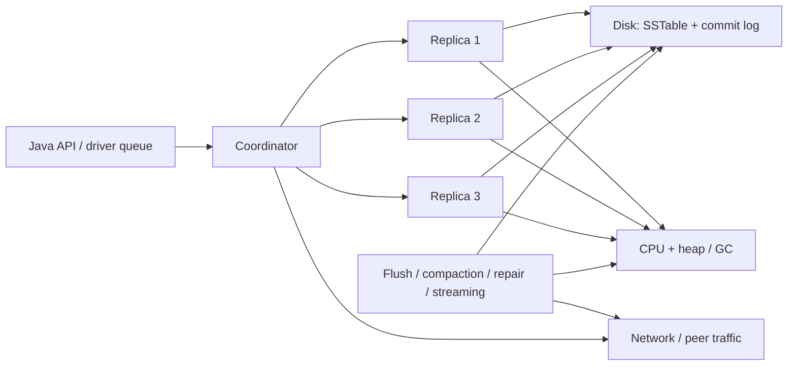
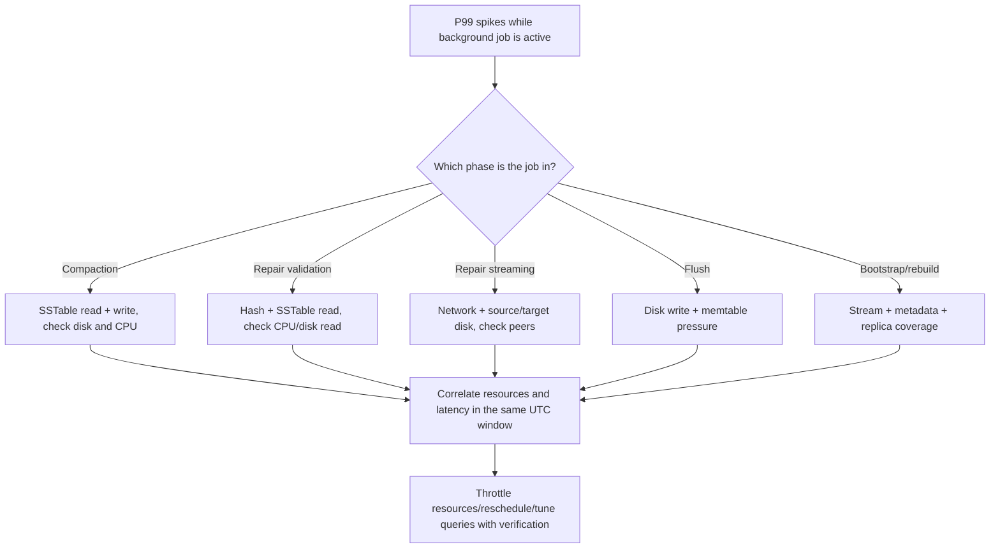
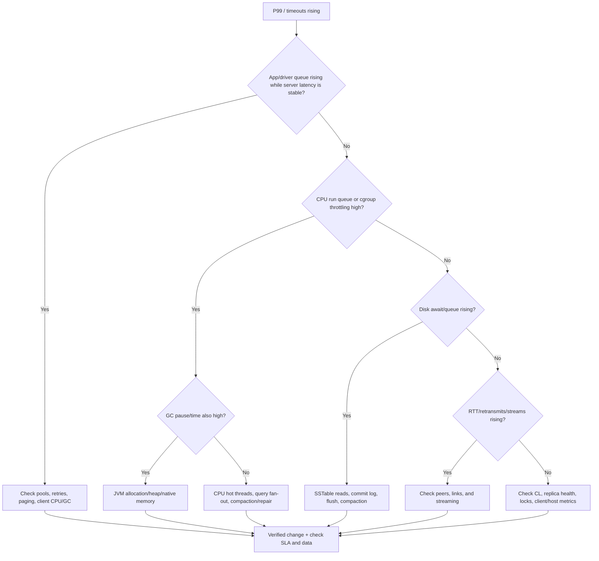

# Distinguishing CPU, GC, Disk, Network, and Background Resource Contention

When an Apache Cassandra cluster slows down, seeing **90% CPU**, **continuous GC**, **high disk `%util`**, or **increased network throughput** is not enough to conclude what the root cause is. A query may be slow because a replica is reading SSTables from disk, the coordinator is waiting for enough replicas for `LOCAL_QUORUM`, the JVM is paused by GC, the Java Driver is out of available connections, or because **compaction/repair/streaming** is competing for CPU, memory, disk, and network with application queries. These signals often appear simultaneously and have complex causal relationships.

This lesson belongs to the **Resource Tuning** chapter of the **DATABASE_ENGINE_WIDE_COLUMN_CASSANDRA** module. The focus is on **evidence-based diagnosis** across CPU, JVM/GC, storage, network, and background tasks. The content connects to distributed architecture, partition keys, wide-column data, read/write consistency, CQL, SSTables/compaction, repair, topology changes, and the Java Driver. The goal is not to memorize a "magic parameter", but to know **what to measure → distinguish hypotheses → change one variable under control → verify the improvement**.

## 1. Learning Objectives

After this lesson, you can:

1. Distinguish a **bottleneck** (a resource/queue limiting throughput) from **symptoms** (latency, timeouts, GC, `iowait`, or growing queues).
2. Correlate application, Java Driver, coordinator, replica, and host p95/p99 over the **same time window**.
3. Recognize the characteristic signal patterns of CPU saturation, GC pauses/heap pressure, disk I/O saturation, and network congestion.
4. Describe how memtable flushes, SSTable compaction, repair validation/streaming, bootstrap/rebuild, and snapshots compete for resources with the read/write path.
5. Use CQL, `nodetool`, JVM/OS metrics, and Java Driver telemetry to build diagnostic evidence, knowing the limitations of each tool.
6. Build a runbook to classify root causes, choose safe changes, and validate acceptance against SLA, throughput, errors, and data correctness.
7. Avoid dangerous symptom-treating shortcuts: lowering consistency, recklessly reducing `gc_grace_seconds`, disabling repair, forcing major compaction, setting unbounded timeouts/retries, or increasing heap without measurement.

## 2. Why Must Cassandra Diagnosis Span Multiple Layers?

A request from a Java application does not simply "enter one Cassandra machine and come back out". The driver selects a **coordinator**, the coordinator determines the set of **replicas** from the partition key/token/replication strategy, sends requests, and waits for enough responses according to the **consistency level (CL)**. At the replica, reads may touch memtables, SSTables, Bloom filters, indexes, caches, and tombstones; writes involve the commit log, memtable, and subsequent flush/compaction paths.



If RF = 3 in a DC, `LOCAL_QUORUM` typically requires **two replicas** in that DC to respond. Therefore:

- **One slow replica** can increase tail latency, especially when the coordinator must wait for its response to satisfy the required quorum or when another replica is already down.
- **A slow coordinator** can cause the application to observe high latency even when replica disks are normal.
- **Java Driver connection pool/request throttling bottlenecks** can increase client-side time while Cassandra spends very little time processing on the server.
- **Another DC** may experience its own network/streaming issues without increasing all local-read latencies uniformly.
- **Replication factor** increases the number of data copies, but it does not mean every SELECT runs on all replicas; the actual replicas contacted depend on the CL and cluster state.

### Distinguishing Five Operational Concepts

| Concept | Meaning | Example |
| --- | --- | --- |
| **Latency** | Time from one measurement boundary to the end boundary. | App calls `session.execute()` and takes 800 ms. |
| **Throughput** | Number of operations/bytes processed per unit of time. | 5,000 SELECTs/sec or 150 MiB/s disk writes. |
| **Utilization** | Proportion of time a resource is busy according to the measurement tool. | CPU 90% busy; disk `%util` near 100%. |
| **Saturation/queue** | Work waiting because serving capacity is insufficient. | Pending tasks, run queue, disk request queue, or driver in-flight increasing. |
| **Error** | Work rejected/failed, or the client did not receive a result in time. | `ReadTimeout`, `Unavailable`, dropped message, network reset. |

**High utilization alone does not prove saturation.** A multi-core machine can run at high CPU and still meet SLAs, whereas a single saturated core/event loop can raise latency even when average CPU is low. On NVMe drives with multiple queues, `%util=100%` does not simply equal "disk completely out of capacity". You need to examine **queues, latency, throughput, errors, and workload** together.

## 3. Starting Procedure: Scope the Issue Before Touching Parameters

When p99 increases, record six factors:

1. **Who is affected?** Only one `query_name`, tenant, partition, node, rack, DC, or all queries?
2. **When?** UTC timestamp, duration, frequency, hourly variation, correlation with compaction/repair/deploy/backup.
3. **Which path?** Read or write, coordinator, involved replicas, RF, CL, and the Java Driver's local DC.
4. **Which data?** Partition size, clustering range, row width, TTL/DELETE/tombstone ratio, SSTables/read.
5. **What is the system doing?** Memtable flush, compaction, repair, streaming, bootstrap, snapshot, JVM GC, or disk pressure.
6. **What changed recently?** Increased ingest, schema/TTL/compaction changes, new node, different RF, Java retry policy/page size, or higher client concurrency.

### Timeline Is the Primary Tool

```text
10:00  App read p99: 35 ms; Write p99: 20 ms; QPS 2k
10:05  Repair validation starts on n03
10:07  Disk read await increases, queue grows; n03 read latency increases
10:08  App read p99: 600 ms; driver retries increase
10:12  Repair transitions to streaming; NIC throughput increases
10:16  Repair completes; disk/queue decreases
10:18  App read p99 returns to 40 ms
```

This is a **hypothetical timeline**, not actual measurements. Temporal correlation **suggests** repair is competing for resources, but does not independently prove causality; you still need metrics on n03's disk/network/CPU, query load levels, and the state of other nodes. Do not conclude "repair is at fault" just because two chart lines rose together.

## 4. Quick Diagnostic Table: CPU / GC / Disk / Network / Background

| Suspect Group | Typical Signals | What Else to Verify | Safe First Response |
| --- | --- | --- | --- |
| **CPU saturation** | High user/system CPU, growing run queue, rising coordinator/replica latency; `iowait` may be low. | Per-core/thread CPU, hot partition, request rate, GC CPU, compaction CPU, cgroup quota. | Reduce burst/concurrency and classify processes/threads; optimize query/schema or scale capacity in the right place. |
| **GC/heap pressure** | Increasing GC pause/time, high post-GC heap occupancy, high allocation rate, JVM stalls; "spiky" latency. | GC logs/JFR, heap/off-heap, allocation, pause duration, OOM/swap. | Gather JVM evidence, find allocation/large-query pressure; do not blindly increase heap. |
| **Disk I/O** | Increasing disk latency/queue, read/write throughput or IOPS near ceiling; `iowait` may be high. | Which device (data vs commit log), IO size/random vs sequential, pending flushes/compactions, free disk. | Preserve headroom, throttle background work if appropriate; address hot partitions/I/O-heavy read paths. |
| **Network** | Rising RTT/jitter/retransmits, high link throughput, prolonged stream sessions, rack/DC-scoped timeouts. | NIC drops, TCP retransmits, packet loss, connection resets, MTU/DNS/firewall, peer logs. | Isolate the node/DC pair; keep CL and data safe, reduce competing traffic in a controlled manner. |
| **Background contention** | P99 rises alongside compaction, repair, streaming, bootstrap, or backup; shared resource usage rises. | Phase/task logs, bytes/s, queues, disk/network/CPU, overlap between jobs. | Throttle concurrency/reschedule background work per runbook; do not disable maintenance indefinitely. |
| **App/driver bottleneck** | High HTTP latency while Cassandra server latency is normal; growing pool in-flight/queue. | Driver metrics, event loop, Java service CPU/GC, retry/speculation, page fetches. | Limit fan-out/retries, monitor request trackers, optimize pools and query scope. |

**Never pick a row based on a single chart.** High CPU may be caused by GC or compaction; high disk I/O may be a direct cause or a consequence of SELECT scanning tombstones; high network traffic may be legitimate streaming rather than a link failure.

## 5. CPU Saturation: Distinguishing Workload, GC, and Bottlenecked Cores

A Cassandra node's CPU serves many types of work: CQL parsing, coordinator orchestration, serialization/deserialization, hashing/compaction, repair Merkle validation, TLS/compression, network processing, and JVM GC. A node at 95% CPU **does not by itself** tell you which query needs fixing.

### Strong Signals

- **Increasing runnable threads and run queue** while throughput stops growing and p95/p99 latency rises with higher concurrency.
- **Per-core or per-thread CPU** shows a hot group of threads, while node-wide average CPU may not look high on a many-core machine.
- **Low GC CPU time** paired with high user CPU suggests workload/compaction/query CPU; conversely, high GC time requires separate JVM diagnosis.
- **Container/cgroup quotas**: a pod allocated only 2 CPUs on a 32-core host can be throttled continuously even when the host CPU dashboard shows plenty of headroom.
- **CPU steal** on VMs or contention with sidecars/other processes can slow Cassandra down even when the process CPU itself never reaches 100%.

### Common Observation Commands (Linux; authorized environments)

```bash
# System snapshot; can be replaced with an existing deployed dashboard.
uptime
vmstat 1 5
top -H -p <CASSANDRA_PID>
pidstat -t -u -p <CASSANDRA_PID> 1 5
```

In `vmstat`, inspect the `r` (runnable), `us/sy`, `id`, and `wa` columns; do not treat `wa` as "CPU actively processing disk", but understand it as CPU idle time while I/O is pending in Linux's accounting. These commands are examples; `pidstat` comes from the `sysstat` package and may not be installed on every machine.

### Diagnosis by Workload

| Symptom | Hypothesis to Cross-Check |
| --- | --- |
| CPU spikes mainly on coordinators for one API | Query hitting too many partitions, broad filters, fan-out, serialization, or rising client retries. |
| CPU spikes on replicas holding a hot tenant/partition | Hot partition, excessive UPDATE/DELETEs, clustering range/tombstone scans. |
| CPU spikes on compaction schedule | Data rewrite/metadata processing; check disk throughput and compaction tasks simultaneously. |
| CPU spikes on repair validation schedule | Merkle tree/hashing and SSTable reads; check repair/validation logs and disk reads. |
| High CPU + high GC time | Allocation/heap pressure; do not label this merely as "not enough CPU". |
| Low average CPU but a few queries hang | Single thread/lock/queue, disk/network, driver, or hot core; further profiling needed. |

**Optimization direction:** prioritize schema/query design that bounds partitions and clustering slices, reduce unnecessary fan-out/retries, size capacity to measured load, and isolate background resource contention. Only tune thread pools, compaction throughput, or JVM flags once you have identified the actual bottleneck and know the rollback conditions.

## 6. JVM and GC: Pauses Are Different from Running Out of RAM

Cassandra runs on the JVM; **heap, off-heap/direct memory, OS page cache, and OS memory** all share physical RAM or cgroup limits. Having lots of RAM on a node does not mean you should push heap close to total RAM: doing so can starve the page cache, increase disk reads, and even cause longer GC pauses.

### Key Signals

1. **GC pause duration** over time: do pause spikes align with p99/timeouts?
2. **GC time ratio** and frequency: what fraction of time does the JVM spend in GC, and is it constantly reclaiming memory?
3. **Heap used after GC**: if the baseline after full/old collections steadily climbs, it may indicate a large live set/leak or an improperly sized heap.
4. **Allocation rate**: reading large partitions, creating many objects, deserialization, or excessive logging/tracing can raise allocation rates.
5. **Native/off-heap/mmap/page cache**: RSS, cgroup memory, and OOMs can occur even when heap used has not reached Xmx.
6. **Swap/thrashing**: swap-in/out or major page faults under load can cause extreme latency; follow your version's memory/OS policy.

### GC and CPU Identification Table

| Condition | What You Should See | Investigation Direction |
| --- | --- | --- |
| High CPU, low GC, high run queue | Application/compaction/repair work occupying cores. | Bounded CPU flame graphs/thread profiling, request mix, and background jobs. |
| High CPU, high GC time, heap nearly full | GC and allocation/memory pressure. | GC logs, heap/GC occupancy, allocation, JVM configuration matching the Cassandra release. |
| Latency has spikes close to GC pause duration | Stop-the-world or JVM stall is a strong hypothesis. | Correlate pause logs and p99 in the **same UTC/monotonic window**. |
| Heap is stable but RSS/cgroup memory is near ceiling | Off-heap/native/page cache or other processes. | RSS/cgroup/OOM, direct buffers, thread stacks, mmap, OS counters. |
| Larger heap makes disk reads slower | Possible loss of OS page cache. | Compare read latency/IOPS before and after, not just GC pauses. |

### Reference JVM Tools

```bash
# Use only with authorization, compatible JDK tools, and runbook approval.
jcmd <CASSANDRA_PID> GC.heap_info
jstat -gcutil <CASSANDRA_PID> 1000 5

# For Java 9+ and supported JVM configuration, read already-enabled GC logs.
# Do not automatically run large heap dumps on production nodes with full disks.
```

**Version caveats:** Cassandra 3.x/4.x/5.x have different Java/JVM/GC requirements and flags; the JDK running `jcmd/jstat` must be compatible. GC logs may follow Java 8 format or Java 9+ unified logging depending on the deployment. Do not copy `-Xlog:gc*` options into unsupported environments or change the GC algorithm without testing under representative load.

**Do not use heap dumps or forced full GCs to probe in production** without first assessing disk/headroom/pause impact. For deep analysis, prefer GC logs/JFR or an approved profiler with bounded overhead.

## 7. Disk I/O: IOPS, Throughput, Latency, Queue, and Capacity

Cassandra uses disk for the **commit log, SSTables, compaction, streaming, snapshots**, and temporary files. A small logical write can result in multiple physical reads/writes due to compaction; one logical read can touch multiple SSTables. Therefore, you must monitor the **actual physical devices/volumes**, not just table sizes.

### Three Basic Questions

- **IOPS**: how many I/O operations/sec, and what is the size of each request?
- **Throughput**: how many MiB/sec, read or write, sequential or random?
- **Latency and queue depth**: how long does each I/O wait, and are requests piling up?

NVMe drives can handle high throughput/IOPS with deep queues; HDDs have vastly different random IOPS limits. **A single `%util` or `await` number is not enough to declare disk saturation**: you must compare against the baseline, device type, queue depth, and application behavior.

### Reference Observation Commands

```bash
df -h
df -i
iostat -xz 1 5
pidstat -d -p <CASSANDRA_PID> 1 5
```

In `iostat -xz`, pay attention to `r/s`, `w/s`, `rkB/s`, `wkB/s`, `r_await`, `w_await`, `aqu-sz`, and `%util` (field names may vary by `sysstat` version). You need to map mount/filesystem → block device → specific SSD/cloud volume. `df -h` shows **free capacity**, not I/O latency; a disk with 50% free space can still be IOPS-saturated.

### Commit Log vs. SSTable Data Path

| I/O Path | Signs When Bottlenecked | What to Distinguish |
| --- | --- | --- |
| **Commit log append/sync** | Write latency rises, high fsync/disk write latency. | `commitlog_sync` policy, disk errors, commit log volume, write CL; do not assume one ack means fsync per mutation. |
| **Memtable flush** | Pending/blocked flushes, memtable pressure, many new SSTables; sometimes triggers write stalls. | Memtable/flush writers and disk throughput; do not confuse flush with compaction. |
| **Read SSTable** | Read p99 rises, high random read latency, many SSTables/read, cache misses. | Partition/range, tombstones, compaction, disk cache, and CL. |
| **Compaction rewrite** | Heavy reads + writes, high disk bandwidth, pending compactions. | Strategy STCS/LCS/TWCS, write amplification, and competing user traffic. |
| **Repair/streaming** | Disk reads/writes rise during validation/transfer, network also rises. | Merkle validation vs streaming phase, token ranges, and participants. |
| **Snapshot/backup** | Space/inodes or read throughput rises; may retain old SSTables longer. | Hard links/snapshot retention, backup uploader; do not delete files manually. |

### Free Disk Space Is a Safety Variable

Compaction often needs to keep both **input and output SSTables** during processing; bootstrap/repair can also add files. Never run close to 100% disk usage and then trigger major compaction or admit a new node. If the disk fills up, Cassandra may fail writes, fail to complete flushes/streaming, and degrade availability.

**Never manually delete SSTables, commit logs, or snapshot directories** to "free space immediately" without a runbook and confirmation that those files can be safely reclaimed. Snapshots and backups may be critical recovery sources; compaction does not replace repair/backups.

## 8. Network: Local DC, Cross-DC, TCP, and Streaming

A network bottleneck may sit at **app → coordinator**, **coordinator → replica**, **replica ↔ replica** (repair/streaming), or **cross-DC** links. A "NIC throughput 80%" chart does not distinguish user CQL traffic from bulk streaming; nor does it prove packet loss.

### Signals and Differentiation

| Signal | Possible Interpretation | Verification |
| --- | --- | --- |
| Latency increases only in one rack/DC | Link/routing/peers in that zone, or disk/CPU on nodes in that rack/DC. | Pairwise RTT, server metrics on both ends, rack/DC labels, packet drops. |
| Retransmits/TCP errors rise | Packet loss, congestion, NIC/driver/firewall, or overloaded peer. | `ss -ti`, `sar -n TCP,ETCP`, interface counters, switch/cloud metrics. |
| NIC throughput hits link limit during stream | Stream/repair/backup competing with CQL on the link. | `nodetool netstats`, stream logs, bytes/s per peer, CQL latency. |
| Low network traffic yet requests time out | Not necessarily network: could be CPU/GC/disk or connection pool saturation. | Correlate host/server/driver signals; do not look at bandwidth alone. |
| High WAN RTT, `EACH_QUORUM` writes slow | Writes must wait for quorum in multiple DCs; WAN latency is on the critical path. | Compare CL, RTT, remote replica health, throughput, and application SLA. |
| Connection resets/handshake failures | TLS/network/identity/version mismatch, load balancer, or timeouts. | Error logs on both ends, certs, DNS, ephemeral ports, connection metrics. |

### Reference Network Tools

```bash
ip -s link
ss -s
ss -ti
sar -n DEV,TCP,ETCP 1 5

# Check RTT to peer per the environment's network policy.
ping -c 5 <PEER_HOST>
```

ICMP ping may be blocked or prioritized differently from TCP traffic; **a successful ping does not prove the native protocol/streaming link is healthy**. TCP retransmits can be a symptom of a slow peer or link loss; check CPU/GC/disk on both nodes and logs over the same time window.

### Multi-DC Is Especially Sensitive to Consistency

Example with two DCs, RF=3+3:

- `LOCAL_QUORUM` reads/writes in the local DC wait for quorum in the local DC. The WAN can affect async replication/hints, but it is **not necessarily on the quorum wait path** for a successful local request.
- `EACH_QUORUM` writes require quorum in **every DC**, so WAN latency or failures can directly impact write availability.
- If the Java client accidentally picks a coordinator in the wrong DC or does not configure the local datacenter as intended, latency and routing can change drastically.

Never fix WAN timeouts by lowering CL when the business requires remote acknowledgment or strong consistency. First verify CL, routing, topology, replica health, and committed RPO/RTO trade-offs.

## 9. Background Contention: Not "Invisible" Work

Many background tasks are **essential for correctness or system longevity**, yet they share resources with queries:

| Task | CPU | Disk | Network | Why It Happens | Risk If Ignored |
| --- | --- | --- | --- | --- | --- |
| **Memtable flush** | Serialize/compress | Write SSTables | Minimal, local | Memtable reaches threshold or flush requested. | Write pressure, backlog, memory pressure. |
| **STCS/LCS/TWCS compaction** | Merge/compress | Read and rewrite SSTables | Mostly local | Reduce file overlap, reclaim eligible data. | SSTable count/latency/tombstones/disk usage grow. |
| **Repair validation** | Hashing/Merkle trees | Read SSTables | Exchange metadata/trees | Compare replicas, detect divergence. | Replicas drift; zombie data risk if delayed past grace. |
| **Repair sync / streaming** | Encryption, data processing | Read source, write target | Bulk peer-to-peer | Sync token ranges/replicas. | Repair fails to complete, missing data on replicas. |
| **Bootstrap / replace / rebuild** | Metadata/stream processing | Heavy reads/writes | Potentially very high | Ownership transfer/populate replicas. | Unstable topology/replica coverage. |
| **Snapshot / backup** | Tool-dependent | Snapshot/read files/upload | Possible upload to object storage | Recovery protection. | Loss of recovery capability or growing disk retention. |
| **Hint replay / read repair** | Message processing | Writes on replicas | Peer traffic | Replay missed mutations/sync on read. | Replicas stay out of sync; read latency may fluctuate. |

**Do not "disable repair to make the cluster faster" indefinitely**: `gc_grace_seconds` protects tombstones within a window; if repair falls behind and a replica is absent for too long, deleted data can reappear (*zombies*). Similarly, disabling compaction for too long causes SSTables/tombstones to accumulate and increases read amplification.

### Identifying the Phase When a Background Job Runs



**Both belong to "repair running", yet the validation phase can drive heavy CPU/disk reads while streaming drives heavy network/disk writes.** Without knowing the phase, advice like "lower repair network throughput" may do nothing for validation reading SSTables.

## 10. Nodetool: Observing by Node, Table, and Task

Syntax and metrics can differ across Cassandra 3.x, 4.x, 5.x, or distributions. Always check `nodetool help <command>` and the documentation **for the running version** before automating.

```bash
nodetool status
nodetool info
nodetool tpstats
nodetool compactionstats
nodetool netstats
nodetool tablestats resource_lab.events_by_tenant_day
nodetool tablehistograms resource_lab events_by_tenant_day
```

| Command | What It Helps Observe | What You Should Not Infer |
| --- | --- | --- |
| `status` | Up/Down/Normal, DC/rack, load, and ring membership. | A `UN` node does not prove replicas are repaired or queries are healthy. |
| `info` | Node info, heap, and some metadata/resource stats. | A single snapshot is insufficient to diagnose GC/disk saturation. |
| `tpstats` | Active/pending/completed and dropped tasks in thread pools. | Growing Pending does not by itself say whether CPU or disk is the bottleneck. |
| `compactionstats` | Running/pending compactions, progress/bytes estimates. | Does not represent all disk I/O or every repair phase. |
| `netstats` | Active streaming and some network states. | Does not replace packet loss/retrans/RTT or completed stream history. |
| `tablestats` | Read/write latency, SSTable count/space, tombstone/live scanned metrics depending on version. | Table averages do not pinpoint a specific hot partition or query. |
| `tablehistograms` | Estimated partition sizes/latencies/SSTables per read depending on release. | Not a complete profile of an individual request. |

### Reading `tpstats` Correctly

A queue with growing **Pending** means work is waiting to finish in that pool. But you need to know **what the pool is doing** and why service rate is slow:

- Request-processing Pending can grow due to slow CPU/GC, disk, or downstream replicas.
- Compaction/flush Pending can grow due to weak I/O or write arrival rate exceeding processing capacity.
- "Dropped messages" is an overload/timeout signal for certain message types and must be correlated by timestamp, message type, and version; it does not directly equate to data loss.
- An increasing `Completed` count does not mean throughput is high enough to keep queues stable: **if arrival rate exceeds service rate**, Pending still grows.

**Do not change thread pool sizes just because you see Pending tasks.** Increasing concurrency when disk/CPU is already saturated can enlarge queues, worsen p99, and trigger more timeouts.

## 11. JMX/Prometheus: Dashboards That Measure Causes, Not Just Symptoms

Cassandra exposes many metrics via JMX, which can be collected through an appropriate exporter/agent. MBean/Prometheus names change across versions and configurations, so the table below lists **concepts and common names**, not a fixed metric contract for every release.

| Group | Metrics/Charts Needed | Question Answered |
| --- | --- | --- |
| **API/Driver** | Request rate, request latency p50/p95/p99, timeouts/unavailable, retries, in-flight/queue, coordinator/driver node metrics. | Is the client slow before the server starts processing, or inside the replica path? |
| **CQL/table** | ReadLatency, WriteLatency, SSTablesPerReadHistogram, TombstoneScannedHistogram, LiveScannedHistogram. | Is a query touching many SSTables/tombstones? |
| **Thread pools** | Active/Pending/Completed/Dropped by pool and message type. | Which work queue began rising before p99? |
| **JVM/GC** | Heap usage, allocation, GC pause/time/count, native/RSS/cgroup memory, GC logs. | Do pauses/pressure align with spikes? |
| **CPU** | Process CPU %, run queue, per-core/thread CPU, cgroup throttling/steal. | Is compute the current limit? |
| **Disk** | Read/write IOPS, MiB/s, r/w await, queue depth, free disk/inodes, filesystem errors. | Which volume is bottlenecked and what I/O type is causing it? |
| **Network** | NIC throughput/drops/retrans, inter-peer RTT, streaming active/bytes, driver connection failures. | Which traffic is contending for the link or which peer is slow? |
| **Background** | Pending compactions, bytes compacted, pending flushes, repair status/errors, streaming status, snapshot size. | Which task started first and what shared resource does it consume? |
| **Topology/replication** | Node UP/DOWN, DC/rack, RF, hints/repair gap, token ownership. | Are the required replicas healthy and synchronized? |

### Do Not Use One Histogram to "Prove" an Incident

For example, a table has high `TombstoneScannedHistogram` and high disk IOPS. There are at least two explanations:

1. **Queries/schema cause wide scans**, driving up disk reads; compaction backlog is only an aggravating factor.
2. **Compaction has not kept up with ingest/TTL**, leaving many SSTables/expired data; previously narrow queries start getting impacted.

To distinguish them, inspect **query/partition distribution**, TTL/DELETE timing, SSTable count, compaction phase, and read latency. Histograms are aggregates; one hot tenant can be masked in the average of millions of other requests.

### Cardinality and Sampling

Use low-cardinality labels (DC, node, stable `query_name`, CL, outcome). Do not put `partition_key`, `tenant_id`, `operation_id`, or tracing UUIDs in Prometheus labels: the number of time series will explode uncontrollably. Those IDs belong in **structured logs/spans**, subject to security policy. Cassandra query tracing has overhead; do not enable it at 100% under production load.

## 12. CQL Lab: Distinguishing Narrow Queries from Wide Scans

The lab uses a DC named `dc1` with at least three nodes when configuring RF = 3, or adjust RF appropriately for the lab if there is only one node. Never use production to intentionally generate excessive load.

### Step 1 — Query-Driven Table and Test Data

```sql
CREATE KEYSPACE IF NOT EXISTS resource_lab
WITH replication = {
  'class': 'NetworkTopologyStrategy',
  'dc1': 3
}
AND durable_writes = true;

CREATE TABLE IF NOT EXISTS resource_lab.events_by_tenant_day (
  tenant_id text,
  event_day date,
  event_time timestamp,
  event_id uuid,
  event_type text,
  payload text,
  PRIMARY KEY ((tenant_id, event_day), event_time, event_id)
) WITH CLUSTERING ORDER BY (event_time DESC, event_id DESC);

CONSISTENCY LOCAL_QUORUM;

INSERT INTO resource_lab.events_by_tenant_day
  (tenant_id, event_day, event_time, event_id, event_type, payload)
VALUES ('tenant-a', '2026-11-21', '2026-11-21T08:05:00+0000',
        11111111-1111-4111-8111-111111111111, 'LOGIN', 'lab-only');

INSERT INTO resource_lab.events_by_tenant_day
  (tenant_id, event_day, event_time, event_id, event_type, payload)
VALUES ('tenant-a', '2026-11-21', '2026-11-21T08:40:00+0000',
        22222222-2222-4222-8222-222222222222, 'LOGOUT', 'lab-only');
```

With only two rows of data, **there is no basis to benchmark saturation**. These statements verify schema/query correctness; afterward, the lab can load a representative dataset using an authorized test tool and separately measure CPU/GC/disk/network impact across scenarios.

### Step 2 — Narrow SELECT Using Partition and Clustering Slice

```sql
TRACING ON;

SELECT event_time, event_id, event_type
FROM resource_lab.events_by_tenant_day
WHERE tenant_id = 'tenant-a'
  AND event_day = '2026-11-21'
  AND event_time >= '2026-11-21T08:00:00+0000'
  AND event_time <  '2026-11-21T09:00:00+0000'
LIMIT 20;

TRACING OFF;
```

This specifies one partition and an explicit clustering range, bounding the candidate data. `LIMIT 20` only caps live rows returned; **it does not stop the server from scanning past 20 tombstones**. Tracing helps inspect coordinator/replica activity for the traced query, but adds overhead and asynchronous logging; in production, sample only under control.

### Step 3 — Anti-Pattern Analysis, Do Not Run on Large Datasets

```sql
-- Anti-pattern illustration: missing event_day in composite partition key.
-- Do not run on production data / large tables.
SELECT event_time, event_id, event_type
FROM resource_lab.events_by_tenant_day
WHERE tenant_id = 'tenant-a'
ALLOW FILTERING;
```

With partition key `(tenant_id, event_day)`, `tenant_id` alone cannot locate a single partition. The query may have to inspect many partitions; disk/CPU/network cost can surge even if only a few rows are returned. The fix is to **supply the exact `event_day`/bucket** or create another query table serving that access pattern, rather than increasing CPU threads or page size first.

### Step 4 — Capture Baseline While the Lab Is Idle

```bash
nodetool status
nodetool tpstats
nodetool compactionstats
nodetool netstats
nodetool tablestats resource_lab.events_by_tenant_day
nodetool tablehistograms resource_lab events_by_tenant_day
```

Also record existing OS/JVM and Java application metrics. You should capture p50/p95/p99 per query, read/write IOPS, GC pauses, run queue, network RTT/retransmits, pending compactions, and read/write throughput. **Never treat a single `nodetool` snapshot as a complete performance measurement.**

### Step 5 — Test One Factor at a Time in the Lab

Experiments should be coordinated with bounded scope; never run `stress/fio` directly against production disks:

| Phase | Controlled Change | Metrics to Observe | Conclusion to Prove |
| --- | --- | --- | --- |
| **A — Baseline** | Stable dataset, no large repair/streaming. | App p99, host CPU/GC, disk/network, nodetool. | Baseline is stable enough for comparison. |
| **B — Increase read concurrency** | Step up concurrency with the same narrow query. | Run queue, CPU, disk read await/IOPS, p99, and throughput. | Is the limit CPU, I/O, or driver concurrency? |
| **C — Increase row width / range** | Use a different lab dataset with the same tenant/key distribution. | Disk bytes/read, deserialize CPU, client bytes, GC. | Which resources are impacted by wide scans/large rows? |
| **D — Concentrated TTL/DELETE** | Load test data with tombstones without breaking table A. | Tombstones scanned, SSTables per read, disk/GC, p99. | Are tombstones the source of increased I/O/CPU? |
| **E — Scheduled lab compaction/repair** | Trigger an approved operation, one type at a time. | Background phase, disk/network, app p99. | Does it actually contend for resources with queries? |
| **F — Recovery** | Stop test workload, wait for jobs to finish cleanly. | Queues return to baseline, read/write SLA, data correctness. | Does the system recover steadily with no stuck work? |

Measure repeatedly while keeping CL, RF, hardware, dataset, caches, and driver config comparable. If query B is slower than A while reading more data, you cannot attribute the difference to concurrency alone.

## 13. Java Driver 4.x: Measuring Latency Properly and Avoiding Load Amplification

In Java, use **prepared statements**, a stable query name, the full partition key, and a CL matching business requirements. A timed-out request does not mean Cassandra did not execute the mutation; blind retries can amplify load when the cluster is already congested.

Example reading by partition/range with bounded telemetry logging (assuming `CqlSession session` is configured with a local DC and a logger `LOG`):

```java
import java.time.LocalDate;
import java.time.Instant;
import com.datastax.oss.driver.api.core.ConsistencyLevel;
import com.datastax.oss.driver.api.core.cql.PreparedStatement;
import com.datastax.oss.driver.api.core.cql.BoundStatement;
import com.datastax.oss.driver.api.core.cql.ResultSet;
import com.datastax.oss.driver.api.core.cql.ExecutionInfo;

PreparedStatement select = session.prepare(
    "SELECT event_time, event_id, event_type " +
    "FROM resource_lab.events_by_tenant_day " +
    "WHERE tenant_id = ? AND event_day = ? " +
    "AND event_time >= ? AND event_time < ? LIMIT 20");

BoundStatement statement = select.bind(
        "tenant-a", LocalDate.of(2026, 11, 21),
        Instant.parse("2026-11-21T08:00:00Z"),
        Instant.parse("2026-11-21T09:00:00Z"))
    .setConsistencyLevel(ConsistencyLevel.LOCAL_QUORUM)
    .setPageSize(20)
    .setIdempotent(true);

long t0 = System.nanoTime();
try {
    ResultSet result = session.execute(statement);
    ExecutionInfo info = result.getExecutionInfo();
    double elapsedMs = (System.nanoTime() - t0) / 1_000_000.0;
    String coordinator = info.getCoordinator() == null
        ? "unknown"
        : info.getCoordinator().getEndPoint().toString();
    LOG.info("query_name={} elapsed_ms={} coordinator={} warnings={}",
        "events_by_day.hour_window", elapsedMs,
        coordinator, info.getWarnings().size());
    // Process result within row budget; measure subsequent page fetch time separately if any.
} catch (RuntimeException e) {
    double elapsedMs = (System.nanoTime() - t0) / 1_000_000.0;
    LOG.warn("query_name={} elapsed_ms={} error_class={}",
        "events_by_day.hour_window", elapsedMs,
        e.getClass().getSimpleName());
    throw e;
}
```

### Limitations of Java-Side Measurement

- `elapsedMs` in the example measures the **initial execute call**, not necessarily all pages if the application iterates further afterward.
- `ExecutionInfo.getCoordinator()` describes the coordinator of a successful response, **not every replica** that responded. On timeout, no coordinator/tracing ID may be returned.
- The driver has **connection pools, request throttling, retries, and speculative execution**; low server latency can still accompany high client latency if the bottleneck is before or after the server.
- `setPageSize(20)` does not cap the number of tombstones Cassandra scans. Bounding the partition, clustering slice, and API fan-out remains mandatory.
- `setIdempotent(true)` is only valid on this side-effect-free SELECT; do not use it for counters or non-idempotent workflows.
- Do not log raw `tenant_id`/payload/PII or use `operation_id` as a Prometheus label. Use stable `query_name`/CL/DC labels for aggregated metrics and put operation IDs in structured logs when tracing is needed.

### Retry Storms and Resource Coupling

When p99 rises, many clients may time out together and retry. If retries are unbounded, **new request throughput + retries** can exceed node capacity. Then even slight increases in disk/CPU will not let the system recover because incoming load keeps escalating. You should:

1. Cap concurrency/in-flight requests in the service with explicit queues/bulkheads.
2. Retry with backoff/jitter, bounded attempts, and a total deadline aligned with idempotency.
3. Do not enable speculative execution for every query, especially queries that are already expensive.
4. Track request rate separately from attempt rate to see how many attempts one business operation generates.
5. Block **cluster-wide choking operations** via fan-out/day/shard limits instead of simply raising request timeouts.

## 14. Throttling Background Tasks: What to Change and What Not to Change?

Once you have evidence that compaction/repair/streaming is contending for resources, you can adjust **parallelism, throughput, schedules, or scale capacity** according to the release and operational policy. Exact parameters and syntax vary across Cassandra versions, so always check actual help/configs.

| Scenario | Controlled Handling | Risk If Taken to Extremes |
| --- | --- | --- |
| Compaction crushes disk I/O at peak hours | Benchmark compaction throughput/concurrency suitable for the disk, shift bulk loads, upgrade disk capacity. | Throttling too hard causes **SSTable backlog** and rising read amplification; setting it too high worsens p99. |
| Repair validation is too heavy | Split ranges/schedule, limit concurrency, pick windows with sufficient headroom, monitor progress. | Delaying repair past grace risks replica/tombstone divergence. |
| Repair/streaming saturates WAN | Consider throughput limits/maintenance windows, stabilize links/peers, group by DC. | Throttling too low makes repair/rebuild drag dangerously and increases RTO. |
| Bootstrap/replace is streaming | Do not start concurrent topology changes; monitor source/target and RF/CL. | Parallel or forced runs can leave replica coverage or metadata unstable. |
| Pending flushes grow | Evaluate write ingest, disk throughput, memtable/heap/commitlog, and compaction backlog. | Arbitrarily raising buffers/heap can push pressure onto GC or disk, causing blocked writes. |
| Backup/snapshot consumes bandwidth | Schedule runs and throttle uploaders according to backup/RPO protection targets. | Skipping backups too long loses recovery points; snapshots hold disk space if retention is missing. |

**Reference read-only CLI examples** when supported:

```bash
nodetool help getcompactionthroughput
nodetool getcompactionthroughput
nodetool compactionstats
nodetool netstats
```

Commands that **set** throughput, change compaction workers, or intervene in repair must only run after version-specific runbooks and change approvals are cleared. Raising or lowering a parameter for a few minutes does not prove long-term optimization: measure **steady state**, backlog, SLA, and disk/network headroom across multiple ingest/compaction cycles.

### Things Not to Use as "Quick-Fix Buttons"

- **Table-wide major compaction** to fix p99: can rewrite huge SSTables, consume large amounts of free disk, and break TWCS time-window properties.
- **Lowering `gc_grace_seconds` to 0** to "clear tombstones faster": increases zombie risk if a replica misses deletes before repair.
- **Uncontrolled disabling of repair/streaming** while a new node is joining or replicas are long overdue: harms convergence and post-incident availability.
- **Increasing thread pools indefinitely** when disk is already saturated: only creates more queued work and context switching.
- **Increasing Java/Cassandra heap indefinitely**: can shrink OS page cache, lengthen GC pauses, or cause cgroup OOMs.
- **Downgrading `LOCAL_QUORUM` to `ONE`** solely to cut latency without revisiting consistency requirements.
- **Increasing timeouts and retry counts** without shedding load: can amplify the incident.

## 15. Four Evidence-Backed Diagnostic Scenarios

### Scenario A — High CPU, Normal GC

A node serving token ranges of a hot tenant has high user CPU, a growing run queue, low GC pauses, and disk read latency near baseline. Logs/query metrics show an API unexpectedly scanning many partitions due to `ALLOW FILTERING` or increased fan-out.

**Hypothesis:** CPU is consumed by request processing/serialization and excessive coordinator work. **Verification test:** constrain the partition key/clustering range and concurrency, then compare per-core CPU, app p99, throughput, CQL call count, and server read metrics under the same load. If CPU and p99 drop for the same business result, that is stronger evidence than simply scaling instances.

### Scenario B — GC Pauses Coincide with P99 Spikes

Post-GC heap occupancy climbs, allocation rate is high, and JFR/GC logs show significant pauses right when the app experiences timeouts. `iostat` shows no clear rise in disk latency.

**Hypothesis:** allocation/memory pressure from large queries, wide rows, or excessive logging/tracing. **Verification test:** reduce rows/payload/page size and cut unnecessary object allocations; compare GC time, p99, post-GC heap, and CPU. Only if still needed should you adjust JVM/heap per Cassandra release while leaving enough RAM for caches.

### Scenario C — Disk Saturated During Compaction

Read p99 rises alongside compaction; `compactionstats` shows many tasks, `iostat` reports rising r/w await and queue depth, CPU has not hit its ceiling, and network is steady.

**Hypothesis:** compaction is competing with reads for disk. **Verification test:** in a lab or via an approved change, adjust compaction schedule/throughput cap sensibly; track **subsequent pending compactions as well** alongside read p99. If slowing compaction causes pending files to grow endlessly, throttling is not a sustainable fix: you need disk capacity, an appropriate compaction strategy, or lower workload write amplification.

### Scenario D — Network/Repair and Replica Timeouts

Write/read timeouts increase mainly during repair streaming between two racks; `netstats` shows heavy streams, TCP retransmits rise, NIC throughput/drops are high; disk reads on the source node may also increase.

**Hypothesis:** the link or peer in the stream path is contending for network and disk. **Verification test:** check both ends and network gear, fix packet loss/MTU/link faults if present; apply controlled stream throttling/scheduling while monitoring Cassandra CL, timeout rate, and repair completion. **Do not** declare cluster-wide network congestion if only one node is timing out due to GC.

## 16. 15-Step Resource Incident Investigation Runbook

The following procedure applies when a dashboard alerts on rising read/write p99. The steps form an investigation framework, not an automated script:

1. **Define the incident:** service, SLA, query type, p50/p95/p99, throughput, timeouts, start timestamp.
2. **Preserve business invariants:** verify CL/RF, TTL/repair; do not weaken consistency or delete data to "speed things up".
3. **Determine scope:** one tenant/partition, one coordinator/replica, one rack/DC, or the whole cluster?
4. **Collect node state:** `nodetool status`, topology changes, nodes DOWN/JOINING/LEAVING.
5. **Collect logs and driver metadata:** `query_name`, application operation ID, Java Driver coordinator (if known), retries/speculation, paging, and timeout class.
6. **Check CPU:** process/per-core CPU, run queue, throttling, host steal, thread profile if authorized.
7. **Check JVM:** GC pause/time, post-GC heap, RSS/native memory, swap/OOM; align GC logs in UTC.
8. **Check disk:** r/w IOPS, throughput, latency, queue, free space/inodes, distinguishing data vs commit log volumes.
9. **Check network:** NIC throughput, drops/retransmits, rack/DC RTT, streaming peers, and client connections.
10. **Check background tasks:** `compactionstats`, `netstats`, `tpstats`, repair/bootstrap/backup/flush schedules and phases.
11. **Check the read path:** partition key, clustering range, `ALLOW FILTERING`, SSTables/read, tombstone scans, row width.
12. **Rank hypotheses:** each hypothesis must have **at least two matching signals** and a measurement that could falsify it.
13. **Change one controlled variable:** limit fan-out, shed load, fix queries, reschedule background tasks, or scale capacity; know the rollback beforehand.
14. **Monitor recovery:** p99, throughput, errors, queues, GC, disk/network, pending compaction/repair, and data correctness under the same workload.
15. **Write the record:** evidence-backed root cause, remaining uncertainties, before/after data, impact on correctness/availability, and recurrence prevention.

### Quick Triage Decision Tree



This diagram is **initial triage**, not a claim of single-root-cause failures: CPU, disk, and network can saturate together. If the first branch points to "client queue" yet the server is also slow, investigate both and identify **which started first in time**.

## 17. Accepting Tuning Changes: Do Not Trade Off Long-Term Risk

A change is considered successful only when it satisfies **all** of the following gates simultaneously:

| Gate | Required Evidence |
| --- | --- |
| **Application SLA** | Read/write p95/p99, timeouts, and error rate improve under the same workload/CL. |
| **Throughput** | Throughput meets targets without unbounded growth in retries/in-flight queues. |
| **Resources** | CPU/GC pauses, disk latency/queues, network retransmits, and free disk remain within safe thresholds. |
| **Background health** | Pending flush/compaction/repair/streaming do not grow continuously; maintenance schedules still satisfy grace/DR. |
| **Correctness** | No change to CL/RF, no loss of tombstone/replica coverage; business queries and post-incident data verified. |
| **Long-term stability** | Results hold across multiple ingest/compaction/repair cycles, not just a few minutes of warm cache. |
| **Rollback** | Old parameters/schedules/config formats can be restored; any irreversible effects are understood. |

### Before/After Change Record Template

```text
CHANGE_ID: cassandra-resource-lab-001
QUERY: events_by_day.hour_window
CL / RF / DC: LOCAL_QUORUM / RF3 / dc1
HYPOTHESIS: compaction is competing with SELECT for disk reads
BASELINE: p99, QPS, disk read/write await, queue, CPU, GC [actual measurements]
CHANGE: [one approved change, all other settings unchanged]
AFTER: p99, QPS, await/queue, pending compaction [actual measurements]
SAFETY: RF/CL unchanged; repair schedule still safe; disk headroom PASS?
RESULT: PASS / FAIL / INCONCLUSIVE
ROLLBACK_OWNER: team/on-call shift
```

Never fill `[actual measurements]` fields with fabricated numbers. If observations are not yet long enough to prove backlogs do not accumulate, record **INCONCLUSIVE** instead of declaring optimization a success.

## 18. Common Misconceptions

| Misconception | Accurate Understanding |
| --- | --- |
| "90% CPU means CPU is definitely the bottleneck." | You need run queue/per-core/throttling, GC, process profiling, and temporal correlation with p99. |
| "GC happens at the same time as timeouts, so we must increase heap." | Measure pauses, allocation, native memory, OS cache, and the impact of raising heap. |
| "Disk `%util=100` means every SSD is out of capacity." | For NVMe/multi-queue devices, inspect IOPS/throughput/await/queue, SLA, and real baselines. |
| "`iowait` means CPU is 100% busy processing disk." | Iowait is not CPU actively working on disk; examine I/O activity and queues. |
| "High network throughput means packet loss." | Check retransmits/drops/RTT and determine whether traffic is streaming or CQL. |
| "Repair slows things down, so disable repair permanently." | Repair is needed for replica convergence and tombstone safety; adjust schedules/throughput within limits. |
| "Compaction is behind, so just trigger major compaction." | Major compaction can create heavy I/O and disk pressure; it is not a default fix. |
| "Increasing concurrent threads clears queues." | When the bottleneck is disk/CPU, adding concurrency usually worsens tail latency and queues. |
| "Bigger heap is always better on high-RAM machines." | Large heaps can starve OS page cache and lengthen GC pauses; always measure. |
| "Switching `LOCAL_QUORUM` to `ONE` is just a performance tuning." | It alters consistency guarantees and read/write correctness risks. |
| "Lowering `gc_grace_seconds` safely clears tombstones faster." | Risks zombie data if a replica misses deletes before tombstones are purged. |
| "The response has LIMIT 10 so the server only reads 10 rows." | The server may scan many tombstones/SSTables to find ten live rows. |
| "Node UN means the node is healthy and synchronized." | UN is membership status; it does not confirm p99, repair state, or data convergence. |
| "P99 dropped for 3 minutes after a change, so the fix succeeded." | Requires steady state across backup/repair/compaction cycles, same workload, and a rollback plan. |

## 19. Practical Exercises

### Exercise A — Distinguishing CPU from GC

A Cassandra node has 92% CPU and read p99 rose from 40 ms to 900 ms. `vmstat` shows a high run queue, while GC logs show only tiny pauses; disk await and network RTT are near baseline.

1. Which hypotheses remain viable and which become weaker?
2. How would you use per-core/thread data, `tpstats`, and query tracing?
3. If you see many `ALLOW FILTERING` requests, how do you fix the schema/query before adding CPU?
4. Choose metrics to verify that business results are not lost after the fix.

### Exercise B — GC or Disk?

An application reads a partition with very large rows. After increasing the Java page size, p99 increases, GC pauses increase, and disk I/O shows no clear rise.

1. Why can a larger page size increase allocation and response handling cost?
2. How should you compare post-GC heap, allocation rate, native memory, and app/server p99?
3. If lowering the page size stabilizes GC but requires fetching more pages, how do you measure total end-to-end latency?
4. Why shouldn't you assume simply increasing Xmx will solve this permanently?

### Exercise C — Disk Bottleneck During Compaction

A table using LCS has a write-heavy workload; pending compactions grow, disk write throughput is high, `iostat` reports rising await and queue depth, and read p99 degrades. The team proposes **reducing compaction throughput to near 0**.

1. Why might this proposal reduce I/O short-term while hurting the read path long-term?
2. Outline a plan to benchmark capacity, compaction strategy, row width/update rate, and disk headroom.
3. State rollback criteria and conditions to keep the repair schedule safe.

### Exercise D — Cross-DC Streaming

A repair between dc1 and dc2 is streaming. Network RTT/retransmits increase and `EACH_QUORUM` write p99 rises, while `LOCAL_QUORUM` local reads stay stable.

1. What mechanism makes `EACH_QUORUM` writes sensitive to the WAN?
2. Which metrics do you measure on both ends of the stream and on NICs/links?
3. How can throttling streaming throughput help, and what is the risk if repair does not finish before the tombstone safety window?
4. Why should you not downgrade `EACH_QUORUM` by default if the business requires remote acknowledgment?

### Exercise E — Hot Partition Mistaken for "Insufficient Resources"

One tenant generates 10 million events/day into a single partition; most API calls only need the latest 30 events, yet the partition has many tombstones. P99 is high only on one set of token ranges.

1. Why might adding CPU cluster-wide fail to fix a hot partition?
2. Propose hourly/sharded partitioning, bounded clustering ranges, and an appropriate `LIMIT`.
3. How do you measure partition size, SSTables per read, tombstones scanned, and app fan-out?
4. Explain the trade-off if sharding forces the API to merge multiple partitions.

### Exercise F — Monitoring Dashboard and Alerts

Design a dashboard for a single-DC RF=3 Cassandra cluster with a Java API:

- Row 1: read/write p50/p95/p99, throughput, errors/timeouts, and retries by `query_name`.
- Row 2: CPU/per-core/run queue, JVM GC pause/time/heap/RSS.
- Row 3: disk read/write await, queue, throughput, IOPS, free space.
- Row 4: NIC drops/retransmits/RTT, streaming sessions, compaction/repair/flush backlog.
- Row 5: node/rack/DC health, partition size, and SSTable/tombstone read metrics.

Define at least three alerts combining **symptom + saturation evidence**, rather than a single CPU or disk `%util` threshold.

### Exercise G — Evidence-Verified Postmortem

Given this scenario: p99 spiked right during repair; `netstats` showed streaming and disk queues grew, and CPU was also high. After repair finished, p99 dropped. Do you have enough evidence to conclude **network was the sole bottleneck**? Write a postmortem distinguishing correlation from causation, listing missing measurements and a solution to keep periodic repair succeeding without breaching SLAs.

### Completion Criteria

Learners pass when they can:

1. **Accurately scope** the query/node/replica/rack/DC and time window.
2. **Classify the bottleneck source** using combined CPU/GC/disk/network and background task metrics.
3. **Propose conditional changes** rather than tuning from a single chart, preserving replication/consistency/tombstone correctness.
4. **Measure after the change** across p99, throughput, backlog, and data correctness, with rollback and risk limits.

## 20. Self-Check Questions

1. Why is 90% CPU not enough to prove CPU is the bottleneck?
2. What is `iowait`, and why is it not the portion of CPU directly processing disk I/O?
3. When can high CPU be caused by GC while the deeper root cause is a query reading too much data?
4. Why can increasing heap excessively make disk reads slower?
5. Which `iostat -xz` metrics help distinguish disk saturation from high yet healthy throughput?
6. Why should high p99 limited to a few token ranges trigger an investigation into partition keys/hot partitions?
7. How do compaction and repair validation differ in purpose, yet what shared resources can both contend for?
8. How do repair streaming and validation differ in CPU/disk/network footprint?
9. Why can disabling compaction/repair long-term cause new incidents even if p99 temporarily drops?
10. Why can raising timeouts/retries under saturation create an overload spiral?
11. When do `LOCAL_QUORUM` and `EACH_QUORUM` behave differently under WAN latency?
12. Why does seeing `UN` in `nodetool status` not suffice to say a node is healthy or data has converged?
13. When changing compaction throughput, which metrics must be tracked **across multiple cycles** rather than only right after the change?
14. Why do `LIMIT 20` and page size 20 not cap the number of tombstones the server must scan?
15. What conditions must a proper tuning record meet to conclude PASS?

## 21. References

- [Apache Cassandra — Monitoring](https://cassandra.apache.org/doc/latest/cassandra/managing/operating/metrics.html): node/table/thread pool metric groups, JMX, and version-specific operations.
- [Apache Cassandra — Nodetool](https://cassandra.apache.org/doc/latest/cassandra/managing/tools/nodetool/): `tpstats`, `compactionstats`, `netstats`, `tablestats`, and cluster status.
- [Apache Cassandra — Storage Engine](https://cassandra.apache.org/doc/latest/cassandra/architecture/storage_engine.html): memtable/commit log/SSTables and read/write paths.
- [Apache Cassandra — Compaction](https://cassandra.apache.org/doc/latest/cassandra/managing/operating/compaction/overview.html): STCS/LCS/TWCS, I/O impact, and backlog.
- [Apache Cassandra — Repair](https://cassandra.apache.org/doc/latest/cassandra/managing/operating/repair.html): validation/streaming, replica synchronization, and tombstone safety requirements.
- [Apache Cassandra — Tombstones](https://cassandra.apache.org/doc/latest/cassandra/managing/operating/compaction/tombstones.html): read amplification, `gc_grace_seconds`, and zombie risk.
- [Apache Cassandra Java Driver 4.x](https://apache.github.io/cassandra-java-driver/): `ExecutionInfo`, query tracing, metrics, retries, pools, and paging.
- [Linux man-pages / sysstat documentation](https://sysstat.github.io/): `iostat`, `pidstat`, `sar`, and OS-version-specific counter semantics.

**Takeaway:** CPU, GC, disk, network, and compaction/repair/streaming often produce **overlapping symptoms**. To tune Cassandra safely, start from **query/partition/CL and impact scope**, correlate **OS/JVM/driver/server metrics on the same timeline**, separate **root bottleneck from downstream effects**, then apply bounded changes and re-measure **p99, throughput, backlog, and data correctness**. The goal is not to make one chart look prettier, but to keep the cluster healthy under both user load **and** essential maintenance work.
