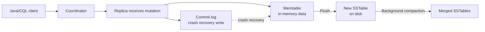
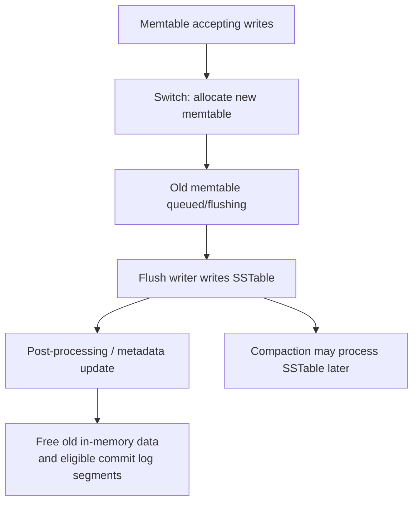
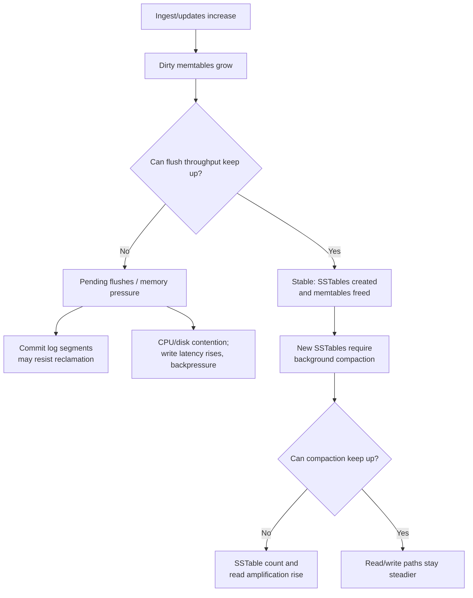
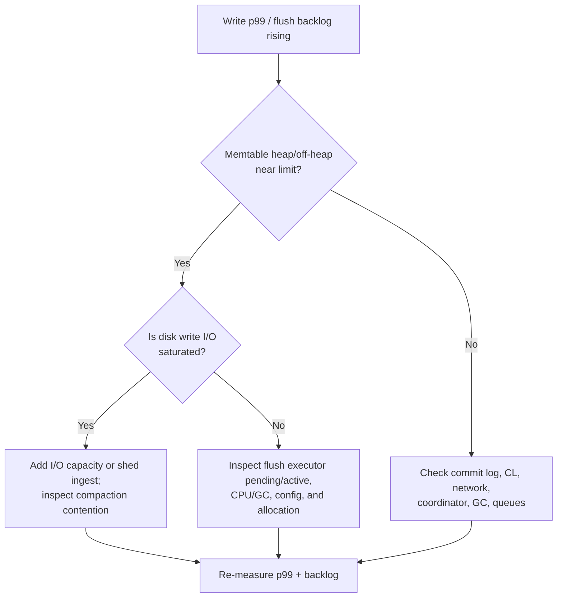

# Memtables, Memory Limits, and Flush Pressure

**Chapter:** Resource Tuning  
**Module:** `DATABASE_ENGINE_WIDE_COLUMN_CASSANDRA` — Apache Cassandra

Apache Cassandra uses an **LSM-tree**-style write architecture: mutations from a Java/CQL application are written to the **commit log** to support crash recovery while updating an in-memory **memtable**; subsequently, the memtable is **flushed** into an immutable SSTable on disk. This design suits heavy write workloads, yet remains stable only when write rate, memory budget, flush throughput, compaction, and disk capacity stay balanced.

A cluster can still acknowledge many `INSERT` statements while flushing begins falling behind the rate at which dirty data accumulates. If this persists, memtables consume nearly the entire budget, flush tasks queue for resources, commit log segments become hard to reclaim, and application p95/p99 latency climbs. Conversely, **forcing flushes continuously** is no solution either: it creates extra small SSTables and shifts cost onto the read path and compaction.

This lesson focuses on evaluating **memtables, heap/off-heap limits, and flush pressure** using CQL, `nodetool`, JMX/metrics, and Java Driver examples. The concepts connect directly to Apache Cassandra's wide-column model, partition keys, replication/consistency levels, SSTables/compaction, repair, and error handling.

> **Safety and Versions:** Perform experiments on a lab cluster only. Cassandra 4.1 and 5.x, packaging/distributions, JDKs, and containers can differ in configuration names, defaults, and metrics. **Do not copy memory budgets, increase flush writers, or run `nodetool flush` repeatedly in production** before verifying the version and measuring actual load. This is an instructional and operational scenario guide, not observed benchmark results.

## 1. Learning Outcomes

After this lesson, you can:

1. Distinguish **memtables**, the **commit log**, **SSTables**, **flushing**, and **compaction**.
2. Explain why an ACK at a given consistency level does not require the mutation to have become an SSTable, while durability still depends on the commit log and write sync configuration.
3. Identify flush triggers: memtable budget pressure, commit log space pressure, periodic flush intervals, administrative requests, and certain node lifecycle operations.
4. Distinguish memtable budgets across the **JVM heap**, **off-heap**, other JVM memory, and the **OS page cache**.
5. Read `nodetool tablestats`, `tpstats`, `compactionstats`, `info`, and related metrics to separate **healthy high write volume** from an **abnormal flush backlog**.
6. Predict the effects of undersized memtables, excessive flushes, unreclaimed commit log segments, and near-saturated SSDs.
7. Set up a lab with before/after `nodetool flush` measurements without confusing flushing with repair or replication.
8. Evaluate trade-offs when changing memory allocation, flush writer counts, data partitioning, and ingest rate.
9. Build a tuning procedure with a baseline, hypothesis, stop thresholds, and rollback capability.
10. Correlate server metrics with Java Driver latency/timeouts without using a handful of INSERTs to draw production performance conclusions.

## 2. Where Memtables Sit in the Cassandra Write Path

### 2.1. Basic Write Flow



This is a conceptual model of **one replica**. The coordinator sends the mutation to replicas chosen by the replication strategy; the consistency level determines how many responses are required before the request is considered successful. Exact commit log/memtable ordering and the ACK completion point depend on implementation, `durable_writes`, and the running version's commit log sync policy.

**Three events must not be conflated:**

- **Write ACK:** the replica/coordinator satisfied the write condition at the chosen CL; it does not mean all replicas received the mutation or that data has been flushed to an SSTable.
- **Flush:** moves data from a memtable to an SSTable; does not automatically ship that SSTable to other replicas.
- **Compaction:** processes/merges SSTables **per replica**, cleaning old versions and tombstones when safe; does not replace anti-entropy repair.

### 2.2. When a Partition Is Updated Multiple Times

```sql
UPDATE lab_memtable.profile_by_user
SET score = 10 WHERE user_id = 'user-01';

UPDATE lab_memtable.profile_by_user
SET score = 20 WHERE user_id = 'user-01';
```

Assuming no concurrent writes or abnormal timestamps, a subsequent `SELECT` can see `score = 20` even before the memtable flushes. Cassandra reconciles mutations by timestamp/cell rules without waiting for compaction to reflect the latest logical state.

After multiple flushes, versions of the same key may reside across multiple SSTables. Compaction reduces read amplification and space overhead under defined rules, yet having **multiple SSTables contain the same partition** is normal in an LSM-tree.

### 2.3. Commit Log Is Not Memtable

| Structure | Where? | Purpose | When Reclaimed? |
| --- | --- | --- | --- |
| **Commit log** | Append-only files on disk | Replay un-flushed mutations after a node crash | A segment becomes eligible for reuse/deletion only when **all memtables** containing mutations referenced by that segment have flushed, per version mechanics |
| **Memtable** | Memory allocated to write structures | Merge mutations in RAM and serve reads before flush | When data is written to SSTables and memory references are released |
| **SSTable** | Immutable files on disk | Durable storage and read serving after flush | Replaced/cleaned according to compaction and active reference state |
| **Page cache** | OS-managed RAM | Cache file/disk data to accelerate reads | Automatically managed by the OS under memory pressure |
| **Repair/streaming** | Network and disk data exchange | Sync or transfer replica ownership | Not a memtable reclamation mechanism |

If many dirty memtables remain un-flushed, commit log segments can be retained longer than expected. Expanding commit log space may only **delay when pressure surfaces**, without fixing why flushing cannot keep up.

## 3. What Flushing Does and Does Not Do

### 3.1. From Memtable to SSTable

When a flush begins, Cassandra closes/switches the active write memtable so new mutations can be accepted, then writes the old memtable's contents out as an SSTable. This work consumes CPU, buffer memory, disk writes, and metadata updates. Post-processing steps complete before the corresponding memtable and commit log resources can be freed.



**Note:** Memtable switch, flush completion, and compaction are distinct milestones. Seeing memtable switch count climb does not by itself prove all dirty bytes have reached disk.

### 3.2. Common Flush Triggers

| Trigger | Conceptual Condition | Note |
| --- | --- | --- |
| **Memtable heap/off-heap pressure** | Memtable memory approaches or exceeds node-level thresholds | Memory is managed at the **node** level; multiple tables compete for the budget |
| **Commit log space pressure** | Log segments consume significant space, forcing memtable flushes to free segments | Can occur even when a single table's memtable is not large |
| **Table periodic interval** | Table has non-zero `memtable_flush_period_in_ms` | Periodic flush is not a guarantee of "one SSTable strictly every minute" under all conditions |
| **Administrative request** | `nodetool flush` | Generates I/O and can create small SSTables; use only intentionally |
| **Shutdown/snapshot/other lifecycle** | Certain operations require syncing or stabilizing storage state | Verify per command and version; do not assume every snapshot always flushes |

There is no "single cluster-wide memtable". Each node manages memtables for the tables/data it stores; other replicas maintain their **own** memtables, commit logs, and flush schedules.

### 3.3. Flush Is Not a Replica Synchronization Command

Suppose RF=3, a write at `LOCAL_QUORUM` is ACKed by two replicas, and the third replica is offline. Running `nodetool flush` on one node affects only that node's memory/files. It does **not** send missing mutations to the third replica.

If the goal is replica convergence, inspect hinted handoff, read repair, anti-entropy repair, or recovery per your runbook. If the goal is crash durability, understand commit log durability and ACK policies—do not treat a flush as a Cassandra "transaction commit".

## 4. Memory Allocation: Heap, Off-Heap, and Page Cache

### 4.1. Budget at the **Node Level**, Not Just `-Xmx`

Cassandra runs in a single JVM process, yet not all resident memory sits in the Java heap. A proper mental model:

```text
RAM / container memory limit
├── Java heap (-Xmx)
│   ├── Heap objects, query state, metadata/caches
│   └── Heap-resident memtable allocations (if configured on-heap)
├── Native / off-heap memory
│   ├── Off-heap memtable allocations (if used)
│   ├── Direct buffers, compression, networking, native/JVM overhead
│   └── Thread stacks and runtime allocations
└── OS / filesystem page cache, kernel, and other processes
```

This diagram is a **budget map**; some memory sits inside process RSS while some sits in the host's shared page cache. In containers, kernel/cgroup accounting can include file cache as well. Do not add `-Xmx`, off-heap limits, and page cache assuming they are always "100% consumed blocks"; they are distinct capacities/bounds to measure.

**Implications:**

- Increasing heap does not automatically make Cassandra write faster; it can lengthen GC pauses and steal RAM meant for the page cache.
- Moving/keeping memtables off-heap can reduce GC pressure on some workloads, yet **does not eliminate total RAM demand**. Native memory still needs room.
- A container memory limit smaller than process needs plus essential page cache can cause memory pressure or OOM kills even when the heap is not full.
- If the disk is slow, making memtables larger only delays when flushing stalls; SSD write throughput remains the physical ceiling.

### 4.2. Parameters to Recognize

Configurations commonly seen in Cassandra 4.x include the following names, though **defaults, units, and availability must be checked against your running version**:

| Group | Common Config Name | Conceptual Meaning |
| --- | --- | --- |
| Memtable heap budget | `memtable_heap_space` | Bounds heap space allocated to memtables on the node |
| Memtable off-heap budget | `memtable_offheap_space` | Bounds off-heap space for memtables on the node |
| Allocation mode | `memtable_allocation_type` | Selects allocation strategy (supported values vary by version) |
| Flush worker count | `memtable_flush_writers` | Flush parallelism; raising it can increase I/O contention |
| Commit log space | `commitlog_total_space_in_mb` or version-specific equivalent | Influences segment retention pressure and flush triggers |
| Table periodic flush | `memtable_flush_period_in_ms` | CQL table option; `0` typically disables periodic flush deadlines |
| Commit log sync | `commitlog_sync` and companion options | Controls log sync policy; **not** a knob to enlarge memtables |

Config names in this table are **reference points**, not a `cassandra.yaml` template to copy blindly. For example, `memtable_offheap_space` may be absent or differ in semantics in specific distributions. Check version docs and reload/restart behavior before applying changes.

Avoid rules of thumb like "give every node 50% of RAM for memtables", because heap GC, page cache, compaction buffers, networking, and JVM native overhead all need memory.

### 4.3. Budgeting Illustration, Not an Optimal Config

Suppose a node has **16 GiB usable RAM** and `-Xmx = 6 GiB`. Roughly 10 GiB remains **arithmetically** for other needs, yet you cannot conclude all 10 GiB can go to off-heap memtables.

| Item to Review | Question |
| --- | --- |
| 6 GiB Heap | Are GC pauses and heap occupancy stable under the workload? |
| Memtable heap | How much of the heap is tied up by dirty tables? |
| Memtable off-heap | How do actual allocations and RSS/cgroup usage grow? |
| Native/JVM/thread stacks | Is there headroom for direct buffers and off-heap structures? |
| Page cache | Does a read-heavy workload need substantial RAM to cache files? |
| Kernel/cgroup limit | Is there risk of host memory pressure or container OOM kill? |

**Do not assign 10 GiB to memtables** just because 16 total − 6 heap = 10. Base sizing on baseline measurements and load, then test small incremental changes in a production-like environment.

## 5. How Does Flush Pressure Emerge?

### 5.1. Dirty Data Creation Rate vs. Flush Drain Rate

Let:

- `W_m`: new memtable memory bytes generated per second during an observation window.
- `F_m`: equivalent **memtable data bytes freed** per second by flushing, using the same measurement basis/unit.
- `Q_m`: amount of memtable data awaiting processing.

An approximate model:

\[
\frac{\Delta Q_m}{\Delta t} \approx W_m - F_m
\]

If `W_m > F_m` persists, `Q_m` tends to grow. However, never take raw network/CQL bytes as `W_m` and **compressed** SSTable bytes as `F_m` assuming they are equivalent: mutations, allocations, and SSTable storage have different sizes and overheads.

**Purely illustrative example:** If dirty allocations grow at **120 MiB/s** while the system drains the equivalent of **90 MiB/s** on the same measurement basis, the gap is about **30 MiB/s**, or roughly **1.8 GiB/minute**. This is only a mental model showing why backlogs grow quickly; Cassandra has automatic flush triggers, so real throughput curves are not necessarily linear as in this example.

### 5.2. When Pressure Goes Unresolved



A "flush bottleneck" can occur at multiple points: too few flush writers, slow SSDs, saturated filesystem/IOPS, CPU/GC, compaction disk contention, or tables spawning too many small memtables. Increasing workers only helps if the target resource still has headroom.

### 5.3. Two Common Problem Patterns

**Memtable capacity pressure:** memory approaches its cap, flushes trigger frequently, pauses/queues rise. Inspect total heap/off-heap memory and dirty tables.

**Flush rate pressure:** flush queues wait longer, SSTable output lags, I/O wait climbs, and commit log segments fail to clear promptly. Inspect actual flush throughput and disk/compaction contention.

These two problems are related but distinct. Enlarging the memory budget can cut flush frequency short-term yet **does not speed up the SSD**; adding flush writers can add concurrency yet **worsen I/O queues** if the disk is already saturated.

## 6. Which Metrics Matter?

### 6.1. Node-Level Observation Commands

On the lab Cassandra node:

```bash
nodetool status
nodetool info
nodetool tpstats
nodetool compactionstats
nodetool tablestats lab_memtable.events_by_device_day
nodetool gcstats
```

Depending on Cassandra/JDK version, command names, columns, thread pools, and exported metrics may vary; check `nodetool help <command>` for your exact version. `nodetool` normally inspects **the queried node**, rather than giving an automatic cluster-wide view across every replica.

### 6.2. Metrics to View Side by Side

| Metric | What It Suggests | Pitfall to Avoid |
| --- | --- | --- |
| **Memtable live data size** | Live data currently in a table/replica's memtable | Not total RSS or bytes on disk |
| **Memtable on-heap/off-heap size** | Memtable memory by allocation type if exposed | Not all heap/native allocations |
| **Memtable switch count** | How many times memtables switched state | Increasing does not prove flush tasks finished or disk kept up |
| **Pending flushes** | Queued or incomplete flushes per version metric | A single snapshot of 0 does not rule out peak-hour bottlenecks |
| **Flush writer pending/active tasks** | Whether the flush executor is backed up | Executor names may differ; check actual `tpstats` |
| **Commit log bytes/usage** | Whether log segments are retained/approaching cap | Do not assume 1 byte of commit log = 1 byte of memtable |
| **SSTable count** | Files produced after flushes and compaction | High SSTable count can stem from workload/strategy, not just flushes |
| **Pending compactions** | Whether compaction keeps pace with new SSTables | 0 at one instant does not mean no accumulating pressure |
| **Disk write throughput, IOPS, await/I/O wait** | Whether disk limits flushing/compaction | Low CPU does not mean the disk isn't saturated |
| **GC pauses, heap occupancy, process RSS, cgroup memory** | Whether JVM/OS is under memory pressure | Looking only at `-Xmx` misses off-heap and page cache |
| **Client write p95/p99, timeouts, dropped messages** | Impact on application SLA | High latency may be CL/replica/network, not necessarily memtables |

For analysis, align the **same time window** and, whenever possible, the same node/table/DC. Do not compare one node's memtable max against application p99 measured on another node and claim causality.

### 6.3. JMX and Exporters

Cassandra tables typically expose metrics conceptually named like:

```text
Table / MemtableLiveDataSize
Table / MemtableOnHeapSize
Table / MemtableOffHeapSize
Table / MemtableSwitchCount
Table / PendingFlushes
ThreadPools / ActiveTasks
ThreadPools / PendingTasks
ClientRequest / WriteLatency
```

**These labels are only guides for locating metrics.** Exact JMX ObjectNames, MBean scopes, units, availability, and exported Prometheus names vary by Cassandra/exporter version. When building dashboards:

1. Verify MBean/metric names on the **running version**.
2. Distinguish point-in-time gauges, monotonic counters, and histograms/latencies.
3. For switch/flush counters, compute a **rate over time** rather than comparing cumulative totals.
4. Label by node, DC, keyspace, and table; avoid putting raw partition keys into Prometheus labels.
5. Track **per-node max/tail**, not just cluster averages.
6. Add annotations for schema changes, restarts, manual flushes, rebuilds/repairs, or workload shifts.

### 6.4. `tpstats` and Thread Pools

`nodetool tpstats` reports active/pending/completed/blocked tasks per executor. Executors related to memtable flushing may appear as `MemtableFlushWriter` plus post-flush executors depending on the release.

If pending tasks grow alongside high disk write queues, adding flush writers may not help; check disk throughput and latency. Only if executor pending counts are high while the disk still has ample headroom is it worth investigating concurrency, CPU, locks, or other bottlenecks.

**Do not set a rigid universal alert like "pending > 10 is an error".** During bursty ingest, brief pending spikes can be normal; **steady, non-draining growth** paired with worsening p99 is the actionable evidence.

## 7. Preparing the CQL Lab on Memtables and Flushing

### 7.1. Prerequisites

- Compatible Cassandra 4.1/5.x, at least one node for learning commands; verifying replica divergence requires a multi-node cluster.
- Access to `cqlsh`, `nodetool`, and node metrics.
- Never run experiments on real data or intentionally trigger full disks/OOMs.
- Record version, JDK, heap size, disk capacity, compaction strategy, and baseline load before testing.
- If your datacenter is not named `datacenter1`, update the DDL accordingly.

In the terminal:

```bash
nodetool status
nodetool info
cqlsh
```

In `cqlsh`:

```sql
SELECT data_center, release_version FROM system.local;
```

Create the keyspace/tables:

```sql
CREATE KEYSPACE IF NOT EXISTS lab_memtable
WITH replication = {
  'class': 'NetworkTopologyStrategy',
  'datacenter1': 1
}
AND durable_writes = true;

CREATE TABLE IF NOT EXISTS lab_memtable.events_by_device_day (
    device_id text,
    bucket_day date,
    event_ts timestamp,
    event_id uuid,
    value double,
    payload text,
    PRIMARY KEY ((device_id, bucket_day), event_ts, event_id)
) WITH CLUSTERING ORDER BY (event_ts DESC, event_id ASC)
  AND memtable_flush_period_in_ms = 0;

CREATE TABLE IF NOT EXISTS lab_memtable.profile_by_user (
    user_id text PRIMARY KEY,
    score int
);
```

Meaning:

- `(device_id, bucket_day)` bounds partition size: one logical partition per device per day. If daily volume is too high, use a smaller time bucket or shard further.
- `event_ts`, `event_id` support ordered intra-day queries; `event_id` is a `uuid`, not strictly requiring `timeuuid`.
- `memtable_flush_period_in_ms = 0` disables periodic flush deadlines for the table on supporting versions; memtables **still** flush due to memory pressure, commit log pressure, or admin commands.
- RF=1 suits lab syntax, yet **cannot tolerate replica loss**. Production requires proper RF/CL design.

### 7.2. Writing Data with Deterministic Keys

```sql
CONSISTENCY ONE

INSERT INTO lab_memtable.events_by_device_day
    (device_id, bucket_day, event_ts, event_id, value, payload)
VALUES ('device-01', '2026-11-21', '2026-11-21T10:00:00Z',
        10000000-0000-4000-8000-000000000001, 21.5, 'm-001');

INSERT INTO lab_memtable.events_by_device_day
    (device_id, bucket_day, event_ts, event_id, value, payload)
VALUES ('device-01', '2026-11-21', '2026-11-21T10:01:00Z',
        10000000-0000-4000-8000-000000000002, 22.0, 'm-002');

INSERT INTO lab_memtable.events_by_device_day
    (device_id, bucket_day, event_ts, event_id, value, payload)
VALUES ('device-02', '2026-11-21', '2026-11-21T10:00:00Z',
        10000000-0000-4000-8000-000000000003, 19.1, 'm-003');

SELECT event_ts, event_id, value
FROM lab_memtable.events_by_device_day
WHERE device_id = 'device-01'
  AND bucket_day = '2026-11-21';
```

If the INSERTs are ACKed without competing writes, the logical result for `device-01` has two rows. **Do not** assume both are already in SSTables: prior to flushing, they can still be served from the memtable.

### 7.3. Updating the Same Key

```sql
INSERT INTO lab_memtable.profile_by_user (user_id, score)
VALUES ('user-01', 10);

UPDATE lab_memtable.profile_by_user
SET score = 20
WHERE user_id = 'user-01';

SELECT user_id, score
FROM lab_memtable.profile_by_user
WHERE user_id = 'user-01';
```

Expect `score = 20` under normal sequential writes. `UPDATE` does not overwrite immutable SSTables in place; versions are reconciled on the read path and merged on storage during compaction.

## 8. Controlled Experiment: Before and After Flushing

### 8.1. Step A — Save Baseline

After writing a few rows, on the **same lab node**:

```bash
nodetool tablestats lab_memtable.events_by_device_day
nodetool tablestats lab_memtable.profile_by_user
nodetool tpstats
nodetool compactionstats
nodetool info
```

Record:

```text
TIME_UTC:
NODE:
TABLE:
MEMTABLE_LIVE_DATA_SIZE:
MEMTABLE_ON_HEAP / OFF_HEAP (if available):
MEMTABLE_SWITCH_COUNT:
PENDING_FLUSHES:
SSTABLE_COUNT:
PENDING_COMPACTIONS:
DISK_WRITE / IOWAIT:
READ_P99 / WRITE_P99:
```

With only three INSERTs, many numbers will be small—not enough to measure meaningful performance differences. The lab's purpose is understanding how actions map to metrics, **not** proving one configuration is faster.

### 8.2. Step B — Request a Flush of **One Table** on the Lab Node

```bash
# Only on the lab node, for the assigned learning keyspace/table:
nodetool flush lab_memtable events_by_device_day

# After the command completes:
nodetool tablestats lab_memtable.events_by_device_day
nodetool tpstats
nodetool compactionstats
```

Expected observations:

- Memtable live size drops after the table's dirty data is flushed (assuming no new writes during observation).
- SSTable count increases or changes depending on existing files and background compaction.
- Memtable switch count may increment.
- Commit log segments **may** become eligible for reclamation, depending on whether other memtables still reference those segments.
- `compactionstats` may show background work triggered after the flush.

Never claim "a flush always produces exactly one SSTable". Flush mechanics, active memtables, data directories, secondary indexes/tables, and version internals affect the outcome. Even an unchanged `SSTable count` does not prove the command failed: compaction/metadata and data state may change simultaneously.

### 8.3. Step C — Write Again to Separate Data Path from Disk State

```sql
INSERT INTO lab_memtable.events_by_device_day
    (device_id, bucket_day, event_ts, event_id, value, payload)
VALUES ('device-01', '2026-11-21', '2026-11-21T10:02:00Z',
        10000000-0000-4000-8000-000000000004, 22.7, 'm-004');

SELECT event_ts, value
FROM lab_memtable.events_by_device_day
WHERE device_id = 'device-01'
  AND bucket_day = '2026-11-21';
```

Expect three logical rows for `device-01`, even though the first two may live in an SSTable while the newest row resides in the memtable. This illustrates why the **read path merges memtable and SSTable data**.

### 8.4. Step D — Test a Periodic Flush Interval in the Lab, Then Revert

```sql
-- Lab only: may create many small SSTables under low workload.
ALTER TABLE lab_memtable.events_by_device_day
WITH memtable_flush_period_in_ms = 60000;

SELECT keyspace_name, table_name, memtable_flush_period_in_ms
FROM system_schema.tables
WHERE keyspace_name = 'lab_memtable'
  AND table_name = 'events_by_device_day';
```

After observing for a reasonable interval, restore:

```sql
ALTER TABLE lab_memtable.events_by_device_day
WITH memtable_flush_period_in_ms = 0;
```

**Do not interpret `60000` as optimal for 1-minute data**: flush period is neither a retention period nor a TWCS window. If many tables flush every minute with tiny data volumes, SSTable count and compaction overhead can climb. Do not use this experiment as justification for setting periodic flushes in production.

## 9. From Flush to SSTables and Compaction: Cascading Effects

### 9.1. Frequent Flushing Is Not Necessarily Good

Suppose a workload receives 1,000 writes/s, yet each table accumulates only a few dirty bytes before a forced flush. Many tiny SSTables can be generated; the read path must consult more metadata/files to reconcile rows, and compaction must merge them. For the same workload, higher ratios of tiny flushes can raise write amplification.

Situations that cause frequent flushes:

- Memtable budget is too small relative to ingest rate or bursts.
- Too many tables configure low `memtable_flush_period_in_ms`.
- Commit log space pressure triggered across many different tables.
- Frequent `nodetool flush` calls from an ill-suited runbook.
- Ingest spread thinly across many tables with small memtables; measure rather than guess.
- Restarts/maintenance/system operations switching memtables per lifecycle rules.

**Implication:** Reducing flush frequency by enlarging memtables can help some workloads, yet if the disk cannot keep up, it merely delays congestion and increases RAM consumption. Measure compaction, backlog, and p99 together.

### 9.2. Compaction Strategy Is Related but Does Not Replace Flush Tuning

| Strategy | Typical Workload | Relationship to Flushing |
| --- | --- | --- |
| **STCS** | Heavy ingest, light reads, write-throughput focus | Groups similar-sized SSTables; too many tiny SSTables still add overhead |
| **LCS** | Lookup/read-heavy where read latency is critical | Lowers read amplification but can increase write amplification and I/O competing with flushes |
| **TWCS** | Append-only time-series with relatively uniform TTL | Organizes SSTables by time window; overly tiny flushes and late writes degrade effectiveness |
| **UCS (Cassandra 5+ when supported)** | Mixed workloads needing trade-off flexibility | Benchmark per version and metrics; does not magically give memtables more RAM |

Do not switch compaction strategies solely because `MemtableSwitchCount` increases. Evaluate backlog, SSTable sizes, read latency, tombstones, update frequency, and TTL requirements.

### 9.3. Flush Pressure and Repair/Streaming

When repair or bootstrap is streaming large volumes, SSDs simultaneously serve flushes, compaction, and reads/writes for incoming/outgoing SSTables. If write latency spikes specifically during maintenance windows, annotate that event on dashboards; increasing memtables or flush writers will not necessarily resolve I/O contention.

## 10. Narrowing Down the Root Cause: Memory or Disk?

### 10.1. Decision Tree



This is a diagnostic guide, not a rigid rulebook. Multiple bottlenecks can happen together: nearly full SSDs, heap pressure, GC pauses, commit log fsync latency, and network replication lag.

### 10.2. Symptom Matrix

| Symptom | Possibilities to Consider | Priority Checks |
| --- | --- | --- |
| Memtable size rises, pending flushes grow | Flushing cannot keep pace with workload | Disk I/O, executors, compaction, commit log space |
| Switch count spikes, SSTable count explodes | Continuous flushes / small memtables / short period | Periodic flush, per-table write rate, commit log pressure |
| Heap GC pauses rise, RSS normal | On-heap memtables / caches / high object allocation | GC logs, heap occupancy, memtable allocations |
| RSS/cgroup climbs while heap is stable | Off-heap/native/direct buffer/page cache pressure | Native memory, cgroup limit, OS memory |
| Disk write throughput maxed out, pending flushes | SSD bottleneck or compaction I/O contention | Disk queues, I/O wait, compactionstats, streaming |
| Commit log space grows while one table's memtable is tiny | Other tables hold segments or pending flushes remain | Node-wide memtable/commitlog metrics, per-table flush states |
| High write latency with normal flush queues | CL/replica/network/GC/commitlog sync or app | `nodetool status`, tracing, client errors, disk fsync |
| Read p99 rises after many tiny flushes | SSTable count/read amplification/compaction | `tablehistograms`, SSTables/read, compaction |
| Only one node has a flush backlog | Slow disk on node, repair/stream, skewed partition/token load, GC/cgroup pressure, or hardware mismatch | Compare per-node CPU/RSS/I/O/compaction and token distribution |
| All nodes slow together during ingest peak | Total load exceeds cluster capacity or workload shifted | Ingest bytes/s, schema access, capacity planning |

If the cause is a **hot partition** due to an unsuitable partition key, enlarging memtable memory will not spread workload across tokens either. Redesign the partition key/bucket/shard around query access and traffic distribution.

## 11. Tuning from Lowest Risk to Highest Risk

### 11.1. Start with Workload and Data Structure

Ask:

- Is any table receiving millions of mutations/s into a single partition?
- Does the data have dense TTL/DELETE/UPDATEs keeping compaction busy?
- Is the application continuously sending huge batches or oversized payloads?
- Do queries use proper partition keys and clustering ranges?
- Is high ingest spread across too many tables producing tiny memtables?
- Are clients retrying unboundedly after timeouts, doubling write load?

Adjusting batch size, burst rate, or the partition model often has far greater impact than altering memtable allocations. **Never use `BEGIN BATCH` to boost bulk write throughput** across multiple partitions; logged batches carry distinct semantics/overhead and are no substitute for rate-limited ingestion.

### 11.2. Reduce Disk Contention First

If write disk I/O is saturated:

- Check whether compaction is consuming heavy I/O.
- Check whether snapshots/backups/streaming/repair are competing.
- Assess real SSD throughput/IOPS and latency, not just spec-sheet bandwidth.
- Schedule maintenance and apply controlled concurrency limits.
- If necessary, scale capacity/hardware/cluster when workload exceeds a single node's ceiling.

**Increasing `memtable_flush_writers` on an already saturated disk can worsen p99** because more writers queue for I/O simultaneously. Only test higher writer concurrency when evidence shows workers are the bottleneck and the disk still has headroom.

### 11.3. Adjust Memtable Budget When Headroom Exists

If the memtable budget is too small and flushes occur too frequently while disk and JVM still have headroom, try increasing the budget **gradually** per version rules. Before each change:

1. Verify current settings across **all nodes** and how they take effect.
2. Calculate total RAM (heap, off-heap, native, page cache, cgroup) and safety headroom.
3. Measure GC pauses and RSS/OS cache first.
4. Test in staging or on a canary node if your deployment/runbook supports it.
5. Compare flush rate, SSTable size/count, pending tasks, p99, and I/O after reaching steady state.
6. Keep a rollback plan for config restoration and rolling restarts per version constraints.

Never assume every option is dynamic; many JVM/node-level parameters require a restart to take effect, and a rolling restart temporarily alters replica load as well.

### 11.4. Evaluate Flush Writer Count

If pending flush tasks grow while the disk still has ample throughput, CPU/GC are stable, and the configured writer count is low relative to hardware, you can benchmark higher writer counts. Keep in mind:

- Each writer consumes CPU/buffers/I/O.
- More writers increase contention with compaction, commit log, and client reads.
- Nodes on HDDs, network storage, or different SSD tiers have different sweet spots.
- Raising writers does not fix partition design or delete/tombstone rates.
- Measure **effective** throughput and tail latency, not just completed task counts.

### 11.5. Evaluate Commit Log Independently

The commit log governs write durability and crash replay. If log space pressure triggers frequent flushes, inspect:

- Segment size and total commit log space per running version config.
- Which memtables remain dirty and hold references to segments.
- Whether the commit log disk has sufficient throughput/fsync latency.
- Active commit log sync policy and `durable_writes`.
- Log errors, free disk space, and timeouts.

**Never disable `durable_writes`, bypass the commit log, or weaken sync policies carelessly** just to benchmark memtables: that introduces **data-loss risk**, not harmless tuning. Adjusting commit log total space can help absorb bursts in some cases, yet cannot cure insufficient flush throughput.

### 11.6. When Should You Scale the Cluster?

Once query/write patterns are optimized and maintenance contention is controlled, yet sustained ingest and read/write I/O still exceed hardware capacity, options include:

- Adding nodes to distribute tokens/partitions and replica load.
- Using storage with suitable latency/IOPS and ensuring adequate network bandwidth for replication.
- Splitting workloads or tables by query/retention instead of cramming all mutations into one partition.
- Changing RF/CL only after understanding cost and consistency guarantees; never drop RF just to "save resources".

Topology expansion also generates temporary streaming/repair and disk pressure, so ensure capacity headroom before bootstrapping.

## 12. Flush Capacity Sizing Problems

### 12.1. Scenario A — Short Burst

Assume:

- Ingest dirty allocation is ~**80 MiB/s** for 20 seconds, then returns to 15 MiB/s.
- Flushing drains the equivalent of **40 MiB/s** on average during the burst.
- Memtable budget has 1 GiB headroom right before the burst.

Over 20 seconds, the approximate deficit is:

\[
(80-40)\,\mathrm{MiB/s}\times20\,\mathrm{s}=800\,\mathrm{MiB}
\]

This burst **may** be absorbed if the measurement assumptions hold, no other limits trip, and flushing keeps running—yet you must still inspect commit log, compaction, cgroups, and GC. This is an idealized calculation, not a guarantee Cassandra absorbs bursts without raising p99.

### 12.2. Scenario B — Prolonged Imbalance

Assume ingest creates **80 MiB/s** of dirty allocations continuously for one hour while flush drain rate is **40 MiB/s**. The gap is:

\[
(80-40)\,\mathrm{MiB/s}\times3600\,\mathrm{s}
=144000\,\mathrm{MiB}\approx 140.6\,\mathrm{GiB}
\]

A few GiB of memtable space cannot absorb an hour-long imbalance. Long-term fixes must address ingest rate, flush/disk capacity, node count, or workload structure. **Simply increasing memtable budget is not a solution.**

### 12.3. Scenario C — Flush Count Rises While Throughput Stays Healthy

If write rate climbs briefly, a higher memtable switch count can be an acceptable consequence. When `pending flush` returns to baseline, p99 remains stable, and disk I/O still has headroom, there is insufficient evidence to alter configurations.

Good tuning does not mean "driving switch count to 0"; it means **maintaining write/read SLAs, memory, disk, and compaction stability under the target workload**.

## 13. Java Driver: Bounded Ingest Testing and Latency Correlation

With Java Driver 4.x, the example below uses a prepared statement, deterministic per-event keys, **sequential** execution, and a bounded iteration count. It is not meant to measure peak throughput; its goal is creating an easily stoppable workload while recording client numbers to correlate with flush metrics.

```java
import com.datastax.oss.driver.api.core.CqlSession;
import com.datastax.oss.driver.api.core.DefaultConsistencyLevel;
import com.datastax.oss.driver.api.core.cql.PreparedStatement;
import com.datastax.oss.driver.api.core.cql.BoundStatement;
import com.datastax.oss.driver.api.core.data.CqlDate;

import java.nio.charset.StandardCharsets;
import java.time.Instant;
import java.time.LocalDate;
import java.util.UUID;

public final class BoundedMemtableIngest {
    public static void run(CqlSession session) throws InterruptedException {
        PreparedStatement insert = session.prepare(
            "INSERT INTO lab_memtable.events_by_device_day " +
            "(device_id, bucket_day, event_ts, event_id, value, payload) " +
            "VALUES (?, ?, ?, ?, ?, ?)"
        );

        CqlDate day = CqlDate.fromDaysSinceEpoch(
            (int) LocalDate.of(2026, 11, 21).toEpochDay()
        );
        Instant base = Instant.parse("2026-11-21T12:00:00Z");

        int acknowledged = 0;
        int failed = 0;
        long started = System.nanoTime();

        // 300 sequential operations with pacing pauses: not a stress test.
        for (int i = 0; i < 300; i++) {
            UUID id = UUID.nameUUIDFromBytes(
                ("memtable-lab-device01-" + i).getBytes(
                    StandardCharsets.UTF_8)
            );

            BoundStatement write = insert.bind(
                "device-01",
                day,
                base.plusMillis(i * 1000L),
                id,
                20.0 + (i % 20) * 0.1,
                "sample-" + i
            ).setConsistencyLevel(DefaultConsistencyLevel.ONE);

            try {
                session.execute(write);
                acknowledged++;
            } catch (RuntimeException ex) {
                failed++;
                System.err.println("i=" + i + " write error: " + ex);
                // Do not treat a timeout as rolled back; avoid blind retries.
            }

            Thread.sleep(10);
        }

        double elapsedSeconds =
            (System.nanoTime() - started) / 1_000_000_000.0;
        System.out.println(
            "ack=" + acknowledged + ", failed=" + failed +
            ", elapsedSeconds=" + elapsedSeconds
        );
    }
}
```

**Explanation:**

- The RF=1 lab sample uses `ONE`. In production, CL must match RF/DC and consistency goals; do not use `ONE` as a blanket choice to make writes "fast".
- `UUID.nameUUIDFromBytes` generates a deterministic UUID per index; re-running the same data keeps the same primary key rather than creating duplicate rows. However, mutation timestamps and concurrent writes still matter on retries.
- `Thread.sleep(10)` adds rough pacing; real throughput still depends on `session.execute` duration. Do not treat this as a high-precision rate limiter.
- The loop runs **synchronously and sequentially** to avoid flooding. A real load test uses controlled concurrency/rate limiting, latency histograms, multiple partitions, and production-like payload sizes.
- `acknowledged` only counts success responses at the chosen CL, **not SSTables created** or mutations repaired across every replica.
- Re-run `nodetool tablestats`, `tpstats`, and disk metrics during ingest, though 300 rows will very likely be too small to create a visible backlog.

### 13.1. Logging Results Over Time

```text
RUN_ID:
CASSANDRA_VERSION:
NODE / DATACENTER:
JAVA_DRIVER_VERSION:
REQUEST_RATE_TARGET:
WRITES_ACK / WRITES_ERROR:
CLIENT_WRITE_P50 / P95 / P99:
MEMTABLE_HEAP / OFF_HEAP:
MEMTABLE_SWITCH_RATE:
PENDING_FLUSHES:
FLUSH_EXECUTOR_PENDING / ACTIVE:
COMMITLOG_USAGE:
SSTABLE_COUNT:
PENDING_COMPACTIONS:
DISK_WRITE_MBPS / IOPS / AWAIT:
CPU / GC_PAUSE / RSS / CGROUP_MEMORY:
NOTES:
```

In real benchmarks, collect latency percentiles across **many requests**, never compute p99 from a handful of calls, and never compare nodes with different configurations without documenting them.

## 14. Troubleshooting Scenarios

### A. Fast Writes Initially, Then Write P99 Climbs After a Few Minutes

**Possibility:** memtables absorb the initial burst, yet flushing or compaction cannot keep up; pending flushes, commit log usage, and disk I/O climb.

**Action:** verify temporal correlation and I/O capacity. If the disk is saturated, enlarging memtables only stretches the initial grace period without fixing long-term throughput. Throttle ingest, reduce maintenance contention, or scale capacity per runbook.

### B. Memtable Remains Small Yet Commit Log Is Nearly Full

**Possibility:** other memtables/tables hold dirty mutations referencing those segments; commit log pressure is forcing flushes. Looking at one table's memtable alone is misleading.

**Action:** inspect node-wide memtable/commitlog metrics, flush state across all tables, log errors, disk space, and commitlog sync. Never delete commit log segments manually, as that can destroy crash-replay capability.

### C. Increasing Flush Writers Worsens Disk Latency

**Possibility:** the SSD was already near saturation, and extra concurrent writers increased queue depth and contention with compaction.

**Action:** revert to the last stable benchmarked setting and measure IOPS/await and pending tasks. Only raise writers if headroom exists and backlog drops without violating SLOs.

### D. Container Gets OOM-Killed After Changing Heap/Memtable

**Possibility:** total RSS/native/off-heap/page cache exceeded cgroup limits, even though `-Xmx` stayed the same.

**Action:** inspect cgroup memory, process RSS, native memory, and OS state. Restore a safe budget; never raise heap and off-heap simultaneously without evaluating total RAM.

### E. `nodetool flush` Finishes, Yet Reads Are Still Slow

**Possibility:** the issue lies in wide partitions, too many SSTables, tombstones, compaction backlog, or network/CL; flushing does not fix everything.

**Action:** check `tablehistograms`, SSTables/read, read p99, tracing, and partition design. Do not keep forcing flushes to "clean up data".

### F. After Setting a 1-Minute Flush Period, SSTables Multiply Rapidly

**Possibility:** small memtables flush periodically, creating sparse SSTables.

**Action:** restore the default/appropriate period and re-measure. Review retention/query workload before setting a flush period, and do not confuse this interval with TTL.

### G. Only Node C Has a Flush Backlog in an RF=3 Cluster

**Possibility:** C has a degraded disk, C is running repair/streaming, partition/token workload is skewed, C is under GC/cgroup pressure, or hardware differs from peers.

**Action:** compare per-node metrics, `nodetool status`, queues, CL, disk/network, and compaction. Cluster-wide averages easily mask a weak node; raising heap across all nodes will not fix a failing disk on node C.

### H. Disabling Durable Writes Makes the Benchmark Faster

**Observation:** the test altered **data durability**; its numbers cannot serve as evidence of a safe configuration for business workloads requiring durability.

**Action:** restore the required durable-write policy and re-benchmark. Resource tuning must be evaluated alongside crash and replica failure recovery.

## 15. Tuning Decision Matrix

| Observed Evidence | What to Try First | What to Avoid |
| --- | --- | --- |
| Pending flushes rise, disk saturated | Smooth ingest bursts, reduce contention, add I/O capacity | Increasing writers unboundedly |
| Many tiny SSTables flushed, disk is healthy | Review flush period, memtable budget, and many low-write tables | Scheduling even more frequent forced flushes |
| High heap GC and large on-heap memtable | Evaluate allocation/heap budget, JDK GC, off-heap per version | Raising heap without measuring GC/page cache |
| RSS/cgroup near limit, GC normal | Inventory off-heap/native/direct/page cache | Looking only at `-Xmx` |
| High commit log pressure, many dirty tables | Inspect node-wide flushes and commitlog config | Deleting commit log files manually |
| High write p99 while flushing is normal | Check CL/replicas/network/commitlog sync | Blindly enlarging memtables |
| Read p99 climbs after ingest, high SSTables/read | Review compaction backlog/strategy, queries, partitions | Using `nodetool flush` to "improve reads" |
| Short burst settles, backlog drains quickly | Monitor, do not rush config changes | Tuning based on a brief spike |
| Backlog grows for hours | Capacity planning, load balancing, I/O, and scale-out | Simply adding memory to buffer indefinitely |

## 16. Safe Change Procedure in Production

A change to `memtable_heap_space`, `memtable_offheap_space`, or `memtable_flush_writers` must be treated as **operationally risky tuning**, since it may require restarts/rolling restarts and affect memory/GC and read/write SLAs.

**Suggested runbook:**

1. **Define the goal:** eliminate persistent pending flushes, cut tiny SSTable creation, or improve write p99? Never optimize for "largest possible memtable".
2. **Capture a baseline:** at least one peak-hour window and one normal window across node, table, and client metrics.
3. **Record current config:** Cassandra version, JDK, heap size, cgroups, filesystem, memtable options, commitlog, compaction, and RF/CL.
4. **Write a hypothesis:** e.g., "low memtable budget causes tiny flushes while the SSD still has 40% headroom".
5. **Select one change:** budget, writer count, or periodic flush; never change three variables at once.
6. **Test in lab/canary:** keep partition distribution, payload, read/write rate, TTL, and compaction identical.
7. **Set stop conditions:** read/write p99, dropped/timeout rate, disk queue, GC pauses, RSS/cgroup, pending flush/compaction, and free disk.
8. **Controlled rollout:** ensure sufficient replicas/CL while restarting nodes one by one; monitor repair/hints for any downtime.
9. **Evaluate after stabilization:** compare performance and disk headroom long enough to span full flush + compaction cycles, not just the first minute.
10. **Rollback or commit:** if conditions worsen, restore config per runbook and record the timeline and cause.

In particular, before restarting a replica in an RF=3 cluster, verify the active CL and the health of remaining replicas. Never modify multiple nodes simultaneously if doing so could render `LOCAL_QUORUM`/`ALL` clients unavailable.

## 17. Self-Check Questions

1. Why can Cassandra still serve a correct `SELECT` right after an INSERT before data flushes to an SSTable?
2. How does the commit log differ from a memtable? When does a commit log segment become eligible for reclamation?
3. Why does `nodetool flush` not push missing mutations to another replica?
4. Does `memtable_flush_period_in_ms = 0` mean Cassandra will never flush that table?
5. Why does increasing memtables from 1 GiB to 4 GiB fail to fix poor disk throughput?
6. Distinguish Java heap, off-heap allocations, process RSS, and the OS page cache.
7. When a container is OOM-killed even though the Java heap is not full, what must you measure?
8. Why is an increasing memtable switch count insufficient to prove a flush backlog?
9. When pending flushes and disk I/O wait rise together, what harm can adding flush writers cause?
10. Why can frequent `nodetool flush` commands on small data make the read path more expensive?
11. When commit log space approaches its limit while one table's memtable is tiny, why must you check other tables?
12. How does `memtable_flush_period_in_ms` differ from TTL and a TWCS compaction window?
13. If write latency rises while memtable/flush metrics are normal, what are three other cause categories to check?
14. How can you distinguish a large/hot partition from a memtable memory problem?
15. Describe how to correlate `tablestats`, `tpstats`, `compactionstats`, GC, and disk I/O to pinpoint the bottleneck.
16. In the 80 MiB/s ingest and 40 MiB/s flush example, by how many MiB does the equivalent backlog grow after 20 seconds?
17. If a 40 MiB/s imbalance persists for an hour, is adding a few GiB of memtable sufficient?
18. Under what conditions can moving memtables off-heap not be treated as "free RAM"?
19. Why does `acknowledged` in the Java code not equal the number of rows written to SSTables?
20. When benchmarking, why must RF/CL, payload, schema, compaction, and partition distribution stay fixed?
21. What pressure can a streaming/repairing node place on flushing and read/write p99?
22. When are scaling out or upgrading SSDs better solutions than tuning memtable knobs?

### Operational Monitoring Checklist

- [ ] Know the Cassandra/JDK versions and current memtable/commitlog configs on every node.
- [ ] Have baselines for memtable live/heap/off-heap size, switch rate, and pending flushes.
- [ ] Track active/pending flush executor tasks, commit log usage, and disk I/O wait.
- [ ] Track SSTable count, pending compactions, and SSTables per read.
- [ ] Track process RSS, cgroup memory, heap occupancy, GC pauses, and OS page cache/headroom.
- [ ] Track client write/read p95/p99, timeout rate, CL, and replica status.
- [ ] Separated **memtable capacity pressure** from **flush/disk rate pressure**.
- [ ] Did not alter commitlog durability to mask a bottleneck.
- [ ] Did not force frequent flushes in production.
- [ ] If planning to change flush writers, proved the disk still has headroom.
- [ ] If planning to enlarge memtables, evaluated heap, off-heap, and cgroup limits together.
- [ ] Tested tuning under representative workloads with stop/rollback criteria.
- [ ] Verified replica health and application consistency remain satisfied during rolling restarts.
- [ ] Measured across multiple flush/compaction cycles rather than concluding from one snapshot.

**Takeaway:** **Memtables absorb writes in memory, flushes convert memtables to SSTables, the commit log supports crash recovery, and compaction organizes data on disk.** Proper system evaluation treats **heap + off-heap + page cache + commit log + disk I/O + workload** as a single shared budget. If dirty data accumulates faster than sustainable flush capacity, adding RAM only buys time; durable fixes require raising processing capacity or reducing/redesigning the load. The best tuning **preserves p99 and data durability**, not merely reduces flush counts.
