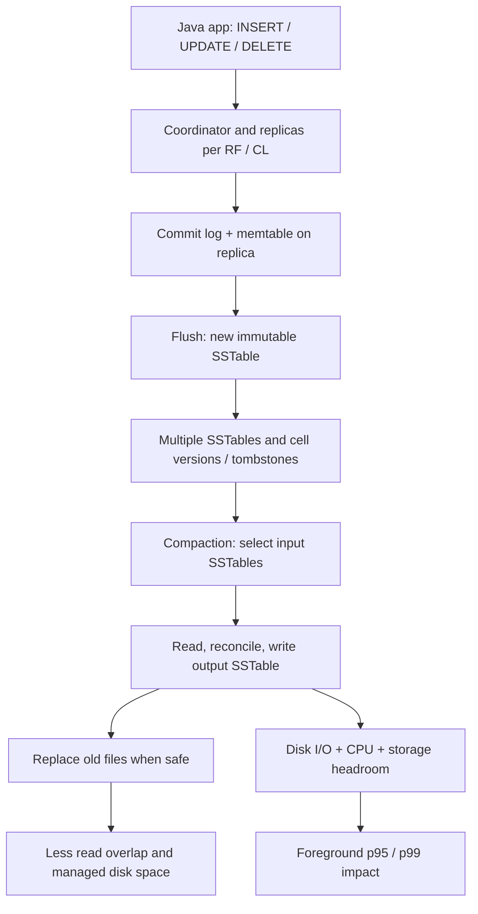
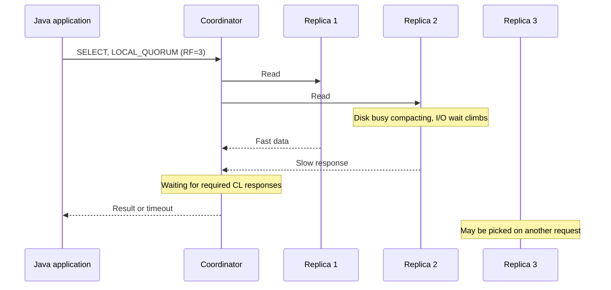
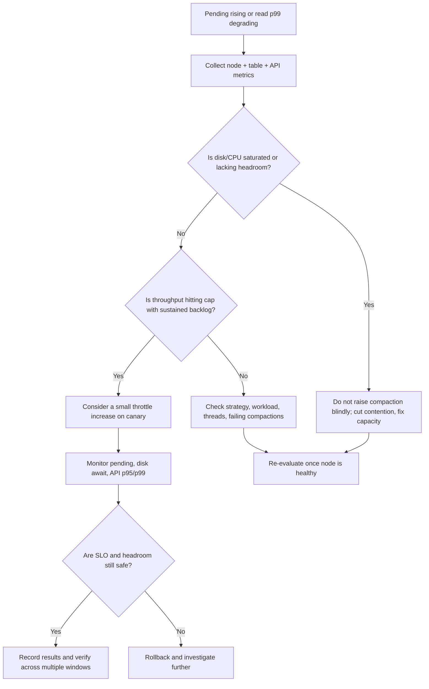

# Compaction Throughput, Pending Tasks, and Write Amplification in Apache Cassandra

## 1. Goal: Balancing Background Work with Real Read/Write Load

Apache Cassandra is a **distributed wide-column** database. Every CQL mutation targeting a **partition key** is written to the commit log and memtable on replicas matching the **replication factor (RF)** and **consistency level (CL)**. When memtables flush, data is written out to immutable SSTables. **Compaction** merges and reorganizes SSTables per each table's strategy while discarding older cell versions and tombstones once safety conditions are met.

Compaction is essential background work, yet it competes for **disk I/O, CPU, memory, and sometimes network bandwidth** with Java application requests. Both extremes hurt:

- **Compaction too slow:** SSTables pile up, read amplification rises, queries must reconcile many data versions, disk pressure grows, and space reclamation lags.
- **Compaction too aggressive:** massive SSTable reads/writes starve flushes, reads, and writes on the same drives; API p95/p99 can spike even while the backlog shrinks quickly.

Three concepts must be tracked together:

1. **Compaction throughput:** the rate at which compaction work/data is processed and its corresponding throttle cap.
2. **Pending tasks:** the reported count of queued compaction tasks, **not directly the remaining byte volume**.
3. **Write amplification:** how much more physical data must be written compared to new logical data ingested by the application.

This lesson focuses on **resource tuning**, never treating higher compaction speed as a substitute for query-driven table design, replication, repair, or handling failed nodes.

## 2. From Mutation to Compaction: Where Is Data Rewritten?



This diagram shows **where I/O arises**, not a fixed protocol sequence across every Cassandra version. Selected SSTables, run cadence, output layout, and tombstone eviction eligibility depend on **compaction strategy**, release version, and data state.

### Why Can a Row Be Written Multiple Times?

Suppose the same `order_id` key goes through three state versions:

```text
T1: status = CREATED  -> memtable -> SSTable A
T2: status = PAID     -> memtable -> SSTable B
T3: status = SHIPPED  -> memtable -> SSTable C

Compaction picks A, B, C:
  read relevant cells and timestamps
  reconcile by Cassandra rules
  write valid live data to SSTable D
  remove A, B, C once safety conditions hold
```

Data written once to an SSTable during a flush is **written again into a new SSTable** during compaction. An output SSTable may subsequently become input to another compaction pass. That is a major source of *write amplification*.

**Do not confuse compaction with repair:** compaction organizes data **within a single replica**; anti-entropy repair compares and synchronizes **across replicas**. Compaction cannot fix a mutation missing on another replica.

## 3. Three Cost Layers to Separate

| Layer | Work Performed | Relevant Metrics |
| --- | --- | --- |
| **Foreground writes** | CQL requests, commit log, memtable, ACK per CL | QPS, write latency, timeouts, pending flushes |
| **Flush** | Converting memtables into immutable SSTables | Flush rate, new SSTables, disk writes, memtable size |
| **Compaction** | Reading input SSTables, writing output SSTables, swapping files | Throughput, pending compactions, completed tasks, I/O, write amplification |

Add to this streaming during bootstrap/repair, snapshots, compactions triggered by admin operations, and OS activity. When measuring **total** disk write speed, never attribute every written byte to compaction.

In Cassandra, an `INSERT` request succeeds once enough replicas satisfy the CL; the application **does not wait for a future compaction** for that write to succeed. However, resource contention from compaction can slow writes/flushes and cause timeouts later.

### Connection to SSTable Immutability

To update a cell, Cassandra writes a new mutation rather than **modifying in place** the old cell inside an SSTable. Reads reconcile multiple sources: memtable, SSTables, timestamps, TTLs, and tombstones. Consequently:

- Flushes continuously produce new SSTables.
- Compaction bounds SSTable counts and overlap within strategy rules.
- Writing many versions to the same partition increases reconciliation work.
- TTLs and deletes generate tombstones that do not vanish immediately upon expiration.

Tuning purely by adding RAM or raising compaction throughput while ignoring **partition size, query shape, and compaction strategy** can target the wrong bottleneck.

## 4. Compaction Throughput: A Throttle Cap, Not Disk Speed

**Compaction throughput** has two commonly confused meanings:

1. **Throughput limit (throttle):** the rate budget Cassandra configuration allows compaction to consume per version mechanics.
2. **Observed throughput:** actual compaction bytes processed during a measurement window.

A 64 MB/s cap **does not mean compaction always runs at 64 MB/s**. It may run slower due to lack of tasks, I/O scarcity, few active threads, or CPU/disk contention. Conversely, actual physical device reads and writes cannot be derived trivially from a throttle number, since metrics may define **bytes processed** differently from **bytes written to disk**.

Cassandra releases typically provide commands such as:

```bash
nodetool getcompactionthroughput
nodetool help setcompactionthroughput
```

Config key names in `cassandra.yaml`, units (MB/s vs MiB/s), rounding, and runtime mutability **differ by version**. Before applying changes, read `nodetool help` on the target cluster and check that release's documentation.

### Controlled Adjustment Example

Only on a **lab cluster or under an approved runbook**, after verifying units:

```bash
# Check current state.
nodetool getcompactionthroughput

# Verify syntax/units; never test ad-hoc in production.
nodetool help setcompactionthroughput

# Example setting 32 in the unit documented by your version:
nodetool setcompactionthroughput 32

# Verify value after change.
nodetool getcompactionthroughput
```

The value `32` here is an **operational example**, not a good default for every drive. Record the prior value for rollback. Changes via `nodetool` may be **runtime-only**; never assume they persist across restarts or propagate automatically to other nodes.

### Why Not "Uncap Full Speed"?

Suppose a node sustains roughly 250 MiB/s of disk write throughput under test conditions:

```text
Foreground writes + flushes:   85 MiB/s
Compaction writes:            110 MiB/s
Streaming/other:               30 MiB/s
------------------------------------
Hypothetical total writes:    225 MiB/s
```

That leaves about 25 MiB/s in **average throughput**, before factoring in IOPS limits, read I/O, queued latency, SSD behavior, fsyncs, compaction bursts, and CPU usage. A node can breach p99 **before** reaching nominal write bandwidth limits.

Therefore, **disk busyness, disk read/write latency, and API p99** usually judge headroom to increase compaction better than a standalone MB/s figure.

## 5. Pending Tasks: Counting Queued Jobs, Not Owed Bytes

`nodetool compactionstats` reports active compaction tasks and a version-dependent pending task count.

```bash
nodetool compactionstats
```

An abbreviated illustrative output:

```text
pending tasks: 124
            id   compaction type   keyspace   table      completed   total
            ...  COMPACTION        sales      events    ...         ...
Active compaction remaining time: ...
```

This is a **conceptual sample explaining fields**, not exact output from a specific Cassandra version. Column names and pending estimation vary across versions.

### Three Mistakes When Reading Pending Tasks

**Mistake 1 — "124 pending" means 124 GiB left.** False. Each task can cover vastly different byte volumes; many small tasks can weigh less than one large compaction.

**Mistake 2 — "Pending = 0" means the disk is idle.** False. There can still be **active compactions**, flushes, repair streaming, commit log writes, foreground reads/writes, or OS I/O.

**Mistake 3 — "Rising pending" always means throughput is too low.** Not necessarily. Causes include ingest bursts, flushes spawning SSTables fast, strategy changes, table/partition skew, tombstones, failing compactions, or an overloaded node.

### Reading Backlog Growth Rate

```text
09:00: pending =  40
09:10: pending =  90
09:20: pending = 145
09:30: pending = 190

Growth +50, +55, +45 tasks every 10 minutes.
=> Indicates an accumulating backlog trend.
```

The pending value is only an **estimate of remaining tasks**. It can jump up or down as the scheduler re-evaluates SSTable sets or merges/splits large jobs. Pair it with **bytes pending (if exposed by version), active throughput, completed tasks, SSTable count, and disk headroom** to understand real impact.

A simple mental relationship:

```text
Backlog growth rate ≈ task creation rate - task completion rate
```

Still, "tasks/second" cannot replace "bytes/second", because task sizes are non-uniform.

## 6. Write Amplification: Define Numerator and Denominator Clearly

**Write amplification (WA)** describes how many physical bytes are written per unit of new logical bytes. In an LSM/SSTable engine, data written during a flush is often **rewritten multiple times** during compaction.

Depending on metric sources, WA can be defined differently:

- **WA from logical ingest:** `(SSTable flush writes + compaction SSTable writes) / logical ingest bytes`.
- **WA relative to flushed SSTable data:** `(flush writes + compaction writes) / flush writes`.
- **Compaction-only amplification:** `compaction writes / flush writes`.
- **Disk-level write amplification:** may also include commit log, snapshots/temp files, and filesystem/SSD overhead; not equivalent to the three ratios above.

Because data may be compressed, contain tombstones/TTLs, span replicas, and overwrite keys, **never compare WA ratios between two clusters without agreeing on the exact definition and window**.

### Steady-State WA Calculation Example

A node has these hypothetical averages over a sufficiently long window:

| Item | Average Rate |
| --- | ---: |
| Logical data arriving at replica, pre-compression | 20 MiB/s |
| New SSTables from flush, post-compression | 16 MiB/s |
| Output SSTables written by compaction | 48 MiB/s |
| Total SSTable bytes written | 64 MiB/s |

Then:

```text
WA vs. logical = (16 + 48) / 20 = 3.2x
WA vs. flush = (16 + 48) / 16 = 4.0x
Compaction-only / flush = 48 / 16 = 3.0x
```

A report stating "WA = 3" might mean **3.0x compaction writes relative to flushes**, **not** "3x total physical I/O". This example also **omits commit log writes and compaction reads**, so it cannot size total device I/O alone.

> Note: application-level writes entering a cluster are **multiplied by RF copies** across nodes. Measuring WA on a single replica must use the logical bytes that replica actually receives—do not mix client-side logical writes directly with cluster-wide physical writes arbitrarily.

## 7. Read Amplification, Space Amplification, and Trade-Offs

Compaction tuning affects at least three forms of amplification:

| Concept | Description | Example |
| --- | --- | --- |
| **Write amplification** | Rewriting data into SSTables multiple times | Compaction output consumes heavy write I/O bytes |
| **Read amplification** | One logical read must inspect multiple SSTables/cells | One partition has versions spread across many files |
| **Space amplification** | Actual storage temporarily/redundantly exceeds live data | Old and new SSTables coexist during compaction |

Pushing one factor down often pushes another up. For example:

- **LCS** generally targets low read amplification for many workloads, yet can raise write amplification as files promote across levels.
- **STCS** typically has different write amplification than LCS, yet can retain more overlapping SSTables.
- **TWCS** works well for time-window/TTL data when writes and expirations follow time order; mixing old updates into recent windows causes undesirable side effects.
- **UCS** (where version-supported) exposes parameters to tune goals/trade-offs; verify version and exact options.

There is no single "ideal" WA ratio for every table. `SELECT` patterns, update rates, partition counts, TTLs, compaction strategy, and hardware decide the right fit.

## 8. Strategy Shapes Backlog and WA More Than a Throttle

| Strategy | General Mechanism | When to Consider | Tuning Risks |
| --- | --- | --- | --- |
| **SizeTieredCompactionStrategy (STCS)** | Merges similarly sized SSTables into larger SSTables | Write-heavy workloads tolerant of some overlap on reads | Pending/SSTable counts can grow; large compactions need headroom |
| **LeveledCompactionStrategy (LCS)** | Organizes data into levels, bounding overlap within levels | Read-amplification-sensitive queries, frequent updates | Repeated rewrites can drive up compaction I/O |
| **TimeWindowCompactionStrategy (TWCS)** | Groups data into time windows | Time-series/uniform TTL with minimal late writes to old windows | Late writes, mixed TTLs, and mutating old data |
| **UnifiedCompactionStrategy (UCS)** | Parameterized strategy trading off amplification per supported version | Supported platforms/versions after benchmarking | Mis-tuning can shift WA, RA, and space amplification simultaneously |

**TWCS is not the default answer for every table with a timestamp.** It fits best when ingest and TTLs align so SSTables in expired time windows can be dropped cleanly. If old rows are continuously updated or TTLs vary widely, do not pick TWCS merely because data "has time".

### CQL Example: Choosing a Strategy for an Events Table

```sql
CREATE KEYSPACE IF NOT EXISTS tuning_lab
WITH replication = {
    'class': 'NetworkTopologyStrategy',
    'dc1': 3
}
AND durable_writes = true;

CREATE TABLE IF NOT EXISTS tuning_lab.events_by_tenant_day (
    tenant_id text,
    bucket_day date,
    created_at timestamp,
    event_id uuid,
    payload text,
    PRIMARY KEY ((tenant_id, bucket_day), created_at, event_id)
) WITH CLUSTERING ORDER BY (
    created_at DESC,
    event_id ASC
)
AND compaction = {
    'class': 'SizeTieredCompactionStrategy'
};
```

Creating the table **does not start a benchmark automatically**; it only sets the strategy. To test TWCS on a time-series table in the **lab**, you can evaluate:

```sql
ALTER TABLE tuning_lab.events_by_tenant_day
WITH compaction = {
    'class': 'TimeWindowCompactionStrategy',
    'compaction_window_unit': 'DAYS',
    'compaction_window_size': '1'
};
```

**Never run this `ALTER TABLE` in production just to cut pending tasks.** Changing strategy on existing data does not instantly transform old SSTables into the new layout, can trigger a heavy I/O wave, and alters tombstone/TTL handling; you need a migration runbook and before/after measurements.

## 9. Concurrency and Throughput Are Two Different Knobs

Beyond throughput limits, Cassandra configures **concurrent compaction execution** (e.g., `concurrent_compactors` in relevant versions). The two knobs behave differently:

| Knob | Primary Effect | Limitation |
| --- | --- | --- |
| Throughput throttle | Rate budget for compaction processing | Raising it does not guarantee the disk can keep up |
| Concurrent compactors | Number of compaction tasks running in parallel | Too many can contend for disk/CPU and raise context switching |
| Compaction strategy | How SSTables are chosen and when/how they merge | Fundamentally shifts read/write/space amplification |
| Flushes and write workload | Rate at which new SSTables arrive | Raising throttle cannot fix schema/partition flaws |

For instance, if four compactions are running on an already saturated drive, adding more threads will not necessarily finish work sooner; it may simply inflate queue depth and query p99.

Some config changes require restarts or version-specific admin steps. **Never change concurrency, throughput, and strategy simultaneously** and then guess which knob helped.

### Too Low a Throttle Is Also Dangerous

A cluster with steady writes kept at a very low compaction throttle will accumulate un-merged data. As SSTable counts climb, reads do far more work; as free disk shrinks, the node loses headroom needed to compact later.

The target is a **sustainable compaction service rate that keeps pace with incoming work** while foreground latency stays within SLO—neither "always keep it low to protect the app" nor "always max it out to zero pending".

## 10. Connecting to Cassandra P95/P99 and Consistency Levels

While a node compacts heavily, client requests still traverse that replica's read/write paths.



Simplified diagram: exact replica count contacted, digest vs data reads, speculative reads, and coordinator logic depend on version, CL, and runtime state.

With RF3 and `LOCAL_QUORUM`, the coordinator needs two local responses. If two replicas experience compaction disk contention simultaneously, Java sees read p99 spike even while all nodes show `UN` in `nodetool status`.

On the write path, compaction is not synchronously in the ACK path, yet disk saturation and delayed flushes/commit log reclamation can slow ACKs. **Never downgrade `LOCAL_QUORUM` to `ONE` just to mask timeouts** when the app requires quorum guarantees.

### Node Metrics Are Not API Metrics

`Local read latency` in `nodetool tablestats` is measured at the node via Cassandra's instrumentation. Java API p99 also includes client networking, coordinator hops, multiple replicas, paging, retries, and service logic. Attributing p99 spikes to compaction requires **temporal correlation across compaction I/O, replica latency, and API p99**.

## 11. System Health: Observing Accurately Across Multiple Tools

A commonly useful command set:

```bash
nodetool status
nodetool compactionstats
nodetool getcompactionthroughput
nodetool tablestats tuning_lab.events_by_tenant_day
nodetool tablehistograms tuning_lab events_by_tenant_day
nodetool tpstats
nodetool netstats
```

If the lab table isn't created yet, substitute the real table under investigation. `nodetool` typically queries **the node it connects to**, so collect from relevant nodes rather than treating one replica as representative of the whole DC.

| Source | What to Inspect | Question Answered |
| --- | --- | --- |
| `compactionstats` | Pending, active, task types, progress/ETA per version | Is there a backlog, huge compaction, or stalled task? |
| `getcompactionthroughput` | Current throttle | Is the cap low, high, or mismatched with runbooks? |
| `tablestats` | SSTable count, space, pending flushes, read/write latency | Which table spawns many files and shows I/O pressure? |
| `tablehistograms` | SSTables/read, p95/p99, partition size, cell count | Is there read amplification or large partitions? |
| `tpstats` | Pending/active tasks, dropped messages by verb/type | Are foreground queues or timeouts growing? |
| `netstats` | Streaming and network/hints activity | Is bootstrap/repair overlapping with compaction? |
| JVM/JMX exporter | Compactions completed/rate, thread pools, GC, SSTables | Trends and active workload levels |
| OS metrics | Disk read/write MB/s, IOPS, await/p99, %util, free disk, CPU | Does the hardware actually have headroom? |
| Java Driver/API | QPS, attempts/retries, read/write p95/p99, timeouts | Are users being impacted? |

JMX metric names, throughput units, and output fields **vary by Cassandra/exporter version**. On dashboards, record version, host, DC, keyspace, table, and units. Never take a multi-day cumulative counter as an instantaneous rate.

### Measure Deltas Instead of Cumulative Counters

Suppose the completed tasks counter grows from 11,500 to 11,560 in 5 minutes:

```text
delta completed = 60 tasks
duration = 300 seconds
completed rate = 60 / 300 = 0.2 tasks/second
```

This **does not yet prove processing capacity is sufficient**, because compaction tasks vary in size. Check bytes read/written, SSTable creation sources, and pending trends. On node restarts, counters reset; monitoring must handle counter resets rather than plotting negative rates.

## 12. Diagnosing Compaction Backlogs by Symptom

| Observation | First Hypothesis | What to Verify |
| --- | --- | --- |
| Pending climbs steadily while disk I/O has headroom | Low throttle or concurrency underutilizing storage | Current throughput limit, active tasks, disk latency |
| Pending climbs, disk util high, p99 bad | I/O saturated; workload creates work faster than drain | OS I/O, flush rate, compaction sizes, query/write load |
| Pending steady yet SSTable count high | Strategy keeps many SSTables or byte backlog differs from task count | SSTables/read, strategy, pending ranges, flush history |
| Pending low, read p99 still high | Hot/large partitions, tombstones, network/quorum, caches, or other I/O | `tablehistograms`, tracing, API metrics, GC |
| Compaction throughput hits cap while disk is idle | Throttle may be the real limit | Step up carefully with monitoring, staying within SLO |
| High throttle yet low observed throughput | Lack of tasks, I/O/CPU bottleneck, pauses, or failing compaction | Logs, active tasks, thread states, disk |
| Free disk drops while pending/compaction IO rises | Inputs and outputs coexist; large data or un-reclaimed TTL/deletes | Disk headroom, snapshots, retention, GC grace |
| Backlog spikes after bootstrap/repair | Streaming and compaction contending for resources | `netstats`, network/disk, repair schedule |

**Never run wholesale major compaction** during a high backlog without understanding the strategy and disk headroom. Major compaction can trigger a massive I/O spike and, on time-window workloads, break time-based data separation.

## 13. Step-by-Step Safe Tuning Playbook

### Step 1 — Define Targets and Boundaries

Document:

- SLA: read/write API p95/p99, maximum acceptable timeouts and unavailables.
- Data: table sizes, ingest rate, RF, updates/tombstones/TTLs, compaction strategy.
- Infrastructure: drive count, SSD class, free disk, sustained IOPS and bandwidth.
- Maintenance windows: are repair/backup/bootstrap currently running?
- Rollback plan: pre-change throughput and concurrency values.

**Do not tune on a nearly full disk** just to shrink backlog; compaction often needs extra output space before freeing inputs. Prioritize capacity planning and fixing root causes.

### Step 2 — Capture Baseline Across Multiple Windows

For example, sample every 5 minutes across a workload-representative interval:

```text
09:00 | pending=60 | compaction active=2 | disk busy=48% | read p99=35ms
09:05 | pending=85 | compaction active=2 | disk busy=55% | read p99=38ms
09:10 | pending=110| compaction active=2 | disk busy=59% | read p99=42ms
```

These numbers are **hypothetical**. Include bytes processed, observed throughput, flush rate, disk latency, write p99, and QPS. From the series above you can only hypothesize "pending rises while disk busyness isn't maxed out"—not yet conclude the throttle is the cause.

### Step 3 — Classify the Problem Before Raising Throughput



### Step 4 — Change Only One Knob and Use a Canary

When the throttle is genuinely the limiter, make a small change on one selected node/subset and monitor:

1. Save old config and Cassandra version.
2. Pick a new cap matching **both read and write** headroom.
3. Observe across multiple measurement cycles, not just 20 seconds.
4. Compare pending trend, active throughput, disk await, free disk, read/write p99, and retries.
5. If API degrades or headroom disappears, **revert to the prior value** and confirm recovery.

Only after canary validation consider controlled broader rollout. **Never simultaneously raise `concurrent_compactors`, switch STCS → LCS, and raise throttle**—you lose the ability to attribute effects.

### Step 5 — Verify Debt Actually Declines

Successful tuning is not merely "pending dropped from 100 to 20". Verify:

- Does it stay **sustainably** lower across peak and steady-state load?
- Are SSTable counts and SSTables/read reasonable for the strategy?
- Is local/API p99 within SLO?
- Do free disk and I/O latency keep headroom for node failures or repair?
- Are timeouts, dropped messages, or compaction errors absent?

If a parameter change drops pending while tripling p99 and driving disks to 99% util, it is **not a system-wide improvement**.

## 14. CQL Practice: Generating Data and Observing Compaction

Use the `tuning_lab` keyspace from Section 8 on a **test cluster** with DC `dc1` and matching RF. Never run fault injection or heavy load tests in production.

### Writing Sample Events

```sql
INSERT INTO tuning_lab.events_by_tenant_day (
    tenant_id, bucket_day, created_at, event_id, payload
) VALUES (
    'tenant-a', '2026-11-20', '2026-11-20 09:00:00+0000',
    11111111-1111-4111-8111-111111111111, 'created'
);

UPDATE tuning_lab.events_by_tenant_day
SET payload = 'confirmed'
WHERE tenant_id = 'tenant-a'
  AND bucket_day = '2026-11-20'
  AND created_at = '2026-11-20 09:00:00+0000'
  AND event_id = 11111111-1111-4111-8111-111111111111;

SELECT created_at, event_id, payload
FROM tuning_lab.events_by_tenant_day
WHERE tenant_id = 'tenant-a' AND bucket_day = '2026-11-20'
LIMIT 20;
```

Two mutations are insufficient to produce significant compaction load; their purpose is verifying schema and query paths. Afterward, generate test data across **many partition keys** at a bounded rate and observe over time.

### Observing After an Ingest Run

```bash
nodetool tablestats tuning_lab.events_by_tenant_day
nodetool tablehistograms tuning_lab events_by_tenant_day
nodetool compactionstats
nodetool getcompactionthroughput
nodetool tpstats
```

Capture data **before – during – after** a test run. Record QPS, bytes written, compaction strategy, disk I/O, pending count, and API/driver p99 with aligned timestamps. Low write rates or un-flushed memtables can leave `compactionstats` nearly unchanged; that is expected.

### If Testing TTL / TWCS

On an appropriate **lab table**, create mutations with TTL:

```sql
INSERT INTO tuning_lab.events_by_tenant_day (
    tenant_id, bucket_day, created_at, event_id, payload
) VALUES (
    'tenant-b', '2026-11-20', '2026-11-20 12:00:00+0000',
    22222222-2222-4222-8222-222222222222, 'temporary'
) USING TTL 604800;
```

A `604800`-second TTL equals 7 days. **Expired TTL data does not disappear from all SSTables immediately.** Tombstones/compaction and safety rules determine when space is reclaimed; inter-replica repair must also align with tombstone retention policies.

## 15. Java Driver 4.x: Measuring Business Writes to Avoid Optimizing the Wrong Target

A Java layer can execute CQL with prepared statements and measure request latency. The example below uses caller-supplied deterministic timestamps/event IDs rather than generating fresh IDs on every retry:

```java
import java.time.Instant;
import java.time.LocalDate;
import java.util.UUID;
import java.util.concurrent.TimeUnit;

import com.datastax.oss.driver.api.core.CqlSession;
import com.datastax.oss.driver.api.core.DefaultConsistencyLevel;
import com.datastax.oss.driver.api.core.cql.BoundStatement;
import com.datastax.oss.driver.api.core.cql.PreparedStatement;

public final class EventWriter {
    private final CqlSession session;
    private final PreparedStatement insert;

    public EventWriter(CqlSession session) {
        this.session = session;
        this.insert = session.prepare(
            "INSERT INTO tuning_lab.events_by_tenant_day " +
            "(tenant_id, bucket_day, created_at, event_id, payload) " +
            "VALUES (?, ?, ?, ?, ?) USING TIMESTAMP ?"
        );
    }

    public long writeLatencyMillis(
            String tenantId, LocalDate bucketDay,
            Instant createdAt, UUID eventId, String payload,
            long timestampMicros) {
        BoundStatement stmt = insert.bind(
                tenantId, bucketDay, createdAt, eventId, payload,
                timestampMicros
            )
            .setConsistencyLevel(DefaultConsistencyLevel.LOCAL_QUORUM)
            .setIdempotent(true);

        long start = System.nanoTime();
        session.execute(stmt);
        return TimeUnit.NANOSECONDS.toMillis(System.nanoTime() - start);
    }
}
```

**Conditions for `setIdempotent(true)`:** the same logical operation must reuse the **exact same** `eventId`, data, and `timestampMicros`, involve no counters/LWTs/side effects, and guard against concurrent conflicting writes. If those conditions are not guaranteed, **do not mark it idempotent**. Write timeouts have uncertain outcomes; never retry blindly.

Production applications should reuse `CqlSession` and normalize metric labels by query template, DC, CL, and status/error—never attach millions of `tenantId` values as metric labels. Alongside write latency, track **API p95/p99, attempts/retries, timeouts, throughput, app backlogs, and connection pools**.

**Never interpret one `session.execute` duration as compaction time.** A write can succeed before data is ever flushed or compacted. Correlate client latency against node/disk metrics over the same time window.

## 16. Operational Scenarios for Self-Check

### Scenario A — Pending Climbs While Disk Isn't Saturated

Pending compactions climb from 20 to 300 during ingest hours; disk latency is steady, compaction throughput hits its current cap, and CPU has headroom. Should you raise throughput?

**Hint:** You can **test a small controlled increase** and re-measure, since the throttle may be the bottleneck. Still evaluate compaction strategy, task sizes, peak workload, and p99; do not assume certainty from pending count alone.

### Scenario B — Pending Drops, API P99 Doubles

After raising throughput, pending drops from 200 to 50, yet read p99 jumps from 45 ms to 130 ms and disk await spikes. Did tuning succeed?

**Hint:** No. It improved one background counter at the cost of foreground SLAs. Roll back or re-throttle, measure total I/O, and balance drain speed against p99.

### Scenario C — LCS Shows High Write Amplification

A table frequently updates the same partitions, prioritizes fast reads, and uses LCS. Measured compaction SSTable writes far exceed flush writes. Is LCS broken?

**Hint:** You cannot conclude that from the ratio alone; LCS intentionally trades higher WA to reduce certain forms of read amplification. Measure read p99, SSTables/read, space headroom, workload, and exact WA definitions before switching strategies.

### Scenario D — TWCS with Late-Arriving Writes

An application continuously updates events from 90 days ago in a TTL-enabled TWCS table. Pending tasks and SSTable sizes grow unexpectedly. What needs checking?

**Hint:** Late writes, timestamp/time-window semantics, mixed TTLs, and how compaction buckets data into windows. TWCS is ill-suited if old windows are continuously mutated; revisit workload and strategy.

### Scenario E — Disk Nearly Full, Proposal to Force Major Compaction

A node has 6% free disk, pending tasks rise, and data contains many tombstones. An admin proposes major compaction to "clean up disk space". Is it safe?

**Hint:** Not by default. Major compaction requires space for output SSTables and heavy I/O; tombstones are not always eligible for eviction. Address headroom/capacity, snapshots, retention, and repair schedules first.

### Scenario F — Computing Write Amplification with the Wrong Denominator

An app writes 20 MiB/s logically at the client; an RF3 cluster records 180 MiB/s total disk SSTable writes. Can you call system-wide WA 9x and compare it directly against an RF1 node's WA?

**Hint:** No. 180/20 = 9 is an aggregate ratio inflated by **replication factor**. To compare flush/compaction amplification, normalize per node/replica using the actual data each replica receives, and state explicitly whether compression and commit log are included.

## 17. Pre- and Post-Tuning Checklist

- [ ] Identified **ingest workload**, update/delete/TTL frequency, and partition/query shape.
- [ ] Know each table's compaction strategy; never apply STCS/LCS/TWCS/UCS with one blanket formula.
- [ ] Read `nodetool compactionstats` distinguishing **pending, active, and progress**.
- [ ] Did not directly equate pending task count with **byte backlog** or required disk space.
- [ ] Checked `getcompactionthroughput` and version-specific units/syntax before making edits.
- [ ] Separated throughput throttle from observed throughput, and throughput from concurrency.
- [ ] Clearly defined whether write amplification includes flushes, compaction, compression, RF, and commit log.
- [ ] Tracked **SSTables/read, disk await, free disk, read/write p95/p99, and timeouts** together.
- [ ] Evaluated compaction alongside repair, bootstrap, streaming, snapshots, and foreground traffic.
- [ ] Avoided blindly raising throughput/concurrency when disk or CPU is already saturated.
- [ ] Avoided forcing major compaction or lowering `gc_grace_seconds` solely to purge tombstones.
- [ ] Changed one variable on a canary, kept baseline numbers, and prepared rollback.
- [ ] Verified across multiple workload windows rather than a single `compactionstats` snapshot.
- [ ] In Java, preserved required CL and idempotent retries, avoiding load amplification when nodes slow down.
- [ ] Accepted improvements only when both **sustainable backlog and application SLOs** are met.

**Takeaway:** `compaction throughput` is a rate-limiting knob for compaction capacity; `pending tasks` is a **scheduler-estimated** indicator of queued jobs, not direct owed bytes; `write amplification` is the cost of rewriting data and must be calculated with clear definitions. Effective Cassandra tuning keeps **SSTable/compaction backlogs under control without sacrificing read/write p99, disk headroom, or data correctness**.
