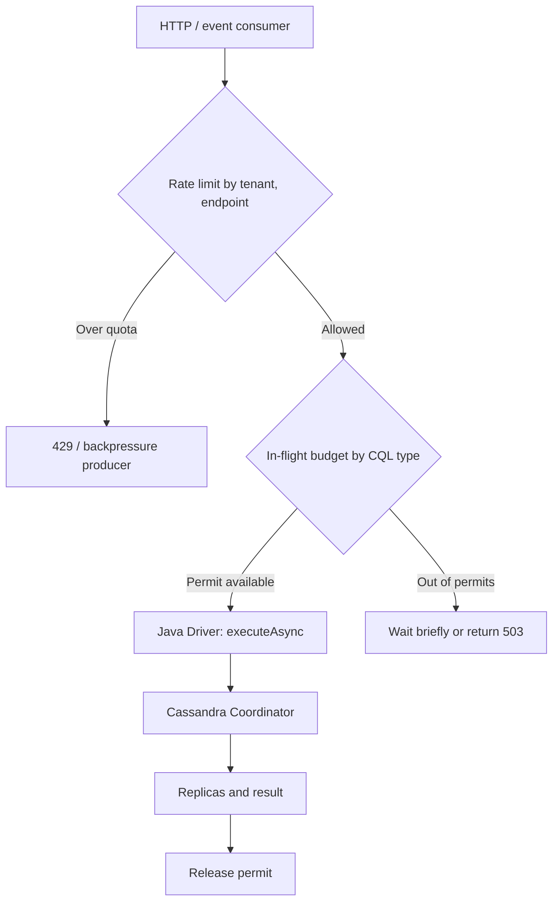

# Application-Side Concurrency Limiting and Throttling for Apache Cassandra

## 1. The Problem: Applications Can Overload Cassandra Even with Valid Queries

In **DATABASE_ENGINE_WIDE_COLUMN_CASSANDRA**, Apache Cassandra stores data in a **wide-column** model, distributing partitions across nodes and replicating per keyspace settings. Query-driven table design, proper partition keys, replication, consistency, compaction, and repair are all critical operational pillars. Yet even when every CQL query specifies a partition key and returns quickly under normal load, **thousands of concurrent queries** can still build queues, spike response times, raise memory pressure, and trigger cluster-wide timeouts.

For example, a retail service receives a traffic spike right after a flash sale opens. Each HTTP request executes one product read, one inventory check, and sometimes an order update. If 200 requests arrive together and each fires 3 CQL queries in parallel, the application can emit up to **600 in-flight CQL operations** awaiting responses. Adding more threads, enlarging connection pools, or raising timeouts often prolongs the outage: even more operations pile up in queues and users receive errors later.

The solution is an application-side **load budget** deciding which operations go out immediately, which wait briefly, and which are rejected under control. This is **admission control / backpressure**: protecting Cassandra, application resources, and committed API response times.

After this lesson, you should be able to distinguish rate limits from concurrency limits, pick the right limiting unit, implement load shedding with the Java Driver, design error/retry policies, and test under traffic spikes or replica failures.

## 2. Distinguishing Request Rate, In-Flight Operations, and Queues

| Quantity | Question Answered | Example | Suitable Tool |
| --- | --- | --- | --- |
| **Request rate** (`λ`) | How many requests arrive per second? | 800 HTTP requests/s | Rate limiter, token bucket, per-tenant quota |
| **CQL operation rate** | How many CQL operations are actually emitted per second? | 2,400 CQL ops/s because each HTTP request fans out into 3 operations | Repository/driver counters, per-query-type limits |
| **In-flight concurrency** (`L`) | How many operations are sent and awaiting completion right now? | 96 CQL operations | Semaphore/bulkhead, in-flight cap |
| **Latency** (`W`) | How long does each operation take to finish? | Mean 80 ms; p99 450 ms | Timeout budget, p50/p95/p99 tracking |
| **Pending queue** | How many operations are waiting to be admitted? | 200 operations waiting for a permit | Bounded-length and bounded-wait queue |
| **Rejected requests** | How many requests were denied for exceeding budget? | 15 requests/s rejected | HTTP 429/503, bounded retries with jitter |

The two primary mechanisms complement each other:

- **Rate limiting:** caps request volume **over a time window**. A token bucket permits a short burst and refills tokens at a configured rate. Suitable for tenant quotas, endpoints, or ingress caps.
- **Concurrency limiting:** caps operations **occupying resources simultaneously**. A semaphore is easy to apply; once all permits are taken, the app stops emitting new CQL calls. Suitable for stopping slow requests from piling up load.

A system limiting only `requests/second` can still overload when Cassandra slows down. For instance, at a steady 500 ops/s, if each operation climbs from 20 ms to 400 ms, in-flight operations surge sharply. Conversely, limiting only concurrency does not guarantee fair quotas: one tenant can monopolize all permits.

### Using Little's Law for a Starting Point

In steady state, using consistent units:

\[
L \approx \lambda \times W
\]

Where `L` is the **average number of concurrent operations**, `λ` is throughput in operations/second, and `W` is the **average completion time in seconds**. For example, if you observe 600 CQL ops/s and 0.08 s average latency, average in-flight operations are roughly `600 × 0.08 = 48`.

The number **48 is not an automatic optimal setting**. It ignores bursts, p99, partition skew, traffic from other applications, per-node limits, or degradation when a replica goes down. Use the formula to gauge scale, then measure real traffic and set limits with a safety margin. Never plug p99 latency into the formula and interpret the output as an average.

## 3. Limiting at the Right Point in the Processing Flow



A strategy can combine multiple layers:

1. **Ingress / API gateway:** set max rate and burst per endpoint/tenant; catch clients polling continuously or retry-flooding.
2. **Service / business layer:** separate budgets for fast reads, critical writes, LWTs, scans/paging, and background tasks like sync or backfills; never let batch jobs starve online transactions.
3. **Before driver calls:** limit **in-flight CQL operations**, not just HTTP requests. One HTTP request firing 10 parallel CQL queries consumes 10 operations' worth of budget.
4. **At the driver and cluster:** monitor driver in-flight requests, driver queues/throttling (if configured in your version), and Cassandra overload signals; app limits must align with downstream capacity.

**Budget units must stay consistent.** Counting "one request" at the HTTP gateway and "one operation" at the driver are different metrics. For paged queries, one `executeAsync` call may fetch only the **first page**; iterating further pages fires additional requests to Cassandra. To bound the whole operation, either hold the permit until all pages are consumed or enforce limits on each subsequent fetch. For batch/fan-out pipelines, bound parallelism right where work is generated.

### Choosing Limiting Scopes

| Scope | Why It Is Needed | Caveats |
| --- | --- | --- |
| Whole application instance | Stops one pod from generating excessive in-flight CQL | Adding pods raises total concurrency unless adjusted |
| Per endpoint / operation type | Keeps slow scans, backfills, or LWTs from starving small reads | Align with business priority and measured cost |
| Per tenant / customer | Ensures fairness and prevents noisy-neighbor cascading impact | Both rate limits and in-flight quotas may be needed |
| Per partition / hot key | Prevents heavy contention on one partition, especially writes and LWTs | Never allocate unbounded semaphores for arbitrary keys; bound map size and clean up |
| Fleet-wide across instances | Keeps aggregate budget stable during autoscaling | Requires per-instance budget allocation or distributed coordination; plan for coordinator failure |

For example, with 6 pods each allowed 64 in-flight CQL operations, that service alone can emit up to **384 concurrent operations**, excluding other apps. If autoscaling bumps pod count to 12 without adjusting limits, the ceiling jumps to **768**, even though Cassandra did not scale out. Track and recalculate budgets whenever app replicas, Cassandra topology, or traffic profiles change.

## 4. Practice with Java Driver 4.x: In-Flight Limiting Using `Semaphore`

Example repository reading a product by **partition key `sku`**, returning one row per lookup. The snippet uses Java Driver 4.x `CqlSession` (`com.datastax.oss.driver.api`) configured with contact points, local datacenter, and authentication at startup. `CqlSession` is **reused** and the prepared statement is prepared once.

Assume the backing table:

```sql
CREATE TABLE catalog.product_by_sku (
    sku text PRIMARY KEY,
    title text,
    price decimal
);
```

Java class rejecting new requests once 128 reads are in flight:

```java
import java.time.Duration;
import java.util.concurrent.CompletableFuture;
import java.util.concurrent.CompletionStage;
import java.util.concurrent.RejectedExecutionException;
import java.util.concurrent.Semaphore;

import com.datastax.oss.driver.api.core.CqlSession;
import com.datastax.oss.driver.api.core.DefaultConsistencyLevel;
import com.datastax.oss.driver.api.core.cql.AsyncResultSet;
import com.datastax.oss.driver.api.core.cql.BoundStatement;
import com.datastax.oss.driver.api.core.cql.PreparedStatement;

public final class BoundedProductRepository {
    private final CqlSession session;
    private final PreparedStatement bySku;
    private final Semaphore readPermits = new Semaphore(128);

    public BoundedProductRepository(CqlSession session) {
        this.session = session;
        this.bySku = session.prepare(
            "SELECT sku, title, price " +
            "FROM catalog.product_by_sku WHERE sku = ?");
    }

    public CompletionStage<AsyncResultSet> findBySku(String sku) {
        // Do not block the HTTP thread waiting indefinitely for a permit.
        if (!readPermits.tryAcquire()) {
            return CompletableFuture.failedFuture(
                new RejectedExecutionException("Cassandra read budget exceeded"));
        }

        try {
            BoundStatement query = bySku.bind(sku)
                .setConsistencyLevel(DefaultConsistencyLevel.LOCAL_ONE)
                .setTimeout(Duration.ofMillis(500));

            return session.executeAsync(query)
                .whenComplete((result, error) -> readPermits.release());
        } catch (RuntimeException error) {
            // Release even if an error occurs before obtaining the CompletionStage.
            readPermits.release();
            return CompletableFuture.failedFuture(error);
        }
    }
}
```

**How it works:** `tryAcquire()` permits sending CQL only when a permit is free. When the `CompletionStage` completes normally **or** exceptionally, `whenComplete` releases the permit. The synchronous catch branch also releases it to prevent leaks. `LOCAL_ONE` here is solely the **consistency policy for an illustrative catalog read tolerant of stale data**; if an endpoint must read acknowledged writes, choose a CL matching the business contract—never downgrade CL just to boost load numbers.

This example queries a single `sku`, so results hold at most one row without multi-page fetching. If replaced by a multi-page list query, **do not release the permit after the first page while fetching remaining pages at an unbounded rate**. Hold the permit across the entire paged traversal or acquire/release per page fetch so concurrent server requests stay bounded. In production, map `RejectedExecutionException` at the HTTP boundary to an appropriate status response instead of leaking an opaque 500 error.

### Why Not Enlarge Thread Pools to Handle Spikes?

Java Driver async methods let few app threads drive lots of I/O. Yet **async does not equal infinite processing capacity**. Spawning 50,000 `CompletionStage` instances simultaneously still forces the app to track pending state, response buffers, timeouts/retries, and memory. A `Semaphore` bounds load size before pushing requests into the driver. Never call `.join()` or `.get()` inside an event loop, turning async execution into blocking threads.

### Rejections Must Be Handled at the API Boundary

Illustrative business conventions:

| Breached Actor / Limit | Response / Action | What Must Be Guaranteed |
| --- | --- | --- |
| A tenant exceeds quota | `HTTP 429 Too Many Requests`, optionally with `Retry-After` | Client knows to slow down or wait |
| Instance exhausts Cassandra budget | `HTTP 503 Service Unavailable` or API-defined overload response | Requests are not left hanging until mass timeouts |
| Message consumer fills up | Pause/throttle message pulls and cap prefetch | Do not ACK before processing; avoid unbounded memory backlogs |
| Batch job gets throttled | Pause, checkpoint, and resume within background quota | Does not starve user-facing traffic |

When retrying, use **exponential backoff with jitter and bounded attempts/total deadline**; favor idempotency keys or repeatable processing models. Cassandra may have applied a write before the client timed out; blindly resending an increment or side-effecting mutation is dangerous. `IF`/LWT statements can also face contention; handle conditional outcomes and timeouts per business rules instead of retry-storming.

## 5. Rate Limiters and Short Queues: Smoothing Bursts Without Accumulating Debt

Suppose a catalog read endpoint has a 200 requests/s quota per tenant allowing a 100-request burst. A **token bucket** refills 200 tokens/sec on average with capacity 100 tokens; each request consumes one token. Once empty, further requests are throttled until tokens refill. If one HTTP request fires multiple queries, compute `cost` from expected CQL operations, or apply an independent semaphore layer at the repository.

Policy pseudo-code example:

```text
onRequest(tenant, request):
    cost = estimateCost(request)       // must at least reflect fan-out
    if !tenantBucket[tenant].take(cost):
        return 429                    // include an appropriate Retry-After

    if !operationBudget.tryAcquire():
        return 503                    // fail fast to avoid choking the driver

    try:
        return executeCqlAsync(request)
    finally_when_async_completes:
        operationBudget.release()
```

This pseudo-code shows control ordering; a real implementation must handle thread safety, monotonic time-based token math, bounding tenant bucket map size, releasing permits on all paths, and distinguishing timeouts/cancellations.

If brief waiting helps smooth tiny spikes, use a small bounded queue with a strict deadline—for example, **at most 32 queued requests waiting up to 20 ms** per instance after testing. Reject once the wait expires; never configure an unbounded queue. Long queues inflate latency without necessarily raising throughput, and serve stale responses right as HTTP callers give up.

**Avoid stacking queues unconsciously across multiple layers.** API servers have queues, retry libraries have queues, the driver has throttlers, messaging systems have prefetch buffers, and Cassandra has internal queues. Total queued work can vastly exceed any single dashboard gauge. Prefer one explicit admission control point in the app and monitor all remaining queues.

## 6. Preventing Hot Partitions and Expensive Tasks from Consuming the Entire Budget

In the wide-column model, rows sharing a partition key land on the same replica set. **Global concurrency limits do not automatically solve hot partitions.** For example, 1,000 users reading one trending product—or 500 workers updating the same counter/order—can create a hotspot even while cluster-wide QPS looks low.

Complementary measures:

- **Query-driven partition keys and load spread.** Avoid oversized partitions and wide scans. Shard/bucket only when business logic and read paths are designed for it; never change partition keys arbitrarily just to "spread evenly".
- **Coalescing/caching duplicate reads:** many concurrent requests for the same `sku` can share a cache entry or an in-flight call with proper TTL and invalidation rules. Guard against cache-expiration stampedes.
- **Per-operation-type isolation:** reserve budget for online reads; maintain separate limits for writes, LWTs, heavy queries, exports, and migrations. LWTs incur extra Paxos rounds and should not share equal-priority queues with simple reads.
- **Control batches and paging:** CQL `BATCH` is not a throughput booster across unrelated partitions. Chunk imports, bound parallelism, pick sensible fetch sizes, and evaluate tombstone/TTL impact.
- **Limit write contention:** for conditional updates on a single partition, use versioning or LWTs when needed; give them a separate budget and handle CAS failures properly. If invariants span multiple partitions, revisit the data model and transaction boundaries.

In multi-DC clusters, `LOCAL_ONE`, `LOCAL_QUORUM`, `QUORUM`, and LWTs carry different network/replica costs. **Keep consistency aligned with read/write requirements**, then tune rates and in-flight limits to each query class's measured latency; never use CL downgrades as a default overload defense.

## 7. Establishing Initial Settings and Metrics to Watch

A practical rollout process:

1. **Classify CQL operations:** partition-key reads; idempotent writes; conditional LWT writes; scans/paging; backfills; separate online vs background traffic.
2. **Measure baselines under representative load:** ops/s, in-flight counts, mean and p95/p99 latency, timeouts, unavailables, partition sizes, and app/Cassandra CPU/GC/network usage.
3. **Locate the latency inflection point:** ramp throughput gradually; when p99 and error rates jump sharply while throughput stops scaling, you have likely crossed the stability threshold. Investigate the cause before concluding.
4. **Set limits per instance and operation type:** pick budgets below the measured saturation point, leaving headroom for node loss/retries/maintenance and accounting for active pod count.
5. **Control bursts, deadlines, and errors:** rate limit first, concurrency limit next, short queue only if genuinely helpful, explicit rejection, bounded retries.
6. **Monitor production and re-tune:** whenever schemas, RF/CL, node counts, pod counts, or query volumes shift, re-test limits.

For example, a pre-production load test yields: 4 app instances, steady aggregate 1,200 CQL ops/s, 70 ms average latency, and p99 within SLO. By Little's Law, average in-flight is roughly `1,200 × 0.07 = 84`, or ~21 per instance if evenly balanced. You might **experiment** with a cap of 32–48 in-flight/instance and re-check p99, rejections, and recovery behavior. This illustrates **how to find a value**, not a universal default of `32`, `48`, or `128` for every cluster.

| Metric to Track | What to Check on Abnormal Shifts |
| --- | --- |
| `in_flight` by instance/query type | Is the cap saturated, or are requests stuck/leaking permits? |
| Accepted/rejected rate, `429`, `503` | Which client is bursting? Is the budget too tight or is Cassandra genuinely saturated? |
| Queue depth and queue wait | Is admission control holding too many waiting requests? |
| CQL ops/s, completed throughput | Does extra load still yield more successful completions? |
| Latency p50/p95/p99, request timeouts | Is tail latency rising from slow replicas, network, compaction, or GC? |
| Driver in-flight, pool/throttler metrics | Is queuing or bottlenecking happening inside the driver before reaching Cassandra? |
| Cassandra CPU, GC, disk I/O, pending tasks, dropped/timeout metrics | Resource saturation, compaction, repair, node faults, or hot partitions? |
| Read/write consistency, LWT errors, and retry counts | Is latency rising from CL, CAS contention, or load-amplifying retry loops? |

Avoid using raw `partition_key` values as metric labels for every key: cardinality explodes. Track hot keys via controlled sampling or diagnostics/tracing; dashboards grouped by tenant, endpoint, statement type, and DC are far more practical.

### Dynamic Adjustment When Conditions Change

You can apply **Additive Increase / Multiplicative Decrease (AIMD)** per query group: raise concurrency slowly while latency and errors stay healthy, and cut it sharply when p99 or overload breaches thresholds. However, enforce min/max bounds, cooldowns, and observation windows; if all pods react simultaneously to noisy signals, the system can oscillate wildly. Start with tested static limits and add dynamic controllers only when data proves they are needed.

## 8. Key Test Scenarios

| Test | How to Run in Test Environment | Expected Verification |
| --- | --- | --- |
| Short burst 5–10x baseline | Inject sudden traffic spike to one endpoint | In-flight never exceeds cap; controlled rejections; admitted requests' p99 stays within target |
| Slow down Cassandra | Inject latency via fault injection or resource caps | Rate stabilizes while in-flight hits cap; queues do not grow unboundedly |
| Lose one replica in DC | Simulate slow/down node, test under real CL | Timeouts and failover behave cleanly; retries do not trigger a retry storm |
| One hot partition | Many clients read/write the same partition concurrently | Hot key detected and other endpoints protected; LWT contention handled cleanly |
| One monopolizing tenant | Tenant A sends huge traffic while Tenant B sends normal traffic | Quotas and fairness prevent B from excessive degradation |
| Scale pods from 4 to 10 | Keep load constant while adding app instances | Total CQL budget stays controlled without unintentionally multiplying cluster load cap |
| Backfill alongside online traffic | Run scheduled import/repair/compaction plus read load | Background work is throttled; online traffic SLOs take priority |
| Ambiguous write timeout | Drop responses after some replicas may have written | API does not report guaranteed failure or blindly retry unsafe writes; uses idempotency/reconciliation |

Tuning limits is an **end-to-end** problem: queue wait + app processing + driver call + coordinator/replica work + response must all fit within the API deadline. Setting a 3-second driver timeout behind a 1-second HTTP timeout leaves queries burning cluster resources long after callers gave up. Propagate deadlines/cancellations properly and track post-disconnect work; remember cancellation does not guarantee Cassandra rolled back an already-sent write.

## 9. Common Mistakes and Fixes

| Mistake | Consequence | Fix |
| --- | --- | --- |
| Putting `Semaphore` around HTTP requests when each fans out 20 queries | Exceeds Cassandra budget despite low HTTP request count | Count and cap at the CQL layer while bounding fan-out |
| Using unbounded queues to "avoid dropping requests" | Heap spikes, bad tail latency, piling retries | Bounded queue + deadline + explicit rejection policy |
| Blocking with `.get()` on I/O threads | Wastes threads, causes stalls and deadlocks in reactive/event-loop models | Use `CompletionStage` and release permits in completion callbacks |
| Enlarging connection pools and timeouts when Cassandra slows | Causes even more requests to pile up | Measure bottlenecks, lower admission, and fix node/query root causes |
| Sharing one limit across LWTs, product reads, and batch exports | Background jobs starve online traffic | Bulkheads/quotas by operation type and priority |
| Retrying every error immediately | Retry storms, duplicate writes/ambiguous state | Idempotency, exponential backoff + jitter, retry budgets |
| Downgrading `LOCAL_QUORUM` to `LOCAL_ONE` to cut timeouts | Breaks data-freshness contracts | Keep business CL, shed load, and define explicit degraded modes if any |
| Sizing per pod while forgetting autoscaling | Total limit scales linearly with pod count | Budget service-wide and update per-pod shares when scaling |
| Capping total requests while ignoring hot partitions | One replica set still saturates | Cache/coalesce, key-level throttling, and revisit partition model |

## 10. Scenario Exercise and Pre-Deployment Checklist

**Scenario:** A ticketing system runs 8 Java instances, each permitting up to 100 in-flight CQL operations. One booking flow emits 1 `SELECT` and 2 write operations. When ticket sales open, 4,000 users send requests nearly simultaneously; Cassandra p99 spikes, timeouts appear, and the system immediately retries every error twice.

Answer the following:

1. What is the maximum total in-flight CQL operations across all 8 instances? If each booking fires 3 operations **in parallel**, at most how many concurrent bookings can consume all 800 permits (assuming similar operation durations)? If executed **sequentially**, why does the math change?
2. Why can immediate retries slow Cassandra's recovery? Where would you place retry budgets, idempotency keys, and "unknown outcome" handling?
3. When scaling to 16 instances, how should per-instance limits adjust to keep the service-wide cap around 800 operations (setting aside uneven load distribution)?
4. If one `seat_id` becomes a hot partition and two users try reserving the same seat concurrently, why doesn't a concurrency limit solve the state conflict? When do you consider LWT with `IF`?

**Self-check hints:** 8 × 100 = **800** in-flight CQL operations. If each request holds 3 permits concurrently over similar durations, around **266 requests** can nearly saturate the cap (266 × 3 = 798); note this is concurrency, not throughput/s. Scaling to 16 instances splits 800 across 16 for a starting cap around **50 permits/instance**, then verify empirically. With sequential calls, each booking holds only one permit at a time, yet stays open longer and still emits three total queries over its lifecycle. If seat reservation requires at most one winner, you need conflict/consensus logic and proper modeling beyond load limiters.

Before going to production, verify that:

- Actual **CQL operations** per API are measured, including fan-out, paging, LWTs, and retries.
- Rate limits per traffic source and in-flight limits before driver calls are active; queues have bounded length and wait times.
- Partition keys, replication, and consistency follow the **business contract**; load limits are never used to mask bad table design.
- 429/503 responses, timeouts, ambiguous writes, idempotency, and jittered retries are clearly defined.
- Bursts, hot partitions, failed nodes, compaction/repair, autoscaling, and background tasks have been tested.
- Metrics expose accepted/rejected rates, queues, in-flight counts, p99, and errors end-to-end from the application to Cassandra.

**Conclusion:** Application-side request throttling keeps Cassandra operating inside its stable load envelope by capping ingress rates, concurrent queries, fan-out, and queue depth. Sustainable results require pairing this with query-driven partition keys, business-appropriate consistency, safe retries, sound replication/compaction/repair operations, and realistic load testing.
