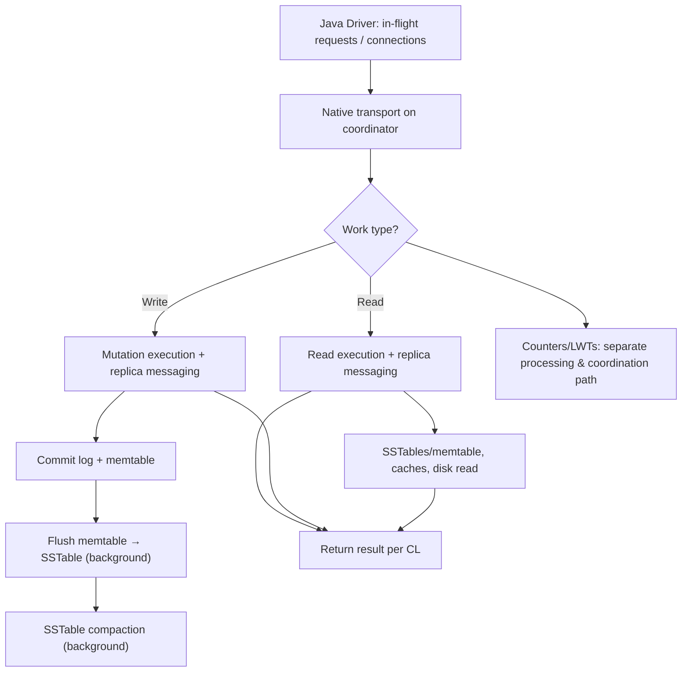
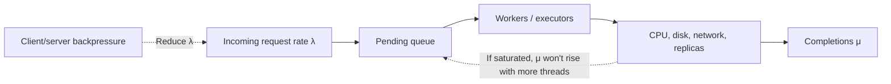
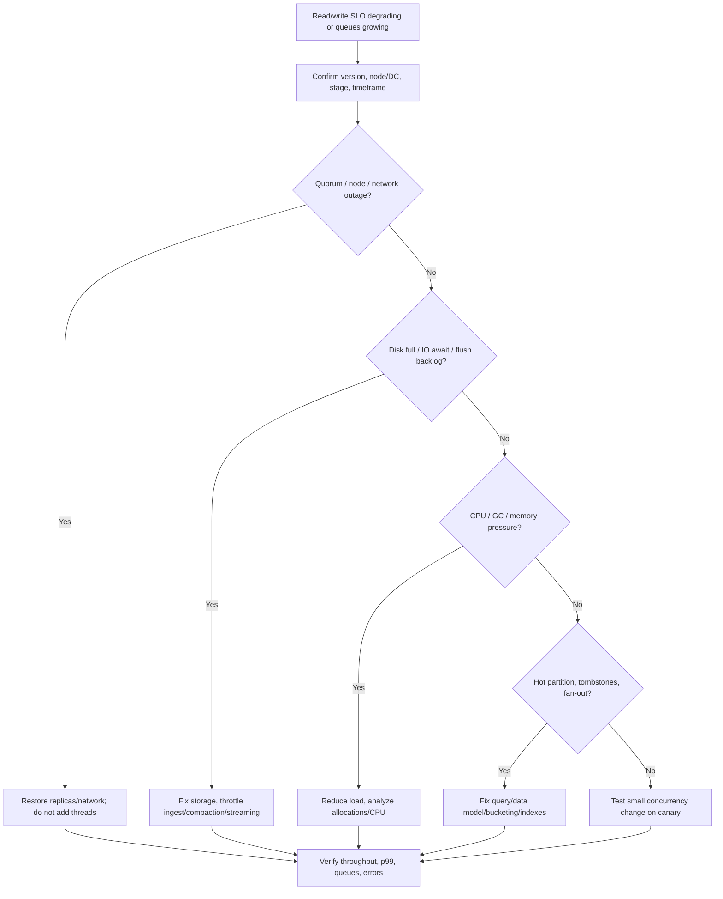

# Queues, Thread Pools, and Version-Dependent Parameters

> **Chapter:** Resource Tuning  
> **Module:** `DATABASE_ENGINE_WIDE_COLUMN_CASSANDRA` — Apache Cassandra

Cassandra is a distributed **wide-column** database: a query passes through the driver, coordinator, replicas, commit log/memtables/SSTables, and back to the application. Along the way, work is handled by asynchronous execution mechanisms, **executors/thread pools**, queues, concurrency caps, and background I/O pipelines. When a queue grows, the most common wrong reaction is **"just increase thread counts"**. If the real bottleneck is disk, network, GC, compaction, or a hot partition, more threads make matters worse.

A harder factor is **versioning**. Stage names, metrics, `cassandra.yaml` keys, defaults, and runtime mutability can all shift across Apache Cassandra 3.x, 4.x, 5.x, and vendor distributions. Therefore, what matters is not merely memorizing `concurrent_reads`, but knowing **how to identify where work is waiting, verify against the exact Cassandra version, change one variable with measurement, and preserve availability**.

This lesson focuses on safe resource observation and tuning while connecting back to query-driven table design, partition keys, replication, consistency levels, compaction, repair, and Java Driver connectivity.

**Objectives**

- Understand the differences among **thread pools**, **executors**, **queues**, **backpressure**, and CPU/heap/disk/network resources.
- Read `nodetool tpstats` alongside `compactionstats`, `tablestats`, JMX/metrics, logs, and Java-side metrics.
- Explain why `Pending`/`Active`/`Dropped` do not by themselves prove a root cause or data loss.
- Classify parameters affecting **reads/writes, counters, memtable flushes, compaction, streaming, and native transport**.
- Build a **parameter – version – verification source – impact – rollback** matrix instead of copying configs verbatim from another version's docs.
- Execute a small tuning loop with a baseline, safety limits, canary, p95/p99 tracking, and stop conditions.

## 1. Which Resources Does a Request Consume?

Consider a Java application writing events into a table:

```sql
-- Assumes the telemetry keyspace already exists with suitable replication.
CREATE TABLE telemetry.events_by_device_day (
    device_id text,
    event_day date,
    event_id uuid,
    payload text,
    PRIMARY KEY ((device_id, event_day), event_id)
);
```

The partition key `(device_id, event_day)` hashes to a token, from which Cassandra determines replicas via `NetworkTopologyStrategy`. If the Java Driver sends a write at `LOCAL_QUORUM` with RF=3 in the local datacenter, the coordinator typically needs two replicas in that DC to acknowledge before returning success; **the remaining replica may still be processing** the mutation.

A simplified read/write path:



This is a **mental model**, not a guarantee that every release has one dedicated thread pool per box. Cassandra uses stages/executors and messaging architectures that evolve across versions; many tasks also run asynchronously with I/O.

**Key takeaway:** a request can "wait" at multiple layers:

- Waiting for an **in-flight slot** in the Java Driver or service.
- Waiting for **connection/request processing** at the coordinator or network.
- Waiting for a **task inside an executor** on coordinator/replicas.
- Waiting for **commit-log sync**, disk reads, flushes, or compaction to relieve pressure.
- Waiting for peer replicas per **consistency level**, network RTT, failure detector, or timeouts.
- Waiting on GC, CPU scheduler, and OS I/O queues.

If you measure the wrong layer, raising `concurrent_reads` or Java connection counts may simply push more requests into the same bottleneck.

## 2. Thread Pools, Queues, Backpressure, and Dropped Messages

### 2.1. Core Concepts

| Concept | Meaning | What to Remember |
| --- | --- | --- |
| **Worker / thread** | Task execution unit | More threads do not mean higher throughput if tasks are waiting on I/O. |
| **Executor / stage** | Mechanism accepting and scheduling a class of work | Executor/stage names and internals are **not a stable API** across versions. |
| **Active** | Tasks currently executing in the stage | Staying pegged at max for long periods suggests saturation, yet compare against actual throughput. |
| **Pending / queue** | Tasks queued in the stage awaiting execution | Sustained queue growth + rising latency is significant; brief tiny queues can be normal. |
| **Completed** | Total tasks completed by the stage | Usually a cumulative counter; compute rates over windows rather than comparing raw totals. |
| **Blocked / All time blocked** | Tasks blocked by that executor's gating mechanism | Not automatically identical to kernel blocked I/O or CQL errors. |
| **Dropped messages** | Messages/tasks not processed within validity/timeout windows | Overload or failure signal; **does not by itself prove permanent mutation loss**. |
| **Backpressure** | Slowing/capping work intake when downstream cannot keep up | Far better than unbounded queue growth leading to memory exhaustion/timeouts. |



Common stage names seen in Cassandra releases include `ReadStage`, `MutationStage`, `CounterMutationStage`, and executors for request/response, flushes, and compaction. **Do not assume stage names, thread counts, metrics, or `Pending` semantics are identical across all releases.** Inspect `nodetool tpstats` on the real node and version-matched metric documentation.

### 2.2. Why Pending Task Counts Are Not a Complete Diagnosis

Suppose a node receives an average of **500 tasks/s** yet completes only **400 tasks/s** during peak load. If that persists, the queue grows by ~**100 tasks/s**. After 5 minutes, roughly **30,000 tasks** accumulate (ignoring caps or timeouts).

Adding workers only helps if waiting stems from **insufficient useful parallelism**. If the disk is already at peak IOPS, adding threads adds outstanding I/Os, context switches, memory usage, and retries **without raising completion rate μ**.

A simple model:

\[
\frac{dQ}{dt} \approx \lambda - \mu
\]

Where `Q` is queued work, `λ` is arrival rate, and `μ` is service rate. Shrinking the backlog sustainably requires `μ > λ` during recovery, or reducing `λ` via load limits. This is a capacity-reasoning tool, **not a replacement** for measuring actual executors.

**Little's Law** in a stable system:

\[
L = \lambda W
\]

Where `L` is average work inside the system, `λ` is throughput, and `W` is average time in the system. When `W` rises without throughput increasing, queued/in-flight work swells. Applications firing extra requests to "compensate for slowness" make the pressure worse.

### 2.3. Does Dropped Mean Data Loss?

**You cannot conclude that from a single metric.** Dropped messages generally indicate messages whose wait exceeded timeout or were no longer useful to process in that stage. A client may time out while another replica succeeded, hinted handoff/repair may heal later, or the request may have failed consistency level.

Proper investigation cross-checks **message type**, logs, Java-side request outcomes, `Timeouts`/`Failures`/`Unavailables` metrics, replica health, and actual data. On a write timeout, **the outcome is uncertain**: never blindly retry counters or side-effecting operations.

## 3. Reading `nodetool tpstats` Properly

`nodetool tpstats` is useful for inspecting executor/thread-pool state and dropped messages on the connected node.

```bash
# Observation commands; require appropriate admin/JMX access.
nodetool version
nodetool tpstats
nodetool status
nodetool describecluster
```

Output may contain columns similar to:

```text
Pool Name             Active  Pending  Completed  Blocked  All time blocked
ReadStage                  8      100     120000        0                 0
MutationStage              2        0     130000        0                 0

Message type        Dropped
READ                    50
MUTATION                 0
```

**This is simulated data** to illustrate reading the table, not default thresholds or a guaranteed format for every Cassandra release. If your binary adds/removes stages or columns, rely on that exact binary's docs and `nodetool` output.

### 3.1. Table Reading Procedure

1. **Verify version:** record `nodetool version` first. During a rolling upgrade, metrics can differ across nodes; do not treat differently named stages as identical.
2. **Take multiple samples:** 15–60 seconds apart or via high-resolution dashboards; one snapshot showing `Pending=100` cannot distinguish a 100 ms spike from a 1-hour backlog.
3. **Check `Completed` rate:** compute deltas between two samples and handle counter resets from node restarts.
4. **Classify stages:** Read/Mutation/Counter, flush/compaction pools, internal messaging; verify definitions in the running release.
5. **Correlate with CL and replicas:** `ReadStage` pending on one replica can cause read timeouts on a different coordinator. Check **multiple nodes**, not only the one the client talks to.
6. **Compare with OS/driver:** CPU, GC, disk await, network loss, Java in-flight, retry rates, and p99.

### 3.2. Symptom Cross-Check Examples

| Observation | Initial Hypothesis | Further Verification |
| --- | --- | --- |
| `ReadStage Pending` rises, high disk read await | Replica reads SSTables slowly, cache misses, many tombstones/SSTables | `tablestats`, `proxyhistograms`, disk I/O, partition-key queries |
| `MutationStage Pending` rises, high commit log wait | Writes stalled at commit log/storage | `CommitLog` metrics, flushes, disk free/await, write p99 |
| Counter-related stage pending rises | Heavy counter updates, many writes to same partition or coordination | Query volume, RF/CL, key distribution, outcomes/retries |
| Flush pool/`PendingFlushes` rises | Memtable flushing falling behind, disk busy/full | `tablestats`, commit log size, compaction, and disk |
| Compaction pending rises | SSTables created faster than merged | `compactionstats`, strategy, disk headroom, ingest rate |
| Dropped messages rise alongside client timeouts | Tasks/messages expiring or node/replica saturated | Relevant stage, JMX request metrics, network/GC |
| Pending normal yet p99 high | Bottleneck lies outside the inspected queue | Network/CL, disk service time, GC, app, locks/coordination |

**Do not conflate layers:** executor pending in `tpstats` differs from OS block-device queues (`iostat`), Java Driver queues, compaction backlogs, and pending streaming sizes. Measure each layer with its own tool.

## 4. Four Easily Confused Resource Limits

### 4.1. CPU-Bound

Signals:

- Sustained high user/system CPU not fully explained by GC.
- Many active stages yet throughput barely grows when raising concurrency.
- Context switches / runnable queue climb; p99 worsens.

Direction: eliminate unnecessary work, improve query/partition models, run CPU profiling in a safe environment, and tune thread counts sensibly. **Adding workers on an already saturated CPU** often just increases context switching.

### 4.2. Disk I/O-Bound

Signals:

- `iostat` shows rising disk await/queues, throughput near device limits.
- Heavy concurrent SSTable reads, commit-log syncs, memtable flushes, or compaction.
- Rising `PendingCompactions`, `PendingFlushes`, or `TotalCommitLogSize`.

Direction: throttle ingest/repair/streaming, isolate or expand disks, evaluate compaction strategy and partitions/tombstones. Never use `concurrent_reads` to try making a slow disk fast.

### 4.3. Memory/GC-Bound

Signals:

- Heap/off-heap pressure, long GC pauses, high allocation rate.
- Page cache starved out by an oversized heap, raising read I/O.
- Too many in-flight requests/buffers pushing the process toward OOM.

Direction: cap concurrency and payloads, monitor memtables/caches, heap/off-heap, and OS page cache; adjust JVM flags only after understanding your Cassandra/JDK version. **Never give all RAM to the JVM heap** assuming the server will perform better.

### 4.4. Network / Replica / Consistency-Bound

Signals:

- High internode RTT/packet loss, slow source DC, node Down.
- `LOCAL_QUORUM` unmet on some token ranges; remote DC / `EACH_QUORUM` inflating write latency.
- Streaming/rebuild/hints saturating NICs while CPU/disk still have headroom.

Direction: inspect RF/CL, topology/snitch, links, streaming rate limits, and repair schedules. Local thread pools cannot fix a disconnected remote node or insufficient quorum.

## 5. Common Parameters: What They Mean and How to Check Versions

### 5.1. Group Orientation Table

| Group | Example Parameter / Mechanism Names | What It Controls | What Not to Infer |
| --- | --- | --- | --- |
| Read concurrency | `concurrent_reads` | Read execution parallelism per release mechanics | Not a guaranteed cluster-wide queries/sec figure. |
| Write concurrency | `concurrent_writes` | Concurrent write work along the corresponding path | Raising it does not fix commit log / full-disk stalls. |
| Counter concurrency | `concurrent_counter_writes` | Coordinates counter work | Counters still have different retry semantics from idempotent updates. |
| Flush | `memtable_flush_writers` and memtable configs | Flush worker count or memtable resource policy per version | Adding flush writers can saturate data disks and compaction. |
| Compaction | `concurrent_compactors` | Number of compaction tasks running concurrently | More parallel compactions can raise I/O and temp disk needs. |
| Compaction bandwidth | `compaction_throughput` or older unit-suffixed name | Background compaction throughput cap | Does not mean all disk I/O is capped. |
| Streaming | `stream_throughput_outbound`, `inter_dc_stream_throughput_outbound`, or release-specific name | Outbound streaming rate cap | Not a throttle on all write replication or native CQL. |
| Native transport | Limits on requests/connections/frames/in-flight | Connection count, frame size, and CQL request buffering | Tuning server limits does not replace Java-side backpressure. |
| Internode messaging | Version-specific messaging queues/capacities/timeouts/throttles | Buffering/flow control and message lifetimes | Metric/option names change; never copy from another version. |
| Request timeouts | `read_request_timeout`, `write_request_timeout`, and equivalents | Server request timeout thresholds by type | Raising timeouts masks symptoms rather than adding capacity. |

**Note:** this table lists *commonly seen knob groups*, not a valid config template for every binary. For example, throughput key names changed across documentation branches, and several fields auto-size defaults from CPU, disk, or JVM. Inspect `cassandra.yaml` and **version-exact** docs rather than copying snippets from old blog posts.

### 5.2. Version Verification Matrix

| Apache Cassandra Line | How to Apply Tuning Guidance | What to Guard Against |
| --- | --- | --- |
| **3.x** | Read config and metrics docs matching 3.x; verify pools/stages and defaults via node's `nodetool` | Do not copy 4.x/5.x snippets or assume identical YAML syntax. |
| **4.0 / 4.1** | Re-verify internode messaging, native transport, thread pools, request/concurrency knobs, and metric exports; check supported JDK/GC | Architecture and options changed across major versions, including I/O and buffer handling. |
| **5.0.x** | Use 5.0 branch docs and exact patch release; verify compaction/streaming knobs against live system | Do not assume legacy `_mb_per_sec`/`_megabits_per_sec` names share identical syntax or semantics with new names. |
| **Post-5.0 / Vendor** | Verify **exact binary, release notes, and provider docs** | Do not assume Apache options are exposed for modification on managed services. |

**A verification method beats memorizing defaults:**

1. Record the **version on each node** via `nodetool version`.
2. Read official docs **for that branch** plus the real config deployed by configuration management. This lesson does not open external module files; in production, operators must inspect live configs.
3. For runtime-queryable/tunable knobs, run `nodetool help <command>` on the actual node.
4. Inspect live JMX metrics/exporters instead of assuming exported metric names match earlier releases.
5. Record default, active value, unit (`MiB/s` vs `Mb/s`), apply mode (runtime vs rolling restart), risks, and rollback.
6. Avoid changing multiple settings simultaneously if you cannot isolate their effects.

### 5.3. YAML Example — Reference List, Not for Copying to Production

```yaml
# MENTAL MODEL EXAMPLE: use only on Cassandra releases supporting these keys.
# Values below are not default recommendations or a complete configuration.
concurrent_reads: 32
concurrent_writes: 32
concurrent_counter_writes: 32
memtable_flush_writers: 2
concurrent_compactors: 2

# Verify compaction and streaming parameter names/units per release.
# For instance, newer branches use compaction_throughput while older branches
# used compaction_throughput_mb_per_sec; NEVER treat both as synonyms.
```

Why not give one "standard" number for every cluster? A 4-vCPU node on network SSD with heavy writes differs completely from a 32-vCPU NVMe node serving read-heavy queries—plus heap, page cache, RF, compaction strategy, and partition sizes all differ. `32` here is purely an **illustrative value**, not a tuning target.

**Separate two decisions:** first determine **whether a parameter actually needs changing**, then choose **the value** from CPU, drive count, IOPS, queue latency, request throughput, and experiments.

### 5.4. Runtime Config Differs from Persistent Config

Some `nodetool` commands read or alter runtime limits:

```bash
# Read-only on supporting versions:
nodetool getcompactionthroughput
nodetool getstreamthroughput
nodetool getinterdcstreamthroughput

# Check syntax first; NEVER tweak in lab/prod just to poke around:
nodetool help setcompactionthroughput
nodetool help setstreamthroughput
nodetool help setinterdcstreamthroughput
```

Never assume `nodetool set...` **persists across restarts**: depending on the knob and version, runtime overrides are not written back to `cassandra.yaml`. Sync intended configuration into config management, double-check units, roll out node by node, and document rollback.

## 6. Diagnosing via a **Decision Tree**, Not a Single Pending Count



### Step 1 — Confirm the Symptom Affects the Application

Collect read/write p50/p95/p99, timeouts, unavailables, failures, request volume, consistency level, local datacenter, and Java-side queue/in-flight counts. A stage showing `Pending=1000` while client SLOs hold and queues drain right after a burst may not be a P1 incident; conversely, repeated client timeouts despite tiny Pending counts still demand investigation.

### Step 2 — Connect Stages to Underlying Resources

```bash
nodetool tpstats
nodetool compactionstats
nodetool tablestats telemetry.events_by_device_day
nodetool proxyhistograms
nodetool netstats
```

OS checks (Linux example; adjust paths to match deployment):

```bash
df -h /var/lib/cassandra/data /var/lib/cassandra/commitlog
df -i /var/lib/cassandra/data /var/lib/cassandra/commitlog
iostat -xz 1 5
```

These commands are **read-only observations** and do not modify SSTables. In production, use long-term JMX/Prometheus and network provider telemetry to spot when queues begin growing. CQL tracing helps inspect a sample query, yet never turn tracing on for 100% of traffic.

### Step 3 — Identify Scope

- **Single node:** specific drive, heap, NIC, hardware fault, hot token/partition.
- **Multiple nodes in one DC:** ingest source, routed traffic, compaction/rebuild, DC network.
- **Cluster-wide:** new schema/query, data growth, CL/RF change, app deploy, concurrent repairs, backup/export.
- **Single table:** primary key, partition size, tombstones, SSTable count, compaction strategy, query fan-out.

With RF=3, examine the **replica set owning affected partitions**. High queues on one replica can slow `LOCAL_QUORUM` reads if coordinators wait on that node; raising client concurrency sends even more traffic to that same replica.

### Step 4 — Classify Controllability

| Bottleneck | Try First | Consider Raising Concurrency Only When |
| --- | --- | --- |
| Slow/full disk | Expand/heal storage, shed load, schedule compaction | Disk still has headroom yet pipeline underutilizes parallelism. |
| Network/replica down | Restore node/link, review CL and hints/repair | Replica and network issues are ruled out. |
| CPU/GC saturated | Cut mutation/query cost, cap in-flight, profile | CPU has headroom and tasks genuinely wait for execution slots. |
| Hot partition | Bucket/shard, fix model/query | Skew is reduced; adding threads won't redistribute one hot key. |
| Flush backlog | Check data disk, commit log, memtable size, compaction | Flush writers are genuinely the limiter with spare disk capacity. |
| Compaction backlog | Check strategy, throughput, disk, mutation rate | Disk I/O/headroom suffice and parallel tasks run efficiently. |
| Client burst | Backpressure, batch/parallelism caps, rate limits, token bucket | Server has spare capacity and requests distribute evenly. |

## 7. Runbooks for Common Queue Patterns

### RB-01 — `ReadStage` Pending Rising and Read P99 Breaching SLO

**Confirm:** measure Java read p99, `ClientRequest` read timeouts, per-node stage pending, `tablestats`, `SSTablesPerReadHistogram`, `TombstoneScannedHistogram`, disk await.

**Common causes:** wide scans/`ALLOW FILTERING`, oversized or hot partitions, heavy tombstones, cache misses, excessive SSTables from lagging compaction, slow disks, or network/replica outages.

**Mitigate:** block wide scans/batches, enforce full partition keys and bounded clustering ranges, pause competing streaming/repair I/O when safe, add capacity if needed. Canary `concurrent_reads` only after proving disk/CPU headroom—never start there.

**Avoid:** raising timeouts and calling it fixed; inflating all pools; adding `ALLOW FILTERING` on hot paths to "silence Invalid query errors".

**Closure:** read p95/p99, timeouts, and queues return to SLO; key partitions read cleanly at CL; no severe disk/compaction bottlenecks remain.

### RB-02 — Write/Mutation Pending Rising

**Confirm:** `MutationStage` (or version-equivalent write stage), write latency, `CommitLog` wait, disk await, `PendingFlushes`, `TotalCommitLogSize`, node health.

**Causes:** slow commit log disk, stalled memtable flushes, full data disk, mutation overload, RF/CL/network failures, write hot partition.

**Mitigate:** throttle producer rate/in-flight, fix disk and flush issues, throttle competing bulk streaming/compaction on schedule. If consistency-related, restore healthy replicas rather than blindly raising `concurrent_writes`.

**Avoid:** manually deleting commit logs or SSTables; restarting multiple replicas together; cranking `concurrent_writes` to extremes while disks are saturated.

**Closure:** write errors/p99 within SLO, commit log and flushes draining, queues no longer climbing continuously, sufficient disk headroom.

### RB-03 — Counters or LWTs Experiencing Bad Queues/Latency

Counters have special increment/decrement semantics; **resending a counter command after a timeout can apply it twice**. LWT/CAS uses a distinct coordination path and cost model beyond worker thread counts.

- Measure counter/LWT ratio, partition key skew, conditional conflicts, write/read CL, and app retries.
- Bound concurrency and hotspots first; evaluate whether immutable events/IDs with off-hot-path aggregation can replace counters.
- Never set `setIdempotent(true)` on counters or non-idempotent mutations just to enable retries.
- After timeouts, outcomes are uncertain; use business reconciliation.

### RB-04 — Memtable Flush Backlog / Commit Log Growing

- Verify `PendingFlushes`, memtable usage, commit log size/wait, free disk/await, compaction backlog.
- If the data disk is nearly full, prioritize **freeing safe capacity**. Flushing must write SSTables; forcing flushes with zero disk room can worsen the outage.
- While disk headroom exists, evaluate flush writer count, memtable sizing, and SSTable creation rate. Too many concurrent flush writers can swell compaction backlogs.
- Never delete commit log files to "free space quickly" without verifying data durability.

### RB-05 — Compaction Pending Growing Continuously

- Measure pending tasks, SSTable counts, disk throughput, CPU, free space, active repair/streaming.
- Review `STCS`/`LCS`/`TWCS` or `UCS` (UCS was introduced in Apache Cassandra 5.0) against read/write/TTL patterns.
- Higher `concurrent_compactors` may help if spare disk IOPS exist and tasks are independent; on a saturated volume, it worsens contention and temporary space amplification.
- Never trigger table-wide major compaction as an experiment while disks are nearly full or p99 breaches SLO.

### RB-06 — Streaming/Repair Building Cross-DC Queues and Impacting Clients

- Separate streaming bytes/rates from request traffic; inspect `nodetool netstats`, repair state, hints, and directional WAN links.
- Depending on version, cap outbound and inter-DC streaming via matching settings/`nodetool` commands. **Never mistake them for throttles on all write replication.**
- Slow down deferrable background tasks while keeping repairs on schedule before `gc_grace_seconds`, avoiding concurrent runs overlapping the same replicas.
- When WAN recovers, hint replays can spike traffic; never delete hints merely to shrink queues.
- Close the incident once scoped streaming/repair finishes or follows a safe schedule, with client SLOs and capacity healthy.

## 8. Java Driver 4.x: Backpressure Before Flooding Nodes

**Server tuning must pair with client-side control.** If 20 Java app instances each fire 10,000 concurrent async requests at a handful of replicas, total in-flight load becomes huge even for simple queries.

Java Driver 4.x example capping **in-flight requests per instance** with a semaphore. This example **reads only** by a valid partition key, uses `LOCAL_QUORUM`, and fetches a single page via `LIMIT`. Uses Java 11+, assuming `CqlSession` is configured with local DC, credentials, and TLS at initialization.

```java
import java.time.LocalDate;
import java.util.UUID;
import java.util.concurrent.CompletableFuture;
import java.util.concurrent.CompletionStage;
import java.util.concurrent.RejectedExecutionException;
import java.util.concurrent.Semaphore;

import com.datastax.oss.driver.api.core.CqlSession;
import com.datastax.oss.driver.api.core.DefaultConsistencyLevel;
import com.datastax.oss.driver.api.core.cql.AsyncResultSet;
import com.datastax.oss.driver.api.core.cql.BoundStatement;
import com.datastax.oss.driver.api.core.cql.PreparedStatement;

public final class BoundedEventReader {
    private final CqlSession session;
    private final PreparedStatement select;
    private final Semaphore permits;

    public BoundedEventReader(CqlSession session, int maxInFlight) {
        if (maxInFlight <= 0) {
            throw new IllegalArgumentException("maxInFlight must be positive");
        }
        this.session = session;
        this.permits = new Semaphore(maxInFlight);
        this.select = session.prepare(
            "SELECT event_id, payload " +
            "FROM telemetry.events_by_device_day " +
            "WHERE device_id = ? AND event_day = ? LIMIT 50");
    }

    public CompletionStage<AsyncResultSet> read(
            String deviceId, LocalDate day) {
        if (!permits.tryAcquire()) {
            return CompletableFuture.failedFuture(
                new RejectedExecutionException("Client backpressure"));
        }

        BoundStatement statement = select.bind(deviceId, day)
            .setConsistencyLevel(DefaultConsistencyLevel.LOCAL_QUORUM)
            .setPageSize(50)
            .setIdempotent(true);

        try {
            return session.executeAsync(statement)
                .whenComplete((result, failure) -> permits.release());
        } catch (RuntimeException failure) {
            permits.release();
            throw failure;
        }
    }
}
```

**Meaning and limits:**

- The semaphore **caps per-instance in-flight calls**, not cluster-wide load. Account for total instances, replicas, and real capacity. `maxInFlight` must be benchmarked—there is no universal default.
- `tryAcquire()` sheds load early to **protect the system**; the API should return controlled errors (e.g., rate-limit responses) or enqueue with a bounded queue and deadline rather than blocking HTTP threads indefinitely.
- `whenComplete` returns the permit when the stage finishes, even on failure. Keep the callback lightweight; never run heavy work on the event loop.
- `LIMIT 50` caps returned rows; **reads still require the partition key**. Page size does not fix wide scans.
- On `SELECT`, `setIdempotent(true)` is valid. **Never copy this flag onto counters or side-effecting mutations.** Write timeouts can leave uncertain outcomes.
- If consumers fetch additional pages, account for paging in-flight pressure separately. Here `LIMIT 50` avoids unbounded streaming.
- Beyond app semaphores, the driver has connection pools, request throttling, and version-specific timeouts/configs; check the exact 4.x driver branch docs and measure state rather than raising every limit.

### Backpressure Prevents "Retry Storms"

Automatic retries raise `λ` right when Cassandra is already falling behind. If timeouts trigger cascading retries across service tiers, load **amplifies**: 1,000 client requests/s become 2,000–3,000 attempts/s on coordinators.

Therefore:

1. Retry only when **operation semantics allow**, under bounded policies with backoff and jitter.
2. Keep event IDs, partition keys, and payloads deterministic for idempotent mutations; watch TTL/timestamps if used.
3. Enforce API deadlines/circuit breakers and bounded in-flight queues.
4. Track **attempt rate separately from original request rate**; never count retries as independent business volume.
5. When nodes/replicas go down, backpressure must reflect remaining healthy replicas per RF/CL; never add workers to compensate for an unreachable replica.

## 9. Designing Verifiable Tuning Experiments

### 9.1. Pre-Change Baseline

Capture at least:

| Layer | Metrics to Save | Question |
| --- | --- | --- |
| Application | Read/write p50/p95/p99, timeouts/unavailables, QPS, retry attempts, in-flight | Are users impacted? |
| Cassandra stages | Active/Pending/Completed/Dropped by node/stage | Where are queues sitting? Did service rate shift? |
| Storage | Free disk, disk await, read/write IOPS/throughput, commit log/flushes | Is there real headroom for extra parallelism? |
| JVM/OS | Heap/off-heap, GC pauses, CPU utilization, runnable queue, FDs | Do extra threads risk GC/context-switch overhead? |
| Workload | Keyspace/table, partition size/skew, SSTables/tombstones, RF/CL/DC | Is the cause in the data model or replicas? |
| Background | Compaction/repair/streaming/hints, backups/exports | Are concurrent jobs consuming resources? |

Never compare just one quiet minute before and after. Cover **steady-state and peak loads**, representative data, warm-up, cache state, replica failures, and background compaction.

### 9.2. Test Only **One** Hypothesis

Suppose you want to test raising `concurrent_reads` because `ReadStage` pending rises while **disk/CPU still have headroom**:

1. Capture baselines on a comparable node group, verifying workload, version, and relevant stages.
2. State the **hypothesis**: slightly raising read parallelism will lift `Completed/s` and lower `Pending` without raising disk await/p99.
3. Confirm apply method: `cassandra.yaml` edit + rolling restart, or runtime change **only if supported by that release**; never infer hot-reloadability from an option's name.
4. Apply under control; **never restart multiple replicas of the same token range simultaneously**.
5. Measure throughput, p99, error rate, CPU, GC, disk queues, `ReadStage` pending, and side effects on writes.
6. If latency/errors climb or disks saturate without throughput gains, **roll back** per procedure.
7. If successful, roll out incrementally with evidence and update runbooks and config management.

**Experiment log template:**

```text
Hypothesis: Read worker parallelism is insufficient (disk/CPU have headroom)
Cassandra version: <exact version and distribution>
Scope: <cluster/DC/node subset>
Knob: <exact supported cassandra.yaml key / nodetool command>
Old value: <current verified value>
New value: <small, justified change>
Apply method: <runtime / rolling restart>
Before: <read p99, pending, completed/s, CPU, disk await>
After:  <same measures, same representative workload>
Stop conditions: <SLO, timeouts, disk free, GC, backlog>
Rollback: <how to revert and validate>
Owner / review: <person and change ticket>
```

The placeholders above serve solely as a **notebook template**, not production commands.

### 9.3. When Should You Scale Out Instead of Adding Threads?

Once near CPU/disk/network limits, raising concurrency simply piles more requests onto the same bottleneck. Consider:

- **Adding nodes** for capacity and token/range distribution after budgeting streaming, disk, RF, and topology impact.
- **Redesigning partition keys/buckets/shards** when a few partitions are hot; adding nodes will not split one hot partition across multiple partitions automatically.
- **Cutting write amplification** via workload models, compaction strategy, and suitable TTL/tombstone policies.
- **Throttling producers/consumers** to protect critical requests rather than adding workers unchecked.
- **Isolating workloads** or shifting repair/analytics/backups to fit resource budgets.

Scaling out is not risk-free: bootstrap/repair/cleanup add background load. After topology shifts, verify `UN` status, ownership, streaming, read-before/write-after checks, and CL.

## 10. Misconceptions to Avoid

**"`ReadStage Pending` is rising, so `concurrent_reads` is definitely too low."**  
False. Disk await, GC, tombstones, hot partitions, compaction, or slow peer replicas can all be the cause. Prove spare headroom exists and throughput rises when increasing parallelism.

**"High `Completed` means the system is healthy."**  
`Completed` is usually a cumulative counter since startup; examine its **rate of change** relative to arrival rate, latency, and failures.

**"Dropped messages mean Cassandra permanently lost data."**  
You cannot conclude that from one metric. Check message type, request outcome, CL, hints/repair, and replica state.

**"Server thread pools and Java connection pools are the same thing."**  
False. Client throttling and in-flight connection slots live in Java/driver; executors/stages are server resources. Both affect total concurrent work.

**"You can copy Cassandra 3.x `cassandra.yaml` straight into 5.x."**  
False. Option names, units, defaults, and execution models may have changed. Use branch-matching docs, release notes, and real binary verification.

**"Raising `concurrent_compactors` always makes compaction faster."**  
False, especially on saturated disks or tight space for output SSTables. It can worsen read/write p99.

**"Raising request timeouts solves backlogs."**  
False. Longer timeouts keep in-flight work lingering longer and mask server saturation. Shrink queues or add real capacity.

**"Capping inter-DC stream throughput caps all CQL writes too."**  
False. It targets bulk streaming, not normal inter-replica write replication traffic.

**"All Cassandra 5.x patch releases share identical configs."**  
Do not assume that. Check exact patch-level documentation and binaries, especially for renamed keys and runtime adjustability.

## 11. Scenario Exercises and Self-Assessment

**Question 1.** Over 5 minutes, a node receives 500 tasks/s and finishes 400 tasks/s. Without drops or backpressure, by how many tasks does the backlog grow? Does that prove a shortage of threads?

**Question 2.** `ReadStage` has high Pending, disk await is climbing, and `SSTablesPerReadHistogram` looks bad. Should you quadruple `concurrent_reads`? Name at least three other checks to run.

**Question 3.** A blog post shows `compaction_throughput_mb_per_sec: 64` for an older Cassandra release, while docs for a newer branch show `compaction_throughput` in another unit. Should you just swap the key name and keep `64`?

**Question 4.** A Java service runs 30 instances, each allowing 1,000 in-flight requests. Why is inspecting one instance ("only 1,000") insufficient to evaluate cluster load?

**Question 5.** Write timeouts spike while `MutationStage` pending stays low, yet `CommitLog.WaitingOnCommit` climbs. Where do you prioritize measurement and remediation before touching `concurrent_writes`?

**Question 6.** A counter table is very hot; a team enables `setIdempotent(true)` on `UPDATE counters SET value = value + 1` so the driver retries automatically. What is the risk?

**Question 7.** Repair/streaming is saturating the WAN; local DC `LOCAL_QUORUM` succeeds while remote data lags behind. Which parameter group controls streaming, and why can't it be treated as a throttle on all write replication?

**Question 8.** An experiment raising `concurrent_compactors` shrinks compaction pending yet doubles read p99 and raises disk await. What is your conclusion and next step?

<details>
<summary>Answer Hints</summary>

1. `(500 - 400) × 300 = 30,000 tasks`. No: the cause could be disk/CPU/network capacity, hot partitions, GC, or execution slots; you must measure headroom.
2. Check partitions/queries (wide scans, tombstones), disk IOPS/await, compaction backlog, GC/CPU, and replicas/CL. Adding threads can worsen disk contention.
3. No. Verify exact version/key, unit (`MiB/s` vs `Mb/s`), defaults, and apply method; test small benchmarked changes with rollback.
4. Cluster-wide the app can emit up to `30 × 1000 = 30,000` in-flight calls, many hitting one token/replica group; measure server-side and verify RF/CL.
5. Prioritize commit log disk latency/sync, data disk flush backlog, full disks, and competing streaming/compaction; adding threads will not cure fsync stalls.
6. Counter mutations are not idempotent; a timeout can happen after an increment already applied, causing retries to double-count.
7. The version-matched `stream_throughput_outbound`/`inter_dc_stream_throughput_outbound` group. They bound bulk streaming, not regular inter-replica write mutations.
8. Roll back / reduce compaction concurrency or throttle per runbook: lower queue size is not a win if SLOs degrade and disks saturate. Prioritize application outcomes.

</details>

## 12. Checklist When Preparing a Resource Change

| Item | Pre-Rollout Verification |
| --- | --- |
| **Version** | Every target node matches expected Cassandra/JDK/release; account for any active mixed-version upgrade. |
| **Documentation** | Exact key, type, unit, default, scope, runtime vs restart, and deprecated/removed status for that version. |
| **Baseline** | QPS, p95/p99, errors, tpstats pending/completed/dropped, disk/CPU/GC, background backlogs. |
| **Hypothesis** | Why is the bottleneck threads/executors rather than disk/network/data model? |
| **Scope** | Target nodes/DC/tables, avoiding restarting too many replicas of the same partition simultaneously. |
| **Safety limits** | CPU, free disk, I/O await, latency budget, timeout rate, repair schedule. |
| **Load testing** | Steady + peak + hot partition + background compaction/repair, under real CL. |
| **Comparison** | Change only one variable, measure successful throughput and p99, compare on identical workloads. |
| **Rollback** | Save old values, revert steps, config management sync, and stop criteria. |
| **Post-check** | Node health, stable schema/ownership, read/write probes, and error budgets met. |

### Further Reading

- [Apache Cassandra — cassandra.yaml (parameters must match exact branch)](https://cassandra.apache.org/doc/stable/cassandra/managing/configuration/cass_yaml_file.html)
- [Apache Cassandra — Metrics, ThreadPools, ClientRequest, CommitLog, Compaction](https://cassandra.apache.org/doc/stable/cassandra/managing/operating/metrics.html)
- [Apache Cassandra — nodetool tpstats](https://cassandra.apache.org/doc/stable/cassandra/managing/tools/nodetool/tpstats.html)
- [Apache Cassandra — nodetool compactionstats](https://cassandra.apache.org/doc/stable/cassandra/managing/tools/nodetool/compactionstats.html)
- [Apache Cassandra — Compaction strategies and trade-offs](https://cassandra.apache.org/doc/stable/cassandra/managing/operating/compaction/overview.html)
- [Apache Cassandra — Streaming](https://cassandra.apache.org/doc/stable/cassandra/architecture/streaming.html)
- [Apache Cassandra — Repair](https://cassandra.apache.org/doc/stable/cassandra/managing/operating/repair.html)
- [DataStax Java Driver 4.x — Asynchronous API](https://docs.datastax.com/en/developer/java-driver/4.17/manual/core/async/index.html)
