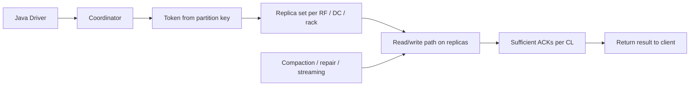
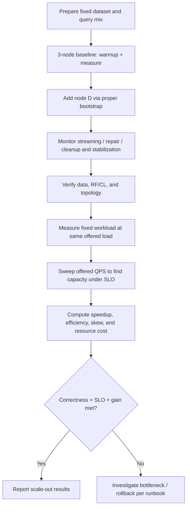
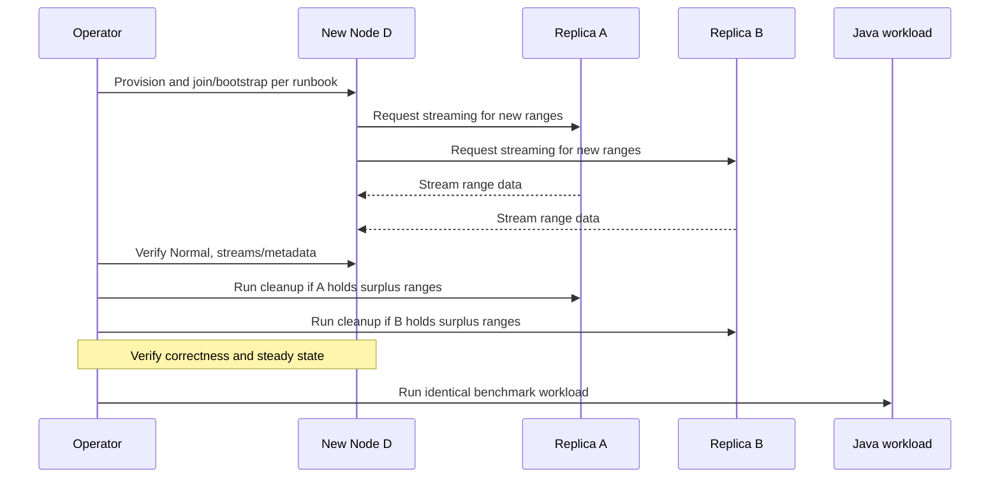

# Measuring Scale-Out Efficiency When Adding Nodes Under Identical Load

## 1. The Problem: Does Adding a Node Actually Increase Cassandra Capacity?

Apache Cassandra is a **distributed wide-column** database: partition keys hash to tokens, the replication strategy selects **natural replicas**, and the coordinator orchestrates reads/writes per **consistency level (CL)**. Adding a node adds CPU, memory, disk, and network capacity, yet **does not automatically** make every query faster or scale throughput linearly with node count.

For instance, a 3-node cluster handles 6,000 operations/s within p99 and error-rate SLOs. After adding a fourth node, concluding "scale-out succeeded" requires knowing:

- At the **same 4,000 offered operations/s**, how did p95/p99, timeouts, and CPU/disk/network utilization change?
- When **ramping load**, how many **successful** operations/s does the 4-node cluster sustain while keeping p99 and error rates within SLO?
- Did the new node finish **bootstrapping/streaming**, did data rebalance, and were old nodes **cleaned up** properly?
- Do partition keys distribute load, or do most requests still hammer a **hot partition**?
- Were RF, CL, query mix, dataset, page size, Cassandra/Java Driver versions, client placement, and background load kept comparable?

This lesson belongs to the **Resource Tuning** chapter of the `DATABASE_ENGINE_WIDE_COLUMN_CASSANDRA` module, tying together distributed architecture, query-driven table design, partition keys, CQL, replication/consistency, compaction, repair, error handling, and the Java Driver.

**Learning Outcomes:** learners can design and interpret an **identical-workload** scale-out benchmark as node count grows; separate steady-state capacity from topology-transition cost; compute speedup/efficiency, verify data correctness and SLOs; and identify remaining bottlenecks before deciding to scale further.

## 2. "Identical Load" Must Be Strictly Defined

Here, **identical load** does not mean merely running the same `SELECT` string. You must hold constant or explicitly declare every factor determining resource consumption **per business operation**:

| Property | Quantitative Description Example | What Confusion Occurs If Altered? |
| --- | --- | --- |
| Query mix | 80% read / 20% write; `SELECT`/`UPDATE` counts per business op | Shifts read/write I/O, coordinator, and commitlog load |
| Query shape | Same table, partition key, range, projection, `LIMIT`, batch size | Dropping columns or rows speeds up tests while doing less real work |
| Partition key distribution | 70% uniform keys, 30% hot keys with same seed/Zipf parameter | Changing hot-key ratio alters load spread even with fixed node count |
| Data footprint | Partition count, rows/partition, SSTable count, tombstones/TTL, payload size | Small cached datasets behave completely differently from disk-bound datasets |
| CL and RF | `NetworkTopologyStrategy {'dc1': 3}`, read/write `LOCAL_QUORUM` | Lowering CL or RF for higher throughput changes semantics |
| Paging queries | `pageSize`, reading one page vs exhausting all pages | Changes server request counts and bytes/operation |
| Driver | Local DC, token-aware routing, retries, speculative execution, connection pools | Alters coordinator spread; retries inflate real server requests |
| Cluster conditions | Nodes, rack/DC, storage tier, CPU, RAM, network, Cassandra/JDK version | Comparing mismatched hardware/software cannot prove node-addition benefit |
| Background load | Repair, bootstrap, compaction, backups, snapshots, GC | Background spikes easily drown out scale-out effects |
| Offered load | Offered operations/s, concurrency, arrival pattern, duration | Comparing at mismatched offered loads distorts p99 wildly |

**Principle:** tests keep **operation types, key distributions, payloads, semantics, and client configs** identical before and after. You vary **load level** during capacity sweeps, yet must report each offered rate separately instead of mixing levels.

### Two Concepts to Separate

- **Fixed-workload (strong-scaling-style):** same total dataset and same offered traffic; grow from 3 to 4 nodes and compare latency, errors, and resource usage. The goal is better latency/headroom, not higher completed throughput, since offered input is capped.
- **Capacity under SLO (capacity scaling):** hold query/data distribution constant and step up offered traffic for each cluster size to find the **highest successful operations/s** still meeting p99, error, and resource budgets. This is the right measure when asking "how much extra load does adding 1 node handle?"

A **weak-scaling-style** setup scales nodes, dataset size, and total workload together to keep data/load **per node** roughly constant. That is a separate experiment to declare explicitly—never mix it with fixed-dataset conclusions.

## 3. Why Cassandra Does Not Speed Up Linearly When Adding Nodes

Conceptually, a request flows through:



Adding nodes can reduce token ranges, **effective** data volume, and average traffic per node, yet does not eliminate these limits:

1. **Hot partitions:** operations on one partition still hit **one set of RF replicas**, rather than splitting row-by-row across every new node.
2. **RF and CL:** with RF = 3 and `LOCAL_QUORUM`, reads/writes still require local quorum responses; new nodes alter **which** nodes hold replicas, not how many nodes one partition can span.
3. **Coordinator/client bottlenecks:** driver, load balancer, DNS, network, or load generators may bottleneck ahead of the cluster.
4. **Shared overhead:** gossip, streaming, compaction, repair, schema metadata, caches, and network coordination carry costs that do not vanish with more nodes.
5. **Data/load skew:** the new node may hold fewer or uneven hot partitions; "Owns (effective)" does not map directly to IOPS, bytes, or CPU.
6. **Device ceilings:** disk write amplification, GC/heap, NICs, CPU, request queues, and per-DC resources may scale unevenly.

Thus, you must prove **real load actually spread** and **bottlenecks shifted**, rather than simply seeing one more `UN` line in `nodetool status`.

### RF = 3 Before and After Adding a Node

Suppose the cluster starts with **3 nodes in one DC and RF = 3**. Every partition has natural replicas on **all 3 nodes** (when all three are eligible). After adding a fourth node and stabilizing ranges, each partition still has **3 replicas**, though which 3-node subset owns a given token range differs.

| Property | 3 Nodes, RF3 | 4 Nodes, RF3 |
| --- | --- | --- |
| Natural replicas per partition | 3 | 3 |
| `LOCAL_QUORUM` ACKs required | 2 | 2 |
| Nodes storing one partition | Typically all three | A subset of three out of four, per token/rack |
| Total logical copies of dataset | Roughly RF × data, plus overhead | Roughly RF × data, plus overhead |
| Average data per node | Higher if balanced | Potentially lower **after range move and cleanup** |
| One hot partition splits across 4 nodes | No | **No** |

In an ideal balanced model, average copy footprint per node drops by \(3/4\) moving from 3 to 4 nodes **at identical RF3 and dataset**. This is an **average expectation**, not a per-node disk forecast: SSTables, compaction, snapshots, token allocation, and actual range data cause noticeable variance.

## 4. Before Measuring: Verify Data Invariants and Consistency

Scaling out is a topology change, so performance tests must pair with **correctness and availability** checks. Questions to verify:

- Do all workload tables/keyspaces keep the exact same replication strategy/RF?
- Does the new node match DC/rack, snitch, JDK/Cassandra versions, and storage/network config?
- Did bootstrap stream all required token ranges? Is repair needed before declaring the new state steady?
- Is pre-expansion data readable at the same `LOCAL_QUORUM`?
- Did record counts/partitions/TTLs or test timing shift the result set?
- Did the driver discover the new topology and route to the right local DC instead of pinning requests to a few fixed contact points?

Check the keyspace:

```sql
SELECT keyspace_name, replication, durable_writes
FROM system_schema.keyspaces
WHERE keyspace_name = 'scale_lab_ks';
```

Inspect cluster state:

```bash
nodetool status scale_lab_ks
nodetool ring scale_lab_ks
nodetool describecluster
nodetool netstats
```

`nodetool status` displays Up/Normal status, effective ownership, and load—it **does not prove every replica is synchronized**. `UN` is merely a necessary operational prerequisite. Combine it with bootstrap logs, streaming, repair, and test reads on pre-existing partitions.

**If data mutates continuously during testing**, keep an immutable test fixture for correctness checks or normalize by cutoff/primary key. Cassandra does not create a consistent snapshot across two `SELECT`s merely because they share identical query text.

## 5. Experiment Design: Single DC, Homogeneous Hardware

### Illustrative Setup

- Lab Cassandra cluster in `dc1`, starting with three nodes `A/B/C`, then adding `D`; optionally `E` if lab capacity allows.
- Identical node CPU, RAM, storage, NIC, rack/network policies; identical Cassandra version and JVM/GC configs whenever feasible.
- RF3 keyspace with `NetworkTopologyStrategy`; reads/writes at `LOCAL_QUORUM`.
- Synthetic dataset with enough partitions/rows to exercise the real read path, not just a few cached rows.
- Identical query mix, partition-key distribution, load generator seed, payload size, page size, and retry policy.
- Driver/load generator on hosts **separate** from Cassandra, with ample capacity so it never bottlenecks measurements.
- Change **only node count** between the two steady states; never simultaneously tweak compaction throughput, JVM heap, page size, RF, or CL.

### Visual Workflow



**Never run steady-state benchmarks the instant D turns `UN`.** Confirm streaming finished with zero bootstrap failures, cleanup (when applicable) ran, and compaction/anti-compaction backlogs returned to normal. Nor should you wait at all costs for "every pending compaction = 0" on a continuously written cluster; instead define **concrete steady-state criteria**, e.g., backlogs and disk/CPU stay within steady bounds with no ongoing topology changes.

## 6. A Proper Test Requires Two Measurement Branches

### 6.1. Branch A — Fixed Load

Hold offered rate steady, e.g., **3,000 operations/s**, for both three and four nodes. Measure:

| Quantity | Meaning in Fixed-Workload Test |
| --- | --- |
| Successful operations/s | Does it hold near 3,000, or do timeouts drag it down? |
| Full-operation p50, p95, p99 | Latency and tail shifts at constant total load |
| Read/write errors, timeouts, retries | Did topology/driver affect reliability? |
| Per-node user/system CPU and GC | Did headroom grow and inter-node skew shrink? |
| Disk read/write IOPS, latency, SSTables per read | Did moving ranges genuinely ease I/O contention? |
| Inbound/outbound network (client and internode) | Replica coordination cost and source/target spread |
| Per-node disk used/free | Are effective ownership and footprint balanced? |

Never expect 3,000 successful requests/s to jump to 4,000 when **only 3,000 requests/s were offered**. If both clusters sustain 3,000, the win in this branch is **lower latency, higher headroom, and resilience**, not higher QPS.

### 6.2. Branch B — Capacity Under SLO

Hold the **workload type** constant and sweep offered rates like 2,000 → 3,000 → 4,000 → ... operations/s, stopping when safety thresholds breach. For each cluster size, record the **highest successful throughput** satisfying:

- Correctness PASS per read/write contract;
- **Full-operation** p99 below defined SLO (e.g., 100 ms, illustrative only);
- Error/timeout rate below cap (e.g., 0.1%, illustrative only);
- No GC instability, full disks, runaway queues, or non-draining request backlogs.

**Offered** is load *scheduled or submitted*, **achieved** is operations completed, and **successful** is operations returning valid contract results without timeout. Count CQL-layer retries separately from business operations to avoid misreporting load.

For paged workflows, define whether the unit is **reading the complete business result** or **one page**. If one operation spans 5 pages, 1,000 operations/s generates ~5,000 page requests/s before retries; never compare that against 1,000 single-page requests/s and call it identical load.

## 7. Speedup and Scale-Out Efficiency Formulas

Definitions:

- \(N_0\): baseline node count, \(N_1\): expanded node count;
- \(T_{N_0}\), \(T_{N_1}\): **maximum successful throughput under the same SLO** and workload;
- \(S = T_{N_1} / T_{N_0}\): throughput speedup;
- \(I = N_1 / N_0\): ideal node scaling factor;
- \(E = S / I\): **scale-out efficiency** relative to linear per-node scaling.

\[
S = \frac{T_{N_1}}{T_{N_0}},\qquad
E = \frac{T_{N_1}/T_{N_0}}{N_1/N_0}
\]

**Hypothetical example**: 3 nodes sustain \(T_3 = 6,000\) successful ops/s within SLO; 4 nodes sustain \(T_4 = 7,500\).

\[
S = 7,500/6,000 = 1.25
\]

\[
I = 4/3 \approx 1.333;\qquad E=1.25/(4/3)=0.9375=93.75\%
\]

Reading the result: adding 33.3% more nodes yielded **25% more within-SLO throughput**, at roughly **93.75% linear scaling efficiency**. Never call this "93.75% CPU efficiency": it is a **throughput-per-node scaling ratio**, not CPU utilization.

**Marginal** gain of the fourth node relative to one-third of baseline capacity:

\[
\text{Marginal gain fraction} =
\frac{T_4-T_3}{T_3/3}
= \frac{1,500}{2,000}=0.75
\]

That means the added node delivered **75%** of the average per-node throughput of the 3-node baseline. This differs from \(E\) because it measures **marginal** gain, whereas \(E\) compares cluster totals. Under RF/CL and hot keys, \(T_3/3\) cannot be treated as each machine's independent standalone capacity.

### Measuring Cost Efficiency and Headroom

| Metric | How to Report | Caveat |
| --- | --- | --- |
| Throughput/node | \(T_N/N\) successful ops/s/node | Do not compare across mismatched node hardware/capacities |
| Capacity gain / added node | \((T_4-T_3)/(4-3)\) | Does not guarantee the fifth node adds the same gain |
| Unit cost | Total node + storage + network cost / successful ops/s at SLO | Depends on infra pricing, replicated bytes, and background work |
| CPU headroom | 100% minus utilization on **each** node | Cluster averages hide hot nodes |
| Disk headroom | Free bytes, IOPS/latency margin on busiest node | Post-bootstrap disk usage before cleanup does not reflect steady state |
| SLO headroom | Distance from measured p99/error to threshold | Does not replace sweeping multiple offered rates |

If adding a node leaves one hot partition saturating three replicas, \(S\) can stay near 1—or even \(E < 1\) due to coordination overhead, token skew, measurement noise, or incomplete stabilization. That is **actionable evidence to fix workload design**, not a "failed" measurement to hide.

## 8. Creating a CQL Fixture for Correctness Testing

The snippet below is **strictly for a lab cluster**, assuming `dc1` has enough nodes and data is populated by a synthetic generator. Never write test data into production.

```sql
CREATE KEYSPACE scale_lab_ks
WITH replication = {'class': 'NetworkTopologyStrategy', 'dc1': '3'}
AND durable_writes = true;

CREATE TABLE scale_lab_ks.events_by_device (
    device_id text,
    bucket_day date,
    event_ts timestamp,
    event_id uuid,
    event_type text,
    payload text,
    PRIMARY KEY ((device_id, bucket_day), event_ts, event_id)
) WITH CLUSTERING ORDER BY (event_ts DESC, event_id DESC);

INSERT INTO scale_lab_ks.events_by_device
    (device_id, bucket_day, event_ts, event_id, event_type, payload)
VALUES ('synthetic-device-001', '2026-11-21', '2026-11-21T08:00:00+0000',
        11111111-2222-4333-8444-555555555555, 'HEARTBEAT', 'sample-1');

INSERT INTO scale_lab_ks.events_by_device
    (device_id, bucket_day, event_ts, event_id, event_type, payload)
VALUES ('synthetic-device-001', '2026-11-21', '2026-11-21T08:01:00+0000',
        22222222-3333-4444-8555-666666666666, 'ALERT', 'sample-2');
```

**Partition key:** `(device_id, bucket_day)`. Putting every event of one device into **a single very hot partition** prevents added nodes from splitting work row-by-row; daily bucketing and realistic **`device_id` distribution** are critical variables. If one device logs millions of events/day, choose a smaller bucket upfront—**never alter schemas between two scale-out measurements** and credit the gain to adding nodes.

In lab `cqlsh`:

```sql
CONSISTENCY LOCAL_QUORUM
PAGING 100

SELECT event_ts, event_id, event_type, payload
FROM scale_lab_ks.events_by_device
WHERE device_id = 'synthetic-device-001'
  AND bucket_day = '2026-11-21'
LIMIT 100;
```

**Correctness gate before and after adding a node:**

1. Identical query shape, CL, and full result pages across a known set of partitions.
2. Compare **primary keys and business values**, not just row counts; include empty partitions, tombstones, and multi-row partitions.
3. If writes occur during tests, verify write ACKs per CL and read back after appropriate sync/timing checks.
4. Never treat one `LOCAL_QUORUM` `SELECT` as proof **every replica** is repaired.

### Generating Representative Benchmark Data

Two fixture rows only illustrate correctness checks. Before a real benchmark, specify:

- Total partitions, rows/partition (median and tail), payload sizes, and SSTable counts.
- Days/buckets, hot/cold skew, TTL/tombstone ratios, and read frequency distributions.
- Read/write ratio, average returned rows, page size, and keys accessed per second.
- Generation with a **fixed random seed** and controlled TTL timing so both phases share equivalent datasets.

Never copy production data into labs unless security/anonymization requirements are met; use synthetic data to avoid exposing real partition keys or payloads.

## 9. Before Adding a Node: Capture Scoped Baselines

### CQL / Cluster Topology

```bash
nodetool status scale_lab_ks
nodetool ring scale_lab_ks
nodetool describecluster
nodetool info
nodetool netstats
```

Collect on **every node**, recording UTC timestamps and DC/rack labels. When reading **resources**, distinguish:

- **Load (disk size) and Owns (effective)** are not QPS/node. RF3 can show high effective ownership on multiple nodes while hot-key distribution still dictates CPU/disk load.
- **Node Up/Normal** says nothing about request counts, timeout rates, or repair progress.
- **Token/vnode counts** and token allocation govern range splits. Adding a node will not give every node an even 25% of queries when distributions are skewed.

### Node and Table Metrics

```bash
nodetool tablestats scale_lab_ks.events_by_device
nodetool tablehistograms scale_lab_ks events_by_device
nodetool proxyhistograms
nodetool tpstats
nodetool compactionstats
```

Pair with JMX/Prometheus and host metrics covering at least:

| Layer | Metrics to Collect | Scale-Out Meaning |
| --- | --- | --- |
| **Driver / client** | Offered/completed/failed ops/s; retries; p50/p95/p99; in-flight, pool utilization | Prevents load generator or routing bottlenecks ahead of server |
| **Coordinator** | Per-node requests/s, pending threads, timeouts, client request latency | Did coordinator load actually spread to the new node? |
| **Replica / table** | Table read/write latency, SSTables/read, tombstones scanned, read/write counts | Did read amplification drop and replica load distribute? |
| **CPU / GC** | User/system CPU, load average, allocation/GC pauses/heap | Is the hottest node still hitting CPU/GC limits? |
| **Disk** | Used/free disk, IOPS, read/write throughput, await/p95 disk latency, compaction backlog | Did disk saturation ease rather than merely moving bytes? |
| **Network** | NIC bytes/s, retransmits, internode/client traffic, streaming | Traffic/bytes per op and WAN/ToR bottlenecks |
| **Topology jobs** | Bootstrap/stream/repair status, pending compactions, cleanup | Never compare long-term capacity before steady state |

**Avoid double counting:** one mutation goes to RF replicas, so sum of **node network bytes** differs from client payload bytes; likewise, one coordinator request emits multiple replica messages. Never sum every node's request counters and call it "business operations".

## 10. Adding a Node: Separate Topology Transition from Benchmarking

Following your Cassandra release's runbook, a new node typically:

1. Matches cluster name, DC/rack/snitch, seeds/contacts, CPU/RAM/storage, network, Java/Cassandra version, and token allocator.
2. **Bootstraps** and receives its new token ranges via streaming from existing replicas.
3. Transitions `Joining → Normal` after completing membership and data steps per version mechanics.
4. Once replica mapping, data sync, and backup/repair checks are verified, runs **cleanup on older nodes holding ranges they no longer own**.
5. Waits for compaction, streaming, GC, and disk/network to settle before steady-state measurement.



### What Not to Do During the Benchmark

- **Do not** alter `num_tokens`/`initial_token` on live nodes to "rebalance load" instead of a proper topology change.
- **Do not** force `auto_bootstrap: false` when adding a real node just to skip streaming.
- **Do not** run `cleanup` before data and ownership are verified stable.
- **Do not** run multiple bootstraps/decommissions concurrently without checking RF/CL and bandwidth budgets.
- **Do not** change RF, CL, or DC placement inside the same experiment and credit the new node for all gains.
- **Do not** treat higher free disk after cleanup as proof p99 dropped; measure directly.

### Criteria for "Stable Enough to Measure"

| Criterion | Evidence |
| --- | --- |
| Old/new nodes cleanly `UN` in right DC/rack | `nodetool status`/`describecluster` from multiple nodes |
| Bootstrap streaming complete with zero failed ranges | `netstats`, bootstrap logs, streaming plan |
| No other topology operations running | Runbook/scheduler logs and cluster status |
| Scoped cleanup completed, or deferral explicitly documented | Cleanup logs and per-node disk/SSTable metrics |
| Required repair/anti-entropy addressed | Repair schedule, range coverage, outage history |
| Disk/CPU/compaction/GC show no major drift | Dashboards across multiple workload-matched intervals |
| Java Driver picked up new topology and balanced endpoints | Per-node coordinator requests/s, driver node discovery and connection metrics |

## 11. A Scale-Out Probe Using Java Driver 4.x

This snippet **illustrates measuring one operation**, not a production load generator. Assumes `CqlSession session` is configured with `local-datacenter = dc1`, with Java Driver and `java.time.LocalDate` imported.

```java
PreparedStatement ps = session.prepare(
    "SELECT event_ts, event_id, event_type " +
    "FROM scale_lab_ks.events_by_device " +
    "WHERE device_id = ? AND bucket_day = ? LIMIT 100"
);

BoundStatement request = ps.bind(
    "synthetic-device-001", LocalDate.of(2026, 11, 21)
).setConsistencyLevel(DefaultConsistencyLevel.LOCAL_QUORUM)
 .setPageSize(100);

long begin = System.nanoTime();
ResultSet result = session.execute(request);
long firstPageTime = System.nanoTime();
int rows = 0;
for (Row row : result) {
    row.getUuid("event_id");
    rows++;
}
long finished = System.nanoTime();
System.out.printf(
    "rows=%d firstPageMs=%.2f fullResultMs=%.2f%n",
    rows,
    (firstPageTime - begin) / 1_000_000.0,
    (finished - begin) / 1_000_000.0
);
```

**Explanation:** Java-side measurement covers queues, connections, network, coordinator, replicas, and result processing; server traces cover only part of this. On multi-page results, reading "all rows" triggers extra requests. Keep page size and iteration logic identical between baseline and after.

To measure cluster-wide throughput, never rely on a single-threaded synchronous loop like above: it gets capped by **one in-flight request and single-thread latency** rather than saturating the cluster. Use a capable load generator (Java Driver async, dedicated benchmark tool, or validated harness) configured with:

1. **Open-loop offered schedule** at each QPS step, or clearly declared closed-loop load. If closed-loop, report concurrency and watch for coordinated omission.
2. Identical prepared statements, RF/CL, page size, payloads, partition-key generator/seed, and retry policy.
3. Count successful operations by **operation ID**, avoiding counting retries as extra new operations.
4. Record latency histograms and errors/timeouts **including failed requests**; never report only successful latencies.
5. Run long enough with repeats for statistically meaningful p99; record peak/steady-state and warm-up conditions.

### Routing Behavior When Adding a Node

Java Driver 4.x is normally token-aware and receives topology updates via metadata/events, depending on policy/config and refresh timing. **Contact points are only for initial discovery**, not a permanent whitelist of allowed coordinators. After bootstrap, inspect per-node requests/s to confirm the driver balanced coordinator traffic; never blame Cassandra for flat QPS if a proxy or custom policy funnels everything to one coordinator.

## 12. Sample Result Table (Hypothetical Figures)

Numbers below are **purely simulated for analytical practice**, not real benchmark measurements. RF3, identical local DC/CL, query mix, dataset, and hardware; sample SLO is **p99 ≤ 100 ms, error rate ≤ 0.1%**.

| Cluster | Offered ops/s | Successful ops/s | p50 (ms) | p95 (ms) | p99 (ms) | Error rate | Max CPU/node | Meets SLO? |
| --- | ---: | ---: | ---: | ---: | ---: | ---: | ---: | --- |
| 3 nodes | 3,000 | 2,999 | 14 | 34 | 70 | 0.03% | 70% | Yes |
| 4 nodes | 3,000 | 3,000 | 11 | 26 | 49 | 0.00% | 54% | Yes |
| 3 nodes | 6,000 | 5,995 | 26 | 61 | 96 | 0.08% | 88% | Yes |
| 4 nodes | 6,000 | 5,998 | 19 | 47 | 73 | 0.03% | 73% | Yes |
| 3 nodes | 7,500 | 7,010 | 65 | 210 | 410 | 6.53% | 99% | No |
| 4 nodes | 7,500 | 7,498 | 24 | 59 | 93 | 0.03% | 89% | Yes |
| 4 nodes | 8,500 | 7,900 | 78 | 250 | 530 | 7.06% | 100% | No |

**Accurate interpretation:**

- At fixed 3,000 ops/s, both clusters achieve nearly identical successful throughput **because only 3,000 were offered**. The 4-node gain is lower p99 (70 → 49 ms) and **more CPU headroom**, not throughput jumping to 4,000.
- At 6,000 ops/s, both stay within SLO while 4 nodes show lower CPU and p99; scaling stability requires repeated runs and steady load generation.
- At 7,500 ops/s, 3 nodes clearly breach SLO/error budgets while 4 nodes pass. Still, the table **does not prove** \(T_3=6,000, T_4=7,500\) are the **true maxima**: they are merely the highest passing points **among the tested steps**. Sweep finer points around the threshold to narrow down real capacity.
- Pushing 4 nodes to 8,500 offered ops/s still raises successful ops/s, yet p99 and errors fail. **Never** claim 7,900 as "usable capacity" when SLOs fail.
- Always pair **max/node CPU**, disk await, and histograms; average CPU alone hides a single node pinned near 100%.

## 13. Insights That Average Dashboards Easily Hide

### 13.1. Low Cluster Average While One Node Saturates

Example after expansion: A = 95% CPU, B = 42%, C = 44%, D = 40%. Average CPU is only 55.25%, yet A can still bottleneck hot keys or coordination. Inspect:

- Share of requests hitting A as **coordinator**.
- Hot **partition keys** and their replica sets (without logging sensitive raw keys; use stats/anonymized labels).
- Disk I/O, SSTables/read, and memtable/commitlog pressure on A.
- Rack/endpoint placement and driver token-aware routing.

A new node may sit idle due to token allocation or data skew—not because Cassandra "cannot scale out".

### 13.2. Disk Usage Drops Yet Throughput Does Not Rise

If data rebalances cleanly while the bottleneck sits in app serialization, network proxies, one hot partition, or JVM GC, dropping disk used/node barely helps p99. Pair **resource utilization and latency** with ownership stats.

### 13.3. Write Workloads Differ from Read Workloads

At RF3, every write hits multiple replicas, memtables/commitlogs, and future compaction. Adding nodes helps spread replica load, yet total replicated logical bytes still scale with RF. `LOCAL_QUORUM` reads carry reconciliation/digest latency distinct from writes.

Therefore, benchmark **read-only**, **write-only**, and **realistic read/write mixes** whenever all three matter. Never use write throughput to predict read p99 on tombstone/SSTable-heavy workloads.

### 13.4. Storage, Repair, and Operational Overhead Scale with Nodes

More nodes also increase aggregate JVM heap/GC events, disk footprint, repair participants, metadata sync, network ports, and infra cost. During expansion, bootstrap/streaming can **temporarily worsen p99**; once steady, ensure repair/backup/compaction schedules fit capacity rather than benchmarking CQL alone.

### 13.5. Cassandra Cannot Cure Bad Query Patterns

If queries use `ALLOW FILTERING` on large datasets, or one unbucketed partition stores entire histories, adding nodes may barely reduce read amplification. Before buying more nodes, fix **query-driven schema and partition-key spread**. One hot partition can drop scaling efficiency near zero despite plenty of idle cluster CPU.

## 14. Diagnosing Failures to See Improvement

| Symptom | Hypothesis | Evidence to Collect |
| --- | --- | --- |
| Node D is `UN` yet uses very little CPU | Driver routing hasn't picked up D, token hot-skew, D owns few hot ranges | Per-node driver requests, status/ring, key distribution |
| Disk usage on A/B/C did not drop | Cleanup not run, snapshots pinning SSTables, compaction unfinished | Disk/SSTable/cleanup logs, snapshot refs, `compactionstats` |
| P99 spiked right after bootstrap | Streaming/repair/compaction contending for I/O/network | `netstats`, `compactionstats`, disk await, event timeline |
| Throughput rises while timeouts surge | Past capacity; retries/queues exploding | Offered vs success, timeout histogram, thread pools |
| Adding nodes didn't improve hot-key p99 | Single partition stays pinned to RF replicas | Hot-key frequency, replica mapping, schema bucketing |
| 4 nodes slower than 3 nodes at same load | Measurement noise, cold caches, changed RF/CL, client bottleneck, token skew | A/B protocol, warm-up, client CPU, workload/dataset diffs |
| Low CPU yet high write p99 | Disk fsync/commitlog, NIC/WAN, pending compactions, slow replica | Disk latency, per-node write metrics, network/errors |
| 4 nodes pass 3,000 QPS, fail 7,500 QPS | Saturation point still exists; capacity still short of target | Multi-step load sweep, p99/errors, and hotspots |
| Read result counts differ after expansion | Shifting TTL/writes, incomplete bootstrap data, changed CL | Immutable fixture, key/row comparison, stream/repair state |
| Load generator at 100% CPU while servers are idle | Benchmark client is the bottleneck | Isolate client hosts, client CPU/network, latency/offered schedule |

**Never fix by raising timeouts** just to make success rates look prettier: that hides long queues and breaks latency SLOs. Nor should you drop CL from `LOCAL_QUORUM` to `ONE` inside an experiment just to claim extra node capacity.

## 15. Practical Runbook for Milestone Re-Measurement

### P0 — Lock Targets and Test Matrix

Document upfront: are we cutting p99 at fixed 3,000 ops/s or raising capacity under p99 ≤ 100 ms, errors ≤ 0.1%? What minimum disk/CPU headroom is required? Freeze query mix, dataset, key distribution, seed, and versions.

### P1 — Establish 3-Node Baseline

Prepare fixtures/data, verify CL/RF, warm up, and measure across multiple offered QPS points with repeats. Capture latency histograms, success/error throughput, and **per-node** CPU/disk/network alongside server logs. Record background compaction/repair activity.

### P2 — Add Exactly One Node and Isolate Transition Window

Following version procedures, bootstrap D while monitoring streaming, disk, and p99 during the topology shift. **This phase has its own SLO**—never merge it into steady-state before/after stats. Never destroy local data, skip streaming, or modify multiple nodes at once.

### P3 — Post-Bootstrap Verification

Confirm `UN`, tokens/DC/rack, natural replicas, clean logs, and zero missing fixture rows; run scoped cleanup, address required repair, and wait for backlogs to settle. Confirm the driver adopted the new topology without pinning traffic to one coordinator.

### P4 — Repeat Fixed-Load Test

Run the **exact baseline offered QPS** with identical query mix/seed/CL/page size. Compare p99, success rate, max/node CPU, disk await, coordinator distribution, and streaming/compaction. If correctness FAILS, **stop** before claiming any improvement.

### P5 — Re-Sweep Capacity Under SLO

Step up offered rates per approved plan, recording **successful ops/s**, p99, and errors. Stop on threshold breach to protect nodes. Repeat near the SLO boundary to refine capacity estimates and variance.

### P6 — Compute Efficiency and Decide

Calculate \(S\), \(E\), marginal gain, max/p99 resource usage, unit cost, and headroom. If the added node yields poor gains, inspect hot partitions, data skew, driver routing, disks, and query design before proposing another node.

### P7 — Finalize and Monitor

Keep or revert per runbook with data/RF/CL and availability evidence. Once a node holds data, **rollback is not merely shutting it down**: removing a node requires proper decommission/membership procedures ensuring replicas retain data. Keep monitoring afterward to verify production workloads and repair/compaction cycles show no regressions.

## 16. Before/After Scale-Out Report Template

```text
CHANGE_ID:
OWNER / UTC time window:
Cassandra / JDK / Java Driver version:
DC / rack / snitch / RF / CL:
Before nodes: 3          After nodes: 4
Node hardware / disk / NIC identical?:
Token allocation / num_tokens:
Bootstrap + streaming + cleanup + repair evidence:

Dataset: partitions, rows/partition, payload, TTL/tombstone:
Workload: read/write mix, query shape, key distribution + seed:
Client: local DC, page size, retries, concurrency, offered schedule:
Correctness before/after: key+rows+values, PASS/FAIL:

Fixed load (offered ops/s):
  Before: success ops/s, p50/p95/p99, timeout/error, CPU max/node:
  After:  success ops/s, p50/p95/p99, timeout/error, CPU max/node:

SLO: p99 <= ..., error rate <= ..., resource headroom >= ...
Capacity sweep (offered -> successful ops/s -> p99/errors):
  3 nodes:
  4 nodes:
  Highest measured SLO-passing throughput (not necessarily true max):
Speedup S:
Ideal node factor I:
Scale-out efficiency E:
Marginal gain / added node:

Disk free/await, compaction, network, coordinator skew:
Load-generator CPU / bottlenecks:
Confounders / measurement uncertainty / repeats:
DECISION: ACCEPT / EXTEND TEST / REWORK / ROLLBACK
Next steps / topology recovery plan:
```

## 17. Self-Check Exercises

1. Why does adding a fourth node to an RF3, three-node cluster not automatically spread a hot partition across four replicas?
2. At a fixed 3,000 ops/s offered rate, both clusters reach ~3,000 successful ops/s—can we conclude the extra node was useless? Which metrics must be compared?
3. Why shouldn't you compare the old cluster's throughput at 6,000 offered ops/s against the new cluster's p99 at 3,000 ops/s?
4. If 3 nodes sustain 6,000 successful ops/s and 4 nodes sustain 7,500 at the same SLO, compute \(S\), \(E\), and marginal gain using the lesson's formulas.
5. A new node is `UN` yet cleanup hasn't run; what conclusion about disk used/node could be wrong?
6. If read p99 drops yet write timeouts and pending compactions surge, should you immediately approve the scale-out?
7. Why is a workload sending 90% of requests to one `device_id` a poor test for proving scale-out on uniform workloads?
8. How can you tell when the client load generator or proxy became the bottleneck ahead of Cassandra?
9. Does a correct `SELECT` returning at `LOCAL_QUORUM` prove every replica has complete data after bootstrap? Why or why not?
10. Why must throughput be counted in **successful business operations** instead of summing all CQL requests (including paging and retries)?
11. Design an experiment separating **bootstrap/streaming** effects from **steady-state** capacity when adding a node.
12. If a current schema has an ultra-wide partition, would you evaluate changing partition key/bucketing or adding nodes first? How do you avoid changing two variables inside one measurement?

**Completion Criteria:** Learners can establish a reproducible workload, protect correctness/RF/CL, run a 3→4 node test after bootstrap stabilizes, measure **fixed workload** and **capacity under SLO**, interpret successful throughput/p99/errors, compute speedup/efficiency meaningfully, and base scale-out decisions on metrics and partition-placement limits.

## 18. References

- [Apache Cassandra — Production recommendations](https://cassandra.apache.org/doc/stable/cassandra/getting-started/production.html): hardware selection, layout, production capacity, and operations.
- [Apache Cassandra — Architecture](https://cassandra.apache.org/doc/stable/cassandra/architecture/overview.html): partitioner, replica placement, read/write paths, and CL.
- [Apache Cassandra — Topology changes](https://cassandra.apache.org/doc/stable/cassandra/managing/operating/topo_changes.html): bootstrap, decommission, cleanup, and version-specific token/range movement notes.
- [Apache Cassandra — Repair](https://cassandra.apache.org/doc/stable/cassandra/managing/operating/repair.html): range reconciliation and post-topology-change correctness.
- [Apache Cassandra — Monitoring metrics](https://cassandra.apache.org/doc/stable/cassandra/managing/operating/metrics.html): client requests, tables, compaction, and histograms.
- [Apache Cassandra — nodetool](https://cassandra.apache.org/doc/stable/cassandra/managing/tools/nodetool/): `status`, `ring`, `netstats`, `tablestats`, `tablehistograms`, and `compactionstats`.
- [Apache Cassandra Java Driver 4.x — Load balancing](https://apache.github.io/cassandra-java-driver/4.18.0/core/load_balancing/): local DC, token-aware routing, connection distribution.
- [Apache Cassandra Java Driver 4.x — Metrics](https://apache.github.io/cassandra-java-driver/4.18.0/core/metrics/): measuring request latency, errors, connections, and retries.

**Conclusion:** **Adding nodes only proves scale-out under identical workload, identical data contracts, and identical SLOs**, compared in steady state after bootstrap/cleanup while tracking **successful throughput, p99/errors, and per-node resource utilization**. Measure both fixed load and SLO-bounded capacity sweeps, compute scaling efficiency, and check for hot partitions or driver skew before buying more capacity or revising table models.
