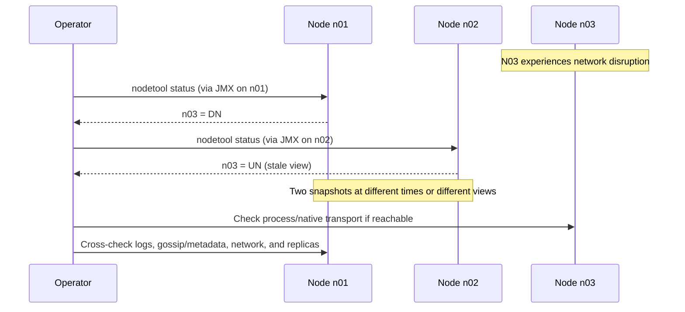
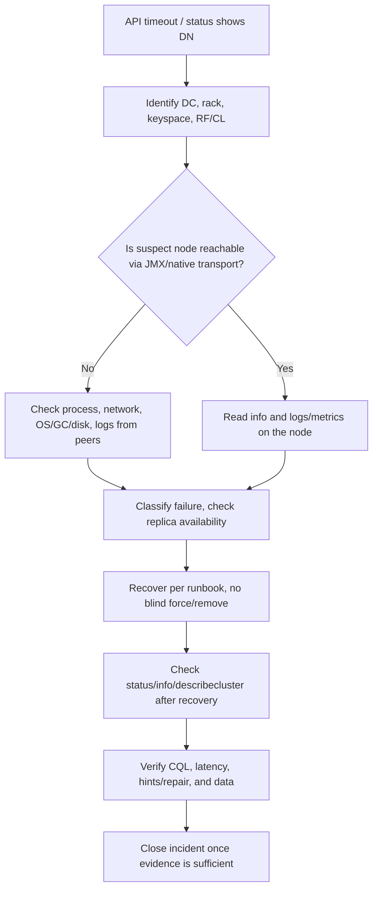

# nodetool status/info/describecluster and Reading Cluster State

When a Java API encounters an `UnavailableException` or `ReadTimeoutException`, the first question an Apache Cassandra operator usually asks is: **"Which nodes are participating in the cluster, are the coordinator and replicas healthy, and does the topology match the design?"** The three commands `nodetool status`, `nodetool info`, and `nodetool describecluster` provide complementary perspectives. However, seeing all nodes in the **`UN` (Up/Normal)** state does not automatically mean every replica has the same data, repair is complete, the application can write at every consistency level, or CPU/disk/network are healthy.

This lesson belongs to the **Operational Tools** chapter in the **DATABASE_ENGINE_WIDE_COLUMN_CASSANDRA** module. We will learn how to accurately read distributed state and the wide-column model, identify the relationship between tokens, partition keys, placement, replication factor (RF), and consistency level (CL), and then combine observations from `nodetool` with CQL, compaction, repair, JVM/OS metrics, and the Java Driver to investigate incidents without altering data.

**Key takeaway:** these three commands are **observational snapshots**, not a single test certifying "cluster healthy". You need to know which node they ran on, when, which version, and what information is still missing.

## 1. Learning Objectives

After this lesson, you will be able to:

1. Explain the scope differences between `status` (token ring and members), `info` (the queried node), and `describecluster` (cluster metadata/schema).
2. Read the `UN`, `DN`, `UJ`, `UL`, and `UM` codes and the distinct meanings of **liveness** and **membership state**.
3. Explain the `Address`, `Load`, `Tokens`, `Owns (effective)`, `Host ID`, and `Rack` columns; know when to pass a keyspace to interpret ownership.
4. Use `info` to inspect gossip/native transport status, heap, uptime, exception counters, and node metrics within the right bounds.
5. Use `describecluster` to verify the cluster name, snitch, partitioner, and schema versions; recognize signs that warrant investigating metadata/schema disagreement.
6. Analyze RF/CL and failure domains to determine which read/write requests **one Down node** affects.
7. Build a diagnostic workflow when a node is Down/Joining/Leaving or the Java Driver reports timeouts, and confirm findings using multiple independent signals.
8. Practice `nodetool`, CQL, and Java Driver 4.x in a lab without using topology-destructive operations.

## 2. Three Commands Answer Three Different Questions

| Command | Primary Question | Default Perspective | What It Does **Not** Prove |
| --- | --- | --- | --- |
| `nodetool status` | Which nodes are seen in the ring, Up/Down, and in Joining/Normal/Leaving/Moving state? | The node `nodetool` connects to via JMX, viewing membership/gossip and ring state. | All replicas have synchronized data, query p99 meets SLA, repair/streaming is complete, or quorum is met for every keyspace. |
| `nodetool info` | What are the identity, heap, load, and internal services of the queried node? | **One** Cassandra process/node; many metrics are point-in-time or since startup. | Health of other nodes, per-query latency, or cluster-wide capacity. |
| `nodetool describecluster` | How does the cluster identify its name/partitioner/snitch and schema versions? | Cluster metadata known by the queried node at execution time. | SSTable data is identical across all replicas, schema is definitely agreed on all disconnected nodes, or topology changes are fully verified. |

All three commands are relatively **read-only**: they are used for observation and do not trigger decommission, remove, repair, flush, or compaction on their own. They still require appropriate administrative privileges and may incur minor JMX overhead; do not invoke them continuously at unbounded frequency on an overloaded system.

### Rule for Reading a Snapshot

```text
  A line with "UN" in status
       │
       ├── Liveness: node is seen as Up
       ├── Membership: node is Normal
       │
       ├── DOES NOT imply: replica data is identical
       ├── DOES NOT imply: every keyspace meets its designed RF
       ├── DOES NOT imply: repair/hints have completed
       ├── DOES NOT imply: read/write p99 or disk/GC are normal
       └── DOES NOT imply: apps in another DC immediately see new mutations
```

This matters in Cassandra because a **write** can succeed once enough responses arrive per CL while a replica temporarily misses the mutation, and a **read** can return data from a subset of replicas without touching the stale replica.

## 3. Preparation: Version, Permissions, JMX, and Observation Point

`nodetool` is an administrative tool that connects to Cassandra over **JMX**. It is not equivalent to `cqlsh` (which uses the native protocol/CQL) and is not the Java Driver API executing a SELECT statement. Always know clearly which node is the **JMX target** when running commands.

### Basic Commands

```bash
# On a node granted operational access:
nodetool status
nodetool info
nodetool describecluster

# Check help/syntax for the exact Cassandra version running:
nodetool help status
nodetool help info
nodetool help describecluster
```

In multi-node environments, you may need to specify the JMX host via supported options such as `-h`, credentials/TLS, and port per policy. **Do not** expose unauthenticated JMX to the Internet or put passwords in commands recorded in shell history. Remote configuration must comply with RBAC, TLS/firewall, auditing, and your deployment's guidelines.

### Four Details to Record in the Logbook

1. **Which node are you connecting to?** Hostname/IP of the queried JMX node; during a node-Down incident, `status` is typically run on a **live node**—do not expect JMX on the Down node to always be reachable.
2. **When?** UTC timestamp, Cassandra version, and tool version; snapshots taken seconds apart can reflect different gossip states.
3. **Which keyspace?** When analyzing ownership and RF, use `nodetool status <keyspace>` if your version supports it, rather than inferring from the cluster-wide token ring.
4. **What defines "healthy"?** It must be tied to SLA, DC/rack, RF/CL, repair, and CQL results; `UN` is one signal, not the sole acceptance criterion.

### If `nodetool` Fails

Failure to connect to JMX **does not prove** the Cassandra native protocol is Down. You must distinguish among JMX port/auth/TLS, firewall, a stalled JVM, host/network issues, Cassandra process not running, or tool version mismatch. Cross-check service/process status, driver/native transport, node logs, and commands from another node before declaring the cluster Down.

## 4. `nodetool status`: Reading the Ring Table Column by Column

The **hypothetical output** example below simulates a cluster with two DCs, three nodes per DC; the lab keyspace uses `NetworkTopologyStrategy` with RF = 3 in each DC. The addresses, host IDs, disk usage, and token counts are **not** measurements from a real environment.

```text
$ nodetool status ops_status_lab

Datacenter: dc1
===============
Status=Up/Down
|/ State=Normal/Leaving/Joining/Moving
--  Address      Load       Tokens  Owns (effective)  Host ID                               Rack
UN  10.0.1.11    281.4 GiB  16      100.0%            11111111-1111-4111-8111-111111111111  rack1
UN  10.0.1.12    279.0 GiB  16      100.0%            22222222-2222-4222-8222-222222222222  rack2
UN  10.0.1.13    291.3 GiB  16      100.0%            33333333-3333-4333-8333-333333333333  rack3

Datacenter: dc2
===============
Status=Up/Down
|/ State=Normal/Leaving/Joining/Moving
--  Address      Load       Tokens  Owns (effective)  Host ID                               Rack
UN  10.0.2.21    266.1 GiB  16      100.0%            44444444-4444-4444-8444-444444444444  rack1
UN  10.0.2.22    270.0 GiB  16      100.0%            55555555-5555-4555-8555-555555555555  rack2
UN  10.0.2.23    268.5 GiB  16      100.0%            66666666-6666-4666-8666-666666666666  rack3
```

With RF=3 **and exactly three nodes in each DC**, every node can store a replica for all data in that keyspace within its respective DC, so `Owns (effective)` being 100% in the example is **intentional**. **Do not add the six 100% figures together and assume there is a 600% token ring**; this is the effective percentage accounting for replication, not the unreplicated token share. When adding nodes, changing RF, or selecting another keyspace, this percentage can change.

### Column Meanings

| Column | Meaning | Notes to Avoid Misinterpretation |
| --- | --- | --- |
| **Datacenter** | DC name assigned by snitch/topology. | The Java app's `localDatacenter` must match; a wrong DC causes unexpected routing/latency and CL behavior. |
| **Two characters `UN`/`DN`...** | First character: Up/Down; second character: Normal/Joining/Leaving/Moving. | State as seen by the queried node is distributed and can lag; it is not a complete health check. |
| **Address** | Node endpoint/address displayed by the tool. | IPv4/IPv6, broadcast endpoint, NAT, or hostname formatting can vary across deployments. |
| **Load** | Estimated Cassandra data size on the node as measured by the tool. | Not RAM, free filesystem space, disk IOPS, or total logical data size of the cluster. |
| **Tokens** | Number of tokens held by the node, typically reflecting vnode/token assignments. | Not partition count, replica count, CPU count, or load requiring balancing. |
| **Owns (effective)** | Fraction of data/token ranges owned by the node under the selected keyspace's replication. | Requires keyspace/RF context to interpret; may show `?` or be hard to interpret without specifying a suitable keyspace. |
| **Host ID** | UUID identifying the node in cluster metadata. | Crucial during replace/rebuild; the same IP address does not necessarily mean the same valid node identity. |
| **Rack** | Failure domain/rack reported by the snitch. | Does not itself prove nodes are in independent AZs/power zones; must be verified against physical infrastructure. |

### Why Does Each Node Have Multiple Tokens?

When using vnodes, a single node can own multiple segments of the token ring. This helps distribute ownership and allows streaming across multiple ranges, though adding or removing **one** node may require transferring data across **many token ranges**. `Tokens = 16` in the table does not mean there are only 16 partitions on the node or 16 concurrent SELECT queries.

### Distinguishing Load from Disk Headroom

Two nodes with the same `Load = 280 GiB` can have different free disk space due to volume sizes, snapshots/backups, temporary files, separate mounts, or metadata. To decide whether a node has enough room for bootstrap/repair/compaction, inspect `df`, disk/cgroup metrics, and SSTable/snapshot sizes—**never** rely on `Load` alone.

## 5. Status Codes: Up/Down vs. Normal/Joining/Leaving/Moving

`nodetool status` displays two dimensions:

- **First character — liveness:** `U` = Up, `D` = Down **from the membership/gossip perspective**.
- **Second character — membership phase:** `N` = Normal, `J` = Joining, `L` = Leaving, `M` = Moving.

| Code | Interpretation | What to Check Next |
| --- | --- | --- |
| **`UN`** | Node is seen as Up and Normal. | RF/CL, read/write latency, repair/hints, disk/GC, representative data. |
| **`DN`** | Node is seen as Down while metadata still considers it Normal. | Process/network/JMX, replica ranges, remaining quorum, outage timeline. |
| **`UJ`** | Node is Up and Joining/bootstrapping. | Streaming, token ranges/pending replicas, data sources, disk headroom, final outcome. |
| **`DJ`** | Node is seen as Down while Join has not completed. | Classify bootstrap failure; do not blindly delete the data directory or force remove. |
| **`UL`** | Node is Up and Leaving/decommissioning. | Outbound data transfer, destination nodes, post-leave quorum, metadata state. |
| **`DL`** | Node is seen as Down mid-way through Leaving. | Version-specific recovery runbook, scope of streaming completed vs. remaining. |
| **`UM`** | Node is Up and Moving, if supported by the version/token mode. | Old/new token ranges, streaming, overlap risk during movement. |
| **`DM`** | Node is Down during Moving if this state is surfaced. | Must resolve the incomplete topology operation; do not guess with a force command. |

Specific codes may not appear in every version/topology workflow. Cassandra 5.x has a **Cluster Metadata (TCM)** mechanism that differs from earlier versions; when the CLI and metadata show differing states, consult logs/tools for the **exact version** rather than assuming identical workflows across 3.x, 4.x, and 5.x.

### `UN` Is a Necessary Condition in Many Runbooks, Not a Sufficient One

A node that just finished bootstrapping to `UN` might:

- Have completed a membership step while still requiring post-checks on streaming/repair/cleanup per procedure;
- Have uncompacted SSTables or disk pressure after streaming;
- Serve writes/reads at some CL while still having historical data divergence because repair has not yet covered it;
- Be suffering GC pauses/CPU saturation while gossip still marks it Up;
- Have clients connecting to an unintended DC or holding stale token-routing metadata on some clients.

To declare "topology change complete", you must confirm **metadata + streaming + replica coverage + data correctness + p95/p99**, not just `UN`.

## 6. Owns (effective) Must Be Tied to Keyspace and RF

Do not read `Owns (effective)` as CPU/disk load or a simple balance ratio. Cassandra uses the partitioner to map partition key → token; the replication strategy decides which nodes store **replicas of a token range**. Effective ownership therefore depends on both token layout and replication, especially with multi-DC `NetworkTopologyStrategy`.

### Comparing Two Ways of Observing

```bash
nodetool status
nodetool status ops_status_lab
```

The first command may print ownership without effective per-keyspace calculation (e.g., `?` in that column, depending on version/configuration). The second requests calculation based on the **replication of keyspace** `ops_status_lab`. When comparing two snapshots, explicitly note **whether a keyspace was passed**, as the percentages do not necessarily mean the same thing.

### Conceptual Examples

| Assumed Topology | Safe Interpretation |
| --- | --- |
| `dc1` three nodes, RF = 3 | Every partition has three local replicas; each node can have very high effective ownership, even 100% for that DC's keyspace. |
| `dc1` six nodes, RF = 3 | Each partition only has three replicas among six nodes; effective ownership is distributed by token/rack placement; do not assume each node owns exactly 50% if token/placement is uneven. |
| Two DCs `dc1:3, dc2:3` | Ownership figures also reflect per-DC replication; do not sum percentages across DCs to calculate "what % of the ring is free". |
| Node currently bootstrapping/decommissioning | Token ranges, pending ownership, and active streaming data can cause the snapshot percentages not to match the steady target state yet. |

**Do not use Owns to pick "low-load nodes to remove".** You must evaluate node/rack availability, RF, CL, capacity, disk I/O, pending ranges, and repair schedule; a node with low Load can still be a required replica for hot partitions.

## 7. `nodetool info`: Information for **One Node**, Not the Entire Cluster

On the node under investigation:

```bash
nodetool info
```

Commonly seen fields depending on version/distribution:

```text
ID                     : 11111111-1111-4111-8111-111111111111
Gossip active          : true
Native Transport active: true
Load                   : 281.4 GiB
Generation No          : ...
Uptime (seconds)       : ...
Heap Memory (MB)       : ... / ...
Off Heap Memory (MB)   : ...
Data Center            : dc1
Rack                   : rack1
Exceptions             : ...
Key Cache              : ...
Row Cache              : ...
Counter Cache          : ...
```

This is an **illustrative field sample**, not a mandatory complete output. Some versions include cache metrics, percent repaired, tokens, or other fields; some fields may be absent or formatted differently.

| Field | What It Provides | What to Cross-Check With |
| --- | --- | --- |
| **ID** | Host ID of the node, to compare against `Host ID` in `status`. | Topology/replace/rebuild history, not just IP. |
| **Gossip active** | State of the gossip subsystem on this node. | View from peers; gossip active does not mean every peer is reachable. |
| **Native Transport active** | Whether CQL native transport is active on this node. | Client `9042` connectivity, auth/TLS, driver pool, and query success; do not look only at the true flag. |
| **Load** | Local total data reported by Cassandra. | `df` and disk/volume metrics; do not treat as free disk. |
| **Generation No** | Gossip/startup generation indicator per version mechanism. | Uptime/restart logs; do not treat as "number of repairs". |
| **Uptime** | How long the node process has been running. | Incident timeline; a recent restart does not mean bootstrap or repair is done. |
| **Heap Memory** | JVM heap currently used and reported heap capacity. | GC logs, allocation, native/RSS/cgroup/page cache; heap is not all RAM. |
| **Off Heap Memory** | A portion of off-heap memory tracked by Cassandra. | RSS/cgroup/direct buffers; may **not** include all native memory. |
| **Data Center / Rack** | Labels reported by the snitch/node. | `status`, AZ/rack infrastructure, NTS RF, and Java local DC. |
| **Exceptions** | Node exception counter within the scope provided by the version. | Rate over time, `system.log`, restart time; do not assume every exception is a request failure. |
| **Cache metrics** | Partial effectiveness of key/row/counter caches when enabled. | Hit rate, misses, and workload; increasing cache does not fix a bad partition query. |

### Three Easily Misunderstood Scenarios

**Scenario 1 — Gossip active=true but the driver cannot connect:** check native transport, TLS/auth, firewall, listen/broadcast address, connection pool, or CPU/GC. Gossip uses a different mechanism/protocol from the native protocol, so the two states are not equivalent.

**Scenario 2 — Native Transport active=true but `ReadTimeout`:** the node can accept CQL connections while target replicas are slow/Down, disks are saturated, `LOCAL_QUORUM` lacks enough responses, or the query scans tombstones. This is a read-path availability/latency issue, not simply "port 9042 open".

**Scenario 3 — Plenty of heap left but the node's disk is slow:** heap is only one part of RAM. OS page cache, off-heap, compaction, IOPS, and SSTable reads must be observed separately. Never raise Xmx solely because of one `Heap Memory` field in a snapshot.

## 8. `nodetool describecluster`: Cluster Identity and Schema Versions

```bash
nodetool describecluster
```

An **illustrative** output might include:

```text
Cluster Information:
  Name: Cassandra Lab
  Snitch: org.apache.cassandra.locator.GossipingPropertyFileSnitch
  DynamicEndPointSnitch: enabled
  Partitioner: org.apache.cassandra.dht.Murmur3Partitioner
  Schema versions:
    77777777-7777-4777-8777-777777777777: [10.0.1.11, 10.0.1.12, 10.0.1.13,
                                            10.0.2.21, 10.0.2.22, 10.0.2.23]
```

Specific field names, groupings, and formatting **vary by Cassandra release**. The example does not imply the schema GUID has any business meaning. On certain versions/states, schema version may be displayed with special information or appear unsettled; do not automatically label "schema disagreement" simply because a line does not match the example verbatim.

### What to Read in Each Field

| Field | Operational Meaning | What Not to Conclude |
| --- | --- | --- |
| **Name** | Cluster name, helping detect accidental connection to dev/staging/prod. | Identical names do not prove all nodes belong to the same healthy membership. |
| **Partitioner** | How partition keys are converted to tokens, e.g., `Murmur3Partitioner`. | Does not determine RF and does not replace snitch/rack placement. |
| **Snitch** | How Cassandra discovers DC/rack/topology for replica placement. | Correct snitch class does not guarantee each node's config files declare the right DC/rack. |
| **DynamicEndpointSnitch** | Feature that helps select better replicas for reads in certain setups. | Does not strengthen consistency, replace data, or replace repair. |
| **Schema versions** | Schema versions observed via cluster metadata at snapshot time. | A single shared version does not guarantee SSTable data values match or that every Down node received the latest schema update. |

### What Is Schema Agreement and What Are Its Limits?

When creating/altering tables or keyspaces, schema metadata must be consistently recognized by the relevant members. If `describecluster` shows **multiple schema versions** across observed nodes past the normal convergence window:

1. Record **which nodes belong to which version**, DC/rack, and timestamp.
2. Cross-check `status` and network/gossip: are there Down/Joining nodes, broken inter-DC links, or ongoing topology changes?
3. Cross-check CQL `DESCRIBE KEYSPACE`/expected DDL and the application: are there `UNPREPARED` errors, schema mismatches, or an active migration?
4. Check logs and cluster metadata state using **version-appropriate** tools; Cassandra 5.x uses a modern metadata/schema mechanism that differs from some older versions.
5. Do not issue overlapping `ALTER TABLE`/schema migrations or manually edit system tables to "sync quickly" before identifying the root cause.

**Schema agreement differs from replica consistency.** Two nodes can share the exact same table definition while holding different old/new data because of missed mutations; that falls under replication/hints/repair. Conversely, schema disagreement can exist while most queries reading older data continue running.

## 9. Reading a Cluster as a Distributed System: Multiple Perspectives

Cassandra relies on membership/gossip mechanisms (and metadata/topology workflows depending on version). Because updates and network faults are not seen simultaneously by all nodes, two `status` runs from two different nodes can **temporarily disagree**.



This is a conceptual scenario, not a fixed RPC sequence. **If two views conflict**, do not pick the "prettier" view to close the ticket. Record the timestamps and node pairs, check stability across a bounded set of repeated observations, and inspect driver and network/JVM logs.

### Evidence Triangle

| Source | What It Can Answer | Must Be Combined With |
| --- | --- | --- |
| **`status` from 1–2 healthy nodes** | Membership/liveness/topology view. | Peer logs, health of the suspect node, CQL CL/replicas. |
| **`info` on the suspect node** | Local gossip/native transport/JVM/uptime and identity. | OS/JVM metrics, client connectivity, and CQL results. |
| **`describecluster`** | Cluster identity, snitch/partitioner/schema versions. | Schema metadata/DDL, topology workflows, migration logs. |
| **Java Driver metadata/metrics** | Driver-known endpoints, node state, DC, request coordinator, latency/retries. | Does not replace server ring/repair status; the driver also has an eventually updated view. |
| **CQL + table inspection** | Does a query with partition key/CL return the expected representative data? | Not sufficient to verify all replicas/token ranges via a single SELECT. |
| **Server logs/OS/JMX metrics** | CPU, GC, disk, network, streaming, compaction/repair, exceptions. | Needs time window and correlation; no single chart proves root cause. |

## 10. From Node State to Fault Tolerance: RF and CL

Suppose a keyspace uses `NetworkTopologyStrategy` with RF = 3 in `dc1`, with three nodes in three different racks; a partition is replicated across three replicas A/B/C:

```text
DC dc1, RF = 3, one partition P
Replica A: UN
Replica B: UN
Replica C: DN

LOCAL_ONE    : requires 1 replica in dc1, can proceed if A or B responds.
LOCAL_QUORUM : floor(3/2) + 1 = 2; can proceed if both A and B respond.
ALL          : requires all 3 replicas, cannot succeed when C is truly unavailable.
```

This is the **replica-count condition for one partition**, not a guarantee that the request will succeed: A/B might be slow due to disk/GC/network, or have schema or coordinator errors, so `ReadTimeout`/`WriteTimeout` can still happen. If another live node does not hold partition P, it **does not** automatically substitute for a replica of P.

### Distinguishing CL and DC

With two DCs `dc1:3, dc2:3`:

| Consistency | Required Responses | When One Node in dc2 Is Down |
| --- | --- | --- |
| `LOCAL_ONE` in dc1 | 1 local replica of the partition. | May not directly affect ack latency in dc1, but affects data/DR in dc2. |
| `LOCAL_QUORUM` in dc1 | 2 replicas in dc1. | Can still ack locally; **does not** prove dc2 has caught up. |
| `LOCAL_QUORUM` in dc2 | 2 replicas in dc2. | Can still succeed with 2/3 UP, but has little fault-tolerance margin left. |
| `QUORUM` total RF=6 | 4 replicas out of six total. | Must examine which replicas actually respond; do not assume `QUORUM` means 2+2 in each DC. |
| `EACH_QUORUM` (write) | Quorum in **each DC** (2 in dc1 and 2 in dc2). | Directly impacted if dc2 lacks quorum; WAN is on the critical wait path. |

**Reading `status` must be tied to a keyspace and request type.** "5/6 nodes Up in the cluster" is too coarse a number without knowing RF/CL and which replicas hold which keys.

### Rack/AZ Is a Failure Domain That Must Be Verified

Three `UN` nodes placed in the same rack can suffer a shared power/infrastructure outage. `Rack` in `status` is a label from the snitch; it must be cross-checked against actual physical placement/AZs. To assess single-rack failure tolerance, identify which partitions have replicas in the same rack and whether RF/CL will still be met if that rack goes down—do not just count nodes.

## 11. CQL Lab: Observing Topology and Per-Partition Data

**Prerequisites:** a lab with two genuine DCs named `dc1` and `dc2`, at least three nodes per DC, and access to `cqlsh` and `nodetool`. If you only have a single DC/node, adjust the RF examples in the **lab** accordingly; never change production RF to run exercises. The initial steps are **read-only**; CREATE/INSERT are performed only in the dedicated practice keyspace.

### Step 1 — Capture Cluster-Wide Baseline

```bash
nodetool status
nodetool info
nodetool describecluster

# Check by keyspace after creating it in the next step.
# nodetool status ops_status_lab
```

Record the UTC time, JMX node, Cassandra version, node counts per DC/rack, Host IDs, current states, Load, and Tokens. Do not mark `SUCCESS` solely because all nodes are `UN`; check `info` on at least representative nodes and `describecluster` to compare cluster name/schema.

### Step 2 — Create Keyspace and Query-Driven Table

```sql
CREATE KEYSPACE IF NOT EXISTS ops_status_lab
WITH replication = {
  'class': 'NetworkTopologyStrategy',
  'dc1': 3,
  'dc2': 3
}
AND durable_writes = true;

CREATE TABLE IF NOT EXISTS ops_status_lab.events_by_tenant_day (
  tenant_id text,
  event_day date,
  event_time timestamp,
  event_id uuid,
  event_type text,
  PRIMARY KEY ((tenant_id, event_day), event_time, event_id)
) WITH CLUSTERING ORDER BY (event_time DESC, event_id DESC);

CONSISTENCY LOCAL_QUORUM;

INSERT INTO ops_status_lab.events_by_tenant_day
  (tenant_id, event_day, event_time, event_id, event_type)
VALUES ('tenant-lab', '2026-11-21', '2026-11-21T08:00:00+0000',
        11111111-1111-4111-8111-111111111111, 'BASELINE');
```

**Explanation:** `(tenant_id, event_day)` is the partition key; `event_time, event_id` are clustering columns. A CQL `LOCAL_QUORUM` write from a coordinator in one DC does not wait for quorum in the other DC, so an immediate read in the other DC may **temporarily see stale/missing data** if replication has not converged yet. Having enough `UN` nodes is only the initial topology condition, not a substitute for verifying the result.

### Step 3 — Re-read Status by Keyspace

```bash
nodetool status ops_status_lab
nodetool describecluster
```

Verify `Owns (effective)` per NTS/RF3+3, rack distribution, and schema versions after DDL. If `describecluster` shows multiple schema versions right after CREATE, give the cluster time to converge and check whether any node is unhealthy; **do not** issue repeated schema changes endlessly just to clear the warning.

### Step 4 — SELECT a Single Partition

```sql
CONSISTENCY LOCAL_QUORUM;

SELECT event_time, event_id, event_type
FROM ops_status_lab.events_by_tenant_day
WHERE tenant_id = 'tenant-lab'
  AND event_day = '2026-11-21'
LIMIT 20;
```

With RF3+3 and healthy nodes, the SELECT should target a single logical partition. To check from **both DCs**, open two `cqlsh` sessions connected to coordinators **verified to belong to each DC** and run the same query. A SELECT in dc1 returning the expected result does not prove all replicas in dc2 have received the mutation at that exact moment.

### Step 5 — Query Metadata via CQL (Reference)

```sql
-- Coordinator/local node that cqlsh is connected to (version-dependent):
SELECT cluster_name, host_id, data_center, rack
FROM system.local;

-- Inspect DDL/replication per cqlsh support:
DESCRIBE KEYSPACE ops_status_lab;
```

In some releases, `system.peers` or `system.peers_v2` is available to inspect peer node information; system table schemas can vary by version and metadata mechanism. **Do not manually modify system tables.** CQL metadata results are supplementary only; they do not replace `nodetool status/info/describecluster` and cluster logs during a membership incident.

### Step 6 — Walk Through an Anomaly Scenario **on Paper**

Do not stop nodes or run decommission/removenode in this mandatory lab. Modify a **copy of the simulated output** to:

```text
dc1: n01=UN, n02=UN, n03=DN
dc2: n04=UN, n05=UN, n06=UN
RF: dc1=3, dc2=3
App write CL in dc1: LOCAL_QUORUM
```

Evaluate whether the two surviving dc1 replicas can achieve quorum, whether any margin remains to tolerate one more failure, whether `info` on n03 is reachable, and which metrics/logs must be checked before declaring the node truly failed.

## 12. Incident Workflow: A Node Transitions from `UN` to `DN`

### Non-Destructive Investigation Steps

1. **Record the time window and perspective:** run `nodetool status` from a live node, noting the source node and UTC timestamp; cross-check another healthy peer if needed.
2. **Scope the impact:** which DC/rack is the DN node in, does it hold replicas for the failing application partitions, and what are the RF and CL for those keyspaces?
3. **Inspect the suspect node:** host/process/JVM if permitted, native port, JMX, disk free/IOPS, GC pauses, CPU/heap, peer network connectivity; do not treat unreachable JMX as the sole proof.
4. **Cross-check logs:** Cassandra `system.log`/GC logs, kernel/OS logs, network events, Java Driver error classes, and per-coordinator/replica latency.
5. **Check other sources of churn:** repair/streaming/compaction/flush, bootstrap/decommission, schema deploys, disk-full, WAN/rack failure.
6. **Preserve correctness:** do not unconditionally lower consistency or reduce RF; do not `removenode` a node that might recover before knowing its state and the right runbook.
7. **Recover per failure type:** restart service, fix network/disk, or replace/rebuild strictly according to your version's operational runbook; monitor missed mutations and tombstone data.
8. **Verify acceptance:** the node returning to `UN` is one step, but you still need to check CL, application behavior, repair/hints, and representative data across ranges.



### Why Not Just Count Up Nodes?

A cluster has ten nodes, yet a hot partition resides only on three replicas A/B/C. If both B and C are DN, the cluster-wide Up count is still eight; `LOCAL_QUORUM` for that partition **cannot** achieve RF3 quorum. Conversely, a DN node outside the replica set of the partition being read may have no direct impact on that request. You must map **partition/token → replica set**, not merely count total nodes.

## 13. Joining/Leaving Scenarios: Coordinate with Streaming

Topology changes transfer data ownership. `status` can report `UJ` or `UL`, but it **does not** show full progress for every SSTable/range. Supplement with:

```bash
nodetool netstats
nodetool compactionstats
nodetool tpstats
nodetool status
nodetool describecluster
```

| Signal | When Seeing `UJ` | When Seeing `UL` |
| --- | --- | --- |
| **Membership** | New node is joining; do not count it as a stable replica solely from Up status. | Old node is leaving; assess RF/CL and data sources before it disappears. |
| **Streaming** | Check source/target nodes, bytes/ranges, peer errors, and disk headroom. | Confirm data/ownership is handed off to remaining replicas per runbook. |
| **Resources** | Target disk and source read I/O can surge; network/GC/p99 may be impacted. | Data streaming, compaction, and network may contend with live traffic. |
| **Completion criteria** | Normal membership + successful stream + replica coverage + data checks. | Node cleanly leaves ring + data/replica coverage + post-checks. |
| **Risky actions** | Starting another bootstrap/replace while the current phase is unclear. | Forcibly shutting down a decommissioning node or running `removenode` without assessment. |

`nodetool netstats` reports **active** streams; seeing no streams in a final snapshot does not itself prove all streams succeeded. Use logs and the final output of the topology command. If a session fails/is unknown, do not start a second topology change simply because a node flipped to `UN`.

### When Are Repair or Cleanup Needed?

After bootstrap/decommission/replace, **repair** may be needed to ensure replica convergence or **cleanup** to reclaim data no longer owned by a node, depending on procedure and version. These are not interchangeable commands:

- **Repair** compares data across replicas and synchronizes discrepancies.
- **Cleanup** reclaims local data no longer within the node's ownership range after a valid topology change.
- **Compaction** optimizes SSTables on the local node; it does not cause other replicas to receive missed mutations.

Those commands **carry resource/data impact**; this lesson only introduces their meaning and how to observe them, and does not ask you to run them as a "let's try it to see if the error goes away" step.

## 14. Linking with Java Driver 4.x: The Client Has Its Own View

The Java Driver maintains metadata on nodes, endpoints, DC/rack, and state as known by the driver. A driver using connection pools/token-aware routing can have a **stale view** compared to `nodetool` during topology changes. Conversely, `nodetool status` showing `UN` does not guarantee the client has valid TLS/auth or an unsaturated connection pool.

### Example: Observing Driver-Side Metadata (Read-Only)

```java
import com.datastax.oss.driver.api.core.CqlSession;
import com.datastax.oss.driver.api.core.metadata.Node;

// Assumes CqlSession session has already been created and configured with
// environment-appropriate contact points and localDatacenter at app startup.

for (Node node : session.getMetadata().getNodes().values()) {
    System.out.printf(
        "hostId=%s endpoint=%s dc=%s rack=%s state=%s%n",
        node.getHostId(),
        node.getEndPoint(),
        node.getDatacenter(),
        node.getRack(),
        node.getState());
}
```

This snippet shows **what the driver knows**, not absolute cluster metadata. `node.getState()` is the driver's view of state, not equivalent to `nodetool`'s `UN/DN/UJ/UL/UM` codes; the driver does not guarantee full visibility into membership phases.

### Logging Which Coordinator Handled a Request

```java
import java.time.LocalDate;
import com.datastax.oss.driver.api.core.ConsistencyLevel;
import com.datastax.oss.driver.api.core.cql.PreparedStatement;
import com.datastax.oss.driver.api.core.cql.BoundStatement;
import com.datastax.oss.driver.api.core.cql.ResultSet;
import com.datastax.oss.driver.api.core.cql.ExecutionInfo;

PreparedStatement select = session.prepare(
    "SELECT event_time, event_id, event_type " +
    "FROM ops_status_lab.events_by_tenant_day " +
    "WHERE tenant_id = ? AND event_day = ? LIMIT 20");

BoundStatement statement = select.bind(
    "tenant-lab", LocalDate.of(2026, 11, 21))
    .setConsistencyLevel(ConsistencyLevel.LOCAL_QUORUM)
    .setPageSize(20)
    .setIdempotent(true);

long start = System.nanoTime();
try {
    ResultSet rs = session.execute(statement);
    ExecutionInfo info = rs.getExecutionInfo();
    double elapsedMs = (System.nanoTime() - start) / 1_000_000.0;
    String coordinator = info.getCoordinator() == null
        ? "unknown" : info.getCoordinator().getEndPoint().toString();

    System.out.printf(
        "query=events_by_day.select elapsedMs=%.2f coordinator=%s " +
        "warnings=%d%n", elapsedMs, coordinator, info.getWarnings().size());
    // Iterate results within bounds; if fetching additional pages, measure pages separately.
} catch (RuntimeException error) {
    System.err.println("query=events_by_day.select error="
        + error.getClass().getSimpleName());
    throw error;
}
```

**Notes:**

- `ExecutionInfo.getCoordinator()` is the node that sent the response for a successful execution; it is **not** the set of selected replicas or proof of repair.
- When the driver times out before receiving a response, there may be no coordinator/tracing ID from `ExecutionInfo`; write outcome may be **unknown**. Do not reflexively retry writes that generate new IDs or have non-idempotent side effects.
- `setPageSize(20)` does not guarantee the server scans only 20 rows/tombstones. Proper partition key/range design is a prerequisite.
- `LOCAL_QUORUM` should not be downgraded to `ONE` just to mask node/replica failures. Base decisions on SLA and the consistency contract.
- Log `query_name`, CL, local DC, elapsed, and coordinator when needed; **never** put raw partition keys, bind values, or PII into logs/Prometheus labels.

### When the Driver and nodetool Disagree

If the driver still sees a node as `DOWN` after `nodetool` shows `UN`, check contact points, local DC, native protocol connectivity, auth/TLS, address/broadcast settings, metadata refresh, driver reconnection, and logs. Never force the driver to mark a node Up by tampering with the ring or server metadata.

## 15. Diagnostic Matrix Combining Operational Tools

| Symptom | Which Command to Start With? | What to Add? | Conclusion to Avoid Jumping To |
| --- | --- | --- | --- |
| A node displays `DN` | `status` from a healthy node; `info` if suspect node is still reachable. | Process/JVM/network logs, RF/CL, replica endpoints. | "The entire cluster is unusable." |
| Java fails to connect to native port | `info` to check Native Transport; `status` to check membership. | Firewall/TLS/auth, driver local DC, and pool. | "Node is DN" just because JMX or TCP from one client failed. |
| Heap grows after deploy | `info`. | GC logs/JFR, RSS/off-heap/cgroup, allocation, and p99. | "Just increase Xmx and it's fixed." |
| Slow queries despite all `UN` | `status` + `tablestats`/`tablehistograms`. | Read latency, tombstone scans, SSTables/read, disk/GC, and Java driver. | "UN = queries will be fast." |
| Node stays `UJ` for hours | `status` + `netstats`. | Bootstrap logs, stream bytes, disk headroom, peer health. | "Force Normal/remove and retry." |
| Node `UL` and another node Down | `status` + `describecluster`. | RF, CL, pending ranges, streaming, and quorum capacity. | "Remove another node since total node count is still high." |
| Schema mismatch after `ALTER TABLE` | `describecluster`. | CQL DDL, peers/metadata, schema agreement, migration logs. | "Running data repair will fix the schema immediately." |
| Skewed Ownership/Load across nodes | `status <keyspace>` + `info`. | Data volume/df, token ranges, RF/rack, SSTable counts, and workload. | "Low Owns means the node should be removed." |
| One DC reads stale data | `status` per DC + `describecluster`. | CL, WAN/hints/repair, write timestamp, replica data. | "Status UN already guarantees all DCs converged." |

### Supplementary Observational Commands (Not the Same Purpose)

```bash
nodetool tpstats
nodetool tablestats ops_status_lab.events_by_tenant_day
nodetool tablehistograms ops_status_lab events_by_tenant_day
nodetool compactionstats
nodetool netstats
```

`tpstats` inspects thread pool queues/active/dropped tasks; `tablestats/tablehistograms` inspects table metrics/read amplification; `compactionstats` inspects compaction; `netstats` inspects active streaming. Combine these with OS/JVM CPU/GC/disk/network metrics; do not use `status/info/describecluster` to replace all monitoring.

## 16. Dashboards and Alerts for the Three State Groups

A useful dashboard should keep these distinct:

| Dashboard Group | Metrics/Output | Meaningful Alerts |
| --- | --- | --- |
| **Membership & placement** | Nodes `UN/DN/UJ/UL/UM` by DC/rack, Host ID count, ring changes, RF/keyspace. | Prolonged Down node or insufficient replicas/quorum for critical workloads; stuck transitions. |
| **Node & transport** | `info` gossip/native transport, uptime/restarts, heap/GC, exceptions, connection health. | Native transport down, abnormal restarts, GC pauses, and rising request errors. |
| **Cluster metadata** | Cluster name, partitioner/snitch, schema versions, migration/topology state. | Prolonged schema disagreement past convergence window or nodes with wrong DC/rack labels. |
| **Data & latency** | App read/write p95/p99, timeouts, CL, SSTables/read, tombstones scanned, repair/hints. | SLA violations accompanied by read amplification, replica trouble, or overdue repair. |
| **Maintenance/resources** | Streaming/compaction/repair progress, disk capacity, CPU/GC, network RTT/retrans. | Pending work and resource exhaustion threatening bootstrap/repair completion. |

**Alerts should pair state + impact.** For example, "n03 DN beyond agreed threshold **and** dc1 RF3 is down to exact quorum" is stronger for SLA than a standalone "one node not UN" alert. Still, a single DN node warrants its own alert for early response because redundancy has already decreased, even before the app times out.

### Cardinality and Security Notes

Metric labels should use stable `dc`, `rack`, `node`, `query_name`; do not attach `tenant_id`, raw partition keys, request UUIDs, or sensitive info as unbounded labels. Logs containing Host IDs, endpoints, and cluster topology are operational data requiring access control; do not dump full `nodetool status` outputs into public channels.

## 17. Acceptance Criteria for a Cluster Health Check

Do not use a single label "GREEN if all UN". Define five acceptance gates:

1. **Membership:** no unplanned `DN`/Joining/Leaving/Moving; no unreachable nodes or unexplained conflicting views.
2. **Placement and RF/CL:** critical keyspaces use replication in the right DCs/racks; expected partitions have enough replicas/failure domains to satisfy CL and tolerate node loss.
3. **Schema/topology metadata:** cluster name/snitch/partitioner match, schema versions/metadata have no unresolved prolonged drift, topology transitions are complete.
4. **Data and maintenance:** scoped repair/hints/streaming/cleanup are complete or explicitly flagged pending; sample reads/writes on target partitions show no abnormal errors.
5. **Resources and SLA:** Java Driver/app p95/p99, timeouts, node disk/CPU/GC/network, compaction backlog, and safe capacity headroom.

If gates 1–3 pass but repair is incomplete, record `TOPOLOGY_STABLE / DATA_REPAIR_PENDING` per your internal reporting schema instead of `FULLY_HEALTHY`. If a node is DN while app CL can still be served, the status is also not "everything is fine": redundancy is reduced.

### Report Template (Custom Output, Not nodetool)

```text
CHECK_ID: cassandra-ops-status-2026-11-21
OBSERVER_NODE: n01 (dc1)
CHECK_TIME_UTC: [actual timestamp]
CASSANDRA_VERSION: [version]
KEYSPACE_RF: ops_status_lab / dc1:3, dc2:3
STATUS_VIEW: 6 UN / 0 DN / 0 transitions  [illustrative lab figures]
HOST_ID_RACK_AUDIT: PASS / INCOMPLETE
DESCRIBECLUSTER_SCHEMA: AGREED / DISAGREED / UNKNOWN
INFO_CHECKS: native transport / heap / uptime / exceptions
REPAIR_STREAMING: SUCCESS / PENDING / UNKNOWN
DRIVER_CQL_CHECK: LOCAL_QUORUM query succeeds in dc1/dc2?
APP_P99_AND_ERRORS: [actual measurements]
FINAL: HEALTHY / DEGRADED / INCOMPLETE
EVIDENCE: [logs, metrics, change/repair run ID]
```

Do not turn illustrative values like `6 UN / 0 DN` into real observed results. Reports must state the **observer perspective**, time window, and confidence level; after topology changes or restarts, re-run the check instead of reusing an old snapshot.

## 18. Common Misconceptions

| Misconception | Correct Understanding and Handling |
| --- | --- |
| "`UN` means the node is 100% healthy." | Only membership/liveness; still need CPU/GC/disk, client CL, repair, and CQL results. |
| "`DN` means the entire cluster is Down." | Must map RF/CL and per-partition replicas to see how many failure domains remain available. |
| "`nodetool info` shows the health of all nodes." | It describes only the queried node, not a cluster-wide rollup. |
| "Gossip active=true means the CQL port definitely works." | Gossip and native transport are two separate service paths. |
| "JMX failure means CQL is also failing." | JMX and native transport use different ports, TLS/auth, and handlers; verify independently. |
| "Largest Load means the node handles the most client traffic." | Load is primarily data size on disk, not QPS/CPU/latency. |
| "Owns=100% means the node exclusively owns the entire ring." | With high RF, each replica can hold overlapping copies of data; must consider keyspace/DC. |
| "Tokens=256 means there are 256 partitions." | Number of tokens/vnodes is not the number of partitions or rows. |
| "Host ID is the same as IP; a node changing IP is a new node." | Host ID is the metadata identity; node replacement requires a dedicated runbook. |
| "Describecluster showing one schema version means all replica data is identical." | Schema metadata agreement differs from SSTable value/tombstone synchronization. |
| "Schema disagreement is fixed by `nodetool repair`." | Data repair is not a general tool for fixing schema metadata disagreement. |
| "Finishing Join as UN guarantees streaming/repair are all done." | Must inspect logs, pending ranges, streaming, and post-check data. |
| "5/6 nodes Up means every `LOCAL_QUORUM` will succeed." | Quorum depends on partition/DC/replica set, plus slow nodes or network issues. |
| "Increasing RF via `ALTER KEYSPACE` immediately populates data on new nodes." | Requires version-appropriate populate/repair/streaming workflows and verification. |
| "Lowering consistency to ONE is how you fix a Down node." | Changes consistency guarantees and data risk; requires SLA evaluation. |
| "No active streams in netstats means all streaming succeeded." | Current snapshot does not contain history of failed or completed streams. |

## 19. Comprehensive Exercises

### Exercise A — Reading Status Output

A `dc1` cluster has RF=3 and three nodes n01/n02/n03 across three racks. `status` output shows `n01=UN`, `n02=UN`, `n03=DN`.

1. Explain **each character** of `DN`.
2. Can writes at `LOCAL_QUORUM` succeed? What conditions on n01/n02 must still hold?
3. Can writes at `ALL` succeed when n03 is truly unavailable?
4. If n03's process is alive but JMX is blocked, what evidence do you check to distinguish a JMX issue from a native protocol failure?
5. Write at least three things that **cannot** be concluded solely from `status` output.

### Exercise B — Reading `Load` and `Owns`

An NTS cluster has three nodes in dc1, RF=3. `nodetool status keyspace_x` prints `Owns (effective)=100%` for each node.

1. Why do these three percentages not mean the cluster has "300% independent data"?
2. Why can `Load` differ even when `Owns` is equal?
3. To balance disk usage, what other metrics must be measured before removing/adding a node?
4. What can the `Tokens` count tell you about vnodes, and what can it **not** tell you about partition counts?

### Exercise C — `info` and Two Service States

Node n02 shows `Gossip active=true`, `Native Transport active=false`, and heap spiked right after a deploy. The Java Driver cannot connect to n02.

1. Must `status` from n01 necessarily show n02 as DN? Why or why not?
2. In what order do you inspect GC logs, server logs, native port/firewall/TLS, and driver errors?
3. Should you raise Xmx immediately? What additional data on post-GC heap, RSS, and OS page cache is needed?
4. How do you confirm the service has recovered without relying solely on `Native Transport active=true`?

### Exercise D — Schema Version Disagreement

After a schema migration, `describecluster` displays two schema versions; `status` reports one `UJ` node in dc2.

1. What plausible reasons can cause versions to differ temporarily?
2. Why should you not repeatedly run `ALTER TABLE` or manually edit `system.local`?
3. List evidence to distinguish unconverged metadata, a faulty node, and a genuinely broken schema migration.
4. When is it safe to proceed with deploying applications containing prepared statements using the new schema?

### Exercise E — Incomplete Bootstrap

Node n07 is `UJ`, `netstats` shows a large stream, free disk is 8%, and one source node is DN. A scheduler wants to start decommissioning another node because it is past the planned window.

1. Which gate is failing? Why are retaining the source and disk headroom critical?
2. How should you inspect the streaming phase, logs, RF/CL, and disk on source/target nodes?
3. Why should you not reflexively run `removenode` or force bootstrap?
4. What conditions must be met before launching a new topology change?

### Exercise F — Multi-DC and Quorum

Keyspace `orders` has `dc1:3, dc2:3`. One node in dc2 is DN, all dc1 nodes are UN. The app in dc1 writes at `LOCAL_QUORUM` and an API in dc2 reads at `LOCAL_QUORUM`.

1. How many replicas per DC are required for those two requests?
2. Can you conclude that DC2 can already read the write just acknowledged in dc1? Why or why not?
3. Compare with `EACH_QUORUM` writes regarding ack conditions and WAN dependency.
4. Which metrics/hints/repair signals should be monitored to know when DC2 has converged?

### Exercise G — Health Check Report

Design a one-page report containing `status`, `info`, `describecluster`, RF/CL, Java read/write p99, disk/GC, repair/streaming, and test CQL results. Define the three states **`HEALTHY`, `DEGRADED`, `INCOMPLETE`**, give corresponding examples, and explain how to record timestamps/JMX node for future comparison.

### Completion Criteria

Learners must demonstrate:

1. **Correctly reading the three scopes** (ring/member/node/metadata) without confusing `UN` with application/data health.
2. **Understanding status and ownership columns** by RF/keyspace/DC without misusing Load/Owns.
3. **Connecting RF/CL with replica sets** to estimate the impact of a Down node or topology transition.
4. **Following an evidence-based workflow** from `nodetool` → logs/metrics → CQL/Java, using safe runbooks during incidents.

## 20. Self-Check Questions

1. How does `nodetool status` differ from `nodetool info` and `nodetool describecluster` in observational scope?
2. What two state dimensions do `U/D` and `N/J/L/M` represent?
3. Can an `UN` node still return timeouts or partially missing data? Why?
4. Does `Load` equal free filesystem space or node QPS?
5. Why must `Owns (effective)` be interpreted per keyspace replication?
6. What does `Tokens` represent in a virtual nodes environment?
7. How does Host ID differ from IP/hostname, and what role does it play during node replacement?
8. Do Gossip active and Native Transport active mean the same thing?
9. Does Heap Memory in `info` represent all Cassandra RAM/RSS?
10. Does `describecluster` showing one schema version suffice to prove replicas hold identical data contents?
11. When `status` outputs from two different nodes conflict, which information sources help find the cause?
12. Why does total Up node count across the cluster not replace per-partition quorum calculation in a specific DC?
13. When a node is `UJ`, which command shows streaming and why is an empty stream snapshot insufficient for sign-off?
14. Why is `nodetool` failing to connect over JMX insufficient to conclude CQL port `9042` is down?
15. What metrics, repair status, and Java/CQL checks does a complete health check runbook need?

## 21. References and Version Lookup

- [Apache Cassandra — nodetool](https://cassandra.apache.org/doc/latest/cassandra/managing/tools/nodetool/): look up `status`, `info`, `describecluster`, and other observational commands by version.
- [Apache Cassandra — Operating Cassandra](https://cassandra.apache.org/doc/latest/cassandra/managing/operating/): membership, node management, topology changes, and monitoring.
- [Apache Cassandra — Architecture](https://cassandra.apache.org/doc/latest/cassandra/architecture/): token/partition keys, replication strategy, DC/rack, and consistency.
- [Apache Cassandra — CQL DDL](https://cassandra.apache.org/doc/latest/cassandra/developing/cql/ddl.html): `NetworkTopologyStrategy` keyspaces, RF, and table design.
- [Apache Cassandra — Metrics](https://cassandra.apache.org/doc/latest/cassandra/managing/operating/metrics.html): JMX/table/host metrics to evaluate health beyond `UN/DN`.
- [Apache Cassandra — Repair](https://cassandra.apache.org/doc/latest/cassandra/managing/operating/repair.html): replica synchronization and the difference between repair and membership.
- [Apache Cassandra Java Driver 4.x](https://apache.github.io/cassandra-java-driver/): node metadata, local datacenter, coordinator, metrics, and request tracing.

**Remember:** `nodetool status` tells you **which members the ring sees and what phase they are in**; `nodetool info` tells you **how one node reports its internal state**; `nodetool describecluster` tells you **the cluster's metadata, identity, and schema versions**. Only by combining them with **RF, CL, replica placement, CQL data, Java Driver, repair/streaming, and OS/JVM metrics** do operators have enough basis to distinguish a cluster that **sees all nodes** from one that **actually serves requests accurately, consistently, and reliably**.
