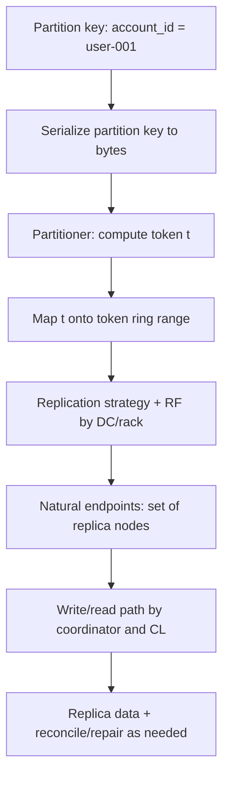

# nodetool ring/getendpoints and Replica Placement Verification

> **Chapter:** Operational Tools  
> **Module:** `DATABASE_ENGINE_WIDE_COLUMN_CASSANDRA` — Apache Cassandra, distributed wide-column database.  
> **Focus:** Use `nodetool ring`, `nodetool getendpoints`, and related cross-check sources to determine **token ranges**, **per-keyspace replica placement**, and **node status**, as well as the limits of inferring whether actual data resides and is synchronized on replicas.

Apache Cassandra selects replicas for a partition via **partition key → token → token ring → replication strategy**. When investigating a slow query, a record missing in one DC, a bootstrapping node, or suspected RF/rack misconfiguration, operations teams commonly ask:

- Which nodes hold the partition for `account_id='user-001'`?
- Which nodes are replicas *according to topology*, and which nodes are Up?
- Why does a keyspace with RF=3 produce hundreds of token lines in `ring` output?
- Why does `getendpoints` list a Down node even though a `LOCAL_QUORUM` query still succeeds?
- Why can two nodes temporarily report different observations after `bootstrap`, `decommission`, or `replace`?
- How do you compare `nodetool` results against CQL, tracing, Java Driver metadata, and repair history without confusing **replica placement** with **a replica having received all data**?

The two core commands address different questions:

- **`nodetool ring`:** observes the ring of tokens/vnodes, DC/rack, node status, and ownership info; helps understand the *overall layout by token*.
- **`nodetool getendpoints`:** given a `keyspace`, `table`, and **specific partition key**, queries the metadata of the node running the command for the **natural endpoints** assigned as replicas; helps understand the *placement of one specific partition*.

**Most important rule:** `getendpoints` answers **"according to replica placement, which nodes own this key?"**—it does not answer **"do all of those nodes have the latest data, are they able to serve requests, or have they been repaired?"**

## 1. Learning Objectives

After this lesson, you will be able to:

1. Explain how token range `(left, right]`, primary token owner, and the set of natural replicas differ.
2. Read `nodetool ring <keyspace>` accurately when nodes use **vnodes** and `NetworkTopologyStrategy`.
3. Invoke `nodetool getendpoints <keyspace> <table> <key>` with a simple partition key, understanding its scope and output limits.
4. Cross-check `ring`, `status`, `describering`, CQL schema, `token()`, and DC/rack to verify placement.
5. Distinguish **natural replica**, **pending replica**, **Up/Down replica**, **where SSTables currently reside**, and **nodes queried by the coordinator in a request**.
6. Understand the role of RF, `LOCAL_QUORUM`, `QUORUM`, `ALL`, and topology changes when a node is Down or out of sync.
7. Use Java Driver 4.x to inspect token/routing key and replica metadata, while recognizing that such metadata can be temporarily stale.
8. Follow safe verification runbooks before/after bootstrap, decommission, replace, and repair; never manually edit the ring due to an unexpected output.

## 2. The Mapping Chain from Partition Key to Replica

### 2.1. Partition Key Is Converted to a Token

Suppose a table has a single partition key column `account_id text`:

```sql
CREATE TABLE lab_placement.accounts_by_id (
    account_id text PRIMARY KEY,
    email text,
    account_state text,
    updated_at timestamp
);
```

When writing:

```sql
INSERT INTO lab_placement.accounts_by_id (
    account_id, email, account_state, updated_at
) VALUES (
    'user-001', 'demo@example.invalid', 'ACTIVE',
    '2026-11-21 08:00:00+0000'
);
```

Cassandra uses the **byte representation of the partition key** and a partitioner (typically `Murmur3Partitioner`) to compute a token. This token determines the ring range and which nodes are selected as replicas for the keyspace.



A key having token `t` **does not mean** data resides only on the node with the first token boundary greater than or equal to `t`. That boundary determines **primary ownership**; the replication strategy also selects **additional replicas**.

### 2.2. Clustering Keys Do Not Change Replica Placement

Example wide-column table:

```sql
CREATE TABLE lab_placement.events_by_account_day (
    account_id text,
    event_day date,
    event_time timestamp,
    event_id timeuuid,
    event_type text,
    PRIMARY KEY ((account_id, event_day), event_time, event_id)
) WITH CLUSTERING ORDER BY (event_time DESC, event_id DESC);
```

In this table:

- `(account_id, event_day)` is a **composite partition key**; both values participate in forming the bytes and token.
- `event_time` and `event_id` are **clustering columns**; they only determine row ordering within the resolved partition.
- Two events with the same `account_id` and `event_day` share the same token and the same **set of natural replicas**.
- The same `account_id` with a different `event_day` can produce a different token, resulting in different replica placement.

Do not include clustering keys in replica placement calculations; equally, do not omit any column of a composite partition key.

### 2.3. Token Ranges Follow Boundary Rules

A common notation is:

\[
R_i = (t_{i-1}, t_i]
\]

meaning **exclusive** of the left boundary, **inclusive** of the right boundary. Suppose token `27` falls in `(20,40]`; token `20` belongs to the range ending at `20`, not `(20,40]`.

The token ring is **circular**: the last range wraps around to the first range. With Murmur3, the actual token space is signed 64-bit integers, not just `0..99` as in the textbook example later on.

### 2.4. RF, DC, and Rack Affect Replica Placement

With `NetworkTopologyStrategy`:

```sql
CREATE KEYSPACE IF NOT EXISTS lab_placement
WITH replication = {
    'class': 'NetworkTopologyStrategy',
    'dc1': 3
};
```

This keyspace requests **RF=3 in dc1**. That means each partition needs three eligible full replicas in that DC, provided topology and node count allow it.

If there is another DC:

```sql
-- Configuration example only, for a REAL cluster with enough nodes in both DCs.
CREATE KEYSPACE IF NOT EXISTS lab_placement_two_dc
WITH replication = {
    'class': 'NetworkTopologyStrategy',
    'dc1': 3,
    'dc2': 2
};
```

A partition targets **three replicas in dc1 and two replicas in dc2**. Nodes in different DCs **cannot arbitrarily substitute** for local-DC quorum when using `LOCAL_QUORUM`.

The replica selection strategy depends on token/rack/DC metadata; avoid guessing from IP positions or the order nodes appear in configuration files. When there are not enough racks to spread all replicas across distinct racks, placement may be forced to share a rack. Always measure the actual available failure domains.

## 3. What Does `nodetool ring` Show?

### 3.1. Basic Syntax and How to Read It

```bash
# Displays the ring, which can include very many lines if vnodes are used.
nodetool ring

# Include keyspace to compute ownership under its replication strategy.
nodetool ring lab_placement
```

Commonly seen columns, depending on version:

| Common Column | Meaning | What Not to Infer |
|---|---|---|
| `Address` | Endpoint address of the node | Not a keyspace name or the most stable node identifier |
| `DC` | Datacenter per snitch/topology | Does not prove WAN links are healthy |
| `Rack` | Declared rack/failure domain | Does not prove physical rack accuracy if snitch is misconfigured |
| `Status` | Up/Down per current membership | Does not prove row data is synchronized |
| `State` | Normal/Joining/Leaving/... depending on version | Does not prove streaming has completed |
| `Load` | Estimated data size on the node | Not filesystem capacity or quota |
| `Owns` | Token/effective ownership share by context | Not an exact proportion of bytes or traffic |
| `Token` | Token boundary of the vnode/ring | Not the partition key of a row |

**Output note:** tokens belonging to the same node can appear across many rows because of **vnodes**. A node holding 128 or 256 tokens does not become 128 or 256 separate servers.

### 3.2. `ring` vs. `status`

```bash
nodetool status
nodetool status lab_placement
```

`nodetool status` typically summarizes each node on one line: address, DC/rack, state such as `UN` (Up/Normal) or `DN` (Down/Normal), load, owns, and token count. `ring` drills down into the ring/token boundaries.

| Question | Tool to Check |
|---|---|
| Which nodes are Up/Down, Joining/Leaving? | `nodetool status` |
| Where do boundary tokens/vnodes sit? | `nodetool ring` |
| What is effective ownership for a keyspace? | `nodetool ring <keyspace>` or `status <keyspace>`, mindful of limits |
| Which replicas own a specific partition key? | `nodetool getendpoints` |
| Which ranges and endpoints belong to a keyspace? | `nodetool describering <keyspace>` |
| Do replicas hold synchronized data? | Repair/streaming logs, coverage, and data verification, **not ring alone** |

Do not read the `Owns` column as actual bytes written. A very large partition can cause heavy data skew even when token ownership percentages are nearly balanced.

### 3.3. When There Are Many Vnodes

If the cluster has a large `num_tokens`, `ring` can be very long. Tokens are typically interleaved across nodes:

```text
Illustrative example:
Address        DC    Rack  Status State   Token
10.0.1.11      dc1   r1    Up     Normal  -743000...
10.0.1.12      dc1   r2    Up     Normal  -720000...
10.0.1.11      dc1   r1    Up     Normal  -680000...
10.0.1.13      dc1   r3    Up     Normal  -650000...
...
```

**This is not real output.** A single node appears multiple times because it owns multiple token boundaries. When calculating RF=3, the replication strategy selects **distinct eligible nodes**, rather than taking three consecutive token lines regardless of duplicate nodes.

## 4. What Does `nodetool getendpoints` Show?

### 4.1. Basic Syntax

```bash
nodetool getendpoints <keyspace> <table> <key>
```

Example with a simple `account_id text` partition key:

```bash
nodetool getendpoints lab_placement accounts_by_id user-001
```

The output is typically a list of node addresses, illustrated below:

```text
10.0.1.13
10.0.1.14
10.0.1.15
```

These are the **natural endpoints according to the ring/replication metadata seen by the node running the command**. The actual count and addresses depend on the key data, partitioner, keyspace RF, topology, and ring state.

### 4.2. Four Important Limitations

**First — This is a metadata lookup, not a row read.** `getendpoints` does not execute a `SELECT` to verify the `email` value, nor does it check timestamps on each replica.

**Second — Down nodes can still be listed.** Membership/replica responsibility and Up/Down status are two separate layers. A Down replica can still be a natural endpoint for the key.

**Third — It does not prove which endpoints the coordinator actually queried.** A query with a specific CL, request scheduling, speculative executions, or pending ranges can take a different path. To investigate a single request, use bounded tracing and logs/metrics.

**Fourth — The `key` input must accurately represent the partition key.** `nodetool getendpoints` is designed for keys passed via CLI; how CQL types and **composite partition keys** are parsed/serialized can depend on the Cassandra version. Do not assume you can type an arbitrary string for a UUID/composite key and reliably get the exact bytes CQL uses.

That is why the first example uses **a single `text` partition key** without spaces or special characters. For complex keys, check `nodetool help getendpoints` for your version and cross-check with `token()`, serialized routing keys/driver metadata, or an appropriate tool.

### 4.3. Expected Placement Exists Even Without a Row

The token and natural replica placement depend on the **partition key value**, not on whether a row has been inserted. Given the same schema/keyspace/topology, `getendpoints` can tell you **which nodes would be responsible** even when no data exists for that key.

This is also why the output cannot prove that a row exists.

### 4.4. Use the Exact Keyspace and Table

`getendpoints` takes keyspace, table, and key. Two keyspaces with different replication strategies or RFs can pick different replica sets for **the same partition key**. Within the same keyspace, two tables with different partition key types can also produce different tokens for visually similar string representations.

Before running, verify:

```sql
DESCRIBE KEYSPACE lab_placement;
DESCRIBE TABLE lab_placement.accounts_by_id;
```

`DESCRIBE` is a `cqlsh` command, not a generic CQL statement understood by all drivers. If `cqlsh` is unavailable, read schema from CQL/system schema metadata or an appropriate tool.

## 5. Hand-Tracing the Ring Model: From Token to Natural Replicas

To understand `ring` and `getendpoints`, use a **hypothetical** ring with one token boundary per node, in a single DC with RF=3.

| Boundary token | Node | Rack |
|---:|---|---|
| 0 | A | r1 |
| 20 | B | r2 |
| 40 | C | r3 |
| 60 | D | r1 |
| 80 | E | r2 |
| 99 | F | r3 |

**Textbook assumptions:** tokens lie on a `0..99` ring, placement walks clockwise in increasing token order, data is evenly divided, and racks are favorably distributed. This is **not** Murmur3's real token domain or exact output for any Cassandra release.

### 5.1. A Key with Token 27

Token `27` falls in range `(20,40]`, closed by C's boundary `40`. In the simplified model, C is the starting point for selecting natural replicas. With RF=3, we then select eligible nodes per the strategy:

```text
Ring in increasing token order:
... → 20(B,r2) → 40(C,r3) → 60(D,r1) → 80(E,r2) → 99(F,r3) → 0(A,r1) → ...

Key k has token = 27
              │
              ▼
       range (20,40] → C
                       D
                       E  (RF=3 example across three eligible racks)
```

The **illustrative** replica set is `{C,D,E}`, but when **vnodes** or real replication strategies are used, do not hand-pick "the first three lines after the token". A single node can own multiple tokens; rack/DC selection can skip token boundaries belonging to the same node or same rack to pick eligible replicas.

### 5.2. When One Node Owns Multiple Tokens

Suppose `ring` shows two consecutive boundaries belonging to node C:

```text
Token 40  → Node C
Token 45  → Node C
Token 60  → Node D
Token 80  → Node E
```

RF=3 **does not mean** C counts as two replicas just because it has two boundaries. Cassandra selects a replica set per strategy based on eligible distinct nodes; one node does not substitute for two independent replicas.

### 5.3. Verify with Tools Instead of Guessing

In a real cluster:

1. Identify the **schema** and the keyspace's `NetworkTopologyStrategy`/RF.
2. Inspect `ring` and `status` to understand token ownership/DC/rack.
3. Run `getendpoints` for the **specific key**.
4. Cross-check the endpoints against expected DC/rack.
5. If results do not match expectations, **check your assumptions** (composite key, vnodes, topology, version, rack placement) before concluding the ring is broken.

`getendpoints` is an observation of replica placement, not a promise that it will always match a hand calculation on a simplified model.

## 6. Full Lab: Inspecting a Text Partition Key

### 6.1. Lab Prerequisites

Prepare a **lab cluster** with:

- Cassandra 4.x/5.x or compatible version, with exact version noted.
- Datacenter `dc1` with at least three full-capable nodes and accurate topology/snitch.
- Permissions to run `cqlsh` and `nodetool`.
- Internode/JMX connectivity compliant with security policy.
- No bootstrap/decommission/replace running when capturing the baseline.

IPs like `10.0.1.13` in examples are **illustrative** addresses, not addresses required in your environment.

### 6.2. Create Keyspace and Table

```sql
CREATE KEYSPACE IF NOT EXISTS lab_placement
WITH replication = {
    'class': 'NetworkTopologyStrategy',
    'dc1': 3
};

CREATE TABLE IF NOT EXISTS lab_placement.accounts_by_id (
    account_id text PRIMARY KEY,
    email text,
    account_state text,
    updated_at timestamp
);
```

This table fits the query `WHERE account_id = ?` and has a single `text` partition key, making it straightforward to compare `getendpoints` with the token.

### 6.3. Write and Read a Row

In `cqlsh`:

```sql
CONSISTENCY LOCAL_QUORUM;

INSERT INTO lab_placement.accounts_by_id (
    account_id, email, account_state, updated_at
) VALUES (
    'user-001', 'demo@example.invalid', 'ACTIVE',
    '2026-11-21 08:00:00+0000'
);

SELECT account_id, email, account_state, updated_at
FROM lab_placement.accounts_by_id
WHERE account_id = 'user-001';
```

**`CONSISTENCY` is a `cqlsh` command**, not a CQL keyword you can embed directly into a Java prepared statement. `LOCAL_QUORUM` requires quorum in the coordinator's local DC; with RF=3 full replicas in `dc1`, quorum is 2.

### 6.4. Read the Token of an Existing Partition

```sql
SELECT account_id, token(account_id) AS partition_token
FROM lab_placement.accounts_by_id
WHERE account_id = 'user-001';
```

`token(account_id)` reveals the token for the partition key under the current partitioner. The output is the cluster's real value, **not** token `27` from the textbook example.

Note: `SELECT` on a table only returns a row if the row exists and the read succeeds; it is not a general-purpose token calculator for arbitrary non-existent keys. If a key does not exist yet, computing the token at the driver/partitioner layer may be more appropriate.

### 6.5. Observe Ring and Endpoints

On a lab admin node (or passing authorized host/JMX parameters):

```bash
nodetool status lab_placement
nodetool ring lab_placement
nodetool describering lab_placement
nodetool getendpoints lab_placement accounts_by_id user-001
```

Record:

| Source | Observation to Save |
|---|---|
| `DESCRIBE KEYSPACE` | `NetworkTopologyStrategy` and `dc1:3` |
| `SELECT token(account_id)` | Actual token of `user-001` |
| `ring` | Boundary tokens, addresses, DC/rack, states |
| `status` | Nodes Up/Down/Joining/Leaving, rack/DC |
| `describering` | Ranges and endpoints per keyspace |
| `getendpoints` | List of natural replica addresses for `user-001` |
| `SELECT` | Logical query result at the chosen CL |

### 6.6. Cross-Check Three Layers

With RF=3 in `dc1` and sufficient topology:

1. **Placement:** `getendpoints` is expected to return three natural replicas in `dc1`.
2. **Availability:** each endpoint can be `UN` or `DN` in `status`; a Down node is not automatically removed from the natural endpoint list.
3. **Data correctness:** a single read at `LOCAL_QUORUM` does not prove all three replicas received the mutation. Hints/repair and sync state must be evaluated separately.

If an endpoint does not appear in `status` at the same time, or belongs to a DC different from what the keyspace specifies, investigate **metadata at different timestamps, wrong endpoint/port, DC/rack schema, or an in-progress topology change** before claiming data was placed in the wrong location.

## 7. `nodetool describering` Complements `ring` and `getendpoints`

```bash
nodetool describering lab_placement
```

This command describes the token ranges and corresponding endpoints for a keyspace according to the node's metadata view. It is useful when you need to **inspect an entire set of ranges**, not just a single key, especially during ownership audits or post-topology verification.

However:

- Output can be very large when many vnodes are used.
- It reflects ring metadata at call time, not whether each replica holds the required SSTable bytes.
- If keyspace and replication strategy differ, the endpoint sets differ as well.
- During bootstrap/decommission, you must understand **pending ranges** and transitional states; one snapshot is not proof of the entire transition.
- Never use token ranges copied from output to manually edit filesystem files or ownership in production.

### 7.1. Comparison Table of the Commands

| Command | Observation Granularity | Primary Output | Limits |
|---|---|---|---|
| `nodetool ring` | Whole ring/vnodes | Boundary tokens, node, DC/rack, state, ownership | Long; does not isolate a single queried key without matching tokens |
| `nodetool describering <ks>` | Per-keyspace ranges | Token ranges and endpoints | Does not prove actual data was streamed/repaired |
| `nodetool getendpoints <ks> <table> <key>` | One partition key | Natural replica addresses for the key | Key serialization and metadata only; does not confirm health/data |
| `nodetool status <ks>` | Per node | Up/Down/Normal and ownership | Does not confirm replicas for a specific key |

**No single command simultaneously proves "placement is right, nodes are Up, data is up-to-date, and the app can always read".** Multiple sources must be combined.

## 8. Natural Replica Differs from "Node Already Holds Correct Data"

Distinguish at least **four questions**:

| Question | Appropriate Tool/Source |
|---|---|
| **By topology, who should hold the partition?** | `getendpoints`, ring metadata, driver token map |
| **Who is active and able to serve requests?** | `status`, health checks, logs, JMX/driver |
| **Who has received the latest mutation?** | CL ACK/hints/repair evidence, replica diagnostics |
| **What logical result is the application getting?** | CQL reads at CL, driver metrics, controlled tracing |

### 8.1. Scenario: RF=3, One Replica Down

Suppose `getendpoints` for `user-001` returns A, B, and C, all in `dc1`. C is Down:

```text
Natural endpoints: A, B, C
Status:            A=UN, B=UN, C=DN
Write CL:          LOCAL_QUORUM → needs 2 ACKs in dc1
Observed ACKs:     A and B
C:                 May have missed the mutation
```

The client write succeeds because A and B satisfy quorum. Yet `getendpoints` **can still list C** because C is a natural replica on the ring. When C returns, hinted handoff or anti-entropy repair may be needed to synchronize it.

**What must not be inferred:** "Three endpoints listed ⇒ all three definitely stored the record."

### 8.2. LOCAL_QUORUM, QUORUM, and ALL

With RF=3 in one DC:

\[
Q=\left\lfloor\frac{3}{2}\right\rfloor+1=2.
\]

`LOCAL_QUORUM` requires quorum in the local DC. In a multi-DC cluster, `QUORUM` computes quorum across all full replicas per the applicable semantics; `ALL` requires all required replicas. Raising CL tightens the ACK requirement, but does not change the partition's **natural replica list**.

One Down node can render `ALL` unavailable even while `LOCAL_QUORUM` keeps working. Evaluate consistency by **RF/CL and actual DCs**, not by line counts in `ring`.

### 8.3. Read Repair Does Not Replace Anti-Entropy Repair

If an application successfully reads a key at `LOCAL_QUORUM`, that result does not prove every replica or all ranges are consistent. Read repair can fix certain discrepancies depending on version/configuration, whereas **anti-entropy repair** is the planned reconciliation process across selected ranges.

`getendpoints` does not trigger repair, does not run Merkle trees, and does not stream SSTables.

### 8.4. Tombstones and Zombie Data Risk

If C is Down when A/B receive a `DELETE`, C may still hold old data. Tombstones on A/B must survive long enough for synchronization before being eligible for purge under `gc_grace_seconds` and compaction rules.

If C stays Down too long, tombstones on healthy sources may already have been purged; bringing C back risks **resurrecting deleted data**. The fact that `getendpoints` lists C while it is Down does not mean C received the tombstone.

When a node has been Down past grace or poses high risk, **do not let the old node rejoin the cluster without a runbook assessment/replace/rebuild from trusted sources**.

## 9. Multi-Datacenter: Cross-Checking Replicas per DC

Suppose a keyspace is:

```sql
CREATE KEYSPACE IF NOT EXISTS lab_geo
WITH replication = {
    'class': 'NetworkTopologyStrategy',
    'dc1': 3,
    'dc2': 2
};
```

If topology provides enough eligible full replicas:

- Each partition needs three natural replicas in `dc1`.
- Each partition needs two natural replicas in `dc2`.
- A `getendpoints` lookup can list endpoints in **both DCs**.
- `nodetool status` helps confirm which DC/rack each endpoint address actually resides in.

### 9.1. Do Not Compute Quorum by Summing All Nodes

With `LOCAL_QUORUM` from a coordinator in `dc1`, quorum is required in **dc1** (2/3). Do not compute `(3+2)/2` and apply it to local quorum. With a coordinator in `dc2`, local quorum of two full replicas is 2/2.

| Coordinator DC | Local RF | LOCAL_QUORUM Required |
|---|---:|---:|
| `dc1` | 3 | 2 |
| `dc2` | 2 | 2 |

These numbers assume full replicas and ready topology. This is why an application failing over from dc1 to dc2 may see different availability if local RF differs.

### 9.2. Two DCs Can Temporarily See Different Metadata

If the ring recently changed, or gossip/schema agreement or streaming has not settled, nodes queried in dc1 and dc2 may temporarily see unconverged states. You should:

1. Record the timestamp and **node where `nodetool` ran** for each output.
2. Check `status`/`ring` on a node in **each DC**.
3. Cross-check schema/replication options and topology state.
4. Check gossip, internode connectivity, and logs.
5. Re-observe after topology stabilizes; if mismatch persists, investigate deeply rather than manually editing tokens.

When data diverges between DCs, **running local repair per DC separately does not prove cross-DC reconciliation**. Repair policy must cover the appropriate peers/token ranges.

### 9.3. `getendpoints` Does Not Prove Freshness of Remote Data

A write in `dc1` at `LOCAL_QUORUM` can ACK before DC2 has quorum updated. `getendpoints` still returns natural replicas in DC2, yet an application reading in DC2 immediately afterward can see stale data.

You need CL/replication/failover design matching read-your-write and RPO requirements; never treat the endpoint list as a "synchronization certificate".

## 10. When Topology Changes: Bootstrap, Decommission, Replace

### 10.1. Bootstrapping a New Node

While a new node is Joining:

- The ring may show `UJ` or Joining depending on Cassandra version.
- Replica placement may involve **pending ownership/ranges**.
- Data must stream from healthy replicas to the new node.
- Natural endpoints and client routing can shift during the state transition.
- Two `getendpoints` calls at different times may return different lists.

**Even after the node reaches `UN`** and logs show streaming finished, you still need data/repair checks per runbook; an Up node does not prove every range is consistent.

### 10.2. Decommissioning a Live Node

When a node leaves the cluster gracefully:

- It may still serve/stream during part of the process.
- Other nodes take on new responsibility per RF.
- `ring` and `getendpoints` can change once leaving completes.
- Data no longer owned by the old node may require cleanup after topology stabilizes.

Do not remove a live node from the system just because one `getendpoints` call no longer returns its IP; complete the proper `decommission` procedure and verify membership.

### 10.3. Replacing a Failed Node

A replacement node may need to receive the old node's ranges from healthy replicas. IP/host ID and other membership attributes can change depending on the replacement method, so:

- Do not use the **old IP** as the sole long-term identifier for replica verification.
- Compare **host ID, DC/rack, token responsibility, and node state**.
- Confirm data has streamed, the ring is stable, and post-checks/repair run per policy.
- Do not let an old node's disk image rejoin after extended downtime if zombie data risk exists.

### 10.4. Changing Keyspace RF

For example, increasing `dc1` from RF=2 to RF=3 changes the **desired replica set** for each token range. `getendpoints` after the change may list an additional natural replica, **but appearing in that list does not prove old data has been streamed/repaired onto the new node**.

Run the replication completion/repair workflow appropriate to your version, scope, and DC. Do not treat `ALTER KEYSPACE` finishing as having achieved full data redundancy.

### 10.5. Why Not Run Cleanup Immediately?

`nodetool cleanup` removes data no longer belonging to a node under the new ring. Running it while topology is still unstable, before data has fully transferred, or without sufficient disk headroom can cause severe problems.

`getendpoints` and `ring` are **pre-check** tools; they do not replace verifying completion of streaming/repair, snapshots, and the cleanup procedure.

## 11. Cross-Checking from Two or More Nodes

If you suspect metadata has not converged, one assessment method is to run **the same commands on different nodes**, recording timestamps:

```bash
# Run the corresponding commands on admin node A:
nodetool getendpoints lab_placement accounts_by_id user-001
nodetool status lab_placement

# Then run those exact commands on admin node B.
nodetool getendpoints lab_placement accounts_by_id user-001
nodetool status lab_placement
```

Comparison table:

| Attribute | Seen by Node A | Seen by Node B | Notes |
|---|---|---|---|
| Timestamp | T1 | T2 | How many seconds apart? |
| Keyspace RF | `dc1:3` | `dc1:3` | Has schema converged? |
| Token/key input | `user-001` | `user-001` | Are the bytes identical? |
| Natural endpoints | A,B,C | A,B,C | Set equality; need not depend on print order |
| Endpoint health | A/B Up, C Down | A/B Up, C Down | Is membership consistent? |
| Topology events | None | None | Is bootstrap/replace underway? |

**Illustrative example**, not real output. Compare the **set of endpoints**; do not assume print order from two CLI runs must be identical to be valid.

### 11.1. If Two Nodes Disagree

Do not rush to "fix" Cassandra by editing token files:

1. Ensure both commands used the **exact same keyspace, table, partition key bytes, and version**.
2. Compare hostname/IP/host ID, DC/rack, schema agreement, and gossip.
3. Check whether any node is Joining/Leaving/Moving/Replacing.
4. Check for network partitions and restart history.
5. Only after metadata has converged should you verify data consistency and repair.
6. If mismatch persists, follow the version-appropriate admin/support runbook.

"Still differing when the cluster is steady" is a symptom to investigate, not definitive proof of physical data corruption.

## 12. Cross-Checking with Single-Query Tracing

In `cqlsh`, you can enable tracing **temporarily** for a narrow query:

```sql
TRACING ON;

CONSISTENCY LOCAL_QUORUM;

SELECT account_id, account_state, updated_at
FROM lab_placement.accounts_by_id
WHERE account_id = 'user-001';

TRACING OFF;
```

Tracing can show the coordinator, messages/requests, and nodes involved in a single execution path, depending on version and request behavior. Keep in mind:

- `getendpoints` lists **natural replicas**.
- Tracing shows **one or a few steps in an executing request**.
- A request may not need to wait for all replicas to satisfy CL.
- Read repair/speculative retry, pending ranges, unavailable nodes, and tracing sampling can make the observed path differ from the natural replica list.
- Tracing is not proof that every replica received every mutation.
- Broadly enabling tracing adds overhead; do not enable it across all production traffic just to compare addresses.

A sound analysis asks: "Which replicas did the coordinator choose during this read and why?", **not** demanding that every trace print the exact same three lines as `getendpoints`.

## 13. Java Driver 4.x: Cross-Checking the Client-Side Token Map

Java applications need the partition key to route requests effectively. Java Driver 4.x exposes **TokenMap** metadata and routing keys from prepared statements, providing another vantage point alongside `nodetool`.

The example below uses table `lab_placement.accounts_by_id` with a `text` partition key:

```java
import com.datastax.oss.driver.api.core.CqlIdentifier;
import com.datastax.oss.driver.api.core.CqlSession;
import com.datastax.oss.driver.api.core.DefaultConsistencyLevel;
import com.datastax.oss.driver.api.core.cql.BoundStatement;
import com.datastax.oss.driver.api.core.cql.PreparedStatement;
import com.datastax.oss.driver.api.core.metadata.Node;
import com.datastax.oss.driver.api.core.metadata.token.Token;
import com.datastax.oss.driver.api.core.metadata.token.TokenMap;

import java.net.InetSocketAddress;
import java.nio.ByteBuffer;
import java.util.Optional;
import java.util.Set;

public final class InspectReplicaPlacement {
    public static void main(String[] args) {
        try (CqlSession session = CqlSession.builder()
                .addContactPoint(new InetSocketAddress("127.0.0.1", 9042))
                .withLocalDatacenter("dc1")
                .build()) {

            PreparedStatement ps = session.prepare(
                "SELECT account_id, account_state " +
                "FROM lab_placement.accounts_by_id " +
                "WHERE account_id = ?"
            );

            BoundStatement query = ps.bind("user-001")
                .setConsistencyLevel(
                    DefaultConsistencyLevel.LOCAL_QUORUM
                );

            ByteBuffer routingKey = query.getRoutingKey();
            Optional<TokenMap> tokenMapOptional =
                session.getMetadata().getTokenMap();

            if (routingKey == null || !tokenMapOptional.isPresent()) {
                System.out.println(
                    "Routing key or token map unavailable");
                return;
            }

            TokenMap tokenMap = tokenMapOptional.get();
            Token token = tokenMap.getToken(routingKey);

            CqlIdentifier keyspace = CqlIdentifier.fromCql("lab_placement");
            Set<Node> replicas = tokenMap.getReplicas(keyspace, token);

            System.out.println("Token: " + token);
            for (Node node : replicas) {
                System.out.println(
                    "Replica: " + node.getHostId() +
                    " endpoint=" + node.getEndPoint() +
                    " dc=" + node.getDatacenter() +
                    " rack=" + node.getRack()
                );
            }

            // CQL read: this is a separate request; a successful result
            // does not prove all replicas have been repaired.
            session.execute(query);
        }
    }
}
```

**Example preconditions:** uses Java Driver 4.x with the corresponding token metadata API, lab keyspace/table prepared, proper access, and valid DC `dc1`. `getRoutingKey()` can return `null` if the driver cannot infer the routing key; `getTokenMap()` can be absent when metadata is disabled or not yet available. Depending on driver version, endpoint info may be formatted differently.

### 13.1. Token Map Is Client-Side Metadata

During application startup, after a topology change, or during a network partition, the driver may **lag in refreshing** replica metadata. Therefore:

- Compare Java results with `getendpoints` at sufficiently close timestamps.
- Check driver topology refresh/events, contact points, and local DC.
- Do not treat temporary discrepancies during bootstrap as proof that the replication strategy needs changing.
- Do not hardcode static replica lists in application config to "fix" a stale token map.
- Treat token-aware routing as a **routing optimization**, not a guarantee that all replicas hold synchronized data.

### 13.2. Do Not Force Other Key Types Through CLI

CQL supports `uuid`, `int`, `blob`, and composite partition keys. The Java Driver can accurately serialize types from a prepared statement to compute a routing key; `nodetool getendpoints` accepts CLI string arguments with its own semantics.

If the two tools produce different outputs for a UUID/composite key:

1. Verify the **actual serialized bytes** of the partition key.
2. Compare the partitioner/computed token, not just the display string.
3. Check that **all partition key columns in the exact order** are included.
4. Determine the support limits of `getendpoints` in the running version.
5. Do not conclude a partition is misplaced simply from seeing two different key representations.

## 14. Investigation Workflow: "Where Are the Replicas of This Key?"

### Step 1 — Identify the Key and Schema

Record clearly:

- Cluster/environment, Cassandra version.
- Keyspace/table and **exact partition key columns**.
- Type of each column: `text`, `uuid`, `date`, etc.
- Key value **masked/protected per sensitive-data rules** when logging.
- Per-DC RF and partitioner/snitch.

For user IDs or personal data, do not copy raw keys into tickets/public logs if policy prohibits it.

### Step 2 — Verify Expected Placement

```bash
nodetool ring lab_placement
nodetool getendpoints lab_placement accounts_by_id user-001
```

For complex keys, prefer obtaining the token via properly typed CQL/driver metadata. Record the timestamp and node where the commands ran.

### Step 3 — Verify Membership and Failure Domain

```bash
nodetool status lab_placement
nodetool describecluster
```

Cross-check each endpoint against:

- Actual DC/rack.
- Up/Down/Normal vs. Joining/Leaving.
- Host ID and bootstrap/replacement status.
- Whether there were recent node additions, removals, or RF changes.

### Step 4 — Verify Read/Write Semantics

Check which CL the application uses for reads/writes, which DC the coordinator is in, and whether there are timeouts/retries/hints. With a sample query:

```sql
CONSISTENCY LOCAL_QUORUM;

SELECT account_id, account_state, updated_at
FROM lab_placement.accounts_by_id
WHERE account_id = 'user-001';
```

A correct result at one CL is evidence for **that read path**, not completion of cluster-wide repair.

### Step 5 — Verify Data and Synchronization

If replica divergence is suspected:

- Inspect logs, hints/repair history, and mutation timestamps.
- Scope token ranges, replicas, and DCs needing repair.
- For a long-Down node, compare downtime duration against `gc_grace_seconds`.
- Run repair per runbook, tracking validation/Merkle tree/streaming/finalization completion.
- If data is lost on all replicas, use backups/audits rather than expecting repair to recreate it.

### Step 6 — Record a Qualified Conclusion

Report using a structured format:

```text
Keyspace/table: lab_placement.accounts_by_id
Key: user-001 (text)
Observed token: <from CQL/driver>
RF strategy: NTS dc1=3
Natural endpoints: <3 endpoints returned by getendpoints>
Membership: <UN/DN/UJ/UL for each endpoint>
Observed read/CL: <CQL result, coordinator DC>
Repair/streaming evidence: <job/ranges/session status>
Conclusion:
  - Replica placement: <correct/converging/needs investigation>
  - Availability: <quorum met/insufficient per CL>
  - Data correctness: <verified/insufficient evidence>
```

Never delete the "Data correctness" field just because the endpoint list matched.

## 15. Common Failure Scenarios

### 15.1. `getendpoints` Returns Three IPs but `status` Shows One Node Down

This **is not necessarily a contradiction**. Natural endpoints describe data ownership responsibility; Up/Down status describes current serving availability.

Check CL. With RF=3, `LOCAL_QUORUM` can still succeed with two replicas; `ALL` cannot. Restore the node, check hints, and run scheduled repair.

### 15.2. `ring` Has Hundreds of Lines in a Five-Node Cluster

This likely occurs because each node holds many **vnodes**. Check the token count in `nodetool status` and distinguish token boundaries from physical nodes. Never use ring line count to compute RF.

### 15.3. One Keyspace Chooses Different Endpoints from Another Keyspace

Completely valid if the two keyspaces have different RF/NTS configurations. Read `DESCRIBE KEYSPACE` for each keyspace and compare.

### 15.4. A Table Uses a Composite Partition Key but `getendpoints` Disagrees with CQL

Most likely caused by **different key serialization** between the CLI string and CQL composite bytes. Check version/input format, `token(partition_key_columns)` when a row exists, and prepared statement routing keys in the driver.

Do not change keyspace replication just because CLI output did not match.

### 15.5. A Node Just Bootstrapped, `getendpoints` Lists It, but SELECT Is Still Slow

Replica placement is shifting; the new node may not have streamed enough yet, or the system is contending on disk/network. Check Joining/Normal state, stream logs, `nodetool netstats`, compaction, and client p99. Never treat the endpoint list as proof bootstrap is complete.

### 15.6. An Old Node Still Has SSTables for a Key Even Though `getendpoints` No Longer Lists It

**Physical data presence** does not mean **still a natural replica**. After a topology change, an old node can retain SSTables covering ranges it no longer owns until cleanup/compaction; snapshots can also hold files.

Run cleanup only once the ring is stable and replication workflows are complete; never delete files manually to "make them match" getendpoints.

### 15.7. Java Driver Picks Nodes Different from the Predicted List

Client metadata may not have refreshed, the coordinator need not be a replica in every case, local DC/routing policy may have specific rules, or the request experienced a retry/failover. Check the actual TokenMap, routing key, policy, tracing, and topology events.

### 15.8. Another DC Has Endpoints Listed but Cannot Read a New Write

`getendpoints` listing replicas in dc2 does not mean dc2 received a write ACKed with `LOCAL_QUORUM` in dc1. Check lag, CL, node availability, hints/repair, and failover policy.

### 15.9. `nodetool` from Two Nodes Returns Different Lists

Topology may be transitioning, gossip may not have converged, nodes/drivers may have schema metadata from different moments, or one side has a network fault. Collect outputs with timestamps, observer nodes, versions, and statuses; never force token ranges or run `removenode` based solely on this difference.

### 15.10. RF=3 but Only Two Healthy Nodes Exist in the DC

Natural endpoints still follow ring/placement, while the ability to satisfy CL depends on actually healthy nodes. Do not raise RF in schema and assume a physical replica was automatically added; ensure proper capacity/topology/repair.

## 16. Operational and Replica Placement Audit Checklist

**Before inspecting**

- [ ] Identify exact keyspace/table and schema, including **all partition key columns**.
- [ ] Record partitioner, RF per DC, rack/snitch, vnodes, and Cassandra version.
- [ ] Pick a simple text key to verify before attempting UUID/composite keys.
- [ ] Record timestamp, node running `nodetool`, and current topology state.
- [ ] Do not expose sensitive keys directly in unprotected tickets/logs.

**Metadata checks**

- [ ] `nodetool ring <keyspace>` and `status <keyspace>` read accurately.
- [ ] Distinguish each **token boundary** from each **physical node**.
- [ ] `nodetool getendpoints <ks> <table> <key>` returns endpoints matching expected RF/DC.
- [ ] `describering` used when coverage across many ranges needs checking.
- [ ] If in doubt, compare outputs from two nodes with the same key/version/close timestamps.

**Availability and data checks**

- [ ] Which natural replica endpoints are `UN/DN/UJ/UL`?
- [ ] Which DC does CQL/Java CL target and how many ACKs are needed?
- [ ] Is sample tracing understood as **one request**, not proof of full repair?
- [ ] Have repair/streaming/history completed if the cluster recently changed RF/topology?
- [ ] Do long-Down nodes pose tombstone/grace and zombie data risks?
- [ ] Disk/SSTables on old nodes are not deleted solely because ownership changed.

**Closing the check**

- [ ] Separate conclusions for **placement**, **node availability**, and **data correctness**.
- [ ] Document metadata disagreements, unchecked scopes, and remediation steps.
- [ ] Do not mark complete if the ring is still changing or replicas lack coverage.
- [ ] Gather CQL/Java evidence at target CL and post-change monitoring.

## 17. Thought Exercises

### Exercise 1 — Reading the Ring

A simulated ring has boundary tokens `0:A, 20:B, 40:C, 60:D, 80:E, 99:F`. A key has token `27`. Which range does it belong to? In an RF=3 single-DC model with favorable rack placement, which nodes are considered first as replicas?

### Exercise 2 — RF and Vnodes

`nodetool ring` shows 600 token rows while `status` shows only 6 physical nodes. Does that mean every partition's RF must be 100? Why or why not?

### Exercise 3 — Down Node

`getendpoints` returns A, B, C. `status` reports A/B Up, C Down. A client write at `LOCAL_QUORUM` succeeds with RF=3 in dc1. Can you assert C has the latest mutation? What mechanisms does C need upon returning?

### Exercise 4 — Two DCs

A `NetworkTopologyStrategy` keyspace has `dc1:3, dc2:2`. `getendpoints` for a key returns five nodes. How many local ACKs does a `LOCAL_QUORUM` write in dc1 require? If read in dc2 immediately afterward, is the write guaranteed to be visible?

### Exercise 5 — Composite Partition Key

A table has `PRIMARY KEY ((tenant_id, event_day), event_time)`. Must two rows with the same tenant and different `event_day` always land on the same replica set? Should you pass only the tenant string to `getendpoints` and treat it as the placement of a specific row?

### Exercise 6 — Mid-Bootstrap

A new node is Joining, and `getendpoints` from two admin nodes gives different outputs. Should you abort bootstrap, manually edit tokens, and conclude data corruption? What is the right verification workflow?

### Exercise 7 — Data Presence vs. Natural Owner

Node A no longer appears in `getendpoints` for a key, yet still holds SSTables containing related data after a decommission/scale-out. Can this be valid? When is cleanup considered?

### Exercise 8 — Java Driver Metadata

The Java Driver shows a different replica set from `getendpoints` for a few minutes after a replace. Name three things to check before deciding one tool is wrong.

### Exercise 9 — Repair and Tombstones

Replica C was Down for a long time and missed a `DELETE`. `getendpoints` still lists C. Why does that not protect against zombie data? Which milestones/metrics must be checked?

### Exercise 10 — Investigation Report

An administrator sends a `ring` screenshot and declares "all three replicas are right". Add at least five pieces of evidence or checks required before accepting that conclusion.

### Answer Hints

1. Token `27` is in `(20,40]`, primary boundary is C; in the favorable model, consider C/D/E. Actual placement follows strategy/vnodes/racks.
2. No. 600 rows can simply be the total vnode token boundaries; RF is a **keyspace** setting, not the ring row count.
3. No. C may have missed writes; it needs valid hints or anti-entropy repair to converge, depending on state.
4. dc1 RF=3 needs 2 local ACKs; dc2 may not have received the mutation immediately, even though it has natural endpoints.
5. Not necessarily; `event_day` is part of the partition key so tokens can differ. A bare tenant string does not fully represent the composite key.
6. No. Check timestamps, ring state, gossip/schema agreement, streaming logs, and wait for topology to stabilize per runbook.
7. Yes. Old physical data can linger before cleanup or in snapshots; run cleanup only after topology/streaming stabilize with adequate replica coverage.
8. Routing key bytes, driver metadata refresh, DC/rack, pending ranges, timestamps, and which node `nodetool` queried.
9. Endpoint only indicates responsibility; it does not confirm tombstone delivery. Check downtime, `gc_grace_seconds`, compaction/purge, repair coverage, backups, and trusted sources.
10. Schema/RF/DC/rack, key token, `getendpoints`, `status`, CL/coordinator, request tracing, repair/stream completion, timestamps, and topology state.

## 18. References for Version-Exact Verification

When studying and running labs, prioritize official documentation **matching your running Cassandra version**:

- Apache Cassandra — **nodetool ring** (tokens/vnodes, effective ownership).
- Apache Cassandra — **nodetool getendpoints** (keyspace/table/key and replica endpoints).
- Apache Cassandra — **nodetool status**, **describering**, **describecluster**.
- Apache Cassandra — **NetworkTopologyStrategy** and datacenter/rack replication.
- Apache Cassandra — **CQL token()** and partition/clustering key model.
- Apache Cassandra Java Driver 4.x — **prepared statement routing key**, `TokenMap`, and `getReplicas`.
- Apache Cassandra — **Repair**, **streaming**, **bootstrap/decommission/replace**, tombstones/`gc_grace_seconds`.

Read `nodetool help ring`, `nodetool help getendpoints`, and your actual driver/version docs. Output formats, CLI parsing, metadata, and replica placement algorithms can vary from illustrative examples depending on the Cassandra release or distribution.

## 19. Key Points to Remember

- **`ring` is the big-picture view of tokens/vnodes and placement; `getendpoints` is the answer for one specific partition key.**
- **An assigned replica is not synonymous with the replica being Up, having the row, or having the latest synchronized data.** Always cross-check `status`, CL, and repair/streaming evidence.
- **The partition key determines the token.** Clustering columns do not alter replica placement, whereas all components of a composite partition key do.
- **RF is a per-DC property of the keyspace.** More vnode boundaries or more `ring` rows do not increase RF or physical server count.
- **Natural endpoints can include Down nodes**; `LOCAL_QUORUM` can succeed with one Down replica while that node still remains in the placement list.
- **During topology changes, metadata can be in flux.** Record timestamps, compare multiple nodes, wait for the ring to settle, and check streaming/repair before concluding.
- **`getendpoints` is not a tool to verify on-disk data or fix errors.** There is never a reason to use it to decide to delete SSTables, run cleanup prematurely, or shorten tombstone grace.
- **Java Driver TokenMap is another metadata perspective**; it requires exact routing key bytes and awareness of metadata refresh, especially with composite keys.
- A thorough investigation ends with three separate findings: **whether placement is right, what availability looks like per CL, and whether data correctness has sufficient evidence**.
