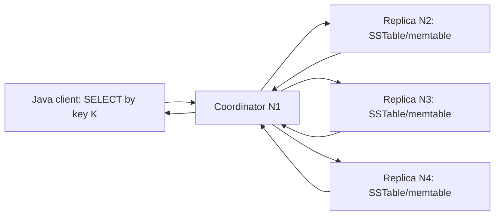
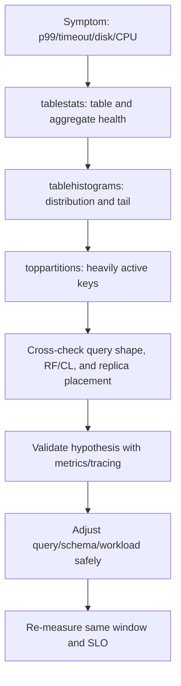
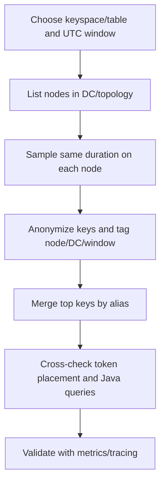

# nodetool tablestats, tablehistograms, toppartitions, and Diagnosing Hot Data in Apache Cassandra

## 1. Scenario: The Table Is Not Large, Yet Some Requests Are Very Slow

A Java application observes `LOCAL_QUORUM` read p99 jumping from 45 ms to 260 ms. `nodetool status` shows all nodes are `UN`. Total table size is only around 90 GiB/node and average cluster CPU is not very high. However, one group of requests reading the same partition key accounts for most of the load on three replicas and occasionally hits tombstone scans.

To diagnose this, the operator must answer **three distinct questions**:

1. **What state is the table in?** Are size, SSTable count, latency, tombstones, and partition sizes abnormal?
2. **What do the data and latency distributions look like?** Are averages hiding huge partitions or a long latency tail?
3. **Which partitions are receiving the most accesses right at measurement time?** Are a few keys being hammered by reads/writes even if their size is modest?

The three tools `nodetool tablestats`, `nodetool tablehistograms`, and `nodetool toppartitions` address these questions respectively. They **complement** rather than replace one another: `tablestats` does not list top partitions by traffic, `tablehistograms` does not identify individual hot keys, and `toppartitions` is not a comprehensive report on partition sizes or traffic history.

This lesson belongs to the **Operational Tools** chapter of the `DATABASE_ENGINE_WIDE_COLUMN_CASSANDRA` module. It is framed within distributed/wide-column Cassandra, partition keys, query-driven table design, read/write CL, CQL, replication, compaction, repair, failure operations, and the Java Driver.

### Learning Outcomes

After this lesson, you will be able to:

- Use the basic syntax correctly and read the metric scope of all three commands.
- Distinguish **hot partition**, **large partition**, **hot coordinator**, and **data skew**.
- Analyze a table with abnormal SSTables-per-read, tombstone scans, partition sizes, or p99.
- Design a multi-node `toppartitions` sampling experiment without treating sampler output as an exact cluster-wide count.
- Relate CQL/Java query behavior to token/RF placement, detect hotspots, and choose cause-specific remediation.
- Report baseline → action → after using time-bounded evidence without creating risk when running tools in production.

## 2. Background: Partition vs. Node, Table, and Coordinator

In Cassandra, a **partition key** is hashed into a token to determine replicas according to the replication strategy and topology. Rows within a partition can be ordered by **clustering columns**, while physical data may span multiple **SSTables**. The node receiving a CQL request from the application is the **coordinator**; it does not necessarily have to be a replica holding that partition.



With `NetworkTopologyStrategy` and RF = 3 in the local DC, a partition has three target replicas in that DC. A `LOCAL_QUORUM` request needs enough responses per CL, but **coordinator location** and **where local reads execute** are not always the same node. That explains why `tablestats` on one node does not represent every request that node coordinates.

### 2.1. Three Different "Hot" Concepts

| Phenomenon | Symptoms | Must the Partition Be Large? |
| --- | --- | --- |
| **Hot partition** | One key/range receives excessive requests or bytes/s in a short window | **No**: a tiny row can be read 50,000 times/s |
| **Large/wide partition** | One partition holds excessive rows/cells/bytes; wide scans consume memory/I/O | **Does not require** high traffic; even occasional reads can be very expensive |
| **Hot coordinator** | One node handles excessive request attempts or coordinates heavy requests | **Not** necessarily a replica for every hot partition |
| **Data skew** | Data/traffic distributed unevenly across nodes/tokens/tenants | Can stem from key design, RF, token ownership, load, or weak/strong nodes |

**Hot characterizes workload over a time window; large characterizes data size.** A partition can be both hot and large, but evidence is needed for each dimension.

## 3. Three-Tool Matrix: Which One to Use First?

| Tool | Primary Output | Scope | Suitable Question | What It Does Not Prove |
| --- | --- | --- | --- | --- |
| `tablestats` | Per-table aggregate metrics: SSTables, bytes, reads/writes, partition/tombstone estimates | **Queried node** and selected table/keyspace | Which table has concerning data/latency/tombstones? | Which partition key causes the load |
| `tablehistograms` | Percentiles/histograms exported by Cassandra for one table | **Queried node** and table | Is the tail of partition size/cell count/SSTables-per-read/latency bad? | Identity of large/hot keys; percentiles are not exact absolute counts |
| `toppartitions` | List of **sampled heavy-hitter partition keys** from a sampler over a duration | **Queried node** and sampling window | Which keys have high read/write activity right now? | All hot keys cluster-wide; exact counts without sampling error |

Put the three tools in sequence:



If the goal is to find a **currently hot key** and you already know the table, you can start with `toppartitions`. If you only know cluster-wide p99 rose, start with metrics/`tablestats` to locate the table/node first.

## 4. Safety Conditions and the Meaning of "Node-Local"

`nodetool` interacts with **one Cassandra node** via its management/JMX interface. Without `-h`, commands typically connect to the local node; you can target another node with `-h` and the configured JMX port. Always verify the target host, permissions, and Cassandra version.

### Minimum Checklist

1. Identify **cluster, DC, node, keyspace, table**, version, and timestamp; never assume the host where your terminal sits is the troubled node.
2. Check health first: `nodetool status`, read/write error rates, free disk, active compaction/repair.
3. Capture data in the **same window** as the workload and for the exact table name; do not compare 09:00 `tablestats` with 15:00 `toppartitions` under a different traffic pattern.
4. Limit impact: `toppartitions` runs a sampler with overhead; test short durations and moderate top counts before longer runs.
5. Manage security: `toppartitions` can print **partition keys** containing identifiers, so do not copy raw output into public channels.
6. Capture data from **all relevant replicas/nodes**, or state explicitly that results cover only a single node.

These observational commands **do not intentionally modify data**, but that does not mean they consume zero CPU/heap or cannot expose keys in logs.

### Version-Aware CLI

Across Cassandra 3.11, 4.1, and 5.0, detailed options may differ. Always run:

```bash
nodetool help tablestats
nodetool help tablehistograms
nodetool help toppartitions
```

Examples in this lesson use widely compatible syntax and note version-dependent options. **Do not** alter JMX parameters, thresholds, or sampler settings directly just to get output for a production lab exercise.

## 5. tablestats: A Single-Node Table Health Snapshot

Basic syntax:

```bash
# Example keyspace sensor_lab, table readings_by_device_day:
nodetool tablestats sensor_lab.readings_by_device_day

# Display human-readable bytes if supported by version:
nodetool tablestats -H sensor_lab.readings_by_device_day

# Some versions offer JSON/YAML output for automation:
nodetool tablestats -F json sensor_lab.readings_by_device_day
```

`-F json` is a tool option and **does not** guarantee identical JSON output schemas across all releases. Collectors must test actual available fields and record the version when storing them. Do not export unsecured JSON containing host/table names externally.

### 5.1. Metric Groups to Read

| Common Field/Group | Practical Meaning | Misinterpretation Warning |
| --- | --- | --- |
| **SSTable count** | Number of existing SSTables for the table on this node | Many SSTables does not itself prove a query reads many files |
| **Space used (live)** | Live SSTable size as accounted by the node | Not logical app data size or cluster total after RF |
| **Space used (total)** | Total SSTable space per metric definition, which may differ from live | Does not replace filesystem free disk; snapshots/temp files must be checked separately |
| **Space used by snapshots** | Snapshot size reported for the table, if present | Do not blindly add to live/total since metrics follow distinct rules |
| **Number of partitions (estimate)** | Estimated partitions on this node/table | Not an exact `COUNT(*)`; does not show traffic distribution |
| **Compacted partition maximum/mean bytes** | Partition sizes estimated from SSTable/data stats | Does not guarantee the absolute largest key cluster-wide or logical size post-reconciliation |
| **Local read/write count/latency** | Read/write activity on this node at table-metric scope | Not full end-to-end Java client latency |
| **Average/maximum tombstones per slice (last five minutes)** | Tombstone signal during read slices in the corresponding window | Does not imply every query scans the max; depends on sample count |
| **Bloom filter false ratio** | Indicator of SSTable filtering efficiency; check denominator too | Does not directly measure query latency |
| **Pending flushes** | Data/buffers awaiting flush per metric | One snapshot with pending = 0 does not prove absence of I/O bottlenecks |
| **Percent repaired** | Extent of repaired SSTables/data per version metric | Does not replace evidence of full repair covering all token ranges |

Field names, units, and availability vary by release. Do not compare a node's `Local read latency` directly against HTTP p99 without confirming which slice of the request the metric measures.

### 5.2. Abbreviated, **Purely Hypothetical** Output Example

```text
Keyspace: sensor_lab
  Table: readings_by_device_day
  SSTable count:                         184
  Space used (live):                     32.8 GiB
  Number of partitions (estimate):       780000
  Compacted partition maximum bytes:     98000000
  Local read count:                      4100000
  Local read latency:                    4.1 ms
  Average tombstones per slice (last five minutes): 18.2
  Maximum tombstones per slice (last five minutes):  8400
```

**Initial interpretation:**

- SSTable count 184 and size 32.8 GiB describe **one table on one node**, to be cross-checked against compaction strategy, flush timing, and node history.
- Estimated partition count 780,000 does not make all partitions equal-sized. A ~98 MB max partition estimate is a signal to investigate wide partitions, **not a list of keys causing that number**.
- Average tombstones far below maximum indicates there may be a **tail of queries scanning many tombstones**; inspect queries/ranges/logs and time-series charts.
- `Local read latency 4.1 ms` can coexist with 180 ms client p99 due to coordinator, queuing, network, paging, or a few costly queries. Averages do not refute p99.

**What not to do:** see high `SSTable count` and immediately run major compaction. Major compaction can consume disk headroom and I/O, and with TWCS it risks disrupting time-window organization.

## 6. tablehistograms: What Does the Distribution Tail Reveal?

Common syntax:

```bash
nodetool tablehistograms sensor_lab readings_by_device_day

# Some versions accept keyspace.table format:
nodetool tablehistograms sensor_lab.readings_by_device_day
```

The command outputs percentile tables for quantities such as **SSTables per read**, **write/read latency**, **partition size**, and **cell count** depending on version. Traditionally, percentiles include 50%, 75%, 95%, 98%, 99%, min/max; always **read the actual headers and units** rather than assuming every column is milliseconds or bytes.

### 6.1. Each Column Answers a Different Question

| Common Column | Question to Answer | Invalid Inference |
| --- | --- | --- |
| **SSTables** / SSTables per read | How many SSTables does one partition read touch? | Table SSTable count equals SSTables per read |
| **Write latency** | Write latency per histogram measured at the layer documented by the tool | This equals client HTTP p99 |
| **Read latency** | Read latency by percentile per the metric definition | One hot partition definitely causes all latency |
| **Partition size** | **Estimated** partition size distribution, usually in bytes | The top 10 partitions here are the top 10 keys by traffic |
| **Cell count** | Distribution of cells/partition | Number of rows returned by every query |

A high partition size percentile means **the tail of the size distribution** is large; it does not immediately name the specific **partition key**. Identifying large keys requires dedicated tooling, controlled SSTable/metadata inspection, or workload instrumentation. `toppartitions` only finds **heavily accessed keys during the sampling window**, and does not fully replace finding **largest partitions**.

### 6.2. Example Reading a Histogram Table (Hypothetical Numbers)

| Percentile | SSTables per read | Read latency | Partition size |
| --- | ---: | ---: | ---: |
| 50% | 2 | 3 ms | 32 KiB |
| 95% | 6 | 18 ms | 4 MiB |
| 99% | 13 | 110 ms | 52 MiB |
| Max | 29 | 270 ms | 180 MiB |

**Note:** the table only illustrates unit-normalized values; real output may use different units and metric sources. Do not use this example to claim correlation on **the same request** having SSTables=13 and latency=110 ms: percentiles from separate histograms **do not necessarily correspond to the same sample**.

Plausible hypotheses:

- **Large-partition tail exists**: p99 size 52 MiB, max 180 MiB; check key design, retention, clustering fan-out, and bucket sizing.
- **Reads touching many SSTables** in the tail: inspect compaction strategy, flush rate, SSTable overlap, and access distribution.
- p99 read latency much higher than median: inspect hot partitions, tombstone scans, GC/disk, and coordinator/client latency.

**Never assert root cause from histograms alone.** Place metrics from the same node, table, and window alongside query shape, application latency, and compaction timing.

### 6.3. Histograms May Lack Sufficient Samples

If a table is barely read, the read latency histogram may lack data, show sentinel values, or have unstable percentiles. When samples are sparse, report **sample count and collection window** when possible instead of forcing a p99 claim. Avoid comparing p99 across two times with different workloads, sample counts, or histogram reset behavior.

## 7. toppartitions: Finding Heavily Active Partitions in a Short Window

This command directly answers **"which keys are being heavily accessed?"** using **sampling/stream summary**, not an exact full-table access count.

In standard Apache Cassandra syntax:

```bash
# Sample on ONE node, one table, for 10,000 milliseconds (= 10 seconds).
nodetool toppartitions sensor_lab readings_by_device_day 10000

# Show up to 20 results and increase sampler capacity to 1024;
# only use options confirmed supported by your version's nodetool help.
nodetool toppartitions -k 20 -s 1024 \
  sensor_lab readings_by_device_day 10000

# Example selecting READS,WRITES samplers if your running version supports these names.
nodetool toppartitions -a READS,WRITES -k 10 \
  sensor_lab readings_by_device_day 10000
```

**The unit of the final parameter is milliseconds**, not seconds. `10000` means 10 seconds. Verify `-a` syntax and sampler names via `nodetool help toppartitions` for your exact release. Cassandra 5.0 also includes scheduled sampling options; this lesson uses only one-shot runs to keep scope bounded.

### 7.1. Parameter Meanings

| Parameter | Role | Limits |
| --- | --- | --- |
| `<keyspace> <table>` | Table to sample | Does not automatically span all tables |
| `<duration>` | Sampling duration, **milliseconds** | A 10-second slice does not represent full-day traffic |
| `-k <topCount>` | Number of keys in top output | A larger `-k` does not make the statistics more accurate |
| `-s <capacity>` | Sampler/summary capacity, affecting accuracy at high cardinality | Higher capacity consumes more resources; weigh carefully |
| `-a <samplers>` | Select activity types to sample, may include READS/WRITES | Does not directly translate sample counts into business RPS |

**Critically important:** numbers like sampled count, cardinality, and error in output must be interpreted according to **version semantics**. Sampling and heavy-hitter algorithms have error bounds/limits; a key absent from the top list **does not mean it received zero traffic**. Never sum sample counts across multiple replicas and call that a logical operation count.

### 7.2. Illustrative Output, Not a Fixed Standard Layout

```text
Sampling window: 10 seconds; table: sensor_lab.readings_by_device_day
sampler=READS
  key=(device-042,2026-11-21)     estimate=3200
  key=(device-917,2026-11-21)     estimate=910
  key=(device-002,2026-11-21)     estimate=85
sampler=WRITES
  key=(device-042,2026-11-21)     estimate=1800
  key=(device-120,2026-11-21)     estimate=430
```

Lines are **paraphrased for clarity** and do not guarantee layout, key serialization, or an `estimate` field in every release. In practice, output may include error/cardinality and keys formatted as strings or bytes. **Never use real customer keys** in public examples or tickets.

### 7.3. Questions to Ask After Obtaining Top Keys

1. Does the key appear across **multiple windows** or only spike during a brief job?
2. Is it hot on **READS**, **WRITES**, or both? Which query pattern corresponds to it?
3. Does the same key appear on **nodes holding replicas for that token**? Was a node omitted because insufficient nodes were sampled?
4. Does the key have a **large partition size** or simply very many small requests?
5. Which Java service/endpoint generates the traffic; is there a retry storm, missing clustering range scan, or batch?
6. Do CL, RF, and topology cause requests to fan out across multiple nodes or regions?

Do not blame a tenant/key as "buggy" just because it tops traffic. Some partitions are legitimately hot by business design, yet still require schema/sizing built to handle the load.

## 8. Why toppartitions Is Not Cluster-Wide Hot-Key Analytics

When node N2 is a replica of partition K, it can execute many local reads for K even if the actual coordinator is N1. Conversely, a range/multi-partition query on a coordinator can touch many keys/replicas; sampling does not necessarily map one-to-one with user requests.

Treat `toppartitions` as a **per-node sensor**:

- **Spatial limit:** only activity observed by that node on the selected table.
- **Temporal limit:** only the sampling window (e.g., 10 seconds); hourly/daily activity can differ.
- **Algorithmic limit:** favors heavy hitters based on sampler, capacity, counts, and approximation.
- **Semantic limit:** READS/WRITES are operation types counted/sampled by Cassandra, not necessarily equal to HTTP RPS or row counts.

### Multi-Node Sampling Workflow



Roughly aligning windows across nodes helps comparison, though **you cannot assume every command starts and ends on the exact same millisecond**. Record each node's timestamps to avoid misreading transient bursts. Sample counts from multiple replicas **can double-count the same logical write**, so never sum them directly as business traffic.

## 9. Combining the Three Tools into a Causal Investigation

Suppose at 10:00 UTC, the device-events read API in DC1 sees elevated p99. Collect:

| Evidence | Hypothetical Observation | Initial Meaning |
| --- | --- | --- |
| `tablestats` N2 | SSTable count 180, max tombstones/slice 8,400 | Possible multi-file/tombstone scans |
| `tablehistograms` N2 | SSTables per read p99=12, partition size p99=48 MiB | Expensive data/read tail |
| `toppartitions` N2 | Key alias A consistently top READS across three samples | A heavily accessed key on N2 |
| `toppartitions` N3 | Same alias A appears in top READS | Matches a key replicated on N2/N3 |
| Java metrics | Query fingerprint Q, p99 260 ms, retries 5% | Real business impact |
| `compactionstats` N2 | Pending compactions rising | Potential factor degrading read I/O |

**Hypothesis:** key A is both hot and costly to read due to tombstones/SSTable overlap. However, you cannot yet conclude "compaction is the sole root cause", because:

- Top traffic key **does not prove** that specific key generated the max tombstones.
- p99 from table histograms **is not inherently bound** to one key/statement.
- Compaction backlog and p99 rising together may simply be **correlated**.

To verify, correlate **Java-side query fingerprint + partition alias + timestamp** with sampling; enable tracing **for a small controlled set of requests**; inspect table-level tombstone histograms, node disk I/O, and replay workload on staging. Promote a hypothesis to a conclusion only with evidence distinguishing competing causes.

## 10. Finding Data Skew: Bytes vs. Requests per Node

A table totaling 900 GiB at RF=3 **cannot simply be divided** into "300 GiB per node" without knowing node count, token distribution, replication, compression, snapshots, and key distribution. In a vnode cluster, token ownership may be fairly even while **request skew** remains severe because one token/partition is accessed far more often than others.

### 10.1. Triage Matrix

| Data Size/Node | Traffic/Node | Initial Interpretation | Investigation Path |
| --- | --- | --- | --- |
| Roughly even | Roughly even | Normal per load model; still check p99 | Query cost, GC, disk, SLO |
| Roughly even | Heavily skewed | **Hot-key/traffic skew**, driver routing, or request pattern | `toppartitions`, token/replica placement, retries |
| Heavily skewed | Roughly even | Data skew, compaction/repair/snapshots, disk/capacity | Per-node `tablestats`, `tablehistograms` |
| Heavily skewed | Heavily skewed | Possibly wide-and-hot partitions or topology skew | All three tools + Java metrics |

### 10.2. Hot Coordinator vs. Hot Replica

If N1 coordinates many queries whose keys actually live on N2/N3/N4, `toppartitions` on N1 may not reflect all local replica traffic. Conversely, N2 can run hot because it holds replicas for many hot partitions even with modest direct CQL connections. Inspect **coordinator ClientRequest metrics**, `proxyhistograms`, `tpstats`, and placement alongside `toppartitions`.

```bash
nodetool proxyhistograms
nodetool tpstats
nodetool status sensor_lab
```

`status` reports membership and load, **not** whether a node has good read p99; `proxyhistograms` reports coordinator-side paths without directly identifying partition keys.

## 11. CQL Lab: Device/Day Bucket Design

A lab example to illustrate why partition keys determine whether a key becomes hot. **Do not run on production**; adjust DC and RF to your test cluster:

```sql
CREATE KEYSPACE IF NOT EXISTS sensor_lab
WITH replication = {
    'class': 'NetworkTopologyStrategy',
    'dc1': 3
};

CREATE TABLE IF NOT EXISTS sensor_lab.readings_by_device_day (
    device_id text,
    event_day date,
    event_time timestamp,
    event_id uuid,
    temperature double,
    payload text,
    PRIMARY KEY ((device_id, event_day), event_time, event_id)
) WITH CLUSTERING ORDER BY (event_time DESC, event_id ASC);
```

With composite partition key `(device_id, event_day)`, each device gets one partition per day. Querying by exact key:

```sql
INSERT INTO sensor_lab.readings_by_device_day
    (device_id, event_day, event_time, event_id, temperature, payload)
VALUES (
    'device-042', '2026-11-21', '2026-11-21T08:30:00Z',
    11111111-1111-1111-1111-111111111111, 28.5, 'lab-only'
);

SELECT event_time, event_id, temperature
FROM sensor_lab.readings_by_device_day
WHERE device_id = 'device-042'
  AND event_day = '2026-11-21'
  AND event_time >= '2026-11-21T08:00:00Z'
  AND event_time < '2026-11-21T09:00:00Z'
LIMIT 100;
```

**Explanation:**

- `device_id` and `event_day` together identify the partition; queries must supply both to hit a specific partition.
- `event_time` is a clustering column; a tight range limits entries read **within the partition**.
- `LIMIT 100` does not guarantee scanning only 100 cells/tombstones.
- If one device emits millions of events/day, a daily partition can still grow very large and hot; consider hourly buckets or sharding **after measuring**.

### 11.1. Designing a Hot-Key vs. Multi-Key Experiment

Create two workloads **on staging**:

1. **Even workload:** many different `device_id` and `event_day` values, keeping total RPS and payload/query shape identical.
2. **Skewed workload:** most requests concentrated on one or a few partition keys, keeping total RPS and CL comparable.

Compare `toppartitions` on replicas, Java p95/p99, and node CPU/queues. If the skewed workload drives high p99, that is evidence of **traffic distribution impact**, though you still must check compaction/GC/disk before deciding to shard.

### 11.2. When Are Smaller Partition Buckets Useful?

Daily buckets keep historical partitions smaller than partitioning by `device_id` alone. However, **bucketing does not reduce QPS if all queries target the same current bucket**. Splitting finer (hourly, or hash sharding) can spread load if the app can route/read across shards, at the cost of trade-offs:

- More partitions and queries issued.
- Queries must fan out and merge results, increasing requests/CL/cost.
- Shard selection must be coherent and preserve ordering/time ranges.
- Never place shards arbitrarily such that reading one device requires scanning the entire cluster.

Choose based on actual workload and before/after measurements. **Never change schema just because one `toppartitions` run showed a key at the top.**

## 12. Java Driver 4.x: Collecting Source-Accurate App Metrics

`toppartitions` does not inherently know which Java endpoint issued a request. To join the data, every query type should track **query fingerprint**, CL, page size, local DC, timestamps, and an anonymized partition alias.

Java 17+ example with DataStax/Apache Cassandra Java Driver 4.x and an app-configured `CqlSession`:

```java
import com.datastax.oss.driver.api.core.DefaultConsistencyLevel;
import com.datastax.oss.driver.api.core.cql.BoundStatement;
import com.datastax.oss.driver.api.core.cql.PreparedStatement;
import com.datastax.oss.driver.api.core.cql.Row;
import java.time.Instant;
import java.time.LocalDate;
import java.util.UUID;

// session is a long-lived CqlSession configured with local DC and security.
PreparedStatement ps = session.prepare("""
    SELECT event_time, event_id, temperature
    FROM sensor_lab.readings_by_device_day
    WHERE device_id = ? AND event_day = ?
      AND event_time >= ? AND event_time < ?
    LIMIT 100
    """);

BoundStatement request = ps.boundStatementBuilder()
    .setString(0, "device-042")
    .setLocalDate(1, LocalDate.of(2026, 11, 21))
    .setInstant(2, Instant.parse("2026-11-21T08:00:00Z"))
    .setInstant(3, Instant.parse("2026-11-21T09:00:00Z"))
    .setConsistencyLevel(DefaultConsistencyLevel.LOCAL_QUORUM)
    .setPageSize(100)
    .build();

long startedNs = System.nanoTime();
try {
    int rows = 0;
    for (Row row : session.execute(request)) {
        rows++;
    }
    long latencyNs = System.nanoTime() - startedNs;
    // Record histogram: query_shape, CL, localDC, elapsed, rowCount.
    // Attach HMAC partition_alias instead of raw device_id if policy applies.
} catch (RuntimeException error) {
    long latencyNs = System.nanoTime() - startedNs;
    // Record timeout/unavailable/read failure separately with query fingerprint.
    throw error;
}
```

**Limits to remember:**

- The `for` loop consumes result pages if the driver paginates; measuring from before `execute` to after the loop captures **end-to-end query consumption**, unlike latency for only the first page.
- A successful `LOCAL_QUORUM` read **does not** guarantee all replicas are healthy or data is fully repaired.
- `System.nanoTime()` measures duration within the same JVM; use separate UTC timestamps to correlate logs across nodes, accounting for clock skew when ordering events.
- Retries/speculative executions can generate multiple server attempts per logical query, making Java counts and `toppartitions` non-1:1.
- Real device IDs may be sensitive data; use a stable HMAC alias for correlation and never put the HMAC key into metrics/logs.

### 12.1. Additional Driver Metrics

Where your driver version supports it, collect per-node open connections/in-flight requests, request latency, retries, speculative executions, and throttling. Cross-check which nodes the driver routes to against `toppartitions` output and token-based replica endpoints. Metric names/configs can vary across Driver 4.x releases; consult docs for your exact driver and exporter.

## 13. Tombstones and Compaction: A Hot Table Is Not Always High-RPS

A partition can incur heavy cost from deleted/TTL-expired data and the number of SSTables probed, even when requests/s are modest.

### 13.1. Tombstone Scans

`DELETE` and TTL leave tombstones behind until eligible for physical reclamation via compaction. A `SELECT ... LIMIT 20` may still have to scan many tombstones to find 20 live rows. Therefore:

- `tablestats`: check average/maximum tombstones per slice if supported by your version.
- JMX metrics: inspect `TombstoneScannedHistogram`, warning/failure counters if exported.
- Tracing/logs: find queries scanning many tombstones, tied to specific CQL/ranges.
- `toppartitions`: identify heavily active keys during slow reads, **without** assuming the top-traffic key is the tombstone key until proven.

Raising `tombstone_failure_threshold` to "make errors stop" may just let nodes scan longer. Instead, narrow scan ranges, fix TTL/delete lifecycles, and align compaction/repair plans.

### 13.2. SSTable Count and SSTables-per-Read

A table's SSTable count can be high while Bloom filters, indexes, and clustering ranges let each request skip irrelevant files and touch only a few SSTables. Conversely, a key range with versions spread across many SSTables can be I/O-heavy. `tablehistograms` SSTables per read offers a **more useful distribution** than looking at SSTable count alone.

STCS, LCS, TWCS, and UCS each carry different trade-offs among write amplification, read amplification, and TTL reclamation. Do not switch compaction strategies solely because `tablestats` shows many SSTables, and never run major compaction casually in production.

### 13.3. Repair and Replicas

An offline replica can miss writes or tombstones. Repair must be operated to converge replicas, especially before data becomes eligible for purge. However, `repair` **is not** a command to fix a hot partition; it can add I/O and temporarily worsen p99. Record repair/compaction activity when sampling to avoid attributing every spike to queries.

## 14. 10-Step Runbook When Suspecting a Hot Partition

| Step | Action | Evidence to Record |
| --- | --- | --- |
| 1 | Confirm affected endpoint/query and SLO | Query fingerprint, client p95/p99, timeouts, UTC window |
| 2 | Confirm topology/RF/CL and node health | `nodetool status`, DC/rack, replica states |
| 3 | Locate table/aggregate symptoms | Per-node `tablestats`, read/write rates, SSTables/tombstones/disk |
| 4 | Inspect the tail | `tablehistograms` on same table/node | Percentiles, units, sample counts if available |
| 5 | Sample partitions under live workload | Controlled 10–30 s `toppartitions` on relevant nodes | Anonymized top keys, samplers, duration, capacity |
| 6 | Cross-check replica placement and routing | `getendpoints`/token metadata if appropriate | Node/replica set, coordinator, query shape |
| 7 | Check resources and background activity | CPU/heap, GC, disk I/O, `tpstats`, compaction, repair | Time series over same window |
| 8 | Test hypotheses | Bounded trace samples, CQL range/TTL/delete, app metrics | FACT/HYPOTHESIS and competing causes |
| 9 | Shed load and fix root cause | Concurrency limits, semantically safe caching, bucketing/sharding/query redesign | Change plan, rollback, read consistency |
| 10 | Re-measure and close incident | Same RPS, CL, comparable schema/dataset, p99, errors, hot key | Before/after; remaining unknown cases |

**Do not** force all 10 steps if the outage is clearly caused by a Down node or lost quorum. This runbook targets **hot data** triage and does not replace DR or restore procedures.

### 14.1. Immediate Mitigation Actions

Once a key is confirmed under a read flood:

1. **Limit concurrency** per endpoint/tenant or temporarily shed offered RPS for expensive queries.
2. Consider caching repeatedly read data **if** the business accepts the corresponding TTL/invalidation and stale-read semantics.
3. Eliminate unnecessary fan-out; use prepared statements with exact partition keys and clustering ranges.
4. Bound retries/backoff; retry storms multiply load onto the same hot replicas.
5. If compaction/repair is running, avoid adding heavy I/O tasks until headroom is understood.

Do not **add replicas** by altering RF and conclude the hotspot is solved: increasing RF requires historical repair/backfill; a hot partition can still be hit across all existing/new replicas, and consistency cost rises.

## 15. Separating a Real Hot Key from Sampling Skew

Suppose `toppartitions` shows key A with 5,000 READS samples in 10 seconds. What remains **unknown**:

- How many **logical Java operations** happened? One operation might retry or fetch multiple pages.
- What is the **error bound** on the estimated count and what was the sampler capacity?
- Was the sampled node coordinator or replica? How many other replicas served the same key?
- Within the same window, were app retries/timeouts elevated?
- Did the activity persist for many minutes or only during the 10-second slice?

**Verification plan:**

1. Run multiple short windows on the same node, recording UTC start/end, sampler type, and capacity.
2. Repeat across the relevant replicas to check consistency of the top-key set.
3. Join `query fingerprint + partition alias` from Java within the same window.
4. Compare successful requests vs. retries/speculations/pages.
5. Measure latency and resources before/after throttling key A traffic or switching the query to a better pattern.

If only a single sample shows key A on top while workload is stable with no p99/timeout issues, note it as **evidence of traffic concentration** rather than calling it "incident root cause".

## 16. Before/After Reporting: Did Hot Data Actually Decrease?

Before making changes, lock down:

| Goal | Primary Metric | Must Keep Constant or Note Differences |
| --- | --- | --- |
| Reduce hot-key concentration | Top key share/sample rank via same method | Sampler duration/capacity, node set, offered RPS |
| Reduce read cost | SSTables per read, tombstones scanned, partition size distribution | Query shape, CL, cache/compaction state |
| Improve SLO | Client p50/p95/p99, timeouts, rejections, successful RPS | Concurrency, payload, page size, DC |
| Protect nodes | CPU, GC, disk util/latency, compaction backlog, free disk | Hardware, repair jobs, traffic mix |
| Preserve data correctness | Accurate CQL results, read consistency, idempotency | Schema/migration, TTL, replica health |

### Hypothetical Numbers Showing Trade-Offs

| Metric | Baseline | After Appropriate Bucketing/Sharding |
| --- | ---: | ---: |
| Client read p99 | 215 ms | 71 ms |
| Read timeout rate | 2.5% | 0.3% |
| Successful RPS | 8,000/s | 8,200/s |
| SSTables per read p99 | 15 | 6 |
| Max partition size estimate | 160 MiB | 38 MiB |
| Avg fan-out requests/endpoint | 1 | 2 |

Figures are **illustrative only**, not a Cassandra benchmark. Better p99 comes alongside **doubled fan-out**, which can raise network/CPU; you must verify other workloads and fault tolerance. If the hotspot merely shifted to another key or client successful RPS dropped, you cannot declare the fix successful.

### 16.1. Never Compare Metrics with Mismatched Units

`tablestats` includes fields in bytes, counts, milliseconds, or other intervals; `tablehistograms` can display latency in **microseconds** and size in bytes; `toppartitions` takes duration in **milliseconds**. Normalize units before tabulating, and record source and version.

**Never average p99 across multiple nodes** to claim a cluster p99. If histograms are mergeable, use a proper aggregation method; otherwise, report p99 **per node** alongside its traffic volume.

## 17. Common Misinterpretation Errors

| False Statement | Why It Is Wrong | How to Fix |
| --- | --- | --- |
| "`tablestats` shows the top 10 hot keys" | It mainly reports **table/node aggregates** | Use `toppartitions` and app instrumentation |
| "The largest partition is always the hottest partition" | Size and traffic are independent | Compare size histograms with sampled READS/WRITES |
| "`toppartitions` is exact across the whole cluster" | Node-local, sampled, time-windowed | Collect across nodes/windows, note limits |
| "Key absent from top means zero accesses" | Sampler only keeps top/approximates/limited capacity | Repeat samples, tune capacity reasonably, join app logs |
| "Increasing `-k` makes counts more accurate" | `-k` only sets how many top keys are displayed | `-s` affects capacity, and it remains sampling |
| "The duration parameter is in seconds" | CLI uses **milliseconds** | `10000` for 10 s |
| "High SSTable count means every read touches that many files" | Filters skip irrelevant SSTables | Check SSTables per read |
| "Histogram p99 + max size happened on the same query" | Histogram percentiles are not joined per request | Need tracing/instrumentation |
| "Many tombstones just requires raising failure threshold" | Lets nodes scan longer without fixing data model | Narrow scan range, fix retention/compaction |
| "`nodetool status UN` proves the node is fast" | Membership does not measure latency/queues | `proxyhistograms`, `tpstats`, and SLO |
| "Adding buckets always eliminates hotspots" | The current bucket may still take all writes | Measure partition key/traffic, shard by workload |
| "Increasing RF/running repair clears hotspots" | Can add I/O without fixing skewed queries | Diagnose first, then fix data model/concurrency |

## 18. Security and Evidence Retention

`toppartitions` output can expose partition keys such as emails, customer IDs, account numbers, or device identifiers. When putting data into tickets/dashboards:

- Use a **stable HMAC alias** with the HMAC key managed outside logs instead of storing sensitive values. Plain hashes over small keyspaces can be guessed.
- Record `cluster/DC/node, UTC start/end, duration, sampler, capacity, topCount, table, Cassandra version`.
- Keep raw output only in authorized storage with policy-defined retention.
- Do not put partition keys into Prometheus metric labels for **every** request due to high cardinality and PII exposure risk.
- Use key aliases and normalized metrics in reports; separate FACT (tool output) from HYPOTHESIS (suspecting hot key causes p99).

An output with clear timestamps, method, and bounds is far more useful than an anonymous screenshot lacking node and time.

## 19. Tiered Practice Exercises

### Exercise A — Distinguishing Hot and Large

Suppose key A has **partition size estimate 2 KiB** but ~9,000 READS samples in 10 s; key B has size 80 MiB but does not appear in top read/write.

1. Which key is hot in the observed window?
2. Which key is large by data definition?
3. If read p99 is high, what additional metrics must be measured to determine whether A or B caused it?
4. Why can you not conclude from these three numbers that B has zero impact on p99?

### Exercise B — Reading Histograms with Exact Units

On one node, `tablehistograms` reports p99 SSTables per read 14, p99 partition size 70 MiB, and p99 read latency 120 ms.

1. Must these three p99 values belong to the same request?
2. How do you use `tablestats`, JMX, and tracing to test their relationship?
3. If 0.1% of requests time out, what wrong conclusion can come from analyzing latency only for successful requests?

### Exercise C — Planning Multi-Node Sampling

A 6-node, two-DC cluster has an NTS keyspace with RF 3 per DC. Java clients in DC1 send most reads at `LOCAL_QUORUM`.

1. Should you sample `toppartitions` only on coordinator N1?
2. How do you choose nodes, time windows, and samplers to compare results?
3. Why should you not sum counts from all six nodes and call that total logical reads?
4. How do paging and retries affect the results?

### Exercise D — Comparing Before/After Partition Key Change

Before migration, a table is partitioned by `device_id`; after migration, by `(device_id, event_day)`. p99 drops from 190 to 80 ms, while requests/session increase by 60%.

1. Which workload characteristics must remain constant for a fair comparison?
2. Did read fan-out increase, and how does that affect CL/replicas/network?
3. How do you verify data correctness and retention/TTL before cutover?
4. When should you not declare the migration successful even though p99 dropped?

### Self-Check Questions

1. How do `tablestats` and `tablehistograms` differ in metric aggregation style?
2. What unit does `toppartitions` use for duration?
3. How do `-k` and `-s` differ in `toppartitions`?
4. Why is `toppartitions` output not a list of the largest partitions?
5. Can a small key become a hot partition?
6. Why can the same partition appear on multiple nodes?
7. What factors make a coordinator hot even when connection count looks normal?
8. How do `SSTable count` and `SSTables per read` differ in measurement scope?
9. Does `LIMIT 20` bound the number of tombstones scanned?
10. When should you cap retries/concurrency instead of growing the connection pool?
11. Why can you not use a single histogram p99 to pinpoint the exact failing key?
12. Why must CL, query shape, and local DC be recorded when comparing Java client metrics with node metrics?

## 20. Copyable Operational Report Template

```text
INCIDENT / CHANGE: <id>
UTC WINDOW: <start> ... <end>
CASSANDRA VERSION / CLUSTER / DC / NODE SET:
KEYSPACE.TABLE:
QUERY SHAPE / CL / PAGE SIZE / APPLICATION BUILD:

SYMPTOMS:
  Client offered RPS / successful RPS / p50,p95,p99 / timeout:
  Coordinator latency/attempts and replica/node health:

TABLESTATS (PER NODE):
  SSTable count, live bytes, total bytes, partition estimate:
  Local read/write, tombstones per slice, snapshot/flush context:

TABLEHISTOGRAMS (PER NODE):
  SSTables per read p50/p95/p99:
  Partition size p50/p95/p99:
  Cell count/read latency percentiles and UNITS:

TOPPARTITIONS (PER NODE/WINDOW):
  Samplers, -k, -s, duration milliseconds, UTC start/end:
  Top partition aliases and approximate counts/error:

CROSS-CHECK:
  Partition token/replica placement:
  Java query fingerprint / partition alias / retry:
  Compaction/repair/GC/disk I/O/tombstone context:

HYPOTHESES:
  H1: <evidence for/against>
  H2: <evidence for/against>
  UNKNOWN: <missing node, time window, sampler, count>

ACTION:
  <backpressure, cache, query range, bucketing/sharding...>
  Safety/consistency, rollback:

AFTER:
  Same workload and CL? node set/duration comparable?
  p95/p99, errors, successful RPS, estimated partition size:
  Data correctness and other workload impact:
  STATUS: VERIFIED / INCOMPLETE / ROLLED_BACK
```

**Do not** fill fabricated data into real measurement fields and present them as production results. If sample counts/accuracy are missing or a node could not be measured, clearly mark `INCOMPLETE`.

## 21. Apache Cassandra Documentation for Version Verification

- [Apache Cassandra — nodetool tablestats](https://cassandra.apache.org/doc/latest/cassandra/managing/tools/nodetool/tablestats.html): syntax, `-F`, `-H`, and sort/stats fields.
- [Apache Cassandra — nodetool tablehistograms](https://cassandra.apache.org/doc/latest/cassandra/managing/tools/nodetool/tablehistograms.html): syntax for exporting table statistic histograms.
- [Apache Cassandra — nodetool toppartitions](https://cassandra.apache.org/doc/latest/cassandra/managing/tools/nodetool/toppartitions.html): duration in milliseconds, `-a` samplers, `-k` topCount, `-s` capacity.
- [Apache Cassandra — Monitoring Metrics](https://cassandra.apache.org/doc/latest/cassandra/managing/operating/metrics.html): table/coordinator histograms and metrics, tombstones, SSTables, and latency.
- [Apache Cassandra — Use Nodetool](https://cassandra.apache.org/doc/stable/cassandra/troubleshooting/use_nodetool.html): using `nodetool` to narrow incidents per node.

The docs above may be updated and option/field names vary by release; use **`nodetool help <command>` and your actual Cassandra/driver version** when operating a cluster.

## 22. Conclusion

**`tablestats` answers "what state is this table in on this node"; `tablehistograms` answers "is the distribution tail concerning"; `toppartitions` answers "which partition keys were sampled as heavily active in this window".** No single tool alone proves one key caused all read/write errors cluster-wide.

Proper hot-data diagnosis pairs **table state + percentiles + sampled top keys** with **query shape, partition/clustering keys, RF/CL, replica placement, Java driver metrics, I/O, and background tasks**. Hot data can be small yet heavily read; very large data may be rarely accessed; a hot coordinator can differ from hot replicas. Collect **per node and UTC window**, respect sampling limits, anonymize keys, and measure **before/after** against real SLOs/business metrics. **Only change partition design, concurrency, caching, or compaction with solid evidence and a safe rollback plan.**
