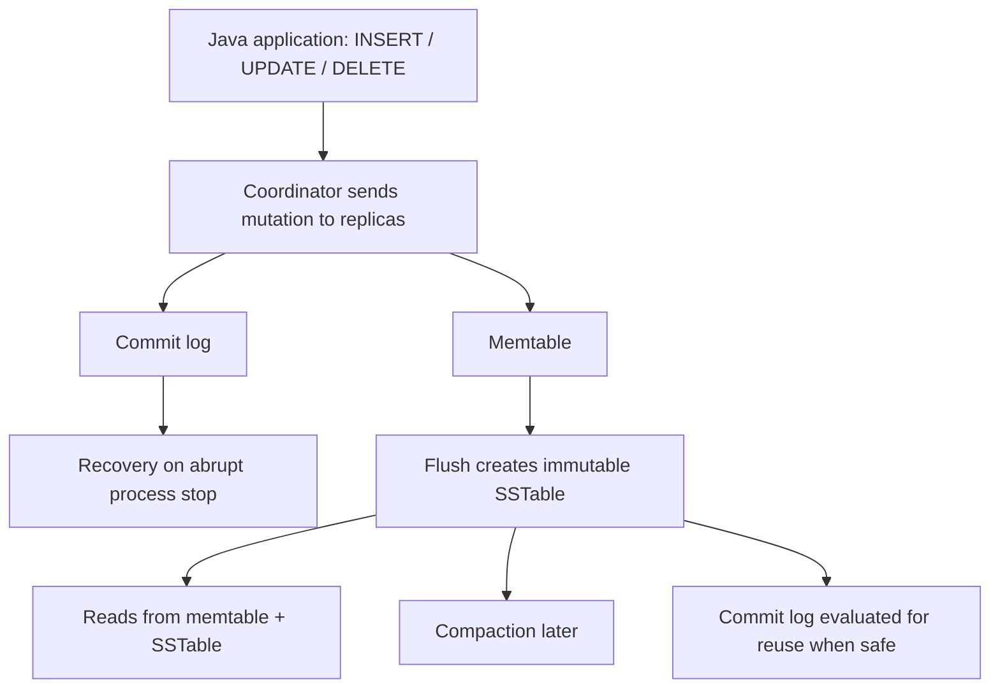
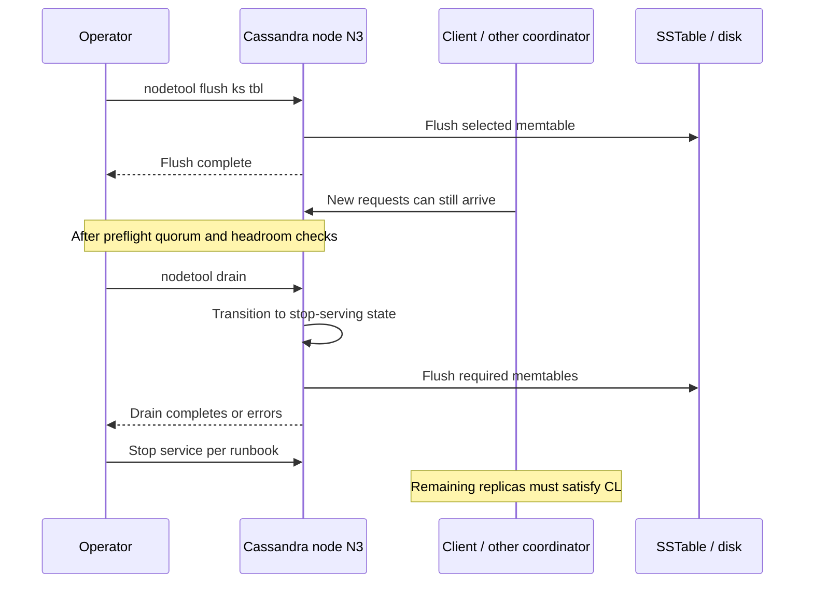
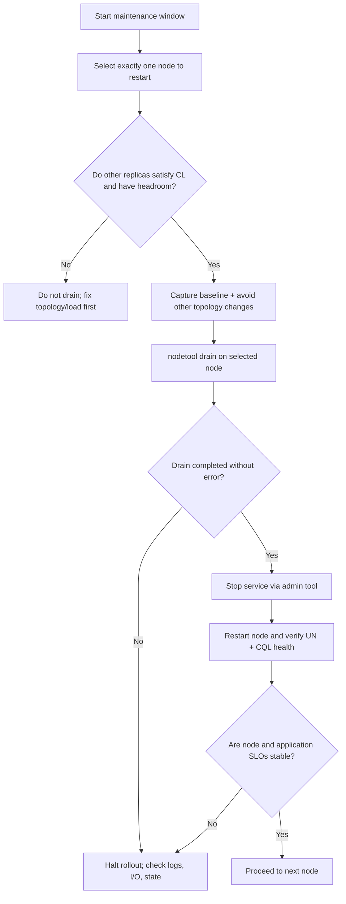

# `nodetool flush`, `drain`, and Prerequisites Before Stopping a Cassandra Node

## 1. The Problem: Stopping a Node Safely Without Losing Availability

Apache Cassandra is a distributed **wide-column** database. Data resides in partitions identified by a **partition key**; each partition is replicated across multiple **replicas** according to the replication factor (RF). A CQL query sent by a Java application requires enough responses to satisfy its **consistency level (CL)**, such as `LOCAL_QUORUM` or `QUORUM`.

During maintenance, an administrator may need to stop a node for upgrades, OS reboots, configuration changes, or hardware checks. Two commands that are easily confused are:

- `nodetool flush`: instructs the node to **flush memtables to SSTables**.
- `nodetool drain`: transitions the node into a **controlled stop-serving process** and flushes data before shutting down the process per procedure.

**Neither command guarantees that the cluster still has enough replicas to satisfy CL once the node stops.** Before stopping a node, you must verify topology, RF, CL, health of remaining replicas, capacity/load, and whether clients can route to other nodes.

In this lesson, "node" means a Cassandra process on a machine/VM. `nodetool` operations typically affect **the node the tool connects to**, not the entire cluster simultaneously.

### Questions You Should Be Able to Answer Afterward

1. What does flush change in memtables, SSTables, and the commit log?
2. How does drain differ from flush, and does it shut down the process automatically?
3. Why is `UN` in `nodetool status` insufficient to conclude a node can be stopped?
4. How should a **rolling restart** be scheduled and verified?
5. When drain fails or a node stays offline for a long time, what should you do instead of deleting the data directory or running dangerous commands?

## 2. The Write Path and Where Flush Happens

On each replica receiving a mutation, Cassandra typically uses two key components:

- **Commit log:** records mutations to support recovery if the process stops abruptly.
- **Memtable:** an in-memory data structure holding updates not yet fully written out to SSTables.

When a memtable flushes, Cassandra writes an **immutable SSTable** to disk. Afterward, commit log segments are reused or released only once safety conditions for the associated mutations are satisfied.



This diagram is conceptual: ACK details, commit log sync, internal ordering, and segment release depend on configuration and version. **Do not infer that the application only receives an ACK after an SSTable has been flushed.** On the normal write path, SSTable flushing is not a synchronous requirement of every request.

### Flush and Durability Do Not Mean Replication

Suppose partition `order_id = O1` has RF = 3:

```text
Replica R1: commit log + memtable
Replica R2: commit log + memtable
Replica R3: currently Down, missed mutation
```

If you run `nodetool flush` on R1:

- Data in **R1**'s memtable is written to the corresponding SSTable.
- R2 does not automatically flush just because R1 flushed.
- R3 does not automatically receive the missed mutation.
- Flush does not prove data has converged across replicas.

**Anti-entropy repair**, hints, and replication are separate mechanisms with distinct purposes. Never use `flush` as a backup or as a command to fix inconsistency.

## 3. `nodetool flush`: What It Does and Does Not Do

In common Cassandra versions, syntax takes the form:

```bash
# Check syntax on your exact version.
nodetool help flush

# Flush memtables for the specified keyspace/table.
nodetool flush maintenance_lab events_by_device

# Flush per version default scope if arguments are omitted.
nodetool flush
```

The command can target a keyspace and specific tables within that keyspace; help text and advanced flags vary by version. **Do not treat `nodetool flush` as a "flush all nodes" command.**

### Scope of Impact

| Behavior | Does `flush` Do It? | Notes |
| --- | --- | --- |
| Request moving memtables to SSTables | **Yes** | On the targeted node and table scope |
| Stop accepting all new CQL | **No** | New writes can still arrive during/after flush |
| Transition node to drained state | **No** | This is not a shutdown procedure |
| Ensure all replicas are synchronized | **No** | Affects local data only |
| Create a safe backup elsewhere | **No** | Snapshot/backup and restore are separate procedures |
| Immediately reduce SSTable count | **No** | Flush can actually **increase** SSTable count |
| Guarantee all commit log segments disappear | **No** | Segments also depend on other memtables and recycle conditions |

### Why Can Data Still Exist in Memtables After Flush?

An application can continue writing immediately after flush starts or as it finishes. Therefore:

```text
10:00:00  nodetool flush maintenance_lab events_by_device
10:00:01  Memtables eligible for flush are processed
10:00:02  Application writes another mutation M2
10:00:03  nodetool flush returns success

M2 may reside in a brand-new memtable.
```

**Flush is not a "no more new writes" barrier.** If the goal is stopping a node for maintenance, running flush alone and immediately powering off is not equivalent to a controlled service stop.

### Flush Has a Cost

Flushing creates SSTables and consumes disk throughput/CPU. When a node is nearly out of disk or I/O is saturated, forcing extra flushes can worsen latency and pending compactions. Never run flush repeatedly just to shrink memtable size "to make numbers look nice".

When observation is needed:

```bash
nodetool tablestats maintenance_lab.events_by_device
nodetool compactionstats
nodetool tpstats
```

`Memtable data size`, `Pending flushes`, `SSTable count`, and free disk should be tracked **as trends**, not deduced from a single snapshot.

## 4. `nodetool drain`: Preparing a Node for Orderly Shutdown

Command:

```bash
nodetool help drain
nodetool drain
```

In standard Cassandra versions, `drain` puts the node into a state where it stops serving normal new writes and **flushes required memtables** in preparation for shutdown; relevant processing/communication components are brought down per the version's mechanism.

Key points to understand accurately:

- Drain is **broader than flush**: it prepares the node to stop, rather than merely writing memtables to SSTables.
- Drain can cause the node to **stop accepting or serving new requests** during transition. Never run drain on a production node solely for measurement.
- Once drained, **do not expect CQL service to resume on the same process via an "undrain" command**; the standard plan is to stop and restart the service.
- `nodetool drain` **does not power off the machine or always terminate the JVM on its own**. Verify state and then use your service manager/orchestrator to stop the process per runbook.
- Syntax, flush details, logs, communication states, and completion times can vary across Cassandra versions and deployment platforms.

### When to Choose Drain

| Goal | Usually Appropriate Choice | Avoid Confusing With |
| --- | --- | --- |
| Force memtable flush of one table for diagnostics | `nodetool flush keyspace table` | Does not stop CQL |
| Prepare a planned node stop/restart | `nodetool drain` then stop per runbook | Does not permanently remove node from token ring |
| Permanently remove a healthy node from cluster | Version-appropriate **decommission** workflow | Do not use `drain` instead of decommission |
| Handle a dead node needing ownership metadata removal | **removenode** workflow under proper conditions | Not used to "undo" drain |
| Reconcile data missed by replicas | **Repair** | Neither `flush` nor `drain` |
| Back up data before a risky operation | Policy-compliant snapshot/backup | Do not treat flushed SSTables as backups |

**Drain does not transfer ownership and does not change RF.** A drained/stopped node remains a topology member until a separate membership operation is performed per procedure.

## 5. Stage-by-Stage Comparison of Flush, Drain, and Shutdown



This illustrates **operational ordering**. In practice you do not have to run `flush` separately before `drain`: **drain already performs the necessary flushes**, so running both can be redundant and add I/O. The diagram places flush before drain to clarify that the two commands are not equivalent.

### Why Must You Budget Time for Drain?

If a node holds large memtables to flush, I/O is contended by compaction, or disks are nearly full, drain can take time or fail. Never configure orchestrator timeouts too short and fall back to `SIGKILL` by default.

In Kubernetes, VM managers, or service managers, check **graceful shutdown deadlines**, termination ordering, and readiness/traffic routing in your actual orchestration layer. A process forcefully killed by an orchestrator before drain completes must not be logged as "drain succeeded".

## 6. Most Critical Prerequisite: Are Enough Replicas Left for the Consistency Level?

Suppose keyspace `maintenance_lab` uses `NetworkTopologyStrategy` with `RF(dc1)=3`. Every partition has three replicas in `dc1`, and clients use `LOCAL_QUORUM`:

```text
LOCAL_QUORUM = floor(3 / 2) + 1 = 2

R1: Up
R2: Up
R3: Up

Planned stop of R3 => R1 and R2 remain.
By count: still enough for 2 local quorum responses,
IF both R1 and R2 are truly healthy and hold the needed data.
```

If R2 was already Down beforehand:

```text
Before maintenance: R1 Up, R2 Down, R3 Up => could still reach 2.
After stopping R3:  R1 Up, R2 Down, R3 Down => only 1 left.
LOCAL_QUORUM requires 2 => unavailable.
```

**Never stop R3 solely because `nodetool status` shows R3 as `UN`.** Verify the remaining replicas for the token ranges R3 serves.

### RF/CL Matrix Before Stopping One Replica

| RF in DC | Application CL | Required | If RF − 1 Healthy Replicas Remain | Count-Based Conclusion |
| ---: | --- | ---: | ---: | --- |
| 3 | `LOCAL_ONE` | 1 | 2 | Can continue |
| 3 | `LOCAL_QUORUM` | 2 | 2 | Can continue, but zero margin for a second replica failure |
| 3 | `ALL` | 3 | 2 | Fails |
| 2 | `LOCAL_QUORUM` | 2 | 1 | Fails |
| 1 | `ONE` | 1 | 0 | Fails |

This example assumes three (or RF) replicas sit on distinct nodes in healthy states with valid data. **Do not apply `RF - 1` mechanically** if the cluster has placement issues, an incomplete topology change, or physical DC/rack mismatch against Cassandra configuration.

### Multi-Datacenter Clusters

`NetworkTopologyStrategy` defines RF per DC; `LOCAL_QUORUM` for an app in one DC only requires quorum among **local** replicas. `QUORUM` computes quorum across the keyspace's total RF, and `EACH_QUORUM` (normal writes) requires quorum in each DC.

For example, with RF3 + RF3, global `QUORUM` needs 4 of 6 total replicas. Stopping one replica leaves 5, yet if one DC is already impaired or WAN is partitioned, **you cannot infer from the ideal-case number 5** that queries will succeed. Check CL **per application flow** and the actual state of each DC.

**LWT/CAS** also has serial consistency and its own Paxos path; do not check only normal CL and assume conditional operations remain safe during maintenance.

## 7. Preflight Before Drain: From Topology to Application

### 7.1. Ring Health and Topology Operations

```bash
nodetool status
nodetool describecluster
nodetool netstats
```

Verify:

- Required remaining nodes are **Up/Normal**, with no critical nodes Joining/Leaving/Moving or failing.
- The target node sits in the expected DC/rack; verify host ID so you do not stop the wrong node.
- No bootstrap, decommission, rebuild, repair, or heavy streaming is contending for resources.
- Network links among remaining replicas show no errors or abnormal latency.
- Quorum capacity holds for **every critical keyspace/CL**, not just one test table.

`UN` is a membership state, **not proof that a node answers CQL within deadline**. Also check timeout metrics, dropped messages, and thread pools.

### 7.2. Resource and Latency Health

```bash
nodetool tpstats
nodetool compactionstats
nodetool netstats
```

Also monitor OS metrics:

| Area | What to Verify | Why It Matters |
| --- | --- | --- |
| Disk space | Free space on target node and remaining nodes | Drain/flush writes SSTables; remaining nodes absorb traffic |
| Disk I/O | Utilization, read/write latency, pending queues | Concurrent flushes or shifted load can spike p99 |
| CPU/GC | Pauses, heap pressure, threads | Remaining nodes need headroom when losing a replica |
| Network | Packet loss, RTT, inter-node/inter-DC throughput | Quorum requests depend on healthy communication |
| Client SLO | Read/write p95/p99, timeouts, unavailable, retry rate | Gate deciding whether maintenance should proceed |
| Backup/repair | Schedule and most recent status | Prolonged offline nodes can miss mutations/tombstones |

If free disk space is already critically low, **do not start drain just to "push data down to disk"**. Flushing may require extra SSTable space, and restarting on troubled storage increases recovery risk.

### 7.3. Can the Application Tolerate Missing One Coordinator?

The Java Driver normally discovers topology after connecting via **contact points**. Never assume every application is configured properly:

- Clients have **multiple redundant contact points**, not all traffic pinned solely to the IP of the node about to stop.
- `local datacenter` is configured accurately.
- Connection pools, request deadlines, and retry policies will not trigger a **retry storm** when one node is drained.
- Load-balancing policy does not force all requests to the maintenance node.
- A dashboard tracks **logical QPS** vs. **attempt QPS**, retries, and errors per DC.

**A clean storage drain can still trigger unavailable errors or p99 spikes** if remaining replicas overload or clients cannot reach another coordinator.

## 8. Rolling Restart vs. Stopping Multiple Nodes Simultaneously

**Rolling restart** means stopping/restarting one node at a time or in small groups proven safe. It does not mean "run drain on every node at once and restart all of them".



For example, with RF3, `LOCAL_QUORUM`, and three replicas across three independent racks: stopping one node leaves two replicas satisfying quorum by count, **but immediately stopping a second node before the first recovers** leaves only one replica for many partitions. Always wait for the prior node to return to normal serving state and stable SLOs.

### Single Rack or Availability Zone Considerations

A rack can contain multiple nodes, and a power/switch failure can affect multiple replicas. When scheduling, evaluate **physical failure domains**:

- Never simultaneously restart nodes in different racks if doing so breaks quorum.
- Do not assume two distinct VMs are independent if they share a hypervisor, power feed, or storage appliance.
- While one DC is experiencing an incident, generally avoid planned maintenance that reduces live replicas in the remaining DC.

## 9. Single-Node Procedure: Preflight → Drain → Stop → Restart

Suppose node `N3` in `dc1` is selected. This is an **illustrative runbook**, not a substitute for version- and orchestrator-specific procedures.

### Step 1 — Lock Down Scope and Stop Conditions

Record host ID, IP, DC, rack, Cassandra version, affected keyspaces/CLs, owner, and maintenance window. Define rollout abort thresholds, such as:

- API read/write p99 breaches SLO across consecutive measurement windows;
- timeouts/unavailable errors climb above baseline;
- free disk on a required node drops below allowed headroom;
- another node disconnects or repair/streaming hits errors.

Specific thresholds must be grounded in your system's SLOs and capacity, not one universal number across all clusters.

### Step 2 — Observe Before Draining

```bash
nodetool status
nodetool tpstats
nodetool compactionstats
nodetool netstats
```

Also inspect logs, disk/GC/network metrics, and client metrics. **Never run a service-stopping admin command** if you are unsure which node you are connected to.

### Step 3 — Execute Drain on the Exact Target Node

```bash
nodetool drain
```

Monitor duration, exit code, logs, and errors involving memtable flushes, commit logs, or storage. Never treat a hung or erroring command as a successful drain.

**Do not habitually run a separate `nodetool flush` before `drain`.** Under normal procedures, drain handles the needed flushes. Run flush beforehand only if your version runbook specifies a concrete reason and I/O cost was assessed.

### Step 4 — Stop the Process Using the Deployment Tool

Only after drain finishes per runbook should you use the service manager or orchestrator to stop the service. `systemctl`/container lifecycle commands differ by platform; **never copy-paste stop commands without knowing the exact service name, privileges, and graceful termination deadline**.

Never use `kill -9`/forced container deletion as the default option. When a process is killed abruptly, Cassandra may have to **replay the commit log on startup**; recovery behavior and risk depend on actual storage state.

### Step 5 — Restart and Verify

Once the service starts back up:

```bash
nodetool status
nodetool info
nodetool netstats
nodetool tpstats
```

Do not simply see the process running and move on to the next node. Verify:

1. Node returns to **Up/Normal** across multiple membership views.
2. Logs show no startup, recovery, commit log, SSTable, or connectivity errors.
3. The Java Driver executes CQL across the cluster at business CL.
4. p95/p99, timeouts, unavailable errors, retries, and disk/CPU are stable.
5. Required replicas are healthy; if the node was down long, evaluate hints/repair against downtime duration and tombstone policy.

Only after these checks should you hand off to the next node in the rollout.

## 10. Flush/Drain Do Not Replace Backup, Repair, or Decommission

| Tool / Action | Primary Purpose | What It Does Not Promise |
| --- | --- | --- |
| `nodetool flush` | Persist node/table memtables to SSTables | Does not stop requests; does not fix other replicas |
| `nodetool drain` | Prepare node for clean stop per version lifecycle | Does not move ownership; does not increase quorum |
| Graceful service stop | Terminate process via service manager | Does not prove other nodes can absorb the load |
| `nodetool snapshot`/backup | Create recovery data per supported mechanism | Does not keep replicas converged |
| `nodetool repair` | Reconcile data across selected replicas/ranges | Does not replace backups or sync whole cluster from one node |
| `nodetool decommission` | Remove a live node from ring and transfer ownership | Not a required step of a rolling restart |
| `nodetool removenode` | Clean up metadata for a dead node when appropriate | Not a generic "undo" for a failed drain |

### When Maintenance Spans Multiple Days

If a node remains absent longer than planned, watch for:

- Hints may no longer suffice to deliver all missed mutations.
- Tombstones and `gc_grace_seconds` impose safety bounds when DELETE/TTL workloads exist.
- Anti-entropy repair must cover the relevant token ranges and replicas.
- Once the node returns, compaction/streaming can increase load and p99.

Do not simply restart the node and declare "all data is synchronized". If downtime exceeds safe repair/tombstone windows, follow a dedicated recovery runbook; **never run repair or cleanup haphazardly while topology is unhealthy**.

## 11. CQL Lab: Checking Availability Before and After Maintenance

The example below is strictly for an **isolated lab cluster** with datacenter `dc1`, at least three nodes for RF3, and verified DC naming.

### Create Keyspace and Query-Driven Table

```sql
CREATE KEYSPACE IF NOT EXISTS maintenance_lab
WITH replication = {
    'class': 'NetworkTopologyStrategy',
    'dc1': 3
}
AND durable_writes = true;

CREATE TABLE IF NOT EXISTS maintenance_lab.events_by_device (
    device_id text,
    bucket_day date,
    event_time timestamp,
    event_id uuid,
    payload text,
    PRIMARY KEY ((device_id, bucket_day), event_time, event_id)
) WITH CLUSTERING ORDER BY (
    event_time DESC,
    event_id ASC
);
```

Partition key `(device_id, bucket_day)` scopes reads by device and day. This table is for API testing; it must not be used to make claims about every partition in the cluster.

### Sample Write and Read

In `cqlsh` connected to a coordinator in `dc1`:

```text
CONSISTENCY LOCAL_QUORUM;
```

Then:

```sql
INSERT INTO maintenance_lab.events_by_device (
    device_id, bucket_day, event_time, event_id, payload
) VALUES (
    'device-42', '2026-11-20',
    '2026-11-20 10:00:00+0000',
    11111111-1111-4111-8111-111111111111, 'online'
);

SELECT event_time, event_id, payload
FROM maintenance_lab.events_by_device
WHERE device_id = 'device-42'
  AND bucket_day = '2026-11-20'
LIMIT 20;
```

In the **lab**, after confirming enough live replicas, you can stop one node per runbook and test the same query from another healthy coordinator. With RF3 and `LOCAL_QUORUM`, the two remaining replicas can satisfy the request if they hold the data and have serving capacity.

**One successful `SELECT` does not prove all keyspaces are ready.** To assess production, observe multiple query templates, partition keys, CLs, DCs, and real workloads.

### Measuring Flush and Distinguishing It from Shutdown State

On a lab node with permissions:

```bash
nodetool tablestats maintenance_lab.events_by_device
nodetool flush maintenance_lab events_by_device
nodetool tablestats maintenance_lab.events_by_device
```

You may observe memtable/SSTable stats change, though with few mutations and concurrent compaction **not every metric field is guaranteed to shift noticeably**. After flush, the node still accepts CQL requests; that is expected.

**Do not run `nodetool drain` during the flush test if you still want the lab node to keep serving**: drain prepares for stopping service and normally requires a restart to return the node to normal state.

## 12. Java Driver 4.x: Probing Availability at Business CL

Example Java Driver 4.x app connecting via **two distinct contact points** in the same DC, preparing a `SELECT` by partition key, and measuring latency. In practice, the driver continues discovering metadata/topology; contact points are bootstrap addresses, **not a static load-balancing policy**.

```java
import java.net.InetSocketAddress;
import java.time.LocalDate;
import java.util.UUID;
import java.util.concurrent.TimeUnit;

import com.datastax.oss.driver.api.core.CqlSession;
import com.datastax.oss.driver.api.core.DefaultConsistencyLevel;
import com.datastax.oss.driver.api.core.cql.BoundStatement;
import com.datastax.oss.driver.api.core.cql.PreparedStatement;
import com.datastax.oss.driver.api.core.cql.ResultSet;
import com.datastax.oss.driver.api.core.cql.Row;

public final class MaintenanceProbe implements AutoCloseable {
    private final CqlSession session;
    private final PreparedStatement select;

    public MaintenanceProbe() {
        session = CqlSession.builder()
            .addContactPoint(new InetSocketAddress("10.0.0.11", 9042))
            .addContactPoint(new InetSocketAddress("10.0.0.12", 9042))
            .withLocalDatacenter("dc1")
            .build();

        select = session.prepare(
            "SELECT event_time, event_id, payload " +
            "FROM maintenance_lab.events_by_device " +
            "WHERE device_id = ? AND bucket_day = ? LIMIT 20"
        );
    }

    public long probeMillis(String deviceId, LocalDate day) {
        BoundStatement statement = select.bind(deviceId, day)
            .setConsistencyLevel(DefaultConsistencyLevel.LOCAL_QUORUM)
            .setIdempotent(true)
            .setPageSize(20);

        long started = System.nanoTime();
        ResultSet result = session.execute(statement);
        for (Row ignored : result) {
            // Consume all returned rows within LIMIT.
        }
        return TimeUnit.NANOSECONDS.toMillis(
            System.nanoTime() - started
        );
    }

    @Override
    public void close() {
        session.close();
    }
}
```

IP addresses, DC, and RF are **illustrative values**. Production requires TLS/auth, redundant contact points, connection pooling, timeouts, retries, and proper session lifecycle management. Never create a new `CqlSession` **per request**; close the session when the application shuts down.

### Interpreting Java Probe Results

- A probe succeeding while one node is down only proves **that specific query path/CL at that moment** succeeded.
- Rising p99 may stem from a new coordinator, overloaded remaining replicas, network, GC, paging, or retries.
- `UnavailableException` can mean too few live replicas for CL; `ReadTimeoutException` can occur even when enough nodes are `UN` but slow.
- A read probe does not evaluate write durability, LWT, batches, TTL, or other tables.
- Never downgrade `LOCAL_QUORUM` to `ONE` just to turn maintenance metrics "green".

In production monitoring, use **read and write probes on dedicated test keys per policy**, rate-limited to avoid generating large data/TTL volume solely for health checks. Test writes must have proper cleanup and never disturb live traffic.

## 13. When Drain/Flush Fails: The Safe Choice Is to Halt the Rollout

| Symptom | Possibilities to Check | First Action |
| --- | --- | --- |
| `nodetool flush` reports I/O error | Full/failing disk, permissions, filesystem | Inspect logs, free space, and storage errors; do not retry endlessly |
| `nodetool drain` hangs long | Flush backlog, slow disk, pending operations | Monitor logs/metrics; do not kill prematurely |
| Drain errors yet service stays up | Partial completion, partial failure | Assess actual node state; pause rollout |
| Node Down after stop, clients report unavailable | Insufficient replicas for CL or driver pinned to one endpoint | Check RF/CL, topology, app connections, and remaining nodes |
| Node returns `UN` but CQL times out | I/O/GC/network or heavy startup/repair work | Inspect disks, logs, `tpstats`, and client latency |
| Slow commit log recovery | Node stopped abruptly or large replay backlog | Let recovery run per runbook; never delete commit logs |
| Offline duration exceeds plan | Hints/tombstone/repair scope needs review | Follow extended-downtime recovery runbook; do not roll next node |

**Never delete SSTables, commit logs, or the data directory to "make drain finish faster".** These are durable data structures, not harmless caches.

### Avoid Misusing Membership Operations

- `decommission` is for removing a live node **from the cluster**, not a normal restart.
- `removenode` handles dead-node metadata per procedure; it is not an undo button for a failed drain.
- `cleanup` removes data no longer owned after a topology change; never run it in place of flush or to free disk while lacking headroom.
- `repair` reconciles replicas and can incur heavy I/O; do not trigger it automatically while a node is failing or bootstrapping unsteadily.

If graceful stop is impossible during an emergency, follow a dedicated **emergency shutdown** runbook documenting risks, potentially affected data scopes, and verification steps before restoring traffic.

## 14. Common Operational Mistakes

| Misconception | Correct Understanding |
| --- | --- |
| "Once flush finishes, I can power off anytime" | Flush does not stop new writes; planned shutdowns should use drain/graceful stop |
| "Drain is just a faster flush command" | Drain transitions the node into a stop-serving preparation state |
| "Drain succeeded means every replica has the data" | Drain only acts on the target node; it does not replace replication/repair |
| "Drain removes the node from the cluster permanently" | Membership/ownership still requires a separate decommission workflow to remove |
| "UN status is enough to drain the next node" | Must verify CL, capacity, CQL p99, and recovery first |
| "RF3 always lets you restart two nodes at once" | Local quorum needs two replicas; stopping two can leave only one |
| "RF3 + CL ALL is safe when stopping one node" | `ALL` requires confirmation from every replica |
| "Just increase retries when stopping nodes" | Retry storms can overload remaining nodes and mask quorum loss |
| "Kill -9 is fine because Cassandra has a commit log" | Commit log aids recovery, but does not make forced kills a safe default |
| "Flush is a backup" | You need separately verified snapshots/backups/restores |
| "Drain always terminates the process automatically" | Verify version behavior and stop the service per runbook |

## 15. Self-Check Scenarios

### Scenario A — One Replica Already Down Before Maintenance

An RF3 keyspace in `dc1` uses `LOCAL_QUORUM`. R2 is already Down; R1 and R3 are Up. An admin wants to drain R3 because it needs a restart. Should they proceed now?

**Answer:** No. Once R3 stops, only R1 remains live for partitions held by all three replicas; `LOCAL_QUORUM` requires two responses. Restore R2 or reschedule maintenance first.

### Scenario B — Flush Followed by New Writes

`nodetool flush maintenance_lab events_by_device` ran at 10:00. At 10:01 the app keeps writing. Can you claim "the memtable is guaranteed empty until shutdown"?

**Answer:** No. Flush does not block new writes. If the goal is a planned stop, follow the drain procedure and verify quorum first; never use flush as a write barrier.

### Scenario C — Drain Succeeded, Yet p99 Spiked

R3 drained cleanly, and R1/R2 remain Up and numerically sufficient for `LOCAL_QUORUM`. API read p99 spikes from 70 ms to 450 ms and timeouts rise. Can you proceed to restart R2?

**Answer:** No. Even if quorum count is met, remaining nodes may lack CPU/disk/network headroom. Halt the rollout, investigate load sources, driver retries, and R3's recovery state.

### Scenario D — Wanting to Permanently Remove a Node

Operations wants to shrink a four-node cluster to three nodes and plans to run `nodetool drain` on the fourth node and delete its VM. Is this right?

**Answer:** No. Drain does not transfer ownership/ranges or remove a node from the ring. You must run a **decommission** workflow and verify replication/streaming/disk headroom per version.

### Scenario E — Abrupt Stop Due to Container Deadline

The orchestrator sends a stop signal, then kills the container before flush/drain completes. On restart, the node reports commit log replay needed. Should you delete the commit log to speed up startup?

**Answer:** No. The commit log recovers mutations not yet persisted in SSTables; deleting it manually risks data loss. Inspect logs, disks, and graceful termination deadlines, and let Cassandra complete recovery per runbook.

## 16. Checklist Before, During, and After Stopping a Node

**Before drain**

- [ ] Identify exact node/host ID, DC/rack, keyspaces, RF, CL, and workload types (read/write/LWT).
- [ ] Verify quorum across **every critical token range and app flow** after the planned node stop.
- [ ] Confirm no other required replica is Down, Joining/Leaving, or overloaded.
- [ ] Check free disk, disk I/O latency, CPU/GC, compaction, streaming, repair, and backups.
- [ ] Capture baseline read/write p95/p99, timeouts, unavailable errors, retries, and dropped messages.
- [ ] Confirm Java Driver/clients have connectivity and routing to other coordinators.
- [ ] Confirm maintenance window, authorization, rollout stop thresholds, and rollback plan.

**During drain/stop**

- [ ] Check `nodetool help drain`/`help flush` for your exact version.
- [ ] Run `nodetool drain` **on the exact node** to stop, never in bulk across nodes.
- [ ] Monitor exit code, logs, flushes, and storage errors; never treat a hung command as success.
- [ ] Do not force `flush` before drain out of habit without a specific reason.
- [ ] Stop the service per runbook only after drain completion is verified.
- [ ] Never use forced kills or delete data files to speed things up outside true emergencies.

**After restart**

- [ ] Verify the node is Up/Normal and CQL is healthy at actual business CL.
- [ ] Compare request/replica latency, API p99, errors/timeouts, and retries against baseline.
- [ ] Inspect logs for commit log replay, SSTables, network, GC, and streaming status.
- [ ] If downtime was long, evaluate hints, repair, tombstones, and data recovery before restoring full traffic.
- [ ] Do not proceed to the next node if errors occur or headroom is exhausted.
- [ ] Record actual impact and drain/restart durations, and update the runbook.

**Remember:** `nodetool flush` moves memtables to SSTables **on the specified node and scope** without stopping new writes. `nodetool drain` prepares for a **controlled node stop**, including required flushes, but **does not guarantee quorum, fix other replicas, substitute for decommission, or replace backups**. Stopping a Cassandra node is safe only when **topology is valid, enough replicas remain for CL, remaining nodes have headroom, clients are ready, and post-restart results are verified**.
