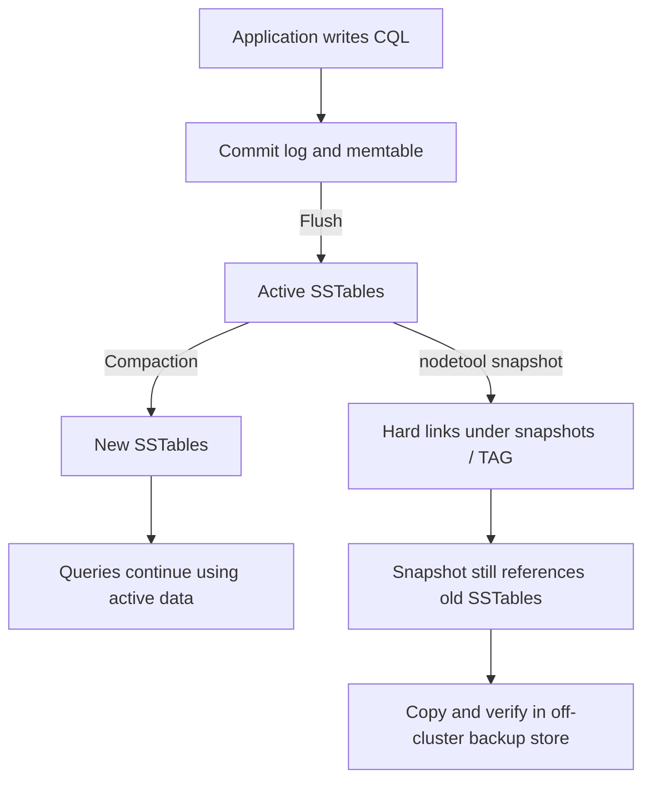

# nodetool snapshot, listsnapshots, clearsnapshot, and Replica Inventory in Apache Cassandra

## 1. Operational Goal

Apache Cassandra is a distributed **wide-column** database. Tables are typically designed around queries, data is distributed by **partition key**, and the **replication factor (RF)** determines the replicas storing each partition's data. In day-to-day operations, beyond reading/writing via CQL and choosing consistency levels, administrators must know **which snapshots exist, on which nodes they reside, how much space they consume, and whether they can actually be restored**.

Three core `nodetool` commands in this lesson:

- `nodetool snapshot`: creates a local snapshot from SSTables for a specified keyspace or table.
- `nodetool listsnapshots`: lists snapshots known to **the queried node**.
- `nodetool clearsnapshot`: removes selected local snapshots after verification and retention checks confirm required data is preserved.

**Key takeaway:** a snapshot on one node is a **local point-in-time capture**, not automatically a durable cluster-wide backup. To obtain a restore-ready backup set, you must **inventory and collect snapshots from every required node, copy them to independent storage, verify integrity, and rehearse restores**.

After this lesson, you will be able to build a safe snapshot runbook, distinguish snapshots from replication/repair/compaction, read an inventory table, and decide when clearing snapshots is permitted.

## 2. Distinguishing Replica, Snapshot, and Backup

| Concept | Purpose | Where It Lives | What Is Not Guaranteed |
| --- | --- | --- | --- |
| **Replica per RF** | Query serving, fault tolerance, and consistency per CL | Multiple nodes across one or more DCs | Does not protect against valid deletes, replicated logic bugs, or human errors |
| **Local snapshot** | Retain SSTable versions at capture time as a restore source | Inside one node's data directory | Not an atomic cluster-wide snapshot; shares the failure domain of the disk/node |
| **Off-cluster backup set** | Recovery after node loss, DC loss, accidental deletion, or disaster | Object storage / independent backup store | Not usable by itself without schema, manifests, versions, and restore tests |
| **Incremental backup** | Records new SSTables via incremental backup when enabled | Local backup directory; must be shipped off-node | Does not provide exact point-in-time history without commitlog/PITR procedures |
| **Repair** | Synchronize data state across replicas when divergence occurs | Anti-entropy process across nodes | Does not create historical copies to undo deleted data |
| **Compaction** | Merge/rewrite SSTables, reduce file counts, and process tombstones when eligible | On each node | Does not replace backups and can cause retained snapshot size to grow over time |

For example, keyspace `commerce` has `RF(dc1)=3`. Three nodes can hold three **active replicas** of the same partition. Taking snapshots on all three nodes yields three distinct sets of **local snapshots**. Each snapshot may contain only the data owned by that specific node; never assume node A's snapshot holds the entire keyspace.

A record deleted via CQL is replicated to all replicas during normal operation. **RF=3 does not mean you have three historical backups.** Snapshots/backups must be designed as a dedicated policy.

## 3. How Do Snapshots Work Under the Hood?

In Cassandra, data passes through the commit log and memtable; on flush, memtable contents become immutable **SSTables** on disk. A snapshot creates **hard links** to existing SSTable files in the filesystem rather than immediately copying every byte.



Consequences to understand:

1. **Snapshot creation is usually fast** thanks to hard links. By standard behavior, `nodetool snapshot` flushes before creating the snapshot; some versions offer a flag to skip flushing, which should only be used if you understand what data is not yet in SSTables.
2. **Snapshots do not freeze the entire cluster.** Nodes keep serving writes, and snapshots run sequentially across nodes can reflect slightly different points in time.
3. **Do not assume storage cost stays zero after creation.** Initially, hard links share blocks with live files; after compaction, old SSTables remain pinned by the snapshot, so disk usage can grow and stay unreclaimable until the last link is removed.
4. **Deleting an active file does not delete snapshot contents pinned by hard links.** Conversely, `clearsnapshot` removes snapshot links/files without deleting SSTables still used by live data.
5. **Readable snapshots do not equal successful restores.** Recovery still requires schemas, compatible versions, exact node/table scope, associated files, SSTable loading procedures, and post-restore checks.

On many Cassandra versions, snapshots live under paths structured like:

```text
<data_file_directory>/
  commerce/
    orders_by_id-<table_id>/
      <sstable-components>...
      snapshots/
        orders-20261121T0400Z/
          manifest.json
          schema.cql
          <sstable-components>...
```

This is a **structural illustration**, not a fixed path. Cassandra can configure multiple `data_file_directories`; table directories embed table IDs; certain files/metadata vary by version. Inspect the node's actual configured paths rather than hardcoding every cluster to `/var/lib/cassandra/data`.

## 4. Preparation Before Running Commands

Before taking snapshots for scheduled backups or ahead of a major change, clearly define:

- **Scope:** which keyspaces, tables, all DCs or one DC; whether to include or exclude system keyspaces per restore goals.
- **Recovery objectives:** RPO/RTO, audit vs. data recovery backup, required history depth, and whether concurrent writes must be coordinated.
- **Topology:** node list per DC, Up/Down states, any bootstrapping/decommissioning/moving nodes, and whether new replicas are streaming.
- **Disk space:** headroom for flush, compaction, snapshots, and upload; snapshot growth over time rather than just initial cost.
- **Storage destination:** off-node/off-cluster destination, encryption, access permissions, retention, checksum verification, and key management.
- **Snapshot tag:** a unique, meaningful tag with UTC timestamp, identical across all participating nodes.
- **Version:** check syntax via `nodetool help snapshot`, `nodetool help listsnapshots`, and `nodetool help clearsnapshot` on the exact running node/version; flags can vary across Cassandra releases and distributions.

The commands below **illustrate running on a Cassandra node** with valid JMX access. In container/Kubernetes setups or custom JMX port environments, run them through your platform's authorized management path.

```bash
# Check node and cluster status before taking snapshots.
nodetool status
nodetool version

# Verify syntax supported by the current version.
nodetool help snapshot
nodetool help listsnapshots
nodetool help clearsnapshot
```

`nodetool status` gives the topology view from the queried node, but does not replace status consensus checks from external monitoring. If any node is unhealthy or topology is changing, replan before declaring a snapshot set complete.

## 5. Creating Snapshots with `nodetool snapshot`

### 5.1. Snapshotting a Keyspace

Suppose keyspace `commerce` holds a table looking up orders by `order_id`. Use a UTC-timestamped tag to correlate cleanly across nodes, DCs, and backup storage:

```bash
# Run on node n1 (example only; does not substitute for running on other nodes).
nodetool snapshot -t orders-20261121T0400Z commerce

# Re-read the snapshot list on THAT SAME node n1.
nodetool listsnapshots
```

You must run the snapshot command with **the same tag** on every node in the backup scope. When protecting an entire cluster, the orchestrator must track exactly which nodes succeeded, failed, or were missed. Never mark a backup set complete just because one node returned success.

### 5.2. Snapshotting a Single Table

When backing up only a tightly scoped table, you can specify the table using the flag supported by your version. In many Cassandra releases, the flag is `-cf` or `--table`:

```bash
# Common syntax example; confirm with "nodetool help snapshot".
nodetool snapshot -t orders-table-20261121T0400Z -cf orders_by_id commerce
```

A single-table snapshot is suitable before a migration isolated to that table, but **insufficient** for business recovery if data also depends on materialized views, denormalized tables, indexes, or external sources. Cassandra designs tables around queries; backups must cover **the entire set of tables that must be restored together**.

### 5.3. Snapshotting All Data Within Supported Scope

You can run `nodetool snapshot` without specifying a keyspace to snapshot the default scope per your version/command. In production, however, **specify scope intentionally** and check `--help`, because system data, metadata restore requirements, and backup sizes can differ from expectations.

**Do not confuse snapshot with export:** this command does not upload data to S3, NFS, or another store. After snapshot succeeds, you still must collect files and metadata from each node, verify them, and store them independently.

## 6. Inventorying with `nodetool listsnapshots`

`nodetool listsnapshots` shows the snapshots held by **one node** at inspection time. When operating a multi-DC cluster, run it on each node or through a centralized management system with authorized JMX access.

```bash
# Run individually on each node in the cluster list.
nodetool listsnapshots
```

Output typically lists dimensions such as **snapshot name/tag**, **keyspace**, **table/column family**, and **size info**. Column names, formatting, and size calculation depend on version. Use it to identify snapshots, then verify against the filesystem and manifests if you need exact restorable or reclaimable byte counts.

Do not sum `Size on disk` across multiple nodes and assume that equals immediately reclaimable space: hard links share blocks, replication duplicates data, snapshots may pin old SSTables, and filesystems carry metadata/overhead. For capacity forecasting, track **actual disk usage, growth over time, and free space**, not a single stat snapshot.

### 6.1. Complete Inventory by Node, DC, Keyspace, and Table

A minimum inventory record should capture:

| Field | Meaning |
| --- | --- |
| `backup_id` / `snapshot_tag` | Unique tag grouping all snapshots in the same run |
| `cluster`, `dc`, `node_id` / admin address | Identifies data source; prevents mixing staging and production |
| `cassandra_version`, `schema_version` | Supports restoring with compatible format and DDL |
| `keyspace`, `table`, `table_id` | Exact resources and files snapshotted |
| `started_at_utc`, `finished_at_utc` | Records actual time span without assuming a single cluster-wide instant |
| `command_status`, `error` | Distinguishes success, failure, and missing results |
| `snapshot_path`, `file_count`, `bytes` | Verifies files physically present on the node |
| `manifest` / checksum | Verifies completeness after copying |
| `remote_uri`, `upload_verified_at` | Off-cluster backup location and verification status |
| `retention_until`, `owner`, `restore_test` | Retention policy, owner, and restore test result |

Example **illustrative inventory table**, not output from a real cluster:

| backup_id | DC | Node | Keyspace | Snapshot Result | Off-Cluster Copy |
| --- | --- | --- | --- | --- | --- |
| `orders-20261121T0400Z` | `dc1` | `node-a` | `commerce` | Succeeded | Verified |
| `orders-20261121T0400Z` | `dc1` | `node-b` | `commerce` | Succeeded | Verified |
| `orders-20261121T0400Z` | `dc1` | `node-c` | `commerce` | Failed | Missing |

In this example, the backup set status must be **INCOMPLETE** even though two nodes uploaded. Never say "three replicas backed up" when one replica lacks a snapshot; depending on recovery targets and token distribution, missing one node can lose data ranges.

### 6.2. Cross-Checking from the Filesystem When Needed

On standard installations, you can **read** snapshot directories to verify tags and files:

```bash
# Example on a Linux node using the default data directory.
# Replace the path with your actual configured data_file_directories.
find /var/lib/cassandra/data -type d -path '*/snapshots/orders-20261121T0400Z' -print
```

`find` here only reads metadata and modifies no data. With multiple data paths or mounts, check all of them. A directory existing **is not sufficient** to prove a snapshot is restorable: verify manifests, checksums, table scope, files from all required nodes, and upload status.

### 6.3. Checklist for Completing an Inventory Run

Consider a backup set **operationally complete** only when:

1. The node/DC list in backup scope is locked at capture time.
2. Every required node ran the command and was marked successful; missing or failed nodes are explicitly logged.
3. Tag, keyspace, tables, and schemas are reconciled consistently, including newly created tables.
4. Snapshots have been exported from **all nodes in scope** to storage independent of the cluster.
5. File counts, manifests, and/or checksums are verified at the destination store.
6. Retention, owner, and scheduled restore-test records are in place.

A complete `listsnapshots` output **only confirms local inventory**, not the six conditions above.

## 7. Cleaning Up Snapshots with `nodetool clearsnapshot`

Snapshots keep hard links to old SSTables; after compaction or repeated runs, these files can contribute to filling disks. However, deleting the wrong snapshot can destroy recoverability. Always tie every cleanup to **tag, keyspace, node scope, and verified off-cluster backup evidence**.

Safe workflow:

1. Inventory `nodetool listsnapshots` on each node; verify the exact tag.
2. Cross-check `backup_id` against the centralized log: off-cluster upload finished, manifest/checksum valid, local retention allows deletion, and no restore is active.
3. Confirm **exact node, exact tag, exact keyspace**; prefer clearing one specific tag rather than a delete-all flag.
4. Run `clearsnapshot` on approved nodes.
5. Re-run `listsnapshots` on each node, inspect directories, and monitor disk usage. Log any skipped nodes, permission errors, or lingering snapshots.

```bash
# On a node inventoried and approved for clearing this tag:
nodetool listsnapshots

# Remove the snapshot with a specific tag in keyspace commerce on the current node.
nodetool clearsnapshot -t orders-20261121T0400Z commerce

# Confirm the tag no longer appears on this node.
nodetool listsnapshots
```

**Important note:** `clearsnapshot` acts only on **the connected node**; it does not wipe snapshots across all replicas/DCs at once. It does not delete copies already shipped to object storage, nor does it validate that those remote copies are intact or complete. After cleanup, reclaimed space depends on which SSTables are still referenced by live data or other snapshots.

Some versions allow broad deletion via flags such as `--all` or omitting the tag. **Never use broad deletion flags in automated runbooks** without verifying version-specific scope and policy approval. For automatic snapshots created by `DROP`/`TRUNCATE` or system config, tags may differ from manual snapshots; inventory them before applying retention.

### When Must You Not Delete Yet?

Do not call `clearsnapshot` if:

- One or more nodes have not uploaded their snapshot, have partial uploads, or failed checksums.
- The snapshot set belongs to an ongoing rollback/migration window that has not closed.
- The off-cluster backup lacks required manifests/schemas or has not passed policy restore checks.
- Ownership, retention, or whether this is the sole remaining pre-incident snapshot is unclear.
- A restore is actively reading those files, or a cluster incident just occurred with no finalized recovery plan.

If critically low on disk, **do not delete randomly**. Assess all space consumers first: old snapshots, live SSTables, compaction, commitlogs, incremental backups, filesystem overhead, and recovery impact. Act in order of risk and data policy.

## 8. Sample Runbook: Snapshotting Before a Major Schema Change

Suppose you are preparing to alter the write path in keyspace `commerce`. The cluster spans two DCs, and the change could affect multiple tables' data. An operational runbook should have three phases.

### Phase A — Before the Change Window

- Lock down the list of nodes, DCs, keyspaces/tables, a tag such as `commerce-prechange-20261121T0400Z`, and the owner.
- Check cluster status, free disk space, expected upload duration, and latest backup status.
- Identify active write traffic; if you need to recover a cross-table transactionally consistent state, plan to **coordinate or pause writes at the application layer**. Running snapshots across nodes alone does not guarantee a global point-in-time cut.
- Confirm the off-cluster storage target, encryption keys, retention, and criteria allowing rollback/cleanup.

### Phase B — Execute and Verify

On **each node in scope**, orchestrate the same commands:

```bash
nodetool snapshot -t commerce-prechange-20261121T0400Z commerce
nodetool listsnapshots
```

Then:

1. Record per-node results in the inventory table; failed nodes keep `FAILED` status and are never ignored.
2. Gather SSTable components, manifests, and schema details per actual disk layout.
3. Copy data to the separate backup store. Any copy tool must preserve filenames and contents intact; avoid modifying snapshot files directly on the Cassandra node.
4. Compare checksums/file counts between source and destination, and restrict write/delete permissions on the backup store.
5. Record `VERIFIED` after checks pass; only when all nodes succeed is the backup set considered ready for the change step.

### Phase C — After the Change

- Verify business queries by partition key, read/write consistency, aggregated data across query-driven tables, and application error counts.
- If an incident occurs, use the tested recovery path. Never copy SSTables directly into a running node's data directory expecting Cassandra to automatically pick everything up.
- Once the rollback window and local retention expire, cross-check the off-cluster backup set, then run `clearsnapshot -t <tag> <keyspace>` on **each eligible node**.
- Update inventory to `LOCAL_CLEARED` / `REMOTE_RETAINED` and archive the logbook.

This runbook applies similarly before major upgrades, replication changes, or large imports, though schema/restore prerequisites differ. When changing RF or topology, pay close attention to which nodes hold data ranges before and after the transition.

## 9. Snapshots, Consistency, and Recoverability

### Is a Snapshot a Cluster-Wide Transaction?

**No.** Each node captures its local SSTables. Nodes can receive writes at different instants, and a snapshot run spanning several minutes can mix different points in time. Even when writing with `LOCAL_QUORUM` or `QUORUM`, snapshots collected sequentially across nodes do not inherently share a cluster-wide or multi-partition transactional boundary.

Therefore distinguish:

- **Backup for infrastructure recovery:** the goal may be capturing complete data to rebuild, then accepting defined recovery/reconciliation bounds.
- **Backup for point-in-time business recovery:** evaluate write pausing/coordination, event logs, commitlogs, or PITR mechanisms supported by your version and platform.
- **Backup for schema-change rollback:** save pre-change schemas, list all related tables, and plan how post-backup writes will be handled.

**Snapshots + commitlogs** can form part of a point-in-time recovery strategy, but only with explicit archiving, shipping, replay, and testing procedures. Snapshots alone are not a complete PITR feature.

### How Is Restore Performed?

SSTable restoration goes beyond the three commands in this lesson. At a high level, a restore workflow requires:

1. Recreating compatible keyspace/schemas and checking Cassandra version, table IDs, and SSTable formats.
2. Choosing the restore method for the scope: node recovery, restoring into a new cluster, importing via tools like `sstableloader`, or distribution-supported workflows.
3. Placing data properly and validating structure without unplanned overwrites of live data.
4. Handling replication, consistency, repair, and required post-restore steps per cluster design.
5. Comparing business queries, checksums/meaningful record counts, and verifying RPO/RTO.

Detailed restore instructions depend on Cassandra version, SSTable format, security, topology, and data requirements. **Always test restores in an isolated environment before relying on backups for production recovery.**

## 10. Capacity Monitoring and Troubleshooting

| Symptom | Possible Causes | Right Investigation Step |
| --- | --- | --- |
| `snapshot` succeeds yet nothing appears on another node | Snapshot is node-local; other node has not run it | Check per-node/per-DC inventory table and orchestration logs |
| `listsnapshots` is empty while object storage has backups | Command only lists local snapshots | Inventory local and remote stores via two separate sources |
| Snapshot finishes fast, then disk usage climbs later | Hard links pin old SSTables after compaction | Inspect snapshot list, live SSTables, compaction activity, and retention |
| `clearsnapshot` reclaims less space than expected | Files still referenced by live data/other snapshots; other space consumers | Check remaining snapshots, compaction, and disk usage |
| Cannot reach `nodetool` | JMX, auth, permissions, network config, or node trouble | Verify management connectivity, version, and logs; never hand-edit data files |
| Snapshot contains only a few tables | Command used narrow keyspace/table scope, node lacked data, or errors occurred | Compare initial scope, schema, and per-node manifests |
| Same tag has different files across nodes | Token ownership and capture timestamps differ | Compare range scope and metadata; differing files do not mean failure |
| Remote backup missing one node | Upload failed or orchestration skipped it | Mark backup set incomplete; backfill/re-collect per policy |
| Old backup fails to restore after upgrade | Schema/SSTable incompatibility or missing restore components | Maintain version manifests and rehearse restores across upgrade paths |

Snapshots also interact with **compaction and repair**. Repair helps replicas converge but is not a backup; compaction replaces active SSTables while snapshots keep old files pinned. When budgeting disk space, factor in repair schedules, write rates, compaction strategy (e.g., STCS/LCS/TWCS per workload), TTL/tombstones, and snapshot frequency together.

### Metrics Worth Adding to Dashboards

| Metric | Operational Value |
| --- | --- |
| Snapshot count per node/DC/keyspace | Spots lingering or skipped snapshots |
| Snapshot duration and command failure rate | Detects failing nodes or management tooling |
| Total disk used/free, SSTable and snapshot growth rate | Estimates disk-full risk |
| Nodes uploaded/verified out of total required nodes | Evaluates completeness of backup sets |
| Time from snapshot to remote verification | Measures lag before off-cluster protection exists |
| Snapshot age and retention deadline | Supports deliberate cleanup |
| Latest restore test and RPO/RTO results | Proves backups are actually usable |

Never embed sensitive info in snapshot tags or public paths. Standardize a tag naming convention free of customer data, tokens, or passwords.

## 11. Controlled Practice Exercise

**Scenario:** A Cassandra cluster has `dc1` with three nodes `n1,n2,n3` and `dc2` with three nodes `n4,n5,n6`. Keyspace `commerce` has `RF=3` in each DC. Operations wants a pre-migration snapshot, stored on object storage, and wants to clear local snapshots after verification.

**Tasks:**

1. Pick a UTC-timestamped tag and write the command to snapshot keyspace `commerce`.
2. List the nodes that must run the command, and explain why running `nodetool snapshot` on `n1` does not protect the whole cluster.
3. Write the command to check local snapshots; design an inventory table with node/DC, tag, keyspace, status, remote URI, and checksum status.
4. Suppose `n5` succeeds locally but its upload fails. May you clear the snapshot on `n5` or mark the backup complete? What must happen next?
5. After all six nodes upload and pass verification, write the command to clear snapshots **only for the approved tag** on each node.
6. When `clearsnapshot` reclaims very little space, name two reasons involving hard links and compaction.

**Answer Hints:**

```bash
# Run individually on n1 ... n6 within approved scope:
nodetool snapshot -t commerce-pre-migration-20261121T0400Z commerce
nodetool listsnapshots

# Run on each node only after remote backup verification succeeds:
nodetool clearsnapshot -t commerce-pre-migration-20261121T0400Z commerce
nodetool listsnapshots
```

`n5` failing upload means the backup set is **incomplete**; retry the upload or re-run per procedure, record checksums, and update inventory status. Never delete the sole local copy before a valid remote copy exists. If `clearsnapshot` reclaims little space, SSTables may still be referenced by live data or another snapshot, or active compaction and other SSTables may account for most disk usage.

## 12. Shift Handover Checklist

- [ ] Defined restore objective, keyspaces/tables, node list, and DC scope.
- [ ] Checked topology, `nodetool` permissions, version, free disk space, and retention policy.
- [ ] Used one consistent tag across all nodes in the snapshot run.
- [ ] Ran `nodetool listsnapshots` and saved per-node results.
- [ ] Inventoried local copies: paths, keyspaces, tables, sizes, file counts, and success/failure status.
- [ ] Copied to off-cluster storage and verified manifests/checksums for every source.
- [ ] Recorded timestamps, version/schema, and restore-test history.
- [ ] Obtained retention/rollback approval before running `nodetool clearsnapshot`.
- [ ] Re-checked snapshot lists and disk usage after cleanup.
- [ ] Updated owner, open errors, and remediation plan in the inventory.

**Remember:** `snapshot` creates a **local** SSTable retention point, `listsnapshots` shows what remains on **the current node**, and `clearsnapshot` cleans up local snapshots within the specified scope. In distributed Cassandra, backup quality lives in **per-node/per-DC inventories, independent off-cluster storage, business-level consistency, and a tested restore procedure**.
