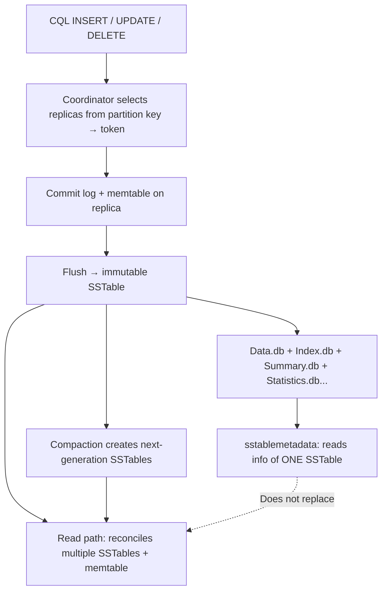
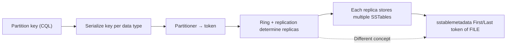
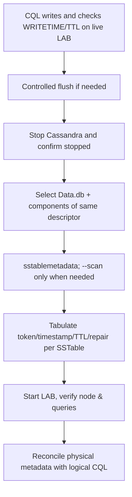

# sstablemetadata and Reading Format, Token, and Timestamp Information

> **Chapter:** Operational Tools  
> **Module:** `DATABASE_ENGINE_WIDE_COLUMN_CASSANDRA` — Apache Cassandra

When a Cassandra table reads slowly, accumulates tombstones, or retains many old SSTables after repair and compaction, operators often need to know **what a specific SSTable file contains** without reading every single data row. The `sstablemetadata` tool serves that exact purpose: it prints statistics, format info, tokens, timestamps, TTL, compression, and repair status recorded in SSTable metadata.

The core issue is **scope of evidence**. An SSTable is an **immutable** data file produced by a flush or compaction, whereas a logical table can span many SSTables across multiple replicas plus memtables. `sstablemetadata` reads **SSTable-level metadata**—it is not a CQL query, does not reconcile replicas, and does not determine a row's final post-reconciliation state.

> **Mandatory operational warning:** Official Apache Cassandra documentation requires **stopping Cassandra before running offline SSTable tools**, including `sstablemetadata`. The script **does not verify that Cassandra has stopped**; running against files actively undergoing flush/compaction can yield unexpected results. In production, either schedule maintenance for the inspected node or create a **consistent SSTable copy to analyze on an isolated machine** with a matching tool version. Never run directly on live data simply because the command is "read-only".

This lesson teaches how to read each field group, distinguish time units, evaluate token ranges, and avoid common traps when drawing conclusions about TTL, tombstones, compaction, or missing data.

## 1. Placing sstablemetadata in Cassandra Architecture

A mutation in Apache Cassandra is replicated according to the **partition key** token and replication strategy. On each replica, mutations are written to the commit log and memtable; the memtable is later flushed to **SSTables** on disk. SSTables are never updated in place: subsequent updates or deletes land in newer SSTables; on read, Cassandra reconciles data across memtables and multiple SSTables using timestamp/tombstone rules.



`sstablemetadata` helps answer:

- Which **partitioner**, file format, and schema metadata describe this SSTable?
- What are the smallest/largest tokens of **partitions stored in this SSTable**?
- What are the min/max write timestamps and time span represented by data in this SSTable?
- What TTL/tombstone signals, compression ratio, compaction level, and repaired/pending-repair markers does the SSTable carry?
- Are there notable differences among SSTables of **the same table on the same node**?

The tool **does not answer by itself**:

- "How many **live rows** does the table have?"
- "What is the final CQL value of partition X?"
- "Is data across all three replicas of RF=3 consistent?"
- "Can I delete this file because estimated droppable tombstones is high?"
- "Does this SSTable still belong to the node's current token range ownership?"

Answering those requires combining CQL, `nodetool`, metrics, repair, compaction, and actual topology.

## 2. What Components Make Up an SSTable?

An SSTable typically consists of multiple files sharing a common prefix, each serving part of the read/write path. Example in traditional SSTable layout:

```text
/var/lib/cassandra/data/telemetry/events_by_device_day-<table-id>/
    mc-17-big-Data.db
    mc-17-big-Index.db
    mc-17-big-Summary.db
    mc-17-big-Statistics.db
    mc-17-big-Filter.db
    mc-17-big-CompressionInfo.db   (if compressed)
    mc-17-big-TOC.txt
    ... other components depending on version/format
```

These names are **structural examples**, not a guarantee that every file exists. Newer releases, formats, compression, and table features may use different components.

| Component | General Role | Relation to `sstablemetadata` |
| --- | --- | --- |
| `Data.db` | Data stored in partition/clustering order on disk | **Argument usually passed to the command** to identify the SSTable to inspect. |
| `Index.db` | Partition index data inside the SSTable | Supports partition lookup on read; not a CQL secondary index. |
| `Summary.db` | Index summary/sampling and key boundaries | One of the metadata sources read by the tool. |
| `Statistics.db` | Metadata/statistics: timestamps, TTL, repair, size distributions... | Primary source for the statistics printed by the tool. |
| `Filter.db` | Bloom filter to skip SSTables on the read path | `Bloom Filter FP chance` reflects configured/expected false-positive probability. |
| `CompressionInfo.db` | Offsets needed to locate compressed data chunks | Present when compression is enabled; ratio also appears in metadata. |
| `TOC.txt` | Table of contents listing the SSTable's components | Helps verify all files belonging to one descriptor. |

An SSTable name such as `mc-17-big-Data.db` reads as:

- `mc`: **SSTable format version** code in the descriptor.
- `17`: **generation** identifier of the SSTable within that table directory—**not** Cassandra 17.0 or a token.
- `big`: **SSTable format** identifier per version naming rules.
- `Data.db`: the data component of that SSTable.

**Never infer server version from a single filename prefix.** An upgraded node can still hold older-format SSTables; format transitions happen during flushes, compaction, or upgrades, not immediately upon upgrading the binary. Always check **Cassandra version + SSTable version + file format compatibility** before inspecting files with a different release's tool.

## 3. Runbook for Using the Tool Safely

### 3.1. Preflight

Before opening an SSTable:

1. Identify **node, keyspace, table, data directory, and Cassandra version**; record the case/incident ID and investigation goal.
2. For a production node, confirm remaining replicas are healthy enough to serve current CL before putting the node into maintenance. If the node cannot be stopped safely, take a **consistent copy/snapshot and analyze offline on an isolated machine** per your backup runbook.
3. Never run against files that might be replaced by active flush/compaction. Follow the official warning that **Cassandra must be stopped** when running offline SSTable tools.
4. Check access permissions and security classification: metadata keys can contain identifiers; never post raw files or outputs to public tickets.
5. Record the **exact path** to the SSTable file set and use only a Cassandra binary supporting that format version.

`sstablemetadata` is an offline **metadata-reading** tool; do not confuse it with `sstablerepairedset`, `sstablelevelreset`, `sstablescrub`, or `sstableupgrade`—those tools have different purposes and can modify metadata or SSTables.

### 3.2. Finding the `Data.db` File to Inspect

In a **stopped Cassandra** environment, official documentation allows using `sstableutil` to list a table's files:

```bash
# Illustrated on a LAB node where Cassandra IS STOPPED.
# 'telemetry' and 'events_by_device_day' are hypothetical names.
sstableutil telemetry events_by_device_day | grep 'Data.db'
```

Example output:

```text
/var/lib/cassandra/data/telemetry/events_by_device_day-aabbccdd11223344/mc-17-big-Data.db
/var/lib/cassandra/data/telemetry/events_by_device_day-aabbccdd11223344/mc-18-big-Data.db
```

Table directories typically contain the table name plus table ID. Never copy a path seen on another node without verifying **host ID, table ID, keyspace, version, and copy consistency**. With multiple data directories, one table can span multiple volumes.

### 3.3. Reading Metadata for One or More SSTables

```bash
# Offline. Pass the exact Data.db file of the SSTable to inspect:
sstablemetadata \
  /var/lib/cassandra/data/telemetry/events_by_device_day-aabbccdd11223344/mc-17-big-Data.db

# Multiple Data.db filenames can be passed to the same command:
sstablemetadata \
  /var/lib/cassandra/data/telemetry/events_by_device_day-aabbccdd11223344/mc-17-big-Data.db \
  /var/lib/cassandra/data/telemetry/events_by_device_day-aabbccdd11223344/mc-18-big-Data.db

# Check exact binary options in the offline environment:
sstablemetadata --help
```

General syntax published by Apache Cassandra:

```text
sstablemetadata <options> <sstable filename(s)>
```

On some installations, the command lives in Cassandra's tools package or under `tools/bin` / `resources/cassandra/tools/bin`. Never assume every node has the executable in `PATH`; use the tool from the **matching distribution** with proper JDK and permissions.

### 3.4. Useful Options

| Option (per 5.0 docs) | Purpose | Notes |
| --- | --- | --- |
| `--help` | Display help | Exact options and aliases can vary by version. |
| `--gc_grace_seconds <seconds>` | Supply grace value used to estimate droppable tombstones | **Does not alter** table/CQL `gc_grace_seconds`; deletes no data. |
| `--scan` | Scan **the entire SSTable** to compute partition, row, cell, tombstone, and wide/large partition counts | Can **consume heavy I/O and time**; use only when budgeted. |
| `--timestamp_unit <unit>` | Declare cell timestamp unit for the tool when needed | Do not confuse cell timestamp with local deletion time; verify valid values via `--help`. |
| `--colors` / `--unicode` | Change color and histogram display formatting | Does not make metadata more accurate or fix SSTables. |

Versions 4.0/4.1 may document fewer options in official docs; **do not assume `--scan` or `--timestamp_unit` exist** on every 3.x/4.x binary just because they appear in 5.0 docs. Reading older SSTables with a newer binary must also obey compatibility limits.

## 4. An Illustrative Output and How to Read It

Below is an **abbreviated, simulated output** using Apache Cassandra documentation field names. Values do not correspond to any running system, and date formatting may vary by version, locale, or options:

```text
SSTable: .../events_by_device_day-<table-id>/mc-17-big
Partitioner: org.apache.cassandra.dht.Murmur3Partitioner
Bloom Filter FP chance: 0.010000
Minimum timestamp: 1760000000000000
Maximum timestamp: 1760086400000000
Duration: Days: 1 Hours: 0 Minutes: 0 Seconds: 0
SSTable min local deletion time: 1760172800
SSTable max local deletion time: 1760259200
Compressor: org.apache.cassandra.io.compress.LZ4Compressor
Compression ratio: 0.55
TTL min: 86400
TTL max: 86400
First token: -8200000000000000000 (key=...)
Last token: 7900000000000000000 (key=...)
Estimated droppable tombstones: 0.31
SSTable Level: 0
Repaired at: 0
Pending repair: --
Total Column Cells: 72918
Total Rows: 24306
```

**Important:** never read these numbers as live CQL records. This is **aggregated metadata** from one SSTable. Field names may change or expand in newer versions (e.g., originating host id, covered clusterings, replay positions, histograms, encoding stats).

The tables below group fields into categories commonly used during investigations.

## 5. Reading Format and Compatibility Metadata

| Field / Signal | Interpretation | What Not to Conclude |
| --- | --- | --- |
| `SSTable` | Path/prefix of the inspected component group | Does not confirm the file still belongs to **live SSTables** on an online node. |
| Descriptor `mc-17-big` | SSTable version/generation/format per naming rules | Never treat `17` as server version or token. |
| `Partitioner` | Algorithm mapping partition keys to tokens, e.g., `Murmur3Partitioner` | Does not prove which node owns the token. |
| `KeyType` / `ClusteringTypes` / `StaticColumns` / `RegularColumns` | Column encoding/structure info in metadata | Not proof that current cluster schema is in agreement. |
| `Bloom Filter FP chance` | Expected/configured Bloom filter false-positive probability | Not the actual false-positive rate measured across the whole workload. |
| `Compressor` | Compression algorithm used in the SSTable, such as `LZ4Compressor` | Do not assume all other SSTables of the table use the same codec after an `ALTER TABLE`. |
| `Compression ratio` | Ratio of **compressed size / uncompressed size** as reported by Cassandra | Do not assume total disk space shrinks by that exact ratio (indexes, filters, snapshots remain). |
| `SSTable Level` | Compaction level stored in metadata, typically meaningful for LCS | Level 0 **does not** mean the file was never compacted or that the strategy is always LCS. |

### 5.1. Recognizing Old Files After an Upgrade

A Cassandra node may run a newer binary while retaining older SSTable formats. That can be normal because:

1. New memtables flush in the format supported by the running release.
2. Older SSTables are read while compatible, and transition format upon compaction or appropriate offline/online upgrade commands.
3. Multiple components on the same node can span different generations/formats.

If the tool reports **unsupported SSTable version**, check the binary and compatibility first; **never** edit descriptor filenames, rename `Data.db`, or copy metadata from another file. Similarly, altering compression in schema does not immediately recompress immutable SSTables; older file metadata still reflects the old codec.

### 5.2. What Does a Compression Ratio of 0.55 Mean?

If `Compression ratio = 0.55`, under Cassandra's standard reporting, the compressed data measured takes roughly **55%** of its uncompressed size—a relative reduction of roughly **45%** for that portion. It does not mean "this SSTable uses 55% of cluster disk", nor does it measure inter-DC network bytes.

When tuning, compare **by table and timestamp**, CPU during flush/compaction, read-path decompression speed, disk I/O, and `nodetool tablestats`. Compression trades CPU; optimizing disk space can shift query p99.

## 6. Reading `First token` and `Last token` in Context

These are the two fields most easily misinterpreted right after adding nodes, rebuilding, or decommissioning.

- `First token` is the smallest token among partition keys stored in the SSTable in partition order.
- `Last token` is the largest token among partition keys stored in the SSTable.
- `key=...` is usually **encoded key bytes**, printed in hex or a corresponding binary representation; not necessarily human-readable UTF-8 text.
- With `Murmur3Partitioner`, tokens can be negative numbers. "Negative" does not mean corrupt data or a time in the past.
- These two tokens describe **partitions present inside one SSTable**, not necessarily the token ranges **currently owned by the node in the ring**.



### Example: Why a Wide Token Range Does Not Mean the SSTable Holds Every Partition

Suppose an SSTable reports:

```text
First token: -9000000000000000000 (key=...)
Last token:   9000000000000000000 (key=...)
```

You only know the SSTable has at least one partition near each end. It might contain 30 sparse partitions or millions of partitions. Never compute `last - first` to estimate partition count, data size, replica count, or ring token balance.

After a topology change, a node can retain SSTables holding data in ranges ceded to another node **until safe cleanup completes**. Conversely, an SSTable streamed from another replica carries keys at the same tokens with different generation/metadata. To verify ownership, cross-check:

```bash
# Online READ-ONLY commands: run while Cassandra is running
# in a separate observation phase, NOT during offline SSTable tool runs.
nodetool status telemetry
nodetool ring telemetry
nodetool describering telemetry
```

For a **single partition key** of the right CQL type, `nodetool getendpoints` helps look up expected replicas for a specific partition; for a **composite partition key**, serialize types properly as supported by the tool/driver rather than concatenating components arbitrarily with delimiters.

**Accurate conclusion:** `sstablemetadata` tells you **the token span of actual data stored in that SSTable**, whereas `nodetool ring/getendpoints` reflects **the current replica ownership map**. Both answers complement rather than replace each other.

## 7. Reading Timestamps: Microseconds, Seconds, and CQL Timestamps

### 7.1. `Minimum timestamp` and `Maximum timestamp`

Cell timestamps in Cassandra are write-order logical markers used for version reconciliation, normally expressed in **microseconds since Unix epoch**. With `USING TIMESTAMP`, the application may supply the timestamp; otherwise Cassandra/the driver selects it per version write semantics.

Example:

```text
Minimum timestamp: 1760000000000000
Maximum timestamp: 1760086400000000
```

These two values are **86,400,000,000 microseconds = 86,400 seconds = 1 day** apart. They **do not prove** the SSTable flushed over exactly one day, because timestamps can come from application logic, backfills, repairs, or much older writes. OS file creation time is also **not** the data write timestamp.

Cassandra may print timestamps both as date-time strings and raw epoch values in parentheses. When comparing across nodes, prefer **numeric epoch values** normalized to UTC; avoid interpreting ambiguous formats like `07/08/2023` that depend on day/month locale conventions.

### 7.2. `SSTable min/max local deletion time`

`Local deletion time` is typically recorded in **Unix epoch seconds**, serving TTL/tombstones and purge eligibility. It is **not** a microsecond copy of `Minimum timestamp`.

| Field | Common Unit | Meaning |
| --- | --- | --- |
| `Minimum timestamp`, `Maximum timestamp` | **Microseconds** since Unix epoch | Write timestamp of data/cells in the SSTable. |
| `SSTable min local deletion time`, `max local deletion time` | **Seconds** since Unix epoch | Local deletion time markers related to tombstones/TTL in metadata. |
| `TTL min`, `TTL max` | **Duration in seconds** | TTL applied to corresponding cells, **not** a Unix epoch timestamp. |
| `Repaired at` | **Milliseconds** since Unix epoch (or `0`) | Timestamp when the SSTable was marked repaired in metadata. |
| `Replay positions covered` | Commit log **segment ID/offset** | Commit log replay positions covered by the SSTable, **not** wall-clock timestamps. |

If `local deletion time` displays **2147483647** (a sentinel value in many versions), **do not** immediately interpret it as "data deletes in 2038". It typically represents no applicable deletion time in that field (or non-expiring state), depending on format/version. Always read it alongside TTL, tombstone histograms, and related data.

A common operational mistake is comparing `1760000000000000` (microseconds) directly with `1760172800` (seconds) and concluding metadata is corrupt. The **million-fold** difference is purely units.

### 7.3. Comparing with CQL `WRITETIME` and `TTL`

CQL can inspect a **live queried cell** by primary key, rather than a whole SSTable. Example schema:

```sql
-- Illustrated in a lab environment where keyspace telemetry already exists.
CREATE TABLE IF NOT EXISTS telemetry.events_by_device_day (
    device_id text,
    event_day date,
    event_id uuid,
    payload text,
    PRIMARY KEY ((device_id, event_day), event_id)
);

INSERT INTO telemetry.events_by_device_day
    (device_id, event_day, event_id, payload)
VALUES (
    'sensor-07', '2026-11-21',
    11111111-1111-4111-8111-111111111111,
    'reading:23.5'
) USING TTL 86400;

SELECT payload,
       WRITETIME(payload) AS write_ts_us,
       TTL(payload) AS remaining_ttl_s
FROM telemetry.events_by_device_day
WHERE device_id = 'sensor-07'
  AND event_day = '2026-11-21'
  AND event_id = 11111111-1111-4111-8111-111111111111;
```

Here:

- `WRITETIME(payload)` returns the write timestamp **of the live `payload` cell**, in microseconds.
- `TTL(payload)` returns **remaining** TTL (seconds), not necessarily the original TTL; it can be `null` if the cell has no TTL.
- An SSTable having a `Minimum timestamp` or `TTL min` does not mean those values belong to the exact cell being read: the row may have a newer version in a memtable or another SSTable.
- `WRITETIME`/`TTL` have restrictions by column type and version; do not apply them blindly to collections, counters, or other schemas.

`SELECT` in CQL and `sstablemetadata` are two different views: **logical current read** vs. **physical file metadata**.

## 8. TTL, Tombstones, and `Estimated droppable tombstones`

In Cassandra:

- `DELETE` and assigning `null` to a column create tombstones.
- Expired TTL also causes data to act as tombstones.
- Tombstones prevent absent replicas from resurrecting deleted data during synchronization.
- `gc_grace_seconds` provides a protection window before tombstones can be purged when **compaction meets safety conditions**.

Output may contain:

```text
TTL min: 86400
TTL max: 86400
Estimated droppable tombstones: 0.31
Estimated tombstone drop times:
  <epoch-second>: <estimated-count>
```

The value `0.31` is an **estimated ratio of tombstones eligible to drop per the algorithm and grace parameter used**—it does **not** mean 31% of file bytes can be safely deleted or that exactly 31% of disk space will be reclaimed right after one compaction.

An aged tombstone may still have to be retained if dropping it risks letting an older value in another SSTable reappear. Reclaiming space also depends on **SSTable overlap**, compaction strategy, and replica sync state. Specifically, if repair has been neglected too long or a replica was offline past grace, purging tombstones too early risks **zombie data**.

### Meaning of `--gc_grace_seconds`

```bash
# OFFLINE and strictly for comparing ESTIMATES;
# e.g., 864000 seconds = 10 days, does not alter schema.
sstablemetadata --gc_grace_seconds 864000 \
  /var/lib/cassandra/data/telemetry/events_by_device_day-aabbccdd11223344/mc-17-big-Data.db
```

This parameter affects the printed **droppable tombstones estimate**; it does **not** run `ALTER TABLE`, modify the table's `gc_grace_seconds`, or delete tombstones. Always cross-check the schema setting:

```sql
SELECT keyspace_name, table_name, gc_grace_seconds, compaction
FROM system_schema.tables
WHERE keyspace_name = 'telemetry'
  AND table_name = 'events_by_device_day';
```

If output shows heavy tombstones and queries are slow, the sound action is investigating **TTL, DELETE patterns, partition sizes, tombstone scans, compaction, and repair**—not running major compaction blindly or setting `gc_grace_seconds=0` to "clean up".

## 9. Other Statistics: Level, Repaired, Replay, Histograms

### 9.1. `SSTable Level` and Compaction

`SSTable Level` records compaction level metadata. With **LeveledCompactionStrategy (LCS)**, SSTables are organized into levels and compaction bounds overlap by level. However, never use level as the sole measure of **age, creation order, compaction count, or query performance**.

For tables using STCS/TWCS/UCS or other strategies, level semantics differ from LCS; inspect the table's `compaction` config and metrics:

```bash
# Online, read-only, in a separate observation step (never alongside offline tools):
nodetool tablestats telemetry.events_by_device_day
nodetool compactionstats
```

### 9.2. `Repaired at`, `Pending repair`, and Repair Coverage

| Field | Practical Interpretation | Limits |
| --- | --- | --- |
| `Repaired at: 0` | SSTable carries an **unrepaired** metadata marker | Does not prove rows inside are out of sync or data is inconsistent. |
| `Repaired at: <epoch-ms>` | SSTable marked repaired at the given epoch milliseconds | Not definitive proof that all ranges/replicas were recently repaired thoroughly. |
| `Pending repair: <ID>` | File tied to a pending incremental repair session where format supports it | Does not itself tell whether the session succeeded or failed; check logs and `repair_admin`/scheduler tools. |
| `Pending repair: --` | No pending repair marker in that output | Does not prove no repair is running in the cluster. |

Incremental repair separates repaired/unrepaired SSTables and may run anti-compaction. A file showing `Repaired at: 0` **is not a command** to intervene manually. Never run `sstablerepairedset` just to make output look clean; flipping repair markers wrongly breaks repair/compaction assumptions and skews true coverage.

### 9.3. `Replay positions covered`

Metadata can include **commit log position** spans associated with the SSTable's data, such as:

```text
Replay positions covered:
  CommitLogPosition(segmentId=..., position=...) -> CommitLogPosition(...)
```

These are **segments/offsets**, not event timestamps, replication lag, or consistent-backup guarantees. Use them to analyze commit log/flush/recovery paths within version-appropriate tooling; never decide to delete commit logs by eyeballing a few positions here.

### 9.4. `Total Rows`, `Total Column Cells`, and Histograms

Statistics like `Total Rows`, `Total Column Cells`, row/partition size distributions, and cell counts are **aggregated for that single SSTable**. They are **not** a `SELECT COUNT(*)` of the logical table:

- One logical row can appear across **multiple SSTables** with different versions and tombstones.
- The analyzed SSTable may hold overwritten or expired data.
- Memtables, other replicas, snapshots, and other SSTables are outside this command's scope.
- Histograms/estimates may not give exact per-partition figures without scanning the full file.

Never sum `Total Rows` across all SSTables on three replicas and report it as "total orders in the system"; doing so both multiplies by RF and double-counts historical versions.

## 10. `--scan`: What More Does Scanning the Entire SSTable Reveal?

On supported SSTable formats, `--scan` reads **the entire file** and prints deeper actual statistics than summary metadata:

```bash
# OFFLINE: only when Cassandra is stopped or analyzing
# a consistent SSTable set on an isolated machine.
sstablemetadata --scan \
  /var/lib/cassandra/data/telemetry/events_by_device_day-aabbccdd11223344/mc-17-big-Data.db
```

Illustrative example of extra output:

```text
Size: <bytes-read>
Partitions: <number>
Rows: <number>
Tombstones: <number>
Cells: <number>
Widest Partitions:
  <partition-key>: <row-count>
Largest Partitions:
  <partition-key>: <bytes>
```

Distinction:

| Mode | Work Source | When to Use |
| --- | --- | --- |
| Default | Reads precomputed metadata in `Statistics.db`/`Summary.db` and related components | Initial pass for format, min/max tokens/timestamps, TTL, and repair flags. |
| `--scan` | Walks **the entire `Data.db` SSTable** to count partitions/rows/cells/tombstones | Investigating large partitions, data skew, or specific hypotheses after budgeting disk I/O. |

A scan can take a long time and put heavy disk pressure on very large SSTables. **Never schedule `--scan` in cron across all production SSTables.** Also never use scan results from one file to assert how many live rows a logical partition has after reconciling across other SSTables.

**Privacy caution:** `Largest Partitions`/`Widest Partitions` outputs or hex token keys can expose user keys. Mask sensitive keys and paths before attaching to issues/tickets.

## 11. Real-World Investigation Scenarios

### 11.1. SSTable Has Old Timestamps Even Though App Writes Normally

**Symptom:** a table receives daily writes, yet an SSTable's `Minimum timestamp` predates the current month.

**Do not jump to concluding:** data is stale or the node stopped taking writes. Newer data may live in other SSTables/memtables; compaction can merge data across periods; application backfills may intentionally supply historical timestamps.

**Investigation path:**

1. Compare `Minimum/Maximum timestamp` across **multiple SSTables** and verify microsecond units.
2. Confirm `WRITETIME` of a representative cell via primary-key CQL query.
3. Check compaction strategy, live SSTables, memtable/flushes, and older retained data.
4. Only investigate replication/consistency level if client reads return wrong results or repair is lagging.

### 11.2. Tokens in an SSTable Seem Outside the Node's Ownership After Bootstrap

**Symptom:** tokens in an SSTable fall outside the range `nodetool ring telemetry` lists for the node after a topology change.

**Normal explanation:** the node just ceded ranges, has not run `cleanup` yet, or holds an older snapshot/copy. SSTable metadata files **do not store the current ring map**.

**Investigation path:** confirm the new node streamed data and readback queries succeed; cross-check endpoints and cleanup status. **Never delete SSTables manually** based on `First/Last token`; cleanup is a dedicated operation scheduled only once data on the new owner is safe.

### 11.3. High Estimated Droppable Tombstones, Yet Disk Usage Does Not Shrink

**Symptom:** `Estimated droppable tombstones: 0.9`, yet disk stays nearly full.

**Do not jump to concluding:** compaction is broken. That ratio is a **metadata estimate**, not guaranteed reclaimable disk percentage. Tombstones may mask older data in another SSTable, other SSTables still hold live data, or eligible compaction has not run yet.

**Investigation path:** compare timestamps and local deletion times, check `gc_grace_seconds` in schema, repair coverage, SSTable overlap, compaction strategy/backlog, and TTL distribution. When disk headroom is low, forcing bulk major compactions **can fill the disk even faster**.

### 11.4. An SSTable Reports `Repaired at: 0` After Scheduled Repair Ran

**Symptom:** the repair scheduler shows a completed job, yet one file's metadata remains unrepaired.

**Possibilities:** incremental repair processed only targeted sets/ranges; the file flushed/compacted after the job; part of the scope was skipped; or job exit success did not equal full coverage. Check `Pending repair` markers and repair history; **never treat one file's `repairedAt` as a cluster-wide conclusion**.

### 11.5. After an Upgrade, the Tool Cannot Read a File

**Symptom:** format/version error or missing component, even while the node itself can still read data.

**Investigation path:** verify SSTable descriptor, tool vs. server version, and copy integrity. A `Data.db` copied without matching `Statistics.db`/`Summary.db` from the same descriptor can fail. Never rename prefixes to newer versions or force-open with a very old tool; pick a binary supporting the format and verify checksums/backups per runbook.

## 12. Comparison with Other Cassandra Tools

| Tool | When Appropriate | Difference from `sstablemetadata` |
| --- | --- | --- |
| `nodetool tablestats` | Observing **tables on a running node**: disk used, SSTable count, read/write latency, tombstone histograms | Aggregates at table/node level; does not dump per-SSTable detailed metadata. |
| `nodetool compactionstats` | Observing active compaction tasks and backlogs | Does not print per-SSTable min/max tokens or timestamps. |
| `nodetool status`, `ring`, `getendpoints` | Checking node health, token ownership, and expected replicas | Current ring metadata differs from file min/max tokens. |
| `sstableutil` | Listing SSTable components and locating paths offline | Does not replace reading min/max metadata. |
| `sstabledump` | Deep inspection of selected SSTable contents when authorized and offline | Can dump actual records and sensitive data; scope differs from `sstablemetadata`. |
| `sstablepartitions` | Analyzing large partitions/sizes where version supports it | Not the primary source for general format/timestamp metadata. |
| `sstableexpiredblockers` | Finding SSTables blocking expiration of TTL-expired data in compaction | Answers a different question from estimated droppable tombstones; also offline. |
| `nodetool repair` | Reconciling replicas across token ranges and streaming differences | Can modify data; not merely viewing one SSTable's metadata. |
| CQL `WRITETIME`/`TTL` | Checking timestamp and TTL of a **live logical cell** by primary key | Does not inspect a whole SSTable or show repaired/format markers. |

**Live/offline boundary:** `nodetool` and CQL target a running cluster; Apache documentation states SSTable tools require stopping Cassandra. When you need both views, **capture online evidence first**, then stop a lab node or analyze an isolated copy offline rather than probing actively changing live data.

## 13. Java Driver: Cross-Checking Metadata Against Logical Results

A Java application **does not need to read SSTable files directly** to inspect a current cell's timestamp. The CQL driver reads results already reconciled by Cassandra across memtables/SSTables/replicas at the chosen consistency level.

Java Driver 4.x example for the `telemetry.events_by_device_day` table created above:

```java
import java.time.LocalDate;
import java.util.UUID;

import com.datastax.oss.driver.api.core.CqlSession;
import com.datastax.oss.driver.api.core.DefaultConsistencyLevel;
import com.datastax.oss.driver.api.core.cql.PreparedStatement;
import com.datastax.oss.driver.api.core.cql.Row;

public final class CellTimestampProbe {
    private final CqlSession session;
    private final PreparedStatement statement;

    public CellTimestampProbe(CqlSession session) {
        this.session = session;
        this.statement = session.prepare(
            "SELECT payload, WRITETIME(payload) AS write_ts_us, " +
            "TTL(payload) AS ttl_left_s " +
            "FROM telemetry.events_by_device_day " +
            "WHERE device_id = ? AND event_day = ? AND event_id = ?");
    }

    public void inspect(String deviceId, LocalDate day, UUID eventId) {
        Row row = session.execute(
            statement.bind(deviceId, day, eventId)
                .setConsistencyLevel(DefaultConsistencyLevel.LOCAL_QUORUM)
                .setIdempotent(true)
        ).one();

        if (row == null) {
            System.out.println("No live row found for query.");
            return;
        }

        Long writeTimeUs = row.isNull("write_ts_us")
            ? null : row.getLong("write_ts_us");
        Integer ttlLeftSeconds = row.isNull("ttl_left_s")
            ? null : row.getInt("ttl_left_s");

        System.out.println("writetime_microseconds=" + writeTimeUs);
        System.out.println("ttl_remaining_seconds=" + ttlLeftSeconds);
    }
}
```

Limitations to state clearly:

- `WRITETIME` of a live cell does **not** tell you which SSTable filename holds it; reads span multiple files and replicas may have reconciled versions.
- `LOCAL_QUORUM` reflects the consistency level chosen by the app, not proof that all replicas were repaired. When one replica holds stale data, reads may succeed accurately while offline SSTables still differ.
- The Java Driver is not an offline metadata analysis tool. **Never copy SSTable files from a live request-serving host to parse inside an application.**
- Use `SELECT` with the full partition key rather than `ALLOW FILTERING` or wide scans to avoid adding load during diagnostics.
- Enforce access controls and never log `payload` or sensitive partition keys into monitoring systems.

## 14. Step-by-Step Verification Workflow in the Lab

This is a **conditional lab**: use only an isolated cluster, proper permissions, and **never disrupt production**.

### Phase A — Observe via CQL While Cassandra Is Running

1. Create a keyspace/table matching your lab topology, and write a few rows with and without TTL.
2. Run `SELECT WRITETIME(payload), TTL(payload) ... WHERE` with full partition key; record values in microseconds and seconds.
3. Record cluster/table status and SSTable counts using `nodetool status` and `tablestats`.
4. Ensure lab data contains no sensitive data.

### Phase B — Create a Checkpoint and Take the Lab Offline

1. To obtain SSTables for inspection, wait for natural flush or run a **controlled flush in the lab**, ensuring free disk and no contention.
2. **Stop Cassandra per lab procedure** and confirm the service/process has fully exited. Never launch SSTable tools before this step.
3. Record the binary version, data directory path, and file set. If analyzing a copy on another machine, copy all required components of the same descriptor with verified consistency.

### Phase C — Analyze Metadata

1. Run `sstableutil <keyspace> <table>` to locate `Data.db`.
2. Run `sstablemetadata <Data.db>` to read format, tokens, timestamps, TTL, compression, and repaired flags.
3. Only when genuinely needed, run `sstablemetadata --scan <Data.db>` on an appropriately sized file.
4. Build a comparison table across SSTables of the same table; separate **provable conclusions** from **still-unproven questions**.
5. Never alter SSTables with other tools just to match expectations.

### Phase D — Recover and Cross-Check

1. Start the lab Cassandra back up per runbook, verifying `UN` and schema agreement.
2. Re-read the prepared keys; compare `WRITETIME` and remaining TTL (TTL will continue counting down over time).
3. Compare with `sstablemetadata`: an SSTable carries many timestamps, whereas CQL returns **one live cell**.
4. If errors occur, halt the experiment, preserve logs/copies, and investigate binary/version issues; never try file-deletion tricks.



## 15. Diagnostic Checklist and Non-Negotiable Principles

| Check Question | Required Before Concluding |
| --- | --- |
| Is the data safe to open offline? | Cassandra is stopped or a consistent file set sits on an isolated analysis host; matching tool version. |
| Is this the exact SSTable? | Keyspace, table ID, descriptor, `Data.db`, and sibling components. |
| Which unit do the timestamps use? | Microseconds (cells), seconds (local deletion), milliseconds (repairedAt); explicit timezone/format. |
| Who owns the tokens? | File min/max tokens **and** current keyspace ring/endpoints, not only one side. |
| Can tombstones be purged yet? | Schema grace, TTL, SSTable overlap, repair coverage, and compaction safety. |
| How many live rows are in the table? | Scoped logical queries/reconciliation, never summing `Total Rows` across files/replicas. |
| Is the file format compatible? | Server/tool versions, descriptor, and upgrade guide for that Cassandra branch. |
| Is repair complete? | Range/table/DC coverage from repair tools and logs, not `Repaired at` on a single file. |
| Can compaction be forced? | Check load, disk headroom, pending tasks, and data-loss risk; never rely on one estimated ratio. |
| May outputs be shared? | Redact paths, hex keys, and sensitive row/partition keys. |

## 16. Applied Exercises

**Question 1.** A file `mc-17-big-Data.db` is read with `sstablemetadata`. Is `17` the Cassandra server version or a token? What must be checked to confirm compatibility?

**Question 2.** `Minimum timestamp = 1760000000000000`, `SSTable min local deletion time = 1760172800`. Why can you not subtract these two numbers directly to compute TTL?

**Question 3.** An SSTable has `First token = -9000000000000000000` and `Last token = 9000000000000000000`. Can you conclude it holds most rows of the entire cluster?

**Question 4.** `Estimated droppable tombstones = 0.92` and the data disk has little free space left. Should you run major compaction immediately to "reclaim 92% of disk"?

**Question 5.** A file reports `Repaired at: 0`, yet the scheduler says the latest incremental repair cycle completed. Can you conclude the repair system is broken? What must be cross-checked?

**Question 6.** Why does `WRITETIME(payload)` from CQL not necessarily equal `Maximum timestamp` of an SSTable holding an older version of that row?

**Question 7.** An operator plans to run `sstablemetadata --scan` directly against a live node's data path to inspect a large partition. What risks exist and what is the safer approach?

**Question 8.** After adding a node, `First/Last token` in an old file shows data outside the node's ownership. Can you delete that file with `rm`? What must be verified?

**Question 9.** A file has `Compression ratio = 0.55`. Does that mean compression reduces size by 55% or that the compressed file is ~55% of uncompressed size? Why must you still check actual disk usage?

<details>
<summary>Answer Hints</summary>

1. No. `17` is the SSTable generation per descriptor convention. Check Cassandra version, SSTable version/format, binary/tool compatibility, and companion components.
2. The two numbers use different **units**: microseconds vs. seconds; TTL is a **duration in seconds**, whereas local deletion time is a Unix epoch second mark. Convert to matching units and respect each field's semantics.
3. No. Min/max tokens only bound partitions physically present in **that file**; they do not tell how many partitions or bytes exist, and do not replace ring metadata.
4. No. This is an **estimated tombstone ratio**, not a percentage of bytes; compaction needs disk headroom and must respect overlap, grace, and repair safety.
5. Not yet. The SSTable may have flushed after repair, fallen outside repaired ranges, or remained unmarked. Inspect repair history/coverage, pending repair, logs, and full vs. incremental mode.
6. CQL returns the timestamp of the **currently reconciled live cell version**; an SSTable may hold older cells, tombstones, or other rows. Maximum timestamp is the max across **all entries in the file**.
7. Documentation requires Cassandra **stopped before running offline tools**; files undergoing compaction/flush can mutate, and `--scan` causes heavy I/O. Use a stopped lab or consistent file set on an isolated host.
8. No. Verify ring/endpoints, completed bootstrap/streaming, readback, and run cleanup only per runbook once ownership is safe.
9. Ratio 0.55 means the measured compressed payload is roughly 55% of uncompressed size—about a 45% reduction in that scope. Disk still holds indexes/filters, snapshots, other files, and overhead.

</details>

## Remember

- **`sstablemetadata` is an offline SSTable analysis tool** reading statistics from companion components; **stop Cassandra before using it** and never run on actively mutating live files.
- Read **format/version/generation**, **First/Last token**, **microsecond timestamps**, **second-resolution local deletion times**, **millisecond `repairedAt`**, TTL, and compression accurately.
- Min/max tokens in a file **are not** node token ownership; one SSTable's metadata **is not** the current logical data of the whole table.
- `Estimated droppable tombstones` and `Total Rows` must be interpreted in context; never use them to delete files or count exact live rows.
- `--scan` yields finer partition/cell stats but **must read the entire SSTable**; budget I/O and protect sensitive data.
- Cross-check CQL `WRITETIME`/`TTL`, `nodetool tablestats`/`ring`/`compactionstats`, repair history, schema, and metrics before making operational decisions.

### Official References

- [Apache Cassandra — sstablemetadata (syntax, examples, output fields, and offline warning)](https://cassandra.apache.org/doc/stable/cassandra/managing/tools/sstable/sstablemetadata.html)
- [Apache Cassandra — SSTable tools and Cassandra stop requirement](https://cassandra.apache.org/doc/stable/cassandra/managing/tools/sstable/index.html)
- [Apache Cassandra 4.1 — sstablemetadata (version-specific comparison)](https://cassandra.apache.org/doc/4.1/cassandra/tools/sstable/sstablemetadata.html)
- [Apache Cassandra — Compression (definition of compression ratio)](https://cassandra.apache.org/doc/stable/cassandra/managing/operating/compression.html)
- [Apache Cassandra — sstableutil](https://cassandra.apache.org/doc/stable/cassandra/managing/tools/sstable/sstableutil.html)
- [Apache Cassandra — Tombstones and compaction](https://cassandra.apache.org/doc/stable/cassandra/managing/operating/compaction/tombstones.html)
- [Apache Cassandra — Repair](https://cassandra.apache.org/doc/stable/cassandra/managing/operating/repair.html)
- [Apache Cassandra — nodetool tablestats](https://cassandra.apache.org/doc/stable/cassandra/managing/tools/nodetool/tablestats.html)
