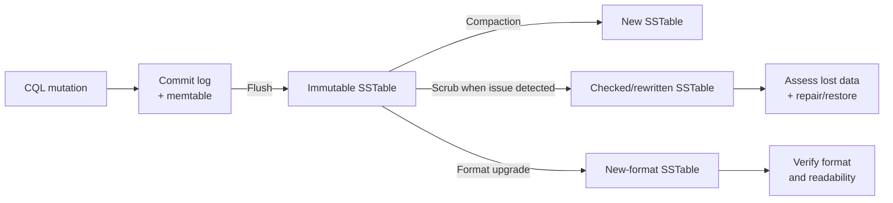
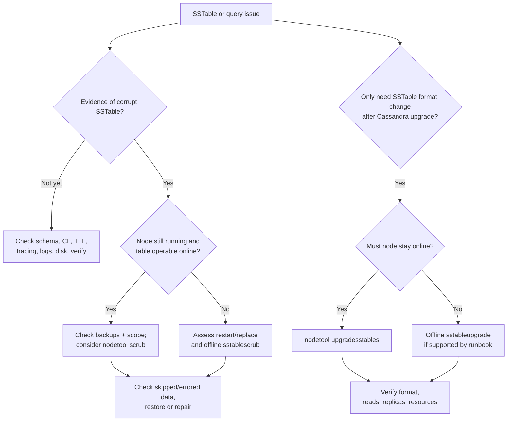
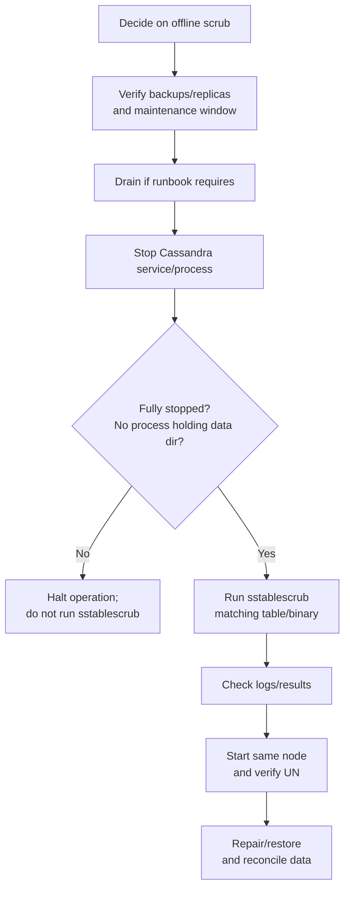

# SSTable Scrub/Upgrade Tools and Required Online/Offline Scope Checks

**Chapter:** Operational Tools  
**Module:** `DATABASE_ENGINE_WIDE_COLUMN_CASSANDRA` — Apache Cassandra

Apache Cassandra stores long-lived data in **immutable SSTables** on each replica. After a disk fault, file-format error, or Cassandra version upgrade, operators may encounter similar-sounding commands: `nodetool scrub`, `sstablescrub`, `nodetool upgradesstables`, and `sstableupgrade`. However, they are not equivalent. The two `nodetool` commands operate through a running Cassandra node; the two `sstable*` utilities operate directly on files and **require stopping the Cassandra process on the node holding the data** before use.

More importantly, **scrub can discard data deemed corrupt**. It is not a "fix everything without losing any row" command. Conversely, **upgrading SSTables** rewrites file formats to the current Cassandra version's format; it is not a corruption check or repair. Picking the wrong tool, wrong target, or wrong timing can cause data loss, prevent startup, or render post-upgrade rollback impossible.

This lesson belongs to the `DATABASE_ENGINE_WIDE_COLUMN_CASSANDRA` module on distributed wide-column architecture, partition keys, query-driven table design, consistency levels, CQL, replication, compaction, repair, failure handling, and Java connectivity. The goal is building an **online/offline and scope decision runbook**, rather than memorizing four commands and running them casually.

> **Scope and safety:** Examples target Apache Cassandra 4.1/5.x on Linux. Syntax, flags, snapshot behavior, and format support can vary by distribution. Cross-check `nodetool help ...`, `sstablescrub --help`, `sstableupgrade --help`, and docs for your exact running version. Test SSTable repair only in a **disposable cluster**. Never deliberately corrupt real files, manually delete SSTables, or run offline utilities while Cassandra still has the data directory open.

## 1. Learning Outcomes

After this lesson, you will be able to:

1. Distinguish **physical data corruption**, **query/schema errors**, **missing replicas**, and **old SSTable formats after an upgrade**.
2. Choose among `nodetool scrub` (online), `sstablescrub` (offline), `nodetool upgradesstables` (online), and `sstableupgrade` (offline).
3. Explain why `nodetool verify`/`sstableverify` validates files and **does not** restore lost rows on its own.
4. Scope the exact **keyspace/table/node/SSTable/snapshot** affected; understand that one command on one node does not fix every replica in the cluster.
5. Prepare health checks, independent snapshots/backups, disk headroom, rollback plans, and stop conditions.
6. Execute a monitored online scrub runbook, understanding why `--no-snapshot`, `--skip-corrupted`, and `--no-validate` are risky flags.
7. Follow the offline workflow: drain (when appropriate) → stop Cassandra → verify stopped → run matching-version tool → restart → repair/validate.
8. Explain why format upgrades increase disk read/write I/O and can impact rolling back to older binaries.
9. Cross-check CQL and Java Driver results with logs, `nodetool`, and repair outcomes after maintenance.
10. Write a maintenance report capturing before/after evidence and unverified scopes.

## 2. LSM-Trees and Why SSTable Tools Exist

### 2.1. From Mutation to File

On each replica:



A partition maps to a token via its partition key; depending on RF and topology, multiple nodes hold copies of that partition. **An SSTable is a file on a single replica**, not the entire logical data of the keyspace. The same partition can span multiple SSTables across flushes/updates and compaction.

An SSTable comprises multiple data and metadata components (e.g., Data, Index, Statistics, Summary, CompressionInfo depending on format). Filenames/formats evolve across Cassandra lines. Never hand-edit component files with an editor or rename prefixes just to "upgrade" formats.

### 2.2. When Do Physical Errors Occur?

Sources that can raise SSTable suspicion:

- `CorruptSSTableException` or checksum/validation errors in logs.
- Node fails to start because it cannot open or read an SSTable.
- `nodetool verify` reports anomalies on checked SSTables/ranges.
- Filesystem, controller, disk, or kernel reports I/O errors.
- Incomplete snapshots/backups, partial file copies missing components, power loss, or hardware faults.
- Post-upgrade state incompatible with format rules per version docs.

However, **a query returning wrong values is insufficient to conclude SSTable corruption**. The application may have used the wrong partition key, timestamp, TTL, consistency level, or schema, or replicas may simply lack repair. Scrub cannot fix business logic bugs.

## 3. Online/Offline Decision Matrix

| Tool | Cassandra Node on **That Data Directory** | Purpose | Primary Risk |
| --- | --- | --- | --- |
| `nodetool scrub` | **Running (online)**, via JMX | Scrub, inspect/rewrite SSTables for the selected table | Can drop data deemed corrupt; heavy I/O; needs repair/restore |
| `sstablescrub` | **Must be stopped (offline)** | Fix damaged SSTables via direct filesystem utility | Can drop corrupt rows; requires node downtime; risk of startup/missing data |
| `nodetool upgradesstables` | **Running (online)**, via JMX | Rewrite legacy-format SSTables to current format | Disk/CPU/compaction contention; requires backups and upgrade plan |
| `sstableupgrade` | **Must be stopped (offline)** | Rewrite SSTable formats on disk (also supports snapshot mode by version) | Must not run concurrently with daemon; affects rollback/recovery |
| `nodetool verify` | Running (online) | Validate data/SSTable checksums per version mechanism | Generates I/O but **does not** recover lost records |
| `sstableverify` | Must be stopped (offline) | Verify SSTables via direct utility | Heavy I/O; **not** scrub |
| `nodetool repair` | Running (online) | Compare replicas and stream differences | Requires healthy source replicas; consumes network/disk |
| `nodetool compact` | Running (online) | Trigger compaction | **Not** scrub or repair; can consume substantial extra disk |

**Online** here means **the target node is still running Cassandra and can serve CQL**; it does not mean zero impact, zero p99 increase, or unconditional safety in production. **Offline** means **no Cassandra process has that data directory open** while the utility runs; finishing `drain` while the daemon is still alive **is not offline**.

**Do not invert the definitions:** `nodetool` connects from an admin host to the target node's JMX; running it from another machine does not make it "offline". Conversely, `sstablescrub` runs outside the server process, so opening another terminal to run it does not bypass the requirement to stop Cassandra.

## 4. Symptom-Based Tool Selection Flow



Some incidents call for **replacing/rebuilding the node** rather than scrubbing, especially when a data directory is badly damaged while RF still provides healthy replicas to stream from. Never pick a risky operation simply because a command name showed up in logs.

### 4.1. Four Questions Before Choosing Scrub

1. What evidence confirms file corruption: exceptions, checksums, read errors, or hardware I/O?
2. Which **node, keyspace/table, SSTables, and token ranges** are affected?
3. Do other replicas hold clean, regularly repaired data? For RF=1, is there a backup?
4. Can you tolerate **losing some corrupt rows**, or must you restore intact data from snapshots/backups?

Scrub **does not repair failing physical disks**. If disks keep throwing I/O errors, prioritize hardware remediation and data protection before letting any tool rewrite files at scale.

### 4.2. Three Questions Before Choosing Upgrade

1. Have Cassandra binaries/schemas been upgraded compatibly per supported procedure?
2. Are existing SSTables actually in an older format needing rewrite, or already current?
3. If binary rollback becomes necessary, can the older binary read SSTables after rewriting?

**SSTable upgrade is not meant to discard corrupt data**, nor is it a step to recover missing data. Never run `upgradesstables` in place of verify/scrub/repair when logs report corruption.

## 5. Mandatory Preflight: Scope and Safety

### 5.1. Verify Cluster and Node Before Rewriting Data

On the **test node/cluster**:

```bash
nodetool status
nodetool version
nodetool describecluster
nodetool info
nodetool tpstats
nodetool compactionstats
nodetool netstats
```

Record Cassandra version, JDK, replication factor, datacenter/rack, replica `UN/DN` state, pending compactions, active repair/streaming, and free disk. If another replica is also unhealthy, scrubbing away data on a surviving node could leave the cluster with zero recovery sources.

For a suspect table, record:

```bash
nodetool tablestats lab_ops.inventory_by_sku
nodetool tablehistograms lab_ops inventory_by_sku
nodetool help scrub
nodetool help upgradesstables
```

If that table does not exist, `tablestats`/`tablehistograms` above are examples to substitute with your real table name. Not every `nodetool` subcommand exists in every release.

### 5.2. Snapshots and Backups Are Not Interchangeable

Cassandra **snapshots** typically reference SSTable files via hard links or filesystem equivalents; they capture one node's data files at a point in time. A snapshot sitting **on the same failing disk** is not an independent backup.

Before any operation that can discard data:

1. Maintain an off-node backup with a tested restore procedure.
2. Save schema/table metadata and cluster/replication details.
3. Confirm a snapshot on the **exact target node and table** before scrubbing; never rely solely on a snapshot from another node.
4. Budget space for **snapshot holding old files + newly rewritten SSTables + compaction/other snapshots**.
5. Identify who will approve deleting the snapshot once recovery is verified.

Example taking a clearly named snapshot on a lab node:

```bash
# Check syntax on your running version.
nodetool help snapshot

# Example using common syntax:
nodetool snapshot -t pre_sstable_maintenance_011 -cf inventory_by_sku lab_ops

nodetool listsnapshots
```

`nodetool scrub` may create a pre-scrub snapshot by default (unless snapshots are disabled). Even so, **never rely solely on auto-snapshots** against data loss risk: creation can fail on a full disk, be disabled in config, or fail to substitute for an off-host backup.

### 5.3. Resource Budgeting

| Resource | Risk During Scrub/Upgrade | What to Measure |
| --- | --- | --- |
| Free disk on target node | Old and new SSTables coexist; snapshots pin old blocks | Free bytes, snapshot bytes, filesystem errors |
| Disk throughput/IOPS | Rewrites read and write many files, contending with compaction | Read/write latency, queue depth, I/O wait |
| CPU/GC/heap | Validation, compression, index rebuilds, buffers | CPU, GC pauses, RSS/cgroup |
| Replica availability | Offline nodes reduce replicas able to ACK | RF/CL, node status, client timeouts |
| Network | Post-scrub repair/streaming can move heavy data | WAN/DC traffic, `netstats` |
| Maintenance window | Rewrites may overrun if data is large or disks are slow | SSTable size, measured throughput |
| Backup/rollback | Discarded data or new format incompatible with old binary | Tested snapshot/backup restore, version compatibility |

**There is no universal "2x space" multiplier for every table.** Space planning must account for bytes rewritten, snapshots/hard links, compaction, and affected nodes. If destination disk lacks headroom, stop before starting rather than running out of disk mid-way and trying to delete SSTables manually.

### 5.4. Pre-Execution Logbook

```text
CHANGE_ID:
INCIDENT_ID:
NODE / HOST_ID / DC / RACK:
CASSANDRA_VERSION / JDK:
KEYSPACE / TABLE / SSTABLE_PATH_IF_KNOWN:
ERROR_OR_REASON:
RF / CURRENT_CLIENT_CL:
REPLICA_HEALTH:
BACKUP_LOCATION / RESTORE_TEST:
SNAPSHOT_NAME / VERIFY_RESULT:
DISK_FREE / CPU / COMPACTION / P99:
TOOL / ONLINE_OR_OFFLINE:
COMMAND_AND_FLAGS:
STOP_CONDITION:
RECOVERY_OWNER:
```

The goal is recording **verified facts**, never filling illustrative placeholders as real measurements.

## 6. `nodetool scrub`: Running While the Node Is Online

### 6.1. Effects and Risks

`nodetool scrub` instructs a running Cassandra node to **rewrite SSTables** for specified tables, preserving valid data while discarding or adjusting parts judged corrupt by tool logic. This runs through compaction pathways and can contend with client reads/writes.

**Never** say "scrub never loses data". Dropping a corrupt partition/row alters logical data on that replica. With multi-replica RF, you can later repair from healthy replicas; with RF=1 and no backup, dropped data can be **permanently lost**.

### 6.2. Safe Syntax to Inspect First

```bash
nodetool help scrub

# Example strictly for a lab node with the matching table:
nodetool scrub lab_ops inventory_by_sku
```

Scope is **table `inventory_by_sku` in keyspace `lab_ops` on the target node**. It does not scrub that table on every cluster node and does not guarantee all partitions/tombstones across the DC are converged.

Do not run `nodetool scrub` across all keyspaces when only one SSTable in one table failed. If multiple tables are needed, establish an approved list and order.

### 6.3. Flags to Understand Before Using

| Flag (check version `help`) | Meaning | Safety Rule |
| --- | --- | --- |
| `--no-snapshot` / `-ns` | Skip pre-scrub snapshot creation | **Avoid**, unless verified independent backup/snapshot exists and runbook permits |
| `--skip-corrupted` / `-s` | Allow skipping corrupt partitions including counter tables per version semantics | Risks data loss and broken counters; never enable to try your luck |
| `--no-validate` / `-n` | Skip certain column/type validation checks | Never use without knowing exact cause and impact |
| `--reinsert-overflowed-ttl` / `-r` | Special handling path for historical TTL overflow bugs | **Not** a general "fix TTL" flag; only per confirmed bug/version procedure |
| `--jobs` / `-j` | Cap concurrent SSTables processed | Raising jobs can worsen disk I/O and p99 |

These flags **are not default performance tuning knobs**. Some variants let scrub press forward by discarding unreadable chunks; that carries data-integrity consequences requiring explicit approval.

### 6.4. Counters Require Extra Caution

Counter tables have distinct semantics from regular rows. Dropping a corrupt partition or fragment **can leave aggregated counter values short**. Where `--skip-corrupted` exists, it may override default protections and drop corrupt counter chunks.

Therefore, for counter tables:

1. Never pass `--skip-corrupted` just to silence scrub errors.
2. Identify affected data and how values can be reconstructed from business sources if needed.
3. Obtain backup/approval and design post-fix reconciliation.
4. Understand that repair cannot invent accurate business counter totals if every replica lacks the data.

### 6.5. Post-Run Monitoring

```bash
nodetool compactionstats
nodetool tablestats lab_ops.inventory_by_sku
nodetool tpstats
nodetool listsnapshots
nodetool status
```

Record logs showing which files were scrubbed, skipped rows/partitions (if reported), created snapshots, duration, and errors. Exit code 0 only proves the operation finished per its own criteria; **it does not prove every mutation was recovered**.

If data was discarded, execute **backup restore or repair from healthy replicas** matching RF state. Do not run blind repair before logging what was lost; after repair, still verify logical data and replica health.

## 7. `sstablescrub`: The Offline Utility

### 7.1. Mandatory Preconditions

`sstablescrub` operates directly on SSTables and can rewrite files. **Cassandra must be stopped on that node.** Apache Cassandra docs emphasize that offline `sstable*` utilities **do not check** whether the daemon is stopped. Being able to invoke the command **does not mean it is safe**.



**Drain is not stop.** `nodetool drain` handles shutdown preparation for open data, yet the daemon may remain alive. Confirm the process actually exited **after** stopping the service.

### 7.2. Example Runbook on a Lab Linux VM

The commands below **are not an automated copy-paste script**. Run only on a lab VM authorized for downtime with verified backups:

```bash
# While Cassandra is still running, if your version runbook requires it:
nodetool drain

# Stop the service on the target node:
sudo systemctl stop cassandra

# Verify it truly stopped; process name can vary by packaging:
pgrep -af 'org.apache.cassandra.service.CassandraDaemon'

# Only once NO daemon uses the data directory:
sstablescrub --help
sstablescrub lab_ops inventory_by_sku
```

`pgrep` returning non-zero when no process is found is expected once confirmed via service manager/logs/file handles per runbook. If a process still exists, **do not run `sstablescrub`**.

After the utility completes and logs/files are checked:

```bash
sudo systemctl start cassandra

# Wait for node startup and stabilization; run from appropriate host:
nodetool status
nodetool compactionstats
nodetool tablestats lab_ops.inventory_by_sku
```

Never use `kill -9`, delete the data directory, or re-run scrub repeatedly without understanding errors. If the node still fails to start after scrub, preserve logs and snapshots and switch to an appropriate recovery/rebuild/replace runbook.

### 7.3. Docker/Kubernetes Pitfalls

If you run `docker stop cassandra3`, you **cannot** run `docker exec cassandra3 sstablescrub ...` inside a stopped container. In Kubernetes, an operator may auto-restart pods, and an ephemeral container/Job mounting the same volume with matching config/UID **must never** allow two Cassandra/utility processes to write to the same data directory simultaneously.

Therefore, container offline runbooks must be verified by the platform owner:

- A controller/maintenance mode genuinely prevents Cassandra from auto-restarting.
- The utility uses the **exact binary/JDK version** compatible with SSTables and schema.
- Volumes mount safely with accurate ownership.
- No other daemon/sidecar writes to the same data dir.
- Cleanup/restore and service re-entry timing are controlled.

Never add `--privileged` or alter production filesystem permissions to "bypass" permission denied errors.

### 7.4. When Is Offline Scrub Still Not Enough?

If files are severely corrupt, metadata is unreadable, underlying disks keep throwing I/O errors, or multiple replicas are damaged, the tool may fail to recover. In that case:

- Consider backup restore if exact data preservation is required.
- If RF allows, evaluate replacing/rebuilding the node from healthy replicas.
- Never delete failing files just to let a node boot without an approved runbook.
- Never loop `--skip-corrupted` endlessly hoping errors vanish.

**Offline scrub can still discard data**—it is not "stronger so guaranteed lossless".

## 8. `nodetool upgradesstables`: Online Format Upgrade

### 8.1. When to Use

After a **supported Cassandra binary upgrade**, a node may still hold SSTables in the prior version's format. When appropriate, `nodetool upgradesstables` rewrites SSTables not yet in the node's current format to the new format. This consumes I/O/CPU/disk and is documented as running similarly to compaction.

**Never use `upgradesstables` to fix data corruption.** If files are already in the current format, the command may rewrite nothing; that is not an error. Some tools/versions provide `--include-all-sstables` to force rewriting even current-format files, incurring much higher cost.

### 8.2. Syntax

```bash
nodetool help upgradesstables

# Online example for a selected table:
nodetool upgradesstables lab_ops inventory_by_sku

# Monitor during execution:
nodetool compactionstats
nodetool tablestats lab_ops.inventory_by_sku
```

Options described in Cassandra 5.0 documentation may include:

| Option | Meaning | Notes |
| --- | --- | --- |
| `--include-all-sstables` / `-a` | Rewrite even SSTables already in current format | Heavy I/O; do not enable without a clear reason |
| `--jobs` / `-j` | Concurrency for SSTables being upgraded | Weigh disk/CPU/compaction contention |
| `--max-timestamp` / `-t` (if available) | Limit SSTable selection by supported file creation timestamp | May not exist or differ in semantics across versions |

The command runs **on the targeted node**; in a 10-node cluster, it does not automatically rewrite SSTables on the other 9 nodes. Schedule rolling or safe batched execution and track each node's status separately.

### 8.3. When Should It Run in an Upgrade Workflow?

Conceptual order:

1. Have a backup/restore plan and verified binary/schema/driver compatibility.
2. Upgrade Cassandra **per supported runbook**, monitoring per-node health and versions.
3. Once the cluster stabilizes and the rollback window is evaluated, decide whether SSTable format upgrades are needed.
4. Run `upgradesstables` scoped by table/node while monitoring disk/CPU, p99, and compaction.
5. Verify data, readability, format status, and related repair tasks.

**Rollback trap:** once SSTables are rewritten into a new format unreadable by the older binary, "downgrading the Cassandra package" may **fail to bring the node back up**. Even if certain version pairs allow limited compatibility, never assume binary rollback remains safe after `upgradesstables`.

### 8.4. Do Not Run Without a Reason

Some upgrade guides do not require immediate full SSTable rewrites. Older files may remain compatibly readable during transition while background compaction gradually produces the new format. Read the guide for your exact version; never rewrite the whole cluster merely because you deployed a new binary and want to watch SSTable counts move.

## 9. `sstableupgrade`: Offline Format Upgrade

`sstableupgrade` operates directly on SSTables on disk. Per Apache Cassandra docs, **Cassandra must be stopped before running it**, because concurrent daemon and tool access/writes can produce unpredictable results.

### 9.1. Lab Procedure on a Stoppable Node

```bash
# Check --help from the exact binary/installation:
sstableupgrade --help

# If needed and specified by runbook, drain before shutdown:
nodetool drain
sudo systemctl stop cassandra

# Confirm no Cassandra process reads/writes the data dir:
pgrep -af 'org.apache.cassandra.service.CassandraDaemon'

# Only once OFFLINE:
sstableupgrade lab_ops inventory_by_sku

# After the utility completes and results are verified:
sudo systemctl start cassandra
nodetool status
```

This is a **conditional guide**, not advice to stop a production replica without checking RF/CL. In an RF=3 cluster with one node offline, `LOCAL_QUORUM` can remain available if two other replicas are healthy; `ALL` becomes unavailable. With RF=1, stopping the sole replica causes an outage for all ranges on that node.

### 9.2. Snapshots Can Also Be Affected

Depending on version, `sstableupgrade` supports targeting **a snapshot**. Cassandra 5.0 docs note that upgrading a snapshot can modify snapshot files and **break hard links with live SSTables**. Therefore:

- Verify whether you are targeting a live table or a snapshot.
- Do not treat a rewritten snapshot as an untouched immutable backup.
- Keep a backup **on separate storage/filesystem** if rollback/restore is needed.
- Never use snapshot upgrade to fix read errors caused by corruption.

### 9.3. Online vs. Offline Upgrade: Which to Choose?

Normally, when a cluster is running and the version supports it, `nodetool upgradesstables` is more convenient because the node stays online. `sstableupgrade` fits when **a runbook requires offline execution**, such as a node already down for maintenance or specialized file/snapshot handling. An offline utility is not inherently faster, safer, or better in every scenario.

## 10. Similar-Looking Commands That Solve Different Goals

| Command | Purpose | Should Not Be Used To |
| --- | --- | --- |
| `nodetool flush` | Persist memtables to SSTables | Fix corrupt SSTables or recover missing replicas |
| `nodetool compact` | Request compaction | Guarantee data integrity or run format upgrades per runbook |
| `nodetool scrub` | Attempt online repair/rewrite of damaged SSTables | Routinely "purge all tombstones" |
| `nodetool verify` | Check data/SSTable validity | Automatically heal checksum errors |
| `nodetool upgradesstables` | Rewrite SSTable format online | Reconcile missing data across replicas |
| `sstablescrub` | Handle corrupt SSTables offline | Run while daemon is still alive |
| `sstableupgrade` | Rewrite format offline | Run concurrently with daemon compaction |
| `nodetool repair` | Compare replicas and sync divergent data | Replace backups when all replicas lost data |
| `nodetool rebuild` | Stream data for a node from selected source/scope | Simply upgrade file format of one table |

### 10.1. Scrub Does Not Replace Repair

When scrub discards corrupt chunks, replica A may miss mutations still present on B and C. Anti-entropy repair can restore them from peers only if the data genuinely exists and timing/tombstones remain safe. With RF=1, repair cannot conjure data out of thin air.

### 10.2. Upgrade Does Not Replace Compaction Strategy

Changing SSTable format does not automatically fix STCS, LCS, TWCS, or UCS choices. Update-heavy, TTL, or wide-partition workloads still need proper table and compaction design. Never expect `upgradesstables` to be a universal cure for poor read p99.

### 10.3. "Online" Does Not Mean Automatically Distributed

`nodetool` acts on the target node. If a table has RF=3, three replicas may sit on three nodes with differing SSTable formats, compactions, or corruption. Scrubbing one node does not automatically scrub the other two replicas. Deciding **how many nodes require action** must rely on logs and maintenance plans, not multiplying RF by one command.

## 11. Safe Lab: Preparing a Table to Observe Without Deliberately Corrupting Files

This lab creates only **valid SSTables** to inspect behavior and metadata. It includes no byte-flipping, component deletion, or hex-editing. Testing corruption recovery requires a **separate disposable cluster with snapshots/backups** planned by operations.

### 11.1. Topology Preparation

Assume one DC named `datacenter1` with three healthy nodes, RF=3. On one node:

```bash
nodetool status
nodetool version
nodetool describecluster
cqlsh
```

In `cqlsh`:

```sql
SELECT data_center, release_version
FROM system.local;
```

If your actual datacenter name differs from `datacenter1`, substitute the real name below. Use RF=3 only with three replica nodes in the DC; in a single-node lab, adjust RF/CL and accept the absence of repair peers.

### 11.2. Schema and Small Baseline

```sql
CREATE KEYSPACE IF NOT EXISTS lab_ops
WITH replication = {
  'class': 'NetworkTopologyStrategy',
  'datacenter1': 3
}
AND durable_writes = true;

CREATE TABLE IF NOT EXISTS lab_ops.inventory_by_sku (
    sku text PRIMARY KEY,
    available int,
    revision int,
    updated_at timestamp
);

CONSISTENCY ALL

INSERT INTO lab_ops.inventory_by_sku
    (sku, available, revision, updated_at)
VALUES ('sku-011-a', 100, 1, '2026-11-21T02:00:00Z');

INSERT INTO lab_ops.inventory_by_sku
    (sku, available, revision, updated_at)
VALUES ('sku-011-b', 200, 1, '2026-11-21T02:00:00Z');

INSERT INTO lab_ops.inventory_by_sku
    (sku, available, revision, updated_at)
VALUES ('sku-011-c', 300, 1, '2026-11-21T02:00:00Z');

SELECT sku, available, revision
FROM lab_ops.inventory_by_sku
WHERE sku = 'sku-011-a';
```

Proceed only if **all three INSERTs** ACK at `ALL`. Pre-loaded keys support post-operation cross-checking, though checking three rows **does not** prove the whole table/cluster is free of corruption.

### 11.3. Creating Observable SSTables

```bash
# Lab node only:
nodetool flush lab_ops inventory_by_sku

nodetool tablestats lab_ops.inventory_by_sku
nodetool tablehistograms lab_ops inventory_by_sku
nodetool compactionstats
```

Flushing memtables creates SSTables on the targeted node; with RF=3, other nodes maintain their own memtables/SSTables. To ensure inspectable files on every replica, follow the lab runbook per node and check disk state; never flush an entire production cluster casually.

### 11.4. Inspecting Without Modifying Data

```bash
# Online:
nodetool help verify
nodetool verify lab_ops inventory_by_sku

# Observation only:
nodetool tablestats lab_ops.inventory_by_sku
nodetool compactionstats
```

Read logs to see verify completion/failures. A successful verify on one node only speaks for the scope that tool inspected; it does not prove the whole cluster is repaired or backups are ready.

### 11.5. Exploring Upgrade Options

```bash
nodetool help upgradesstables

# If planned and this is a disposable cluster:
nodetool upgradesstables lab_ops inventory_by_sku
```

If SSTables are already in the current format, the command may rewrite nothing. **Do not** pass `--include-all-sstables` merely to force I/O and prove "the command ran". Read logs and version format docs before concluding.

### 11.6. Scrub Only as an Advanced Exercise on a Disposable Cluster

If you still wish to observe `nodetool scrub` on a **healthy table in a disposable cluster**:

1. Take a snapshot and ensure an independently restorable backup exists.
2. Record baseline row counts and disk headroom.
3. Run `nodetool scrub lab_ops inventory_by_sku` on **one selected node**.
4. Inspect logs, rewritten SSTable count, and created snapshots.
5. Re-verify data and replica states without inferring zero errors from three sample rows.
6. Assess whether repair/validation is needed per runbook.

This step is optional for understanding command scope. In production, **scrub only with a concrete operational reason**, never as routine maintenance like compaction.

## 12. Verifying Data with CQL and the Java Driver

### 12.1. Reading at the Appropriate Consistency Level

After maintenance on one node and cluster stabilization:

```sql
CONSISTENCY LOCAL_QUORUM

SELECT sku, available, revision
FROM lab_ops.inventory_by_sku
WHERE sku = 'sku-011-a';

SELECT sku, available, revision
FROM lab_ops.inventory_by_sku
WHERE sku = 'sku-011-b';

SELECT sku, available, revision
FROM lab_ops.inventory_by_sku
WHERE sku = 'sku-011-c';
```

With RF=3 and no concurrent writes, expected values are `100/200/300` with `revision=1`. Yet a `LOCAL_QUORUM` read can return data from two healthy replicas even while the scrubbed node still lacks data; that is **logical CL evidence**, not an on-disk check of the repaired replica.

Even using `CONSISTENCY ALL` once all three nodes are healthy, one successful read checks only **that key**, not every SSTable. CQL reads can trigger read repair depending on version, so never use them to replace metadata, logs, and anti-entropy repair.

### 12.2. Java Driver 4.x Example

```java
import com.datastax.oss.driver.api.core.CqlSession;
import com.datastax.oss.driver.api.core.DefaultConsistencyLevel;
import com.datastax.oss.driver.api.core.cql.PreparedStatement;
import com.datastax.oss.driver.api.core.cql.Row;

import java.util.List;

public final class SstableMaintenanceReadCheck {
    public static void verify(CqlSession session) {
        PreparedStatement read = session.prepare(
            "SELECT sku, available, revision " +
            "FROM lab_ops.inventory_by_sku WHERE sku = ?"
        );

        for (String sku : List.of(
                "sku-011-a", "sku-011-b", "sku-011-c")) {
            try {
                Row row = session.execute(
                    read.bind(sku).setConsistencyLevel(
                        DefaultConsistencyLevel.LOCAL_QUORUM)
                ).one();

                if (row == null) {
                    System.out.println(sku + " -> ABSENT");
                } else {
                    System.out.println(
                        sku + " -> available=" +
                        row.getInt("available") +
                        ", revision=" + row.getInt("revision")
                    );
                }
            } catch (RuntimeException ex) {
                // Timeout/unavailable is not proof the row was deleted.
                System.err.println(
                    sku + " -> READ_ERROR: " + ex
                );
            }
        }
    }
}
```

**Limits:** this snippet only illustrates reads using a `CqlSession` already configured with the right DC, contact points, and auth. It does not manage sessions, invoke scrub, trigger repair, or audit all SSTables. Never embed destructive admin commands inside normal Java endpoints hoping to "self-heal when SELECT fails".

## 13. Post-Scrub Repair/Restore and Tombstone State

### 13.1. When Scrub Discards Rows

If scrub logs report partitions/rows were skipped:

1. Record **exact node, keyspace/table, token/key if safe, affected SSTables, and timestamp**.
2. Check whether surviving replicas hold healthy data.
3. If valid sources exist, schedule **full repair** for the affected scope per version.
4. If no valid replica exists, restore from backup or rebuild data from upstream business systems.
5. Check logical reads across representative keys/ranges; cross-check repair logs and streaming status.
6. Keep pre-scrub snapshots until investigation closure is approved.

Example repair command **only after the node is healthy and runbook approved**:

```bash
nodetool help repair

# Example full repair for the table, executed on planned scope/nodes:
nodetool repair --full lab_ops inventory_by_sku

nodetool netstats
nodetool compactionstats
```

A repair command on one node does not automatically cover every keyspace/range in every DC. Choosing incremental/full or primary ranges must align with your version and repair management tooling.

### 13.2. Tombstones Still Need Proper Retention

A damaged replica may have missed `DELETE`s or TTL tombstones. If other replicas purge tombstones before the old replica receives deletion markers, deleted data can **resurrect**. Scrub and repair must be evaluated alongside `gc_grace_seconds`, downtime duration, repair schedules, and replica states.

**Never** shrink grace or force major compaction mid-investigation just to see fewer tombstones. Doing so can hinder accurate recovery.

### 13.3. Counters and Materialized Views/Indexes Need Separate Checks

Counter tables follow specialized merge logic and cannot self-heal lost increments via a single sum SELECT. Systems with materialized views, secondary indexes, or auxiliary table SSTables need separate runbooks to verify consistency and check whether index/view rebuilds are required per version. **Never** assume scrubbing a base table automatically fixes all secondary structures.

## 14. Performance: Which Resources Do Scrub and Upgrade Consume?

### 14.1. Preliminary I/O Model

Rewriting a 100 GiB SSTable **does not** mean the operation uses only 100 GiB of I/O. The tool may read data/companion files, validate, write new SSTables, update metadata, and run alongside compaction. Snapshots may pin old files on disk.

If bytes actually read are `B_read` and written `B_write`, with effective sustained throughput `V_read` and `V_write`:

\[
T_{\mathrm{I/O}} \gtrsim
\max \left(
\frac{B_{\mathrm{read}}}{V_{\mathrm{read}}},
\frac{B_{\mathrm{write}}}{V_{\mathrm{write}}}
\right)
\]

This is purely an **idealized I/O lower bound**, excluding queues, compression/validation CPU, fsync, GC, concurrent compaction, and retries. Never use it as a firm maintenance ETA.

### 14.2. Hypothetical Example

Suppose:

- Rewritten SSTables produce total `B_write = 80 GiB`.
- Disk offers effective write throughput dedicated to this task of ~`100 MiB/s`.
- Ignoring reads, metadata, GC, and app contention.

Write-only lower bound:

\[
T_{\mathrm{write}} \gtrsim
\frac{80\times1024\ \mathrm{MiB}}{100\ \mathrm{MiB/s}}
=819.2\ \mathrm{s}\approx13.7\ \mathrm{minutes}
\]

If `B_read` is large, disk reads are slower, or app p99 suffers, actual duration will be longer. Never cite this number to promise an 80 GiB scrub/upgrade "will definitely finish in 14 minutes".

### 14.3. Monitoring Dashboard

| Metric | Used to Answer |
| --- | --- |
| Free disk on target node | Is there enough space for new SSTables and old snapshots? |
| Disk read/write IOPS, await, throughput | Is the disk saturated? |
| Compaction active/pending | Are rewrites contending with background compaction? |
| CPU/GC/RSS and cgroup memory | Are validation/compression causing memory pressure? |
| Read/write p95, p99, timeouts/unavailable | Are applications being impacted? |
| Replica health and CL | Did taking a node offline break quorum? |
| Repair/streaming bytes and session errors | How much post-scrub lost data has been reconciled? |
| Snapshot size and backup status | Are rollback/restore sources preserved? |
| SSTable format/count/space | Did rewrites produce the intended format? |
| Error logs/checksum exceptions | Do corrupt SSTables or disk errors remain? |

**Save metrics before, during, and after**; one `nodetool compactionstats` snapshot at the end will not capture a p99 spike mid-job.

## 15. Scenario-Based Diagnosis

### A. Node Still Running, Logs Report One SSTable Checksum Error

Identify the file/table, check disk health, RF, and backups. Consider `nodetool verify` for scoped assessment; if corruption is confirmed, evaluate online `nodetool scrub` with approval, snapshots, and disk headroom. If scrub drops rows, run repair/restore. Never enable `--skip-corrupted` by default.

### B. Node Fails to Start Because It Cannot Open an SSTable

Online `nodetool scrub` is impossible since the daemon is down. Preserve logs/data, identify root cause and healthy replica sources. Choose offline `sstablescrub` or rebuild/replace/restore depending on corruption severity; run offline utilities only after confirming the daemon is completely stopped.

### C. Just Upgraded Cassandra from a Supported Version and Want to Upgrade SSTable Format

If the node is healthy and the runbook allows, consider `nodetool upgradesstables` on target tables after evaluating rollback. Never run scrub without corruption evidence. If offline/snapshot operations are needed, review `sstableupgrade` and shutdown preconditions.

### D. Ran `upgradesstables`, Yet Format Did Not Change

SSTables may already be in the current format, there may be no eligible files, or the command targeted the wrong table/node. Check `nodetool help`, logs, SSTable metadata, and versions. Never enable include-all and loop endlessly just to see bytes written rise.

### E. On a Stopped Container, Cannot Run `docker exec ... sstablescrub`

Because the container is stopped, `docker exec` cannot execute inside it. Use a maintenance Job/VM/sidecar with matching volume mounts and **no concurrent Cassandra daemon**. Never start Cassandra back up just to run `sstablescrub` and claim you are offline.

### F. `nodetool scrub` Creates a Snapshot and Disk Is Nearly Full

Snapshots pin old data blocks while scrub writes new files. Halt subsequent steps, check capacity/runbook, and avoid manual deletions. Never delete the sole recoverable snapshot until approved, an independent backup is verified, and data is reconciled.

### G. After Scrub, Some SKUs Vanished on the Repaired Replica

Scrub may have discarded corrupt data. Inspect logs and healthy replicas, run planned repair/restore, and never send fake `UPDATE`s "to make rows reappear" without verified business values.

### H. Already Rewrote Format, Now Need to Roll Back to Old Binary

This is a format-compatibility risk. Never simply downgrade the Cassandra package and restart on upgraded data directories. Check compatibility matrices and backup/restore procedures; rollback may require restoring a pre-upgrade snapshot or special supported workflows.

### I. RF=1, Data File Corrupted

There are no intra-cluster replicas to repair partitions from. Prioritize evaluating snapshots/backups/rebuilds from upstream business sources; scrub risks losing even more unique data. Never claim `nodetool repair` will restore data that no longer exists anywhere.

### J. Running an Offline Utility on a Healthy Replica While Other Replicas Are Down

Abort the plan: taking the target node offline may break RF/CL for live queries. With `LOCAL_QUORUM` at RF=3, two healthy replicas must respond; with `ALL`, one offline node breaks availability. Verify topology/CL and rolling runbooks before stopping any node.

## 16. Complete Operational Runbook

### Phase P0 — Classify the Goal

- **Integrity:** is SSTable corruption proven? Do you want scrub or restore/replace?
- **Format:** old SSTables after binary upgrade? Do you need `upgradesstables` or can compaction handle it?
- **Verify:** only checking whether SSTables are valid? Run verify first.
- **Replication:** replica missing mutations while files are healthy? Use hints/repair, not scrub.

### Phase P1 — Lock Down Scope and Risks

- Node, DC, rack, host ID, keyspace/table, suspect SSTables/ranges.
- Version/JDK/flag syntax, old/new formats, rollback feasibility.
- RF, CL, live replicas, repair schedule, tombstones/grace.
- Verified backups, explicit snapshot name, free disk, and maintenance window.
- Stop thresholds if p99, error rate, or disk pressure breaches limits.

### Phase P2 — Choose Online or Offline

| Question | If "Yes" | Action |
| --- | --- | --- |
| Must the Cassandra node stay Up? | Yes | Consider `nodetool scrub` or `nodetool upgradesstables` if goal fits |
| Does the daemon fail to start? | Yes | Do not use online nodetool on the daemon; assess offline/restore/replace |
| Confirmed Cassandra fully stopped on data dir? | No | **Do not run** `sstablescrub`/`sstableupgrade` |
| Have copy/backup to restore potentially dropped data? | No | Preconditions for risky scrub not met; escalate per runbook |
| Might need to roll back to old binary? | Unsure | Do not rush to rewrite SSTable formats |
| Have healthy replica sources for post-scrub repair? | Yes | Plan repair/reconciliation; do not treat as an absolute guarantee |

### Phase P3 — Execute Step by Step

1. One node/table per approved maintenance unit if the runbook specifies rolling execution.
2. Record exact command/flags, utility version, and start time.
3. Monitor disk/CPU/compaction, error logs, and app p99.
4. If offline: stop and verify **before** the tool opens files; start only after the tool exits.
5. Never stack `compact`, `cleanup`, or `repair` concurrently if they contend for resources or alter data state before diagnosis completes.

### Phase P4 — Verify and Close

- Tool completed cleanly per logs with no lingering file/format errors.
- Node startup/ring/schema stable; replica health appropriate.
- Target keys/ranges verified via CQL/Java at specified CL.
- If scrub dropped data: scoped repair or restore logged with outcomes.
- Snapshots/backups retained until deletion is explicitly approved.
- Free disk and p95/p99 back to baseline/SLO.
- Document **unverified** scopes and follow-up plans.

## 17. Reusable Operational Report Template

```text
CHANGE_ID:
INCIDENT_ID:
TASK_TYPE: VERIFY | SCRUB | UPGRADE_FORMAT | RESTORE | REPAIR
CASSANDRA_VERSION_BEFORE / AFTER:
JDK / SSTABLE_FORMAT:
NODE / DC / RACK / HOST_ID:
KEYSPACE / TABLE / AFFECTED_SSTABLES:
ERROR_SIGNATURE:
DISK_HEALTH / FREE_BYTES:
REPLICA_HEALTH / RF / CL:
BACKUP_LOCATION / RESTORE_TEST:
PRE_OPERATION_SNAPSHOT:
ONLINE_OR_OFFLINE:
SHUTDOWN_VERIFICATION (if offline):
EXACT_COMMAND / OPTIONS / UTILITY_VERSION:
START_UTC / END_UTC / EXIT_STATUS:
SSTABLES_REWRITTEN / ROWS_SKIPPED_IF_REPORTED:
P95 / P99 / ERRORS_DURING:
COMPACTION / CPU / DISK_IO:
REPAIR_SCOPE / RESULT:
DATA_VALIDATION_KEYS / RESULT:
ROLLBACK_COMPATIBILITY:
SNAPSHOT_RETENTION_DECISION:
OPEN_ISSUES / OWNER / NEXT_ACTION:
```

Never write "no errors found" if logs were not collected; record **not observed** or **unverified**. When reporting to operations, separate tool exit results from data-integrity conclusions.

## 18. Self-Check Questions

1. Why can `nodetool scrub` be online yet still impact SLAs and lose data?
2. Why does `sstablescrub` require the Cassandra daemon stopped, not merely drained?
3. How can running `sstablescrub` in a new container be dangerous if the old container still mounts the same data directory?
4. How does `nodetool upgradesstables` differ in purpose from `nodetool scrub`?
5. Does an SSTable already in the current format need `upgradesstables` by default?
6. Why does changing SSTable formats affect binary rollback capability?
7. Which table type makes `--skip-corrupted` especially dangerous, and why?
8. When does `--no-snapshot` remove a critical safety net?
9. Does a snapshot on the same volume substitute for an independent backup when the disk fails?
10. If RF=1 and scrub drops rows, where can `nodetool repair` recover them from?
11. How do `nodetool verify` and `sstableverify` differ from scrub?
12. Why does one `nodetool` command on one node not fix every replica in the cluster?
13. When scrub exits with code 0, why must you still check data and logs?
14. How can a counter table become inaccurate if corrupt fragments are dropped?
15. Why must you budget free disk for snapshots + rewritten files, not just current table size?
16. When is node rebuild/replace wiser than scrubbing a badly damaged file?
17. Why must `gc_grace_seconds` and tombstones be evaluated after scrub/repair?
18. Is one accurate `LOCAL_QUORUM` CQL read enough to prove SSTables on the repaired replica are completely healthy?
19. With one node offline under RF=3, under what conditions can `LOCAL_QUORUM` keep working? What about `ALL`?
20. Design a before/after data-collection plan for running `upgradesstables` on a node with 80 GiB of legacy SSTables.
21. During version and format upgrades, how do you decide when to **close the rollback window**?
22. Why should you not use `nodetool compact` or `flush` instead of scrub when logs indicate checksum corruption?
23. If you must run `sstableupgrade` on a snapshot, why assess hard links/backups first?
24. Write a short runbook for a scenario where the node is Up, one SSTable in `inventory_by_sku` reports corrupt, RF=3, and other replicas are healthy.

### Checklist Before Permitting SSTable Operations

- [ ] Verified error/intent; did not assume "wrong query = corrupt SSTable".
- [ ] Selected **the right tool and online/offline mode**.
- [ ] Verified keyspace/table/node names, SSTable files, and Cassandra version.
- [ ] Independent snapshot/backup and tested restore plan ready.
- [ ] Evaluated RF/CL, live replicas, and post-loss repair capability.
- [ ] Confirmed disk headroom for rewrites, snapshots, and compaction.
- [ ] Checked `nodetool help`/`sstable* --help` on the real binary.
- [ ] Avoided `--skip-corrupted`, `--no-validate`, or `--no-snapshot` without justification.
- [ ] If offline, confirmed daemon **truly stopped** with no other process opening the data directory.
- [ ] Defined stop thresholds for read/write p99, error rates, disk, or node health.
- [ ] Avoided running heavy scrubs/upgrades concurrently on replicas in the same fault domain.
- [ ] Inspected logs and skipped row/partition counts if reported by the tool.
- [ ] If data was lost, ran appropriate repair/restore and logical verification.
- [ ] Verified SSTable format and post-upgrade rollback compatibility.
- [ ] Cleaned up snapshots only after explicit retention/backup approval.
- [ ] Documented observed facts and unverified scopes in the report.

**Remember:** **Scrub handles damaged SSTables and can drop data; upgrade rewrites SSTable formats; verify only checks; repair syncs replicas.** `nodetool scrub/upgradesstables` run online against a Cassandra node, whereas `sstablescrub/sstableupgrade` require **actually stopping Cassandra**. No command replaces backups, RF/CL checks, healthy data sources, and post-operation verification.

## Technical References

- [Apache Cassandra 5.0 — nodetool scrub](https://cassandra.apache.org/doc/latest/cassandra/managing/tools/nodetool/scrub.html).
- [Apache Cassandra 5.0 — nodetool upgradesstables](https://cassandra.apache.org/doc/latest/cassandra/managing/tools/nodetool/upgradesstables.html).
- [Apache Cassandra 5.0 — sstablescrub (offline)](https://cassandra.apache.org/doc/latest/cassandra/managing/tools/sstable/sstablescrub.html).
- [Apache Cassandra 5.0 — sstableupgrade (offline)](https://cassandra.apache.org/doc/latest/cassandra/managing/tools/sstable/sstableupgrade.html).
- [Apache Cassandra 5.0 — SSTable tools overview and daemon stop requirement](https://cassandra.apache.org/doc/latest/cassandra/managing/tools/sstable/index.html).
- [Apache Cassandra — compaction operations: scrub and upgrading SSTables](https://cassandra.apache.org/doc/latest/cassandra/managing/operating/compaction/overview.html).

These links clarify tool semantics and risks; exact commands and flags must still be verified against **the cluster version actually running**.
