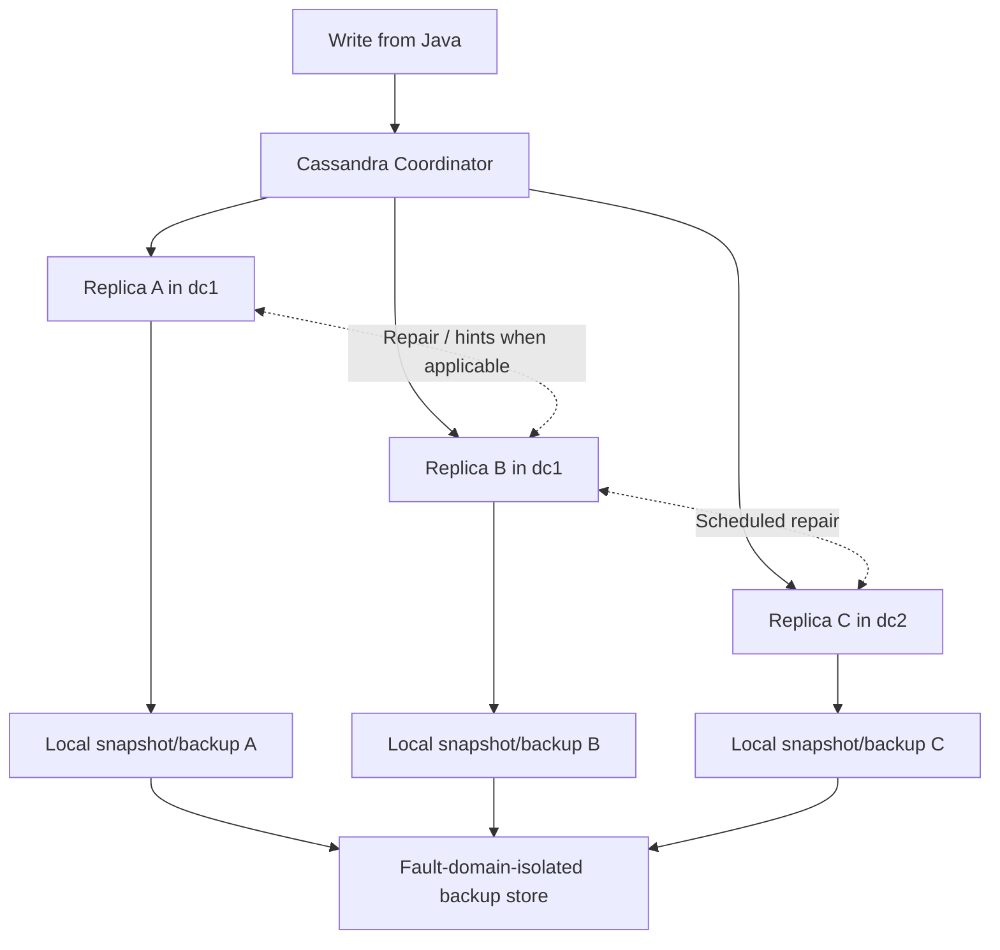
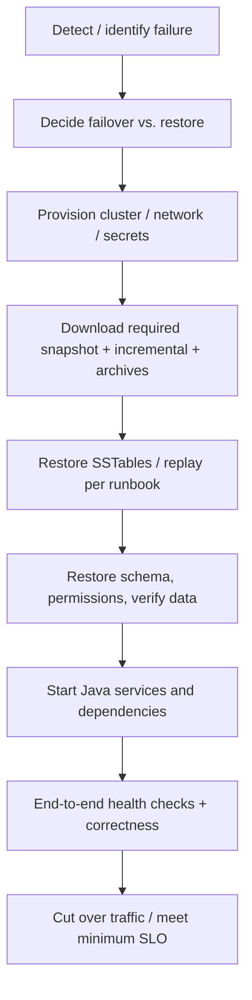

# Identifying Data to Protect and RPO/RTO Requirements

## 1. Start from the Business, Not from the Snapshot Command

In Apache Cassandra, a partition is selected by its **partition key**, assigned a token, and replicated to its **natural replicas** according to the replication strategy and replication factor (RF). Writing to the commitlog, memtable, and SSTables allows Cassandra to serve CQL with tunable durability and consistency. However, **replication is not a backup**: a mistaken `DELETE` statement, an application bug overwriting data, a full DC outage, or a compromised administrative account can affect multiple replicas simultaneously.

The first question of **backup and recovery** is not "at what hour should we run `nodetool snapshot`?" but rather:

1. **What information must be protected**, which application owns it, which keyspace/table stores it, and what dependencies exist outside Cassandra?
2. **How much data can maximally be lost** between the time of an incident and the recoverable point? That is the **Recovery Point Objective (RPO)**.
3. **How long may the service be disrupted** until it meets the agreed operational level? That is the **Recovery Time Objective (RTO)**.
4. For a specific incident, must we restore **one table, one tenant, one node, one DC, or the entire system**?
5. What evidence proves that backups, restore tooling, and dependencies actually achieve the RPO/RTO?

This lesson belongs to the **Backup and Recovery** chapter of the `DATABASE_ENGINE_WIDE_COLUMN_CASSANDRA` module. Its scope connects the wide-column model, partition keys, query-driven table design, read/write consistency, CQL, replication, compaction, repair, failure handling, and the Java Driver to establish a **measurable recovery contract**.

**Learning outcomes:** build an inventory of data requiring protection, classify priority tiers, calculate RPO/RTO across scenarios, select an appropriate recovery-copy retention approach, and plan **restore drills + business data verification**.

## 2. RPO and RTO Are Two Independent Axes

### RPO — How Far Back Can We Go?

**Recovery Point Objective** is the **maximum time-measured data loss acceptable to the business** in a disaster scenario. If the target RPO is 15 minutes, the business accepts the possibility of having to restore to a point no older than roughly 15 minutes before the incident, according to the agreed scope and data definitions.

A simple calculation when recovering from the latest checkpoint:

\[
\mathrm{Data\ loss\ window} =
t_{\mathrm{incident}} - t_{\mathrm{latest\ recoverable}}
\]

**Hypothetical** example: data is corrupted at **14:00 UTC**, and the verified recoverable checkpoint is **13:42 UTC**. The potential data loss window is **18 minutes**. An RPO ≤ 15 minutes policy is **not met**, even if a backup was created successfully at 13:55 but failed to upload all files or cannot be restored.

**Note:** the "recoverable point" does not automatically equal the time `nodetool snapshot` was invoked. You must account for SSTables and unflushed mutations, whether incremental backups have been transferred, whether commitlog archives are complete, cross-table consistency, and drill results.

### RTO — How Long Until the Service Is Restored?

**Recovery Time Objective** is the disruption time limit acceptable to the business **until a defined service level is restored**. "Back in service" must be explicitly pinned down as:

- Able to read a critical table at `LOCAL_QUORUM`?
- Orders validated and new writes accepted?
- APIs, message consumers, background jobs, and payment flows all running?
- Meeting what minimum p95/p99 latency, error rate, and throughput?

**Hypothetical** example: an incident occurs at **14:00 UTC**, and the API only passes full health checks, contractual read/write behavior, and minimum traffic at **15:10 UTC**. The measured actual RTO is **70 minutes**; if the target RTO is ≤ 60 minutes, it is **not met**, even if the restored data has zero missing records.

### Comparison Table

| Criterion | RPO | RTO |
| --- | --- | --- |
| Question answered | "How much recent data can be lost?" | "How long can the application be disrupted?" |
| Unit | Time/age of the recovery point | Time elapsed from the incident or defined detection time |
| Direct dependencies | Capture interval, flush, replication/copying, commitlog archive, consistency, and restorability | Incident detection, decision-making, standby infrastructure, copy/restore speed, startup, testing, traffic cutover |
| Proven by RF alone? | **No** | **No** |
| How to verify | Simulate data loss and identify the last transaction that can be read accurately | Time an end-to-end recovery drill up to the service-readiness criteria |

**RPO = 0** is a very strong requirement regarding the preservation of all acknowledged writes within the disaster scope—it is **not** a default consequence of RF = 3 or `LOCAL_QUORUM`. **RTO = 0** is close to a zero-downtime requirement or continuously fault-tolerant architecture, completely different from "having a recent snapshot."

## 3. Incident Scenarios Determine the Scope of Protection

An RPO/RTO contract must specify **failure scenarios**, rather than writing a generic "15-minute RPO, 1-hour RTO" for every situation.

| Scenario | What is lost or corrupted? | Recovery mechanisms likely needed | Why replicas alone are insufficient |
| --- | --- | --- | --- |
| Hardware failure of one replica/node | One node stops serving; local data may be lost | Failover to surviving replicas, replace/rebuild, repair | Other replicas can help, but do not guarantee every past write reached enough replicas |
| Outage of one rack or an entire DC | One fault domain loses access | Application/driver rerouting, standby DC, resynchronization upon return | RPO for locally ACKed data cannot be inferred from RF in the other DC |
| Accidental `DELETE`/`TRUNCATE` on a table | Data is deleted via CQL across multiple replicas | Backup/snapshot prior to the deletion timestamp, restore testing | Replication propagates intentional deletion operations |
| Application overwrites with bad data | Syntactically valid values that are business-incorrect | Point-in-time recovery or authoritative business source/events | Replicas can all agree on the wrong value |
| Ransomware / compromised admin account | Both live data and backups in the same domain can be destroyed | Copies outside the fault domain, immutable/offline storage, separate accounts/keys | Hard-link snapshots on the same disk do not protect against sabotage/compromise |
| Corrupted SSTable/volume or failed compaction | Some local files become unreadable | Restore from healthy replicas or valid SSTable backups | If multiple replicas suffer the same bug or simultaneous loss, an independent backup is required |
| Bad schema, migration, or new code | Wrong table/UDT/index or application mapping | DDL/schema versioning, compatible backup, migration rollback | A single SSTable does not contain all system code/config/identity |
| Inconsistent data between two denormalized tables | The same business event is written inconsistently across two tables | Reconciliation by event ID, ordered backfill, business source replay | Cassandra does not provide transactions across arbitrary partitions |

**Each scenario has a different RTO.** When only one node fails while RF/CL remain satisfied, the API can keep serving without an immediate SSTable restore. However, a data-deletion bug that propagates to all replicas can require rolling back data and performing business reconciliation that takes much longer.

## 4. Inventory of Data Requiring Protection

Cassandra commonly stores **multiple denormalized tables for a single business entity**. Therefore, an inventory listing only an "orders" table may miss customer-query projection tables, processing-state tables, idempotency support tables, and recovery metadata.

### 4.1. Four Mandatory Data Groups to Audit

| Group | Examples in a Java + Cassandra system | What must be protected and verified |
| --- | --- | --- |
| **Non-reconstructible business data** | Orders, payments, entitlements, reconciliation ledgers, confirmed transactions | Every keyspace/table holding authoritative data, values, keys, versions, TTLs, deletion markers; cross-checking business sources |
| **Conditionally reconstructible data** | Query projection tables, materialized views (if any), caches, summary/stats tables | Which data source is used to rebuild, rebuild duration, event replay, dependencies, and cost |
| **Metadata / Cassandra runtime** | Schema DDL, replication, table settings, UDTs, indexes, roles/permissions, snitch/DC config, version | IaC, exports, snapshot metadata, version-specific restore strategy, access permissions, and consistency |
| **Dependencies outside Cassandra** | Java service config, secrets/KMS, DNS/load balancer, queues/event logs, object storage, container images | End-to-end service bring-up capability; recovering Cassandra data is insufficient if these parts are lost |

**Do not blindly copy every file of a Cassandra node as a "logical backup."** Host IDs, system metadata, commitlogs, tokens, SSTables, and configurations have distinct semantics; restoring the raw data directory to another node or cluster can cause identity or topology conflicts. Clearly separate what must be **recreated via IaC** from what must be **restored from SSTables/commitlogs** according to version-specific runbooks.

### 4.2. One Order May Live in Multiple Tables

For example, a system uses `orders_by_id` as the primary read source by ID and `orders_by_customer` as a projection for the listing page:

```sql
CREATE TABLE recovery_lab_ks.orders_by_id (
    order_id uuid PRIMARY KEY,
    customer_id text,
    status text,
    total decimal,
    updated_at timestamp
);

CREATE TABLE recovery_lab_ks.orders_by_customer (
    customer_id text,
    order_created_at timestamp,
    order_id uuid,
    status text,
    total decimal,
    PRIMARY KEY ((customer_id), order_created_at, order_id)
) WITH CLUSTERING ORDER BY (order_created_at DESC, order_id DESC);
```

In practice, both tables are typically updated from the same business event. If `orders_by_id` is restored to 13:45 while `orders_by_customer` is restored to 13:30, an order may exist in the first table but be missing from the second. **The RPO of an "order" must be defined at the business level**, including how to reconcile projections that do not share an identical point-in-time snapshot.

When classifying, ask:

1. Which table is the **source of truth**, and which table is a rebuildable read model?
2. Do writes/deletes/TTLs flow through a queue, event log, or another service?
3. Does losing one record cause financial/legal consequences or only display lag?
4. Can it be fully rebuilt from retained event logs, or must the event logs themselves also be backed up?
5. Is old data subject to **regulatory deletion**? A restore must not accidentally resurrect information that had to be deleted.

## 5. Priority Classification and Assigning RPO/RTO by Group

Below is a **hypothetical policy matrix** example, not a default recommendation:

| Dataset / Flow | Priority Tier | Target RPO | Target RTO | Decisions to Align On |
| --- | --- | --- | --- | --- |
| Confirmed order state, idempotency keys | P0 | ≤ 5 minutes | ≤ 30 minutes | Is losing confirmed orders acceptable? Is there an independent event log/reconciliation ledger? |
| Catalog/pricing with an external authoritative source | P1 | ≤ 30 minutes | ≤ 2 hours | Can it be resynced from the source? How long does a full load take? |
| Queryable activity history | P2 | ≤ 4 hours | ≤ 8 hours | Is it acceptable to temporarily disable the history API or serve read-only? |
| Dashboard aggregates rebuilt from events | P3 | ≤ 24 hours | ≤ 24 hours | How much CPU/time does rebuilding take, and does it impact source tables? |

Targets must be **approved by business owners**, not chosen unilaterally by DBAs based on backup cost. For P0, if "losing 5 minutes" causes unacceptable damage, you must revise the target or design additional write/replication/recovery sources—**not merely increase snapshot frequency and assume compliance**.

### Inventory Sheet Template

```text
Business capability: order-confirmation
Owner/approver: <responsible role, do not put secrets in the template>
Keyspaces/tables: recovery_lab_ks.orders_by_id, orders_by_customer
Primary key/query pattern: order_id; (customer_id), created_at
Source of truth: orders_by_id + authoritative event stream (if any)
Dependent systems: queue, order API, IAM/KMS, object storage, DNS
Data classification: restricted/internal; PII? [yes/no]
Lifecycle: TTL? retention? legal hold? deletion obligations?
Failure scenarios: wrong DELETE / lost DC / ransomware / corrupted table
Required RPO: <minutes> by scenario
Required RTO: <minutes> by recovery service state
Recovery point mechanism: snapshot + incremental SSTables + optional commitlog archive
Location/copy isolation: <offsite, region, account, immutable policy>
Restore unit: keyspace / table / tenant / cluster
Validation: business IDs, row counts, point-in-time cutoff, CL, API checks
Owner of restore runbook: <role>
Last successful restore test and actual RPO/RTO: <UTC>
```

This is a recovery management document, **not** a place to paste operational secrets into knowledge files. In real deployments, store the sheet in an access-controlled location and update it whenever schema migrations, new tables, or RF/DC changes occur.

## 6. Replication, Consistency, and Repair Do Not Replace Backups

### Same Partition, Different Protections



**Replication** maintains multiple *live* copies. It helps sustain availability when a node goes down and aids replica recovery, but it also propagates deletions and bad values. **Anti-entropy repair** reconciles replicas; it **does not preserve business version history** and cannot undo a syntactically valid `DELETE`.

**Consistency level** is the request acknowledgment condition at call time, not a backup specification. For example, with `NetworkTopologyStrategy {'dc1':3,'dc2':3}`, a `LOCAL_QUORUM` write in `dc1` only requires ACKs from a quorum in `dc1`. It **does not guarantee** that the mutation reached `dc2` before `dc1` was lost. Therefore, you cannot claim "multi-DC RPO = 0" merely from having RF across both DCs.

**Independent snapshots/backups** provide a historical recovery point if live data is deleted or corrupted. To guard against shared fault domains, backups must be moved off the at-risk node/volume/credentials/region, with permissions and decryption capability verified. An SSTable hard-link sitting on the same disk as the source is **not yet an isolated disaster recovery copy**.

### Distinguishing RPO by Scenario

| Design | Single Node Failure | Entire DC Loss | Replicated Accidental Deletion |
| --- | --- | --- | --- |
| RF3 in one DC | Can continue if enough replicas/CL remain | No other DC; requires out-of-DC recovery | Replicas can all be deleted |
| RF3 in each of two DCs + `LOCAL_QUORUM` | Good local availability under conditions | Surviving DC can serve, but recent writes in the lost DC may not have arrived | Deletions can still propagate to both DCs |
| Off-domain backup present | Provides a restore option if replicas are insufficient | Can reconstruct data when a DC is lost, depending on retrieval speed | Can roll back to a point before the bad operation |
| Verified backup + commitlog archiving | Can narrow the mutation loss window if PITR is needed | Depends on fault-domain-isolated archives and recovery procedures | Can choose a point prior to the deletion; valid subsequent writes must be handled |

**Do not assign a uniform RPO/RTO to all failures.** Failing over reads to a surviving DC may be fast but does not roll back a business bug; restoring from backup preserves older state better but takes significantly longer.

## 7. Cassandra Backup Mechanisms and Their RPO Implications

Cassandra stores flushed data in **immutable SSTables**. According to Cassandra documentation, there are two common SSTable-based backup methods: **snapshots** and **incremental backups**. If point-in-time recovery is required, a configured and tested **commitlog archiving/replay** mechanism may also be needed.

| Mechanism | What it contains | Limitations that must be stated in the RPO contract |
| --- | --- | --- |
| **`nodetool snapshot`** | Hard links to SSTables on the **invoked node** at snapshot time; typically includes table metadata/DDL | A node-local snapshot is **not** an off-domain backup; not an atomic cluster-wide/multi-table transaction snapshot |
| **Incremental SSTable backup** | Links to SSTables upon flush/stream on the node, placed in `backups/` when enabled | Does **not** automatically capture mutations only in memtable/commitlog; must be copied and retention-managed |
| **Commitlog archiving** | Commitlog segments archived via optional configuration | Must verify archive lag, completeness, replay/version compatibility, and timestamps; **not enabled by default** |
| **Schema/config backup** | DDL, UDTs/indexes, replication settings, IaC, version, auth, certificates/keys | Must not rely solely on a set of SSTables; must be able to recreate topology and permissions |
| **Event log / source-of-truth backup** | Business events or replayable sources | Must preserve retention/cursors/offsets and idempotency; Cassandra backups do not contain external data |

### 7.1. A Snapshot Is Not an Off-Node Backup

In normal mode, `nodetool snapshot` creates **hard links** to SSTable files; SSTables do not immediately duplicate bytes when the link is created, but hard links can **prevent disk space from being reclaimed** when original SSTables are compacted or deleted. Snapshots can also include `schema.cql` for DDL reference.

```bash
# Check version-specific syntax on a LAB node:
nodetool help snapshot
nodetool help listsnapshots

# Run only in lab / with authorization:
nodetool snapshot --tag rpo-lab-20261121 recovery_lab_ks

# Verify the newly created snapshot on the target node:
nodetool listsnapshots
```

**The command operates on the specified node**, and does not automatically produce a **cluster-wide snapshot with a consistent time boundary**. A coordinated per-node backup schedule/policy and token-range/replica coverage are required to cover the entire dataset.

If the `--skip-flush` option is used (on supported versions), the snapshot may **omit unflushed mutations**; never infer RPO from the command timestamp while ignoring this option. Cross-check the exact documentation for the running binary.

### 7.2. Incremental Backup Does Not Mean "Every Commitlog Write Is Protected"

In supported versions, enabling `incremental_backups: true` or running `nodetool enablebackup` causes the node to create hard links for SSTables **when they are flushed or streamed**. Those files still reside on the same local disk; you need a **pipeline to copy them to the backup store**, verify manifests/checksums, record owner/range metadata, and manage retention cleanup.

```bash
# Check status only; do not toggle backup settings in production without approval:
nodetool help statusbackup
nodetool statusbackup
nodetool help enablebackup
nodetool help disablebackup
```

Because flush time is not the moment every write is acknowledged, **uploading incremental backups every 5 minutes is insufficient to guarantee a 5-minute RPO**. You must measure mutations not yet captured in SSTables, commitlog archive lag, and recoverability after a real failure.

### 7.3. Commitlog Archiving and Point-in-Time Recovery (PITR)

Some Cassandra versions provide `commitlog-archiving.properties` with fields such as `archive_command`, `restore_command`, `restore_directories`, `restore_point_in_time`, and `precision`. This feature is **optional**; you must test segment archiving, ensure segments reach durable storage, and verify ordering/format during replay.

```text
Conceptual pipeline example (not an executable script):
  Verified SSTable snapshot
       + matching incremental SSTables
       + complete set of commitlog archives
       + matching schema and version
       -> restore into an isolated environment
       -> verify timestamp cutoff, rows, and event IDs
       -> cut over application to verified data
```

**PITR is not a one-click switch that automatically achieves RPO = 0.** Commitlog segments may not yet have been archived off the node when a failure hits, checkpoints and client-supplied timestamps affect semantics, and multi-table/multi-partition restores do not equal an atomic business transaction. Replay also carries version compatibility, SSTable copy, and write-pause requirements; follow only a rehearsed runbook.

## 8. Data That Cannot Be Restored by SSTables Alone

A "successful" file-level restore can still be a **business failure** if these components are forgotten:

| Component | Impact if lost | Management solution |
| --- | --- | --- |
| Schema / UDTs / indexes / table settings | Cannot read SSTables or queries change semantics | Versioned CQL DDL, migration repository, per-release schema backups |
| Cassandra version / SSTable compatibility | Files unreadable or refresh/loader procedures fail | Version inventory, test restores against matching binaries |
| Keyspace RF, snitch, DC/rack, and token map | Replica placement mismatch or missing data after restore | IaC/topology manifest, dedicated bootstrap/streaming plan |
| Roles/permissions and service credentials | Application cannot authenticate or has wrong privileges | Secure config store, recreation/rotation procedures, KMS |
| TLS certificates / encryption keys | Cannot connect, cannot decrypt backups or encrypted data | Role-restricted key escrow, KMS DR procedures, rotation |
| Java config, connection strings, local DC, CL | Application routes to wrong region or errors even though DB recovered | IaC, secrets, config, and integration tests |
| Kafka / outbox / CDC / external workflows | Missed or duplicated tasks after the restore point | Event offset checkpoints, idempotency, ordered replay |
| Object storage / attachments | Metadata table points to missing files | Coordinated backup policies and referential consistency |
| Legal deletion / retention catalog | Restore resurrects records required to be deleted | Reapply deletion lists, post-restore verification policy |

**Auth and system keyspaces are special:** do not assume copying all of `system/*` from an old cluster to a new cluster is safe. Internal metadata can be tightly bound to host IDs, tokens, cluster state, and version. What must be recreated should be decided with DBAs/security, rather than using "back up the entire data directory" as a blanket recovery instruction.

## 9. Working Backward from Target RPO to Backup Schedule

Suppose the business owner requires **RPO ≤ 15 minutes**. A 24-hour snapshot schedule is clearly **insufficient if it is the only recovery point**. Even a 15-minute snapshot schedule is insufficient if creation, copying, and verification take an additional 10 minutes and the latest copy might be corrupted.

Let:

- \(I\): interval between opportunities to capture a recoverable data point.
- \(L\): worst-case latency from data capture until the copy resides in a **location surviving the failure scenario**.
- \(G\): gaps/incompleteness from flushes, commitlog, and unprotected dependencies.
- \(M\): margin for missed/delayed schedules and uncertainty.

A **conservative design budget** approach:

\[
\mathrm{Budget\ RPO} \gtrsim I + L + G + M
\]

This is a **mental framework**, not a Cassandra RPO guarantee formula: components may overlap, failures may be correlated, and captures lack transactional boundaries; the true figure must be **measured through restores and data checks**.

Illustrative example:

| Component | Hypothetical Value |
| --- | ---: |
| Capture / recoverable checkpoint interval \(I\) | 5 minutes |
| Copy latency to DR store \(L\) | 3 minutes |
| Other unprotected gap \(G\) | 2 minutes |
| Margin for schedule failures/disruptions \(M\) | 3 minutes |
| Projected total budget | 13 minutes |

A 13-minute budget is **not yet a promise of RPO ≤ 15 minutes**. The more important condition is proving through testing that *all protected data has a recovery point no older than 15 minutes across the designed failure scenarios*, including cases where an upload batch or an archive segment is delayed or lost.

### Questioning Client Acknowledgments

If a Java service writes an order and returns "confirmed" after `LOCAL_QUORUM`, then during a disaster the business wants to protect **the ACKs returned to clients**, not merely flushed SSTables. RPO must be measured against the **last ACKed and recoverable transaction/event ID**, cross-referenced with the timestamp the client recorded success. Do not use file modification time as the sole proxy.

## 10. Decomposing RTO into Timed Steps

A full service recovery generally has a critical path:



To set a time budget:

| Phase | Hypothetical example (minutes) | Delay risks |
| --- | ---: | --- |
| Detect + triage | 5 | No scope-identifying alerts |
| Decision / approval | 10 | Unclear incident commander or acceptable data loss |
| Provision infrastructure/identity | 20 | Missing quotas or KMS in the DR region |
| Fetch data from backup store | 25 | Low bandwidth, missing file manifests, egress limits |
| Restore / replay | 40 | SSTable/commitlog issues, incompatible version, insufficient node disk |
| Data checks + API startup + traffic cutover | 20 | Schema, config, dependent services, read-only mode |
| **Hypothetical sequential total** | **120** | Can be shortened if valid steps run in parallel |

Do not assume "actual RTO = 120 minutes"; you must **measure an end-to-end drill** with realistic data volume and throughput. Parallelized steps take the duration of the **dependency critical path**, not simply the sum of all tasks. The RTO of a read-only API may differ from the RTO of full write recovery, event processing, and reconciliation.

### Estimating Data Transfer Time Is Necessary but Not Sufficient

Suppose you need to pull **2 TiB** of backups at a steady usable bandwidth of **200 MiB/s**. The minimum transfer time alone is approximately:

\[
\frac{2 \times 1024 \times 1024\ \mathrm{MiB}}{200\ \mathrm{MiB/s}}
\approx 10.486\ \mathrm{s} \approx 175\ \mathrm{minutes}
\]

This figure **excludes** cluster provisioning, decompression I/O, SSTable loading, replay, repair, application checks, and operational overhead. If the target RTO is 60 minutes, download time alone far exceeds the target: you need **hot/warm standby infrastructure, copies placed near the recovery region, or a different DR architecture**, rather than trying to fix it by running more backup cron jobs.

## 11. Selecting a Recovery Tier Matching Your RTO

| Preparation Model | Strengths | Limitations |
| --- | --- | --- |
| **Cold recovery** from out-of-region backups | Lower ongoing running cost | Provisioning, transfer, and restore take long; short RTO is very difficult |
| **Warm standby** (pre-built infra, data/backups near region) | Reduces provisioning, can shorten critical path | Higher cost; must verify data freshness and app startup readiness |
| **Active multi-DC** with replicas and apps in standby region | Enables fast traffic rerouting when a DC is unreachable | Does not replace backups/PITR for propagated deletions; `LOCAL_QUORUM` writes do not guarantee cross-DC RPO=0 |
| **Backup with PITR + business replay** | Enables rolling back before a bad timestamp and reapplying valid transactions | Complex regarding timestamps, event sources, idempotency, and multi-table verification |

Sometimes the best approach is **tiered recovery**:

1. P0: open read-only order status from the surviving DC if data freshness is acceptable.
2. P1: accept new writes once writers/CL are verified and indeterminate-outcome requests are handled.
3. P2: backfill projections, historical data, and reporting jobs afterward.

However, **do not report RTO as met** if the business defines "restored" as including writes and P0 features while only a read-only status page is online.

## 12. Planning Backups by Cassandra Scope

### 12.1. Node-Local Snapshots Are Not a Cluster-Wide Recovery Point

`nodetool snapshot` operates on the **target node**. A cluster with multiple nodes, keyspaces, and DCs needs an **inventory of token ranges, nodes/replicas, tables, and timestamps** to know whether available backups suffice to recover the target dataset. Snapshotting node A at 10:00 and node B at 10:20 **does not create a simultaneous cluster-wide transactional snapshot**.

When building a manifest, record:

```text
Backup set ID: dr-set-20261121-a
Cassandra version / partitioner / table IDs / schema version:
Cluster / dc / rack / node host ID:
Keyspace / table / RF:
Snapshot tag / node-local creation time:
Included SSTable components and checksums:
Incremental SSTable files, time interval covered:
Commitlog archive coverage/checkpoints (if used):
Storage URI, encryption key reference, retention/immutability:
Upload verified at UTC:
Recoverable point validated at UTC:
Last restore drill / restored business ID range:
```

**A backup with all bytes intact but missing metadata** can cost a DR team hours guessing which SSTables belong to which table/token range, which schema version applies, and whether the backup actually reached offsite storage.

### 12.2. Schedule and Retention

Questions policy must answer:

- How often are snapshots taken, how many versions are kept, and how long are incremental SSTables/commitlogs retained?
- Does the data have TTLs, tombstones, or legal deletion obligations?
- Across **how many independent fault domains** (node, rack, DC, account/cloud region, offline) do backups reside, and are they protected against modification/deletion?
- Is there a recovery point **prior to** a logic bug discovered days late?
- Who has permission to delete snapshots/backups? Are delete permissions separated from production write permissions?
- Do restore keys/credentials still work after an incident wipes out the primary KMS/IAM?

A tight RPO may require periodic snapshots + incrementals + commitlog archives, but **retention hours cannot be derived from RPO**: RPO dictates how much recent data can be lost, whereas retention determines **how far back in time** you can recover to fix a delayed-discovery bug.

### 12.3. Deleted Data and Tombstones

Cassandra represents deletions using **tombstones** with SSTable cleanup tied to the `gc_grace_seconds` protection window. Restoring an old backup can **resurrect deleted rows** if restore/replay ordering and deletion requirements are not properly enforced. When recovering a node that has been out of sync for a long time, you must also consider zombie data and repair coverage.

Do not lower `gc_grace_seconds` merely to save backup disk space. Deletion policies, outage duration, repair schedules, and retention are distinct constraints and must be evaluated together.

## 13. Lab: Translating Requirements into a Backup Plan

### 13.1. Create a Test Dataset Keyspace

Use only a **lab cluster** with enough nodes for the RF in `dc1`; do not run the DDL below in production:

```sql
CREATE KEYSPACE recovery_lab_ks
WITH replication = {'class': 'NetworkTopologyStrategy', 'dc1': 3}
AND durable_writes = true;

CREATE TABLE recovery_lab_ks.orders_by_id (
    order_id uuid PRIMARY KEY,
    customer_id text,
    status text,
    total decimal,
    updated_at timestamp
);

CREATE TABLE recovery_lab_ks.orders_by_customer (
    customer_id text,
    order_created_at timestamp,
    order_id uuid,
    status text,
    total decimal,
    PRIMARY KEY ((customer_id), order_created_at, order_id)
) WITH CLUSTERING ORDER BY (order_created_at DESC, order_id DESC);

INSERT INTO recovery_lab_ks.orders_by_id
    (order_id, customer_id, status, total, updated_at)
VALUES (
    11111111-2222-4333-8444-555555555555,
    'synthetic-customer-1', 'CREATED', 125.50,
    '2026-11-21T08:30:00+0000'
);

INSERT INTO recovery_lab_ks.orders_by_customer
    (customer_id, order_created_at, order_id, status, total)
VALUES (
    'synthetic-customer-1', '2026-11-21T08:30:00+0000',
    11111111-2222-4333-8444-555555555555,
    'CREATED', 125.50
);
```

This synthetic dataset illustrates **one order written across two query-driven tables**. Separate INSERT statements **do not form an atomic transaction across two arbitrary partitions**; when recovering from a failure between the two writes, you must reconcile by `order_id` or the business event source.

### 13.2. Record Protected Data and Inspect Schema

```sql
SELECT keyspace_name, replication
FROM system_schema.keyspaces
WHERE keyspace_name = 'recovery_lab_ks';

SELECT table_name, gc_grace_seconds
FROM system_schema.tables
WHERE keyspace_name = 'recovery_lab_ks';

SELECT order_id, customer_id, status, total
FROM recovery_lab_ks.orders_by_id
WHERE order_id = 11111111-2222-4333-8444-555555555555;

SELECT order_created_at, order_id, status, total
FROM recovery_lab_ks.orders_by_customer
WHERE customer_id = 'synthetic-customer-1';
```

Record **both key sets**, row counts, and expected results—do not treat row counts alone as sufficient business proof. Classify `customer_id` as a potentially sensitive identifier, which is why the lab uses synthetic data; avoid pasting real customer IDs into tickets.

### 13.3. Inspect Backups on the Lab Node

```bash
nodetool version
nodetool status recovery_lab_ks
nodetool help snapshot
nodetool help listsnapshots
nodetool listsnapshots
nodetool statusbackup

# Execute only in lab or under an approved backup plan:
nodetool snapshot --tag dr-lab-check-20261121 recovery_lab_ks
nodetool listsnapshots
```

Record snapshot start/end timestamps, tag, node, file count, size, and whether the data has been **copied to an independent store**. If it has not been copied, the lab only proves local hard-link creation—it does **not** prove meeting RPO when the entire node/volume is destroyed.

### 13.4. Analytical Recovery Exercise (No Destructive Deletions)

Suppose:

- 09:00: snapshot and metadata are uploaded and checksum-verified.
- 09:10: a valid incremental backup is transferred to the DR store.
- 09:18: the client acknowledges updating `order_id = ...` to `PAID`.
- 09:25: a logic bug deletes some data in both tables.
- 09:28: the incident is detected.

Determine:

1. If you only restore the **09:00** snapshot, how long is the data loss window up to 09:25? Is the `PAID` event at 09:18 preserved?
2. If incremental SSTables were transferred up to 09:10 but there is **no** commitlog archive/replay, can you guarantee keeping the 09:18 write? Why?
3. If archives allow recovering up to **09:24**, to what extent can valid writes before 09:24 be protected? What ordering, timestamps, and tables must be verified?
4. Do writers need to be paused / the 09:25 deletion excluded from replay? How should business reconciliation avoid dropping valid transactions after the restore point?
5. If restoring 2 TiB remotely takes over 2 hours, is a 60-minute RTO target feasible with the current design?

Do not drop real tables or force commitlog replay in production for this exercise. Destructive restore practice should be run **on an isolated cluster with its own snapshots and an approved procedure**—never mistake `TRUNCATE`/`DROP` for a "harmless simulation."

## 14. Java Driver: Application-Level Acceptance Criteria

**Recovering SSTables** is not enough: the Java application must read/write the right data by partition key, CL, and local DC. Example of a safe business verification check on a recovered lab cluster:

```java
PreparedStatement byId = session.prepare(
    "SELECT customer_id, status, total FROM recovery_lab_ks.orders_by_id " +
    "WHERE order_id = ?"
);

BoundStatement request = byId.bind(
    UUID.fromString("11111111-2222-4333-8444-555555555555")
).setConsistencyLevel(DefaultConsistencyLevel.LOCAL_QUORUM);

long startedNs = System.nanoTime();
Row row = session.execute(request).one();
double elapsedMs = (System.nanoTime() - startedNs) / 1_000_000.0;

if (row == null || !"CREATED".equals(row.getString("status"))) {
    throw new IllegalStateException("Missing or unexpected recovered order");
}
System.out.printf("restoreSmokeTest=PASS elapsedMs=%.2f%n", elapsedMs);
```

This snippet assumes `session` is connected, with Java Driver 4.x and `java.util.UUID` imported; the ID/status pair here is a **fixture**. In a restore to 09:24 from the earlier scenario, the expected status could be `PAID` rather than `CREATED`; **test assertions must be based on the target recovery point and a verified event ledger**.

Required verification categories:

- **Correctness:** protected IDs/values list, per-table row counts, business consistency across denormalized tables, ensuring legally deleted data does not reappear.
- **Consistency/availability:** test with the committed CL, RF, and actual topology—do not downgrade from `LOCAL_QUORUM` to `ONE` just to make a test pass.
- **Client routing:** correct local DC, contact points, auth/TLS, prepared statements, page size, and retries.
- **Performance:** p95/p99 latency, timeouts, minimum throughput, and capacity in the recovered state—do not judge from a single request.
- **Idempotency:** retrying actions with unknown outcomes must use the same business ID to avoid creating duplicate orders/transactions.

## 15. Runbook for Defining and Verifying RPO/RTO Requirements

### Step 1 — Map Data and Recovery Points

Interview business owners to identify keyspaces/tables, partition keys, read models, event logs, dependencies, and data classifications. Document scenarios for accidental deletion, single-node failure, DC loss, and credential loss. Identify **non-reconstructible source data**.

### Step 2 — Lock In a Measurable Contract

For example: "In a DC-loss failover, ACKed order-state data in the primary DC is recovered to a point at most 5 minutes before the incident; the API resumes reads/writes at `LOCAL_QUORUM` within ≤ 30 minutes, with p99 under threshold X and errors under threshold Y." If the design cannot meet this, report a **GAP** instead of silently lowering the requirement.

### Step 3 — Choose Strategy and Verify Fault Domains

Decide on active multi-DC, warm/cold standby, snapshots, incremental SSTables, commitlog archiving, schema/IaC backups, and event sources. Ensure copies reside **outside the fault domain** and users with live-data deletion rights cannot by default delete all backups.

### Step 4 — Verify Backup Creation and Transfer

Verify backup job completion **alongside checksums/manifests, retention, encryption, key access, and offsite verification**. Never mark a backup successful just because `nodetool snapshot` exited with code 0 when the upload failed. Track the elapsed time from an acknowledged write to when that data is actually recoverable.

### Step 5 — Rehearse Restore in an Isolated Environment

Pull an actual backup set from the **offsite store**, provision an environment matching version/DDL/keys, execute the restore using the tested runbook, replay if needed, and verify token/replica layout per plan. Do not arbitrarily copy `system/*` directories into a new cluster.

### Step 6 — Time Execution and Reconcile Data

Record simulated incident time, detection time, restore start, copy completion, data load completion, API open, and API meeting p99/error/throughput SLOs. Reconcile **ACKed order IDs**, states, deleted records, event offsets, and projection tables against the exact cutoff. Calculate **actual RPO and actual RTO**, recording the worst values across representative drills.

### Step 7 — Identify Gaps and Lock In Actions

If RPO > target, inspect capture/archive lag, flush gaps, missed schedules, and insufficient regional copies. If RTO > target, inspect the critical path such as provisioning, transfer, restore, secrets, and validation. Consider warm standby, nearby backup copies, runbook automation, and dependency reduction; any technical change must be re-measured.

### Step 8 — Sustain Recoverability

Re-drill whenever schema/volume grows, versions upgrade, DCs are added, KMS changes, new critical tables appear, or CL changes. Report based on **the latest drill results and recoverable backup age**, not just "daily backup jobs are green."

## 16. Common Pitfalls and Correct Answers

| Misconception | Correct Understanding |
| --- | --- |
| "RF = 3 so we don't need backups." | Replication helps survive some node failures, not accidental deletions across all replicas or shared-fault-domain disasters. |
| "Hourly snapshots mean RPO is exactly 1 hour." | You must account for upload/checksum lag, memtable/commitlog state, failed runs, and tested restore checkpoints. |
| "Enabling incremental backup keeps all writes from the last 5 minutes." | It is tied to SSTable flushes/streams and does not automatically protect unflushed mutations; you must measure and use appropriate mechanisms. |
| "Enabling commitlog archive automatically gives standard PITR." | Requires complete segments, replay configuration, version compatibility, timestamps, and end-to-end testing; nothing is automatic. |
| "A snapshot on node A is a cluster-wide backup." | It is node-local; you must ensure token range/replica/table coverage across nodes, DCs, and time. |
| "Database RTO equals application RTO." | No. It depends on auth/TLS, Java services, message brokers, APIs, traffic cutover, and data verification. |
| "We only need to restore `orders_by_id`." | Projections, idempotency tables, event logs, and other services may all be part of the business contract. |
| "One successful `SELECT` proves the restore worked." | One query checks one partition/CL; you must verify the full dataset, cross-table consistency, and performance. |
| "Backups on the same disk protect against ransomware." | Shared fault domains and delete permissions can destroy both live data and backups; separate permissions and offsite/immutable copies are needed. |
| "A 15-minute RPO means 15-minute retention." | RPO is acceptable loss of recent data; retention determines how far back you can go for late-discovered errors. |
| "Restoring old backups won't affect legally deleted data." | It can resurrect records that were supposed to be deleted; tombstone/deletion policies and reconciliation are required. |
| "A DC is lost, but dc2 is Up so dc1's latest writes must be in dc2." | `LOCAL_QUORUM` in dc1 does not wait for dc2 ACKs; actual data freshness/RPO must be evaluated. |

## 17. Exercises and Self-Check Questions

1. A system only has RF3 in a single DC. Give three scenarios where replication **does not** replace backups.
2. An incident occurs at 14:00, the last verified recoverable point is 13:42, and the API resumes at 15:10. Compute the data loss window and actual RTO; evaluate against targets of RPO 15 minutes / RTO 60 minutes.
3. If snapshots run every 15 minutes, uploads take 10 minutes, and a job can fail, can a 15-minute RPO be promised? What must be measured/tested?
4. When a `LOCAL_QUORUM` write succeeds in dc1, why might dc2 miss the latest mutation if dc1 fails immediately afterward?
5. Compare snapshot, incremental SSTable backup, and commitlog archiving: which covers data still in memtable/commitlog, and under what conditions?
6. Why does a snapshot on a single node not guarantee coverage for all token ranges when restoring an entire cluster?
7. `orders_by_id` and `orders_by_customer` were backed up at two different timestamps. What strategy ensures the same order ID does not diverge between the two tables after restore?
8. With a 60-minute RTO where merely downloading 2 TiB at an effective 200 MiB/s takes roughly 175 minutes, propose two architectural changes.
9. What artifacts besides SSTables are needed for a Java service to read/write properly after restore? Include decryption keys, DDL, local DC, and event offsets.
10. Why should RTO not be declared met as soon as a node shows `UN` while the API, auth, and business correctness have not passed?
11. If backup retention is 30 days and a customer requested data deletion, what risk must be handled when restoring a version from 20 days ago?
12. Draft an RPO/RTO sheet for a P0 dataset and describe a **recovery drill** that measures both criteria.

**Completion criteria:** learners can identify **which tables and dependencies actually hold data needing protection**, classify them by business impact, define scenario-based RPO/RTO, avoid confusing RF/repair with backups, choose an appropriate SSTable/commitlog/offsite strategy, and validate it with a **restore drill verifying both data and timing**.

## 18. References

- [Apache Cassandra — Backups](https://cassandra.apache.org/doc/stable/cassandra/managing/operating/backups.html): snapshots, incremental backups, hard links, SSTable metadata, and version-specific restore approaches.
- [Apache Cassandra — commitlog-archiving.properties](https://cassandra.apache.org/doc/stable/cassandra/managing/configuration/cass_cl_archive_file.html): archive/replay fields and point-in-time recovery settings.
- [Apache Cassandra — cassandra.yaml](https://cassandra.apache.org/doc/stable/cassandra/managing/configuration/cass_yaml_file.html): `incremental_backups`, `auto_snapshot`, and version-specific backup settings.
- [Apache Cassandra — Repair](https://cassandra.apache.org/doc/stable/cassandra/managing/operating/repair.html): anti-entropy and replica synchronization scope, distinct from historical recovery.
- [Apache Cassandra — nodetool snapshot](https://cassandra.apache.org/doc/stable/cassandra/managing/tools/nodetool/snapshot.html) and [listsnapshots](https://cassandra.apache.org/doc/stable/cassandra/managing/tools/nodetool/listsnapshots.html): creating and inspecting node snapshot points.
- [Apache Cassandra — Topology changes](https://cassandra.apache.org/doc/stable/cassandra/managing/operating/topo_changes.html): node bootstrap/rebuild/replace, DC/rack, and why membership recovery must not be equated with PITR.
- [Apache Cassandra Java Driver 4.x — Core](https://apache.github.io/cassandra-java-driver/4.18.0/core/): session, topology routing, and CL when verifying APIs after recovery.

**Conclusion:** Cassandra backup goals must start with **business data and RPO/RTO requirements**, not when a snapshot command runs. Replication and repair help live replicas converge, but they do not replace independent historical backups. To assert that a system is recoverable, you need **an inventory of keyspaces/tables/dependencies, fault-domain-isolated backups, verified recovery points, read/write checks at the right CL, and a timed drill from incident onset until the application meets its SLOs**.
