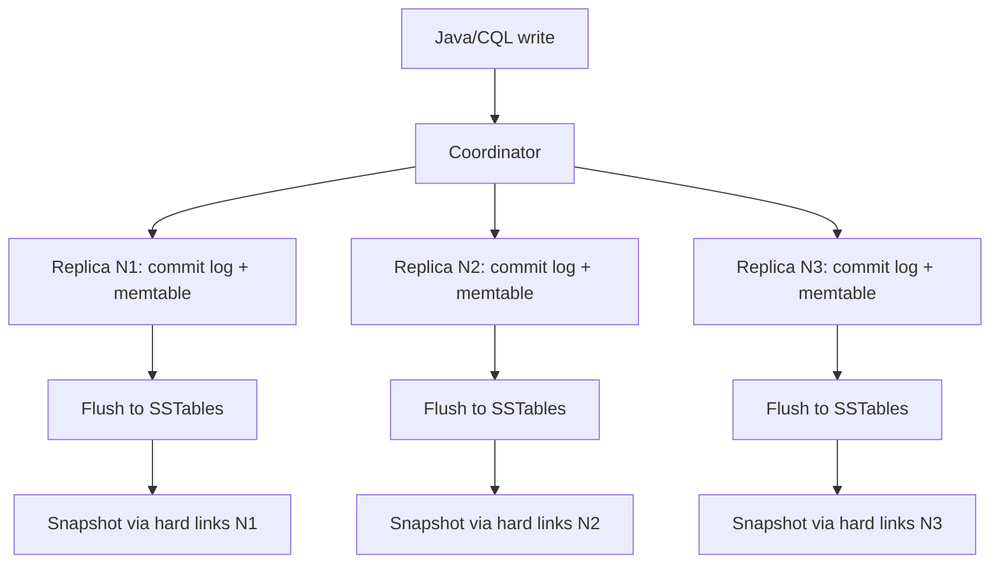
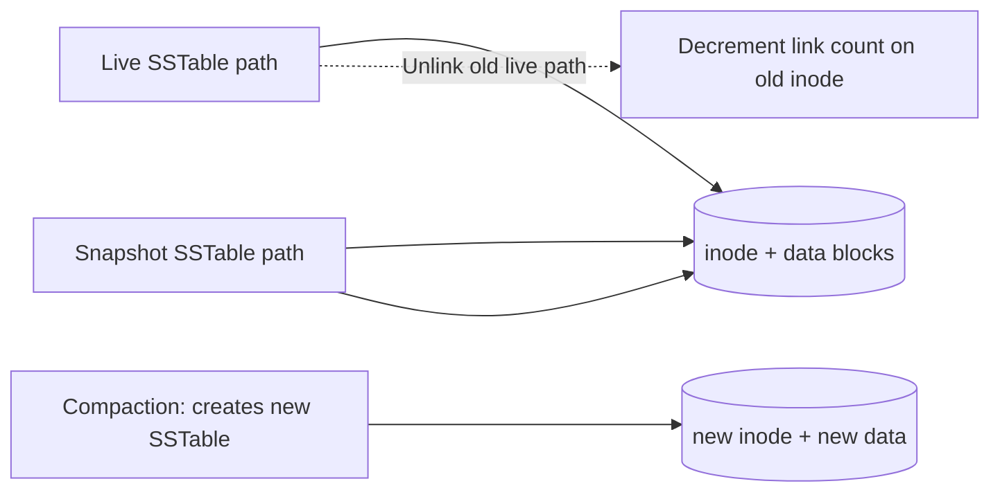
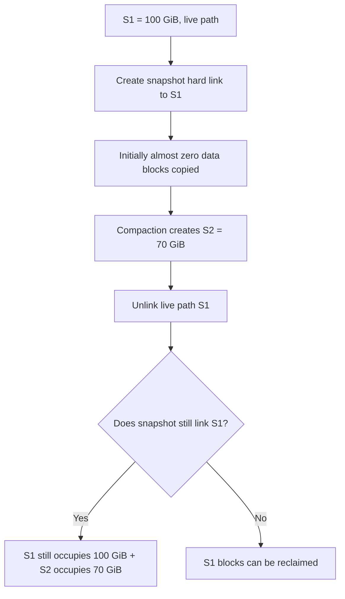
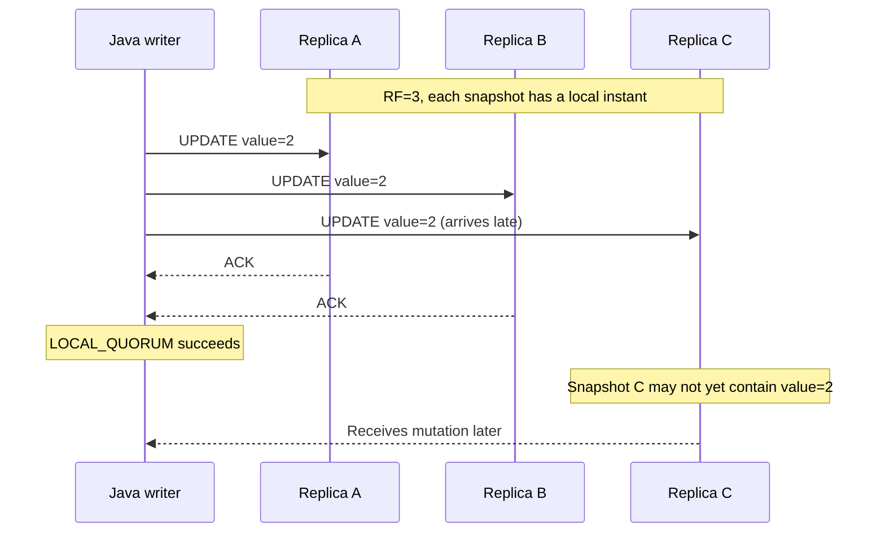

# SSTable Snapshots, Hard Links, and Accompanying Schema Data in Apache Cassandra

## 1. The Problem: Does a Successful Snapshot Mean You Have a Safe Backup?

An **Apache Cassandra** system operates three replicas per partition. Before a software upgrade, a DBA runs `nodetool snapshot` and sees a success message almost instantaneously even though the table holds hundreds of GiB. The next morning, a disk fails; the operations team discovers the snapshot was still sitting **on that very same disk**, never transferred to an independent storage store.

This is a classic misconception: **a Cassandra snapshot is a stable set of references to SSTable files on a node at a point in time, not automatically an off-node backup and not a cluster-wide consistent image**.

This lesson belongs to the **Backup and Recovery** chapter of the `DATABASE_ENGINE_WIDE_COLUMN_CASSANDRA` module, connecting distributed/wide-column architecture, partition keys, read/write consistency levels, CQL, replication, compaction, repair, failure handling, and Java applications. The focus is how snapshots actually work at the **SSTable/hard-link** layer, the role of **manifests and schemas**, and a reliable protection and recovery workflow.

### Learning Objectives

After this lesson, you will be able to:

1. Explain why **immutable** SSTables allow creating snapshots via **hard links** instead of copying all bytes immediately.
2. Distinguish **live SSTables**, **snapshots**, **incremental backups**, **commit log archives**, and **off-node backups**.
3. Understand how `nodetool snapshot` typically flushes memtables, and when `--skip-flush` causes unflushed data to be omitted.
4. Identify snapshot paths, SSTable components, `manifest.json`, and `schema.cql`; prepare complete schema dependencies for recovery.
5. Analyze snapshot disk usage when compaction removes old SSTables, and why hard links do not mean "zero disk cost."
6. Design a **capture → transfer offsite → verify → restore drill → retention/cleanup** workflow across multiple nodes/DCs.
7. Handle restore risks: schema/table ID mismatches, TTL/tombstones, SSTable versions, RF, and replica ownership.

## 2. Terms to Distinguish

| Concept | Meaning | What Must Not Be Inferred |
| --- | --- | --- |
| **Memtable** | In-memory data on a node, which may be logged to the commit log before flushing to SSTables | That a snapshot copying only SSTables automatically includes all memtables |
| **Commit log** | Write-ahead log supporting durability and crash replay | That `nodetool snapshot` automatically saves all commit logs for PITR |
| **SSTable** | Set of immutable on-disk files containing data/metadata in Cassandra format | That one SSTable equals just a single `Data.db` file |
| **Snapshot** | References to SSTable components held in a snapshot directory on a node | That you immediately have an off-host or cluster-wide consistent copy |
| **Hard link** | Another filesystem name/path pointing to the **same inode** on the same filesystem | A copy of contents to another filesystem/region |
| **Manifest** | Metadata describing the set of SSTable files belonging to a version-specific snapshot | Complete schema, backups, commit logs, and restore proof |
| **Accompanying schema** | Table DDL/metadata saved in a snapshot or separate backup artifact | Complete keyspace RF, UDTs, permissions, roles, and full topology |
| **Incremental backup** | New SSTables after flushes saved via an enabled backup setting | Automatic exact point-in-time recovery |
| **PITR** | Recovery to a target point in time with an appropriate log archiving/replay procedure | Achievable merely by keeping a snapshot |

**A snapshot can be file-consistent on one node without being a distributed transactional snapshot.** Replicas can receive writes at different instants; tables/keyspaces can also be flushed at different times.

## 3. Cassandra Write Path and Why Snapshots Must Account for Memtables

A write request arriving at a coordinator is forwarded to target replicas according to the token and replication strategy. On each replica, data is written via the commit log/memtable mechanism and later flushed to SSTables. A request can succeed once enough ACKs arrive per the **consistency level**, while some replicas have not yet received the mutation.



This is a conceptual diagram, not depicting exact ACK/network ordering for every write.

**At snapshot time:**

- If part of a memtable is **not yet flushed**, a snapshot pointing only to existing SSTables may **omit** data still sitting solely in the memtable.
- Under standard behavior, `nodetool snapshot` **flushes the relevant memtables before creating hard links**, unless the operator passes a skip-flush flag such as `--skip-flush` / `-sf` on supported versions.
- Flushing moves data already present on the **snapshotted node** into SSTables, but **does not** turn replicas into a simultaneous point-in-time image.
- Data written **after the flush/snapshot point** is not in that snapshot; writes in flight during snapshot execution must be evaluated by timestamp, node, and consistency.

**Commit logs are typically not included in an SSTable `nodetool snapshot`.** If you need recovery to an exact point between snapshots, you must design commit log archiving/replay with supporting tools/versions—never equate snapshots with PITR.

## 4. What Is an SSTable and Why Can It Be Hard-Linked?

Cassandra SSTables are **immutable**: when compaction merges data, Cassandra writes new SSTables and unlinks references to old files once safe; it does not mutate old SSTable bytes in place to update rows.

An SSTable typically consists of multiple components, whose names and exact set depend on format/version:

```text
<descriptor>-Data.db              data
<descriptor>-Index.db             partition index (when format includes it)
<descriptor>-Summary.db           index summary (when present)
<descriptor>-Filter.db            bloom filter (when present)
<descriptor>-Statistics.db        statistics/metadata
<descriptor>-CompressionInfo.db   compression metadata (when present)
<descriptor>-Digest.crc32         checksum metadata (format-dependent)
<descriptor>-TOC.txt              component list (format-dependent)
```

These examples are **not a mandatory file list** for every Cassandra release. Backups must preserve **all actual SSTable components**, not just copy `Data.db`.

### 4.1. Hard Links at the Filesystem Layer

On a filesystem supporting POSIX-style hard links, two filenames can point to the **same inode**:



Example:

```text
/var/lib/cassandra/data/backup_lab/orders_by_id-<tableid>/
  nb-101-big-Data.db                      # live path
  snapshots/pre-upgrade-01/
    nb-101-big-Data.db                    # hard link to the SAME inode
```

Creating a hard link only adds a **directory entry**; it does not duplicate data blocks at that moment. This is why snapshots are fast even when SSTables are huge. **Hard links must reside on the same filesystem**; you cannot use hard links as a copy to S3, another host, or an independent physical volume.

### 4.2. Illustrative OS-Level Experiment

On **Linux** (not needed in production), using real paths with read permissions:

```bash
# Inspect inode number and hard-link count of the same SSTable component.
ls -li /var/lib/cassandra/data/backup_lab/orders_by_id-<tableid>/nb-101-big-Data.db
ls -li /var/lib/cassandra/data/backup_lab/orders_by_id-<tableid>/snapshots/pre-upgrade-01/nb-101-big-Data.db

# Print inode, hard-link count, and byte size; read-only command.
stat -c '%i %h %s %n' \
  /var/lib/cassandra/data/backup_lab/orders_by_id-<tableid>/nb-101-big-Data.db
```

`<tableid>` and the SSTable name are placeholders; **do not paste them verbatim** into a shell without substituting real paths. If both files share an inode on the same filesystem, the underlying data blocks are shared. A hard-link count of `2` can also grow higher if additional snapshots/backup links exist.

## 5. Where Are Snapshots Actually Stored?

Example Cassandra data directory layout on Linux (actual paths may be configured differently):

```text
<data_directory>/
  backup_lab/
    orders_by_id-<table_uuid>/
      nb-101-big-Data.db
      nb-101-big-Index.db
      ...
      snapshots/
        pre-upgrade-01/
          nb-101-big-Data.db
          nb-101-big-Index.db
          ...
          manifest.json
          schema.cql
      backups/
        ...  # incremental backups if enabled, version/config-dependent
```

**Three critical details:**

1. In modern Cassandra, the table directory name usually includes the **table ID/UUID**. Snapshot paths are therefore tied to a **specific physical table**, not just its display name. Dropping and recreating a table with the same name may assign a new table ID.
2. Snapshots of **each table on each node** live under that node's data directory. If a node has multiple data directories, table data/snapshots may be spread across multiple volumes; backup tooling must discover **all** corresponding paths.
3. `manifest.json` and `schema.cql` are generated inside snapshots in supporting versions, but contents, locations, and format details can vary. **Verify directly** inside a snapshot from the exact Cassandra version you operate.

**Never** infer that a full backup exists merely from finding one `snapshots/<tag>` directory on one node.

## 6. manifest.json, schema.cql, and What Is Missing from a Snapshot

### 6.1. `manifest.json`: The Set of SSTable Components Belonging to the Snapshot

The manifest identifies the snapshot's files/components. It is useful for checking **which SSTables the snapshot selected**, especially after the live directory changes due to compaction.

An illustrative conceptual manifest structure:

```json
{
  "files": [
    "nb-101-big-Data.db",
    "nb-101-big-Index.db",
    "nb-101-big-Statistics.db"
  ]
}
```

This is an **explanatory example**, not a guarantee that every Cassandra release's manifest contains this exact JSON. Real manifests may list descriptors or components and include additional fields. **Never fabricate a fake manifest to replace the original**; preserve the snapshot's native metadata and verify it.

### 6.2. `schema.cql`: The Formula to Interpret SSTable Bytes

SSTables have no business meaning without knowing the **table definition**:

- Partition key and clustering columns determine how data is organized/queried.
- Column types (including frozen collections/UDTs), static columns, and clustering order affect decoding/restoration.
- Table options such as compaction, compression, default TTL, and `gc_grace_seconds` govern post-recovery behavior.
- Indexes and materialized views, if present, have their own lifecycle/backfill; never assume secondary structures are ready solely from the base table's SSTables.

`schema.cql` may capture the table DDL at snapshot time. However, **never assume it contains the entire keyspace schema, dependent UDTs, current replication map, roles/permissions, topology, node tokens, or backup configuration**. Export and store those auxiliary artifacts via a separate procedure.

### 6.3. Completeness Matrix of a Backup Copy

| Component | Present in a Typical SSTable Snapshot? | What Must Be Done for Restore? |
| --- | --- | --- |
| SSTable files/components | **Yes**, if snapshot succeeded and captured the right table/data directories | Cross-check manifest and verify integrity |
| Table DDL (`schema.cql`) | **Usually yes** in supported versions | Inspect directly; keep an independent full DDL export |
| Keyspace RF/strategy | May be **incomplete** inside a table snapshot schema | Export `DESCRIBE KEYSPACE` or equivalent safe metadata |
| UDT/function/aggregate dependencies | Should not be assumed complete | Export dependencies in proper deployment order |
| Roles/permissions/secrets | **No**, not the purpose of a table snapshot | Recover via separate IAM/RBAC/secrets processes |
| Node membership, tokens, DC/rack | **No**, not a cluster-wide backup | Maintain topology/config inventory |
| Unflushed memtables | **No** if flush was skipped and no SSTable exists | Do not use skip-flush when all received writes must be captured |
| Commit logs for PITR | **No** under SSTable snapshot mechanics | Separate archiving/replay plan if required |
| Data from other nodes/DCs | **No** | Snapshot and back up every required node |
| Cluster-wide single-instant consistency | **Not automatic** | Coordinate cutoffs/backups and validate per SLA |

Successful recovery requires **matching dataset, schema, tools, version, and topology**, not merely the existence of a directory named snapshot.

## 7. CQL Lab: Creating a Table to Understand Snapshots

Execute only in a **Cassandra lab** with a valid DC. The example assumes a cluster with at least three nodes in `dc1` using full replicas:

```sql
CREATE KEYSPACE IF NOT EXISTS backup_lab
WITH replication = {
    'class': 'NetworkTopologyStrategy',
    'dc1': 3
};

CREATE TABLE IF NOT EXISTS backup_lab.events_by_device_day (
    device_id text,
    event_day date,
    event_time timestamp,
    event_id uuid,
    value double,
    PRIMARY KEY ((device_id, event_day), event_time, event_id)
) WITH CLUSTERING ORDER BY (event_time DESC, event_id ASC);

INSERT INTO backup_lab.events_by_device_day
    (device_id, event_day, event_time, event_id, value)
VALUES (
    'device-lab-42', '2026-11-21', '2026-11-21T08:30:00Z',
    11111111-1111-1111-1111-111111111111, 25.7
);

SELECT event_time, event_id, value
FROM backup_lab.events_by_device_day
WHERE device_id = 'device-lab-42'
  AND event_day = '2026-11-21';
```

When testing snapshot logic, maintain a test suite covering **partition keys, row counts/expected values, updated records, deletions/TTLs, and timestamps**. Counting total rows alone is insufficient to verify that restored data has no stale values or resurrected deleted records.

## 8. Taking Snapshots with nodetool: Safe Sequence

### 8.1. Sample Syntax

```bash
# On ONE node; snapshots tables in the keyspace.
nodetool snapshot -t lab-20261121-0830 backup_lab

# Restrict to a single table via --table if supported by your version.
nodetool snapshot -t lab-20261121-0830 --table events_by_device_day backup_lab

# Verify actual commands and options before running in production.
nodetool help snapshot
```

Tag names should be **unique, include a UTC timestamp, and contain no sensitive info**. Do not run two sample commands with the same tag without understanding your version's overwrite/duplicate error behavior. The commands above show **two alternatives** (snapshotting an entire keyspace *or* a single table), not a mandatory sequence to run both.

Under standard operation, each `nodetool snapshot` invocation applies to **the connected node**; it does not automatically coordinate all nodes in the cluster. When a multi-replica/multi-DC recovery point is needed, schedule snapshots **across every node requiring backup**, record start/end times, and verify coverage.

### 8.2. Does the Snapshot Flush or Not?

```bash
# Example explicit flush of a table on the node, if separating flush timing.
nodetool flush backup_lab events_by_device_day

# Only for cases where it is understood that unflushed data
# WILL NOT be included in the snapshot:
nodetool snapshot --skip-flush -t lab-no-flush backup_lab
```

Verify the `--skip-flush`/`-sf` option via `nodetool help snapshot` on your actual version. **Never use skip-flush for backups expected to capture all data present on the node**, unless a coordinated mechanism ensures timely flushes or loss of unflushed data is acceptable.

Even a snapshot **with flush** does not provide a **cluster-wide transaction boundary**. If a write is ACKed at `LOCAL_QUORUM`, the third replica might not yet have received the write when that node takes its snapshot. Each node has its own flush instant. Recovery must account for consistency/RF and time-aligned data sources.

### 8.3. Inspecting the Newly Created Snapshot

```bash
nodetool listsnapshots

# Inspect table metadata and snapshot size on the node.
nodetool tablestats backup_lab.events_by_device_day

# Filesystem read-only check; substitute real path per data_directory.
ls -lah /var/lib/cassandra/data/backup_lab/events_by_device_day-<tableid>/snapshots/lab-20261121-0830/
```

**`listsnapshots` and `tablestats` report per-node statistics**; they do not prove data has been copied to an external store. The scope and meaning of "size on disk" and "true size" vary by version; use them alongside `df`/filesystem capacity when planning retention.

## 9. Why Are Snapshots Fast Yet Disk Usage Grows Later?

Suppose a table has SSTable S1 = 100 GiB:

1. Before snapshot: `live/S1` points to inode I1 (100 GiB).
2. Snapshot creates `snapshots/tag/S1` also pointing to I1: **100 GiB is not copied immediately**.
3. Cassandra compaction creates SSTable S2 = 70 GiB, merging contents from S1 and other sources.
4. Cassandra unlinks the live path S1. **I1 remains** because the snapshot still holds a hard link to I1.
5. At this point, the filesystem still holds **100 GiB for I1** plus **70 GiB for S2** and any other SSTables.
6. Only when **no hard links/references remain** pointing to I1, and the filesystem permits, are those blocks reclaimed.



These numbers are purely illustrative; real compaction involves multiple SSTables, compression, and its own overhead.

### 9.1. "Snapshots Take Almost 0 Bytes" Is an Unqualified Claim

The **immediate cost** of creating hard links may be tiny, but the **long-term holding cost** can be large because old SSTables stay pinned instead of being freed after flushes/compactions/deletions. Account for historical snapshots, auto-snapshots, incremental backup hard links, temporary SSTables, and filesystem-level snapshots/backups.

### 9.2. Capacity Tools That Easily Mislead

| Tool | How to Interpret It |
| --- | --- |
| `nodetool listsnapshots` | View tags, tables/nodes, and snapshot stats; distinguish logical size from **truly reclaimable exclusive space** per your version's output |
| `nodetool tablestats` | Compare live SSTables, total, and snapshots per table; fields have specific semantics, so avoid summing blindly |
| `du -sh <snapshots_dir>` | May report full file sizes under a path even when blocks are shared with live hard links; traversal order affects hard-link attribution |
| `df -h` | Shows actual filesystem free/used space; does not tell you which snapshot tag pins blocks |
| `stat`/`ls -li` | Check inode numbers and link counts to help identify hard links |

**Do not conclude you can reclaim exactly N GiB by summing the sizes of all snapshot directories.** A single SSTable can be pinned by multiple tags and share links with live files.

## 10. Comparing Snapshots, Incremental Backups, and Commit Log Archives

| Mechanism | When Data Is Captured | Advantages | Limitations |
| --- | --- | --- | --- |
| **Manual snapshot** | When `nodetool snapshot` is invoked | Named-tag SSTable recovery point, fast creation | Node-local, not automatically off-host, not PITR |
| **Auto-snapshot** | Before certain schema operations like DROP/TRUNCATE if enabled, per version | Opportunity to recover before destructive ops | Must not replace official backup/retention schedules |
| **Incremental backups** | New SSTables written/flushed when feature is enabled | Captures changed SSTables between baseline snapshots | Does not automatically provide commit logs/PITR; needs proper assembly and restore workflow |
| **Commit log archiving** | Saves commit log segments via configured mechanism | Can be a component of a near-point-in-time recovery design | Replay, schema/version mapping, and correctness are complex; not a snapshot feature |
| **External backup** | Copies snapshots/metadata to an independent store | Survives node/volume/site loss when properly designed | Requires checksums, security, inventory, restore testing, and retention |

Do not enable incremental backups and assume "we now have a complete backup." You generally need a **full snapshot baseline**, the matching chain of incremental SSTables, and a tested replay/restore strategy. Arbitrarily assembling SSTables from mismatched intervals can corrupt tombstone/TTL/metadata semantics.

## 11. Snapshots Across Multiple Nodes Are Not a Single Cluster-Wide Instant

With `NetworkTopologyStrategy` and RF=3, a key resides on three replicas. A read/write request at `LOCAL_QUORUM` can succeed when only two replicas ACK, while the remaining replica receives the mutation later. If a DBA snapshots nodes a few minutes apart, replica snapshots may reflect **different sets of versions**.



In multi-DC deployments, timing and divergence windows are even larger due to WAN latency and per-DC RF.

### What Does This Mean for RPO/RTO?

- **RPO** (Recovery Point Objective) is the acceptable amount of data lost after an incident, not "the timestamp of the newest snapshot tag."
- **RTO** (Recovery Time Objective) is the time required to restore operations, not merely file copy time.
- A flushed node-local snapshot does not prove **RPO=0 for cluster-wide ACKed writes**.
- To achieve a tighter backup boundary, the application may need **quiesce/barrier writes**, multi-node coordinated backups with result verification, or specialized recovery architectures. Document availability trade-offs and maintenance windows.
- Restore time also includes schema setup, SSTable transfer, import/streaming, repair, correctness tests, and updating Java client routing.

If backups must protect at cluster scale, define the **sufficient set of nodes/ranges/sources for recovery** at design time—do not wait for an outage to extrapolate from a single replica's snapshot.

## 12. Off-Node Backup Workflow: Snapshots Are Only Step One

A practical runbook:

1. **Lock scope:** keyspaces/tables, cluster/DC/nodes, Cassandra version, data directories, RF, RPO/RTO needs, retention, and approvers.
2. **Capture schema independently:** keyspace/table DDL, UDTs/dependencies, options, topology, build/version, plus any indexes/materialized views and access requirements; do not copy secrets.
3. **Health checks:** `nodetool status`, schema agreement, running snapshots/compactions, disk headroom, backup schedules, down nodes.
4. **Generate a unified UTC tag** and run snapshots sequentially across **every intended node**, recording start/end, outcome, and snapshot contents. Apply an application consistency strategy if business rules require it.
5. **Local verification:** tag exists, SSTable components/manifest/schema present in each data directory and selected tables; zero failed snapshot tasks.
6. **Transfer to independent store:** copy bytes along with manifest/schema to protected object storage or backup host; avoid storing only on the same disk/host.
7. **Verify archive:** manifest inventory, file counts, checksums or equivalent integrity verification; verify every file and total bytes **at the destination**, not just the source.
8. **Record provenance:** source cluster/DC/node, tag, table ID, timestamps, version, object location, checksums, encryption key references, and copy/restore test status.
9. **Rehearse recovery:** restore into a staging/isolated cluster, verify data and read CL as required.
10. **Only after validation** apply local retention/`clearsnapshot`, ensuring remote backups remain sufficient.

### Sample Manifest for an Independent Backup Store

```yaml
backup_id: cassandra-full-20261121T083000Z
cluster_alias: staging-cluster
cassandra_version: "RECORD_ACTUAL_VERSION"
consistency_contract: "node-local snapshots; no global transaction cut"
snapshot_tag: lab-20261121-0830
scope:
  keyspace: backup_lab
  table: events_by_device_day
  data_centers: [dc1]
  nodes_expected: 3
  nodes_completed: 3
source:
  table_id: "CAPTURE_REAL_TABLE_UUID"
  data_directories: "CAPTURE_EACH_VOLUME"
schema:
  schema_cql_included: true
  full_keyspace_ddl_exported: true
archive:
  storage_uri: "BACKUP_REPOSITORY_REFERENCE"
  checksum_algorithm: SHA-256
  verified_from_destination: true
security:
  encrypted_at_rest: true
  key_reference: "KEY-MANAGEMENT-REFERENCE-NOT-SECRET"
validation:
  restore_drill: "NOT_YET_TESTED"
  application_data_check: "PENDING"
retention:
  expires_at_utc: "2026-12-21T08:30:00Z"
```

This manifest is an **organizational template**, not the `manifest.json` generated by Cassandra. Fields like `true`/`nodes_completed` must only be populated after real evidence exists—never copy them verbatim into a completion report.

## 13. Cautions When Copying Hard Links to Another Store

Do not back up only **live SSTable paths** or only a single `Data.db` file. The proper source is **all files belonging to the target snapshot** along with metadata and dependent schema.

### 13.1. Transferring via rsync/tar/object storage

```bash
# Illustrative example; substitute real paths and access permissions.
# Source must be a verified complete snapshots/<tag> directory.
rsync -a --checksum \
  /var/lib/cassandra/data/backup_lab/events_by_device_day-<tableid>/snapshots/lab-20261121-0830/ \
  /mnt/independent-backup/nodeA/backup_lab/events_by_device_day/
```

This is only a **copy outline**, not a production script:

- `/mnt/independent-backup` **must actually be independent storage**, not another folder on the same disk. Verify mounts/hosts and repository replication policies.
- `--checksum` can consume significant I/O; consider backup tools with appropriate checksums/inventories. Account for impact while the node is under load.
- When copying across filesystems, full bytes are written at the destination; **hard links do not preserve a shared inode across filesystems**. If tooling needs to preserve hard-link relationships **among multiple paths inside the same archive**, its configuration must support that; backing up one snapshot directory usually only requires verifying individual file contents.
- Archiving/compression/encryption must preserve filenames and components matching the manifest; never arbitrarily rename SSTable descriptors.
- Object storage lacks local-FS inode hard-link semantics; budget storage capacity for **actual data copies**.

### 13.2. Checksums Are Necessary but Not Sufficient

Matching `SHA-256` digests between source and destination confirm **identical byte contents**; they do not prove:

- That the snapshot includes recent enough data to meet RPO.
- That all nodes/tables/data directories and schema dependencies were backed up.
- That SSTables can be loaded by the target Cassandra version/format.
- That deleted/TTL records recover with correct logic.

Therefore, you need a **restore drill** and CQL verification—do not stop at "checksum PASS."

## 14. Schema Dependencies: What Must Be Saved Alongside schema.cql?

Keep the snapshot's original `schema.cql`, and export the system information needed to rebuild the environment:

| Category | What Must Be Confirmed |
| --- | --- |
| **Keyspace DDL** | Per-DC replication strategy/RF, durable writes, and keyspace options |
| **Table DDL** | Partition/clustering columns, types, clustering order, static columns, table options |
| **UDTs and dependent types** | `CREATE TYPE` must precede tables/statements using those types |
| **Indexes/materialized views** | DDL and proper rebuild/refresh procedures; never assume base-table SSTables make indexes/views ready |
| **Functions/aggregates** | Enabled/supported on target cluster, permissions, and security |
| **Cassandra version/format** | SSTable format, compression, repair metadata, and tool compatibility |
| **Node/DC configuration** | Cluster name, snitch, DC/rack, seeds, and token placement for recovery environment |
| **Authorization** | Roles/grants/secrets from an independent IAM workflow; avoid blindly restoring system auth keyspaces |
| **Encryption** | Decryption keys for SSTables/backups and KMS access paths; never store secrets inside the backup |

`DESCRIBE KEYSPACE` or `DESCRIBE TABLE` in `cqlsh` can export version-accurate CQL DDL:

```sql
-- These are cqlsh commands; do not send via Java Driver session.execute.
DESCRIBE KEYSPACE backup_lab;
DESCRIBE TABLE backup_lab.events_by_device_day;
```

If schema changed between the backup timestamp and now, **do not assume current DDL is compatible with old SSTables**. Audit every `ALTER TABLE`, column name/type, UDT, table ID, and dropped data before restoring.

## 15. Recovery: A Snapshot Is Not an Automatic "Undo" Button

There are two distinct recovery paths:

1. **Node/disk recovery** following procedures for the current Cassandra version, preserving membership/tokens where appropriate and using backups as a supplementary source.
2. **Loading SSTables into an existing cluster/table** using suitable import/streaming tools so data distributes to replicas according to current topology.

Common tools include `sstableloader` (streams SSTable data to a cluster with matching schema), and `nodetool refresh`/`nodetool import` depending on version for loading files **on a single node**. **They are not interchangeable**: loading files on one node does not automatically distribute proper replica ownership across the whole cluster.

```bash
# ILLUSTRATIVE FORM, DO NOT run verbatim in production.
# sstableloader requires version-compatible layout/parameters/schemas.
sstableloader -d <contact_node> <staged_snapshot_table_directory>
```

Before running any real command, check documentation for **your exact Cassandra version**, loader-compatible source paths, permissions, authentication/TLS, and node/cluster preconditions. Never manually copy SSTables into a live data directory on a running node or delete old files without an approved restore guide.

### 15.1. Safe Restore Drill Sequence

1. Provision an **isolated** environment with matching Cassandra version and schema; never point tests at the production cluster.
2. Restore keyspace, UDT, and table DDL **in dependency order**; ensure RF matches the lab node count.
3. Download backup files **from the external store** and verify checksums, manifests, and metadata; do not rely on snapshots still sitting on source nodes.
4. Use the release-appropriate loader/import tool to load SSTables into the table, capture stdout/stderr/logs, and monitor streaming/compaction.
5. Verify data using the partition keys recorded before the snapshot: live rows, updates, deletions, TTLs, and timestamps.
6. Check nodes/replicas at the application's actual CL, and evaluate post-restore repair if needed; never treat one successful `SELECT` as proof that all token ranges are ready.
7. Record duration, throughput, bytes loaded, disk headroom, and errors to evaluate **actual RTO**.
8. Only after the test PASSES should the backup be considered verified as recoverable.

### 15.2. Why Does Cloning Schema Require Attention to Table ID?

Recreating `backup_lab.events_by_device_day` with the same name may generate a **new table UUID**, preventing snapshot SSTable paths/table metadata from being used directly in the original structure. `sstableloader`/import tools can handle loading into the target schema; **never** rename a UUID directory and copy files into a live path to "trick Cassandra into recognizing the table."

Schema compatibility means CQL types/clustering/schema history as well as SSTable format/codecs are supported. Checking the table ID/name is necessary, yet **insufficient** to guarantee valid contents.

## 16. TTLs, Tombstones, and the Risk of Deleted Data Returning

An SSTable snapshot preserves contents and metadata related to timestamps/TTLs/tombstones at the **snapshot instant**. It does not "reset the TTL clock."

### 16.1. TTL After Restore

If a cell was written with a 7-day TTL and the snapshot is retained for 30 days, upon restore it may already be expired according to its **original write/expiry timestamp**. Never promise that every row alive on capture day will reappear intact a month later.

### 16.2. DELETE and Tombstones

Example:

```text
t0: Write key K = ACTIVE
t1: Take snapshot S1 (contains ACTIVE)
t2: DELETE K, replicas receive tombstone
t3: Compaction/repair runs
t4: Improperly restore S1 into the serving cluster
```

If you load **older** data without accounting for deletion markers/timestamps written after the snapshot, restoring can resurrect old values or diverge from current state. Cassandra uses timestamp and tombstone reconciliation rules, yet you **must not rely on "newest automatically wins"** when tombstones may have been purged, replicas may be stale, or restore scope is incomplete.

`gc_grace_seconds` and repair schedules affect safe tombstone purging. **The older the restore, the more carefully you must evaluate zombie-data impact**, especially when merging a snapshot into live data instead of standing up an isolated point-in-time cluster.

### 16.3. Does Recovery "Turn Back Time"?

- **Restoring a separate full environment** to a chosen snapshot set is a different problem from **ingesting old data into a live cluster**.
- When ingesting old data into a cluster accepting live writes, you must design how to handle post-snapshot mutations, deleted keys, idempotency, and conflict resolution.
- If the business requires PITR, combine log archiving, schema history, and an evidence-backed replay procedure rather than treating SSTable snapshots as a transactional rollback service.

## 17. Post-Restore Verification with CQL and Java Driver 4.x

Before backup, record a test set (anonymized samples/expected values); after restore, run the same query shape at the **real CL**. Java 17+ example with Java Driver 4.x, assuming `session` is connected to the **isolated restore cluster**, not production:

```java
import com.datastax.oss.driver.api.core.DefaultConsistencyLevel;
import com.datastax.oss.driver.api.core.cql.PreparedStatement;
import com.datastax.oss.driver.api.core.cql.Row;
import java.time.LocalDate;
import java.util.UUID;

PreparedStatement ps = session.prepare("""
    SELECT event_time, event_id, value
    FROM backup_lab.events_by_device_day
    WHERE device_id = ? AND event_day = ?
    """);

long startedNs = System.nanoTime();
try {
    int rows = 0;
    boolean expectedRowFound = false;
    for (Row row : session.execute(
        ps.boundStatementBuilder()
            .setString(0, "device-lab-42")
            .setLocalDate(1, LocalDate.of(2026, 11, 21))
            .setConsistencyLevel(DefaultConsistencyLevel.LOCAL_QUORUM)
            .build())) {
        rows++;
        if (UUID.fromString("11111111-1111-1111-1111-111111111111")
            .equals(row.getUuid("event_id"))) {
            expectedRowFound = (Double.compare(row.getDouble("value"), 25.7) == 0);
        }
    }
    long elapsedNs = System.nanoTime() - startedNs;
    // Record: snapshot_tag, rows, expectedRowFound, elapsedNs, CL, target DC.
    // Compare against expected data at snapshot time; do not guess from tag name.
} catch (RuntimeException error) {
    // Log timeout, unavailable, and driver errors separately to tell missing
    // replicas from overloaded nodes; never assume data is lost.
    throw error;
}
```

**Limits of this check:**

- One correct row at `LOCAL_QUORUM` **does not prove** all replicas hold the full history.
- Check `rows`, timestamps, active TTLs, tombstone/deletion cases, and multiple token ranges; inspecting `expectedRowFound` alone is insufficient.
- If the restore cluster has an RF smaller than needed for `LOCAL_QUORUM` or a topology mismatch with the source, the test may fail due to configuration rather than backup corruption.
- The driver only **verifies** data; `CqlSession` does not create snapshots or restore SSTables.
- Use staging environments, quotas, and authorized data; never log sensitive production keys into test logs.

## 18. Snapshot Retention and Safe clearsnapshot

The goal of retention is not "keep every snapshot forever." Stale snapshots **pin** old SSTables, consume disk, and increase out-of-disk risk during compaction/streaming.

### Proper Tag Cleanup Procedure

1. List snapshots and identify which **tag/keyspace/node** has already been transferred and verified in the external store.
2. Check **restore drills, retention policies, and legal holds** (if any); do not delete tags still needed for recovery.
3. Confirm sufficient schema/manifest/hashes are stored for that tag and no backup job is actively copying it.
4. Use **`nodetool clearsnapshot`** with a specific tag and keyspace if supported by your version; never manually delete SSTable files.
5. Monitor actual filesystem space (`df`), understanding that clearing one tag **may not** free bytes if SSTables are still referenced by live files or other snapshots.

```bash
# Syntax illustration ONLY; actually deletes snapshot links.
# Do not run before verifying off-node backup.
nodetool clearsnapshot -t lab-20261121-0830 backup_lab

# Re-check after cleanup.
nodetool listsnapshots
```

`clearsnapshot` removes snapshot hard links and metadata on the node; it does **not** delete live data actively used by Cassandra. However, if this was the **only remaining copy** holding an SSTable already compacted/unlinked from live paths, clearing the snapshot destroys the ability to recover that older version of data. Flags like `--all` and `-t` vary by version—always read `nodetool help clearsnapshot` before touching production.

## 19. Common Operational Mistakes

| Mistake | Consequence | Prevention |
| --- | --- | --- |
| "Snapshots are fast so data was copied." | Disk/node loss destroys local snapshots too | Copy archives to an independent store |
| "Hard links take zero extra bytes." | Compaction pins old SSTables; free disk drops | Monitor true size, `df`, and retention |
| Snapshotting **one node** and calling it a cluster backup | Missing replicas/ranges/tables on other nodes | Build multi-node/DC inventory |
| Using `--skip-flush` without understanding it | Unflushed data missing from snapshot | Flush by default or use a dedicated consistency workflow |
| Copying only `Data.db` | Missing SSTable components and metadata | Copy full snapshots per manifest |
| Saving only `schema.cql` | Missing UDTs/keyspace RF/roles/topology | Export DDL/dependencies/config independently |
| Treating `manifest.json` as checksum or restore proof | Backup may still be corrupted/incomplete or schema-incompatible | Hash at destination and run restore drills |
| Assuming RPO=0 because RF=3 | Snapshots from replicas differ in time; ACKs are not global | RPO contract, coordinated backups, and validation |
| Loading old snapshots blindly into a live cluster | TTL/tombstones and new writes conflict; zombie data | Restore in isolation; reconcile per plan |
| Running `clearsnapshot` before backup finishes | Lose recovery point if live links are gone | Enforce retention only after external verification |
| Copying backups onto the same mount pretending it's "remote" | Node/disk failure wipes both source and backup | Audit physical failure domains |
| Confusing incremental backups with PITR | Cannot recover to exact required timestamp | Commit log archive/replay and proper drills |

## 20. Hands-On Exercises

### Exercise A — Why Is a 100 GiB Snapshot Instant?

On a node, live SSTable S1 is 100 GiB. `nodetool snapshot` creates tag T in seconds. Later, compaction creates S2 of 70 GiB and unlinks live S1, while tag T remains.

1. Does snapshot T keep the same inode or copy 100 GiB to a new inode?
2. After live S1 is unlinked, why are S1's 100 GiB not yet reclaimed?
3. If tag T is cleared, will the filesystem definitely free exactly 100 GiB? Why or why not?
4. If the entire volume fails, does tag T help you recover?

### Exercise B — Snapshots with skip-flush

An application sends writes at `LOCAL_QUORUM` and receives success. A DBA runs `nodetool snapshot --skip-flush` on one replica, then tries to recover solely from that snapshot.

1. Why might ACKed data not appear in the snapshot SSTables?
2. Do commit logs automatically appear in the snapshot directory?
3. What does replacing `--skip-flush` with a flushing snapshot solve, and what does it **still not solve** cluster-wide?
4. What additional evidence must be gathered to defend the business RPO requirement?

### Exercise C — Only schema.cql Available

A recovery team has `Data.db` and `schema.cql` but lacks the manifest, some SSTable components, and UDT/keyspace replication details. They recreate the table with the same name on another cluster and plan to copy files into the data directory.

1. Why is this approach unsafe?
2. What minimum metadata/DDL set must be collected?
3. When should `sstableloader` be considered instead of copying into live directories?
4. How do table ID and SSTable version affect restore decisions?

### Exercise D — Backups Exist, but RPO/RTO Are Unverified

Nodes take daily tagged snapshots. An off-host archive holds matching bytes and SHA-256 checksums, yet has never been test-restored; after a WAN outage between DCs, some `LOCAL_QUORUM` writes in DC1 never reached DC2.

1. What do checksums prove? What remains unknown?
2. Which nodes/ranges/DCs must be backed up to cover a DC1 loss scenario?
3. Why can RPO=0 not be claimed just because RF=3 in each DC?
4. Design a restore drill checking schema, TTLs, tombstones, and historical data.

### Self-Check Questions

1. What role does SSTable **immutability** play in creating snapshots via hard links?
2. How does a hard link differ from a symbolic link and an independent copy?
3. Why can a snapshot capturing only SSTables miss memtable data if skip-flush is used?
4. Do `manifest.json` and `schema.cql` serve the same purpose?
5. Why is the UUID/table ID in a table directory path important during restore?
6. Why can `du` make it look like "snapshots consume full size" while hard links still share data blocks?
7. After compaction, does unlinking a live SSTable path always free blocks?
8. Is a single snapshot tag on one node enough to prove a cluster-wide backup?
9. Do snapshots replace incremental backups or commit log archiving for PITR?
10. Why can TTL cause a row to vanish after restore even though it existed when the snapshot was taken?
11. When can `clearsnapshot` destroy the sole remaining recovery point?
12. Does a Java query returning correctly at `LOCAL_QUORUM` guarantee every replica was fully restored?

## 21. Backup and Recovery Verification Report Template

```text
BACKUP ID / UTC TAG:
CLUSTER / VERSION / DC / NODE SET / DATA DIRECTORIES:
KEYSPACE.TABLE / TABLE ID / RF / CONSISTENCY CONTRACT:

CAPTURE:
  snapshot command/options, skip_flush?:
  node and UTC start/end:
  snapshot location and manifest file inventory:
  schema.cql + extra keyspace/UDT/index DDL:
  data volume/headroom before/after:

EXTERNAL ARCHIVE:
  destination storage/failure domain:
  per-file size/checksum and verification AT DESTINATION:
  encryption/key access policy:
  per-node/table completed and missing ranges:

RESTORE DRILL:
  isolated target cluster/version/schema:
  import/stream tool and exact approved procedure:
  output/error log, bytes imported, time elapsed:
  test keys before snapshot, updates, deletes, TTL:
  read CL and replica validation, RTO measured:

DECISION:
  RPO assumptions/known gaps:
  STATUS: VERIFIED / INCOMPLETE / FAILED
  retention and local clearsnapshot approval:
  owner, timestamp, next drill:
```

Mark `VERIFIED` only when **the archive exists independently, checksums/coverage pass, and a restore drill proves data correctness** against the contract. If not yet rehearsed, record `INCOMPLETE — RESTORE_NOT_TESTED` rather than treating a `snapshot` exit code of 0 as sufficient.

## 22. Official Documentation for Version-Specific Cross-Checking

- [Apache Cassandra – nodetool snapshot](https://cassandra.apache.org/doc/latest/cassandra/managing/tools/nodetool/snapshot.html): creating snapshots, tags, table scope, and skip-flush.
- [Apache Cassandra – nodetool listsnapshots](https://cassandra.apache.org/doc/latest/cassandra/managing/tools/nodetool/listsnapshots.html): listing snapshots and capacity metrics.
- [Apache Cassandra – nodetool clearsnapshot](https://cassandra.apache.org/doc/latest/cassandra/managing/tools/nodetool/clearsnapshot.html): clearing snapshots by tag and scope.
- [Apache Cassandra – Backups](https://cassandra.apache.org/doc/stable/cassandra/managing/operating/backups.html): snapshots, incremental backups, and backup contents.
- [Apache Cassandra – Repair](https://cassandra.apache.org/doc/stable/cassandra/managing/operating/repair.html): replica synchronization and tombstone implications.

Doc URLs may shift across releases. Always check **`nodetool help snapshot`, `help listsnapshots`, `help clearsnapshot`**, your Cassandra/Java Driver versions, and actual operational policies before touching production.

## 23. Conclusion

**An Apache Cassandra snapshot is a set of hard links to immutable SSTables, accompanied by metadata such as a manifest and schema in supporting versions.** Taking a snapshot is fast because filenames initially share inodes/data blocks; that same sharing is why **snapshots pin old SSTables after compaction and can consume significant disk over time**. A local-disk snapshot **does not replace** off-node backups, does not automatically capture commit logs for PITR, and does not create a cluster-wide consistent instant.

A proper workflow connects all stages: **flush per contract → snapshot the right tables/nodes → preserve all SSTable components + manifest/dependent schema → transfer to independent storage → verify bytes and coverage → test recovery checking TTLs/tombstones/CL → controlled retention and cleanup**. Only when restore is verified is there a basis to trust RPO/RTO; a successful snapshot tag is never the finish line of backup.
