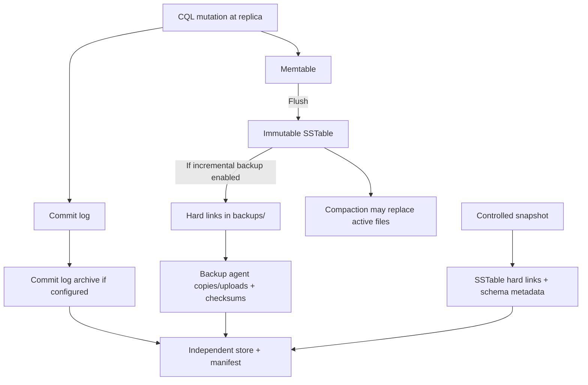
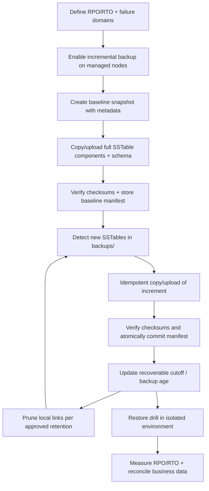

# Incremental Backups and Their Relationship to Flushed Data

> **Chapter:** Backup and Recovery  
> **Module:** `DATABASE_ENGINE_WIDE_COLUMN_CASSANDRA` — Apache Cassandra, distributed wide-column database.  
> **Focus:** Understand *exactly when* a mutation enters an incremental backup, why backups tie to **flushed or streamed SSTables**, how they coordinate with baseline snapshots and the commit log, and the boundaries around RPO, disk space, consistency, and recovery.

In Cassandra, a write succeeding at a consistency level (CL) **does not mean** that data is already in an incremental backup. A mutation first goes to the **commit log** and **memtable** on a replica. Only when the memtable is **flushed** into an immutable SSTable can Cassandra create **hard links to the new SSTable files** in the `backups/` directory if incremental backup is enabled. Cassandra also creates backup links for SSTables **streamed** into a node per supported versions/configurations.

Thus, three milestones must be kept distinct:

1. **Acknowledged write:** Cassandra satisfies the replica count per CL; on acknowledging replicas, write durability relates to the commit log.
2. **Flushed data:** mutations reside in an immutable SSTable on that node, eligible for incremental-backup hard-link creation.
3. **Off-node safe backup:** all required files have been copied/uploaded to an independent store, checksum-verified, and confirmed restorable.

**Milestone 1 does not imply Milestone 2; Milestone 2 does not automatically imply Milestone 3.** This is the single most important principle for setting RPO and designing recovery.

This lesson focuses on **SSTable incremental backups**, not **incremental repair**. Both carry the word "incremental," yet their purpose, metadata, and operation are completely different.

## 1. Learning Objectives

After this lesson, you will be able to:

- Trace the path of a mutation: CQL → commit log/memtable → flush → SSTable → local backup link → off-node backup store.
- Distinguish a full point-in-time snapshot from subsequent incremental SSTables; explain why incremental backups are **not per-row changelogs**.
- Understand the impact of unflushed data, unarchived commit logs, node restarts/crashes, and Down replicas on backup freshness.
- Configure and verify incremental backups per Cassandra version using `cassandra.yaml` or appropriate `nodetool` commands.
- Read the `snapshots/` and `backups/` directory layouts, SSTable components, and hard-link semantics.
- Estimate disk headroom, copy throughput, and retention windows; recognize old SSTables still consuming disk after compaction.
- Build a baseline + increment manifest, verify checksums, preserve full schema/topology, and perform tested restores.
- Distinguish SSTable backup RPO from commit log durability, replication, repair, and recovery RTO.
- Write CQL/`nodetool` labs and Java Driver checks without confusing an application ACK with "backup completed."

## 2. Cassandra Write Path: From Mutation to SSTable

### 2.1. Components and Roles

Cassandra is an **LSM-tree**-oriented storage engine. For a mutation written to a replica:

- **Commit log:** records mutation details for durability and replay if the process crashes before flush, per version configuration/semantics.
- **Memtable:** active in-memory data structure (may combine on/off-heap memory).
- **Flush:** converts memtable contents into new on-disk SSTables.
- **SSTable:** immutable files holding data, primary index, and metadata; multiple versions of rows/tombstones may span multiple SSTables.
- **Compaction:** merges/rewrites local SSTables to manage read/write/space amplification and, when safe, reclaim obsolete data.
- **Incremental backup:** hard links to **SSTables flushed or streamed onto the node** when enabled; these preserve the source files from a file-creation instant, **not a direct copy of the memtable**.



The path from SSTable to `backups/` creates **links to the same file contents on the filesystem**; it does not mean Cassandra just streamed SSTables over the network to cloud storage. Upload pipelines must be built or provided separately by operations.

### 2.2. When Does Cassandra Flush?

Common triggers:

- Memtable reaches its memory threshold.
- Commit log space pressure / write cycles require freeing or recycling segments.
- Administrative invocation of `nodetool flush`.
- Special operations such as certain version-specific snapshot/shutdown procedures that flush prior to acting.

**Flushing does not necessarily happen right after every `INSERT`.** On low-traffic tables, mutations can sit in the memtable for a significant time while protected locally by the commit log for crash recovery.

Example:

```text
09:00 Client INSERT → replica ACKs; data resides in memtable + commit log
09:05 Not yet flushed → no new SSTable for this mutation yet
09:07 Node writes SSTable on flush → incremental backup link appears
09:09 Backup agent copies/uploads SSTable + checksum succeeds
09:10 Manifest confirms safely stored off-node
```

If the entire node is lost at **09:06**, `backups/` does not yet contain the 09:00 mutation; the commit log on that node may also be lost if it lives in the same failure domain. If the node merely **restarts** with disk/commit log intact, Cassandra can replay the commit log to recover unflushed mutations. **Process crashes and total disk loss are two different scenarios.**

### 2.3. "Write ACK" Confirms CL, Not Backup

With RF=3 and CL `LOCAL_QUORUM`, a client typically needs two full replicas in the local DC to respond. Suppose:

| Replica | Mutation received? | Flushed? | Exported to backup? |
|---|---|---|---|
| A | Yes | Yes | Yes |
| B | Yes | Not yet | Not yet |
| C | Down, missed write | No | No |

The client received write success because A/B ACKed. Yet you cannot claim all three replicas have backed up that mutation.

**Backup coverage and replica consistency are two separate axes.** Both per-node/range backup schedules and repair schedules are needed to avoid assuming RF/CL automatically creates independent backups.

## 3. What Incremental Backup Is—and Is Not

### 3.1. SSTable-Level Definition

In Cassandra, incremental backup creates hard links to **SSTables produced by flushes or streamed into the node** after the feature is enabled. These files sit inside each table's `backups/` directory on that node.

It is **not**:

- A JSON/CDC record of every individual `INSERT`, `UPDATE`, or `DELETE`.
- A mechanism recording per-row deltas between two `SELECT` queries.
- A consistent global snapshot across all nodes, tables, and DCs.
- An automatic copy to object storage performed by Cassandra itself.
- Arbitrary exact point-in-time recovery without additional logs and procedures.
- An **incremental anti-entropy repair** session.

For example, if the same row X is updated five times in the memtable before flushing, the incremental backup may hold **one SSTable representing the flushed state/metadata** rather than five separate files per update. Conversely, if row X is flushed across multiple distinct versions, related SSTables may span multiple increments.

### 3.2. Why Not Just Copy Active SSTables Once a Day?

Active SSTables can be replaced by compaction outputs. Arbitrarily copying "currently active" files while compaction runs risks:

- Missing new files created between directory listings.
- Copying an incomplete set of SSTable components.
- Losing an older SSTable removed by compaction before the agent finishes copying it.
- Not knowing which files belong to which baseline/checkpoint or contain overlapping data after renames/generations.

Hard links created at flush/stream preserve **a stable name pointing to that SSTable's contents**, even if compaction later unlinks the active file. Still, to achieve durable backups, you must **copy all associated components to another store** and manage retention/checksums.

### 3.3. Incremental Backup vs. Incremental Repair

| Aspect | Incremental Backup | Incremental Repair |
|---|---|---|
| Goal | Preserve new SSTables for recoverability | Synchronize replicas across needed token ranges |
| Basic unit | SSTable files from flushes/streams | Replica ranges, repaired/unrepaired data, and sessions |
| State | Links in `backups/`, manifest, and external store | Repair sessions, pending/repaired metadata, anti-compaction |
| Replaces independent backup? | Can be a backup component, **insufficient while still local** | **No** |
| Recovers replicated accidental DELETE? | Possible with reliable historical backup checkpoints and proper restore | No; repair usually propagates the faulty state |
| Resource footprint | Retained files, disk, upload bandwidth | Validation I/O, CPU, streaming, compaction |
| Typical risks | RPO drift from flush/upload lag, disk-full from retention | Repair lag, Down nodes, tombstone grace, zombie data |

Never disable incremental backups just because incremental repair succeeded; the two protect against different risks.

## 4. Directories for Incremental Backups and Snapshots

### 4.1. Illustrative Layout on One Node

Suppose keyspace `lab_backup`, table `events_by_account` with an arbitrary table ID. A data directory may look like:

```text
<data_directory>/
  lab_backup/
    events_by_account-<table_id>/
      nb-1-big-Data.db
      nb-1-big-Index.db
      nb-1-big-Statistics.db
      nb-1-big-TOC.txt
      ...
      backups/
        nb-1-big-Data.db
        nb-1-big-Index.db
        nb-1-big-Statistics.db
        nb-1-big-TOC.txt
        ...
      snapshots/
        base-20261121/
          nb-1-big-Data.db
          nb-1-big-Index.db
          ...
          schema.cql
          manifest.json
```

**This is an illustrative layout.** SSTable format prefixes (such as `nb`), component names, snapshot metadata, and directory layouts vary by Cassandra version/distribution. Never hard-code example filenames into scripts meant for every cluster.

Each node has its own data directories; with multiple `data_file_directories`, backups may reside across each configured volume. The table directory includes a **table ID** to distinguish incarnations of a table name after `DROP`/`CREATE`. Never match solely on the name `events_by_account` and assume SSTables share the same table identity.

### 4.2. Why Is `backups/` Only Local?

Cassandra creates hard links on **the node's filesystem**. If the whole host/disk is lost, links inside `backups/` are usually lost along with the original SSTables. Therefore:

\[
\text{Local hard link} \ne \text{off-node backup}.
\]

To survive node/DC loss, a backup pipeline must **copy files to another failure domain**, ensure upload completion, validate checksums, and maintain decryption/recovery access.

### 4.3. One SSTable Comprises Multiple Components

Copying `Data.db` alone is not enough. An SSTable may contain:

- `Data.db` — compressed/uncompressed data contents per format.
- `Index.db` — partition index.
- `Summary.db` — index summary.
- `Statistics.db` — statistics/metadata used in reconciliation.
- `CompressionInfo.db` — compression metadata if the table uses compression.
- `Filter.db` — Bloom filter or equivalent structure.
- `Digest.crc32` / checksum components per format.
- `TOC.txt` — component list.

Different sets may exist depending on version and index types. **Backup/restore must treat an SSTable generation together with all required components**, rather than picking a few familiar filenames.

### 4.4. Hard Links Differ from Physical Copies

Suppose an SSTable file takes **5 GiB** on the filesystem:

```text
active/nb-10-big-Data.db  ─┐
                           ├── Same contents/inode on filesystem
backups/nb-10-big-Data.db ─┘
```

When creating the hard link, 5 GiB need not be rewritten into two independent files. Later, when compaction removes `active/...` while `backups/...` remains, the 5 GiB blocks are **not freed**.

Consequences:

- Directory listings summing displayed sizes of both paths can **double-count logical bytes**.
- Actual filesystem physical usage depends on inodes/link counts and real blocks.
- When only backup links keep old SSTables alive, disk usage can keep climbing.
- Copying off-node consumes **real transfer bytes and remote storage**, unless the target store provides dedup/compression.
- Prune local backup links only after verifying **restorability** from durable storage and retention policy.

**Never manually delete files inside the active data directory to free disk space** without a version-specific Cassandra runbook.

## 5. Enabling, Checking, and Disabling Incremental Backups

### 5.1. `cassandra.yaml` Configuration

Depending on the Cassandra version, the setting is:

```yaml
# Illustrative example; apply through cluster configuration management.
incremental_backups: true
```

In common Apache Cassandra distributions, this feature is **disabled by default**. Verify the actual setting on every node. Changing the config file may require a restart/rollout depending on version and management method; never edit production manually in bulk without a change plan.

In some newer versions, tables may support per-table options to enable/disable incremental backups. That capability **must not be assumed** across all versions; verify table options documentation and actual configuration.

### 5.2. `nodetool` for Runtime Control

Commonly supported commands:

```bash
# View feature status on the target node.
nodetool statusbackup

# Enable incremental backups on the node per lab/runbook procedure.
nodetool enablebackup

# Re-verify.
nodetool statusbackup

# Disable after completing a controlled experiment:
nodetool disablebackup
```

**Warning:** this is a **per-node** operation, not a CQL command enabling backups cluster-wide. Never run it once on node A and record "all DCs covered." Use orchestration/config management and verify status on **every node** in the backup policy scope.

`enablebackup`/`disablebackup` do not retroactively upload pre-existing SSTables, do not create a baseline snapshot, and **do not delete old links** when disabled. Pre-existing local files must still be managed by a safe retention job.

### 5.3. What Does Enabling Mid-Lifecycle Mean?

Suppose a table already has SSTables S0, S1, S2 before enabling:

```text
08:00  Old SSTables: S0 + S1 + S2 already exist
08:30  Enable incremental_backups
08:40  Memtable flush → creates S3, creates hard link S3 in backups/
09:00  Next flush → S4, link S4 in backups/
```

Having **S3 and S4** in `backups/` does not mean you have backed up the table's full state; data from S0–S2 still needs a **baseline snapshot** or equivalent preservation.

**Incremental backups must accompany a reliable baseline.** Without a baseline, SSTables created before the feature was enabled can be completely missing from the recovery chain.

### 5.4. Taking a Baseline Snapshot

Illustrative commands on **one lab node**:

```bash
# Check version-specific nodetool help snapshot before running.
nodetool snapshot --tag base-20261121 lab_backup

# List snapshots on the current node.
nodetool listsnapshots
```

A standard snapshot creates hard links to **existing SSTables**, typically accompanied by schema DDL. In supporting versions/options, taking a snapshot **may flush memtables first** to cover in-flight data; if `--skip-flush` is used, unflushed memtable data does not enter the SSTable snapshot. Verify the exact behavior of the command executed.

**One `nodetool snapshot` on node A is not a cluster-wide consistent snapshot.** Orchestrate across all nodes/replicas/DCs in scope and record each node's timestamp and completion status.

## 6. Relationship Between Baseline Snapshots and Increments

### 6.1. Basic Timeline

Suppose a node sees:

```text
T0  Baseline snapshot B0: contains SSTables prior to T0
    ├── S0
    └── S1

T1  UPDATE/INSERT/DELETE → commit log + memtable (unflushed)

T2  Flush creates S2 → backups/S2
    [increment #1]

T3  Flush creates S3 → backups/S3
    [increment #2]

T4  New mutations sit in memtable; unflushed

T5  Disk failure
```

If **B0 + S2 + S3** were all copied/uploaded, the off-node store has the basis to recover data materialized in SSTables up through T3. Mutations still in the memtable at T4 **do not automatically appear** in the SSTable backup set.

For a real restore, check:

- Are all SSTable components and metadata present for the same node/table ID?
- Are required deletion markers/tombstones present?
- Were any increments lost or not yet uploaded?
- Does the baseline snapshot have the right cutoff and scope?
- Were new files **streamed** into the node without yet being shipped offsite?
- Are commit log archives available to recover beyond T3?
- Is there duplicate/overlapping data between baseline and increments to handle?

### 6.2. Increments Are Not Row-Level "Deltas"

A new SSTable may include:

- A batch of new mutations.
- Partitions/rows overwriting older SSTables.
- Tombstones from `DELETE` or TTLs.
- Cell/timestamp metadata needed for reconciliation.

Thus, **an increment set does not mean "only newly added live rows."** Increment S3 may hold a tombstone deleting row X, while baseline B0 still holds X's old value. When restoring the chain, Cassandra must reconcile timestamps/tombstones to avoid resurrecting deleted data.

You cannot simply "concatenate a snapshot CSV with an increment CSV" and expect a valid table; you need SSTable-aware tooling and Cassandra semantics.

### 6.3. File-Set Model

Let:

- \(B_0\): SSTable set from the baseline snapshot.
- \(I_1,I_2,\dots,I_n\): recoverable and required incremental SSTable sets after the baseline.
- \(M\): schema metadata, format version, manifest, and checksums.
- \(L\): properly archived commit log segments (if available).

The checkpoint recovery file set can be modeled as:

\[
\mathcal{R} = B_0 \cup I_1 \cup I_2 \cup \cdots \cup I_n
\]

along with \(M\), and optional replay of \(L\) when **supported, ordered, and executed via exact procedures**.

This is a model of **required files**, not a complete restore algorithm; merely dropping files into a folder does not merge all data cleanly. SSTable generations, schema/table IDs, timestamps, CRCs/checksums, version compatibility, and token ownership must all be handled properly.

### 6.4. Baseline and Increments May Overlap on SSTables

If a snapshot is taken after incremental backups are already enabled, SSTable S2 may appear via **two link paths**:

- Under `snapshots/base-tag/...`.
- Under `backups/...`.

When copying to object storage, the backup system should **deduplicate by file/generation/checksum** to avoid needlessly storing double capacity. Yet deduplication **must never omit files**; the manifest must logically prove that the baseline snapshot plus incremental chain are complete.

Never assume identical filenames on **two different nodes** represent the same SSTable. Each node has its own topology/replica set and file generations.

## 7. RPO: The Gap Between Flush, Upload, and Incident

### 7.1. Practical RPO of SSTable Backups

**RPO (Recovery Point Objective)** describes acceptable time-measured data loss upon recovery.

Distinguish four times:

- **ACK time:** mutation acknowledged by Cassandra per CL.
- **Flush time:** mutation lands in an SSTable and becomes eligible for hard-linking.
- **Upload-complete time:** file reaches external storage with complete components/checksums and manifest updated.
- **Restore-verified time:** pipeline proves the backed-up data can actually be read/restored.

There is no guarantee that incremental backups **alone** achieve a 5-minute RPO or RPO=0. RPO must be measured at the **latest recoverable data point**, not merely by checking `statusbackup=enabled`.

### 7.2. Gap Calculation Example

Suppose:

| Time | Event |
|---|---|
| 09:00 | Baseline snapshot completes and exports safely |
| 09:10 | S1 finishes flushing, local backup link created |
| 09:12 | S1 upload + checksum complete |
| 09:25 | S2 finishes flushing |
| 09:29 | S2 upload + checksum complete |
| 09:35 | Application writes new mutations into memtable |
| 09:37 | Disaster destroys all nodes/disks |

If the **latest verified recoverable point** is S2 at 09:29, the elapsed time from that upload to the incident is roughly:

\[
37 - 29 = 8\text{ minutes}.
\]

However, **you must not declare RPO = exactly 8 minutes** solely from the upload timestamp. S2 flushed at 09:25 and may exclude mutations written after the memtable swap/flush; you must attach a **mutation cutoff/watermark** to the manifest to know which writes actually entered the SSTable. Upload completion time **does not turn S2 into a 09:29 image**.

With commit log archiving and reliable replay, the recovery point can approach the incident time more closely. Without it, mutations still in memtables or not yet uploaded can be lost when the entire failure domain fails.

### 7.3. Is "Flush Every 5 Minutes" Enough for a 5-Minute RPO?

**Not automatically.** A "flush at least every 5 minutes" policy still faces:

- Copy/upload latency, retries, and checksum checks.
- Agent failures, network outages to backup storage, or snapshot storage failures.
- Nodes flushing at staggered times.
- Write ACKs on replicas not yet covered by uploaded backups.
- Commit log loss happening simultaneously with node loss.
- Out-of-sync replicas prior to backup.

A simple budgeting heuristic:

\[
T_{\mathrm{unflushed}} +
T_{\mathrm{backup\_lag}} +
T_{\mathrm{verification\ margin}}
\lesssim RPO_{\mathrm{budget}}
\]

Use this solely to **guide latency budgeting**, not as a guarantee of RPO under arbitrary failures. True RPO must be verified via failure-injection/restore drills against source-of-truth data.

### 7.4. Avoid Over-Flushing Just to "Get Backups"

Forced flushes create extra small SSTables; doing so too frequently can cause:

- Higher SSTable counts and compaction backlogs.
- Read amplification from many overlapping files.
- More hard links/files to track.
- Higher upload request volume and metadata overhead.
- Degraded client read/write p99 latency due to disk I/O.

Balance target RPO against **flush + compaction + upload** cost rather than scheduling uncontrolled flushes every few seconds.

## 8. Commit Log: Node Durability Is Not a Recoverable Backup

### 8.1. Commit Log Recovers Single-Node Crashes

When a replica accepts mutations on the normal write path, the commit log persists records for replay if the process/host restarts before memtables flush. This is an **operational durability mechanism**, not an independent backup store.

If the host restarts cleanly and disks remain intact:

- Cassandra can replay the commit log for unflushed mutations.
- Application data can survive even if `backups/` has no corresponding SSTable yet.
- Incremental backups are not required to survive **every** process restart.

If the entire disk/volume holding commit logs and SSTables is lost:

- The local commit log is lost too.
- Local `backups/` hard links are lost as well.
- Only copies in **another failure domain** can recover data, provided checkpoints suffice.

### 8.2. Commit Log Archiving Is a Complementary Mechanism

Some Cassandra deployments configure archiving/replay of commit log segments. When properly engineered, this can narrow the RPO gap compared to snapshot + incremental SSTables alone.

However, achieving point-in-time recovery (PITR) requires:

1. A trustworthy data baseline.
2. Complete SSTable files and/or log archives with proper ordering/cutoffs.
3. Compatible versions/formats and exact replay procedures.
4. Verification that no erroneous/post-cutoff mutations are replayed.
5. Real restore testing covering TTL/tombstones, table schema, and application logic.
6. Management of encryption keys, permissions, and retention.

**Merely enabling commit log archiving is insufficient to claim PITR works.** Measure archive lag, missing segments, log checksums, and replayability.

### 8.3. Commit Logs Are Per-Node, Not Cluster-Wide Transaction Snapshots

In a keyspace with RF=3, a mutation may be ACKed by two replicas. Their commit logs may flush and rotate at different times. Snapshots on node A and node B at different instants **do not automatically form a consistent cut** across all mutations.

If the application must guarantee zero loss of critical business events, maintain an **event source / audit log / idempotency layer** and explicit reconciliation rules instead of inferring global consistency from file timestamps.

## 9. Compaction, Tombstones, and Backed-Up File Lifecycle

### 9.1. Compaction Creates New Physical Files

Suppose:

```text
Before compaction:
  Active SSTables: S1 + S2 + S3
  backups/: links to S1, S2, S3

After compaction:
  New active SSTable: S4 = merged result
  Active S1/S2/S3 unlinked when safe
  backups/: links to S1/S2/S3 STILL REMAIN
```

Keeping old links in `backups/` has two effects:

- Preserves historical SSTables to restore along the chain.
- **Pins blocks on disk**, preventing space reclamation even after compaction removes the active files.

Typically incremental backups create links for **flushed or streamed SSTables**, rather than promising to copy every compaction output as a brand-new increment; verify your exact version's semantics. The backup agent must recognize that not every new active SSTable represents "new application writes."

### 9.2. Tombstones During Restore: Easy to Get Wrong

Suppose at T0 row X=`ACTIVE`. At T1 the client deletes X and Cassandra writes a tombstone; at T2 a flush creates SSTable S_del carrying the deletion marker.

- **Baseline snapshot T0** still contains the live value X.
- **Increment S_del** carries the tombstone shadowing X.
- If you restore **only the baseline without S_del**, row X can reappear.
- If you restore by mixing multiple points without a proper procedure, outcomes depend on timestamps, TTLs, tombstones, and compaction.

Tombstones only become eligible for purging after retention/`gc_grace_seconds` conditions and compaction; **they are not guaranteed to vanish right on schedule**.

When restoring old data into a live cluster, existing tombstones may shadow old values, or improperly imported old data can create **zombie data**. Therefore:

> **Never "copy a few old SSTables into the live data directory" as an ad-hoc recovery step.** Follow a restore plan that verifies schema/version, cutoff, tombstones, and supported SSTable loader/refresh tools.

### 9.3. TTLs Complicate Point-in-Time Selection

For tables using TTL:

- Rows may be written and captured in snapshots/increments.
- By restore time, the TTL based on original write/expiry timestamps may already have expired.
- A backup is **not** a promise that data will stay alive forever when restored later.
- "Counting rows before/after restore" must account for TTLs, tombstones, and cutoffs.

If the business must retain records long-term regardless of TTL, use a **separate archival store and retention model** rather than relying on SSTable backup files still existing.

## 10. Capacity Model: Backup Links Are Not Long-Term Free

### 10.1. What Consumes Physical Storage?

Let:

- \(D_{\mathrm{active}}\): space occupied by active SSTables.
- \(D_{\mathrm{pinned}}\): blocks kept solely by backup/snapshot links or other retained files.
- \(D_{\mathrm{temp}}\): temporary compaction/repair/streaming space.
- \(D_{\mathrm{other}}\): commit logs, logs, indexes, system files, filesystem overhead.
- \(H\): policy-mandated reserve headroom.

Estimated requirement:

\[
D_{\mathrm{required}}\approx
D_{\mathrm{active}}+D_{\mathrm{pinned}}+
D_{\mathrm{temp}}+D_{\mathrm{other}}+H.
\]

**Do not double-count** an inode/file referenced by multiple hard links when calculating physical disk usage. However, as compaction replaces active files, the `pinned` portion can grow sharply because backups retain older SSTables.

### 10.2. Post-Compaction Example

Suppose:

- 500 GiB active SSTables.
- 180 GiB kept alive solely by incremental backup/snapshot links.
- 100 GiB peak compaction temporary space.
- 40 GiB commit logs/indexes/OS-related storage.
- 160 GiB policy reserve headroom.

Then:

\[
D_{\mathrm{required}}\approx
500+180+100+40+160=980\ \mathrm{GiB}.
\]

If usable filesystem capacity is **1,024 GiB**, only 44 GiB remain beyond the modeled reserve. Seeing "active SSTables are only 500 GiB" **does not mean** the node has over 500 GiB of safely usable free space.

### 10.3. How Backup Retention Causes Disk-Full Outages

1. CQL writes flush new SSTables.
2. Each SSTable gets a link in `backups/`.
3. Compaction replaces active SSTables and unlinks old names.
4. Local backup links still pin those old inodes.
5. Snapshot/backup links are never cleaned up per policy.
6. Free disk drops even while active data size barely grows.

Consequences include disk pressure, compaction failures, failed streaming/repair, rising read/write latency, and availability loss.

**Retention and off-node copying must form an automated, verified pipeline**, not ad-hoc cleanup after an outage.

### 10.4. Choosing Retention by Version and Recovery Needs

An example policy:

- Baseline snapshots created on a cadence matching RPO/RTO.
- Incremental SSTables shipped promptly to object storage.
- Backup archives retained across windows needed to restore baselines.
- Local links deleted only once files are uploaded, verified, and no longer needed for the local restore chain.
- Immutable retention enabled if data policy requires it.
- Remote store lifecycle expiration configured **without breaking recovery chains**.

The key is **completeness of the recovery chain**, not a blanket "keep 7 days" rule applied blindly to every table.

## 11. Designing a Snapshot + Incremental Backup Pipeline

### 11.1. End-to-End Flow



### 11.2. Baseline Snapshot

A baseline is meaningful when:

- **Node, keyspace/table, table ID, snapshot tag**, timestamps, and version are known precisely.
- Token ranges/replicas backed up match recovery objectives.
- All required SSTable components and schema DDL are included.
- All files are uploaded and checksums match.
- A manifest marks status `VERIFIED`, not merely `COPYING`.
- Files can be decrypted and downloaded for restore.

A snapshot on one node is a baseline **for that node**, not a cluster-wide consistent snapshot. With RF=3, **one node usually holds only a subset of token ranges**; never assume "backing up node A covers the whole keyspace."

### 11.3. Capturing Increments After the Baseline

Principles:

1. Enable incremental backups before or alongside taking the baseline per runbook to avoid coverage gaps.
2. Track every SSTable generation appearing in `backups/`.
3. Upload an SSTable only when **its component set is complete and readable in a stable state**; prevent agents from copying half-written files.
4. Use object keys embedding cluster/node/table identity, generation, and checksums to avoid collisions.
5. Retry uploads using idempotent object naming to avoid missing or duplicate manifest entries.
6. Confirm an increment as backed up only once **all required components** reach the destination.
7. Periodically reconcile local backlog against remote manifests; alert if files remain unuploaded beyond SLA.

### 11.4. Sample Metadata Manifest

```yaml
# Illustrative backup pipeline format, NOT a mandatory Cassandra manifest.
backup_set_id: labbackup-20261121
cluster: cassandra-lab
cassandra_version: "5.x-example"
partitioner: Murmur3Partitioner
node:
  host_id: "<host-id>"
  datacenter: dc1
  rack: rack1
table:
  keyspace: lab_backup
  name: events_by_account
  table_id: "<table-id>"
baseline:
  snapshot_tag: base-20261121
  status: VERIFIED
  complete_file_set: true
increments:
  - generation: "<sstable-generation-1>"
    source: "backups/"
    source_kind: FLUSH
    status: VERIFIED
    components_complete: true
    sha256_manifest: "<checksum-manifest>"
  - generation: "<sstable-generation-2>"
    source: "backups/"
    source_kind: FLUSH
    status: COPYING
restore:
  verified_recoverable_cutoff: null
  last_drill: null
```

Fields such as `source_kind` and `sha256_manifest` are assigned by the **organization's backup pipeline**, not natively emitted by Cassandra. This manifest is intentionally not complete because one increment is still `COPYING` and `verified_recoverable_cutoff` has not been established.

### 11.5. Idempotency and Mid-Upload Crashes

If the agent loses network connectivity 70% through uploading `Data.db`:

- Do not mark the increment `VERIFIED` merely because a destination object appeared.
- Keep state as `COPYING/FAILED` and use staging/temp object names if appropriate.
- Retry or resume using storage tooling with checksum/part integrity checks.
- Verify **complete file set**, matching checksums, and commit the manifest **last**.
- Never prune local links before remote verification finishes.

A backup pipeline must also handle **agent restarts** or node restarts mid-scan: maintain a reconciliation scan over SSTable lists rather than relying purely on filesystem watch events that might be missed.

## 12. Backup Security and Failure Domains

A copy is only useful if it survives the failure you are guarding against:

| Backup Tier | Can Survive | Does Not Guarantee |
|---|---|---|
| Hard links in `backups/` on the same disk | Compaction / active file unlinking | Disk/host loss or ransomware with same permissions |
| Copy to another disk on the same node | Certain filesystem/volume failures | Total host loss or credential compromise |
| Copy to another node in the same rack | Single-node failures | Shared rack/power/network outage |
| Off-DC/off-region copy, separate retention | DC loss and broad regional outages | Restorability if schema/keys/manifest are missing |
| Policy-aligned immutable/offline store | Accidental deletion and partial ransomware | Protection if access keys or recovery workflows fail |

Recommended controls:

- Encryption in transit and at rest, with key management kept outside manifests.
- Least-privilege upload permissions for agents and separate accounts for deletion/retention.
- Access auditing for backups (copies may contain sensitive personal data).
- Compliant retention and controlled deletion.
- Test restores under emergency-scenario accounts and permissions.
- Monitor storage/egress costs and download bandwidth (which directly impact RTO).

Never put raw credentials or encryption keys into labs, backup scripts, tickets, or widely shared manifests.

## 13. Restoring from Baseline + Increments

### 13.1. Order of Thought Before Running Commands

A solid restore procedure starts with: **What must be restored, to what point in time, where, and can the application tolerate downtime?**

Determine:

1. **Target:** a single table, a node, a token range, a DC, or the entire cluster.
2. **Sources and cutoff:** which baseline, which incremental SSTables, and how far commit log archives extend.
3. **Compatibility:** Cassandra/SSTable version, schema, partitioner, table identity, compression, and encryption.
4. **Coverage:** whether ranges/replicas from all necessary nodes are present.
5. **TTLs/tombstones:** whether older versions might resurrect deleted data or be shadowed.
6. **Consistency:** whether restoring into a live cluster while the application keeps writing.
7. **Verification:** queries and business reconciliation, checksums, row identities, RPO/RTO, DC/CL.

**Never drop random files directly into the data directory of a running production node** hoping Cassandra treats them as an "increment."

### 13.2. Isolated Restore Environment

Best practice typically involves:

- Provisioning an isolated lab/cluster with matching version and compatible schema.
- Downloading baseline and increments from the external store and verifying checksums.
- Using supported SSTable loading tools, such as **`sstableloader`** to bulk-stream into the ring, or local `nodetool refresh` where appropriate per version runbook.
- Validating primary keys, TTLs/tombstones, token ranges, and business data.
- Only after verification, planning how to bring data back to production if needed.

These tools **do not automatically perform point-in-time undo** of a bad `DELETE`/`UPDATE` inside a live cluster. Timestamp reconciliation may hide older values; you need a logical restore or business-level replay procedure.

### 13.3. Snapshot DDL and Table Identity

Snapshots typically save `schema.cql`; incremental `backups/` **do not automatically carry full DDL**. If a table was `DROP`ped and recreated with the same name, its table ID and schema may differ. Thus manifests must preserve:

- CQL schema at baseline.
- Ordered DDL changes after baseline.
- Original SSTable table ID.
- Version/partitioner/compression settings.
- Roles/permissions needed by applications (stored via secure channels).
- Mapping from physical nodes/token ranges to SSTable sources.

Never restore SSTables from an old incarnation into a new table without confirming tool/semantic support.

### 13.4. Which SSTables Must Be Restored?

**Do not** grab only "the newest increment." Because flushed SSTables hold non-overlapping updates and tombstones, skipping a file can lose rows or deletions:

```text
B0: X=v1, Y=v1
I1: X=v2
I2: DELETE Y
I3: Z=v1

B0 + I3 does not equal B0 + I1 + I2 + I3:
- X may revert to v1
- Y may reappear
```

Each increment must be selected by **file identity and cutoff/chain**, not arbitrarily sliced/merged by file modification timestamps.

### 13.5. Avoiding Zombie Data During Restore

If an old snapshot holds a row that was later `DELETE`d and the corresponding tombstone is absent from the restore set, the row can come back to life. In particular:

- Importing old data into a healthy cluster whose tombstones already purged past grace/compaction can resurrect deleted rows via reconciliation.
- Combining nodes restored to different checkpoints can leave one replica carrying older state.
- With TTLs, logical alive/expired status shifts over time.

Therefore recovery **must have a business cutoff** and test deletions/TTLs—not merely confirm Cassandra opens SSTables without errors.

## 14. Recovery Across Failure Scenarios

| Incident | Role of Incremental Backups | Additional Needs |
|---|---|---|
| **JVM restart, disk intact** | Usually no backup restore needed; commit log replay recovers memtables | Inspect startup logs, commit log, and CL |
| **Single node lost, healthy replicas remain** | Backup serves as fallback | Usually evaluate replace/bootstrap/streaming from trusted replicas |
| **All disks/nodes lost, insufficient replicas** | Off-node baseline + increments serve as primary recovery source | Schema, manifest, SSTable loader/restore plan |
| **Entire DC lost** | Off-DC backups help if surviving DC lacks data or trustworthiness | RF/DC topology, WAN, RPO/RTO, and restore drill |
| **Accidental DELETE/UPDATE propagated to all DCs** | Pre-incident backup provides historical source | Isolated restore, reconcile valid post-cutoff writes, no blind edits |
| **Ransomware deletes local snapshots** | Local links fail if shared permissions are wiped | Immutable/isolated store, keys, and tested restore |
| **Repair/compaction suspected of corrupting data** | Historical backups aid reconciliation | Audit, root cause, and trusted source selection |
| **Backup agent down for 12 hours** | Local links may still hold files for catch-up upload if disk lasts | Backlog alerts, disk headroom, and catch-up upload plan |

No single `nodetool` command substitutes for assessing trusted data sources and required recovery scope.

## 15. CQL Practice: Observing Flushes Creating Incremental Backups

### 15.1. Preparing a Lab with Node Access

The experiment requires:

- A Cassandra lab cluster with `nodetool` admin access and filesystem visibility into data directories.
- A real DC named `dc1`, with at least three full replicas if using RF=3.
- Sufficient lab disk capacity and zero production workload.
- Knowledge of `data_file_directories` and Cassandra version.
- Ability to enable incremental backups on a test node and revert afterward.
- Clear separation between **single-node actions** and cluster-wide backup coverage.

### 15.2. Create Keyspace and Table

```sql
CREATE KEYSPACE IF NOT EXISTS lab_backup
WITH replication = {
    'class': 'NetworkTopologyStrategy',
    'dc1': 3
};

CREATE TABLE IF NOT EXISTS lab_backup.events_by_account (
    account_id uuid,
    event_day date,
    event_time timestamp,
    event_id timeuuid,
    event_type text,
    payload text,
    PRIMARY KEY ((account_id, event_day), event_time, event_id)
) WITH CLUSTERING ORDER BY (event_time DESC, event_id DESC);
```

- `(account_id,event_day)` is the composite partition key, governing token and replica placement.
- `event_time,event_id` are clustering columns within the partition.
- Models the query "view events for an account on a day"; very large partitions may still require finer bucketing.
- RF=3 means three replicas per keyspace/DC—**not** three off-node backups.

### 15.3. Enable Backup on the Lab Node and Verify

```bash
# Run on the chosen lab node; never toggle blindly in production.
nodetool statusbackup
nodetool enablebackup
nodetool statusbackup
```

Record the output and timestamp. To observe all three replicas, execute and inspect across the planned nodes; enabling on one node does not cover the entire keyspace.

### 15.4. Write Mutation #1

In `cqlsh` connected to the lab cluster:

```sql
CONSISTENCY LOCAL_QUORUM;

INSERT INTO lab_backup.events_by_account (
    account_id, event_day, event_time,
    event_id, event_type, payload
) VALUES (
    11111111-1111-1111-1111-111111111111,
    '2026-11-21',
    '2026-11-21 08:00:00+0000',
    7c627d5a-a6b0-11ef-8ae8-0242ac120002,
    'CREATED', 'v1'
);

SELECT event_time, event_id, event_type, payload
FROM lab_backup.events_by_account
WHERE account_id = 11111111-1111-1111-1111-111111111111
  AND event_day = '2026-11-21';
```

Immediately after `INSERT`, checking local `backups/` **may show no new SSTable yet** because the memtable has not flushed. This is expected behavior to observe, not necessarily a broken backup.

### 15.5. Controlled Flush

```bash
# LAB ONLY: instruct the target node to flush the table's memtable.
nodetool flush lab_backup events_by_account
```

After flush finishes, inspect the table's folder under `data_file_directories` on **the exact node flushed**. When incremental backup is enabled and flushable data exists on that node, new SSTable hard links are expected under `backups/`.

**If no files appear:** the node called might not be a replica for that partition, the memtable was empty, the table sits on another volume, flush produced no new SSTable, backups were not enabled, or version behavior differs. Do not conclude "Cassandra is broken" from a single empty listing.

### 15.6. Write Mutation #2, Unflushed

```sql
INSERT INTO lab_backup.events_by_account (
    account_id, event_day, event_time,
    event_id, event_type, payload
) VALUES (
    11111111-1111-1111-1111-111111111111,
    '2026-11-21',
    '2026-11-21 08:05:00+0000',
    8c627d5a-a6b0-11ef-8ae8-0242ac120002,
    'UPDATED', 'v2'
);
```

Before the second flush, `SELECT` sees both events, yet `backups/` **does not necessarily** contain an increment for the new mutation.

This directly demonstrates the distinction:

\[
\text{CQL-visible} \ne \text{incremental-backup-exported}.
\]

### 15.7. Second Flush and Baseline Snapshot

```bash
nodetool flush lab_backup events_by_account

# Create a clearly tagged snapshot on the lab node.
nodetool snapshot --tag lab-base-20261121 lab_backup

nodetool listsnapshots
```

Observations:

- One or more new SSTable generations appear.
- `backups/` may hold links from both flushes.
- `snapshots/lab-base-20261121/` points to SSTables existing at snapshot time.
- Some SSTables may appear under both snapshot and incremental paths.
- Filesystem disk used does not jump by the sum of logical bytes of all hard links when links are created.

Do not sum `ls -l` across directories as physical disk usage; check filesystem/inode/hard-link semantics.

### 15.8. Deletion and Tombstone Experiment

```sql
DELETE FROM lab_backup.events_by_account
WHERE account_id = 11111111-1111-1111-1111-111111111111
  AND event_day = '2026-11-21'
  AND event_time = '2026-11-21 08:00:00+0000'
  AND event_id = 7c627d5a-a6b0-11ef-8ae8-0242ac120002;
```

Flush again in the lab and observe the increment holding the tombstone SSTable. Pre-DELETE snapshots and post-DELETE increments must be handled properly during restore; omitting the tombstone from the chain can yield wrong results.

**Never lower `gc_grace_seconds` or delete active files to experiment** without understanding zombie-data consequences.

### 15.9. Ending the Lab and Safe Cleanup

After recording logs and manifests, you may disable incremental backups on the test node:

```bash
nodetool disablebackup
nodetool statusbackup
```

Disabling the feature **does not necessarily delete existing links**. Only clean up lab files/snapshots per lab retention rules once verified no longer needed for exercises or restores; never put manual file deletion into general runbooks.

## 16. Java Driver: Application ACK Does Not Mean "Incremental Backup Ready"

Java services execute CQL through the Java Driver rather than reading SSTable directories. Java Driver 4.x example writing an event at `LOCAL_QUORUM`:

```java
import com.datastax.oss.driver.api.core.CqlSession;
import com.datastax.oss.driver.api.core.DefaultConsistencyLevel;
import com.datastax.oss.driver.api.core.cql.BoundStatement;
import com.datastax.oss.driver.api.core.cql.PreparedStatement;

import java.net.InetSocketAddress;
import java.time.Instant;
import java.time.LocalDate;
import java.util.UUID;

public final class BackupVisibilityLab {
    public static void main(String[] args) {
        UUID accountId = UUID.fromString(
            "11111111-1111-1111-1111-111111111111");
        UUID eventId = UUID.fromString(
            "9c627d5a-a6b0-11ef-8ae8-0242ac120002");
        LocalDate day = LocalDate.of(2026, 11, 21);

        try (CqlSession session = CqlSession.builder()
                .addContactPoint(new InetSocketAddress("127.0.0.1", 9042))
                .withLocalDatacenter("dc1")
                .build()) {

            PreparedStatement insert = session.prepare(
                "INSERT INTO lab_backup.events_by_account " +
                "(account_id, event_day, event_time, event_id, " +
                "event_type, payload) VALUES (?, ?, ?, ?, ?, ?)"
            );

            BoundStatement mutation = insert.bind(
                    accountId, day,
                    Instant.parse("2026-11-21T08:15:00Z"),
                    eventId, "CHECKPOINT", "java-client")
                .setConsistencyLevel(DefaultConsistencyLevel.LOCAL_QUORUM);

            session.execute(mutation);
            System.out.println("CQL write ACK received.");

            // ACK != SSTable flush completion.
            // ACK != hard-link in backups/ being created.
            // ACK != off-node backup upload/verify completion.
        }
    }
}
```

**Explanation:**

- `session.execute` succeeding proves **the request satisfied the chosen CL** per Cassandra semantics, not that every replica flushed.
- Cassandra does not flush specifically for a request just because the Java client returned.
- The Java Driver has no standard CQL call like `BACKUP THIS ROW NOW` or `WAIT FOR CLOUD BACKUP`.
- On a write timeout, the mutation may still have been applied on some replicas; retries must consider idempotency and duplicate writes.
- If business logic requires confirming "transaction is in offsite backup," build a **separate workflow** tracking event/backup watermarks or durability contracts—never rely solely on a CQL ACK.
- In a multi-DC keyspace, `LOCAL_QUORUM` binds only the local DC; it does not mean every DC has received the mutation.

### 16.1. Tracking Read-Your-Write and Backup Watermarks

A verification program can:

1. Write an event with a fixed ID.
2. Read back the partition at the desired CL.
3. Log the logical event time/ID and write ACK time.
4. Observe **owning nodes and flush/backup manifests** via operational tooling.
5. Cross-check verified backup watermarks/cutoffs.
6. Perform an isolated restore to confirm the event is recoverable.

Perform steps 4/5 only through authorized pipelines. Never have a Java service invoke `nodetool flush` after every transaction—that is an administrative operation impacting whole-node/table performance.

## 17. Metrics and Alerting for Incremental Backups

### 17.1. Four Ages to Measure

| Metric | Suggested Definition | Meaning |
|---|---|---|
| **Last flush age** | Time since last flush producing an SSTable for table/node | Data may linger in memtables for long periods |
| **Oldest unuploaded increment age** | Age of oldest SSTable link not yet successfully uploaded/verified | Backup backlog may put RPO at risk |
| **Last verified backup age** | Time since the latest data checkpoint verified as restorable | Reflects true recoverability better than scheduler runs |
| **Last successful restore drill age** | Time since the last passing restore drill | Backups can silently degrade without anyone noticing |

Never substitute `time since nodetool enablebackup` for `last verified backup age`: enabling the flag only proves configuration.

### 17.2. Recommended Per-Node and Per-Table Metrics

- Cassandra/JVM uptime, node `UN/DN/UJ/UL` states.
- Memtable data size, pending flushes, flush writer backlog/latency.
- Count/size of new SSTables, SSTable generations, and checksums.
- Incremental backup enabled/disabled state.
- Local `backups/` pending bytes and unuploaded SSTable count.
- Upload MiB/s, success/failure counts, retry age, checksum mismatches.
- Disk used/free, pinned bytes, snapshot size, and compaction pending tasks.
- Commit log archive lag (if used) and missing segments.
- Backup coverage across token ranges/nodes/DCs matching RF and recovery goals.
- Client read/write p95/p99 latency and timeouts during flush/backup load.
- Actual download/restore/verify durations observed in restore drills.

JMX/Prometheus metric names vary by Cassandra version/exporter; never assume Cassandra exports every metric out of the box. Metrics like `oldest unuploaded increment age` and `recoverable backup age` usually **must be emitted by the backup orchestrator/pipeline itself**.

### 17.3. Critical Alerts

| Alert | Suggested Condition | Priority Investigation |
|---|---|---|
| Backup disabled unexpectedly | `statusbackup` diverges from policy on node | Config drift, rollout issue |
| No new increment despite active writes | Flushes not occurring or pipeline broken | Memtable/flush; don't cry missing files prematurely |
| Upload backlog rising | Pending SSTables/bytes climbing continuously | Network/object store/permissions |
| Disk free falling while active data stable | Local links/snapshots pinning old files after compaction | Retention and pinned inodes |
| Verified restore point too old | Recoverable point exceeds RPO budget | Backup chain/manifest/log archive |
| Manifest incomplete | One or more SSTable components missing | Retries, checksums, schema/version |
| Restore drill failed | Unable to load SSTables or data mismatch | Backup source and runbook |
| Node Down beyond expected grace window | Replica may go stale, affecting repair/restore | Tombstone/repair history and rebuild method |

A system with a "green backup pipeline" but no restore drills or missing decryption keys is **insufficient** to declare data safe.

## 18. Comparing Backups with Repair and Replication During Incidents

### 18.1. One Node Lost While Other Replicas Remain Healthy

With RF=3, if one node dies:

- Cassandra may still have enough live replicas for `LOCAL_QUORUM`.
- **Replace/bootstrap/streaming** can copy data from healthy replicas to a replacement node.
- Anti-entropy **repair** can reconcile token ranges after recovery.
- Incremental backups act as a fallback, not always the fastest recovery source.

If healthy replicas already recorded a bad mutation, streaming/repair will also replicate the **bad data** to the new node; historical backups remain essential.

### 18.2. Two DCs Do Not Equal a Backup

With `NetworkTopologyStrategy` and per-DC RF, replication improves availability, yet:

- A bad `DELETE` can still propagate to both DCs.
- A bad schema change can impact data everywhere.
- Local backups in each DC can be wiped if shared admin credentials are compromised.
- Outages longer than tombstone grace make restoring stale replicas dangerous.

Backups need **isolated failure domains, retention, and access permissions** aligned with recovery goals.

### 18.3. Repair Is Not Restore

Repair uses Merkle tree comparison and streaming to converge replicas toward current state. If data was deleted or overwritten across **all replicas**, repair cannot infer historical values to restore. Baseline + increments or audit/CDC can provide historical data, but bringing them back requires a **trusted-cutoff recovery procedure**.

## 19. Five Troubleshooting Scenarios

### Scenario A — INSERT Succeeds but `backups/` Has No New Files

**Diagnosis:** likely normal if the mutation is still in the memtable. Verify backups are enabled, the node is actually a replica for that partition, flush backlog, and last SSTable time; in lab you can trigger an explicit flush to observe.

**Do not:** declare the write lost or force Cassandra to flush on every request just because the folder is empty.

### Scenario B — Compaction Finished Yet Disk Usage Did Not Drop

**Diagnosis:** snapshot/incremental links may be pinning old SSTables; or temporary compaction output / new incoming writes grew. Inspect filesystem/inodes/link counts, retained backup files, and snapshots.

**Resolution:** verify off-node copies/manifests, enforce approved retention, and safely prune local backup links per procedure.

**Do not:** delete active SSTables or shrink tombstone grace as a space-saving trick.

### Scenario C — Backup Enabled Yet Restore Misses Pre-Enable Data

**Diagnosis:** missing baseline snapshot or pre-existing SSTables from before incremental backup was enabled; incremental backups cannot reach backward into the past.

**Resolution:** locate a valid baseline backup, take a full snapshot to establish a clean chain, and document the actual achievable RPO.

### Scenario D — Local Backups Filling Disk While Offsite Store Lacks Files

**Diagnosis:** upload agent failed, network/object storage/permission error, uncommitted manifest, or checksum mismatch. Local hard links may be the only copy keeping post-compaction SSTables alive.

**Resolution:** prioritize rescuing the files, expand disk / throttle load carefully, fix uploads, and prune local links only after remote verification. Never delete links to free space before securing a verified recovery copy.

### Scenario E — Restoring Baseline Causes Deleted Rows to Reappear

**Diagnosis:** missing tombstones from increments, restoring to a point before the `DELETE`, or incorrect file assembly. Inspect timeline, timestamps, `gc_grace_seconds`, and business intent: should the `DELETE` be undone or preserved?

**Resolution:** restore into an isolated cluster, select the right cutoff/chain, compare data, and reconcile. Never import old snapshots directly into production without understanding reconciliation.

## 20. Calculation Exercises and Self-Check

### Exercise 1 — Three Distinct Milestones

A CQL INSERT is ACKed at 10:00, memtable flushes at 10:07, and the backup agent finishes uploading at 10:11. State the evidence corresponding to each milestone and what is lost if the entire host/disk is destroyed at 10:05 with no other replicas/backups.

### Exercise 2 — Enabling Incrementals Mid-Lifecycle

A table already has S0, S1, S2. At 13:00 incremental backups are enabled; subsequent flushes create S3, S4. Is copying `backups/` alone sufficient to recover the table? What must be added?

### Exercise 3 — Snapshots and Hard Links

A 10 GiB SSTable appears under `active/`, `backups/`, and `snapshots/base/` via hard links on the same filesystem. Summing `ls -l` across the three shows 30 GiB. Does it occupy 30 GiB of physical blocks when links are created? What happens when the active path is unlinked?

### Exercise 4 — Disk Budgeting

A node has 420 GiB active SSTables, 190 GiB backup-only pinned files, 110 GiB compaction temp, 60 GiB other data, and needs 140 GiB reserve. Usable capacity is 1,024 GiB. Compute required space per Section 10 and remaining headroom.

### Exercise 5 — Ambiguous RPO

A snapshot/backup upload finishes at 12:00, but the last SSTable came from a flush at 11:50 while the app kept writing. The node dies at 12:08. Why must you not report "RPO = 8 minutes" purely from upload time?

### Exercise 6 — Snapshot Before and After DELETE

Baseline B0 holds X=`ACTIVE`. Increment I1 holds a tombstone `DELETE` X. If you restore B0 while omitting I1, what can happen? If the business intentionally wants to restore state **before** the `DELETE`, what must be decided?

### Exercise 7 — Incremental Backup vs. Incremental Repair

Explain why a successful `nodetool repair` does not prove data is saved off-DC, and why `nodetool enablebackup` does not prove all replicas are synchronized.

### Exercise 8 — Incomplete SSTable Component Upload

The backup pipeline copies `Data.db` successfully, while `Statistics.db` and `TOC.txt` fail. Can the increment be marked `VERIFIED`? What must be done?

### Exercise 9 — Down Node and Flush

Keyspace RF=3 in `dc1`: A/B accept a mutation and ACK quorum, C is Down. Incremental backup is enabled only on C. Is the mutation guaranteed to be backed up off-node? List the missing conditions.

### Exercise 10 — Flush Frequency

To target a 5-minute RPO, a team schedules `nodetool flush` every 10 seconds across all tables. List at least four risks and a testable alternative plan.

### Exercise 11 — Total DC Loss

Two DCs hold replicas; incremental backup links reside only on data disks in DC1. DC1 is completely lost while DC2 stays healthy. What can be used to serve/recover? Why are independent offsite backups still required?

### Exercise 12 — Evaluating "Backup Completed"

Report: `incremental_backups=true` on all six nodes, `backups/` contains files, but there is no manifest or restore drill, and the storage repo reports checksum errors. Can RPO/RTO compliance be declared?

### Answer Hints

1. ACK=CL; flush=SSTable/link; upload=remote verified. Losing the disk before flush means the mutation is not in incremental SSTables; the local commit log may be lost too.
2. No. You need a full baseline snapshot/copy covering S0–S2 plus matching schema/manifest.
3. No; hard links share an inode/blocks. Unlinking one path does not free blocks while other links remain.
4. \(420+190+110+60+140=920\) GiB; \(1{,}024-920=104\) GiB remaining per the hypothetical model.
5. Data inside the SSTable may only reach 11:50 or earlier, not 12:00; a recoverable data watermark is required.
6. Without the tombstone, X can reappear. If undoing the `DELETE` is desired, pick a trusted cutoff, reconcile valid changes, and restore cleanly.
7. Repair reconciles/syncs replicas; backups preserve SSTable history. The two do not replace each other.
8. No. Retry until all components and checksums pass, then commit the manifest atomically.
9. No. C is Down and neither received nor flushed the mutation; you need backup coverage from A/B, remote copies, and verification.
10. Many small SSTables, compaction overhead, disk I/O, backup metadata/upload pressure, rising p99 latency; consider snapshots/incrementals/commitlog archiving and measure lag/restore drills.
11. DC2 can serve per RF/CL and act as a streaming rebuild source if trusted; cannot undo a cluster-wide bad `DELETE` from live replicas alone; offsite backups are still essential.
12. No. Missing upload/verification and restore proof; checksum errors put chain recoverability at risk.

## 21. Preparation and Operations Runbook

**Policy Design**

- [ ] Define RPO/RTO targets per incident type: process crash, disk loss, DC loss, logical delete.
- [ ] Document per-DC RF, token ranges/replica coverage, and backup node plan.
- [ ] Define baseline snapshot cadence and incremental SSTable chain.
- [ ] Decide whether commit log archiving, CDC/audit, and cutoff watermarks are used.
- [ ] Choose an off-failure-domain store with encryption, IAM, retention, and sufficient restore bandwidth.

**Configuration**

- [ ] Confirm incremental backup is actually enabled on all in-policy nodes/tables.
- [ ] Ensure disk headroom for active SSTables, pinned links, compaction, streaming, and logs.
- [ ] Run an idempotent upload agent and per-SSTable-generation manifests.
- [ ] Capture schema/version/table ID/checksums and manage encryption keys.
- [ ] Ensure the backup agent never copies half-written files or misses events after restarts.

**Daily Monitoring**

- [ ] Verify backup enabled state across all in-scope nodes.
- [ ] Monitor oldest unuploaded increment age and recoverable backup age.
- [ ] Track upload failures, checksum mismatches, and snapshot/backup disk usage.
- [ ] Monitor flush/compaction health, down nodes, backup coverage, and replica repair.
- [ ] Alert whenever any node/table lacks a fresh recoverable checkpoint per policy.

**Recovery and Testing**

- [ ] Maintain valid baseline + increments + schema manifests.
- [ ] Rehearse restores in an isolated cluster on a compatible version.
- [ ] Reconcile primary keys, deleted rows, TTLs/tombstones, and business data.
- [ ] Measure actual RPO/RTO from restore drills—never infer from link-creation times.
- [ ] Test partial upload failures, process crashes, disk loss, and DC loss.
- [ ] Keep procedures clear enough for on-call engineers to follow without guessing commands.

**Cleanup**

- [ ] Prune links/snapshots only once remote file sets are verified and retention permits.
- [ ] Never break baseline/increment chains or lose decryption access.
- [ ] Never arbitrarily delete active SSTables or commit logs.
- [ ] Verify actual free disk increases and the cluster still meets SLOs.

## 22. Version-Specific Reference Documentation

- [Apache Cassandra — Backups: snapshots and incremental backups](https://cassandra.apache.org/doc/latest/cassandra/managing/operating/backups.html).
- [Apache Cassandra — Storage Engine: memtable, commit log, SSTables, flush](https://cassandra.apache.org/doc/latest/cassandra/architecture/storage-engine.html).
- [Apache Cassandra — `cassandra.yaml`: `incremental_backups` and related options](https://cassandra.apache.org/doc/stable/cassandra/managing/configuration/cass_yaml_file.html).
- [Apache Cassandra — `nodetool enablebackup`](https://cassandra.apache.org/doc/latest/cassandra/managing/tools/nodetool/enablebackup.html).
- [Apache Cassandra — `nodetool disablebackup`](https://cassandra.apache.org/doc/latest/cassandra/managing/tools/nodetool/disablebackup.html).
- [Apache Cassandra — Backup restore and `sstableloader`/`refresh`](https://cassandra.apache.org/doc/latest/cassandra/managing/operating/backups.html).
- [Apache Cassandra — Bulk loading SSTables](https://cassandra.apache.org/doc/latest/cassandra/managing/operating/bulk_loading.html).

Links may reflect Cassandra 5.x or "latest" documentation rather than matching your production cluster. **Before executing**, verify your version, `nodetool help`, schema, and system runbooks.

## 23. Key Takeaways

- **Cassandra incremental backups tie to flushed or streamed SSTables**, not directly to each ACKed `INSERT`/`UPDATE`.
- **Unflushed memtables may be protected by the local commit log**, yet do not automatically appear in incremental SSTable backups. Total disk/node loss can wipe both memtables and commit logs unless off-node copies exist.
- **Hard links in `backups/` are not off-node backups.** Surviving host/DC loss requires uploading complete SSTable components and verifying manifests/checksums.
- **Baseline snapshots form the foundation of the recovery chain.** Incrementals generated after enabling do not preserve pre-existing SSTables.
- **Incremental files are not row-level diffs.** They can hold overwrites, TTLs, and tombstones; missing an increment can resurrect deleted data or drop rows.
- **Compaction does not clean up backup links.** Old files keep consuming disk and can cause disk-full outages if retention is unmanaged.
- **RPO is measured by the recoverable data checkpoint**, not CQL write time, hard-link creation time, or upload time alone; commit log archiving only helps once actually restore-tested.
- **Backups, replication, and repair protect against different risks.** Having RF=3, completed repair, or `statusbackup=enabled` still does not prove recovery from an accidental `DELETE`.
- A trustworthy workflow combines **baseline snapshots + incremental SSTable chains + manifests/checksums + independent storage + conditional local pruning + restore drills and business reconciliation**.
