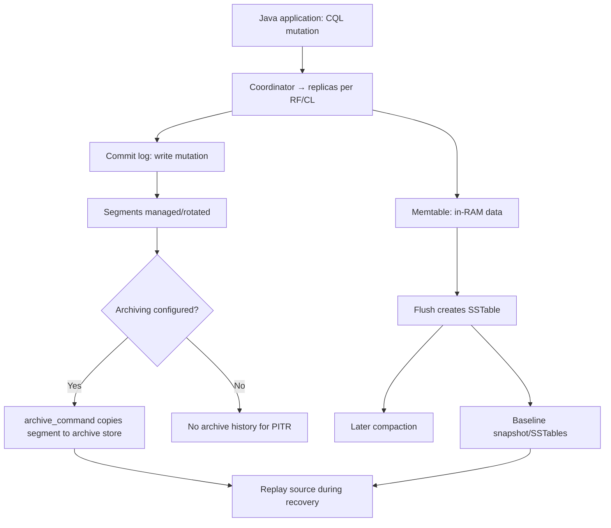
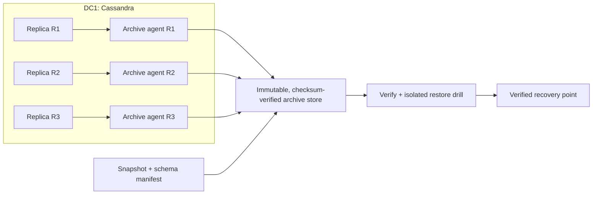

# Commit Log Archiving and Point-in-Time Recovery When Configured in Cassandra

## 1. The Problem: Rolling Data Back Prior to a Bad Operation

Apache Cassandra is a **distributed wide-column** database: data is placed by **partition key**, replicated across replicas according to **replication factor (RF)**, and accessed via CQL from applications such as Java services using `LOCAL_QUORUM`. Replication helps survive node failures, but **it is not version history for undoing arbitrary changes**.

Suppose at 10:20 a faulty deployment runs a `DELETE` across many orders. By 10:25, all three replicas have received the tombstones. Raising the consistency level, running repair, or waiting on another replica **cannot bring the data back to its 10:15 state**: replicas can all be consistent around a bad change.

Consequently, the business may need **point-in-time recovery (PITR)**: restoring a dataset to a chosen *cutoff* timestamp, such as right before the erroneous change. In Cassandra, one mechanism serving this goal when designed and **pre-configured** requires:

1. A sufficiently old **baseline snapshot/SSTables** taken prior to the target recovery time.
2. An **archived chain of commit log segments** complete enough to replay mutations occurring between the baseline and the cutoff.
3. Compatible **schema, topology, token/ownership, and version**, plus a per-node/per-replica recovery plan.
4. Properly configured **commit log restoration** with results verified in an isolated environment.

**Core lesson:** Cassandra **does not guarantee PITR by default** just because commit logs exist on disk. If archiving was not enabled or segments are missing, you cannot assume any arbitrary past timestamp is recoverable.

### Learning Objectives

- Distinguish commit logs, memtables, SSTables, snapshots, incremental backups, repair, and archiving.
- Understand common fields in `commitlog_archiving.properties` and cutoff semantics.
- Know why you must combine a **baseline snapshot + commit logs covering the exact time window**.
- Design RPO/RTO, control archive gaps, checksums, security, and restorability.
- Build a PITR playbook **on an isolated lab cluster**, while understanding multi-node/multi-DC and Java application limits.

## 2. How Does the Commit Log Participate in the Write Path?

On a replica receiving a mutation, Cassandra writes the necessary record to the **commit log** and updates the **memtable**. Once enough replicas acknowledge per CL, the coordinator returns success to the application. Detailed durability guarantees also depend on the **commit log sync policy** and version settings—not every ACK implies an identical fsync model.

The memtable is later **flushed** into immutable SSTables, which can subsequently undergo compaction. Commit log segments can be recycled/reclaimed under safe conditions once their data has been flushed.



This diagram is conceptual. **Exact timing of segment archiving, rotation, reclamation, and error handling depends on the Cassandra version.** Never assume an ACKed mutation immediately sits in an external archive.

### Why Is the Commit Log a Recovery Log, Not Yet a Backup?

The local commit log exists to support **replay when a node restarts after a crash**, especially for mutations not yet flushed to SSTables. It typically rotates and reclaims space so disks do not grow unbounded.

If commit logs live only on the node's own volume:

- A disk failure can wipe both SSTables and commit logs.
- Older segments may already be recycled once no longer needed for crash recovery.
- Without a **baseline snapshot**, replaying a few isolated segments cannot reconstruct a table's full state.
- Without compatible schema and metadata, data cannot be interpreted reliably.

**Archiving** adds a path to retain segments outside the local log lifecycle, yet it remains just **one component** of a backup/restore system.

## 3. Distinguishing Recovery Mechanisms

| Mechanism | What Does It Preserve? | Purpose Served | What It Does Not Guarantee |
| --- | --- | --- | --- |
| **Replication** | Multiple replicas of current data | Survive node/DC failures and meet CL | Rolling back to before a replicated `DELETE` |
| **Local commit log** | Mutations for single-node crash recovery | Replay after process crash | Infinite history or off-node copies |
| **Commit log archiving** | Archived copies of segments retained per policy | Replay mutations within the retained window | PITR when snapshots, segments, or config are missing |
| **Snapshot** | SSTables pinned via snapshot mechanism | Base backup / data restoration | Mutations occurring after the snapshot |
| **Incremental backup** | Newly generated SSTables saved per enabled setting | Reduce full-SSTable re-copying | Exact mutation timeline replacing commit logs |
| **Anti-entropy repair** | Reconcile/repair replicas in repair scope | Converge diverged replicas | Undoing bad business mutations |
| **Compaction** | Merge SSTables on a replica | Manage read/write/space amplification | Independent backup or replica reconciliation |

Do not treat `nodetool flush`, `nodetool repair`, and `nodetool snapshot` as three aliases for "PITR." Each serves a distinct purpose and must work together inside a **complete data protection plan**.

## 4. Commit Log Archiving Is Opt-In, Not Default

Apache Cassandra versions supporting this administrative feature typically use **`commitlog_archiving.properties`** in Cassandra's configuration directory. Common keys include:

| Key | Purpose | What to Verify |
| --- | --- | --- |
| `archive_command` | Runs a program to copy a commit log segment into the archive | Path, permissions, placeholders, exit code, copy durability |
| `restore_command` | How to restore a segment from archive storage to the recovery target | Integrity, file permissions, matching tool version |
| `restore_directories` | Where to look for prepared segments during restore | Path, segment set, identity, sufficient disk space |
| `restore_point_in_time` | Replay cutoff timestamp per supported mechanism | Format, timezone, clock skew, timestamp precision |
| `precision` | Mutation timestamp precision used for replay/cutoff | Supported values and how the app generates timestamps |

These are standard names for Cassandra commit log archiving; **check documentation and sample files for your exact running version** before copying configs. Some changes require restarts, archiving/replay behavior varies, and Cassandra management tools may use their own workflows.

### Sample Configuration for Study—Do Not Apply Directly to Production

```properties
# commitlog_archiving.properties -- Unix lab example
archive_command=/opt/cassandra-pitr/bin/archive-segment %path %name
restore_command=/opt/cassandra-pitr/bin/restore-segment %from %to
restore_directories=/srv/cassandra-pitr/replay
restore_point_in_time=2026:11:20 10:15:00
precision=MICROSECONDS
```

In this example:

- `%path` represents the source segment path for archiving, and `%name` is the segment filename.
- `%from` and `%to` typically denote the source and destination for a restore step.
- `/opt/cassandra-pitr/bin/archive-segment` and `restore-segment` are **hypothetical scripts**, not shipped by default.
- `/srv/cassandra-pitr/replay` is the staging directory preparing segments for the **lab node**.
- `2026:11:20 10:15:00` is only a sample cutoff timestamp; verify timezone, format, and precision per version.

**Never enable `restore_command` and `restore_point_in_time` on a live production cluster and roll restarts.** Restoration settings belong strictly in an intentional restore procedure, usually in an isolated environment.

### Why Are Custom Archive/Restore Scripts Needed?

A sample `cp` command works only for trivial tests. Production needs:

1. **Atomic publish:** never publish an archived segment name as complete while the file is only partially copied.
2. **Checksums:** compare sizes and checksums before and after transfer.
3. **Bounded retries:** transient storage failures must not loop endlessly or delete the source.
4. **Identity:** storage paths must distinguish cluster, DC, node/host ID, version, and segment.
5. **Retention:** never delete the sole copy before recovery windows and restore tests allow.
6. **Security:** TLS/encryption off-node, least-privilege access, auditing, and managed decryption keys.

A successful `archive_command` must tie to an **archive that actually exists and can be read back**. "Shell command exited 0" is insufficient if the script backgrounded an upload and exited before data was durably persisted.

## 5. Segment Lifecycle and Archive Gaps

A commit log segment can remain open and active across many incoming mutations. Archiving typically operates on **segment units** as Cassandra rotates through their lifecycle, rather than shipping individual mutations upon every ACK.

This creates gaps between four milestones:

- **Mutation ACKed at local/quorum CL.**
- **Mutation written to commit log on replica.**
- **Segment holding the mutation successfully archived off-node.**
- **Archive replicated/copied to disaster-surviving storage.**

Never conflate these four milestones. A disk failure between step two and step three can wipe out the ability to recover the mutation via **external archives** even though the client request succeeded.

### Timeline Illustration

```text
10:00:00  Snapshot S0 safely stored
10:03:00  Segment A archived successfully
10:07:00  Segment B archived successfully
10:12:00  Segment C still open / not yet archived
10:13:00  Node disk fails

Having only S0 + A + B does not guarantee recovery up to 10:12.
The missing window depends on mutations inside C and other recovery sources.
```

This is a conceptual illustration, not a fixed Cassandra rotation schedule. When choosing an RPO target, **measure real archive lag on each node** and account for a node losing all local storage before its final segment ships offsite.

### Do Not Turn RPO Requirements into "Frequent Flush" Commands

`nodetool flush` alters memtable/SSTable/commit log lifecycles; it is **not a guarantee that every mutation at that instant is archived**. Forcing flushes too often creates excessive SSTables, compaction debt, and I/O overhead.

Meeting a tight RPO requires designing **snapshot cadence, archiving, storage durability, gap monitoring, and recoverability** according to version behavior—not just cronning `flush`.

## 6. Baseline Snapshot Must Precede Cutoff and Contain No Future Data

Suppose you want to restore state before an accidental delete at 10:20, choosing cutoff `T=10:15`.

```mermaid
timeline
    title Illustration of a recovery chain
    09:00 : Snapshot S0
    09:10 : Valid Mutation M1
    09:15 : Valid Mutation M2
    10:15 : PITR Cutoff
    10:20 : Accidental DELETE
    10:25 : Current cluster state
```

A valid restore needs **baseline snapshot S0 prior to T**, then replays archived mutations **up to T**, ignoring mutations after T according to the version's cutoff semantics.

If you pick the **10:25** snapshot as the baseline for a **10:15** cutoff, the snapshot already contains tombstones/new writes from after the target rollback point. **Commit log replay is not a tool for reversing SSTables that already contain future changes.** Setting an earlier cutoff does not erase data already inside the base SSTables.

Therefore:

- Never restore into a data directory holding SSTables newer than the cutoff expecting timestamp filtering to undo them.
- Never mix snapshots from different days across nodes without proving consistency.
- Never treat incremental SSTable backups created **after the cutoff** as harmless when aiming to restore an older state.
- Always store snapshot manifests with timestamps, node IDs, schema, keyspace/table names, checksums, and segment sources.

**A good baseline snapshot is one whose dataset and schema/topology context can be verifiably reconstructed**; a snapshot directory name alone proves nothing.

## 7. Wall-Clock Time, Mutation Timestamps, and Execution Order

In Cassandra, data reconciles using **cell/mutation timestamps** and tombstone rules. Timestamps can come from the coordinator or **be supplied by the application**, e.g., via CQL `USING TIMESTAMP`.

For PITR to be meaningful, distinguish:

| Concept | Example | Risk if Confused |
| --- | --- | --- |
| API wall-clock time | User clicks a button at 10:14 | Does not prove the mutation carries timestamp 10:14 |
| Client/Java-supplied timestamp | Caller passes `USING TIMESTAMP` | May sit in the past or future relative to send time |
| Coordinator/replica receive time | Replica processes after network delay | Not identical to data timestamp |
| Segment archive time | File copied at 10:18 | Does not mean every mutation inside occurred at 10:18 |
| `restore_point_in_time` | Configured replay boundary | Must verify precision, timezone, and Cassandra version semantics |

### Risky Example with Client-Supplied Timestamps

```sql
-- Example query using a CQL microsecond timestamp,
-- not necessarily the current system clock.
UPDATE pitr_lab.orders_by_id
USING TIMESTAMP 1795170000000000
SET status = 'PAID'
WHERE order_id = 11111111-1111-4111-8111-111111111111;
```

This timestamp value merely illustrates the mechanism; do not assign a specific calendar meaning without converting and checking timezones. If application timestamps **run ahead of real wall clocks**, picking a wall-clock cutoff can produce unexpected outcomes.

**PITR via commit log replay is not grounds to claim a cluster-wide microsecond-consistent transactional snapshot.** Batches, LWTs, counters, and cross-partition/cross-DC operations have distinct semantics that must be tested against real data and mutation types.

## 8. Preparing Schema and Metadata: Commit Logs Cannot Rebuild a Cluster Alone

A restore needs far more than SSTable and commit log bytes:

- **CQL schema:** keyspaces, tables, partition/clustering keys, data types, UDTs, indexes, TTLs/defaults.
- **Replication/topology:** per-DC RF, snitch/DC/rack, tokens, and replica placement.
- **Cluster/node identity:** host IDs, data directories, commit log paths, SSTable/commit log versions.
- **Security:** roles, permissions, certificates, and secrets managed via separate backup procedures.
- **Operations:** compaction settings, GC grace, compression, JMX/driver endpoints, and runbooks.

Never assume all of the above metadata is restored by **replaying the business table's commit logs**. Back up schema and related configurations independently, and verify compatibility before starting replay.

### Schema Drift Risk

```text
09:00  Snapshot has table orders_by_id(status text)
10:00  Deployment alters schema, renames column or changes type
10:15  Desired cutoff
11:00  Recovery onto a new cluster with incompatible schema

Result: replay may fail or yield unexpected data.
```

The runbook must track **schema at snapshot time and at cutoff time**, along with DDL migration steps between the two. Never "hack the schema to make it start" during a restore without documenting those differences.

## 9. Multi-Replica and Multi-Datacenter Nuances

The commit log is a **per-node local log**, not a cluster-wide transaction log. In an RF3 cluster:

- R1, R2, and R3 can receive mutations at different instants.
- With `LOCAL_QUORUM`, a write succeeds once local quorum responds; another replica or remote DC may still lag.
- Backing up only R1's commit log does not cover all partitions or all replicas.
- Snapshots and archives from nodes must be tied to **token ownership**, timestamps, RF, and topology.

Suppose two DCs have `RF(dc1)=3` and `RF(dc2)=3`. Writes in `dc1` at `LOCAL_QUORUM` can succeed while the WAN link to `dc2` is down. When restoring to 10:15, **you cannot assume `dc2`'s logs hold all mutations ACKed in `dc1` prior to 10:15**.

### Whole-Cluster Recovery vs. Single-Node Recovery

| Scope | Goal | Challenges |
| --- | --- | --- |
| Single node loses disk | Restore node's replica duties | Identity/tokens, bootstrap/replacement, syncing from live replicas |
| Single table/keyspace | Recover accidentally modified/deleted business data | Early enough snapshot, complete archives, schema, and re-ingestion path |
| Single DC | Resume serving lost region's data | WAN, RF, mutation ordering, streaming bandwidth |
| Whole cluster to T | Reconstruct logical state at cutoff | No atomic cut across all nodes; requires strict manifests and validation |

Never conclude that "snapshots on three nodes sharing the same tag" form a **cluster-wide atomic consistent snapshot**. Cassandra does not provide cross-partition, cross-DC transactions merely because snapshots share a tag name.

## 10. Archive Storage Architecture and Data Protection

A reliable PITR pipeline can be structured as follows:



Depending on the platform, archives may stage locally before uploading to object storage. **Never delete local/source copies before policy-mandated archive verification completes**, yet also cap staging disk usage so external storage outages cannot fill commit log volumes.

### Suggested Object Key Structure

```text
backup-root/
  cluster-id/
    dc1/
      host-id-r1/
        snapshots/2026-11-20T09-00-00Z/...
        commitlog/CommitLog-<version>-<segment-id>.log
        manifests/...
      host-id-r2/
        ...
    schema/
      schema-at-2026-11-20T09-00-00Z.cql
```

This is an **illustrative naming convention**, not a layout Cassandra creates automatically. Object keys must avoid collisions and bind to the exact node; never merge identically named segments from two different nodes under one key.

### Retention and Recovery Policy

Retain at minimum:

1. **Baseline snapshots** frequent enough relative to RTO and replay cost.
2. **Continuous archived segments** spanning the intervals between retained baselines.
3. **Manifests** listing expected segments, checksums, timestamps, source, and copy status.
4. **Copies outside the cluster's failure domain**, avoiding shared storage/region deletion.
5. **Decryption keys and access credentials** that remain recoverable if primary systems fail.
6. **Restore drill evidence** measuring actual RTO/RPO, not merely upload logs.

Retention must be calculated backward from the **oldest recovery point the business requires**. Never keep snapshots for 30 days while purging commit log archives after 2 days and promising PITR 20 days back.

## 11. Realistic RPO/RTO: First Bounded by Archiving and Replay

**RPO (recovery point objective)** is acceptable data loss; **RTO (recovery time objective)** is required service restoration time.

Suppose:

```text
Snapshot S0:     09:00, checksum verified
Latest archive:  10:10, complete up to a saved segment
Incident:        10:16
Recovery target: 10:15
```

If unarchived segments held mutations between 10:10 and 10:15, **there is not enough data to guarantee RPO = 1 minute**. Replay only works on data actually present; setting `restore_point_in_time=...` cannot conjure unarchived mutations.

RTO depends on:

- Time to download and verify snapshots + all relevant segments.
- Object storage/WAN bandwidth and SSTable size.
- Number of nodes to build, token ownership, and startup/replay duration.
- Schema/permission checks and CQL correctness validation.
- Repair/streaming or rebalancing work during cutover.
- Updating contact points/traffic routing for Java clients.

Illustrative example:

| Task | Hypothetical lab estimate |
| --- | ---: |
| Download and verify snapshots | 45 minutes |
| Prepare config/schema | 20 minutes |
| Replay logs and bring nodes up | 35 minutes |
| Verify data and application routing | 25 minutes |
| **Hypothetical sequential total** | **125 minutes** |

Never treat 125 minutes as a production RTO commitment. Steps may parallelize or stretch due to storage, version issues, missing segments, data scale, and node counts.

## 12. PITR Lab Runbook: Plan Before Touching Data

**Practice only on an isolated lab cluster or approved recovery environment.** Restoring onto a production node holding data newer than the cutoff can cause data loss or invalid replica states.

### Phase A — Preserve Evidence

1. Record the **incident timeline**: when bad actions started, target rollback point T, and affected APIs/tenants/keyspaces.
2. Stop the faulty business write source **via application controls** to prevent further corruption.
3. Preserve existing snapshots and archived logs; **never delete** segments to "free space" before building manifests.
4. Confirm a snapshot exists from **prior to cutoff T** plus a complete commit log chain from baseline to T.
5. Identify other applications writing valid concurrent changes after T: table-wide PITR can discard those valid changes too.

If only a few rows were mis-updated, **selectively restoring from backup to another table/cluster and reapplying via controlled CQL** is sometimes safer than rewinding the whole cluster to T. Cluster-level PITR cannot distinguish "good mutations" from "bad mutations."

### Phase B — Prepare an Isolated Environment

- Provision lab cluster/VMs with **matching Cassandra version, SSTable/commit log format, topology, RF, and schema** per runbook.
- Isolate networking from production applications; prevent real apps from accidentally sending traffic to the lab cluster.
- Allocate enough disk for snapshot SSTables, restored segments, compaction/replay, and logs.
- Gather exact **node identities, tokens, data directories, and commit log directories**.
- Verify checksums, ordering, and completeness of archived segments per node.
- Specify **UTC**, cutoff timestamp timezone, and how timestamps are generated in Java/CQL.

**Never blindly copy system tables/host identities from one cluster into an existing cluster.** To rebuild nodes/clusters intact, use version-appropriate backup/restore procedures; if only business data is needed, stand up a separate cluster and ingest data in a controlled manner.

### Phase C — Restore Baseline Snapshot

Restore SSTables using the version's **exact keyspace/table and data-directory layout** per snapshot restore runbook. With hard-link snapshots, understand file and path relationships when copying from storage.

Never mix SSTables from different nodes, different timestamps, or different schemas into the same table directory. Never place SSTables newer than the cutoff into the baseline expecting commit log replay to remove that data.

### Phase D — Prepare Commit Log Replay and Cutoff

Stage the exact archived segments for the **corresponding node** into the restore staging directory. Configure `restore_command`, `restore_directories`, `restore_point_in_time`, and `precision` per **that Cassandra version's sample file** and chosen cutoff.

```properties
# Reference example for a restored lab node.
restore_command=/opt/cassandra-pitr/bin/restore-segment %from %to
restore_directories=/srv/cassandra-pitr/replay
restore_point_in_time=2026:11:20 10:15:00
precision=MICROSECONDS
```

Verify in the lab that:

1. Source files are readable and decrypted.
2. The restore script writes to the proper destination and verifies checksums.
3. Cassandra locates valid segments with no missing gaps.
4. Cutoff is interpreted with the right **timezone and timestamp precision**.
5. Startup logs show restore/replay completion per Cassandra version semantics.

**Never substitute filename timestamps or upload timestamps for mutation timestamps as the cutoff.** When Java clients supply explicit timestamps, clock skew must be factored into validation.

### Phase E — Phased Startup and Verification

Start nodes in the order required by the topology runbook. Inspect:

```bash
nodetool status
nodetool describecluster
nodetool netstats
nodetool tablestats pitr_lab.orders_by_id
nodetool tpstats
```

`tablestats` is valid only after lab schema/tables exist and the node is up; otherwise inspect the table being recovered. Seeing `UN` in `nodetool status` does not prove replay restored the **exact state at T**.

Once the cluster stabilizes and reads look right, verify via CQL, and only then evaluate moving data back to production. Any data transition requires its own playbook for **merging, conflicts, write freezes, rollback, and Java apps**—never point production at a newly restored cluster merely because startup logged no errors.

## 13. CQL Lab: Building a Pre- and Post-Cutoff Timeline

Example intended only for a lab with DC `dc1` and enough nodes for RF3; on a single-node lab adjust RF/CL to match real infrastructure. Ensure archiving and snapshots are configured and verified **before** creating the timeline.

### Create Schema

```sql
CREATE KEYSPACE IF NOT EXISTS pitr_lab
WITH replication = {
    'class': 'NetworkTopologyStrategy',
    'dc1': 3
}
AND durable_writes = true;

CREATE TABLE IF NOT EXISTS pitr_lab.orders_by_id (
    order_id uuid PRIMARY KEY,
    customer_id text,
    status text,
    updated_at timestamp
);
```

### Insert Initial Valid Data

```sql
INSERT INTO pitr_lab.orders_by_id
    (order_id, customer_id, status, updated_at)
VALUES (
    11111111-1111-4111-8111-111111111111,
    'customer-42',
    'CREATED',
    '2026-11-20 09:00:00+0000'
);
```

In `cqlsh` targeting the appropriate DC:

```text
CONSISTENCY LOCAL_QUORUM;
```

### Take a Named Baseline Snapshot

After locking in the baseline state in the lab, you can run:

```bash
nodetool help snapshot
nodetool snapshot -t before_pitr_lab pitr_lab
```

The snapshot command scopes to **the queried node**. To produce a usable backup across multiple replicas, coordinate snapshots, manifests, and copying across all required nodes per plan. **Snapshots sharing a name across nodes do not automatically form a cluster-wide transactional snapshot.**

### Create a Pre-Cutoff Mutation

```sql
UPDATE pitr_lab.orders_by_id
SET status = 'PAID',
    updated_at = '2026-11-20 10:10:00+0000'
WHERE order_id = 11111111-1111-4111-8111-111111111111;
```

In the lab, pinning mutation timestamps to a fixed timeline requires controlling clock sync / `USING TIMESTAMP` per runbook. The `updated_at` column here is **business payload**, not automatically the commit log mutation timestamp.

### Create a Post-Cutoff Bad Operation

```sql
DELETE FROM pitr_lab.orders_by_id
WHERE order_id = 11111111-1111-4111-8111-111111111111;
```

The required sequence is: take snapshot first, apply valid update, then execute accidental delete. To test **cutoff 10:15**, ensure the `PAID` mutation timestamp truly precedes the cutoff and the delete timestamp truly follows it; **do not rely solely on the `updated_at` column value**.

### Expected Outcome Upon Successful Recovery

| Timestamp | Illustrative Business State | Restore Outcome at T=10:15 |
| --- | --- | --- |
| 09:00 | `CREATED` | Present in snapshot S0 |
| 10:10 | `PAID` | Must be replayed from the right archived segment |
| 10:15 | Cutoff | Locks target state |
| 10:20 | Accidental `DELETE` | Must not be applied in target state |

Verification query:

```sql
SELECT order_id, customer_id, status, updated_at
FROM pitr_lab.orders_by_id
WHERE order_id = 11111111-1111-4111-8111-111111111111;
```

The business expectation is `status = 'PAID'` with the row still present. If `CREATED` appears, archived mutations before T may be missing; if the row is absent, snapshot/segments or cutoff were wrong, or future data leaked into the baseline. Investigate **via logs and manifests**, never diagnose from a single SELECT alone.

## 14. Verify More Than One Partition

PITR is valuable only when tests show the recovered **dataset** has clear boundaries and matches expectations. Verify:

| Data Pattern | What to Check |
| --- | --- |
| Rows created before snapshot | Not lost when loading baseline |
| Rows created after snapshot, before cutoff | Present if commit log archives contain the mutations |
| Rows created after cutoff | Absent from target state |
| UPDATEs before cutoff | Updated values applied |
| UPDATEs/DELETEs after cutoff | Do not alter target state |
| TTLs and tombstones | No unexpected resurrection of deleted data |
| Multiple partitions/tenants | Coverage beyond a single test key |
| Multiple replicas/DCs | Results and CL match restored topology |
| LWTs/counters/batches | Dedicated semantic tests, not inferred from upserts |

If restored on a new cluster, data may pass **logical tests** while still needing replica coverage, networking, auth, and performance verified before serving production traffic.

### Avoid Patching Test Results by Hand

If results miss the cutoff, do not hastily run manual `UPDATE`/`DELETE` statements on the restored cluster and declare PITR successful. That hides archive/replay bugs. **Rebuild the restore from a clean baseline**, fix the root cause (segments, schema, timestamps, version, or topology), and retest.

## 15. Java Driver 4.x: Verifying State After Restore

Java applications can use prepared statements to read by partition key at the target CL. Example repository verifying recovered data:

```java
import java.net.InetSocketAddress;
import java.util.Optional;
import java.util.UUID;

import com.datastax.oss.driver.api.core.CqlSession;
import com.datastax.oss.driver.api.core.DefaultConsistencyLevel;
import com.datastax.oss.driver.api.core.cql.BoundStatement;
import com.datastax.oss.driver.api.core.cql.PreparedStatement;
import com.datastax.oss.driver.api.core.cql.Row;

public final class RestoredOrderVerifier {
    private final CqlSession session;
    private final PreparedStatement getStatus;

    public RestoredOrderVerifier(CqlSession session) {
        this.session = session;
        this.getStatus = session.prepare(
            "SELECT status FROM pitr_lab.orders_by_id WHERE order_id = ?"
        );
    }

    public Optional<String> findStatus(UUID orderId) {
        BoundStatement stmt = getStatus.bind(orderId)
            .setConsistencyLevel(DefaultConsistencyLevel.LOCAL_QUORUM)
            .setIdempotent(true);
        Row row = session.execute(stmt).one();
        return row == null || row.isNull("status")
            ? Optional.empty()
            : Optional.of(row.getString("status"));
    }

    public static CqlSession openRecoveryLab() {
        return CqlSession.builder()
            .addContactPoint(new InetSocketAddress("10.20.0.11", 9042))
            .withLocalDatacenter("dc1")
            .build();
    }
}
```

`10.20.0.11` and the DC name are illustrative only. Production requires TLS, auth, multiple contact points, connection management, and proper local DC configuration. **Never use production credentials in an unprotected lab.**

### A Post-Restore Query Is Not Comprehensive PITR Proof

When `findStatus` returns `PAID`:

- It proves **one query** read that value at the tested CL at check time.
- It does not prove every partition/replica was restored properly.
- It does not prove post-cutoff `DELETE`s were properly excluded if stale data remained in the baseline.
- It does not prove RPO/RTO or recoverability during the next incident.

Add checks across many sample IDs, null/missing/deleted states, timestamps, row counts, business totals, p95/p99 metrics, and repair/consistency checks per runbook.

## 16. Dangerous Common Mistakes

| Mistake | Why Is It Wrong? | Prevention |
| --- | --- | --- |
| "Local commit logs suffice for PITR" | Segments rotate quickly and share the node's failure domain | Off-node archiving, snapshots, retention, and restore drills |
| "Enabling archiving today recovers last week" | Older segments likely do not exist | Never promise recovery before data sources exist |
| "Newest snapshot is always best" | May already hold bad post-cutoff DELETE/UPDATEs | Pick a pre-T baseline and exclude future SSTables |
| "Adding restore_point_in_time auto-rewinds data" | Only bounds supported replay; does not reverse SSTables | Prepare clean snapshots, right logs, and schema |
| "Archive file exists means contents are valid" | Copy may be incomplete or corrupted | Atomic publish, size/checksums, and restore validation |
| "One node has logs for all data" | Commit logs are local; data follows replicas/token ranges | Design per-node manifests and coverage |
| "LOCAL_QUORUM ensures both DCs match" | Local quorum does not wait for remote DC ACKs | Understand replication/WAN and test multi-DC |
| "updated_at dictates cutoff" | Business columns differ from mutation timestamps | Check `USING TIMESTAMP`, clocks, and precision |
| "Log replay also replays all DDL/roles" | Metadata/schema need independent backups | Manage schema, config, and permissions separately |
| "Repair can undo an accidental DELETE" | Repair converges replicas; it does not revert propagated ops | Use backup/PITR or selective recovery |
| "Three replicas mean no backup needed" | Business bugs and ransomware hit all three | Independent backups, separation of duties, immutable retention |
| "Restore test passed because node is UN" | Membership does not mean data matches cutoff | CQL validation, checksums, samples, and RPO/RTO |

## 17. Scenario Exercises

### Scenario A — Missing Tail Segment in Archive

A snapshot was taken at 09:00, archives contain complete segments up to 10:10, and data was accidentally deleted at 10:20. The business wants state as of 10:19. Can you promise PITR will satisfy this?

**Hint:** No. Mutations from 10:10 to 10:19 may be missing if they sat in an unarchived segment. Inspect available segments and other sources; if missing, report the RPO limitation rather than overpromising.

### Scenario B — Snapshot Taken After Accidental DELETE

You have a 10:25 snapshot, an accidental DELETE at 10:20, and archives from 10:00 to 10:30. Is setting cutoff to 10:15 enough?

**Hint:** No. The 10:25 snapshot already contains future changes. Bounded replay cannot erase tombstones inside baseline SSTables. You must locate an older snapshot or use another selective recovery method.

### Scenario C — Java Writes with a Future Timestamp

An app sends a mutation at 10:05 with `USING TIMESTAMP` set to 11:00. The team picks wall-clock cutoff 10:15. Could this mutation be missing after restore?

**Hint:** Yes, there is a risk because the mutation timestamp differs from wall-clock send time. Evaluate cutoff semantics and precision in your Cassandra version, audit clock/timestamp policies, and test specifically.

### Scenario D — WAN Outage Between Two DCs

`dc1` and `dc2` both have RF3. Java in `dc1` writes at `LOCAL_QUORUM` successfully during a WAN split; `dc2`'s archive store misses those mutations. Can `dc2`'s snapshots+logs alone serve as the cluster-wide "gold copy" for that time?

**Hint:** No. Local CL does not prove `dc2` received the mutations. Inspect data sources in each DC, archives/manifests, and choose a recovery policy aligned with business requirements.

### Scenario E — REST API Still Returns Wrong Data After Recovery

Lab cluster replay succeeds and partition-key CQL returns `PAID`, yet the Java API returns `NOT_FOUND`. What should you check?

**Hint:** Check whether the API points to the right cluster/DC/keyspace, caches, routing, CL, query/schema, business filters, and timestamps—instead of blaming PITR from one API response.

### Scenario F — Archive Storage Out of Space

The `archive_command` script writes files into a staging directory on the same commit log volume and uploads asynchronously, but object storage loses connectivity and staging fills up. The script still returns exit code 0. What is dangerous here?

**Hint:** Durable archives do not exist even though the system thinks work succeeded; RPO protection is lost and disk pressure rises. Enforce exit codes, durable acknowledgments, staging headroom, alerts, and throttling/pause policies.

## 18. Commit Log Archiving and PITR Operations Checklist

**Before Claiming PITR Capability**

- [ ] `archive_command` enabled and verified on **all required nodes**, not just one node.
- [ ] Baseline snapshots, schema/config manifests, and archive chains match node/token/version.
- [ ] Archives copy atomically/durably; checksums and read-back checks pass.
- [ ] Storage resides outside primary failure domains with encryption, access controls, retention, and off-region copies.
- [ ] Monitoring tracks archive lag, missing segments, script errors, staging disk, archive age, and object readability.
- [ ] RPO target is calculated from **actually replayable data**, not merely storage SLAs.
- [ ] RTO target is measured via restore drills near production data scale.

**When Executing Recovery**

- [ ] Pinpoint exact corrupted data scope, cutoff timestamp, timezone, and timestamp policy.
- [ ] Select a baseline snapshot **prior to cutoff**, containing zero future data.
- [ ] Verify continuity/completeness of required archived segments and per-node checksums.
- [ ] Restore into an **isolated environment** with controlled schema, RF, DC, tokens, and version.
- [ ] Verify `restore_command`, `restore_directories`, `restore_point_in_time`, and `precision` per version.
- [ ] Never restart production with PITR flags or mix SSTables from unplanned timestamps.
- [ ] Document that valid mutations after the cutoff may also be discarded when rolling back to T.
- [ ] Test reads, writes, and TTL/delete/LWT/counter behavior within real scope.
- [ ] Reconcile multiple partitions and applications via CQL/Java; verify RPO, RTO, and p95/p99.
- [ ] Cut over data/traffic only with a merge, rollback, and replica-consistency check plan.

**Remember:** Cassandra commit log archiving, **when properly configured and operated**, preserves segments usable to replay mutations after an **appropriate baseline snapshot**. Point-in-time recovery is not an "undo" button: it demands complete segments, accurate timestamps/cutoffs, compatible schema/topology, and verification **per node, per replica, and at the business level**. Replication and repair do not replace backups; an archive that has never been restore-tested is not yet a trustworthy RPO/RTO commitment.
