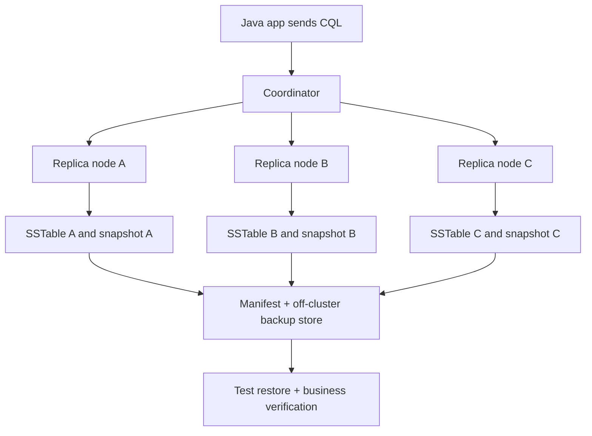
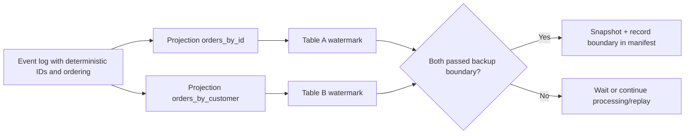

# Copy Consistency at Table, Multi-Table, and Cluster-Wide Levels in Apache Cassandra

## 1. The Problem: File-Complete Backups Do Not Guarantee Valid Business State

Apache Cassandra is a distributed **wide-column** database, partitioning data by **partition key**, replicating across nodes per replication factor (RF), and optimizing tables around query patterns. The `DATABASE_ENGINE_WIDE_COLUMN_CASSANDRA` module also emphasizes CQL, read/write consistency levels, compaction, repair, failure handling, and Java application integration. Every one of these directly affects **data consistency during backup and recovery**.

Consider an order service with two tables serving different queries:

- `orders_by_id` looks up order status by `order_id`.
- `orders_by_customer` lists orders by `customer_id`.

The application updates an order from `CREATED` to `PAID`, then updates the customer listing table. A snapshot might record `PAID` in the first table while still recording `CREATED` in the second. Both snapshot files are format-valid; **yet the restored dataset is business-inconsistent**.

The question of this lesson is not just "did `nodetool snapshot` succeed?" but rather:

1. **Table level:** do rows, partitions, and replicas reflect a validly recoverable state?
2. **Multi-table level:** do tables representing the same entity belong to the same business-change boundary?
3. **Cluster-wide level:** do snapshots taken across multiple nodes, token ranges, and datacenters form a complete, compatible, and restorable backup set?

**Learning objectives:** define a backup consistency contract, understand Cassandra snapshot limitations, choose coordination methods under live writes, build multi-node/multi-table manifests, design verification, and handle failure scenarios.

## 2. Five Properties That Must Be Kept Separate

The word "consistency" easily causes confusion when used interchangeably for queries and backups.

| Property | Question to Answer | How to Verify |
| --- | --- | --- |
| **Physical integrity** | Are SSTable components, manifests, and metadata complete and readable? | Verify file counts, checksums, test reading/restoring SSTables |
| **Scope completeness** | Are all required keyspaces, tables, nodes, DCs, and token ranges covered? | Inventory per node/DC/table and topology at backup time |
| **Replica convergence** | Have a partition's replicas received the necessary mutations? | Check replica health, planned repair/reconciliation; read tests |
| **Logical consistency** | Do tables collectively reflect completed business decisions? | Business constraints, event IDs/versions, cross-table checks |
| **Point-in-time consistency** | Does the recovery set reflect a single intentional change boundary? | Write-pause/coordination markers, barriers, watermarks, and replay history |

You must also measure **RPO** (acceptable time-measured data loss) and **RTO** (time needed to restore service). Hourly snapshots may serve as a starting point for an RPO policy, but actual RPO also depends on the last backup that was **exported off-cluster, validated, and proven restorable**.

### Query Consistency Is Not Backup Consistency

Cassandra allows choosing separate consistency levels for reads and writes. With `RF = 3` in one DC, `QUORUM` requires two replicas to respond, and `LOCAL_QUORUM` considers a majority of replicas in the local DC. Within the corresponding replica set, `R + W > RF` ensures read and write replica sets overlap under normal conditions.

However:

- Writing at `LOCAL_QUORUM` does not mean **every replica** received the mutation before the API returned success.
- Two DCs reading at `LOCAL_QUORUM` can see different data when cross-DC replication lags.
- Quorums do not create ACID transactions spanning multiple partitions or tables.
- LWTs using `IF` handle conditional contention within their scope; they **do not** create atomic keyspace-wide snapshots.
- Running snapshots on nodes at different times is not turned into "a single shared instant" by picking a higher CL.

Therefore, establish a **backup contract** separate from the CQL query contract.

## 3. What Does a Cassandra Snapshot Actually Capture?

Cassandra writes mutations to the commit log and memtable, then flushes to immutable SSTables. `nodetool snapshot` creates **hard links to SSTables** in the snapshot directory on **the node running the command**; normally the command flushes first to move memtable data into SSTables, though behavior/options must be checked by version.



A snapshot preserves the **files** present on the node at capture time. It does not automatically do any of the following:

- Lock all ongoing writes across the cluster.
- Wait for all replicas to receive every previously acknowledged mutation.
- Atomically capture multiple tables, multiple nodes, or multiple DCs.
- Copy the snapshot to storage outside the node/cluster.
- Guarantee schema and topology compatibility at restore time.
- Verify that restored data satisfies business rules.

Because snapshots use hard links, disk usage does not immediately jump by the sum of SSTable sizes, yet old SSTables remain pinned when compaction replaces them. Cleaning up with `nodetool clearsnapshot` may or may not free space depending on whether files are still referenced by live data or other snapshots. **Compaction is not a backup; repair is not a backup either.**

## 4. Table Level: Consistency of a Multi-Partition Table

Suppose a lookup-by-key table:

```sql
CREATE KEYSPACE IF NOT EXISTS commerce
WITH replication = {
  'class': 'NetworkTopologyStrategy',
  'dc1': 3,
  'dc2': 3
};

CREATE TABLE IF NOT EXISTS commerce.orders_by_id (
  order_id uuid PRIMARY KEY,
  customer_id uuid,
  status text,
  version bigint,
  updated_at timestamp
);
```

This table is designed for `WHERE order_id = ?`. Each `order_id` identifies one partition, while **the full table has many partitions** distributed across many nodes. A snapshot on a single node contains only the SSTables managed by that node; it does not mean it contains the whole table.

### 4.1. A Local Snapshot Is Not a Table-Wide Transaction Boundary

Consider two distinct partitions, A and B:

| Time | Event | Node X | Node Y |
| --- | --- | --- | --- |
| `t0` | A has `status=CREATED`; B has `status=CREATED` | No new mutations yet | No new mutations yet |
| `t1` | Write A to `PAID` and receive quorum ACK | May already have new A | May still hold old A |
| `t2` | Snapshot on node X | Captures SSTables at X | Not yet captured |
| `t3` | Write B to `PAID` | May receive new B | May receive new B |
| `t4` | Snapshot on node Y | Already snapshotted earlier | Captures SSTables at Y |

Both snapshot X and Y are valid, yet the collected dataset **lacks a common time boundary**. If restore combines them, operators must understand which mutations existed on each replica and how Cassandra will reconcile them by timestamp. You cannot infer a table-wide `t2` or `t4` image.

Even on a single node, a snapshot may include partitions updated at different times. "SSTable file integrity" differs from "all rows belonging to one table-wide transaction."

### 4.2. How to Raise Confidence at the Table Level

When a table must be backed up to recover application-acknowledged state:

1. **Define partition scope:** which tables, full token ranges, or only reconstructible key sets.
2. **Lock write boundaries:** if a stable snapshot is needed, halt incoming writes and drain in-flight writes—including retries, message consumers, and background writers.
3. **Verify replica state:** a quorum-ACKed write is not necessarily present on every replica. Check node health, hinted handoff, and repair schedules; if full replica convergence is required, run a planned reconciliation/repair process, not just a flush command.
4. **Snapshot all required nodes** with the same tag, then inventory every node by keyspace/table.
5. **Copy and verify files** from each source to an independent backup store.
6. **Test-restore** into a separate environment and query sample partitions with known versions/statuses.

A **table** is not a general Cassandra transaction unit. Single-partition mutations or batches are atomic within Cassandra's model limits, but must not be generalized into atomic snapshots across all partitions.

### 4.3. TTLs, Tombstones, and Timestamps After Restore

Recovery can yield unexpected results even when files are uncorrupted:

- **TTLs** are tied to when data was written. Restoring an old copy does not extend lifespan; data may already be expired against real wall-clock time.
- **Tombstones** mark deletions. Restoring an old snapshot alongside live data can resurrect deleted values in some cases if corresponding tombstones are gone or data scope is mismanaged.
- **Timestamps / last-write-wins** govern how Cassandra reconciles competing cells. Mixing old and new SSTables does not guarantee "keeping what is business-correct."
- **`gc_grace_seconds` and repair** affect whether tombstones still shadow old data on replicas. Backup/restore must factor in retention and replica sync schedules.

The safe verification method is standing up an **isolated** recovery, preserving schema and data per a clear plan, and querying it—never pouring old SSTables into a live production cluster accepting writes to "patch" data.

## 5. Multi-Table Level: Denormalization Creates Business Consistency Challenges

Cassandra encourages creating tables per query pattern. A single business event can update multiple tables:

```sql
CREATE TABLE IF NOT EXISTS commerce.orders_by_customer (
  customer_id uuid,
  order_id uuid,
  status text,
  version bigint,
  PRIMARY KEY ((customer_id), order_id)
);
```

When transitioning an order status, the Java application might execute:

```text
1. UPDATE commerce.orders_by_id        SET status='PAID', version=2 ...
2. UPDATE commerce.orders_by_customer  SET status='PAID', version=2 ...
3. Confirm business completion to the user.
```

If the first table is snapshotted **after step 1** while the second table is snapshotted **before step 2**, they conflict after restore. When data also feeds reporting tables, materialized views, or other lookup tables, divergence cases multiply.

### 5.1. Why Using BATCH Is Still Not Enough

CQL `BATCH` groups mutations; logged batches help ensure all mutations complete upon mid-execution failures. However, **batches do not provide RDBMS-style isolated cross-partition transactions**, nor do they turn multi-table snapshots running across nodes into a single global atomic snapshot.

In particular, across tables with different partition keys, a reader or snapshot process can observe intermediate states. You must model the **"business change completed" boundary** through application mechanisms and recovery procedures.

### 5.2. Three Strategies for Multiple Tables

| Strategy | Implementation | Strengths | Trade-offs / Conditions |
| --- | --- | --- | --- |
| **Coordinated write pause (quiesce)** | Block writers across all instances, drain in-flight tasks, verify, snapshot all related tables | Simple to reason about during maintenance windows | Impacts availability; still must handle lagging replicas and failed nodes |
| **Source of truth + rebuildable tables** | Store canonical state or event logs with IDs/versions, treating query tables as projections | Allows rebuilding/reconciling secondary tables after restore | Rebuild/replay cost; logs and ordering must be trustworthy |
| **Processing checkpoints / watermarks** | Record processed event watermarks per projection, storing watermarks alongside backups | Reduces need for long global write pauses | Must prove no skipped/reordered events, idempotent replay, and multi-consumer coordination |

No single strategy fits every application. If the business requires atomic transactions across multiple accounts/partitions, tweaking consistency levels or adding snapshots will not suffice. You may need a transactional store as the source of truth while Cassandra serves lookup queries.

### 5.3. Example Using Versions and Watermarks

Suppose an event has the structure:

```json
{
  "event_id": "evt-1042",
  "order_id": "11111111-1111-1111-1111-111111111111",
  "version": 2,
  "new_status": "PAID",
  "source_sequence": 1042
}
```

Two projectors update two query tables. For a backup process to claim state **up to event 1042**, it must verify **both projectors** finished processing all necessary events **to the same boundary**, per the system's ordering rules. A number like `1042` is meaningful only if the event source truly provides total ordering across the relevant scope; in partitioned log systems you generally need **per-partition offsets**, rather than applying an arbitrary global offset.



After restore, reconcile `order_id` and `version` across tables, then replay events not yet reflected. **A version field alone does not create transactions;** it helps detect and repair divergence when the system has idempotency, completion acknowledgments, and a clear source of truth.

## 6. Cluster-Wide Level: Multiple Nodes, Multiple Datacenters, Multiple Data Versions

Example topology:

- `dc1`: nodes `a1`, `a2`, `a3`; keyspace RF = 3.
- `dc2`: nodes `b1`, `b2`, `b3`; RF is also 3.
- Application writes primarily in `dc1`, reads in both DCs.
- Shared snapshot tag: `commerce-20261121T020000Z`.

Running `nodetool snapshot` on `a1` snapshots only `a1`. Producing a cluster-wide backup requires **inventorying all relevant nodes and keyspaces/tables in both DCs**, with a clear upload and verification workflow.

### 6.1. What Does "Cluster-Wide Complete" Mean?

Typically, a backup run manifest must record:

| Info Group | Fields to Include |
| --- | --- |
| Identity | `backup_id`, cluster/environment, tag, UTC start/end timestamps |
| Topology | DC, rack, node, node status, token ranges, per-keyspace RF |
| Schema | Keyspace/table DDL, table IDs, related indexes/views, Cassandra/SSTable version |
| Scope | Tables included, tables excluded, required nodes, exclusion reasons |
| Per-node outcome | Snapshot succeeded/skipped/failed, paths, file counts |
| Files and storage | SSTable manifest, checksums, byte size, remote URI, upload status |
| Data boundary | Quiesce window, watermark/event offset, unconverged-replica warnings |
| Operations | Coordinator/operator, retention, encryption, restore test, verified RPO/RTO |

If all six nodes are listed yet `b2`'s upload failed, you cannot declare a **physically complete six-node backup**. Enough data may still exist on other replicas to reconstruct **part or all of the logical dataset**, but that must be proven by token coverage, actual data, and a restore test—never inferred blindly from RF.

### 6.2. One Tag Does Not Mean One Instant

Example:

| Time | Node | Action |
| --- | --- | --- |
| 02:00:00 | `a1` | Capture tag T |
| 02:00:12 | `a2` | Capture tag T |
| 02:00:40 | `a3` | Capture tag T |
| 02:01:25 | `b1` | Capture tag T |
| 02:02:10 | `b2` | Capture tag T |
| 02:03:00 | `b3` | Capture tag T |

If writes continue during those three minutes, these are **six local states captured over a three-minute window**, not a cluster-wide snapshot at exactly 02:00. Tag T is a label for **grouping and inventory**, not a global transaction ID.

Even when `LOCAL_QUORUM` writes succeed in `dc1`, `dc2` may not yet have received those mutations when `b1` snapshots. Per-DC quorums and per-node snapshots must be analyzed separately.

### 6.3. Topology Changes During Backup

During node additions, bootstraps, decommissions, or RF changes, data streams between nodes and token ownership shifts. Backups captured before and after intermediate steps may **miss or duplicate token ranges** relative to the topology manifest.

Therefore, avoid topology/schema changes during a collection window requiring consistent backups. When unavoidable, backup tooling must record exact topology/token-range maps at each instant and validate coverage accordingly. Never rely solely on an IP list collected after nodes have changed.

## 7. Choosing a Backup Contract by Business Requirement

| Requirement Type | Required Rigor | Reference Approach |
| --- | --- | --- |
| Recovering a rebuildable cache table | Short-term skew acceptable; rebuild source exists | Per-table snapshot/restore or rebuild from source system |
| Recovering a full orders table | Complete data required; no lost partitions/replicas | Scoped cluster-wide snapshots and inventory; sample data verification |
| Recovering multiple projection tables for the same order | Prolonged contradictory states unacceptable | Quiesce + verify, or source of truth + version/watermark replay |
| Multi-table schema/migration rollback | Schema, data, and cutoff compatibility required | Export DDL, shared tag, pause/coordinate writers, test-restore before migration |
| Recovery after full DC loss | Backups must sit outside the failed DC | Independent fault-domain backups, all-DC manifest, restore/failover testing |
| Recovering "exactly 10:15:00" | Very tight time boundary | Snapshots combined with designed, deployed, and tested log/PITR mechanisms; snapshots alone fail |
| Cross-entity financial transactions | Cross-partition invariants and transaction boundaries | Appropriate transactional/ledger source; Cassandra as lookup layer if needed |

**RPO/RTO are measured commitments.** For instance, "backup every 30 minutes" does not guarantee a 30-minute RPO if snapshots take minutes, uploads fail, or projector tables lag. Rely on **verified, restore-tested backups**, not cron schedules alone.

## 8. Runbook for Coordinating Consistent Snapshots When Writes Can Pause

This is a reference procedure for a maintenance window with authority to coordinate all writers. It achieves a verifiable business boundary only if zero writers are missed and replicas are reconciled to target standards.

### Phase A — Lock Scope and Preconditions

1. List keyspaces, primary tables, denormalized tables, views/indexes, and state sources that must restore together.
2. Capture schema metadata, RF, topology, Cassandra version, token ownership, TTL/tombstone policies, and backup configs.
3. Verify nodes are `UP`, inspect disk/compaction health, repair, hinted handoff, and pending topology changes. Failed nodes or unconverged replicas require explicit decisions.
4. Pick a unique `backup_id` and independent backup store. Ensure disk quotas, retention, encryption access, and operational deadlines.
5. Announce the "barrier": every HTTP writer, queue consumer, batch job, scheduled task, retry worker, and cross-DC writer must honor it.

### Phase B — Bring the Application to a Stable Boundary

```text
STOP_ACCEPTING_MUTATIONS
  -> DRAIN_IN_FLIGHT_WRITES
  -> WAIT_FOR_PROJECTORS_AND_RETRIES
  -> VERIFY_BUSINESS_INVARIANTS
  -> VERIFY_REPLICA_READINESS / REPAIR_IF_REQUIRED_AND_SAFE
  -> SNAPSHOT_ALL_SCOPED_NODES
  -> VERIFY_LOCAL_SNAPSHOTS
  -> RELEASE_APPLICATION_WRITE_BARRIER
  -> COPY_REMOTE_AND_VERIFY
```

**Points of caution:** halting only the HTTP API while consumers keep updating projection tables leaves the app non-quiescent. Waiting only for `LOCAL_QUORUM` writes to return leaves remaining replicas potentially unconverged. If running repair, schedule it per operational policy: repair incurs network/I/O cost, can run long, and should not be treated as an instant "sync every replica now" command under all conditions.

Once all writers pause at the business boundary, nodes can be snapshotted sequentially without new app mutations. Still, verify in-flight mutation delivery, TTLs, and natural data state changes. **Never claim a global transaction solely because writes were paused.**

### Phase C — Capture and Inventory Per Node

On authorized Cassandra nodes, check version/syntax first:

```bash
nodetool status
nodetool version
nodetool help snapshot
nodetool help listsnapshots
```

Example snapshotting keyspace `commerce` with the **same tag** across every in-scope node:

```bash
# Execute individually on a1, a2, a3, b1, b2, b3
# using an authorized management/orchestration workflow.
nodetool snapshot -t commerce-20261121T020000Z commerce

# This command lists ONLY LOCAL snapshots on the queried node.
nodetool listsnapshots
```

In several Cassandra versions, `nodetool snapshot` flushes memtables before hard-linking SSTables. Verify version behavior and avoid skip-flush options when backups must capture writes still in memtables.

For each node/table, record `STARTED`, `SUCCESS`, or `FAILED`; **missing output does not mean success**. Transition the backup set to `LOCAL_CAPTURED` only when all mandatory nodes have valid snapshots and metadata.

### Phase D — Export Data, Verify, and Retain Proof

Once local snapshots finish across all in-scope nodes, application writes can resume **if** backup policy permits asynchronous upload completion and local snapshots remain intact until uploads are verified.

The collection workflow should:

1. Read exact snapshot paths from each node's `data_file_directories`; table directories embed table IDs, so never hard-code folder names.
2. Preserve all SSTable components, manifests, and required schema/DDL; record source node/table/token coverage.
3. Copy to object storage or off-cluster storage under paths containing `backup_id/dc/node/keyspace/table`.
4. Match file counts, checksums, and byte sizes between source and destination. Use idempotent uploads so retries never mix runs.
5. Mark each item `REMOTE_VERIFIED`; mark the overall backup `VERIFIED` only when all policy requirements pass.
6. Apply retention/WORM if policy mandates, and log restore-test evidence in an isolated environment.

**Never delete local snapshots** before corresponding remote copies are complete, verified, and past policy-defined local retention. When cleaning up, run `nodetool clearsnapshot` with the exact tag and keyspace on **each authorized node**—never bulk-delete without an inventory.

## 9. Backing Up When Writes Cannot Stop: State Limitations Explicitly

In 24/7 services, quiescing the entire cluster is not always feasible. You may choose **"fuzzy" snapshots + replay/reconciliation** backed by a managed source of changes.

Suppose every order change is written first to a source of truth with deterministic per-order sequencing. Cassandra tables serve as projections; backups include:

- Physical snapshots with complete manifests across required nodes.
- Watermarks/offsets for each projector at snapshot time, stating **scope and ordering basis**.
- Independent retention of events not yet uniformly reflected or needing replay.
- Deduplication and per-key ordering rules to update tables post-restore.
- Verification bringing both tables to the same business version.

**Never automatically treat Cassandra CDC or commit logs as a ready-to-use PITR system.** You must engineer storage pipelines, gap detection, retention, replay, schema mapping, and end-to-end tests. For workloads with concurrent updates, clocks and Cassandra timestamp reconciliation must also enter recovery rules.

An alternative is snapshotting a **transactional source system** capable of transactional snapshots and rebuilding Cassandra query tables from it. That can be simpler when Cassandra acts strictly as a read model.

## 10. Verifying a Backup Set: Three Validation Layers

### 10.1. Physical Validation

- Snapshots exist on **every node** in the backup scope with the right tag/keyspace/table.
- Manifests/DDL and SSTable components exist remotely with filenames and checksums matching the source.
- Topology, token ranges, RF, and any non-reporting nodes audited.
- No files exist only on ephemeral/being-wiped storage or share the primary failure domain.
- Cassandra version and compatible import/restore procedures documented.

### 10.2. Logical Validation

Checks should rely on **partition-key queries**, avoiding full-table `SELECT COUNT(*)` on large tables as a primary check since it is resource-intensive. Example:

```sql
-- Execute on the test recovery cluster using order_id values recorded
-- in the pre-backup verification set.
SELECT order_id, status, version, updated_at
FROM commerce.orders_by_id
WHERE order_id = 11111111-1111-1111-1111-111111111111;

SELECT customer_id, order_id, status, version
FROM commerce.orders_by_customer
WHERE customer_id = 22222222-2222-2222-2222-222222222222
  AND order_id = 11111111-1111-1111-1111-111111111111;
```

Compare `status` and `version` for the same `order_id`, sampling many partitions across token ranges—including fresh records, deleted records, TTLs, and concurrently updated orders. The test set should have **expected answers stored independently** per backup ID; never compare two tables solely against each other and declare both correct if both are stale.

### 10.3. Operational Validation

A backup is trustworthy only if it can **actually be restored** into an isolated environment within the target RTO. Verify:

- DDL/schema and table ID compatibility, plus version-appropriate SSTable loading paths/tools.
- Replica ownership and consistency post-restore; repair/streaming if required by procedure.
- Business query latency, accessible partitions, and expected rows.
- Multi-table consistency rules, actual data-loss window, and actual recovery duration.
- Log/projection replayability, idempotent writes, and zero unexpected resurrection of deleted data.

**Merely running `nodetool listsnapshots` is not a restore test.** A snapshot may appear in listings yet still miss remote files, lack schema, or fail to reconstruct business invariants.

## 11. Common Failure Matrix

| Situation | Consistency Risk | Required Action |
| --- | --- | --- |
| Table A snapshot succeeds; Table B not captured | Mismatched checkpoints for the same order | Keep status incomplete; controlled retry or recover from source of truth |
| One node in `dc2` unresponsive | Missing local snapshot / token range on that node | Do not report full backup; assess node and surviving replicas, plan verified compensation |
| API quiesced while consumers still run | Projection tables change between snapshots | Stop/drain all writers, or capture watermarks + replay |
| `LOCAL_QUORUM` write succeeds, immediately snapshot other DC | Other DC may not have received the write | Never infer R+W across DCs; sync/reconcile or enforce explicit restore cuts |
| Restoring old snapshot into live-write cluster | Tombstone/timestamp conflicts; old data may resurrect | Restore in isolation; follow tested import/merge procedures |
| Snapshot taken mid-topology-change | Token ownership and node inventory shift | Freeze topology or capture full transitions and audit token coverage |
| Upload completed but checksum failed | Remote copy is corrupted | Re-generate/re-copy from trusted source, verify, and keep local copies |
| Snapshot too old; event log past retention | Cannot replay the missing gap | Mark backup unusable for that RPO; adjust schedule and retention |
| TTL data expired by restore time | Differs from state observed at backup time | Define time-aware TTL expectations; test restores with realistic workloads |
| Repair/compaction runs after snapshot | Active SSTable set changes | Do not confuse these changes with creating a new backup; watch disk and hard links |

## 12. Practical Exercise: Designing Backups for Orders Across Two DCs

A cluster has `dc1` (`a1,a2,a3`) and `dc2` (`b1,b2,b3`), RF = 3 in each DC. A Java service writes `orders_by_id` in `dc1` with `LOCAL_QUORUM` and updates `orders_by_customer` via an async worker. At 09:00, the API confirms order X is paid. The worker updates the secondary table at 09:00:04. Operations snapshots the first table at 09:00:02 on `a1`, then remaining tables and nodes from 09:01–09:03.

**Questions:**

1. Why can the snapshot set restore `orders_by_id.status = PAID` while `orders_by_customer.status = CREATED`?
2. Does `LOCAL_QUORUM` acknowledgment in `dc1` guarantee every `dc2` snapshot captured `PAID`? Why?
3. What metadata must be added to the manifest to know backups cover all nodes, tables, and token ranges?
4. If the system cannot be paused, how would you use event IDs/versions and per-worker watermarks?
5. If `b2` fails while the other five nodes have snapshots, can this be called a "complete six-node backup"? How do you evaluate whether enough logical data can be recovered?
6. Write the conditions required before pruning local snapshots already transferred to the backup store.

**Solution Hints:**

- Both tables are updated at **two different instants**; snapshots cutting across a multi-step business workflow can capture two different versions.
- Quorum in `dc1` only confirms replicas in that local region acknowledged; it **does not** force every `dc2` replica to be updated before snapshotting.
- The manifest should list nodes/DCs, tag, schema, tables, token coverage, timestamps, per-node results, checksums/file counts, and remote verification status.
- For multi-table consistency without halting writes, rely on a source of truth and **guarantee replay** up to defined processing boundaries per projection. With partitioned logs, record per-partition watermarks/offsets and per-key ordering rules.
- Missing `b2` makes the physical inventory **incomplete**. Other replicas may hold the same data, but coverage and restorability must be proven; RF does not automatically turn missing files into success.
- Prune local copies only when remote backups are **complete, checksum-verified, retention-compliant, and the recovery plan no longer depends on local copies**.

## 13. Pre-Declaration Checklist for Safe Backups

- [ ] Defined **targets** at table, multi-table, or cluster level along with actual RPO/RTO.
- [ ] Identified **sources of truth**, query tables, dependent tables, and rebuildable data.
- [ ] Recorded schema/version, replication, topology, and token ranges.
- [ ] Classified snapshots as quiesced cutoffs, "fuzzy" snapshots, or log/watermark-backed backups.
- [ ] Audited all writers/consumers/retries/backfills that could keep mutating data.
- [ ] Evaluated **replica convergence**, repair, hinted handoff, and lagging DCs.
- [ ] Captured scoped snapshots on all required nodes and inventoried per-node outcomes.
- [ ] Copied all required files/manifests/DDL to an independent store and verified checksums.
- [ ] Retained backup evidence per node, per table, version, and logical watermark.
- [ ] Test-restored in an independent environment and verified business invariants.
- [ ] Checked TTLs/tombstones, idempotency, replay, RPO/RTO, and missing-token risks.
- [ ] Established retention, ownership, restore drill schedule, and safe local snapshot cleanup.

**Conclusion:** In Cassandra, a **file-intact** snapshot set is not necessarily **replica-complete**, and even less **business-consistent across multiple tables or the entire cluster**. Define the data boundary required for recovery, coordinate writers or prepare reliable replay sources, inventory all nodes/tables/token ranges, and declare a backup valid only after verification and a passing restore test.
