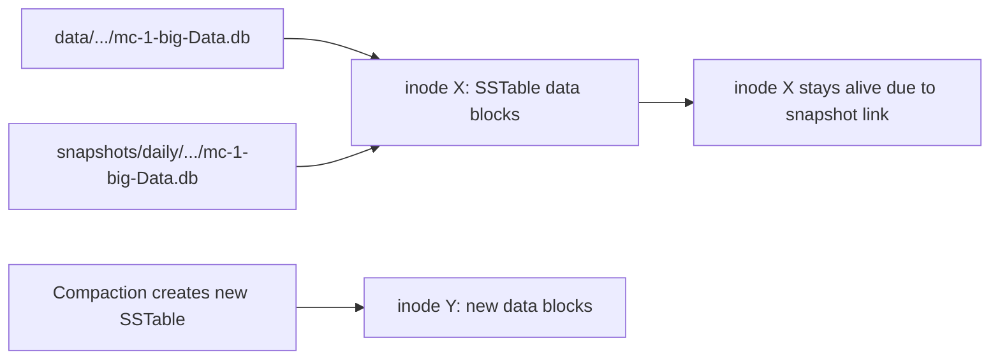
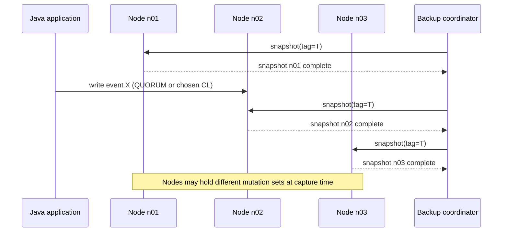
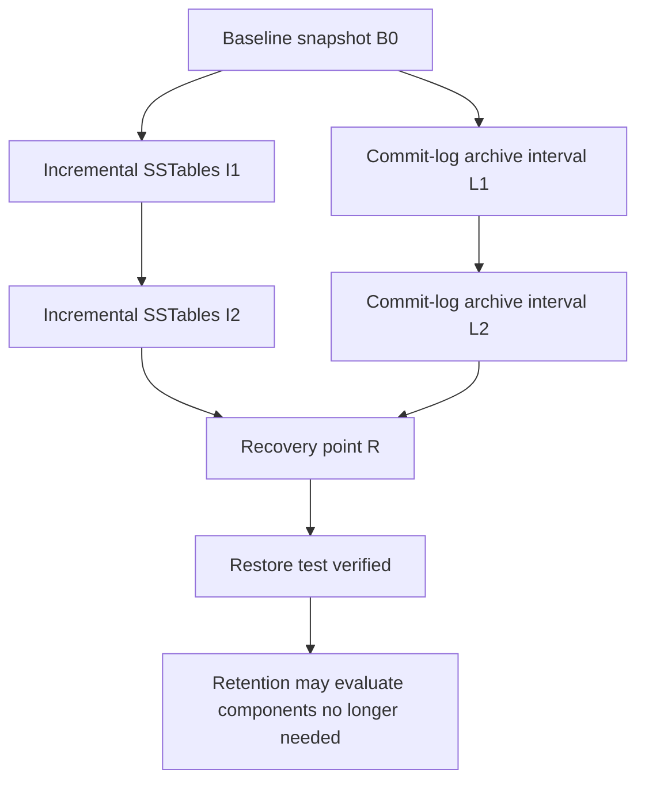
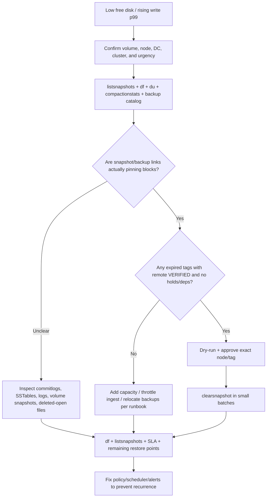

# Managing Snapshot Disk Usage and Retention Policies

In Apache Cassandra, `nodetool snapshot` is an essential tool for creating SSTable data backup checkpoints. Yet creating a snapshot successfully **does not mean you already have a safe backup**: snapshots usually live **on the same node/storage device** as live data and can be lost together when a disk or node fails. Conversely, a snapshot created via **hard links** may consume negligible new space at creation time, then retain many old SSTables as compaction runs. Without a retention policy and controlled cleanup, seemingly "free" snapshots can fill disks, block flushes, compaction, and streaming, and trigger write failures.

This lesson belongs to the **Backup and Recovery** chapter of the **DATABASE_ENGINE_WIDE_COLUMN_CASSANDRA** module. Its focus is **measuring snapshot disk usage accurately**, defining retention schedules from RPO/RTO and audit requirements, storing copies **off-node/off-cluster**, protecting backup chains needed for restore, performing safe cleanup, and running recovery drills. The content integrates CQL, SSTables/compaction, replication, repair, tombstones, node administration, and the Java Driver to prevent misconceptions that commonly cause data loss during incidents.

> **Operational rule:** delete a snapshot only after confirming **which snapshot, on which node, for which recovery point, and whether it is still needed for recovery**, backed by proof that off-node copies are complete and readable. `nodetool clearsnapshot` is a **local recovery-point-destructive** operation, not an arbitrary disk-cleanup tool.

## 1. Learning Objectives

After this lesson, you will be able to:

1. Explain how SSTable snapshots work via **hard links**, and their relationship with memtable flushes, compaction, and `snapshots/` / `backups/` directories.
2. Distinguish **listed logical size**, **unique physical inode/data-block usage**, **actual bytes freed upon deletion**, and disk headroom.
3. Read `nodetool listsnapshots`, `status`, `tablestats`, and OS metrics to pinpoint disk consumers.
4. Design daily/weekly/monthly and **RPO/RTO**-driven retention without deleting components still needed for restore/PITR.
5. Distinguish **manual snapshots**, **auto-snapshots**, **incremental backups**, **commit-log archiving**, and off-node copies.
6. Build an auditable workflow: backup → upload → manifest/checksum verification → catalog → retention → cleanup.
7. Execute a safe CQL/`nodetool` lab and post-restore validation using Java Driver 4.x.
8. Build a runbook for snapshot-induced disk-full emergencies while preserving data, repair/compaction health, and recovery points.

## 2. What Does a Cassandra Snapshot Actually Contain?

Cassandra writes mutations to the **commit log** and **memtable**, then flushes memtables into immutable **SSTables** on disk. `nodetool snapshot` snapshots SSTables for the selected tables/keyspaces, typically triggering a flush before linking files so memtable data is included; some versions/options allow skipping the flush. A snapshot is a collection of SSTable components at capture time **on one node**, not a monolithic cluster-wide transactional image.

The data directory may follow this conceptual layout:

```text
<data_file_directory>/
  backup_lab/
    events_by_tenant_day-<table_id>/
      <current active SSTable components>
      snapshots/
        daily-20261121-0000/
          manifest.json
          schema.cql
          <linked SSTable components>
      backups/
        <SSTable components held by incremental backups>
```

Directory naming, manifest contents, `schema.cql` support, and multiple data directories vary across Cassandra releases. This path is illustrative only; **never assume every node uses `/var/lib/cassandra/data`**. Locate your environment's actual `data_file_directories` and check your version before operating.

### Why Doesn't a Snapshot Copy Full SSTables at Creation Time?

On filesystems supporting **hard links**, Cassandra creates new directory entries pointing to the same inode/file contents as the original SSTables. Creating hard links does not duplicate data blocks:



**Correct interpretation:**

- **Before compaction:** active SSTables and snapshot links reference the same inodes. Immediate physical delta may be tiny compared to logical SSTable size.
- **After compaction:** Cassandra replaces old SSTables with new SSTables and unlinks the active filenames. While a snapshot holds a hard link, **the old inode cannot be freed**.
- **When clearing a snapshot:** one or more hard links are unlinked. Data blocks are freed only when **no hard links or open file handles remain** referencing that inode and the filesystem reclaims them.
- **Immutable SSTables:** never edit hard-linked file contents to "shrink snapshot size"; mutating files can corrupt live data as well.

Therefore, **a snapshot is not a copy-on-write volume snapshot** like LVM/ZFS/EBS. Cassandra's hard-link mechanism and storage/volume-level snapshots are two different technologies with distinct consistency, performance, operational, and cost profiles.

### What Snapshots Contain and What They Lack

| Component | Guaranteed by `nodetool snapshot`? | Action Required |
| --- | --- | --- |
| **Selected SSTables on the node** | Yes, within snapshot scope and flushed/matching-option files. | Copy all SSTable components, preserve manifests and checksums. |
| **New data still in memtable** | Usually included via pre-snapshot flush; omitted by default if `skip-flush` is used or flush fails. | Record flags and flush results; determine actual RPO. |
| **Commit log** | Not fully protected solely by SSTable snapshots. | If PITR is needed, design tested commit-log archiving and replay. |
| **Schema/keyspace/UDT/index definitions** | May include `schema.cql` in snapshot depending on version/scope. | Catalog and back up compatible DDL; verify before restore. |
| **Users/roles/permissions/config/secrets** | Not a complete cluster/application backup. | Protect security metadata, config, TLS/certs, and JDK/version via separate workflows. |
| **Off-node / off-DC backup** | **No**; hard links remain on the node's disk. | Upload/copy to durable independent storage, verify read-back, enforce access control. |
| **Cluster-wide consistent transactional image** | **Not by default**; each node/table flushes and snapshots at its own time. | Define consistency boundaries, RPO, and coordinate ingest/DDL if required. |

## 3. Four Storage Consumers Commonly Mis-Summed

A Cassandra disk may simultaneously hold:

1. **Active SSTables** in `data_file_directories` serving reads/writes.
2. **Snapshot SSTable hard links** retained for restores.
3. **Incremental backup links/files** in `backups/` (when enabled).
4. **Temporary/in-flight SSTables**, commit logs, filesystem snapshots, logs, repair/streaming files, and other artifacts.

Do not count every file in the directory tree as **an independent physical copy**, because multiple paths may point to the same inode. Conversely, do not assume snapshots are **free** just because they only create hard links initially.

### Useful Capacity Formula

```text
Actual physical usage on volume (approx.) =
  unique data blocks of all retained SSTables
  + other data on volume
  + metadata/filesystem overhead

Retained SSTables can be pinned by:
  active table OR snapshot(s) OR incremental backup link(s)

Capacity to budget while running:
  current physical usage
  + headroom for compaction/flush
  + headroom for repair/bootstrap/streaming
  + ingest growth until next cleanup
  + margin for incidents and OS/system operations
```

**Never sum `active SSTables + all snapshot logical sizes + all incremental backup logical sizes` as if they were independent** and claim that as exact physical usage. Inode/hard-link overlap depends on compaction, backup history, and filesystem state.

### Illustrative Numeric Example

Suppose a 300 GiB volume holds:

| Unique Physical Component | Estimate |
| --- | ---: |
| Active SSTables | 120 GiB |
| Obsolete SSTables pinned solely by **snapshot links** | 70 GiB |
| Unique SSTables pinned by **incremental backup links**, disjoint from above | 10 GiB |
| Commit logs / logs / other system files | 15 GiB |
| **Total currently used (approx.)** | **215 GiB** |
| Remaining space before growth/compaction | **85 GiB** |

If a compaction/streaming run needs 60 GiB headroom and ingest grows 35 GiB before the next cleanup, peak demand can exceed the 85 GiB free space. In reality, measure directly from the volume, **not** from this hypothetical table.

**Lesson:** right when a snapshot is created, disk usage may barely move. After several compaction cycles, snapshots pin old SSTables and disk usage climbs even when live data size and row counts stay flat.

## 4. Measuring Usage: `listsnapshots`, `du`, `df`, and Inodes

### `nodetool listsnapshots`

```bash
nodetool help listsnapshots
nodetool listsnapshots
```

Depending on version, output may report **keyspace**, **table**, **snapshot name/tag**, **true size**, **size on disk**, or similar statistics. Check exact column definitions for **your running release**: when hard links span active/snapshot/backup paths, those numbers do not simply add up to the space freed by clearing one tag.

**Hypothetical numbers** example:

```text
Snapshot Tag          Keyspace    Table                  Logical Size
daily-20261118-0000   backup_lab  events_by_tenant_day   80 GiB
daily-20261119-0000   backup_lab  events_by_tenant_day   83 GiB
daily-20261120-0000   backup_lab  events_by_tenant_day   85 GiB
daily-20261121-0000   backup_lab  events_by_tenant_day   86 GiB
```

Never claim "clearing the day-18 tag will definitely free 80 GiB," because files may still be linked by the day-19/20 tags or active SSTables. Reclaimed space must be **measured before and after** authorized cleanup.

### Cross-Checking with the OS (Linux)

```bash
# Read-only; example paths, substitute actual data_file_directories.
df -h /var/lib/cassandra/data
df -i /var/lib/cassandra/data
du -sh /var/lib/cassandra/data

# Displayed size of snapshots directory alone can mislead
# because hard links overlap with live files or other tags.
du -sh /var/lib/cassandra/data/backup_lab

# Inspect link count/inode of a selected SSTable component:
stat -c '%n inode=%i links=%h size=%s' /path/to/file-Data.db
```

Important caveats:

- `df` reports **blocks currently allocated on the filesystem/volume**, suitable for tracking true free space, yet can differ from `du` due to sparse files, reserved blocks, deleted-but-open files, storage snapshots, or separate mounts.
- `du` normally **avoids double-counting the same inode** within one full-tree traversal, but running `du` on snapshots **separately** and on active files **separately** and summing them **will double-count**. Traversal order and flags affect attribution.
- `ls -li` or `stat` shows inode numbers and hard-link counts, yet inodes are meaningful **only within one filesystem**. Two separate volumes may coincidentally share inode numbers while being unrelated.
- One SSTable comprises **multiple component files**; `Data.db` is only part of its total footprint.
- Multiple `data_file_directories` or multiple mounted volumes must be measured **per volume**, not solely via node-level `Load`.

### Minimum Observability Table

| Metric | Question Answered | Alert Condition |
| --- | --- | --- |
| Disk free bytes and % per volume | Is there enough headroom for compaction/streaming/retries? | Free falls below measured threshold—never one blanket number for every node. |
| Disk growth GiB/day | When is the volume projected to fill? | Projected full **before the next cleanup/backup cycle**. |
| Total tags, oldest snapshot age | Are there out-of-policy or uncataloged snapshots? | Orphaned tags, uncollected auto-snapshots. |
| Unique bytes pinned by snapshots (est.) | How many data blocks are snapshots preventing from freeing? | Must be measured filesystem-aware to avoid double-counting. |
| Compaction/flush pending | Is background work backing up due to disk pressure? | Sustained backlog growth, blocked flushes, rising latency. |
| Off-node backup verified bytes/recovery points | Which backups are **truly usable**? | Missing manifest/checksum, incomplete upload, or missing node. |
| Commit-log archive lag | Is PITR keeping pace with target? | Gap with no valid logs despite complete snapshots. |

## 5. Manual Snapshots, Auto-Snapshots, and Incremental Backups

| Mechanism | When Created? | Data Held | Retention Risk |
| --- | --- | --- | --- |
| **Manual `nodetool snapshot`** | Explicitly created by operator/scheduler with a tag. | SSTables at capture time across scoped node/table/keyspace. | Historical tags persist indefinitely without cleanup. |
| **Auto-snapshot** | Created before operations like `DROP`/`TRUNCATE` when enabled in config. | Table data prior to destructive ops for recovery support. | Multi-table migrations can leave many snapshots outside daily schedules. |
| **Incremental backups** | When `incremental_backups` is enabled, newly flushed SSTables are linked/copied into `backups/`. | New SSTable data post-baseline; must coordinate with snapshots and catalog. | Links retain SSTables even after compaction, filling disks unless uploaded/pruned. |
| **Commit-log archiving** | Configured archiving of commit log segments for point-in-time recovery. | Logged mutations, bounded by retention/flush/replay and durability. | A single missing log interval can break target point-in-time recovery. |
| **Filesystem / cloud volume snapshot** | Storage layer captures blocks/volumes. | Depends on block snapshot semantics and multi-volume coordination. | Not automatically consistent across Cassandra nodes/DCs; separate block retention cost. |

### Auto-Snapshot Does Not Replace Backup Schedules

Auto-snapshots prior to `TRUNCATE`/`DROP` can save data after a mistake, yet trigger only on specific DDL/destructive events. If a table loses data to an application bug or node failure without `DROP`, auto-snapshots provide no recovery point. Conversely, **deleting all auto-snapshots immediately after DDL** can destroy the exact safety net a migration team needs during its rollback window.

### Incremental Backup Does Not Mean "Turn It On and Get PITR"

Incremental backups save new SSTables per flush mechanics; they **do not automatically define** a cluster-wide consistent recovery chain, nor do they provide complete commit logs for second-level recovery. A PITR design requires **baseline SSTables + matching delta/log components + metadata + tested replay tooling**. Missing a single SSTable component or commit log interval can break recovery at the target time.

### Commonly Related Configurations

```yaml
# Illustrates field meanings ONLY; NOT a complete production config.
auto_snapshot: true
incremental_backups: false
# commitlog_archiving.properties and dedicated backup tooling
# must be designed and tested if the organization requires PITR.
```

Paths, defaults, and mechanics vary across Cassandra releases/distributions. Edit `cassandra.yaml` / commit-log archiving configs only after checking your exact version, with a rollout, backup, rollback, and restore-test plan. Never flip `auto_snapshot=false` merely to save disk space while discarding protection against destructive schema/table operations.

## 6. Creating an Identifiable, Auditable Snapshot

A snapshot run across a multi-node cluster should carry a unified **backup run ID**, explicit scope (DC/keyspace/tables, included nodes), timestamps, and `flush` behavior. Using the same tag across nodes simplifies auditing, yet **each node still creates its own local snapshot**; capture times will not coincide exactly.

### Illustrative Syntax on One Lab Node

```bash
# Check exact syntax for your version first:
nodetool help snapshot

# Example common flags -t (tag), -cf (table/column family).
# Run only on a Cassandra lab and designated node:
nodetool snapshot -t lab-daily-20261121-0000 \
  -cf events_by_tenant_day backup_lab

# List snapshots on this node:
nodetool listsnapshots
```

In newer versions, flags may use `--table`, `--tag`, or other constraints. Calling `nodetool snapshot` without restricting tables can affect **multiple tables/keyspaces**. **Never paste commands into production before checking help and scope.**

### Per-Run Checklist

1. **Run ID:** e.g., `backup-20261121T0000Z`, not a date without timezone.
2. **Cluster/node identity:** Cassandra version, Host ID, DC/rack, IP, node state; list all involved nodes.
3. **Scope:** keyspaces, table IDs/UUIDs, tag, schema version; schema changes during backup require explicit policy.
4. **Flush semantics:** was `skip-flush` used, and how are memtables/commit logs protected?
5. **Outcome:** per-node command exit/status, manifest presence, and file list/checksums.
6. **Off-node copy:** object storage/backup vault in an independent account/zone matching RPO/RTO.
7. **Verification:** upload completion, checksums, manifest, complete nodes/ranges, catalog update, and restore testing.
8. **Retention:** which policy governs the tag and earliest eligible cleanup time?

A snapshot finishing cleanly on **n01** does not prove other nodes succeeded. On a single node, backups may **lack data for other token ranges** in low-RF clusters. Never equate a "one-node" snapshot with the entire logical dataset.

## 7. Multi-Node Snapshots and Consistency: Never Promise Cluster-Wide Atomic Snapshots

Cassandra offers no single `nodetool snapshot` switch that freezes all nodes/tables/DCs into **one transactional snapshot at an identical timestamp**. A backup run snapshotting n01, n02, and n03 sequentially will observe different mutations if the app keeps writing throughout.



This **does not necessarily render the backup useless**, because replication and commit-log/mutation timestamps can be leveraged inside a well-designed recovery workflow. However, **recovery correctness** must be validated against data/application invariants—especially for cross-partition updates, LWTs, counters, and active-active multi-DC setups.

### Three Expectation Tiers to Separate

| Tier | What You Want Guaranteed | What Must Actually Be Prepared |
| --- | --- | --- |
| **Node-level SSTable snapshot** | A set of SSTables on one node at a local capture instant. | `nodetool snapshot` + metadata/manifest + off-node copy. |
| **Recoverable logical dataset** | Ability to rebuild target tables/keyspaces in a restore cluster with complete token ranges and data sources. | Backups from sufficient nodes/replicas, matching schema, restore testing, handling overlapping/time-skewed mutations. |
| **Application-consistent recovery point** | Business invariants across multiple tables/partitions hold at a logical boundary. | Application/ingest coordination, fencing/checkpoints or supplementary transaction/event logs, and restore testing. |

Never call an uncoordinated snapshot set a "strongly consistent full-cluster backup." Especially across two DCs, `LOCAL_QUORUM` in `dc1` **does not** guarantee mutations reached `dc2` before `dc2`'s snapshot ran.

## 8. RPO, RTO, and Retention: Start from Recovery Objectives

**RPO (Recovery Point Objective)** is the maximum acceptable time-measured data loss after an incident. **RTO (Recovery Time Objective)** is the maximum acceptable duration to restore service to an agreed operational level. Retention answers **how many recovery points to keep and for how long**, yet retention policy alone **does not** prove RPO/RTO compliance.

### Example Targets (Must Be Business-Approved)

| System | Example Target | Strategy to Evaluate |
| --- | --- | --- |
| Time-insensitive event archive | RPO 24 hours; RTO 1 day. | Daily off-node snapshots, sufficient retention, scale-realistic restore testing. |
| Continuously updated customer data | RPO 1 hour; RTO 4 hours. | Daily snapshots are **insufficient** without incrementals/logs/archiving and fitting recovery workflows. |
| Ledger or financial source | Near-zero RPO; short RTO. | Requires strict consistency/authority/backup/DR architecture, likely not solved by Cassandra snapshots alone. |

All numbers are **illustrative**, not default recommendations for every Cassandra cluster.

### Common Retention: Daily / Weekly / Monthly

Example policy:

```yaml
backup_policy_example:
  timezone: UTC
  daily: 7           # keep the latest 7 verified daily points
  weekly: 4          # keep 4 verified weekly points
  monthly: 12        # keep 12 verified monthly points
  off_node_required: true
  verify_manifest_and_checksums: true
  restore_drill: "periodic, based on RTO/RPO"
  delete_local_only_after_off_node_verification: true
```

**This is an illustrative team-designed policy, not YAML natively consumed by Cassandra.** One snapshot may satisfy daily/weekly/monthly rules simultaneously; the catalog must **merge retention labels** so points are not duplicated needlessly. A "keep 7 daily" rule must also clarify **7 calendar days, 7 latest successful points, or 7 ingest cycles**—they behave differently whenever scheduler runs fail.

### Why Counting Days Is Not Enough

Suppose retention is "7 days," yet:

- The most recent backup failed to upload all nodes.
- A 10-day-old copy is the **only verified restorable point**.
- Day 3's daily backup failed checksum verification.
- PITR to Day 5 is needed, yet logs/archives for that interval were purged.

If cleanup relies blindly on `snapshot_age > 7 days`, it can delete the **last surviving recovery point**. A sound policy selects from **verified restorable points** based on dependencies and health status, not just filenames or timestamps.

## 9. Backup Catalog and Dependency Graph

Backup tooling/automation should store auditable records:

| Field | Example / Requirement |
| --- | --- |
| `backup_run_id` | `backup-20261121T0000Z`. |
| `cluster_id / environment` | Uniquely identifies the cluster rather than colliding snapshot tags across environments. |
| `cassandra_version / schema_version` | Prevents restoring with wrong version/schema or losing metadata. |
| `host_id, dc, rack, table_id` | Identifies SSTable provenance and per-node coverage. |
| `snapshot_tag, created_at_utc` | Tag name and canonical UTC timestamp. |
| `files, sizes, checksums, manifest_uri` | Integrity checks; protect manifests with access control/immutability. |
| `remote_location / storage_class` | Bucket/prefix/backup vault and object version ID if applicable. |
| `scope_and_coverage` | Keyspaces/tables/token ranges and nodes required to restore the dataset. |
| `status` | `CREATED, COPYING, VERIFIED, FAILED, EXPIRED, DELETED`. |
| `retention_labels` | Daily/weekly/monthly/legal hold, restore-base, DR test. |
| `dependencies` | Baseline + incremental files + commit-log intervals required for the recovery point. |
| `restore_test_id / last_verified_at` | Proof of actual read/restore/validation. |

### Dependencies for PITR



This graph illustrates **dependencies** conceptually. Not every Cassandra system combines incremental SSTables and commit-log archiving in the same PITR setup; any combination must be **supported by restore tooling and tested**. Avoid assembling multiple SSTables/logs in an ad-hoc invented order, which risks stale records, duplicates, or missing mutations.

**Deletion invariant:** never delete B0, I1, I2, or L1/L2 while any retained recovery point **depends** on that component. An object marked `EXPIRED` only means policy allows **considering deletion**, not that immediate physical deletion is safe.

## 10. Estimating Space Growth with Compaction

Snapshot disk usage does not grow linearly like live data size. A snapshot taken right before compaction can pin many old SSTables; consecutive snapshots may share largely identical SSTables. Forecast from **measured physical growth across multiple cycles**, factoring in write rate, TTLs, compaction strategy, and retention.

### Simple Capacity Budget Model

```text
U(t) = physical_used_bytes of volume at time t
G(t) = net physical growth (ingest plus pinned old SSTables)
H(t) = planned headroom for compaction, streaming, repair, and incidents
F(t) = physical_free_bytes

Safe across the window until next cleanup when:
    F(t) > projected_G_in_window + H(t) + margin

Otherwise, adjust schedule/capacity/retention based on verified
restore points—never blindly delete snapshots ignoring backup dependencies.
```

### "Days to Full" Calculation Example

If a volume has 120 GiB free, net consumption is 10 GiB/day, and at least 50 GiB is needed for compaction/streaming, usable buffer before hitting headroom is `120 - 50 = 70 GiB`, or roughly **7 days at the assumed 10 GiB/day rate**. This is not a deterministic countdown: compaction and snapshot pruning cause step changes. Measure across cycles and alert **well before** disk exhaustion.

### STCS / LCS / TWCS Specifics

| Strategy | Impact on Snapshot Planning |
| --- | --- |
| **STCS** | SSTables merge by size; snapshots pin older input SSTables until cleared, raising physical retention after compaction. |
| **LCS** | Data is rewritten across levels; stale snapshots can pin many obsolete SSTables; measure write amplification. |
| **TWCS** | Fits time-series workloads with matching TTL/conditions; enables expiring whole SSTables by time window. Snapshot/backup links can still pin those expired SSTables' blocks. |

Never switch compaction strategies or force **major compaction** just to "see if clearing snapshots frees space." Major compaction can consume large temporary disk, alter SSTable layout, and significantly impact SLAs.

## 11. Off-Node Backups: Separating Recovery Points from the Failure Domain

A local snapshot on the same disk as Cassandra **cannot survive** disk failure, accidental wipe of the data directory, host ransomware, AZ loss, or DC loss. Copy the **actual bytes** of snapshot files to independent storage, protecting manifests and readability.


### Off-Node Copy Checklist

1. **Failure-domain isolation:** off the disk/node; if surviving DC loss is required, store outside that DC.
2. **Data completeness:** all SSTable components, manifests, schemas, Host IDs, table IDs, and required encryption metadata.
3. **Integrity:** checksums/end-to-end verification, catching incomplete multipart uploads, verifying remote object readability.
4. **Security:** encryption in transit/at rest, key management, least privilege, object immutability/versioning/retention locks where appropriate.
5. **Availability when needed:** recovery credentials, access permissions, network/egress bandwidth, storage-class retrieval latency, inventory.
6. **Cost control:** storage, versioning, lifecycle transitions, API requests, cross-region egress/copies, and restore-drill costs.
7. **Protect Cassandra latency:** uploaders reading many SSTables consume disk cache/IOPS and network; throttle concurrency to avoid p99 spikes.

### Copying to Remote Does Not Mean Verified

`Copy completed` from an uploader confirms only the transport layer. A backup run should become `VERIFIED` only after verifying file counts/sizes/checksums/manifests, full node/table scope, read access, and sample restore testing if required. Never let remote lifecycle rules expire baseline files before proving copies are valid.

### Keeping Backups Immutable

Depending on threat model, use separate storage accounts/credentials and immutable/WORM or retention-lock modes. If the same application credential has rights to wipe live data **and** delete every backup, snapshots and offsite copies can still be lost in a security incident. Encryption keys and key-rotation plans must be backed up and tested separately: having intact backup bytes without decryption keys still fails recovery.

## 12. Safe Local Snapshot Cleanup Policy

**Never write automation that "deletes every snapshot folder older than 7 days" via `rm -rf`.** Orchestrate `nodetool clearsnapshot` or version-supported mechanisms targeting exact nodes/keyspaces/tags, and only after catalog checks.

### Two-Phase Workflow

**Phase A — Candidate Selection (Dry-Run / Read-Only)**

1. Collect `nodetool listsnapshots` inventory **across every node in scope** and cross-check the catalog.
2. Classify manual snapshots, pre-`DROP/TRUNCATE` auto-snapshots, and rollback/incident snapshots.
3. Check retention labels, legal holds, backup-run dependencies, remote verification status, and restore drills.
4. Estimate **reclaimable space**, noting it may be less than logical size due to shared inodes.
5. Generate an explicit **node + keyspace + tag** list with approver sign-off and deletion rationale.

**Phase B — Controlled Execution**

1. Execute in small batches under a change ID, monitoring `df`, latencies, and filesystem health.
2. Run official `nodetool clearsnapshot` after verifying `nodetool help clearsnapshot` **on your exact release**.
3. Re-read `listsnapshots` and update the catalog for cleared tags/nodes.
4. Measure `df` before and after; never claim cleanup will free exactly `size_on_disk` or logical size.
5. Verify readability of remaining snapshots/backups and their restore schedules.
6. Record `DELETED / FAILED / PARTIAL`; if any node fails, **never** report the whole retention run as successful.

### Syntax-Learning Command Example

```bash
# Read-only:
nodetool help clearsnapshot
nodetool listsnapshots

# DESTRUCTIVE — run only in lab after confirming exact tag/scope.
# Depending on Cassandra version, -t/--tag and keyspace syntax may vary.
nodetool clearsnapshot -t lab-daily-20261121-0000 backup_lab

# Re-observe and cross-check filesystem:
nodetool listsnapshots
df -h /var/lib/cassandra/data
```

**Never run** `nodetool clearsnapshot` without a specific tag/scope, or with `--all`, in production, as it can wipe multiple recovery points at once. **Never manually edit/delete SSTable files** inside `snapshots/` or `backups/` without a version-specific runbook: files may still be referenced and hold essential restore data.

## 13. Protecting Legal Holds, Incident Snapshots, and Schema Rollbacks

An automated expiration schedule must support **owner-backed exceptions**:

| Snapshot Type | Why Keep Longer | Release Condition |
| --- | --- | --- |
| **Legal hold / audit** | Regulations, disputes, evidence preservation mandates. | Legal/owner approval, ensuring legal retention and backup immutability. |
| **Incident forensic** | Need to reproduce data/metadata at failure time. | Incident closed, evidence preserved, deletion approved. |
| **Pre-migration schema rollback** | Prior to `DROP/TRUNCATE` or major migration. | Deployment stabilized, rollback window closed, restore-tested if needed. |
| **Last known good backup** | Subsequent runs failed or remain unverified. | At least one newer scoped/verified restore point exists meeting policy RPO. |
| **PITR baseline** | Retained incremental/log intervals depend on this baseline. | All dependent recovery points have expired or a newer independent baseline is verified. |

Exceptions must carry **expiry review dates, owners, approvals, and status**; otherwise they turn into "forever snapshots" that fill disks. For very long legal holds, prefer offsite/immutable archival storage rather than pinning snapshots on write-serving data volumes.

## 14. Lab: Creating, Listing, and Evaluating Snapshot Costs

Perform this experiment only on a **Cassandra lab**. At least three nodes in `dc1` are needed for RF=3; on smaller labs, adjust RF **before starting** to match real infrastructure. Data, timestamps, and tags are examples; never run destructive operations in production.

### Step 1 — Create Query-Driven Keyspace and Table

```sql
CREATE KEYSPACE IF NOT EXISTS backup_lab
WITH replication = {
  'class': 'NetworkTopologyStrategy',
  'dc1': 3
}
AND durable_writes = true;

CREATE TABLE IF NOT EXISTS backup_lab.events_by_tenant_day (
  tenant_id text,
  event_day date,
  event_time timestamp,
  event_id uuid,
  event_type text,
  PRIMARY KEY ((tenant_id, event_day), event_time, event_id)
) WITH CLUSTERING ORDER BY (event_time DESC, event_id DESC);

CONSISTENCY LOCAL_QUORUM;

INSERT INTO backup_lab.events_by_tenant_day
  (tenant_id, event_day, event_time, event_id, event_type)
VALUES ('tenant-lab', '2026-11-21', '2026-11-21T08:00:00+0000',
        11111111-1111-4111-8111-111111111111, 'BEFORE_SNAPSHOT');

SELECT event_time, event_id, event_type
FROM backup_lab.events_by_tenant_day
WHERE tenant_id = 'tenant-lab' AND event_day = '2026-11-21';
```

**Why bind the full partition key?** In Cassandra, a `SELECT` on `(tenant_id, event_day)` pinpoints the exact partition. After restore, use the same keys and UUID to verify specific rows instead of a keyspace-wide `SELECT *` that forces broad scans.

### Step 2 — Capture System Baseline

```bash
nodetool status
nodetool tablestats backup_lab.events_by_tenant_day
nodetool compactionstats
nodetool listsnapshots
df -h /var/lib/cassandra/data
```

Record node/Host IDs, UTC time, nodes per DC/rack, SSTable counts/disk usage, existing backup tags, and free disk. Note that your **lab's data directory** may differ from the example.

### Step 3 — Create a Clearly Tagged Snapshot on the Lab Node

```bash
nodetool help snapshot
nodetool snapshot -t lab-daily-20261121-0000 \
  -cf events_by_tenant_day backup_lab
nodetool listsnapshots
```

This is a **snapshot on the current node**. In a three-node lab, producing a cluster-wide backup requires orchestrating across **all intended nodes** and recording per-node run IDs/manifests; never treat one snapshot on `n01` as covering the whole token ring.

### Step 4 — Observe Hard Links

Locate `snapshots/lab-daily-20261121-0000/` inside the **exact table directory**. Pick an SSTable component and compare its inode/link count against the live file using `stat`/`ls -li`. Do not edit files; do not use `rm` in this lab. Record:

| Before snapshot | Right after snapshot | After compaction/data growth (if tested separately) |
| --- | --- | --- |
| Volume used/free | Volume used/free | Volume used/free |
| Snapshot count | Snapshot count | Snapshot count |
| Sample unique inode/link count | Hard links to same inode? | Are old files still pinned by snapshot? |
| SSTable count | SSTable count | SSTable count |

To observe compaction effects clearly, you need a sufficiently large dataset and multiple flush/compaction cycles in the **lab**; forcing major compaction is unnecessary. With only one or two tiny SSTables, disk changes may be negligible.

### Step 5 — Practice Retention via a Dry-Run Plan

Suppose the catalog lists:

```text
lab-daily-20261118-0000   VERIFIED, no legal hold
lab-daily-20261119-0000   VERIFIED, weekly retained
lab-daily-20261120-0000   COPY_IN_PROGRESS
lab-daily-20261121-0000   VERIFIED, latest
```

Identify which tags must **not** be deleted even if past age limits:

- Day-19 tag carries **weekly retained**, still under retention obligations.
- Day-20 tag is **COPY_IN_PROGRESS**; remote copy is not yet verified.
- Day-21 tag is **latest verified** if policy requires keeping the newest recovery point.
- Day-18 tag is a candidate if policy expired, **but** still requires checking dependencies, last-good status, legal holds, and per-node scope.

Write the selection log and **stop at dry-run** without approval. To test `clearsnapshot` in the lab, create a separate test tag, verify it is no longer needed for the exercise, and run the version-accurate command per Section 12.

## 15. Data Verification with Java Driver 4.x

Backup/restore is primarily an **operational SSTable/cluster workflow**, not a CQL query sent through `CqlSession`. However, a Java app can verify **concrete data** on an isolated restore cluster after recovery finishes.

Java Driver 4.x example, assuming `CqlSession restoredSession` connects to the isolated lab/restore cluster (with local DC configured) and schema has been recreated:

```java
import java.time.LocalDate;
import java.util.UUID;
import com.datastax.oss.driver.api.core.ConsistencyLevel;
import com.datastax.oss.driver.api.core.cql.PreparedStatement;
import com.datastax.oss.driver.api.core.cql.BoundStatement;
import com.datastax.oss.driver.api.core.cql.ResultSet;
import com.datastax.oss.driver.api.core.cql.Row;

UUID expectedEventId =
    UUID.fromString("11111111-1111-4111-8111-111111111111");

PreparedStatement byDay = restoredSession.prepare(
    "SELECT event_id, event_type " +
    "FROM backup_lab.events_by_tenant_day " +
    "WHERE tenant_id = ? AND event_day = ?");

BoundStatement bound = byDay.bind(
        "tenant-lab", LocalDate.of(2026, 11, 21))
    .setConsistencyLevel(ConsistencyLevel.LOCAL_QUORUM)
    .setPageSize(100)
    .setIdempotent(true);

ResultSet rs = restoredSession.execute(bound);
boolean found = false;
for (Row row : rs) {
    if (expectedEventId.equals(row.getUuid("event_id"))
            && "BEFORE_SNAPSHOT".equals(row.getString("event_type"))) {
        found = true;
    }
}
if (!found) {
    throw new IllegalStateException(
        "Restore validation failed: expected lab event missing");
}
```

### Limits of the Java Check

- One matching sample row **does not prove the entire table/cluster recovered**. Test multiple partitions/token ranges, row counts/checksums via suitable strategies, and business invariants.
- `LOCAL_QUORUM` in one DC does not prove all replicas or another DC converged; inspect RF/replica availability and repair scope on the restored cluster.
- Never allow Java validation tests to **write to the restore cluster** unless explicitly part of the test plan; preserve restored data for auditing.
- When data carries TTLs, tombstones, or post-backup schema changes, restore results depend on timestamps/log replay and expiry rules—never assume "a row alive today must exist in an older snapshot."
- If `restoredSession` accidentally connects to production due to misconfigured contact points, the test will read live data and mask failures. Always verify **cluster identity, keyspaces, and Host IDs/DC** before testing.

## 16. Restore Drills: Testing Backups Before Disaster Strikes

A `VERIFIED` checkpoint proves only manifest/checksum integrity and coverage per workflow. A **restore drill** proves those bytes can actually stand up a system capable of reading/writing and meeting target RTO.

### Isolated Environment Testing Workflow

1. Select a **specific restore point** from the catalog: run ID, snapshot time, dependencies, schema/cluster version, and owner.
2. Provision an **isolated restore cluster** with appropriate storage/capacity, name/identity, and networking; never accidentally join the production cluster via shared Host IDs/seeds/data directories.
3. Download off-node backups, check checksums/manifests/file counts, decrypt using the proper keys, and verify file permissions.
4. Recreate required keyspace/table/UDT schemas using version-supported procedures; handle credentials/roles and configurations separately.
5. Restore SSTables using a **compatible mechanism** (e.g., version-supported bulk loader/import/restore tool), never copying arbitrarily into a live production node's directory.
6. If policy uses incrementals/commit logs, recover to the **recovery target time** using supported tooling and log all gaps/errors.
7. Verify replica placement/RF/DC, node status, CQL data across token ranges, sample row/partition counts, tombstones, and application invariants.
8. Run controlled Java/CQL read-backs and measure actual duration against RTO; check access permissions and warmed-up performance.
9. Record `RESTORE_PASS / PARTIAL / FAIL`, load/stream/repair durations, costs, and repeatability.
10. Decommission **only the lab restore environment** per change process after archiving evidence; never delete source backups.

### Restoring Old Checkpoints into a Cluster with Newer Data Is Dangerous

SSTables carry **timestamps and tombstones**. Mixing an old snapshot into a live cluster causes old versions to compete with newer writes; if deletion markers were already purged on live replicas, it risks **resurrection / zombie data**. Never use `sstableloader` or copy old snapshot SSTables into production as a partial-table "undo" without a consistent reconciliation plan evaluating timestamps and tombstones.

### RTO Is Not Just Download Time

Total recovery time includes incident detection, DR approval, infrastructure provisioning, download/decryption, import/loading, streaming/repair, schema/data verification, Java client routing updates, and traffic cutover. A "cheap" archival storage class can have retrieval delays that violate RTO despite great retention.

## 17. Runbook When Snapshots Fill Disk

Symptoms: a Cassandra node reports rapidly dropping free disk, rising write p99 latency, and pending compactions/flushes; `listsnapshots` shows many old tags. **Never immediately run `nodetool clearsnapshot --all` or delete snapshot folders via shell.** Preserve data integrity and triage urgency first.



### Execution Steps

1. **Pinpoint the volume:** which data disk is full, free bytes/inodes remaining; compare `df` and `Load` without confusing filesystems.
2. **Assess SLA/write impact:** any `WriteTimeout`, failed flushes, pending compaction/repair, DN nodes, or disk errors?
3. **Collect inventory:** all snapshot tags, ages, keyspaces/tables, off-node verification status, incremental backup links, and volume snapshots.
4. **Confirm byte consumers:** full-tree `du` and sample inode/hard-link checks, compaction logs—never deduce from summed logical snapshot sizes.
5. **Contain growth:** throttle non-urgent bulk ingest or backup uploaders per SLA; keep repair/compaction operating safely rather than disabling them indefinitely.
6. **Select eligible tags** per approved policy, prioritizing snapshots verified remotely with no holds or dependencies.
7. **If no safe candidates exist:** expand capacity/scale or follow incident service-recovery procedures—never sacrifice the last valid recovery point for temporary space.
8. **Audit-logged batched cleanup** using scoped `clearsnapshot`; verify whether `df` free space actually rises.
9. **Verify correctness and health:** keyspace CQL read/write per policy, p95/p99 latency, flush/compaction pending, repair/streaming, nodes UP/NORMAL.
10. **Postmortem:** why did retention fail, are tags unowned, was upload backlogged, how did compaction/ingest grow, and did alerts fire early enough?

### Tough Case: Clearing a Tag Frees Little Disk

This can be **completely normal** when multiple snapshots/incremental backup links pin the same inodes. Do not keep clearing other tags repeatedly just because `df` barely budged. Inspect hard-link counts, retained point inventories, open file handles, and other data directories before making another approved decision.

## 18. Designing Retention Automation with Guardrails

Production retention jobs should execute in **two phases—plan and execute**—not a blind `find -mtime +7 -delete` script:

```text
INPUTS:
  - policy version, timezone, retention labels, legal holds
  - inventory of local snapshots across all nodes
  - off-node backup catalog with verified checksum/manifest/coverage
  - restore-point / PITR dependency graph
  - cluster/node health and disk headroom

PLAN:
  1. Merge daily/weekly/monthly labels per restore point
  2. Identify expired candidates; exclude holds, incomplete runs, dependencies
  3. Protect minimum required number of restorable VERIFIED points
  4. Produce exact list of node/keyspace/table/tag targets
  5. Dry-run, sign off, record change ID

EXECUTE:
  6. Clean up in bounded batches
  7. Read back listsnapshots + verify df and server metrics
  8. Audit per-node/per-tag outcomes; report partial on any failure, never fake success

NEVER:
  - delete purely based on file age
  - delete local backups before remote verification
  - delete baselines/logs still referenced by retained PITR points
  - wildcard-clear all snapshots during disk-pressure incidents
```

### Three Mandatory Guardrails

1. **Recoverability gate:** at least the policy-required restore points remain `VERIFIED` with intact dependencies after cleanup.
2. **Scope gate:** target only the approved cluster/Host ID/keyspace/tag; identical tag names in another environment must never be touched.
3. **Operational gate:** monitor disk/SLA, use release-supported commands, enforce rate limits/batch sizes, and maintain plan-level rollback awareness—understanding deleted files **cannot be rolled back** if remote copies are also lost.

## 19. Monitoring Snapshot Resources and Preventing Disk Exhaustion

### Recommended Dashboard

| Panel | Granularity and Interpretation | Alert to Configure |
| --- | --- | --- |
| Disk used/free per volume/node/DC | Absolute bytes and GiB/hr or GiB/day growth rate. | Projected disk full before next scheduled backup/cleanup; insufficient compaction headroom. |
| Snapshot count / oldest age per node/table | Attach policy owner and retention class. | Uncataloged tags or overdue tags without hold approval. |
| Backup upload lag | Time from `CREATED` to remote `VERIFIED`. | Prolonged uploads; newest verified copy violates RPO/restore SLA. |
| Compaction/flush pending | Correlate with free disk and I/O latency. | Disk pressure stalling flushes/compactions. |
| Repair/streaming backlog | Repair progress, failed ranges, bytes/s. | Backup uploader competing for I/O/network with repair, or retention eroding headroom. |
| Restore drill results | Last PASS, duration, scope, and data checks. | Missed periodic drill or RTO exceeded. |
| Immutable/offsite backup health | Storage replication/account accessibility, key validity. | Backup vault inaccessible, missing checksums, or insufficient recovery points. |

### Alerts Should Combine Multiple Signals

For example, "low free disk **and** rising pending compactions **and** high snapshot retained bytes/growth" signals true operational risk far better than "100 snapshots exist." However, a missing verified latest backup **must still alert immediately** even with plenty of free disk. Backup availability and disk pressure are two distinct risks.

## 20. Common Misconceptions That Cause Incidents

| Misconception | Correction |
| --- | --- |
| "Cassandra snapshots copy full files, so disk usage immediately doubles." | Hard links usually copy zero data blocks upfront; **later compaction** increases physical retention. |
| "Hard links are free so snapshots can stay forever." | Old data blocks are not freed while links remain, growing disk across compaction cycles. |
| "Summing all `listsnapshots` sizes gives exact disk freed upon deletion." | Inodes/links overlap; measure physical filesystem bytes and verify after cleanup. |
| "Local snapshots survive node/DC loss." | Same failure domain; verified off-node/off-DC copies are mandatory. |
| "`nodetool status` all UN means cluster backups are complete." | Membership differs from backup coverage/manifests, restorability, and data consistency. |
| "A snapshot on one RF3 node holds every node's data." | Audit token ranges/replica coverage; never assume one node holds the whole dataset. |
| "Snapshots are consistent transactional images across all DCs." | Nodes/tables capture at different instants; design application-consistent recovery if needed. |
| "Incremental backups alone give second-level PITR." | Requires baselines/archives/dependencies and tested, supported replay tooling. |
| "7-day retention means delete any file older than 7 days." | Must protect last-good, legal holds, schema rollbacks, and PITR dependencies. |
| "Deleting a snapshot right after CREATE/INSERT is harmless." | Can delete the latest recovery point before remote upload finishes. |
| "Disabling `auto_snapshot` permanently solves disk-full issues." | Only shifts risk to losing rollback after DROP/TRUNCATE; use retention and capacity planning. |
| "Seeing one row right after restore means recovery is complete." | Must verify schema, token ranges, multi-partition data, consistency, and business invariants. |
| "Repair replaces backups." | Repair syncs replicas; if bad deletes propagated to all replicas, repair cannot recover history. |
| "RF=3 replaces backups." | Three replicas in a cluster share exposure to human error, logical deletes, ransomware, or DC loss. |
| "Compaction automatically cleans up old snapshots." | Compaction never removes snapshot/backup hard links pinning old SSTables. |

## 21. Hands-On Exercises

### Exercise A — Reading Physical Usage

A node reports `Load=140 GiB`, and `listsnapshots` shows three tags with logical sizes 120, 125, and 130 GiB. `df` reports a 500 GiB volume with 190 GiB free.

1. Can you sum `140+120+125+130` and conclude 515 GiB of disk is used? Why or why not?
2. Which figure determines whether 80 GiB of compaction headroom exists?
3. Describe how to inspect inodes/hard links and avoid double-counting with `du`.
4. If clearing the first tag increases `df` free space by only 5 GiB, what explanations could be true?

### Exercise B — Designing a GFS Policy

A system requires **7 daily, 4 weekly, and 12 monthly** verified offsite backups, plus a six-month legal hold.

1. Clearly define "daily/weekly copy" when a scheduled backup day fails.
2. Design how one snapshot carries multiple retention labels without duplicating data in the catalog.
3. State the conditions allowing local snapshot deletion after off-node verification.
4. Design a minimal catalog table blocking deletion of last-known-good or legal-hold copies.

### Exercise C — Missing RPO Despite Keeping Many Snapshots

An app writes continuously, takes snapshots once every 24 hours with 90-day retention, yet the business requires a **30-minute RPO**.

1. Why does 90-day retention fail to satisfy a 30-minute RPO?
2. Design an incremental/commit-log archiving or DR approach **with proof of recoverability**.
3. If the commit log archive misses an interval, what happens to the PITR target?
4. What drills prove true RPO/RTO rather than merely counting backup files?

### Exercise D — Headroom Calculation

A 300 GiB volume has 215 GiB used (counting unique blocks), requires 60 GiB for compaction/streaming, and expects 35 GiB growth until cleanup.

1. What is the peak demand? Compare against the 300 GiB capacity.
2. What is the safe course of action if no snapshot is eligible for deletion?
3. If `listsnapshots` reports 150 GiB across old logical tags, can you guarantee reclaiming 150 GiB?

### Exercise E — Disk-Nearly-Full Runbook

Node `n02` has 6% free disk, rising write p99 latency, and a backlog in `compactionstats`. The catalog shows the latest daily is `COPY_IN_PROGRESS`, an older snapshot is under legal hold, and the incremental backup directory is also growing.

Plan from **incident assessment → physical space measurement → offsite/dependency verification → cleanup approval → post-cleanup validation**. List at least five actions **not** to take immediately and capacity solutions when no candidates can be safely deleted.

### Exercise F — Restore Drills and Java

A team has a verified remote snapshot. Describe:

1. Which metadata must be preserved to recreate the right table schema/RF/version.
2. Why restoring into an isolated cluster is safer than loading an old snapshot into live production holding newer data.
3. Which representative partition keys/UUIDs to read using the Java Driver.
4. What checks are needed beyond one row returning properly at `LOCAL_QUORUM`.
5. If DC1 is lost, where backups must reside to meet DR targets and how to measure recovery time.

### Exercise G — Snapshots After Compaction

At t0 SSTable `S1` gets snapshot T1; at t1 compaction produces S2 and unlinks active S1, while snapshot T1 still holds a hard link. At t2 snapshot T2 is created for S2.

1. When can S1's data blocks be freed?
2. Does deleting T2 make S1 disappear?
3. Does deleting T1 guarantee freeing all of T1's logical size if incremental backup links remain?
4. Which inode/dependency relationships must a retention policy check before cleanup?

### Passing Criteria

Learners succeed when demonstrating all four:

1. **Storage mastery:** snapshot hard links, logical vs. unique physical bytes, compaction, and avoiding mis-summed `df/du`.
2. **Recovery policy:** RPO/RTO, retention labels, last-known-good protection, off-node verification, legal holds, and dependencies.
3. **Safe deletion:** dry-run, exact node/tag/keyspace targeting, approvals, version-accurate `clearsnapshot`, read-back, and measured free disk.
4. **Restorability:** manifests/checksums, schema, isolated cluster restores, CQL/Java validation, SLAs, and business invariants.

## 22. Self-Check Questions

1. Why might a newly created snapshot barely increase used disk space?
2. Why does disk usage still climb after compaction even when live row count stays flat?
3. What does `nodetool listsnapshots` report, and why doesn't its displayed size necessarily equal reclaimable bytes?
4. How do `df` and `du` differ when hard links exist?
5. Why don't `RF=3` and repair replace backups?
6. Is one node's snapshot a cluster-wide backup by default?
7. Why isn't a snapshot an atomic transactional image across all partitions/DCs?
8. When are auto-snapshots helpful? Why are daily/off-node backups still required?
9. How do incremental SSTable backups differ from commit-log archiving and PITR?
10. Why is file-age retention insufficient to protect last-good copies and PITR dependencies?
11. How do RPO and RTO differ? Does long retention automatically guarantee a small RPO?
12. When is a snapshot considered VERIFIED, and why are restore drills still required?
13. Why must `clearsnapshot` be treated as a scoped, approval-gated destructive operation?
14. If `df` barely decreases after cleanup, which hard-link references might still exist?
15. Why must old SSTables not be restored directly into a cluster serving new mutations?
16. When snapshot uploaders compete for disk/network with repair, how should you coordinate resources and deadlines?
17. What alert pattern detects disk exhaustion **before** the next cleanup window?
18. Beyond data SSTables, which metadata/keys/permissions are needed for DR to truly work?

## 23. References and Version Cross-Checking

- [Apache Cassandra — Backup and Restore](https://cassandra.apache.org/doc/latest/cassandra/managing/operating/backups.html): snapshot mechanics, incremental backups, recovery, and operational notes.
- [Apache Cassandra — nodetool](https://cassandra.apache.org/doc/latest/cassandra/managing/tools/nodetool/): `snapshot`, `listsnapshots`, `clearsnapshot`, and verifying version syntax.
- [Apache Cassandra — Storage Engine](https://cassandra.apache.org/doc/latest/cassandra/architecture/storage_engine.html): commit logs, memtables/SSTables, flushes, and compaction.
- [Apache Cassandra — Compaction](https://cassandra.apache.org/doc/latest/cassandra/managing/operating/compaction/overview.html): why SSTables are replaced and impact on disk usage.
- [Apache Cassandra — Repair](https://cassandra.apache.org/doc/latest/cassandra/managing/operating/repair.html): replica convergence, not replacing backups, and tombstone safety.
- [Apache Cassandra — Tombstones](https://cassandra.apache.org/doc/latest/cassandra/managing/operating/compaction/tombstones.html): `gc_grace_seconds`, deleted data, and point-in-time recovery risks.
- [Apache Cassandra — CQL](https://cassandra.apache.org/doc/latest/cassandra/developing/cql/): schemas/keyspaces and post-recovery data validation.
- [Apache Cassandra Java Driver 4.x](https://apache.github.io/cassandra-java-driver/): prepared SELECTs, consistency levels, and connecting to restore clusters.

**Remember:** Cassandra snapshots normally start as **hard links to SSTables**; disk costs surface through compaction and long retention, and cannot be computed by summing logical sizes. A **node-local snapshot is not a node-loss-resilient backup**. Good policy binds **RPO/RTO, a backup catalog, off-node verification, dependencies, legal holds, and restore drills**; delete exact tags/nodes only after dry-run checks, confirming remaining recovery points, and measuring real free disk. The goal of backups is not "having lots of snapshot folders," but **recovering accurate data within committed timelines when a real incident strikes**.
