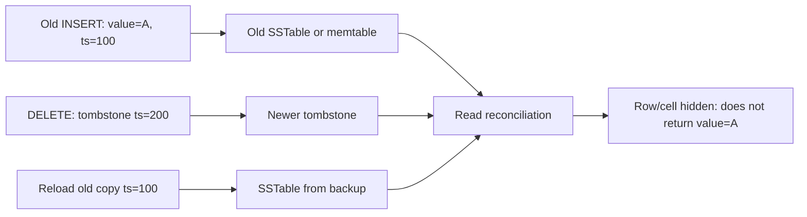
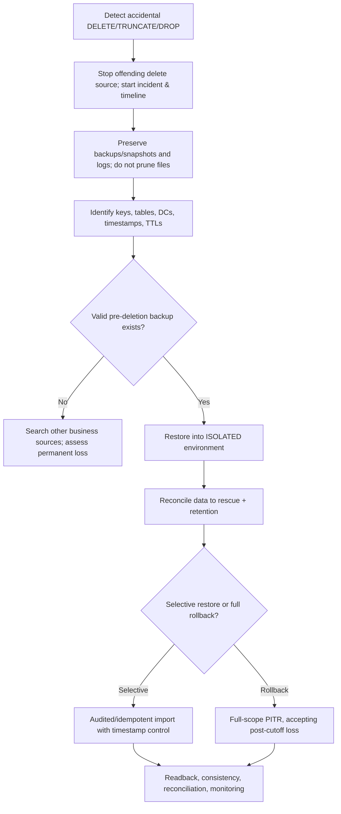

# Recovering from Accidental Deletions and Limitations with TTL/Timestamps/Tombstones

> **Chapter:** Backup and Recovery  
> **Module:** `DATABASE_ENGINE_WIDE_COLUMN_CASSANDRA` — Apache Cassandra

An accidental `DELETE` in Apache Cassandra can succeed at `LOCAL_QUORUM`, replicate to other replicas, and flush into SSTables as a tombstone. Afterward, even with a snapshot holding the old value, **reloading SSTables from the snapshot into the live cluster is not guaranteed to make the data reappear**: Cassandra reconciles competing versions by timestamp, so a newer tombstone still shadows an older value. For TTL data, the old copy may also already be expired by recovery time.

Therefore, this topic is more than "copy backups into the data directory." Distinguish:

1. **Full system point-in-time recovery** (*point-in-time recovery*, PITR), which can discard valid changes made after that timestamp.
2. **Selective recovery of accidentally deleted records** by reading from an **isolated** recovery environment, reintroducing approved records as new mutations, and checking conflicts.
3. **Restoring from snapshots/incremental SSTables** after node or table loss, accounting for schema, tokens, replicas, commit logs, and post-backup data changes.

This lesson belongs to Apache Cassandra, a *distributed wide-column* database. Partition keys determine tokens and replicas, tables are query-driven, and RF plus consistency levels govern read/write acknowledgments. Those mechanisms **do not replace backups**. Repair, hinted handoff, and compaction are not "undo DELETE" buttons either.

**After this lesson, you will be able to** classify accidental deletion types, understand how timestamps/tombstones/TTLs decide which data remains visible, select recovery sources, build an isolated recovery runbook, evaluate RPO/RTO, write CQL/Java validation checks, and avoid resurrecting validly deleted data.

## 1. Core Mechanic: Deletion in Cassandra Is a Timestamped Mutation

### 1.1. Why Doesn't DELETE Physically Erase Immediately?

Cassandra writes mutations first to the commit log/memtable, then flushes them to immutable SSTables. A `DELETE` typically writes a **tombstone** so replicas know old values were logically deleted, including replicas that were offline when the delete ran.



Key point: **the logical query outcome is not decided by "which file was copied last."** When competing mutations exist for the same data, Cassandra compares timestamps under tombstone/cell/range reconciliation rules. Here, timestamp `100` from the backup does not beat tombstone timestamp `200`.

Across snapshots, streaming, and `sstableloader`, **old records normally retain their original write timestamps**. Thus a file/network-level import succeeding **does not mean the accidental deletion was undone**.

### 1.2. Never Equate Different Kinds of Deletion

| Operation | Behavior to Watch | Recovery Impact |
| --- | --- | --- |
| `DELETE column` | Marks deletion at column/cell level | Restoring a column must check deletion timestamp and state of other columns. |
| `DELETE row` | Row-level tombstone (can shadow multiple columns) | Reinserting one column does not necessarily restore the full row if other values are missing. |
| `DELETE partition` | Partition tombstone shadows matching rows/cells | Reloading an SSTable holding old rows may still be shadowed by the tombstone. |
| `UPDATE ... SET col = null` | In CQL, assigning `null` can write a tombstone | Not only `DELETE` statements create tombstones. |
| `TTL expiration` | Value expires automatically and acts like a tombstone | Reloading with the old TTL usually **does not revive it** because expiry passed. |
| `TRUNCATE TABLE` | Clears the entire table via truncate mechanics; special metadata/semantics beyond individual rows | Should not be treated like bulk `DELETE`; requires dedicated restore procedures and may auto-snapshot. |
| `DROP TABLE/KEYSPACE` | Drops schema and logical data; auto-snapshot depends on config | Restore compatible schema before data and check table IDs/indexes. |

**Note:** `TRUNCATE` and `DROP` may create automatic snapshots when `auto_snapshot` is enabled, yet never assume that copy holds everything needed or persists forever. Operators must check **actual config, per-node snapshots, retention, and independent backup sources**.

### 1.3. `gc_grace_seconds` Is Not an "Undo" Window

A tombstone older than `gc_grace_seconds` **becomes eligible** for compaction purging when safety conditions hold (e.g., no longer needed to shadow older data in other SSTables). It **never turns into a restore command** at the grace mark; conversely, if a replica stayed offline too long and tombstones purged before full repair, old data from that replica can **resurrect unexpectedly** (*zombie data*).

Therefore:

- Never wait out grace expecting old values to magically return.
- Never lower `gc_grace_seconds` or run major compaction to "drop tombstones and reload backups."
- Never skip repair to preserve a "chance to recover old copies": doing so damages cluster consistency.
- **Intentional recovery** is completely different from **uncontrolled zombie data**.

## 2. Timestamps: Why Old Backups Lose to Newer Deletes

### 2.1. Three Distinct Time Concepts

| Time | Unit / Source | What Is It Used For? |
| --- | --- | --- |
| **Cell / tombstone write timestamp** | Typically microseconds since Unix epoch; set by coordinator or application | Reconciling competing mutations on the same data. |
| **Local deletion time** | Typically seconds since Unix epoch, stored on tombstones/TTLs | Supporting tombstone purging per grace and compaction. |
| **Snapshot / SSTable filesystem timestamp** | OS file time or snapshot tag label | Locating backup sources, **not** the winning timestamp on CQL reads. |

CQL supports `USING TIMESTAMP` on certain writes/deletes and `WRITETIME(column)` to read a cell's timestamp. Never compare microsecond cell timestamps directly against `gc_grace_seconds` (seconds duration) or local deletion time without converting units.

### 2.2. An Intentional Reconciliation Example

Suppose there is **one test row in a lab**, with two mutations:

- Value `status='PAID'` written at timestamp `1.760.000.000.000.000` microseconds.
- Subsequent `DELETE` at timestamp `1.760.000.000.000.100` microseconds.

Importing `PAID` from a snapshot still carrying timestamp `1.760.000.000.000.000` keeps the newer tombstone winning. To **actively recreate** data, a new mutation must satisfy reconciliation rules—yet **never arbitrarily set timestamps far in the future**, because that can shadow valid subsequent updates for a long time.

Never rely solely on `WRITETIME(status)` on a deleted row to find the tombstone timestamp: since the row/cell is no longer live, CQL may return nothing. During recovery, cross-check **audit logs/CDC/commit-log archives**, service operation logs, backups, and application state. If history is unclear for conflict resolution, prefer a **separate target table/key** followed by controlled traffic cutover.

### 2.3. Equal Timestamps Do Not Mean "Restore Will Win"

Cassandra uses deterministic tie-breaking rules when timestamps match; tombstones and values follow specific precedence. **Never try to recover by re-sending a mutation with the exact old timestamp hoping execution order favors you.** When rewriting data, enforce an explicit timestamp policy, business versioning/fencing, and read-back verification.

## 3. TTL: Recovery Is Not Simply Resetting the Clock

TTL (*time to live*) applies to **written values** in seconds; once that duration elapses, the value expires. On tables with `default_time_to_live`, writes also inherit the table's default TTL policy. Updating the same column can assign a new TTL depending on the statement and schema.

Different situations:

| Situation | What You May Observe | Decision Point |
| --- | --- | --- |
| Snapshot holds **unexpired** TTL values | Value is readable in the recovery environment right now | Stored expiration deadline keeps ticking down. |
| Snapshot holds **expired** TTL values | Value no longer appears in normal CQL queries | Snapshots do not reset TTLs or revive expired values. |
| CQL reinsert same value with `USING TTL 3600` now | Creates a **new expiry relative to the new write** | May violate retention/compliance if original deadline is required. |
| CQL reinsert **without specifying TTL** | May persist longer than intended, depending on `default_time_to_live` | Confirm retention policy and schema upfront. |
| Recovering to a hypothetical point before TTL expiry | Needs matching replay timing and TTL semantics awareness | PITR does not pause real wall-clock time even when replaying old logs. |

**Business example:** an event was written at 10:00 Day 1 with a 7-day TTL, due to expire at 10:00 Day 8. Accidental deletion hits Day 3, recovery runs Day 5. To preserve the **original expiry**, reinsertion must expire around Day 8, not Day 12. Compute remaining TTL from the absolute business deadline, allowing a safety margin for clock skew/latency.

A design formula when reinserting from a logical copy:

\[
TTL_{\text{restore}} =
\max\left(0,\ \left\lfloor
\frac{t_{\text{expiry-original}} - t_{\text{restore}}}{1\ \text{second}}
\right\rfloor\right)
\]

If the result is `0`, **do not** pass `USING TTL 0` expecting "expire in 0 seconds": in CQL, TTL 0 means **no TTL** for the written value in that context. When the goal is not recreating already-expired data, **skip that record**. Check `default_time_to_live`, time precision, and TTL/version bounds during implementation.

### 3.1. `WRITETIME` Does Not Tell the Whole TTL Story

`WRITETIME(column)` returns a live cell's timestamp; `TTL(column)` returns **remaining** lifetime in seconds, or `null` if none. Both show only the **current logical state** and cannot replace audits of original TTLs once rows are deleted.

If **exact absolute expiration** must be recoverable, store `expires_at` or retention metadata outside TTL attributes in a trusted source rather than trying to reverse-engineer it from snapshots lacking app metadata.

## 4. Which Recovery Sources Exist?

Apache Cassandra stores durable data in immutable SSTables. Common protection mechanisms offer very different guarantees:

| Source | What Does It Hold? | When Useful? | What It Does Not Guarantee |
| --- | --- | --- | --- |
| **Snapshot** | Hard links to captured SSTable components, usually with `schema.cql`/manifest | Whole-table recovery or standing up an environment to extract old data | Not an absolute **cluster-wide** transactional snapshot; omits unflushed mutations if `--skip-flush`. |
| **Incremental backup** | Hard links to new SSTables from flushes/streams when enabled | Supplements changes between baseline snapshots | Does not replace baseline snapshots/schema; does not protect against full disk loss on the same host. |
| **Commit-log archive** | Archived commit log segments when archiving is configured | Supports replay/PITR up to points covered by complete logs | **Not enabled by default**; cannot recover data missing from baseline; not automatically DC-synchronized. |
| **App CDC / event log / outbox** | Independently persisted business event stream if designed in | Precisely retrieves keys/values and selects events to restore | Complete only if enabled pre-incident with enough retention, deduplication, and ordering. |
| **Surviving replicas** | Live versions per token range | Node replacement or repair/rebuild from valid sources | Once `DELETE` reaches replicas, replicas are **not an "undo" copy**. |
| **Off-cluster backup** | Dataset and metadata uploaded to an independent store | Survives disk/node/DC loss and in-cluster human errors | Requires restore testing; no consistency guarantee if components or manifests are missing. |

### 4.1. Snapshots Are **Node/Table**-Scoped, Not a Cluster-Wide Consistency Promise

Syntax examples from Cassandra documentation:

```bash
# WARNING: operational task creates snapshots and holds SSTable disk space.
# Run only in LAB or under an approved plan.
nodetool snapshot --tag before-schema-change commerce

# Inspect snapshots on current node:
nodetool listsnapshots

# Check incremental backup status on supported releases:
nodetool statusbackup
```

`nodetool snapshot` captures **the targeted node**; it does not automatically become a consistent recovery point across all nodes/replicas/DCs simultaneously. You need an orchestrator to cover the cluster and write manifests recording timestamps, nodes, host IDs, tokens, DCs, versions, schemas, file lists, hashes, storage locations, and upload outcomes.

Normally snapshots **flush memtables before linking**; with `--skip-flush`, unflushed mutations **do not appear** in the snapshot. Thus actual RPO depends on snapshots/flushes, incremental backups, and commit-log archives—not just the snapshot tag timestamp.

**Also distinguish two actions:** taking a snapshot **after an accidental `DELETE`** is valuable to **preserve forensic state**, yet it is not a "pre-delete" backup. Never name it "pre-delete" and mislead operators about its point in time.

### 4.2. Incremental Backups Must Be Configured Ahead of Time

In `cassandra.yaml`, depending on version:

```yaml
# Policy example: use only on Cassandra versions with matching options.
incremental_backups: true
auto_snapshot: true
```

`incremental_backups` is not enabled by default in current Apache Cassandra docs. When enabled, newly flushed/streamed SSTables get hard links in `backups/`. Hard links on **the same filesystem** do not protect against disk loss, ransomware, or an admin wiping all files. Ship them to another store with checksum verification and retention.

From a recovery standpoint, **baseline snapshot + matching incremental SSTables + schema + commit logs (if any)** are required to hit intermediate points; a `backups/` folder alone cannot magically "rewind the database to 14:32."

### 4.3. Commit-Log Archiving Must Be Engineered Ahead of Time

Apache Cassandra provides `commitlog-archiving.properties` with fields such as `archive_command`, `restore_command`, `restore_directories`, `restore_point_in_time`, and `precision`. **Format illustration only**, not ready-to-use config:

```properties
# DO NOT copy verbatim into production; requires secure/idempotent scripts.
archive_command=/opt/cassandra/bin/archive-segment %path %name
restore_command=/opt/cassandra/bin/restore-segment %from %to
restore_directories=/secure/commitlog-archive
restore_point_in_time=2026:11:21 09:59:59
precision=MICROSECONDS
```

In Apache docs, `restore_point_in_time` uses `yyyy:MM:dd HH:mm:ss` **in GMT/UTC** and replays mutations with matching timestamps. This cutoff can be skewed by **client-supplied timestamps**: if clients set out-of-order timestamps or node clocks drift, timestamp-based PITR is not simply "drop every request arriving after hour X."

**Warning:** sample config shows only property names. In production, `archive_command`/`restore_command` must be programs with retries, checksums, access control, monitoring, non-clobbering logs, and alignment with your Cassandra version's restore workflow. You cannot "turn on PITR after an incident happens" expecting prior segments to exist.

## 5. When an Accidental DELETE Is Detected: Initial 10-Step Runbook

Suppose an API accidentally deletes all orders for tenant `tenant-a` at 10:00 while other tenants continue writing normally. The goal is **saving the affected data without rolling back or overwriting valid transactions after 10:00**.



**1. Stop the bad source.** Halt the job/script/API issuing `DELETE`, block retries, or safely revoke dangerous privileges. If pausing writes for one tenant, communicate status and plan catching up deferred valid writes; **never shut down the whole cluster** without assessing quorums and impact on other tenants.

**2. Record the incident timeline.** Save UTC timestamps, statements/bind values if audited, app deployments, users, trace IDs, and request outcomes. On write timeouts, `DELETE` **may still have applied on some replicas**; never assume it failed.

**3. Pinpoint scope.** Is this column/row/partition `DELETE`, TTL expiry, `TRUNCATE`, or `DROP`? Which keyspace/table, partition keys, TTL/default TTL, CDC/event logs, and related projections/tables?

**4. Preserve current evidence.** Keep logs, metrics, existing snapshots, manifests, and off-cluster copies; **never run `clearsnapshot`/backup pruning, delete SSTables/commit logs, or force major compaction** as "cleanup."

**5. Check service health.** `nodetool status`, per-DC RF, consistency level, free disk, active compaction/repair/hints. If a node must pause for offline inspection, confirm quorum holds and obtain approval; cloning into isolation is safer.

**6. Locate recovery sources.** List **pre-incident** snapshots, incremental backups, commit log archives, storage versions, event sources, and retention windows; note checksums and missing intervals.

**7. Decide RPO/RTO.** If only 50 rows were deleted, rolling the whole table back to 09:59 could wipe thousands of valid writes since 10:00. Prefer **selective recovery**.

**8. Restore in isolation.** Never import old SSTables directly into the live cluster to see what happens. Use an isolated cluster or separate keyspace with compatible version/schema and restricted network, then extract rows by primary key.

**9. Approve timestamp/TTL policy.** Which records remain valid? Must original expiry be preserved? Did valid newer updates overwrite the old row? Design restoration without far-future timestamps.

**10. Import, reconcile, and monitor.** Write audited, rate-limited mutations, verify read-backs per CL/DC, check projections/secondary tables and business APIs, and monitor repair/compaction/timeouts before closing the incident.

## 6. Decision Table: Which Recovery Strategy Should You Choose?

| Incident | Available Sources | Priority Direction | Risks to Accept |
| --- | --- | --- | --- |
| A few rows accidentally deleted; pre-delete backup exists | Snapshot/CDC/event log holds data | **Isolate → extract rows → selective CQL restore** | New write timestamps, original TTLs, post-delete valid updates. |
| Whole partition or many rows accidentally deleted | Matching snapshot and schema | Extract full partition in clone, reconcile rows/cells, budgeted import | Partition tombstones can shadow old SSTables if loaded live. |
| Whole table accidentally `TRUNCATE`d | Pre-truncate auto-snapshot or off-cluster backup | Clone from snapshot, evaluate whole-table restore/table swap | Truncate differs from `DELETE`; must restore right schema and data scope. |
| Table accidentally `DROP`ped | Auto-snapshot if enabled, `schema.cql`/manifest | Recreate version-accurate schema, restore in isolation, then cut over or re-import | Missing schema/table ID/indexes and writes after `DROP`. |
| Need "whole system as of 09:59" | Baseline backup + continuous commit-log archive, restore-tested | **PITR** per verified runbook | Rolls back valid post-cutoff changes too; no automatic multi-DC transactional snapshot. |
| Only live replica SSTables post-`DELETE` | Tombstones reached all replicas | No reliable undo from live logical data; search external sources | Repair/streaming cannot erase accidental deletion history. |
| TTL truly expired long ago | Snapshot holds old physical bytes | Assess retention/legal rules, then decide not to restore or extract with controls | Never "revive" expired data if policy forbids it. |
| All replicas lost with zero backups | No valid source remains | Report limits; investigate upstream logs/exports if any | Cassandra cannot synthesize values out of missing data. |

**Never confuse selective recovery with repair.** Repair reconciles replicas and can **propagate newer tombstones** to replicas unaware of the deletion; that is faithful to database semantics, yet does not recover deleted user data.

## 7. Safe Restoration into an Isolated Environment

A practical approach for accidental `DELETE` when backups exist is **standing up a copy where it cannot accept production writes or join the production ring**.

### 7.1. Preconditions for Launching a Clone

- **Isolate networking and cluster identity:** separate cluster, no shared seeds/gossip with production, zero chance production clients connect accidentally.
- **Matching Cassandra/SSTable version:** binary must read the backup's SSTable format and schema; build tables/indexes/UDTs in dependency order.
- **Complete data:** snapshot file sets with manifests/checksums and matching descriptor components from the right nodes/token ranges; understand RF/replicas to avoid missing ranges.
- **Right point in time:** pre-DELETE snapshots and matching incrementals; replay commit logs **only** if running a PITR workflow with known cutoffs.
- **Sufficient resources:** disk headroom for SSTables, compaction/streaming, clone node count/RF, and download time fitting RTO.
- **Safe permissions:** read only needed recovery data via a recovery account; log redaction, encryption, retention, and export controls.

### 7.2. File Restore vs. CQL Restore

Cassandra documentation covers `sstableloader` and `nodetool refresh` for loading SSTables. Both have distinct scopes:

| Method | When Used | Risk for Accidental Deletions |
| --- | --- | --- |
| **`sstableloader`** | Streams SSTable files from a valid directory to a target cluster per target topology | Preserves old timestamps/semantics: newer tombstones on target still win. |
| **`nodetool refresh`** | Loads prepared SSTables into a node's table data directory per runbook | Easy to mismatch schema/table ID/components or duplicate data if uncontrolled on live nodes. |
| **Offline SSTable restore** | Restores whole nodes/tables from backup while Cassandra is stopped per procedure | May require commit log, topology, and retention handling; does not auto-resolve live state conflicts. |
| **Selective CQL import** | After reading logical records from a clone and checking timestamps/TTLs | Writes new mutations; can overwrite valid updates or reset TTLs without a policy. |

**Recommendation for selective deletions:** use file/SSTable tools to **build the isolated recovery environment**, then export logical records by primary key and import with strict controls. This separates "reading pre-deletion values" from "deciding which mutation wins in production."

### 7.3. Data Extraction Sequence

1. Inventory affected partitions (tenants, customers, order IDs) from audit/event logs; avoid `SELECT *` full-table scans where possible.
2. Cross-check pre-DELETE snapshots and valid post-backup records; never assume one node's backup covers **all token ranges**.
3. On the clone cluster, `SELECT` by **full partition key**, recording payload, write timestamp if available, original TTL deadline (if known), and file/backup provenance.
4. Compare **read-only** against current production state, distinguishing (a) accidentally deleted, (b) validly recreated, (c) validly updated post-delete, and (d) legitimately expired.
5. Build a per-row *restore plan*: restore/skip/manual review, intended value, TTL/expiry, timestamp policy, rationale, and approval.
6. Run a canary on a few authorized rows; monitor read-backs, replica consistency, and projections/derived tables before scaling out.

Never blindly run `sstableloader` simultaneously across nodes of a live serving cluster just because docs say it can read SSTables. Design source/target, RF/CL, schema, current tombstones, and rollback plans upfront.

## 8. CQL Lab: Proving Old Timestamps Do Not Beat Tombstones

The following examples are **solely for an isolated lab cluster**. All timestamps shown are synthetic microseconds chosen for study, not current wall-clock time; never use synthetic timestamps like these in production.

### 8.1. Schema and One Test Row

```sql
-- Lab: adjust RF/DC to match real topology. Never apply this DDL verbatim to production.
CREATE KEYSPACE IF NOT EXISTS recovery_lab
WITH replication = {
    'class': 'NetworkTopologyStrategy',
    'dc1': 3
};

CREATE TABLE IF NOT EXISTS recovery_lab.orders_by_id (
    tenant_id text,
    order_id uuid,
    status text,
    amount decimal,
    note text,
    PRIMARY KEY ((tenant_id, order_id))
) WITH gc_grace_seconds = 864000;
```

Partition key `(tenant_id, order_id)` locates a single order precisely. In real products, projection tables by status/date and separate reconciliation workflows may exist; restoring one source table **does not automatically restore all denormalized tables**.

### 8.2. Demonstrating "Old Timestamp Does Not Beat Delete"

```sql
INSERT INTO recovery_lab.orders_by_id
    (tenant_id, order_id, status, amount)
VALUES (
    'tenant-a',
    11111111-1111-4111-8111-111111111111,
    'PAID', 100.00
) USING TIMESTAMP 1760000000000000;

SELECT status, WRITETIME(status) AS status_ts_us
FROM recovery_lab.orders_by_id
WHERE tenant_id = 'tenant-a'
  AND order_id = 11111111-1111-4111-8111-111111111111;

-- Write a row tombstone with a NEWER timestamp than the original value.
DELETE FROM recovery_lab.orders_by_id
USING TIMESTAMP 1760000000000100
WHERE tenant_id = 'tenant-a'
  AND order_id = 11111111-1111-4111-8111-111111111111;

-- Re-write with a timestamp older than the tombstone: remains shadowed.
INSERT INTO recovery_lab.orders_by_id
    (tenant_id, order_id, status, amount)
VALUES (
    'tenant-a',
    11111111-1111-4111-8111-111111111111,
    'PAID', 100.00
) USING TIMESTAMP 1760000000000050;

SELECT status
FROM recovery_lab.orders_by_id
WHERE tenant_id = 'tenant-a'
  AND order_id = 11111111-1111-4111-8111-111111111111;
```

In that test, the row still **does not appear** because tombstone timestamp `1760000000000100` is newer than restore mutation `1760000000000050`. This is the core illustration of why reloading old backups is not guaranteed to work.

When **confirmed in the lab with no concurrent writes**, a mutation with a newer timestamp can be chosen:

```sql
-- LAB ONLY: mutation timestamped after tombstone to demonstrate reconciliation.
INSERT INTO recovery_lab.orders_by_id
    (tenant_id, order_id, status, amount)
VALUES (
    'tenant-a',
    11111111-1111-4111-8111-111111111111,
    'PAID', 100.00
) USING TIMESTAMP 1760000000000200;

SELECT status, WRITETIME(status) AS status_ts_us
FROM recovery_lab.orders_by_id
WHERE tenant_id = 'tenant-a'
  AND order_id = 11111111-1111-4111-8111-111111111111;
```

**Never turn this example into advice to "pick a huge timestamp."** In production, valid post-delete updates, clock skew, client-supplied timestamps, and business rules can cause that trick to corrupt data long-term. Use explicit timestamps only when you **know and control mutation ordering**, hold authority over which value wins, and have a rollback path.

### 8.3. Separate TTL Lab

```sql
-- Use a distinct order_id to avoid colliding with the tombstone demo above.
INSERT INTO recovery_lab.orders_by_id
    (tenant_id, order_id, status, note)
VALUES (
    'tenant-a',
    22222222-2222-4222-8222-222222222222,
    'OPEN', 'expires-after-one-hour'
) USING TTL 3600;

SELECT status, note,
       WRITETIME(note) AS note_ts_us,
       TTL(note) AS remaining_ttl_seconds
FROM recovery_lab.orders_by_id
WHERE tenant_id = 'tenant-a'
  AND order_id = 22222222-2222-4222-8222-222222222222;
```

`TTL(note)` counts down over time. Cloning/restoring files after TTL expiration **does not grant an extra hour**. Meanwhile, reinserting via CQL with `USING TTL 3600` applies a **fresh TTL**, requiring business owner approval. Never pass `TTL 0` intending "expire immediately."

### 8.4. Inspecting Schema and Retention Read-Only

```sql
SELECT keyspace_name, table_name, gc_grace_seconds,
       default_time_to_live, compaction
FROM system_schema.tables
WHERE keyspace_name = 'recovery_lab'
  AND table_name = 'orders_by_id';
```

Check the backup schema **at deletion time**, not solely the currently running schema: renamed/dropped columns, altered UDT types, or added/dropped indexes and materialized views can complicate restoration.

## 9. Selective Recovery: Which Records Should Be Reinserted?

### 9.1. Classifying Each Key

For each `(tenant_id, order_id)` row, build a decision matrix:

| Current State | Data from Backup | Default Decision |
| --- | --- | --- |
| Row truly accidentally deleted; no valid newer change | Pre-delete value complete and within retention | **Restore candidate**, subject to timestamp/TTL approval. |
| Row validly recreated after incident | Backup holds older state | **Do not overwrite** by default. |
| Row has valid updates after deletion | Backup predates updates | Merge per business policy; optionally restore specific fields only. |
| Row expired via TTL per policy | Backup holds old physical copy | **Skip**, unless special legal/business mandate exists. |
| Row intentionally deleted earlier | Backup still holds value | **Skip** to avoid import-induced zombies. |
| Only metadata or unverified record remains | Value lacks evidence | Manual review; never guess payload. |

**Strictly avoid:** importing every row from an old snapshot into production. A snapshot does not know which mutations after backup were **valid**. Reviving every old value can violate retention, corrupt balances, or expose data users requested erased.

### 9.2. TTL/Timestamp Policy for the Restore Plan

Recovery documentation should record:

```text
incident_id: INC-EXAMPLE
source: snapshot-tag + node list + checksums + extraction query
target: commerce.orders_by_id (tenant_id, order_id)
scope: approved keys only
original_state: BEFORE_ACCIDENTAL_DELETE
current_state_checked_at_utc: ...
post_delete_valid_updates: none / list
expiration_policy: preserve original expires_at / do not restore expired
timestamp_policy: controlled mutation, no far-future timestamp
idempotency_key: incident_id + tenant_id + order_id + payload-version
write_rate_limit: ...
consistency_level: LOCAL_QUORUM (RF and local DC verified)
verification: readback, audit, projection reconciliation, business owner sign-off
rollback: correction event / previously captured state with approved policy
```

This is an **illustrative operational manifest**, not Cassandra YAML config. Defining `rollback` must be an application decision (e.g., a compensating correction event), never assuming a CQL undo exists once new mutations are written.

## 10. Java Driver 4.x: Idempotent Recovery with Concurrency Control

A recovery Java job must not fire uncontrolled writes with infinite retries. It needs an approved key list, clone-verified payloads, a fitting timestamp policy, and bounded in-flight requests.

The snippet below shows **one authorized write** using a timestamp chosen per the restore plan. Reusing the exact same key, payload, and timestamp makes retries idempotent; **never use this pattern to hunt for a "maximum" timestamp in production**. The job must coordinate pausing competing writes for the same keys via appropriate business mechanisms.

```java
import java.math.BigDecimal;
import java.util.UUID;

import com.datastax.oss.driver.api.core.CqlSession;
import com.datastax.oss.driver.api.core.DefaultConsistencyLevel;
import com.datastax.oss.driver.api.core.cql.BoundStatement;
import com.datastax.oss.driver.api.core.cql.PreparedStatement;

public final class ApprovedOrderRecovery {
    private final CqlSession session;
    private final PreparedStatement restore;

    public ApprovedOrderRecovery(CqlSession session) {
        this.session = session;
        this.restore = session.prepare(
            "INSERT INTO commerce.orders_by_id " +
            "(tenant_id, order_id, status, amount) " +
            "VALUES (?, ?, ?, ?) USING TIMESTAMP ?");
    }

    public void restoreApprovedRow(
        String tenantId, UUID orderId, String status,
        BigDecimal amount, long approvedTimestampMicros
    ) {
        // Verify upfront: no valid newer update exists;
        // timestamp is from the approved restore plan, NOT pushed into the future.
        BoundStatement statement = restore.bind(
                tenantId, orderId, status, amount, approvedTimestampMicros)
            .setConsistencyLevel(DefaultConsistencyLevel.LOCAL_QUORUM)
            .setIdempotent(true);

        session.execute(statement);
    }
}
```

Because key, payload, and timestamp stay fixed with no TTL or extra side effects, retrying **the exact same statement** can be treated as idempotent for this sample row. In real systems, also ensure:

- **Schema accuracy:** `commerce.orders_by_id` matches the code's columns/types, and `CqlSession` sets local DC, auth/TLS, and least-privilege access.
- **Timestamp approval:** operators cannot simply infer tombstone timestamps from `WRITETIME` once a row is gone; use audits and justified conflict rules.
- **TTL preservation:** this snippet **omits TTL**. Never use it verbatim on short-retention data; apply explicit `USING TTL` and an approved expiry strategy, accounting for retries shifting expiration.
- **Load throttling:** use bounded queues, rate limits, backpressure, partition-grouped batches, latency/timeout tracking, and SLO circuit breakers.
- **Do not confuse logged batches with transactions:** multi-partition batches in Cassandra do not isolate an entire recovery run. Maintain auditing, idempotency, and reconciliation.
- **Never retry counters, CAS, or side-effecting ops** like regular rows. Those mutation types require dedicated recovery playbooks.

For post-write verification, read by **full partition key** at the chosen CL and cross-check projection tables. A passing `LOCAL_QUORUM` does not prove all replicas hold the data—maintain proper repair and sync schedules.

## 11. System-Wide PITR: Thinking About Cutoffs and Loss of Recent Writes

A **point-in-time restore** returns a scope of data to a pre-incident timestamp, typically starting from a baseline snapshot and replaying valid log sources up to the cutoff. This differs fundamentally from "only undoing an accidental `DELETE`."

### 11.1. Why Isn't PITR a Cluster-Wide Rewind Button?

- **Snapshots are taken per node**, not automatically synchronized across an entire DC.
- Commit logs are stored per **node/segment**, not as one globally strictly ordered cluster transaction log.
- Clients can supply write timestamps; later requests may carry older timestamps, or vice versa.
- Valid writes after the cutoff will be **absent** from the restored state unless a separate business replay process exists.
- Multi-table denormalization and event streams outside Cassandra may **not roll back to the same instant**, causing drift.

```mermaid
sequenceDiagram
    participant App as Application
    participant DB as Production Cassandra
    participant BK as Backup/archive
    participant CL as Isolated recovery cluster
    App->>DB: Valid write 09:55
    DB->>BK: Baseline snapshot + archived logs
    App->>DB: Accidental DELETE 10:00
    App->>DB: Valid write 10:05
    BK->>CL: Restore baseline and replay up to approved cutoff
    Note over CL: Excludes 10:00 DELETE, yet may also lack 10:05 write
    CL-->>App: Extract rows to rescue; never cut over traffic before reconciliation
```

**Rule:** apply large-scale PITR only when the RPO and rollback scope are accepted, with an endpoint/traffic cutover plan, schema/index checks, downstream reconciliation, and business owner sign-off.

### 11.2. Comparison of Both Approaches

| Criterion | Keyspace/Cluster-Wide PITR | Selective Restore from Clone |
| --- | --- | --- |
| Goal | System state prior to incident cutoff | Recover an affected subset of keys/rows |
| Valid new data post-cutoff | Can be **lost** within rollback scope | Can be **preserved** if imports do not overwrite |
| Service impact | Usually major; requires cutover/coordination | Can run in small controlled batches |
| Dependencies | Baseline + complete archives + schema + restore tools | Reliable historical source, key list, audit |
| Timestamp conflicts | Even within snapshot/replay, ordering and TTLs still matter | Must actively control timestamps upon reinsertion |
| Risks | RPO exceeded; multi-DC/downstream state out of sync | Missing rows/columns, reset TTLs, overwriting valid updates |
| Testability | Needs full backup/restore chain drills | Can canary specific keys in isolation |

## 12. Repair, Hinted Handoff, Compaction, and Backups Do Not Replace Each Other

| Mechanism | What Does It Do? | Can It Undo an Accidental DELETE? |
| --- | --- | --- |
| **Hinted handoff** | Replays mutations saved by coordinator for a temporarily absent replica | **No.** If hints carry the accidental DELETE, replay spreads the deletion further. |
| **Read repair** | Reconciles differences in read data per versioning rules | **No.** It obeys existing timestamps/tombstones. |
| **Anti-entropy repair** | Compares token ranges across replicas and streams differences | **No.** It propagates tombstones faithfully per current logical state. |
| **Compaction** | Merges SSTables and reclaims eligible data/tombstones | **No.** Provides no rollback; can erase old physical traces. |
| **Bootstrap / rebuild** | Streams data for new topology/replicas | **No.** Cannot pick "pre-DELETE versions" by business intent. |
| **Snapshot / incremental backup** | Preserves pre-incident SSTables when organized properly | **Can be a recovery source**, but needs restore/merge logic. |
| **Commit-log archive / PITR** | Reconstructs mutations per configured time-cutoff policy | **Can help**, if complete, timestamp-compatible, and pre-tested. |

### 12.1. Why Taking Old Data from an Offline Replica Is Dangerous

An offline replica may still hold an old row because it missed the `DELETE`. Bringing it back without matching tombstones and letting anti-entropy repair run after other replicas already purged tombstones can create **zombie data**. Never exploit that situation as a recovery strategy: values may be stale, incomplete, lack provenance, and risk resurrecting **other intentional deletions**.

For controlled recovery, **copy data from that replica/backup in isolation**, analyze which keys are permitted to return, and reinsert with an audit trail. Never let a stale replica dictate business history for the whole cluster.

### 12.2. Snapshots Are Not a Free "Server Freeze"

Snapshots are usually hard links to SSTables, making creation fast, yet **pin old SSTables from reclamation** when compaction cleans up—affecting disk headroom and backup cost. When `auto_snapshot` or incremental backups accumulate old copies, enforce retention, offsite copying, and cleanup **only after verifying safe recovery sources**.

Never run `nodetool clearsnapshot --all` while investigating an accidental `DELETE`. That wipes critical evidence and recovery sources.

## 13. Special Limits by Data Type and API

| Data Type or Operation | Specific Recovery Considerations |
| --- | --- |
| **Counter** | Increments/decrements are not idempotent. Never blindly "replay +1" from audits; reconcile business totals, source snapshots, and proper corrections. |
| **LWT / CAS** | Conditional writes must respect contention state; never slap manual timestamps onto CAS operations by guesswork. |
| **Multi-cell Collections / UDTs** | Timestamps/TTLs can vary per element; naive row-level restores can misbehave. |
| **Rows with null / individually deleted columns** | Reinserting the entire row can bring back a column that was validly deleted earlier. |
| **TTL data and legal erasure** | Never restore expired/legally erased records merely because a backup still holds them. |
| **Projection / denormalized tables** | Restoring one table does not update other read models; reconcile via events/outboxes. |
| **Materialized views / SAI / indexes** | Post-restore, verify index rebuild/update per version and data flow; never treat indexes as row backup sources. |
| **Multi-DC data** | Recoverability and cross-DC traffic vary; verify per RF/CL/DC and repair coverage. |

**In summary:** data recovery must be treated as a **controlled business operation**, not merely a storage-level command.

## 14. Post-Recovery Verification Plan

A technically successful restore can still be logically wrong. Validate four layers:

**Layer 1 — Source Completeness.** Manifests/checksums match, backups and schema carry provenance, affected keys are scoped, and out-of-scope keys remained untouched.

**Layer 2 — Data Accuracy.** Primary-key queries return expected values; compare payloads/hashes, key columns, `WRITETIME` where relevant, remaining TTLs, and access permissions. If rows received valid post-DELETE updates, verify the restore **did not overwrite** them.

**Layer 3 — Replication and Serviceability.** Per-DC RF and `LOCAL_QUORUM`/business CL hold, timeouts/latency stabilize, hints/repair/compaction schedules run cleanly, and queries succeed from every serving DC.

**Layer 4 — Business Consistency.** Projections, payment systems, ledgers, CDC/queues, search indexes, caches, and audit trails reconcile cleanly without duplicating orders/balances by replaying old events.

Example checklist recorded in the incident ticket:

| Check Group | Evidence to Record | PASS Criteria |
| --- | --- | --- |
| Backup source | Snapshot IDs, node IDs, checksums, schema, UTC timestamps | Zero missing files/ranges needed for recovery |
| Scope | Key list and restore/skip/manual classification | No key left undecided |
| Timestamps | Policy and actual mutation timestamps | No far-future timestamps or overwritten valid updates |
| TTL | Original `expires_at`, remaining TTL, schema defaults | Retention not improperly reset |
| CQL read-back | Partition-key queries, expected values/hashes | Values match across approved key set |
| Java / API | p95/p99 latency, timeouts, idempotency audit | Service meets SLOs with no infinite retries |
| Multi-DC | RF, CL, per-DC probes, repair plan | Zero gaps from lagging DCs |
| Downstream | Projections/caches/search/payments | Consistent business state |
| Postmortem | Incident review, security, retention, restore drill | Assigned owners and preventive actions |

Never use a single `SELECT COUNT(*)` on a huge table as the sole criterion: it strains Cassandra resources and fails to prove individual critical keys are accurate.

## 15. Preventing the Next Accidental Deletion

1. **Least privilege:** ordinary services should lack `DROP`/`TRUNCATE`; separate admin and backup accounts; require approval for broad deletes.
2. **API safety rails:** scope limits per tenant, max affected keys, dry-run mode, two-step confirmation for batch deletes, and job idempotency keys.
3. **Independent event/audit log:** record actor, action, request ID, key range, timestamp, and deletion reason in a secure system without leaking raw sensitive payloads broadly.
4. **Automated, independent backups:** scheduled snapshots + incrementals + archives when low RPO is required; offsite uploads with checksums, separated write/delete rights, and retention policies.
5. **Restore drills:** measure real RTO and test recovering **column, row, and partition DELETEs, TRUNCATEs, expired TTLs**, multi-DC setups, and schema upgrades.
6. **Persist retention metadata:** store reliable `created_at`/`expires_at` alongside TTL-managed records so reinsertion never resets expiry wrongly.
7. **Separate source of truth and projections:** maintain a mechanism to rebuild read-model tables from events/sources if data flow permits.
8. **Early alerts:** detect spikes in `DELETE`/tombstones, truncate/drop events, stale backups, failed incremental uploads, commit-log archive gaps, and filling backup stores.
9. **Protect valid erasures:** restore plans must honor erasure rights and TTLs rather than turning snapshots into policy-violating resurrection channels.
10. **Version-aligned docs:** whenever Cassandra/SSTable formats, indexes, RF/topology/CL, or `sstableloader`/`nodetool` change, re-drill recovery after upgrades.

## 16. Exercises and Self-Check Scenarios

**Question 1.** A row written at timestamp `100` was accidentally deleted by tombstone `200`. You import an old SSTable holding `100` via `sstableloader` into the live running cluster. Will the row definitely reappear? Why?

**Question 2.** Backup at 09:00, accidental DELETE at 10:00, and 5,000 valid transactions occurred after 10:00. Why can rolling the whole table back to 09:00 be worse than selectively restoring 200 affected rows?

**Question 3.** An event was written on Day 1 with a 7-day TTL and recovered on Day 5. If it must preserve its original Day 8 expiry, should you reinsert it with `USING TTL 604800`?

**Question 4.** A table has `gc_grace_seconds = 10 days`. A replica offline for 12 days still holds a record that missed a `DELETE`. Can you use it as a "data rescue source" and run repair to recover automatically?

**Question 5.** `incremental_backups: true` populates `backups/` on the same data volume. Why does this still fail disk-loss resilience and second-level PITR?

**Question 6.** `nodetool snapshot` is run **after** discovering an accidental DELETE. What is this snapshot useful for, and what can it not guarantee?

**Question 7.** A row was accidentally deleted, yet the user subsequently wrote a valid new state. You find the old state in a pre-incident snapshot. Should you import the whole old row?

**Question 8.** In CQL, `TTL(column)` returns `null`, whereas the backup shows the column once had a TTL. Can you conclude Cassandra lost information? Give two plausible explanations.

**Question 9.** Commit log archiving is enabled **after** an incident happens. Can you replay logs to return prior to the incident? What prerequisites had to exist beforehand?

**Question 10.** A Java job reinserts the same key/payload yet picks a new timestamp and new TTL on every retry. Is it truly idempotent with respect to retention?

<details>
<summary>Answer Hints</summary>

1. **No.** The newer tombstone continues shadowing the older mutation; successful file/stream import does not reverse reconciliation rules.
2. Table-wide PITR can wipe valid post-snapshot transactions; selective recovery from a clone for exact keys limits rollback blast radius, provided audits and conflicts are managed.
3. **No.** A 7-day TTL reset on Day 5 would expire on Day 12. If policy requires Day 8 expiry, compute remaining TTL (~3 days minus elapsed processing time) or skip if already expired.
4. **No.** Long-offline replicas can spawn zombies once tombstones purge. Use isolation to extract approved records; repair is not an undo for DELETE.
5. Same-disk hard links do not survive disk loss; incremental SSTables alone lack full baselines/schemas and complete logs for arbitrary cutoffs. Offsite copies, snapshots, archives, and restore tests are needed.
6. Useful to preserve current forensic state or recover from subsequent failures; it is **not** a pre-DELETE snapshot, so it cannot supply shadowed data without an older source.
7. **No.** Compare against the newer state and merge per business logic. Importing the old row risks overwriting valid newer data.
8. Either the column was rewritten without a TTL, or the snapshot captured an older version while CQL reads a newer logical version. Also check table `default_time_to_live` and per-cell values.
9. **No** historical logs can be conjured retroactively. You need a baseline backup, continuous complete commit log archives, compatible tools/configs, point-in-time policies, and timestamp validation.
10. **Not completely.** New TTLs push back expiration deadlines and new timestamps can overwrite concurrent updates. Reuse identical timestamps/payloads, enforce original-expiry TTL logic, and bound retries.

</details>

## Remember

- **DELETE is a mutation writing a tombstone.** Reloading old data does not automatically restore rows when newer tombstones still win.
- **Cell/tombstone timestamps** govern reconciliation; `WRITETIME`, local deletion time, snapshot time, and `gc_grace_seconds` are distinct concepts.
- **TTLs do not reset when reading old backups/SSTables.** Reinserting via CQL with a fresh TTL can extend retention against policy; `TTL 0` does not mean "delete immediately."
- **Selective recovery from an isolated clone** usually suits partial accidental DELETEs; table/cluster-wide PITR can roll back valid post-cutoff writes too.
- **Snapshots + incremental backups + commit-log archiving** play distinct roles; only sources configured and saved prior to the incident enable historical recovery.
- **Repair, hints, and compaction are not undo tools.** They can propagate tombstones or purge old data; never rely on zombie data as a recovery strategy.
- A restore is complete only when **data, deadlines, replicas/CL, projections, and audits are all verified**, not merely when an upload/import command succeeds.

### Official References

- [Apache Cassandra — Backups: snapshots, incremental backups, sstableloader, refresh](https://cassandra.apache.org/doc/stable/cassandra/managing/operating/backups.html)
- [Apache Cassandra — commitlog-archiving.properties: archive/restore/point-in-time](https://cassandra.apache.org/doc/stable/cassandra/managing/configuration/cass_cl_archive_file.html)
- [Apache Cassandra — Tombstones, gc_grace_seconds, and zombie data](https://cassandra.apache.org/doc/stable/cassandra/managing/operating/compaction/tombstones.html)
- [Apache Cassandra — CQL Data Manipulation: TTL, TIMESTAMP, DELETE, WRITETIME](https://cassandra.apache.org/doc/stable/cassandra/developing/cql/dml.html)
- [Apache Cassandra — Repair and replication](https://cassandra.apache.org/doc/stable/cassandra/managing/operating/repair.html)
- [Apache Cassandra — Hints](https://cassandra.apache.org/doc/stable/cassandra/managing/operating/hints.html)
- [Apache Cassandra — Topology changes, bootstrap, replace](https://cassandra.apache.org/doc/stable/cassandra/managing/operating/topo_changes.html)
