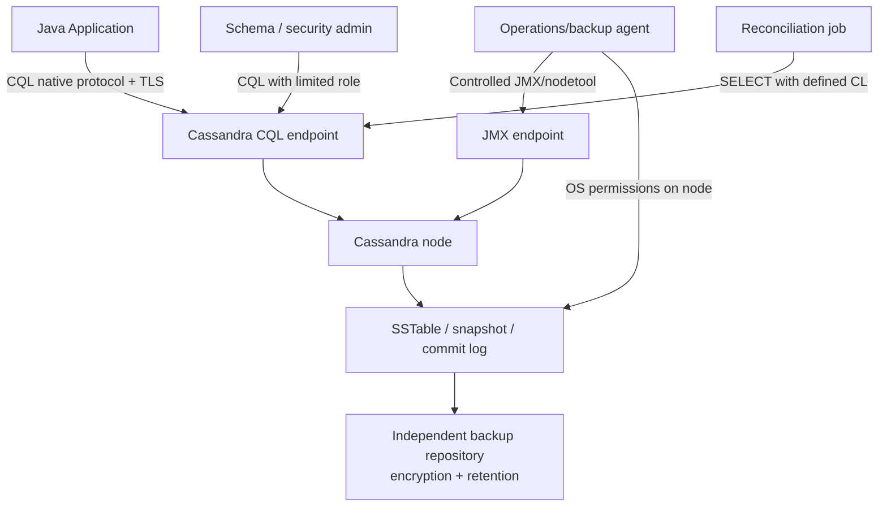
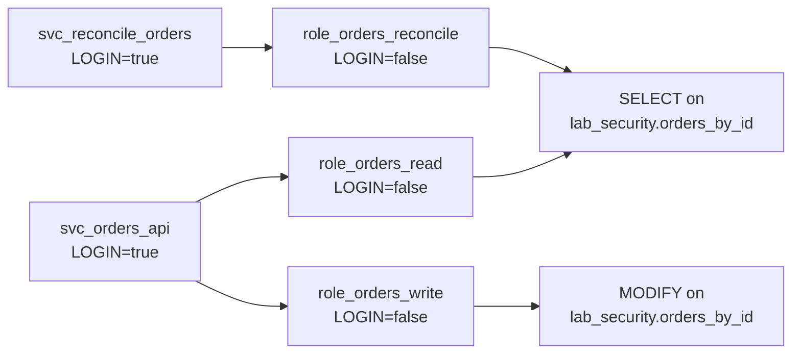

# Separating Application, Administration, Backup, and Reconciliation Accounts

**Chapter:** Security  
**Module:** `DATABASE_ENGINE_WIDE_COLUMN_CASSANDRA` — Apache Cassandra

In an Apache Cassandra cluster, **a single shared password for the application, DBA, backup job, and reconciliation task** turns multiple workflows into one giant privilege. If the password is leaked, it is very hard to tell which component performed an operation; if it is revoked, all components can be disrupted. A single bug in a service can also create an opportunity to alter the schema, read unnecessary data, or unintentionally destroy tables.

A better design is **separating identities by duty and access layer**:

- Applications only read/write the tables needed to serve requests.
- Administrative users/processes have permission to adjust schemas, roles, or node operations within an approved scope, and this account is not used in the API processing path.
- Backups use an operational identity to snapshot/read files and push backups to secure storage, **without needing CQL permissions to read every row by default**.
- Reconciliation uses a separate account, typically with only `SELECT` permission on the tables to compare; this task **must not be equated** with `nodetool repair`.

This lesson connects Cassandra's roles/RBAC mechanism with wide-column architecture, partition keys, query-driven table design, consistency levels, replication, compaction, repair, error handling, and Java connectivity. The theme is **trust boundaries, least privilege, and verifiability**, not just `CREATE ROLE` syntax.

> **Scope:** Reference guide for Apache Cassandra 4.1/5.x with `CassandraRoleManager`, `PasswordAuthenticator`, and `CassandraAuthorizer` or compatible mechanisms. Managed services, authenticator/authorizer plugins, and other versions may grant permissions differently. Only practice role changes in a **test cluster with authentication/authorization configured**. Do not run role creation/revocation commands in production without a recovery account and a rollback plan.

## 1. Learning Objectives

After this lesson, you will be able to:

1. Distinguish **authentication**, **authorization**, **encryption**, and **audit**, along with OS/JMX/CQL protection layers.
2. Design a role matrix for **application**, **schema/role admin**, **backup**, **reconciliation**, and **break-glass**.
3. Explain the role of `LOGIN`, `SUPERUSER`, role inheritance, and `KEYSPACE`/`TABLE` resources.
4. Grant `SELECT`, `MODIFY`, `CREATE`, and `ALTER` at the appropriate scope, clearly understanding that **`MODIFY` includes `TRUNCATE`**.
5. Use `LIST ROLES`, `LIST ALL PERMISSIONS`, and `REVOKE` to verify least privilege rather than just reading permission documentation.
6. Understand why backup accounts typically operate via OS/filesystem and JMX; CQL permissions do not automatically allow copying SSTables or calling `nodetool snapshot`.
7. Build a read-only reconciliation job using CQL/Java, specifying the CL and the limits of logical reconciliation.
8. Design secret rotation, emergency lockout, audit trails, separation of duties, and network path controls.
9. State the risks of using default/superuser accounts, sharing passwords, or granting `ALL PERMISSIONS ON ALL KEYSPACES`.
10. Create a runbook for account creation and revocation with a verification record checking impacts on applications/backups/reconciliation.

## 2. Multi-Layer Security Model

### 2.1. You Cannot Protect Only the CQL Port

A Cassandra cluster typically has multiple access paths:



**All** corresponding paths must be protected: CQL client-to-node TLS, authentication, and authorization; internode TLS/private network paths; JMX; operating system and filesystem; backup storage secrets; and logging systems. Fresh Cassandra installation configs may prioritize ease of cluster setup, so **never assume these safeguards are enabled by default**.

### 2.2. Four Questions Before Granting Permissions

| Question | Related Layer | Example |
| --- | --- | --- |
| **Who are you?** | Authentication / identity | `svc_orders_api` authenticates when connecting via CQL |
| **What are you allowed to do?** | Authorization / policy | `SELECT` on one table, no `DROP` |
| **Where does the data travel?** | TLS/network/OS | Client only reaches permitted DC, internode traffic is encrypted |
| **Who proves the operation happened?** | Audit/monitoring | Login logs, role changes, SELECT/DML, and JMX/OS operations by source |

Authentication verifies identity; it does not limit permissions by itself. TLS protects traffic on the network; it does not replace authorization. Audit records actions; it does not prevent them by itself. Backups support recovery; they do not stop an API account from calling `TRUNCATE` if it has permission.

## 3. Separation by Duty and Destructive Impact

### 3.1. Target Role Matrix

| Identity | Purpose | Permissions to Consider | Should Not Have |
| --- | --- | --- | --- |
| `svc_orders_api` | Handle application requests | `SELECT`/`MODIFY` on tables actually used | `SUPERUSER`, role management, `ALTER`/`DROP` schema, OS/JMX |
| `svc_orders_reader` (depending on design) | Read-only API | `SELECT` on specific tables | `MODIFY`, schema change permissions, reading all other keyspaces |
| `operator_schema` | Approved migrations | `CREATE`/`ALTER` scoped to keyspace/table, `DROP` if truly needed and controlled | Password embedded in Java API, running as an unsupervised cron job |
| `operator_identity` | Grant/revoke roles and policies | Scoped roles/`AUTHORIZE` administration permissions | Routine use to read all business data |
| `svc_backup_node` | Snapshot/copy SSTables to backup repository | Sufficient **OS/filesystem + JMX/nodetool**, backup repository write | Default CQL `SUPERUSER`, schema changes, bulk querying |
| `svc_reconcile_orders` | Compare business state | `SELECT` on tables/scope for reconciliation | `MODIFY`, `DROP`, JMX repair/scrub, access to all tables |
| `break_glass_admin` | Emergency incident, recovery | High privileges with monitoring, approval, and time limits | Integration into routine workloads |

An organization can use different identities for **each service, environment, datacenter, or pipeline**. You do not need to create a user role for every HTTP request; you need a stable, traceable identity for each **workload that owns permissions**.

### 3.2. Service Accounts Differ from Policy Roles

Cassandra uses **roles** both to authenticate users (`LOGIN=true`) and to group permissions (`LOGIN=false`). For example:



This allows adjusting **permission roles** without modifying individual login accounts. Permissions and roles are inherited via `GRANT role TO login_role`; inheritance cycles must not be created. **`LOGIN` is not inherited** just because an account belongs to a role with LOGIN.

### 3.3. Least Privilege at the Exact Resource

Granting `GRANT SELECT ON TABLE lab_security.orders_by_id` is narrower than `ON KEYSPACE lab_security`, while `ON ALL KEYSPACES` is very broad. A keyspace contains multiple tables; adding a new table with sensitive data could inadvertently grant access to an account if permissions were previously granted at the keyspace level.

Do not grant `ALL PERMISSIONS` just because a migration or deployment hits an `Unauthorized` error. Identify **which request, which resource, and which permission** is actually missing, and grant only the exact permission needed.

## 4. CQL Permissions: Important Boundaries

### 4.1. Data and Schema Permissions

| Permission | Common Resource | What It Allows | Risk |
| --- | --- | --- | --- |
| `SELECT` | TABLE / KEYSPACE | Read data within scope | Data leakage; no automatic row-level tenant isolation |
| `MODIFY` | TABLE / KEYSPACE | `INSERT`, `UPDATE`, `DELETE`, **and `TRUNCATE`** on the corresponding resource | Large-scale data deletion/modification even without `DROP` permission |
| `CREATE` | KEYSPACE, ALL KEYSPACES | Create tables/keyspaces within scope | Schema sprawl; changes to system load |
| `ALTER` | TABLE / KEYSPACE | Alter schema within scope | Changing data model/TTL/compaction or replication |
| `DROP` | TABLE / KEYSPACE | Drop matching schema/resources | Destruction of data and objects |
| `AUTHORIZE` | Resource/ROLE | Grant/revoke permissions or role relationships on resources | Privilege escalation if scope is too broad |
| `DESCRIBE` | ALL ROLES, MBEANS when supported | View metadata of roles/MBeans | Exposure of configuration/administrative capabilities |
| `EXECUTE` | FUNCTION/MBEAN when supported | Call functions or MBean operations | Can perform dangerous operational actions |

**Common misconception:** with standard Cassandra CQL RBAC, `MODIFY` has no option to separate "INSERT but not DELETE/TRUNCATE" at the statement level. Do not claim that a `svc_orders_api` role with `MODIFY` "cannot delete the table" in terms of data: it can delete **rows** or `TRUNCATE` the entire table if the version/policy allows. Therefore, authorization must be combined with service/API-layer checks, prohibited-command validation, separation of data ingestion paths, and proper recovery mechanisms.

### 4.2. No Per-Tenant Row-Level RBAC via a Standard GRANT

`GRANT SELECT ON TABLE orders_by_id` does not restrict access to only rows where `tenant_id='tenant-01'`. Cassandra relies on partition keys and query design for fast data access, whereas common RBAC operates at the **keyspace/table** level, without a generic `GRANT SELECT WHERE tenant_id=?` syntax.

If multi-tenancy requires strong data isolation:

- Consider separating keyspaces/tables/clusters based on isolation requirements and operational cost.
- Enforce passing and validating tenant identity at the service layer.
- Design partition keys/queries around the tenant, avoiding unauthorized access via predictable IDs.
- For versions/distributions offering masking or extended policies, verify actual capabilities; **masking does not automatically equal row-level authorization**.
- Do not treat "the client does not know the partition key" as a security control.

### 4.3. What Is Superuser Reserved For?

A role with `SUPERUSER=true` bypasses normal CQL permission restrictions. Bootstrap/emergency accounts should:

- Not be the default credential for a service API.
- Not have a password shared among multiple people.
- Be stored in a secret vault with two-person approval if policy requires.
- Log the reason, duration of use, and post-incident actions.
- Have a password rotation/revocation procedure upon suspected exposure.
- Have a recovery account verified to work after tightening policies to avoid locking yourself out of the entire cluster.

Separate `operator_schema` from `operator_identity` whenever possible: the person changing schemas does not necessarily need to create users or grant permissions to themselves.

## 5. Ensuring Authentication/Authorization Are Actually Enabled

In Apache Cassandra, related settings are typically in `cassandra.yaml`, for example:

```yaml
# Illustrates provider names, not a complete config to copy and run:
authenticator: PasswordAuthenticator
authorizer: CassandraAuthorizer
role_manager: CassandraRoleManager
```

By default, many lab configs may use `AllowAllAuthenticator`/`AllowAllAuthorizer`, making `CREATE ROLE` ineffective as a real safeguard when authentication/authorization are not properly enabled. Third-party providers behave differently.

**Do not change auth on a production cluster by restarting all nodes at once.** Transitioning from unauthenticated to authenticated access requires a plan for superuser bootstrapping, `system_auth` replication, TLS, readiness, and rolling restarts per version/runbook, along with a fallback account.

### 5.1. `system_auth` Is Operational Data for the Security Layer

Cassandra stores roles, credentials, and permissions in the `system_auth` system keyspace when using default providers. If RF is set improperly or replication/repair is unstable, login/authorization itself can break when a replica goes down.

You must:

1. Verify `system_auth` RF in each datacenter according to cluster policy.
2. Check schema agreement/replica health before modifying auth.
3. Schedule appropriate repair/backup and understand that auth tables cannot be treated like ordinary application tables.
4. Do not directly edit rows in `system_auth` to create/modify users; use CQL role management.
5. Do not copy auth system tables directly between clusters assuming metadata is always compatible.

Role changes have cache/propagation semantics; do not interpret a single recently rejected/accepted request as immediate cluster-wide propagation. Verify across time, version, and provider.

### 5.2. TLS and Network Controls Are Not Optional

Enabling CQL authentication while sending passwords over unencrypted connections or leaving JMX/internode ports publicly open still leaves an attack surface. Protect:

- **Client-to-node TLS:** applications verify certificates/hostnames and trust chains.
- **Internode encryption:** nodes exchange mutations, gossip/streaming over permitted network paths.
- **JMX/management ports:** accessible only from the management network, with authentication/authorization and TLS as appropriate.
- **OS/data directory:** file permissions, disk encryption/volume policies, secret mounts.
- **Network segmentation:** firewalls/security groups restricting access to 9042, JMX, and internode ports; do not rely on passwords alone.
- **Backup repository:** write-only/append-only permissions or immutable retention if supported to reduce the risk of backup deletion/modification.

Never store certificate private keys, passwords, or raw tokens in Git or application logs.

## 6. Lab: Setting Up a Table and Separate Roles

> **Prerequisites:** A Cassandra lab with a compatible authenticator/authorizer/role manager enabled. You have an admin account authorized to create keyspaces, tables, roles, and grants. Password strings in these commands are **illustrative placeholders only**, not values to copy into production. In practice, use a controlled secret manager/provisioning tool and avoid exposing passwords in shell history, transcripts, or Git.

### 6.1. Verify the Cluster and Datacenter

```bash
nodetool status
cqlsh
```

In `cqlsh` (logged in with an appropriate lab admin identity):

```sql
SELECT data_center, release_version FROM system.local;

SELECT keyspace_name, replication
FROM system_schema.keyspaces
WHERE keyspace_name = 'system_auth';
```

The DC name below is **assumed** to be `datacenter1`; if different, adjust it accordingly. For a single-node lab, RF=1 keeps configuration simple; RF=1 is **not** a high-availability production configuration.

### 6.2. Create the Keyspace and Application Table

```sql
CREATE KEYSPACE IF NOT EXISTS lab_security
WITH replication = {
  'class': 'NetworkTopologyStrategy',
  'datacenter1': 1
}
AND durable_writes = true;

CREATE TABLE IF NOT EXISTS lab_security.orders_by_id (
    order_id uuid PRIMARY KEY,
    tenant_id text,
    state text,
    amount_cents bigint,
    updated_at timestamp
);

INSERT INTO lab_security.orders_by_id
    (order_id, tenant_id, state, amount_cents, updated_at)
VALUES (
    10000000-0000-4000-8000-000000000001,
    'tenant-lab',
    'CREATED',
    125000,
    '2026-11-21T00:00:00Z'
);
```

`order_id` is the partition key of this table; standard CQL lookups filter by `WHERE order_id = ?`. `tenant_id` is a business field, **not an RBAC boundary**: a role with `SELECT` on the table is not automatically restricted to that tenant.

### 6.3. Non-Login Permission Groups

```sql
-- Run with an authorized admin role, on lab only.
CREATE ROLE IF NOT EXISTS role_orders_read
WITH LOGIN = false AND SUPERUSER = false;

CREATE ROLE IF NOT EXISTS role_orders_write
WITH LOGIN = false AND SUPERUSER = false;

CREATE ROLE IF NOT EXISTS role_orders_reconcile
WITH LOGIN = false AND SUPERUSER = false;

GRANT SELECT ON TABLE lab_security.orders_by_id
TO role_orders_read;

GRANT MODIFY ON TABLE lab_security.orders_by_id
TO role_orders_write;

GRANT SELECT ON TABLE lab_security.orders_by_id
TO role_orders_reconcile;
```

To avoid over-privileging, the reconciliation role is separated from the app read role even though both currently have `SELECT`. If the app later receives permission to read a new table, the reconciliation account will **not automatically** gain extra permissions without a separate grant.

**Note on `MODIFY`:** the write role can `INSERT`, `UPDATE`, `DELETE`, and `TRUNCATE` the granted table. Do not attach this role to a task that only needs reconciliation.

### 6.4. Workload Login Accounts

```sql
-- The following passwords are placeholders only. DO NOT run as-is in production.
-- Provisioning tools must substitute managed random secrets.
CREATE ROLE IF NOT EXISTS svc_orders_api
WITH LOGIN = true
 AND SUPERUSER = false
 AND PASSWORD = 'LAB_ONLY_REPLACE_ME_API';

CREATE ROLE IF NOT EXISTS svc_reconcile_orders
WITH LOGIN = true
 AND SUPERUSER = false
 AND PASSWORD = 'LAB_ONLY_REPLACE_ME_RECONCILE';

GRANT role_orders_read TO svc_orders_api;
GRANT role_orders_write TO svc_orders_api;

GRANT role_orders_reconcile TO svc_reconcile_orders;
```

A role with `LOGIN=true` is allowed to authenticate if the authenticator supports that credential type; group roles with `LOGIN=false` cannot be used to open sessions. Do not share a single password between two accounts just because they access the same table.

### 6.5. Schema Admin Role Is a Separate Path

In the lab, you can create a separate login for **schema migration**, only when an actual migration process exists:

```sql
CREATE ROLE IF NOT EXISTS role_schema_change
WITH LOGIN = false AND SUPERUSER = false;

CREATE ROLE IF NOT EXISTS operator_schema
WITH LOGIN = true
 AND SUPERUSER = false
 AND PASSWORD = 'LAB_ONLY_REPLACE_ME_SCHEMA';

-- Allow creating tables in the lab keyspace, not modifying all keyspaces.
GRANT CREATE ON KEYSPACE lab_security
TO role_schema_change;

-- Only allow ALTER on a specific table, do not automatically grant DROP.
GRANT ALTER ON TABLE lab_security.orders_by_id
TO role_schema_change;

GRANT role_schema_change TO operator_schema;
```

This is only a **scoping example**. A real migration might need `ALTER`/`DROP` on another table or creating a materialized view/index; in that case, evaluate permissions specifically for that migration/job with approval and a time window. Do not default to granting `DROP ON KEYSPACE` or `ALL ON ALL KEYSPACES` just so every migration can run without review.

Pay attention to **resource creator** permissions: Cassandra may automatically grant appropriate permissions on newly created resources to the creator. Therefore, if `operator_schema` creates a new table, inventory the permissions gained from creation after the migration, not just the GRANTs written in the runbook.

## 7. Verifying Effective and Denied Permissions

### 7.1. Checking from an Authorized Admin Account

```sql
LIST ROLES OF svc_orders_api;
LIST ROLES OF svc_reconcile_orders;

LIST ALL PERMISSIONS OF svc_orders_api;
LIST ALL PERMISSIONS OF svc_reconcile_orders;

LIST ALL PERMISSIONS
ON lab_security.orders_by_id
OF svc_orders_api;
```

`LIST ALL PERMISSIONS` typically includes permissions inherited from other roles. `NORECURSIVE` can limit results depending on version semantics. Listing **all roles** in the cluster may require `DESCRIBE ON ALL ROLES`; a regular app account should not be allowed to enumerate all accounts.

Expected lab results:

| Identity | `SELECT orders_by_id` | `MODIFY orders_by_id` | `ALTER orders_by_id` | `SUPERUSER` |
| --- | --- | --- | --- | --- |
| `svc_orders_api` | Yes, via read role | Yes, via write role | No | No |
| `svc_reconcile_orders` | Yes | No | No | No |
| `operator_schema` | Does not need SELECT by default | Does not need MODIFY by default | Yes, per GRANT | No |

**Do not interpret an expected table as proof that the configuration is enforced.** You must run `LIST...` and test with real login sessions because other direct/inherited permissions might exist.

### 7.2. Positive Test with SELECT

Log in as `svc_reconcile_orders` in the **lab** using a secure method from your tool/secret provider, then run:

```sql
SELECT order_id, tenant_id, state, amount_cents
FROM lab_security.orders_by_id
WHERE order_id = 10000000-0000-4000-8000-000000000001;
```

The expected logical result is the `tenant-lab` row in state `CREATED`. If reading fails, inspect the specific error: wrong password/authentication, ungranted role, unrefreshed permissions cache, wrong keyspace, or node/CL unavailable. Do not "fix" it by granting superuser.

### 7.3. Negative Tests Must Not Damage Production

To prove `svc_reconcile_orders` cannot write, test **in a disposable table** with a dedicated test key:

```sql
-- ONLY use when logged in as svc_reconcile_orders in a lab cluster:
-- Returning Unauthorized proves the write-denial policy works.
-- If it unexpectedly succeeds, sample data was altered: stop the test,
-- record the authorization bug, and remediate per runbook.
UPDATE lab_security.orders_by_id
SET state = 'SHOULD_NOT_BE_AUTHORIZED'
WHERE order_id = 10000000-0000-4000-8000-000000000099;
```

**Do not run destructive negative tests (TRUNCATE/DROP/DELETE) on production.** An `Unauthorized` result from one statement does not validate the entire policy: permissions on other resources, inherited roles, access-control plugins, and node configs may still apply. Have safe automated least-privilege tests in CI/staging when policies change.

### 7.4. Controlled Permission Revocation

```sql
-- Lab example: temporarily suspend the group's reconciliation permission.
REVOKE SELECT ON TABLE lab_security.orders_by_id
FROM role_orders_reconcile;

-- To re-grant in the lab:
GRANT SELECT ON TABLE lab_security.orders_by_id
TO role_orders_reconcile;
```

If `svc_reconcile_orders` still receives `SELECT` through another role, revoking from one role will **not remove all grant paths**. Therefore, after revoking, re-run `LIST ALL PERMISSIONS OF svc_reconcile_orders` and re-test. Some permission changes take time for caches/auth state across nodes to reflect; use an appropriate verification window.

## 8. Application Accounts: Function-Scoped Reads and Writes

### 8.1. Do Not Use the Same Identity for All Microservices

If both the `orders` and `billing` services use the `cassandra` account, a bug in the orders service can read billing tables or perform cluster-wide schema operations. Separate them:

- `svc_orders_api`: required order tables.
- `svc_billing_api`: only approved payment tables.
- `svc_orders_projection`: worker updating a separate read model, if needed.
- `svc_reconcile_orders`: read-only for reconciliation, no updates.

The same table may need two access patterns, but separate accounts enable auditing, rotation, containment of credential leaks, and smaller blast radius.

### 8.2. Base Permissions on Actual APIs, Not Service Names

Before granting, create a mapping table:

| API/Job | Actual CQL Query | Table | Permission Needed |
| --- | --- | --- | --- |
| `GET /orders/{id}` | SELECT by `order_id` | `orders_by_id` | `SELECT` |
| `POST /orders` | INSERT by primary key | `orders_by_id` | `MODIFY`, with application guardrails |
| `PATCH /orders/{id}` | UPDATE state | `orders_by_id` | `MODIFY` |
| `reconcile-orders` | SELECT to verify data | `orders_by_id` | `SELECT` |
| Schema migration | CREATE/ALTER TABLE | Specific keyspace/table | `CREATE`/`ALTER` per task |
| Snapshot files | `nodetool snapshot` and copy SSTables | OS/JMX/data directory | **Not implied by CQL `SELECT`** |

`MODIFY` is broader than an API rule saying "may update status"; application logic must validate inputs, tenants, business state, and idempotency. Cassandra does not enforce a "no negative amount" invariant from the `MODIFY` permission.

### 8.3. Prepared Statements and Parameterization

When querying data from Java, use prepared/bound statements instead of concatenating CQL strings from input. Using prepared statements **does not elevate privileges**; the server still checks the session's role. It helps avoid certain injection/query-construction bugs and keeps query shapes consistent.

Do not let applications pass username/password or select a role based on a client-supplied header. The CQL identity is bound to the trusted workload/configuration, not external user input.

## 9. Administration: Schema, Roles, and Operational Rights

### 9.1. CQL Administration Is Not Host Administration

A person might:

- Be allowed to run `ALTER TABLE` without SSH access to nodes.
- Have access to logs/disk metrics without schema modification rights.
- Be allowed to manage JMX snapshots without reading business tables via CQL.
- Have access to a break-glass account via procedure, without using it for daily automation.

Separate **schema changes**, **security policy changes**, **node maintenance**, and **incident response** into tasks with distinct owners once the organization is large enough.

### 9.2. Using High-Privilege Admin Accounts via Break-Glass

Runbook:

1. Confirm the incident and that the task cannot be performed by a limited role.
2. Request approval and record a ticket/change ID.
3. Retrieve the credential from the vault under a human identity, with MFA/time-bound elevation if supported by infrastructure.
4. Execute the exact CQL/JMX/OS commands and save the audit trail.
5. Verify the outcome and impact on replicas/CL.
6. Revoke temporary privileges or rotate the credential per policy.
7. Reconcile `LIST ROLES`/`LIST PERMISSIONS` to detect leftover privileges.

Never use root/superuser to fix ordinary application permission errors.

### 9.3. High-Blast-Radius Operations

| Operation | Why It Is Dangerous | Control |
| --- | --- | --- |
| `DROP TABLE/KEYSPACE` | Removes schema and makes data inaccessible via normal paths | Approval, backup, migration |
| `TRUNCATE TABLE` | Deletes all data in a table even though it is not DROP | Control accounts with `MODIFY` and non-CQL guardrails |
| `ALTER KEYSPACE ... replication` | Changes replica count/placement, may require rebuild/repair | Topology, capacity, and recovery runbook |
| `GRANT ALL ...` | Expands permissions beyond target | Least-privilege reviews and periodic checks |
| `nodetool scrub/cleanup/removenode` | Can cause data loss or alter topology | JMX/OS permissions, preflight, backup |
| Modifying `cassandra.yaml`/certificates | Can break access or internode connectivity | Change control, rollback, node-by-node verification |

**CQL permissions do not protect against an administrator with filesystem access:** anyone who can read/copy SSTables at the OS level can exfiltrate data from the cluster and inspect it separately. Powerful infrastructure accounts therefore need independent monitoring.

## 10. Backups: Why Not Use a CQL Superuser Account?

### 10.1. SSTable-Level Backup Is a Node/Filesystem Task

A typical Cassandra snapshot/backup workflow consists of:

1. Scheduling snapshots for the appropriate nodes/tables/keyspaces.
2. Calling `nodetool snapshot` via JMX (or the distribution's management mechanism).
3. Verifying SSTable/snapshot files, schemas, and metadata required for recovery.
4. Copying data via OS/agent to **independent** storage over a protected transport.
5. Saving manifests, checksums, versions, timestamps, and retention metadata.
6. Periodically testing restores into a disposable cluster.

**`GRANT SELECT ON KEYSPACE` does not grant permission to read SSTable files.** Conversely, being able to copy OS files/snapshots does not require the backup account to `SELECT` every row via CQL. These two layers must be protected independently.

### 10.2. What Should a Backup Identity Have?

| Layer | Permissions Needed If Job Requires | What to Avoid |
| --- | --- | --- |
| OS/service | Read node snapshots, write to designated staging/backup directories | Full machine shell/root if unneeded; writing into live data directories |
| JMX/nodetool | Managed snapshot/status operations per specific JMX auth mechanism | Allowing all MBean operations or unencrypted remote JMX |
| Backup repository | Upload/append objects, appropriate encryption and retention | Permission to delete entire backup history with routine credentials |
| CQL (job-dependent) | Metadata/schema or SELECT truly needed for *logical export* | Superuser, `ALL KEYSPACES` by default |
| Secret management | Dedicated job credential, scheduled rotation | Putting tokens in Git scripts/CLI args/logs |
| Observability | Logs of start/end, bytes, checksums, errors, and restore tests | Logging only "snapshot command success" and considering it done |

**Two distinct types of backup:** *SSTable snapshot backup* uses files/OS/JMX; *logical export via CQL* uses SELECT and reads actual data. Do not merge them into a single superuser identity "so it can do everything."

### 10.3. Snapshot Command Example (Lab Only)

```bash
nodetool help snapshot

# Run on the assigned node, with sufficient JMX permissions:
nodetool snapshot -t lab_backup_20261121 -cf orders_by_id lab_security

nodetool listsnapshots
```

In a multi-replica cluster, **a snapshot on one node does not automatically create a backup across all nodes/DCs**. You must account for point-in-time consistency, schema, topology, RF, and recovery strategy. A snapshot on the same failing disk is not an independent backup. Data in the commit log or in-flight mutations in the cluster may require dedicated consistency/RPO policies.

Do not write examples copying files to a public bucket or printing storage credentials. Real backup tools must use proper organizational IAM/storage policies and encryption.

### 10.4. Restore Is More Dangerous Than Backup

Restoring can overwrite data, use `sstableloader`, alter keyspaces/schemas, or replace nodes depending on the scenario. **Do not automatically grant restore/delete/replace permissions to the daily backup job.** Use a separate account/role with emergency approval, and test the procedure on a disposable cluster. To avoid mistakes, verify that backups include appropriate tombstones, TTLs, schemas, system metadata, and version compatibility.

An untested backup is merely **a set of copied files**, not proof of RPO/RTO.

## 11. JMX and Operational Rights Are a Separate Authorization Domain

### 11.1. CQL Permissions Do Not Automatically Grant JMX Rights

`nodetool` typically accesses JMX; JMX authentication/authorization configurations can be independent of CQL clients. Cassandra also provides an **integrated JMX auth/authorization mode** that allows using roles and permissions on MBeans, **only when the corresponding configuration is enabled**. Therefore:

- Granting `SELECT ON TABLE` is not enough to call snapshot.
- Having a CQL login account does not mean being allowed to connect to JMX.
- `GRANT EXECUTE ON ALL MBEANS` is overly broad if integrated mode is enabled; do not use it as a generic "fix."
- Remote JMX access requires proper network restrictions, authentication, and TLS; default local JMX may authenticate differently from remote depending on configuration.
- A single MBean operation can carry significant administrative power even if the account lacks CQL `SUPERUSER`.

### 11.2. Scope MBeans by Function, Do Not Guess Permissions

To design a read/snapshot backup account:

1. Inventory which MBeans/ObjectNames/operations the backup tool invokes on the **actual version**.
2. Choose a supported JMX auth mechanism (standard JMX or integrated).
3. Grant exact permissions on verified resources; if standard JMX lacks granularity, use a controlled operator/broker instead of granting all permissions to the agent.
4. Test both **authorized users** and **denied users** in the lab.
5. Monitor JMX and OS operations with an appropriate audit system; Cassandra CQL audit logs do not capture all `nodetool` commands.
6. Do not expose JMX to the Internet just to run backups conveniently from an external cron job.

An account with permission to read snapshots on disk **must not** have permission to modify the live data directory; POSIX/ACL permissions and agent volume mounts must be designed separately.

## 12. Data Reconciliation: Read-Only Does Not Mean Unbounded Scans

### 12.1. Reconciliation Has at Least Two Meanings

**Business reconciliation:** comparing Cassandra data against a source-of-truth system/ledger, or comparing read models by key/time window to find missing, extra, or mismatched states. Typically uses CQL `SELECT` and reports discrepancies **without auto-modifying data**.

**Replica reconciliation (anti-entropy repair):** Cassandra compares replicas across token ranges and streams differences via `nodetool repair`. This is an **operational task** requiring JMX/node permissions and resources; it is **not** a read-only SELECT query.

These two tasks require different accounts, SLAs, and approvals.

### 12.2. Designing a Partition-Key-Driven Reconciliation Job

Suppose `lab_security.orders_by_id` uses `order_id` as its partition key. The job only checks orders obtained from the source system and executes:

```sql
SELECT order_id, tenant_id, state, amount_cents, updated_at
FROM lab_security.orders_by_id
WHERE order_id = 10000000-0000-4000-8000-000000000001;
```

Avoid `SELECT * FROM ...` scanning the entire keyspace or adding `ALLOW FILTERING` to query without a partition key. Even a read-only reconciliation job can cause a **performance DoS** if it continuously scans millions of partitions, driving up application p99 latency. Bound the rate, concurrency, page size, key count, time window, and number of DCs queried.

### 12.3. Consistency Level Determines What the Result Means

| CL / Option | What It Helps Observe | What It Does Not Prove |
| --- | --- | --- |
| `ONE` | One replica suffices to respond, usually lighter | Not guaranteed to see the latest mutation from other replicas |
| `LOCAL_QUORUM` (with suitable local RF) | Reads at quorum in the serving DC | Does not audit every physical replica; not cluster-wide linearizable |
| `ALL` | Requires all relevant replicas to respond to the read | Does not turn each SELECT into a full-keyspace snapshot; sensitive to node failures |
| Reads in two DCs via separate routes | Helps compare results across two regions | Two reads at different instants are not an atomic snapshot |
| `nodetool repair` | Reconciles replicas/ranges | Does not know which business state should win when writers conflict on timestamps |

Cassandra has **eventual consistency** by design. If writes are in flight, a mismatch may stem from lag/CL conditions rather than corruption. When comparing business data, choose a **stabilized** window, a source watermark/version, correlation IDs, and a controlled retry policy.

### 12.4. Do Not Use a SELECT Job to Auto-"Heal" Inconsistencies

When a mismatch appears:

1. Log the key pair, timestamp, CL, DC/coordinator, and redacted result.
2. Distinguish response errors from non-existent rows.
3. Cross-check the source of truth, tombstones/TTLs, timestamps, and business events.
4. Investigate hints/repair state if replica divergence is suspected.
5. If a fix is required, use a **separate data remediation process** with approval and a different credential (never let a read-only job self-elevate).
6. Re-verify after remediation and record inconclusive cases.

**Do not** grant `MODIFY` to `svc_reconcile_orders` just to auto-fix a mismatch; doing so erases monitoring and write-privilege boundaries.

## 13. Java Driver: Applications and Reconciliation Use Different Identities

### 13.1. Separate Configurations per Deployment

Java Driver 4.x allows configuring username/password and TLS context per `CqlSession`. The example below accepts credentials **passed from a trusted secret system**, without hardcoding. In production, create a session once per service lifecycle and verify certificates.

```java
import com.datastax.oss.driver.api.core.CqlSession;
import com.datastax.oss.driver.api.core.DefaultConsistencyLevel;
import com.datastax.oss.driver.api.core.cql.PreparedStatement;
import com.datastax.oss.driver.api.core.cql.Row;

import java.net.InetSocketAddress;
import java.util.UUID;
import javax.net.ssl.SSLContext;

public final class AccountSeparationExample {
    // username/password come from a secret manager or trusted provider.
    // tlsContext must contain trust material verifying the server; do not disable verification.
    public static CqlSession connect(
            String hostname,
            int port,
            String localDc,
            String username,
            String password,
            SSLContext tlsContext) {
        return CqlSession.builder()
            .addContactPoint(new InetSocketAddress(hostname, port))
            .withLocalDatacenter(localDc)
            .withAuthCredentials(username, password)
            .withSslContext(tlsContext)
            .build();
    }

    // Call only from the job using the svc_reconcile_orders account.
    public static void reconcileOne(CqlSession readOnlySession,
                                    UUID orderId) {
        PreparedStatement query = readOnlySession.prepare(
            "SELECT order_id, tenant_id, state, amount_cents, updated_at " +
            "FROM lab_security.orders_by_id WHERE order_id = ?"
        );

        try {
            Row row = readOnlySession.execute(
                query.bind(orderId).setConsistencyLevel(
                    DefaultConsistencyLevel.LOCAL_QUORUM)
            ).one();

            if (row == null) {
                System.out.println("ABSENT: " + orderId);
                return;
            }

            // In a real system: compare against a watermarked source-of-truth;
            // only print redacted data, never log full customer details.
            System.out.println(
                "FOUND: " + row.getUuid("order_id") +
                ", state=" + row.getString("state") +
                ", amount=" + row.getLong("amount_cents")
            );
        } catch (RuntimeException ex) {
            // Timeout/unavailable does not mean "absent".
            System.err.println("READ_ERROR for " + orderId +
                ", type=" + ex.getClass().getSimpleName());
        }
    }
}
```

**Version/lab note:** `LOCAL_QUORUM` in this example only makes sense when the DC has an appropriate RF and enough replicas to satisfy it. If you created the RF=1 lab per Section 6, local quorum is also 1, providing no fault tolerance; in production, RF/CL must be designed for your requirements.

The Java Driver does not distinguish "this session is a backup account" by method name: the server grants permissions based on the authenticated role. Never place `operator_schema` username/password in the same service runtime as `svc_orders_api` "for migration convenience."

### 13.2. Why Should Each Deployment Have Distinct Secrets?

If all replicas of microservices share one account, the blast radius of a leaked secret can span every region. You can use separate accounts per environment/region, weighing role count, quota/management overhead, and audit needs. At a minimum, separate **production vs staging**, **API vs backup**, and **read-only reconcile vs writer**.

Use a secret manager with verified rotation: old/new credentials coexist during the transition window when design permits, rolling out application groups gradually, watching auth failures, and then revoking the old credential. Do not change the password of a role currently used by all clients simultaneously without planning for connection errors.

### 13.3. Never Put Passwords in CLI Arguments or Source Code

Commands like `cqlsh -p <password>` or `nodetool -pw <password>` can expose secrets in process lists, shell history, automation logs, or CI output depending on the platform. Choose interactive prompts, tightly permissioned credential files, or platform secret injection; never write real credentials in labs, Git, or tickets.

In Java, never log exceptions containing raw connection configurations if doing so risks printing secrets. Only log the error class, request correlation ID, and non-sensitive parameters needed for investigation.

## 14. Secret Lifecycle: Creation, Distribution, Rotation, Revocation

### 14.1. Distinguishing Rotation from Revocation

- **Rotate:** change the secret for an identity still in use; must avoid downtime.
- **Revoke permission:** the account can still log in but no longer has rights on a specific resource.
- **Disable login:** `ALTER ROLE role_name WITH LOGIN=false` per the corresponding mechanism; impact on existing sessions may vary by version/cache.
- **DROP ROLE:** deletes the identity, removing login capability and associated grants; verify dependent workloads first.
- **Break glass:** temporarily grant elevated permissions, then revoke and perform post-incident review.

### 14.2. Safe Rotation Procedure for Services

1. Inventory accounts, secret storage locations, owners, jobs using the account, and DCs/endpoints.
2. Generate the new credential via secret manager/provisioning without passing it through unprotected channels.
3. Test TLS/auth connectivity and approved `SELECT`/`MODIFY` on a canary.
4. Roll out the secret across instance groups; monitor auth errors, request p99, and connection churn.
5. Verify **no instances are still using the old secret**.
6. Disable the old credential/role or complete the password update per the chosen strategy.
7. Re-inventory `LIST PERMISSIONS`/`LIST ROLES`, record the ticket/audit, and define the rollback window.

Some systems do not support multiple simultaneous passwords for the same role. When zero-downtime rotation is needed, use **two login roles sharing the same policy group** during the transition window, then revoke the old role after traffic drain is confirmed. Do not leave hundreds of parallel accounts active indefinitely.

### 14.3. Handling Compromised Credentials

- Prioritize reducing privileges/disabling the compromised identity per incident response policy.
- Record the exposure window and scope of tables/keyspaces/JMX paths/backup repositories accessible to the credential.
- Search for anomalous logins and DDL/DML via audit logs and telemetry; keep audit retention and node coverage limits in mind.
- Rotate all related secrets if there is any basis for compromise.
- Inspect schema/role changes, data read or modified, and deleted/altered backups.
- Only restore access once the scope is assessed and approved by the owner.

Do not delete audit logs before the investigation is complete.

## 15. Audit: How Much Can You Prove About Who Did What?

### 15.1. CQL Audit Logging

Apache Cassandra 4.0+ provides **audit logging** capable of recording CQL activity, successful/failed logins, permission checks, and changes such as `CREATE ROLE`/`GRANT`/`REVOKE`, depending on include/exclude category/user/keyspace configuration.

Examples of events to monitor:

- Unusual logins of `svc_orders_api` from unfamiliar addresses/regions.
- `Unauthorized` on schema or role-change commands.
- `MODIFY` or `TRUNCATE` issued by a reconciliation account.
- `GRANT ALL PERMISSIONS` or `SUPERUSER` elevation.
- Spikes in `SELECT` volume from a service account with broad read rights.
- Permission changes created and revoked within a very short window.

Cassandra audit logs are typically generated **on the coordinator receiving the request**, not automatically replicated like table data. You cannot read the audit file on one node and conclude you have seen every CQL request in the cluster. Collect logs from **all relevant coordinators**, forward them to a protected log store, and set retention.

### 15.2. Audit Has Scope Limitations

Cassandra audit logs **do not replace**:

- Auditing of `nodetool`/JMX commands.
- Logs from `sudo`/systemd/SSH and snapshot/SSTable filesystem access.
- Access/deletion logs of the backup repository.
- Permission review processes and service ownership.
- Reverse proxy/API gateway or identity provider audits.
- Immutability and integrity protection of the logs themselves.

For backup and recovery, you typically need **two sets of evidence**: node-level Cassandra/JMX events and backup-repository object-storage/IAM events. A single "backup completed" log line does not prove the blob is unaltered, restorable, or meets RPO timing.

### 15.3. PII and Statements Containing Passwords in Logs

Audit logs may contain CQL text, source addresses, role names, and other metadata. Although Cassandra masks passwords in many valid DCL cases, **do not rely on this to put real secrets in transcripts/Git or assume every malformed statement is masked**.

Logging design must:
- Avoid logging raw credentials or full sensitive payloads unnecessarily.
- Restrict log read permissions and encrypt logs at rest.
- Synchronize clocks/UTC and preserve correlation IDs.
- Monitor log growth rate, retention, and storage capacity.
- Distinguish query successes, auth failures, and uncovered OS/JMX operations.

**Do not enable Full Query Logging as a replacement for audit** without understanding the difference: FQL records successful queries for replay/analysis, whereas audit focuses on monitoring activity and authentication/authorization events.

## 16. Periodic Access Reviews and Preventing Privilege Creep

### 16.1. How Role Drift Happens

A service starts out reading one table. Next month a migration fails due to missing permissions, and the on-call engineer temporarily grants `ALL PERMISSIONS ON KEYSPACE`. Months later, a user switches teams without having their old role revoked. As a result, accounts accumulate broader permissions even though the code no longer needs them.

Prevent drift with:

1. **Policy as code** mapping role → resource → permission and owner.
2. Reviewing `LIST ALL PERMISSIONS`, including **direct and inherited permissions**.
3. Comparing effective permissions against the approved manifest.
4. Confirming which service/job still uses each account; removing orphan accounts.
5. Revoking unused permissions, using a canary before broad enforcement.
6. Auditing instances of `SUPERUSER`, `AUTHORIZE`, `DROP`, and `ALL KEYSPACES`.
7. Revoking temporary grants after migrations and verifying the permission change log.
8. Ensuring break-glass accounts are never used by service accounts.

### 16.2. Verification Matrix by Identity Type

| Check | App | Admin | Backup | Reconciliation |
| --- | --- | --- | --- | --- |
| Dedicated owner/credential | Mandatory | Per individual/function | Per pipeline/host | Per job |
| Has CQL login? | Yes | Yes if CQL task | **Not mandatory** | Yes if using CQL |
| `SELECT` on data? | Only required tables | Only when task requires | Not by default | Only reconciliation tables |
| `MODIFY`? | Writers only; note `TRUNCATE` | Per specific change | No | **No** |
| Schema/role management? | No | Purposeful privilege split | No | No |
| OS/JMX? | No | Operational tasks only | Limited | No |
| Backup storage write? | No | Emergency procedure only | Limited | No |
| Audit/rotation/disable tested? | Yes | Yes | Yes | Yes |

Separation of duties does not mean every account type must have a completely separate human manager. What matters is that **compromising one identity cannot perform every operation**.

## 17. Practice: Reconciling Permissions After Adding a Table

Suppose an admin creates a new table in the same keyspace:

```sql
CREATE TABLE lab_security.payment_events_by_id (
    payment_id uuid PRIMARY KEY,
    order_id uuid,
    status text,
    created_at timestamp
);
```

If `SELECT ON KEYSPACE lab_security` had previously been granted to `role_orders_read`, the app role would automatically be able to read the new table. Because this lab granted `SELECT ON TABLE lab_security.orders_by_id`, `svc_orders_api` does **not automatically** gain read access to `payment_events_by_id` thanks to table-level grants.

**Scope exercise:** The administrator checks permissions:

```sql
LIST ALL PERMISSIONS ON lab_security.payment_events_by_id
OF svc_orders_api;

LIST ALL PERMISSIONS ON lab_security.orders_by_id
OF svc_orders_api;
```

If the new table holds sensitive payment data, do not grant access simply because it shares the keyspace. Create a separate approval based on actual API and resource requirements.

**Note:** `system.local`, `system_schema`, or metadata tables needed by drivers have special access handling in some versions; do not cite them as evidence that an account has cluster-wide `SELECT` permission. Test access on **business tables**.

## 18. Troubleshooting Common Security Issues

### A. App Has Correct Username/Password but Receives `Unauthorized`

Authentication may succeed while the role lacks `SELECT`/`MODIFY` on the exact table. Check the actual query, logged-in user, `LIST ALL PERMISSIONS OF role`, role inheritance, resource name, and version. Do not grant superuser just to make the API work.

### B. Backup Job Fails `nodetool snapshot` While SELECT Still Works

CQL `SELECT` permission does not imply JMX snapshot permission. Check JMX auth/network, OS identity, MBean permissions, and logs; do not run `GRANT ALL ON ALL KEYSPACES`.

### C. Reconciliation Account Can Read Tables Outside Scope

A direct role or parent group may hold `SELECT ON KEYSPACE`/`ALL KEYSPACES`. Inventory all inherited permissions with `LIST ALL PERMISSIONS`; revoke from the actual grant source, not just one direct table-level permission.

### D. After Password Rotation, Some Java Instances Still Fail to Connect

A subset of pods/services is still using the old secret or has stale connection pools. Inspect authentication error rates per instance, secret version, TLS handshake, and rollout state. Use a dual-login transition if policy requires zero downtime; do not leave the old account open indefinitely.

### E. Backup Files Exist but Restore Fails

Missing schema, incomplete node snapshot coverage, missing/corrupted upload checksums, incompatible SSTable version, or missing encryption keys may be the cause. Backup policies require restore tests and manifests; broad account permissions do not fix missing data.

### F. Reconciliation Job Sees Different Values Between Two DCs

Check read timestamps, `LOCAL_QUORUM`/`ONE`, replication lag, timestamps, tombstones/TTLs, and whether keys match. Two reads at different times do not form an atomic snapshot. Do not grant `MODIFY` to let the job overwrite data before identifying the source of truth.

### G. Someone Can Create a Role and Grant Themselves `SUPERUSER`

Role management/`AUTHORIZE`/`ALTER` permissions are overly broad or lack separation of duties. Audit the permission graph and admin policy; only authorized identity administrators should modify high privileges, with audit/break-glass controls.

### H. Audit Logs Only Show Events on One Node

Audit entries are recorded on the coordinator handling the request and are not replicated like CQL data. Collect logs from all nodes, verify clock sync, and check retention. Never conclude requests did not occur just because one inspected node did not log them.

### I. `system_auth` RF Does Not Match Topology

Login/authorization can break when a replica goes down or a new DC has not received auth data. Check the replication schema and run repair/bootstrapping per runbook and failover procedures; never edit system tables directly.

### J. App Role Has `MODIFY` and Can Execute TRUNCATE

This is standard permission semantics, not an authorization bug. Apply application guardrails, separate write paths appropriately, restrict DDL/destructive requests operationally, and maintain backups/restores. Never document that "`MODIFY` excludes `TRUNCATE`."

## 19. Runbook for Deploying Account Separation

### P0 — Inventory

Record all services, jobs, users, secrets, roles, keyspaces/tables, JMX/OS, and backup credentials. Classify every action into **read, write, schema, identity, snapshot, restore, reconciliation**.

### P1 — Design Policies and Accounts

Build a role/group matrix matching exact resources. Assign per-environment service identities. Define owners, secret storage, rotation, TTL/time-bound elevation, and break-glass procedures.

### P2 — Harden Infrastructure Layers

Verify client/internode TLS, auth/authorization providers, JMX, firewalls, OS file ACLs, encryption at rest, and `system_auth` RF/repair. Do not migrate all traffic before infrastructure meets policy.

### P3 — Provision on Lab/Staging

Create non-login roles, grant permissions, create login roles, and attach policy roles. Verify with `LIST ROLES` and `LIST PERMISSIONS`. Run safe positive/negative tests on disposable tables; never use production tables for destructive permission tests.

### P4 — Workload Canary

Run one API instance, one reconciliation job, and one small backup job with separate credentials. Measure authentication failures, request p99, job success, data correctness, and snapshot/restore readiness.

### P5 — Roll Out and Lock Old Accounts

Roll out secrets in waves, monitoring connection errors/permission denials. Once no callers use old credentials, disable/revoke them on schedule. Never delete default/break-glass accounts without a verified recovery path.

### P6 — Post-Rollout Permission Reconciliation and Audit

Verify effective permissions, check for policy drift, collect audit entries from all coordinators, JMX/OS logs, and backup repository events. Schedule rotations, orphan-account cleanups, restore tests, and `system_auth` health reviews.

### Stop / Rollback Criteria

- Authentication failures or `Unauthorized` errors exceed threshold.
- Backups/reconciliation fail to meet SLA.
- Applications cannot read/write essential tables.
- A role is discovered with broader permissions than policy permits.
- Loss of break-glass/management access.
- Audit/backup logs lack traceability for critical changes.

Rollback prioritizes **routing/secrets/role policies** based on actual state—never disable cluster-wide authentication as a "quick recovery."

## 20. Permission and Reconciliation Record

```text
CHANGE_ID:
ENVIRONMENT:
CLUSTER / DATACENTERS / CASSANDRA_VERSION:
AUTHENTICATOR / AUTHORIZER / ROLE_MANAGER:
SYSTEM_AUTH_RF_AND_REPAIR_STATUS:
SERVICE_OR_JOB:
OWNER / BUSINESS_PURPOSE:
CQL_LOGIN_ROLE:
POLICY_GROUP_ROLES:
RESOURCE_PERMISSIONS:
JMX_ACCESS_SCOPE:
OS_DATA_DIRECTORY_SCOPE:
BACKUP_STORAGE_PERMISSIONS:
TLS_AND_NETWORK_RESTRICTIONS:
SECRET_REFERENCE (do not record real secrets):
SECRET_ROTATION_DATE:
LAST_PERMISSION_REVIEW:
BREAK_GLASS_OWNER:
CANARY_TEST_RESULT:
POSITIVE_READ_TEST:
NEGATIVE_PERMISSION_TEST:
AUTH_FAILURES / UNAUTHORIZED_EVENTS:
BACKUP_RESTORE_TEST:
RECONCILIATION_SCOPE / CONSISTENCY_LEVEL:
AUDIT_LOG_LOCATIONS / RETENTION:
ROLLBACK_PLAN:
APPROVAL_AND_NEXT_REVIEW:
```

In a real record, anything not yet verified must be marked **unverified**, never replaced with a checkmark. Never record passwords, tokens, private keys, or customer data in the form.

## 21. Self-Check Questions

1. Why does using the same `cassandra` account for API, backup, and administrators increase the blast radius?
2. Why are `CassandraAuthorizer`, TLS, and JMX/OS restrictions still required even when `PasswordAuthenticator` is enabled?
3. How does `LOGIN=true` differ from the `SELECT` permission? How can a `LOGIN=false` group role pass permissions along?
4. Why does `svc_reconcile_orders` need its own login even though it has the same `SELECT` permission as the app read role?
5. Which operations are included in the `MODIFY` permission on a Cassandra table? Why does this require additional guardrails?
6. Can CQL `GRANT SELECT WHERE tenant_id='tenant-01'` be used as a built-in row-level policy?
7. How does granting `SELECT ON KEYSPACE` differ from granting `SELECT ON TABLE` when a new table is created?
8. How do you view both direct and inherited permissions of an account?
9. How does `GRANT role_orders_write TO svc_orders_api` differ from `GRANT MODIFY ON TABLE ... TO svc_orders_api`?
10. Why does a backup account not need `SELECT ON ALL KEYSPACES` by default?
11. Can OS permissions to read SSTables expose data even without a CQL account?
12. Why must `nodetool snapshot` evaluate JMX auth separately from CQL authorization?
13. Is a snapshot stored on the same disk as live data sufficient to ensure recovery if the disk fails?
14. How does a read-only SELECT reconciliation job differ from `nodetool repair` in permissions, impact, and conclusions?
15. Why can two `LOCAL_QUORUM` reads in two DCs differ right after a write?
16. If a reconciliation job detects a mismatch, why should it not be granted permission to automatically UPDATE all tables?
17. Why must secret rotation verify whether any instances are still using the old credential?
18. What is the biggest risk of using a `SUPERUSER` role for a cron job?
19. Which events can Cassandra CQL audit logs capture? Which operational commands require additional audit sources?
20. Why does collecting audit logs from only one node fail to prove you captured every cluster request?
21. When a direct permission is revoked but the account still has access, what cause should you investigate?
22. Build a matrix for a read-only API, an update worker, schema migration, a backup agent, and a reconciliation job.
23. If a backup account is compromised, what storage permissions outside Cassandra must also be investigated?
24. How could someone grant themselves elevated permissions through role management if admin policies are overly broad?
25. Explain how to migrate an application from superuser to a dedicated service account **while retaining rollback capability and without losing administrative access**.

### Safe Operations Checklist

- [ ] Every service/job has a distinct identity, owner, and environment.
- [ ] APIs do not use superuser/default admin and have no JMX/OS access.
- [ ] **Non-login group roles** and **login roles** are cleanly separated.
- [ ] `SELECT`/`MODIFY` permissions are table-scoped, not keyspace-wide by default.
- [ ] Documented that `MODIFY` includes `TRUNCATE`; supplemental guardrails/backups exist.
- [ ] Schema admin is separated from role/identity admin; admin credentials are not embedded in APIs.
- [ ] Backup accounts have least-privilege OS/JMX/repository rights, without CQL superuser by default.
- [ ] Restore/break-glass paths are separate, approved, logged, and tested.
- [ ] Reconciliation jobs only SELECT within required scope, with rate limits and clear CL.
- [ ] Account lifecycle exists: provisioning, rotation, disabling, revocation, and orphan cleanup.
- [ ] Authentication/authorization are genuinely enabled; client/internode TLS and JMX protection are in place.
- [ ] `system_auth` has appropriate RF/repair/availability and is never edited directly.
- [ ] Checked `LIST ROLES`/`LIST ALL PERMISSIONS` including inherited permissions.
- [ ] Safe positive/negative tests are run before changing production permissions.
- [ ] Cassandra audit logs are collected from all relevant coordinators; JMX/OS/backup have supplemental audits.
- [ ] Secrets, private keys, and raw credentials never appear in repos/logs/tickets.
- [ ] No routine identity can simultaneously read all tables, alter schemas, and delete backups.
- [ ] Rollback/stop thresholds and periodic permission reviews exist.

**Key Takeaway:** Separating Cassandra accounts means separating **identities, resources, actions, and access layers**. Applications need least-privilege CQL rights; schema/role admins use separate approved paths; backups need appropriate node/JMX/filesystem and repository rights; data reconciliation needs controlled reads only, without self-repairing or modifying business data. **Never use superuser as a universal fix for missing permissions**, and never treat backups, audits, or TLS as substitutes for one another.

## References

- [Apache Cassandra — Database roles and CQL permissions](https://cassandra.apache.org/doc/latest/cassandra/developing/cql/security.html).
- [Apache Cassandra — Security, authentication, authorization, TLS, and JMX](https://cassandra.apache.org/doc/latest/cassandra/managing/operating/security.html).
- [Apache Cassandra — Audit logging and log scope](https://cassandra.apache.org/doc/latest/cassandra/managing/operating/auditlogging.html).
- [Apache Cassandra — Tools: nodetool snapshot](https://cassandra.apache.org/doc/latest/cassandra/managing/tools/nodetool/snapshot.html).

The above documents serve as reference material for Cassandra OSS; **exact option names, JMX capabilities, providers, and cluster policies must be verified on the running version/distribution** before actual deployment.
