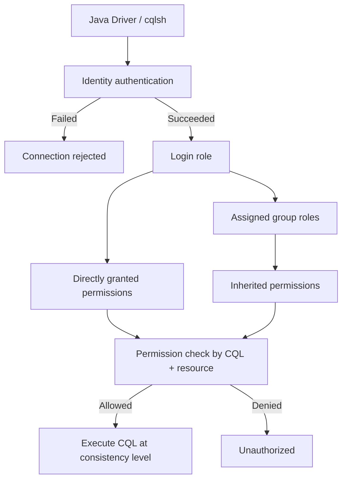
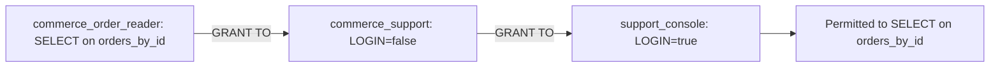

# Roles, LOGIN, SUPERUSER, and Permission Inheritance in Apache Cassandra

## 1. Why Role Management Matters in a Cassandra Cluster

Apache Cassandra stores data using a **wide-column** model, distributing partitions across multiple nodes and replicating data according to the **replication factor**. Java applications typically connect to the cluster through the Java Driver, using CQL to read/write tables designed around queries. When a cluster serves multiple services, administrators, and operational tools, letting every connection use an all-powerful account creates serious risk: an application bug or leaked credential can lead to reading, modifying, or deleting data beyond the intended business scope.

In the `DATABASE_ENGINE_WIDE_COLUMN_CASSANDRA` module, the **Security** section focuses on three role properties:

- **`LOGIN`**: whether a role is allowed to authenticate and open a login session.
- **`SUPERUSER`**: whether a role holds the highest administrative privileges.
- **Permission inheritance**: a role receives **permissions** granted directly or through other roles of which it is a member.

This lesson helps you design accounts for Java applications, task-based group roles, permission granting/revocation, and verification procedures using CQL. The goal is to apply **least privilege** in Cassandra while clearly understanding the boundaries between authentication, authorization, and read/write consistency.

**Running scenario:** an order system has a Java service that looks up status, a service that updates status, and a support team that may only read certain tables. These actors should not share a superuser account.

## 2. Distinguishing Authentication, Authorization, and Privileges

| Concept | Question | Related Cassandra Mechanism |
| --- | --- | --- |
| **Authentication** | "Who is this connection?" | `authenticator`, password/credentials, and a role with `LOGIN=true` |
| **Authorization** | "What can this role do on which resource?" | `authorizer`, `GRANT`/`REVOKE` permissions |
| **Role membership** | "Which groups' permission sets does this role inherit?" | `GRANT role_a TO role_b` |
| **Superuser** | "Does this role have special global privileges to administer the cluster/roles?" | `SUPERUSER=true` attribute |
| **Read/write consistency** | "How many replicas must respond before a query succeeds?" | `ONE`, `LOCAL_QUORUM`, `QUORUM`,… |

**Authorization and consistency are two independent axes.** An application with `SELECT` on a table can choose the appropriate read consistency level via configuration/statement; permissions do not guarantee the newest data. Conversely, writing with `LOCAL_QUORUM` does not bypass `MODIFY` permissions.

### Conceptual Model



The diagram describes a **regular role**. A superuser is handled with elevated privileges and does not require individual permissions for operations it is entitled to perform. Regular applications should not be designed around this special capability.

## 3. Prerequisite: Enabling the Appropriate Auth Mechanisms

Before trying role commands in a lab environment, check the cluster version and configuration. A common Apache Cassandra configuration uses:

```yaml
# Example configuration keys in cassandra.yaml, for illustration:
authenticator: PasswordAuthenticator
authorizer: CassandraAuthorizer
role_manager: CassandraRoleManager
```

Meaning:

- `PasswordAuthenticator` requires login credentials matching a role granted `LOGIN`; never assume connections require a password if the authenticator is not enabled.
- `CassandraAuthorizer` enforces permissions on CQL resources; if `AllowAllAuthorizer` is active, `GRANT` statements may not create any real security boundary.
- `CassandraRoleManager` manages role lifecycles and role membership relationships in standard setups; environments with third-party auth plugins may use a different mechanism.

This is an **example configuration**, not commands to apply directly to a running cluster. Changing authentication/authorization mechanisms usually requires a configuration plan and restarts/rolling restarts per version, especially to avoid locking out administrative access. Always keep a tested administrative recovery path before changing auth.

Beyond RBAC, protect **client-side TLS, internode channels, JMX, config file read permissions, and login secrets**. Enabling roles does not automatically encrypt network traffic or data stored on disk.

### Where Are Roles and Permission Metadata Stored?

In traditional Cassandra deployments, authentication and authorization data relate to the `system_auth` system keyspace. Because this is essential for logins and administration:

1. Check `system_auth` replication settings and actual topology/DCs; many installations require adjusting RF after bootstrap to match production.
2. Plan repair, backup, and recovery of auth metadata as part of cluster operations.
3. Account for refresh latency in node role/permission caches right after `GRANT` or `REVOKE`; **do not assume all active sessions observe changes at the exact same instant**.
4. Verify behavior on your specific version, especially when integrating custom authenticators/authorizers.

**Never manually edit internal `system_auth` tables** to grant permissions instead of using standard CQL administration.

## 4. What Is a Role? How Does It Differ from a User in Cassandra?

Cassandra uses **role** as a unified concept for both login identities and permission groups. A role can:

- Be an application/user account with `LOGIN=true` to open connections.
- Be a group role with `LOGIN=false`, solely to bundle reusable permissions.
- Hold direct permissions on keyspaces, tables, roles, or other resources.
- Be granted one or more other roles to inherit their permissions.
- Have the `SUPERUSER` attribute for special administrative cases.

`CREATE USER` is legacy/compatibility syntax in supporting versions; for new designs, understand the **role** model and use `CREATE ROLE` per your deployed version.

Key attributes:

| Attribute | Example Values | Meaning | Common Confusion |
| --- | --- | --- | --- |
| `LOGIN` | `true` / `false` | Allows or disallows the role to log in | `LOGIN=true` does not grant `SELECT` or `MODIFY` |
| `SUPERUSER` | `true` / `false` | Global administrative privilege | Not a "convenient group role" to hand out to services |
| `PASSWORD` | Account secret | Credential used by password auth when enabled | Having a password does not mean table access is allowed |
| Permission | `SELECT`, `MODIFY`, `CREATE`,… | Rights on a specified resource | May be granted directly or inherited via membership |
| Membership | `GRANT role_group TO role_login` | Grants the target role the source role's permissions | Not `GRANT SELECT`; these are two distinct forms of `GRANT` |

For **non-login group roles**, typically set `LOGIN=false`, `SUPERUSER=false`. For **application login roles**, set `LOGIN=true` while keeping `SUPERUSER=false`; grant only permissions that business queries genuinely need.

## 5. Creating Roles with CQL

Assume a keyspace/tables for reading order status exist. In a lab environment, an administrator can create an illustrative schema:

```sql
CREATE KEYSPACE IF NOT EXISTS commerce
WITH replication = {
    'class': 'NetworkTopologyStrategy',
    'dc1': 3
};

CREATE TABLE IF NOT EXISTS commerce.orders_by_id (
    order_id uuid PRIMARY KEY,
    customer_id uuid,
    status text,
    updated_at timestamp
);

CREATE TABLE IF NOT EXISTS commerce.orders_by_customer (
    customer_id uuid,
    order_id uuid,
    status text,
    PRIMARY KEY ((customer_id), order_id)
);
```

**Note:** `dc1` must match the real datacenter name, and the replica count must not exceed the planned topology uncontrollably. If the lab lacks that DC, adjust to your test environment; never copy sample schemas straight into production.

### 5.1. Creating a Read-Only Group

```sql
-- Group role; this role itself cannot be used to log in.
CREATE ROLE IF NOT EXISTS commerce_order_reader
WITH LOGIN = false
 AND SUPERUSER = false;

-- Grant read access only to the necessary table.
GRANT SELECT ON TABLE commerce.orders_by_id
TO commerce_order_reader;
```

Group roles make permissions reusable: if ten services only read this table, you do not need to repeat `SELECT` grants for each role. Later, when group permissions change, dependent members receive the change through inheritance.

### 5.2. Creating a Role for a Java Application

```sql
-- Run with an admin account authorized to create roles.
-- 'REPLACE_WITH_MANAGED_PASSWORD' is a placeholder, not for real use.
CREATE ROLE IF NOT EXISTS orders_api
WITH LOGIN = true
 AND SUPERUSER = false
 AND PASSWORD = 'REPLACE_WITH_MANAGED_PASSWORD';

-- Let orders_api inherit permissions from the read-only group.
GRANT commerce_order_reader TO orders_api;
```

From here, `orders_api` can log in if the authenticator and configuration allow it, and holds `SELECT` on `commerce.orders_by_id` via `commerce_order_reader`.

**Never place real passwords in documentation, commits, shell history, or CQL logs.** The statement above is illustrative only. In real deployments, use secret-generation workflows, lifecycle/rotation management, TLS channels, and secure admin tools; avoid embedding password strings in source code.

### 5.3. Creating a Role for a Status-Update Service

```sql
CREATE ROLE IF NOT EXISTS commerce_order_writer
WITH LOGIN = false
 AND SUPERUSER = false;

GRANT MODIFY ON TABLE commerce.orders_by_id
TO commerce_order_writer;

-- Separate login role and permission group:
CREATE ROLE IF NOT EXISTS orders_worker
WITH LOGIN = true
 AND SUPERUSER = false
 AND PASSWORD = 'REPLACE_WITH_ANOTHER_PASSWORD';

GRANT commerce_order_writer TO orders_worker;
```

`MODIFY` permits data-modification operations such as `INSERT`, `UPDATE`, and `DELETE` on the granted table (subject to version-supported rights). It does **not** replace `SELECT` when an application needs to read. For conditional updates/LWT using `IF`, carefully check the permission set required by your version; usually both conditional read capability and data modification are needed. Test actual CQL statements using the service role, rather than only reading the permission list.

### Key Rule When Creating Accounts

**One dedicated login account per workload.** Do not share one account across a read API, write worker, batch export, and administration. When credentials leak or one service's rights must be revoked, separate principals limit impact and enable auditing.

## 6. `LOGIN`: Right to Open Connections, Not Right to Use Data

A role with `LOGIN=false` cannot be used as a login account under standard role-based authentication, even if it holds many permissions. Conversely, a role with `LOGIN=true` but no table permissions can authenticate successfully and then receive authorization errors when executing out-of-scope CQL.

Example:

```sql
CREATE ROLE IF NOT EXISTS temp_auditor
WITH LOGIN = false
 AND SUPERUSER = false;

GRANT SELECT ON TABLE commerce.orders_by_id
TO temp_auditor;
```

This role holds `SELECT` but cannot directly open a login session. To give a staff member or application read access, create a **separate login role** and grant `temp_auditor` to it.

### Toggling Login Capability

```sql
-- Disable login for a test account when no longer needed:
ALTER ROLE orders_api WITH LOGIN = false;

-- Restore per approved operational procedure:
ALTER ROLE orders_api WITH LOGIN = true;
```

When changing `LOGIN`, account for **existing open connections/sessions**, driver connection pools, and node caches. Never assume setting `LOGIN=false` immediately closes every active session or cancels all in-flight operations. For credential compromise incidents, combine disabling the role, rotating passwords/secrets, blocking network access paths, and monitoring anomalous activity.

**Role membership is not a way to grant `LOGIN` to a group**: for an application to log in, set `LOGIN=true` on the exact role the driver actually uses as its principal.

## 7. `SUPERUSER`: Global Administration and Why to Restrict It

A role with `SUPERUSER=true` holds the highest privileges to manage resources and roles. In production systems, reserve it for a small number of essential administrative accounts, with matching access controls, auditing, and secret protection.

```sql
-- Syntax illustration only; must be executed by an authorized principal.
CREATE ROLE IF NOT EXISTS cluster_admin_ops
WITH LOGIN = true
 AND SUPERUSER = true
 AND PASSWORD = 'REPLACE_WITH_ADMIN_SECRET';
```

**Do not follow this example for ordinary applications.** If a Java service's role has `SUPERUSER=true`, an injection flaw or leaked password lets an attacker read/drop tables, alter schemas, or manipulate roles far beyond the service's original duty.

Key principles:

1. **Limit the number of superusers.** Use dedicated administrative accounts via controlled access paths.
2. **Do not treat `SUPERUSER` as an "easy permission."** Grant permissions on the exact authorized tables/keyspaces or administrative resources.
3. **Verify role attributes separately from inherited permissions.** Resource access may come from membership; login/admin attributes must be evaluated per actual configuration, version, and role relationships. Never infer whether a role can log in or is a superuser solely from a group's name.
4. **Separate operations from applications.** Accounts used for `nodetool`/JMX, role administration, and service CQL execution have different privilege surfaces; CQL RBAC does not automatically protect non-CQL administrative interfaces.
5. **Proactively rotate default credentials.** On clusters freshly initialized with defaults, handle bootstrap roles/passwords per operational procedure before opening access.

Changing `SUPERUSER` is a sensitive operation. Only authorized personnel should perform it after confirming an admin-recovery plan to avoid locking out the cluster.

## 8. Permissions: Which Right on Which Resource?

Cassandra assigns permissions by **resource**. Common permissions include:

| Permission | Example Operations | Common Scope |
| --- | --- | --- |
| `SELECT` | Reading via `SELECT` | Table, keyspace, broader scope |
| `MODIFY` | `INSERT`, `UPDATE`, `DELETE` | Table, keyspace |
| `CREATE` | Creating keyspaces/tables or roles depending on resource type | Corresponding resource level |
| `ALTER` | Modifying schemas or role attributes | Keyspace, table, role |
| `DROP` | Dropping tables/keyspaces/roles | Corresponding resource |
| `AUTHORIZE` | Granting/revoking rights for other roles on resources | Data resources and role resources when applicable |
| `DESCRIBE` / additional rights | Viewing metadata or version-specific features | Check syntax and scope in deployed version |

This table describes **functional categories**, not an exhaustive list for every Cassandra release. Newer permissions or specialized resources (functions, MBeans, masking…) depend on version and distribution; cross-check your environment's documentation/`HELP`.

Example of two grant levels:

```sql
-- Narrow: read access to one table only.
GRANT SELECT ON TABLE commerce.orders_by_id
TO commerce_order_reader;

-- Broader: read access to tables in the commerce keyspace.
-- Use only when the entire keyspace truly belongs to the workload's scope.
GRANT SELECT ON KEYSPACE commerce
TO commerce_report_reader;
```

The second statement assumes `commerce_report_reader` already exists; it illustrates **scope** and does not necessarily need to be run in the lab.

**Least-privilege principle:** prefer the narrowest resource covering actual CQL queries. `SELECT ON KEYSPACE` may become broader than intended if the development team later adds a sensitive table to the same keyspace. Schema expansion must include permission review.

### Role Administration Rights Differ from Data Rights

Operations like `CREATE ROLE`, `ALTER ROLE`, `DROP ROLE`, and `GRANT role` have their own administrative permission requirements on role resources. Never grant role-management rights to an account that only needs to read orders. Granting `AUTHORIZE` must also be tightly controlled, because it governs delegating permissions to other roles.

A permission granted on a parent resource can apply to child resources under Cassandra's authorization semantics. When auditing permissions, inspect **direct grants, inherited role permissions, and parent resource scopes**.

## 9. Permission Inheritance: `GRANT role TO role`

The `GRANT` statement has **two different meanings** depending on its arguments:

```sql
-- Grant a PERMISSION to a role:
GRANT SELECT ON TABLE commerce.orders_by_id
TO commerce_order_reader;

-- Grant a member ROLE to another role:
GRANT commerce_order_reader TO orders_api;
```

Read the second statement as: "`orders_api` is assigned the `commerce_order_reader` role." `orders_api` inherits the permissions granted to `commerce_order_reader` via role membership.

### 9.1. Multi-Level Inheritance

Example adding an aggregate group:

```sql
CREATE ROLE IF NOT EXISTS commerce_support
WITH LOGIN = false
 AND SUPERUSER = false;

-- The support group inherits permissions from the reader group.
GRANT commerce_order_reader TO commerce_support;

-- A support login account inherits permissions through support.
CREATE ROLE IF NOT EXISTS support_console
WITH LOGIN = true
 AND SUPERUSER = false
 AND PASSWORD = 'REPLACE_WITH_SUPPORT_PASSWORD';

GRANT commerce_support TO support_console;
```

This yields the relationship:



`SELECT` flows from the base group role through `commerce_support` to `support_console`. If `commerce_support` also holds a direct permission on another table, `support_console` can receive that permission through membership as well.

Cassandra discourages cyclic role membership. Keep the role graph clear and avoid granting a parent group back to a member group; cycle checks/constraints are handled by the system according to version.

### 9.2. Effective Permissions Are the Union of All Grant Paths

Suppose `orders_api` has both a direct `SELECT` grant and membership in two group roles that both have `SELECT` on the same table. After `REVOKE` on one grant path, the role **may still be able to read** via the remaining path.

To truly revoke access, inspect:

- Permissions granted directly to the login role itself.
- Permissions from all ancestor roles (direct and transitive).
- Permissions granted at a broader scope, such as keyspace instead of table.
- Active caches/sessions and when nodes refresh permissions.

This is why audits must examine **inheritance graphs and effective permissions**, not just isolated role listings.

## 10. Reviewing Roles and Permissions

In `cqlsh`, an authorized account can run:

```sql
-- Inventory existing roles (subject to current role's rights).
LIST ROLES;

-- Check roles assigned to a principal; recursive by default.
LIST ROLES OF support_console;

-- View recorded effective permissions of a role.
LIST ALL PERMISSIONS OF support_console;

-- View permissions associated with a table.
LIST ALL PERMISSIONS ON TABLE commerce.orders_by_id;
```

On versions supporting `NORECURSIVE`, you can use that option to inspect direct relationships/permissions rather than traversing the full graph. Write exact commands for your running version; `LIST` output also depends on whether the caller is allowed to view metadata.

Cross-check `LIST ROLES OF ...` with `LIST ALL PERMISSIONS OF ...` to answer:

1. Does the login role have `LOGIN=true`?
2. Is it assigned a broader group role than intended?
3. Which role provides `SELECT`/`MODIFY`, and is it granted on the table or the keyspace?
4. Does any role outside the admin group have `SUPERUSER=true`?
5. After `REVOKE`, do any inheritance paths still retain the old permission?

**Do not rely solely on role names:** a role named `readonly` could have received `MODIFY` in an earlier change. Always inspect actual permissions and run verification queries.

### Testing with the Application Account

`cqlsh` supports logging in per account; when testing, enter passwords securely and avoid exposing secrets in CLI arguments or terminal history whenever possible.

The example below illustrates CQL statements **after already logging in** as `orders_api`:

```sql
-- Expected to succeed via inherited SELECT from commerce_order_reader:
SELECT order_id, status
FROM commerce.orders_by_id
WHERE order_id = 11111111-1111-1111-1111-111111111111;

-- Expected to be denied if MODIFY is not granted via any path:
UPDATE commerce.orders_by_id
SET status = 'PAID'
WHERE order_id = 11111111-1111-1111-1111-111111111111;
```

**Run denied-write tests in a lab environment** using dummy data. In real environments, use appropriate safe checks to avoid unintended writes if permissions turn out broader than expected. An `Unauthorized` error here is the expected signal.

## 11. Revoking Roles or Permissions: Scope Differences

There are two `REVOKE` forms corresponding to the two forms of `GRANT`:

```sql
-- Remove the SELECT permission granted directly to the reader group role:
REVOKE SELECT ON TABLE commerce.orders_by_id
FROM commerce_order_reader;

-- Remove reader group membership from the orders_api principal:
REVOKE commerce_order_reader FROM orders_api;
```

Meaning:

- The first statement removes that `SELECT` permission from `commerce_order_reader`, affecting every role inheriting permissions **through the group**. Other permissions or grant paths may remain.
- The second statement stops `orders_api` from inheriting permissions from `commerce_order_reader` along the revoked **membership edge**. Permissions granted directly to `orders_api` remain intact.

A full grant/revoke sequence to observe in the lab:

```sql
-- Ensure the group role holds the permission:
GRANT SELECT ON TABLE commerce.orders_by_id
TO commerce_order_reader;

-- Assign the group to the application:
GRANT commerce_order_reader TO orders_api;

-- Read back state:
LIST ROLES OF orders_api;
LIST ALL PERMISSIONS OF orders_api;

-- Revoke the inheritance edge:
REVOKE commerce_order_reader FROM orders_api;

-- Re-check; if SELECT remains, search for other grant paths:
LIST ROLES OF orders_api;
LIST ALL PERMISSIONS OF orders_api;
```

**Avoid deleting roles with `DROP ROLE` for routine revocation.** Dropping a principal has broad impact, alters membership graphs, and can disconnect services. Identify the account to disable, permissions to narrow, and a clear rollback path.

### Caching Can Delay Observation After Grant/Revoke

Cassandra may cache role and permission data on nodes to reduce authentication/authorization overhead. Thus, a successful `GRANT` or `REVOKE` does not guarantee every node/connection changes state instantaneously. During testing, record the operation timestamp, target node, and when the new behavior takes effect; check your version's cache/invalidation settings.

For emergency revocation, do not wait solely on `REVOKE`: combine disabling login, rotating secrets, enforcing network access controls, and checking open connections per the cluster security runbook.

## 12. Connecting from Java Driver: Use the Right Account for the Duty

Applications should use a dedicated login role with permissions scoped to tables/endpoints. Java Driver 4.x example:

```java
import java.net.InetSocketAddress;
import com.datastax.oss.driver.api.core.CqlSession;
import com.datastax.oss.driver.api.core.cql.PreparedStatement;

public final class OrdersReader {
    public static void main(String[] args) {
        String username = System.getenv("CASSANDRA_USERNAME");
        String password = System.getenv("CASSANDRA_PASSWORD");
        if (username == null || password == null) {
            throw new IllegalStateException("Missing Cassandra credentials");
        }

        // Lab connection parameters only. Production requires TLS and
        // proper CA/trust material configured in the driver.
        try (CqlSession session = CqlSession.builder()
                .addContactPoint(new InetSocketAddress("127.0.0.1", 9042))
                .withLocalDatacenter("dc1")
                .withAuthCredentials(username, password)
                .build()) {

            PreparedStatement ps = session.prepare(
                "SELECT order_id, status FROM commerce.orders_by_id " +
                "WHERE order_id = ?");
            // Bind a validated UUID parameter, then execute at the
            // consistency level required by the business contract.
        }
    }
}
```

In practice:

- Supply application credentials via a secret manager or equivalent secure provisioning mechanism; never hardcode, commit, or log passwords.
- Enable and validate **TLS** to protect credentials and data; the Java snippet above does not configure TLS by itself.
- Reuse `CqlSession` over the application lifecycle; avoid creating a session per HTTP request.
- Use prepared/bound statements and restrict table permissions. A read-API role must never be allowed to create keyspaces or manage roles.
- Separate read/write accounts when workloads have distinct responsibilities, and limit in-flight requests so applications do not overload the cluster.
- Even when `orders_api` has `SELECT`, still design queries around partition keys and choose `LOCAL_ONE`/`LOCAL_QUORUM` to fit consistency needs. RBAC does not fix slow queries or stale data.

Access security must align with operating replication, compaction, repair, snapshot/restore, and timeout handling. For example, when backing up `commerce`, do not reuse application credentials as an "all-powerful backup account"; administrative/`nodetool` rights must be separated and controlled independently.

## 13. Reference Permission Matrix for the Order System

| Role | LOGIN | SUPERUSER | Permission/Membership | Expected Access |
| --- | --- | --- | --- | --- |
| `commerce_order_reader` | false | false | `SELECT` on `orders_by_id` | No login; read-only group |
| `orders_api` | true | false | Member of `commerce_order_reader` | Reads `orders_by_id`, cannot modify |
| `commerce_order_writer` | false | false | `MODIFY` on `orders_by_id` | No login; write group |
| `orders_worker` | true | false | Member of `commerce_order_writer` | Updates `orders_by_id`, cannot read unless granted `SELECT` |
| `commerce_support` | false | false | Member of `commerce_order_reader` | Intermediate support group |
| `support_console` | true | false | Member of `commerce_support` | Read-only via two inheritance hops |
| `cluster_admin_ops` | true | true | High-level administration | Controlled operational channels only |

**This is a target matrix**, not a substitute for real verification. Effective rights may differ if there are direct permissions, keyspace-level grants, extra memberships, or newly created roles.

## 14. Common Mistakes When Designing Roles

| Mistake | Consequence | Fix |
| --- | --- | --- |
| Using cluster superuser in Java apps | Credential leak compromises the entire cluster | Create an app role `LOGIN=true, SUPERUSER=false` with minimal permissions |
| Assuming `LOGIN=true` permits queries | Login succeeds but queries fail with `Unauthorized` | Grant the exact permissions on required tables/keyspaces |
| Using a `LOGIN=false` group role as an account | Cannot log in | Create a dedicated login role and assign the group |
| `GRANT SELECT ON KEYSPACE` when one table is needed | Access automatically expands when new tables join the keyspace | Use `GRANT SELECT ON TABLE` when appropriate |
| Revoking one permission without checking membership | Access remains via other grant paths | Audit direct grants, inherited roles, and parent resources |
| Naming a group "read only" while granting `MODIFY` | Role name and actual permissions diverge | Inspect `LIST ALL PERMISSIONS` and test queries with the role |
| Allowing admin roles broad `AUTHORIZE` rights | Risk of privilege escalation/mis-delegation | Restrict role-management and data-resource permissions |
| Assuming `REVOKE` blocks all sessions immediately | Existing connections/caches may keep working | Check caches, disable login/rotate secrets/block network in emergencies |
| Enabling CassandraAuthorizer while ignoring JMX or plaintext CQL | Other admin/connection paths remain exposed | Simultaneously secure TLS, JMX, internode, and ops accounts |
| Directly editing `system_auth` | Can break auth/replication | Use CQL role management and standard maintenance runbooks |

## 15. Hands-On Exercise and Permission Testing

**Context:** you manage the `commerce` keyspace containing `orders_by_id` and `orders_by_customer`. Three principals need access:

- `api_read`: logs in to read `orders_by_id` only.
- `worker_write`: logs in to update `orders_by_id`, without permission to drop schemas.
- `support_read`: logs in, receiving the same rights as `api_read` through group `commerce_order_reader` and intermediate group `commerce_support`.

**Tasks:**

1. Write `CREATE ROLE` statements for the two non-login groups and three login principals; explicitly set `LOGIN` and `SUPERUSER`.
2. Grant `SELECT` or `MODIFY` on the exact table, then assign membership via `GRANT role TO role`.
3. Use `LIST ROLES OF support_read` and `LIST ALL PERMISSIONS OF support_read` to explain how many levels `SELECT` is inherited across.
4. Test `SELECT` and `UPDATE` queries as `api_read`; predict which operation is denied.
5. Revoke `commerce_order_reader` membership from `api_read`. If the application can still read, list at least three causes to check.
6. Why shouldn't `SUPERUSER=true` be used for all three login roles? If a role is needed to create keyspaces for migrations, how should its permissions and account lifecycle be managed?

**Sample CQL Solution Hints:**

```sql
-- Groups:
CREATE ROLE IF NOT EXISTS commerce_order_reader
WITH LOGIN = false AND SUPERUSER = false;
CREATE ROLE IF NOT EXISTS commerce_order_writer
WITH LOGIN = false AND SUPERUSER = false;
CREATE ROLE IF NOT EXISTS commerce_support
WITH LOGIN = false AND SUPERUSER = false;

-- Table permissions:
GRANT SELECT ON TABLE commerce.orders_by_id
TO commerce_order_reader;
GRANT MODIFY ON TABLE commerce.orders_by_id
TO commerce_order_writer;

-- Inheritance chain:
GRANT commerce_order_reader TO commerce_support;

-- Principals must be created with LOGIN=true, SUPERUSER=false,
-- securely provisioned PASSWORD, then assigned groups:
GRANT commerce_order_reader TO api_read;
GRANT commerce_order_writer TO worker_write;
GRANT commerce_support TO support_read;

-- Verification:
LIST ROLES OF support_read;
LIST ALL PERMISSIONS OF support_read;
```

In this sample solution, `api_read`, `worker_write`, and `support_read` must be **created before running GRANT**; the hints leave full `CREATE ROLE` statements to the learner and avoid placing dummy passwords in runnable commands.

Once `api_read` loses its rights after group revocation, it can still authenticate with `LOGIN=true`, but `SELECT` queries will fail if no other grant path exists. If it can still read, check direct grants, permissions from another role or keyspace scope, and cache/session lag. Never use `SUPERUSER` to "fix" the lab.

## 16. Checklist for Promoting Role Configurations to Production

- [ ] Appropriate authenticator/authorizer enabled and verified with regular roles; not running in authorization-bypass mode.
- [ ] Group roles have `LOGIN=false`; application principals have `LOGIN=true` and `SUPERUSER=false`.
- [ ] No application account uses administrative credentials or default passwords.
- [ ] Permissions are granted on the narrowest resource satisfying real CQL queries.
- [ ] Analyzed role memberships, multi-level inheritance, and parent-resource permissions.
- [ ] Tested both **permitted** and **denied** operations using each real principal in a lab.
- [ ] Procedures exist for `REVOKE`, disabling roles, secret rotation, and handling open connections.
- [ ] Restricted who may manage roles, `SUPERUSER`, and `AUTHORIZE`.
- [ ] Protected client TLS, internode links, JMX, secrets, and non-CQL admin paths.
- [ ] Reviewed replication/repair/backup for `system_auth` and tested node-loss scenarios.
- [ ] Logged permission-change audits and scheduled periodic role reviews.
- [ ] Separated consistency, query optimization, and backup strategy from permission grants.

**Key Takeaway:** `LOGIN` decides **who can open a session**; `SUPERUSER` is a privileged admin attribute that must be protected; `GRANT SELECT/MODIFY...` decides **what can be done on a resource**, while `GRANT role TO role` creates **permission inheritance**. Good Cassandra security design starts with non-login group roles, dedicated accounts for Java applications, least privilege on the exact tables, and testing both grant and revocation paths.
