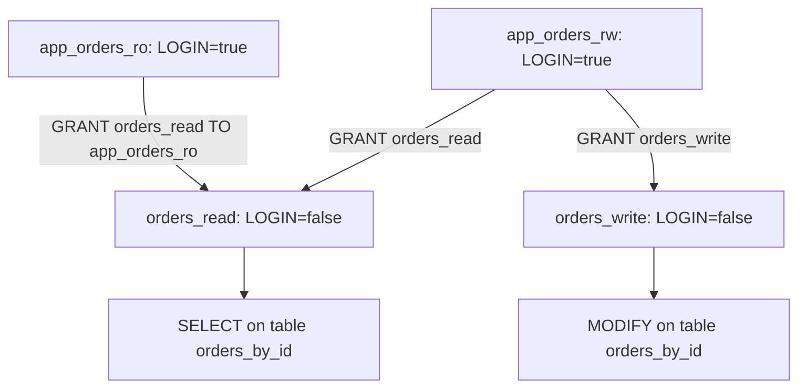

# Permissions on Keyspaces, Tables, Functions, and Related Resources

## 1. Problem: On the Same Cluster, What Should Each Application Be Allowed to Do?

In Apache Cassandra, multiple Java applications often connect to the same cluster while serving different needs: order lookup APIs, status-update services, reporting readers, migration tools, and operational accounts. These accounts **must not share superuser privileges**. An application that only reads an orders table does not need rights to modify schemas, drop tables, create roles, or invoke JMX operations.

The **Security** chapter in the `DATABASE_ENGINE_WIDE_COLUMN_CASSANDRA` module connects distributed architecture and the wide-column model, query/partition-key table design, CQL, replication, compaction, repair, troubleshooting, and Java Driver connectivity. This lesson focuses on **resource-based authorization**: keyspaces, tables, functions, roles, and MBeans; how to grant/revoke/inspect permissions; and the risks of over-scoping.

After this lesson, learners should be able to:

1. Distinguish **authentication** (logging in), **authorization** (what is permitted), **roles**, and **resources**.
2. Understand the four permission hierarchies: data, functions, roles, and MBeans; and know that permissions granted at a parent level **cascade down to child resources**.
3. Use `CREATE ROLE`, `GRANT`, `REVOKE`, `LIST ROLES`, and `LIST PERMISSIONS` correctly.
4. Distinguish `SELECT`, `MODIFY`, `CREATE`, `ALTER`, `DROP`, `AUTHORIZE`, `EXECUTE`, `DESCRIBE`; evaluate `UNMASK`/`SELECT_MASKED` in supporting versions.
5. Build **least-privilege** roles for Java applications and **test both permitted and denied actions**.
6. Troubleshoot cases where a revoked permission still works due to inherited roles, broad resource grants, or caching.

> Scope: the CQL examples below assume Cassandra has **authentication and authorization genuinely enabled** with appropriate mechanisms. Newer syntax/permissions, especially dynamic data masking, depend on version; check the documentation and `cassandra.yaml` of your running cluster before applying. All DDL/GRANTs in this lesson must only be practiced in a **lab** or under an approved change request.

## 2. Three Security Layers That Must Stay Separate

| Layer | Question | Common Mechanism | Limitation |
| --- | --- | --- | --- |
| **Authentication** | Who is logging in? | `PasswordAuthenticator` or equivalent plugin; role identity | Identifying the caller **does not** restrict actions if the authorizer allows everything. |
| **Authorization** | Which resources may that identity operate on? | `CassandraAuthorizer` or custom authorizer, role-bound ACLs | Does not replace TLS, network policies, or authentication; must be properly enabled across nodes. |
| **Connection/data protection** | Where could data be eavesdropped or secrets stolen? | Client-to-node TLS, inter-node encryption, KMS/secret manager, firewalls, audit | CQL RBAC does not encrypt traffic in transit or backup files on disk. |

### Critical Prerequisite

Apache Cassandra provides `AllowAllAuthenticator` and `AllowAllAuthorizer` as permissive implementations; when active, `GRANT SELECT ...` does not mean the system actually blocks ungranted actions. To test permissions, you must use an authenticator and authorizer **that actively enforce controls**, for example:

```yaml
# Illustrative configuration snippet only,
# DO NOT apply directly in production to run a lab.
authenticator: PasswordAuthenticator
authorizer: CassandraAuthorizer
role_manager: CassandraRoleManager
```

These choices live in `cassandra.yaml` and typically require a deployment/restart procedure per **exact version** documentation. Switching from a permissive authorizer to enforced permission checks can immediately break applications if nodes start enforcing; **grant permissions first, validate on a canary node, roll out on schedule, and keep a break-glass path**. Never treat a successful `cqlsh` connection as proof that the authorizer is enabled.

**Default deny** is the principle of `CassandraAuthorizer`: a role does not automatically hold permissions on data. However, a **superuser** has broad privileges and bypasses ordinary permission checks; application accounts must never use `SUPERUSER = true`.

## 3. Roles Are Both Login Identities and Permission Groups

Since Cassandra 2.2, a **role** represents both users and permission groups. A role can:

- Have **`LOGIN = true`**: used to authenticate a CQL session if the authenticator allows it and credentials are valid.
- Have **`LOGIN = false`**: a permission-group role; cannot log in directly.
- Have **`SUPERUSER = true`**: special administrative privilege, reserved for a very small number of controlled accounts.
- Be **granted other roles** to inherit permissions.



**Note:** Permissions and even superuser status can be **inherited** through the role graph; `LOGIN` is **not inherited**. Cassandra rejects role-grant cycles. Therefore, granting an overly broad role to a small login role still produces overly broad permissions.

### Roles in a Query-Driven System

| Role | Permitted | Should Not Be Permitted |
| --- | --- | --- |
| `orders_read` | `SELECT` on specific order-lookup tables | `MODIFY`, `DROP`, `ALTER`, access to other PII tables |
| `orders_write` | `MODIFY` on tables requiring writes | Schema changes, role/GRANT management; note `TRUNCATE` comes with `MODIFY` |
| `orders_schema_migrator` | Needed DDL rights for one keyspace during deploy window | Cluster-wide rights, role management, JMX; must be time-bounded |
| `orders_function_executor` | `EXECUTE` on specific functions | `CREATE/ALTER/DROP FUNCTION` |
| `security_admin` | Manage permissions within delegated scope | Routine `SUPERUSER`, unnecessary business-data read access |
| `jmx_observer` | Only MBeans/operations needed for monitoring | Full MBean EXECUTE/MODIFY and topology-changing operations |

Prefer **one login role per service**, while capability roles may be reused within approved scope. Never share the same password across ops accounts, batch jobs, dashboards, and Java applications.

## 4. Resource Tree: Grants on a Parent Apply to Children

Key resource hierarchies:

```text
DATA:
  ALL KEYSPACES
    └─ KEYSPACE security_lab_ks
         ├─ TABLE orders_by_id
         └─ TABLE audit_by_id

FUNCTION:
  ALL FUNCTIONS
    └─ ALL FUNCTIONS IN KEYSPACE security_lab_ks
         ├─ FUNCTION normalize_status(text)
         └─ FUNCTION normalize_status(int)   # hypothetical different overload

ROLE:
  ALL ROLES
    ├─ ROLE app_orders_ro
    └─ ROLE orders_read

JMX:
  ALL MBEANS
    └─ MBEAN / MBEANS by JMX ObjectName, wildcard
```

Key point: **a permission granted on a parent resource applies to child resources in the same branch**:

- `GRANT SELECT ON ALL KEYSPACES` allows reading tables across many keyspaces, far broader than an application typically needs.
- `GRANT SELECT ON KEYSPACE security_lab_ks` covers **all current and future tables** in that keyspace.
- `GRANT SELECT ON TABLE security_lab_ks.orders_by_id` applies only to the named table.
- `GRANT EXECUTE ON ALL FUNCTIONS` is broader than `EXECUTE` on a single function signature.
- `GRANT AUTHORIZE ON ALL ROLES` grants sweeping role-delegation power, completely distinct from reading tables.

**There is no per-table `DENY` mechanism to override a `SELECT` granted on the parent keyspace** in the standard allowlist model. If a role already received `SELECT ON KEYSPACE security_lab_ks`, running `REVOKE SELECT ON TABLE security_lab_ks.audit_by_id` **does not remove** the permission still inherited from the keyspace.

### Two Distinct Inheritance Directions

1. **Resource inheritance:** permissions granted on a `KEYSPACE` take effect on child tables.
2. **Role inheritance:** a login role receives permissions from assigned capability roles.

Effective permissions can come from **multiple paths**. When revoking a permission, check every remaining grant path.

## 5. Permission Matrix and Scope

Cassandra does not use generic SQL words like `READ` or `WRITE` as permission names. CQL permissions include:

| Permission | Typical Resource | What It Allows | Risk When Over-Scoped |
| --- | --- | --- | --- |
| **`SELECT`** | Table, keyspace, all keyspaces | Read tables, SELECT queries | Exposure of out-of-scope tables/tenants |
| **`MODIFY`** | Table, keyspace, all keyspaces | `INSERT`, `UPDATE`, `DELETE`, **`TRUNCATE`** per documentation | Not update-only; can delete large volumes of data |
| **`CREATE`** | All keyspaces, keyspace; all functions; all roles | Create child resources such as keyspaces/tables, functions/aggregates, roles | Unauthorized schemas, code-executing functions, or new roles |
| **`ALTER`** | Keyspace/table; function; role | Alter schema/attributes or modify functions/roles by type | Changing RF, schemas, passwords/role settings; downtime risk |
| **`DROP`** | Keyspace/table; function; role | Drop supported resources | Data loss, broken APIs, lost identities |
| **`AUTHORIZE`** | Data/function/role/MBean | Grant or revoke corresponding permissions/roles | **Privilege delegation**: letting others grant themselves more rights |
| **`EXECUTE`** | Function, MBean | Invoke granted functions or JMX operations | UDFs run code on the server; JMX can administer the cluster |
| **`DESCRIBE`** | All roles, MBean | List roles/MBean metadata | Exposure of identities, topology, and admin metadata |
| **`UNMASK`** | All keyspaces/keyspace/table on supporting versions | View **unmasked** values of masked columns | Sensitive data exposure |
| **`SELECT_MASKED`** | All keyspaces/keyspace/table on supporting versions | Use masked columns in query conditions where supported | Potential data inference via filter conditions |

Not every permission makes sense on every resource: for example, `EXECUTE ON TABLE` or `SELECT ON FUNCTION` are invalid grants and may be rejected by Cassandra. `GRANT ALL PERMISSIONS ON <resource>` grants **all permissions applicable to that resource**, which does not turn a role into a cluster-wide superuser.

### Easily Overlooked Detail: `MODIFY` Includes `TRUNCATE`

```sql
-- Granting this allows the application to run multiple write operations,
-- including TRUNCATE under Cassandra semantics.
GRANT MODIFY ON TABLE security_lab_ks.orders_by_id TO orders_write;
```

In standard CQL RBAC, there is no separate `GRANT INSERT` or `GRANT UPDATE` to block `TRUNCATE` specifically while allowing other writes on the same table. For sensitive workloads, compensate with **operational procedures, table/keyspace isolation architecture, code controls, and monitoring/auditing**. Never document "`orders_write` only has INSERT/UPDATE" if the role actually holds `MODIFY`.

## 6. Standard Lab: Creating Tables and Least-Privilege Login Roles

> Run the following commands **once on a lab cluster with PasswordAuthenticator/CassandraAuthorizer enabled** and an operator with sufficient privileges. Role names/passwords are dummy data; never use example password strings as production credentials. Never run broad-grant tests on a company production cluster.

### 6.1. Query-Driven Data

```sql
CREATE KEYSPACE security_lab_ks
WITH replication = {'class': 'NetworkTopologyStrategy', 'dc1': 3}
AND durable_writes = true;

CREATE TABLE security_lab_ks.orders_by_id (
    order_id uuid PRIMARY KEY,
    customer_id text,
    status text,
    amount decimal
);

CREATE TABLE security_lab_ks.audit_by_id (
    audit_id uuid PRIMARY KEY,
    actor_id text,
    details text
);

INSERT INTO security_lab_ks.orders_by_id
    (order_id, customer_id, status, amount)
VALUES (
    11111111-2222-4333-8444-555555555555,
    'synthetic-customer-01', 'CREATED', 120.00
);
```

In this example, `order_id` is the partition key of the first table and `audit_id` is the partition key of the second. Two tables sharing a keyspace **does not mean** an app reading orders should read audit logs. If your environment lacks a DC named `dc1` or enough nodes for that RF, adjust the lab config before running.

### 6.2. Create Capability Roles (Non-Login)

```sql
CREATE ROLE orders_read
WITH LOGIN = false AND SUPERUSER = false;

CREATE ROLE orders_write
WITH LOGIN = false AND SUPERUSER = false;

GRANT SELECT ON TABLE security_lab_ks.orders_by_id TO orders_read;
GRANT MODIFY ON TABLE security_lab_ks.orders_by_id TO orders_write;
```

Neither role has access to read `audit_by_id`. Table-level grants avoid keyspace-wide "all current and future tables" access. Write rights must still be evaluated as data modification including `TRUNCATE`.

### 6.3. Create Login Roles and Assign Capabilities

```sql
-- Passwords here are syntactically valid CQL PLACEHOLDER literals,
-- and must be replaced with random lab secrets from your secret-management workflow.
CREATE ROLE app_orders_ro
WITH PASSWORD = '<LAB_RANDOM_PASSWORD_RO>'
AND LOGIN = true AND SUPERUSER = false;

CREATE ROLE app_orders_rw
WITH PASSWORD = '<LAB_RANDOM_PASSWORD_RW>'
AND LOGIN = true AND SUPERUSER = false;

GRANT orders_read TO app_orders_ro;
GRANT orders_read TO app_orders_rw;
GRANT orders_write TO app_orders_rw;
```

Never put real passwords in Git, terminal history, tickets, or Markdown; in production use a secret manager and safe provisioning/rotation workflows. `CREATE ROLE` can be executed by a controlled deployment tool instead of pasting credentials into a terminal manually.

When logging in as `app_orders_ro`, effective permissions include `SELECT` on `orders_by_id` via `orders_read`. When logging in as `app_orders_rw`, effective permissions include both `SELECT` and `MODIFY` on the same table via the two role branches.

```text
app_orders_ro ──► orders_read ──► SELECT orders_by_id
app_orders_rw ──► orders_read ──► SELECT orders_by_id
             └──► orders_write ─► MODIFY orders_by_id

No permissions are granted to audit_by_id.
```

## 7. Verifying with CQL: "Authorized" and "Denied"

With an admin account permitted to list roles/permissions, inspect:

```sql
LIST ROLES OF app_orders_ro;
LIST ROLES OF app_orders_rw;
LIST ROLES OF app_orders_rw NORECURSIVE;

LIST ALL PERMISSIONS OF app_orders_ro;
LIST ALL PERMISSIONS OF app_orders_rw;
LIST ALL PERMISSIONS ON security_lab_ks.orders_by_id OF app_orders_rw;
LIST ALL PERMISSIONS ON security_lab_ks.audit_by_id OF app_orders_ro;
```

`NORECURSIVE` limits expanding inherited roles in supporting list statements. Never inspect only direct grants while overlooking keyspace-level grants, `ALL KEYSPACES`, or group roles. `LIST PERMISSIONS ON TABLE ... OF role` is useful for checking effective permissions **by resource and hierarchy**.

### 7.1. Test Logging In with Both Accounts

From a terminal with network access to the CQL port and proper TLS:

```bash
# Do not pass -p <password> in shell commands/ps history.
# cqlsh will prompt for a password depending on version/config.
cqlsh 192.0.2.11 9042 -u app_orders_ro
```

In the `app_orders_ro` session:

```sql
-- Expected to SUCCEED:
SELECT order_id, status, amount
FROM security_lab_ks.orders_by_id
WHERE order_id = 11111111-2222-4333-8444-555555555555;

-- Expected to be DENIED: missing MODIFY:
INSERT INTO security_lab_ks.orders_by_id
    (order_id, customer_id, status, amount)
VALUES (22222222-3333-4444-8555-666666666666,
        'synthetic-customer-02', 'CREATED', 15.00);

-- Expected to be DENIED: missing SELECT on audit table:
SELECT audit_id, actor_id
FROM security_lab_ks.audit_by_id
WHERE audit_id = 33333333-4444-4555-8666-777777777777;
```

With `app_orders_rw`, `SELECT` and `INSERT` into `orders_by_id` can succeed. **You do not need to execute `TRUNCATE` to prove the risk**: documentation defines `MODIFY` to include it, and testing it in production would destroy data. Better to review the permission matrix, verify configuration, and use a **disposable lab** if direct proof is mandatory.

### 7.2. Acceptance Matrix

| Identity | SELECT orders | INSERT/UPDATE orders | SELECT audit | ALTER/DROP orders | GRANT rights to other roles |
| --- | --- | --- | --- | --- | --- |
| `app_orders_ro` | Allowed | Denied | Denied | Denied | Denied |
| `app_orders_rw` | Allowed | Allowed | Denied | Denied | Denied |
| Approved administrator | Per responsibility | Per responsibility | Per responsibility | Per responsibility | Within delegated scope |

If an action that **should be denied** succeeds, **halt rollout** and investigate the authorizer, superuser flags, role inheritance, parent keyspace grants, and permission caches. Never "patch" it by adding more permissions and re-running only a passing SELECT.

## 8. Keyspace vs. Table Scope and the REVOKE Trap

Only a reporting service that genuinely needs to read all current and future tables in a *designated* keyspace should consider:

```sql
GRANT SELECT ON KEYSPACE security_lab_ks TO reporting_role;
```

This is broader than granting `SELECT ON TABLE security_lab_ks.orders_by_id` individually. If tomorrow a DBA adds `customer_pii_by_id` to `security_lab_ks`, `SELECT ON KEYSPACE` **also applies to the new table**. When that is undesirable, grant per table, control table creation, and separate keyspaces with different data classifications.

### Why Is Child-Level REVOKE Not Enough?

Suppose:

```sql
GRANT SELECT ON KEYSPACE security_lab_ks TO reporting_role;

-- This command DOES NOT negate SELECT inherited from the keyspace:
REVOKE SELECT ON TABLE security_lab_ks.audit_by_id FROM reporting_role;
```

If `reporting_role` must **not** read audit while still reading orders, a safer design is:

```sql
REVOKE SELECT ON KEYSPACE security_lab_ks FROM reporting_role;
GRANT SELECT ON TABLE security_lab_ks.orders_by_id TO reporting_role;
```

Then check whether `reporting_role` still receives broad `SELECT` from **another role**, `ALL KEYSPACES`, or another direct grant. You may need to update the role graph and wait for caches before declaring access fully revoked.

**Revocation is not data deletion:** `REVOKE` only changes the ability to execute new requests; it does not erase previously read data, dumps, exports, backups, client-side caches, or copies sent to other systems.

## 9. Functions and Aggregates: A Separate Permission Branch

Functions are distinct from tables. `SELECT` on a table **does not automatically grant** `EXECUTE` on a user-defined function (UDF) called in the query. The function hierarchy is:

```text
ALL FUNCTIONS
  └── ALL FUNCTIONS IN KEYSPACE security_lab_ks
       ├── FUNCTION normalize_status(text)
       └── FUNCTION normalize_status(int) [example different overload]
```

| Resource | When to Use | Breadth |
| --- | --- | --- |
| `FUNCTION security_lab_ks.normalize_status(text)` | Only allow executing one specific function signature | Narrowest |
| `ALL FUNCTIONS IN KEYSPACE security_lab_ks` | Group may execute every function in the keyspace, including future ones | Broader |
| `ALL FUNCTIONS` | Execute all functions across all keyspaces | Very broad; avoid granting to regular services |

### 9.1. Function Signatures Include Parameter Types

```sql
-- Lab GRANT example after the function already exists.
GRANT EXECUTE
ON FUNCTION security_lab_ks.normalize_status(text)
TO orders_read;

-- Inspect by resource:
LIST ALL PERMISSIONS
ON FUNCTION security_lab_ks.normalize_status(text)
OF orders_read;
```

If both `normalize_status(text)` and `normalize_status(int)` exist, granting `EXECUTE` on `(text)` **does not automatically grant** `(int)`. This is a critical boundary when functions are **overloaded**.

### 9.2. Creating UDFs Is an Optional Lab Exercise Only

In Cassandra 5.0, **UDFs are disabled by default due to security risks**; before running the example below, the lab cluster must have `user_defined_functions_enabled` permitted per exact version documentation. **Never enable UDFs in production just to practice GRANTs.**

```sql
-- Executed by lab admin only, and only when UDFs are permitted.
CREATE FUNCTION security_lab_ks.normalize_status(v text)
RETURNS NULL ON NULL INPUT
RETURNS text
LANGUAGE java
AS $$ return v.trim(); $$;

-- Then the admin explicitly grants EXECUTE:
GRANT EXECUTE
ON FUNCTION security_lab_ks.normalize_status(text)
TO orders_read;
```

Only an account holding both `SELECT` on `orders_by_id` and `EXECUTE` on this function can run queries using the UDF when all other conditions are met:

```sql
SELECT security_lab_ks.normalize_status(status)
FROM security_lab_ks.orders_by_id
WHERE order_id = 11111111-2222-4333-8444-555555555555;
```

Creating or altering UDFs can execute user-supplied code on Cassandra nodes; **`CREATE/ALTER FUNCTION` permissions should be controlled far more strictly than `EXECUTE`**. User-defined aggregates (UDAs) and their state/final functions also require separate evaluation; do not infer aggregate creation rights from table `SELECT`.

### 9.3. Separating Data Permissions from Function Permissions

```sql
-- Data: read all tables in keyspace
GRANT SELECT ON KEYSPACE security_lab_ks TO analyst_role;

-- Function: this is a SEPARATE PERMISSION, not implied by SELECT above
GRANT EXECUTE ON ALL FUNCTIONS IN KEYSPACE security_lab_ks
TO analyst_role;
```

The second statement is included intentionally to **contrast scope**, not as a recommended configuration. If an analyst only needs one UDF, use `EXECUTE ON FUNCTION name(signature)` instead of opening the whole keyspace.

## 10. Roles as an Administrative Resource

Roles in Cassandra act as both **identities/groups** and **authorization resources**.

| Permission | Resource | Effect |
| --- | --- | --- |
| `CREATE` | `ALL ROLES` | Can create new roles subject to role manager rules |
| `ALTER` | `ROLE some_role` or `ALL ROLES` | Modify role attributes within permission limits |
| `DROP` | `ROLE some_role` or `ALL ROLES` | Drop roles subject to superuser protection rules |
| `AUTHORIZE` | `ROLE some_role` or `ALL ROLES` | Can grant/revoke the corresponding role |
| `DESCRIBE` | `ALL ROLES` | List roles within supported scope |

For example, an account responsible for role provisioning might need:

```sql
-- Illustrative scope; lab or approved change only:
GRANT CREATE ON ALL ROLES TO role_provisioner;
GRANT DESCRIBE ON ALL ROLES TO role_auditor;

-- Delegated permission to assign one specific role:
GRANT AUTHORIZE ON ROLE orders_read TO role_provisioner;
```

**Do not abuse `AUTHORIZE`:** if someone can assign a broadly privileged or superuser role to themselves or an accomplice, they can escalate privileges. Superuser and role-assignment guards also depend on the role manager/version; never design a "read-only user viewer" account and give it `AUTHORIZE ON ALL ROLES`.

When a resource is created, Cassandra may **automatically grant applicable permissions on the new resource to the creating role** in documented cases. Thus a migration account may acquire new permissions after creating tables/functions; **review permissions after DDL**, not just permissions granted beforehand.

## 11. JMX/MBean Permissions: A Separate Administrative Path

Beyond CQL, Cassandra is managed via JMX and tools like `nodetool`. With configurations supporting integrated **JMX authorization**, MBeans are also a resource type:

```text
ALL MBEANS
  ├─ MBEAN 'org.apache.cassandra.db:type=StorageService'
  └─ MBEANS '<ObjectName pattern with wildcard>'
```

Permissions on MBeans have **different semantics** from table `SELECT/MODIFY`:

- `SELECT`: read permitted MBean attributes.
- `DESCRIBE`: inspect MBean metadata.
- `MODIFY`: alter attributes through setters.
- `EXECUTE`: invoke MBean operations.
- `AUTHORIZE`: grant/revoke management permissions on that MBean.

Syntax illustration only:

```sql
CREATE ROLE jmx_observer WITH LOGIN = false AND SUPERUSER = false;
CREATE ROLE jmx_operator WITH LOGIN = false AND SUPERUSER = false;
GRANT SELECT ON ALL MBEANS TO jmx_observer;
GRANT DESCRIBE ON ALL MBEANS TO jmx_observer;

-- Example EXECUTE permission on a specific MBean:
-- Grant only after explicitly reviewing allowed operations.
GRANT EXECUTE
ON MBEAN 'org.apache.cassandra.db:type=StorageService'
TO jmx_operator;
```

**Crucial:** `EXECUTE ON MBEAN` can expose cluster-impacting operations (depending on the MBean) and does not mean "read status only." Even `nodetool status` may require `EXECUTE` on certain MBeans per documentation. Therefore, **test real commands**, scope JMX permissions tightly, lock down admin ports, and enforce TLS/authentication. CQL GRANTs do not replace JVM remote JMX authorization configuration.

## 12. Data Masking and Version-Dependent System Exceptions

### 12.1. `UNMASK` and `SELECT_MASKED` Permissions

Cassandra 5.0 introduces dynamic data masking and two data-associated permissions:

- **`UNMASK`**: view the real, unmasked contents of columns configured as masked.
- **`SELECT_MASKED`**: use masked columns in query predicates/restrictions where semantics permit.

```sql
-- PERMISSION SYNTAX ILLUSTRATION; only meaningful on versions and
-- schemas configured with appropriate data masking.
GRANT UNMASK ON TABLE security_lab_ks.orders_by_id
TO pii_reviewer;

GRANT SELECT_MASKED ON TABLE security_lab_ks.orders_by_id
TO pii_filter_operator;
```

Do not include these two permissions in general data-reader roles, as they can weaken masked-column protection. On Cassandra 3.11/4.x, do not assume the parser supports them. **Masking is not disk encryption and does not create row-level ACLs.**

### 12.2. Some Metadata Tables Have Special Read Access

According to Cassandra documentation, system tables supporting driver operation such as `system.local`, `system.peers`, and certain `system_schema.*` tables may be readable by authenticated users even without ordinary `SELECT` grants. Account for that exception when evaluating **metadata/topology** exposure, rather than treating it as a vulnerability exposing business tables.

**Cassandra CQL RBAC is not complete row-level security.** If two tenants share a table partitioned by `tenant_id`, granting `SELECT ON TABLE` **does not automatically restrict** users to rows of their own tenant. Enforce controls at the service layer, use resource-isolation designs, or adopt tested supported security solutions. Never ship Cassandra credentials with shared read access into a frontend application.

## 13. Multi-DC Permissions: Auth Synchronization and Caching

Internal role/permission metadata is typically stored in the `system_auth` system keyspace. It is equally subject to replication, topology, and cluster health. In multi-DC deployments, ensure **`system_auth` RF and availability** so business keyspaces do not stay healthy while new auth requests fail due to unavailable permission metadata.

When GRANT/REVOKE changes happen:

1. Permission/role data is usually **cached** on nodes to avoid hitting `system_auth` on every critical-path request.
2. Permission changes may **not appear instantaneously on all coordinators** depending on cache validity, refresh intervals, and version/plugin behavior.
3. Already-connected Java Driver sessions **do not necessarily need to reconnect to pick up updated permissions**, but tests right after REVOKE may still observe old permissions within the cache window.
4. Cache settings can change names/units across Cassandra versions, such as `permissions_validity`, `roles_validity`, and update intervals; never copy parameters across branches without checking documentation.

**For emergency access blocks**, do not rely solely on a `REVOKE` command and assume all sessions lose read access immediately. Handle credentials, network access, session termination, and cache invalidation per exact operational guidance, while testing from **multiple nodes/coordinators** and monitoring denied queries.

Setting a new password does not erase previously exported data. If a credential leak is suspected, combine secret rotation, identity auditing, accessed-data scope analysis, and audit log review.

## 14. Testing Permissions from Java Driver 4.x

The goal is to prove **the Java application uses the right login role**, not superuser for convenience. Java Driver 4.x allows supplying credentials when building a session and selecting the local DC.

```java
import java.net.InetSocketAddress;
import java.util.UUID;
import com.datastax.oss.driver.api.core.CqlSession;
import com.datastax.oss.driver.api.core.DefaultConsistencyLevel;
import com.datastax.oss.driver.api.core.cql.*;
import com.datastax.oss.driver.api.core.servererrors.UnauthorizedException;

// LAB ONLY: password supplied via test env or secret manager.
// Never log secret values, never commit directly to Git.
String password = System.getenv("CASSANDRA_LAB_PASSWORD_RO");

try (CqlSession session = CqlSession.builder()
        .addContactPoint(new InetSocketAddress("192.0.2.11", 9042))
        .withLocalDatacenter("dc1")
        .withAuthCredentials("app_orders_ro", password)
        .build()) {

    PreparedStatement read = session.prepare(
        "SELECT status FROM security_lab_ks.orders_by_id WHERE order_id = ?");

    BoundStatement request = read.bind(
        UUID.fromString("11111111-2222-4333-8444-555555555555"))
        .setConsistencyLevel(DefaultConsistencyLevel.LOCAL_QUORUM);

    Row row = session.execute(request).one();
    System.out.println("SELECT allowed, rowPresent=" + (row != null));

    // Verify operation that MUST BE DENIED. Use lab fixture only.
    try {
        session.execute(
            "INSERT INTO security_lab_ks.orders_by_id " +
            "(order_id, status) VALUES " +
            "(22222222-3333-4444-8555-666666666666, 'CREATED')");
        throw new IllegalStateException("SECURITY FAIL: read-only role wrote data");
    } catch (UnauthorizedException expected) {
        System.out.println("MODIFY denied as expected");
    }
}
```

**Example limitations:**

- Run only in a lab with auth enabled and valid roles; `192.0.2.11` is an illustrative TEST-NET IP, not a real contact point.
- Real environments require TLS, truststore/certificate setup, and a secret manager; passwords in environment variables must also be assessed for runtime/container exposure risks.
- `UnauthorizedException` indicates **missing permissions**; do not confuse it with `AuthenticationException` (bad credentials), `UnavailableException` (insufficient replicas for CL), or connection failures.
- A `SELECT` failing because `LOCAL_QUORUM` lacks replicas **is not** evidence that RBAC blocked it.
- A write operation returning success when it should be denied is a **FAIL requiring immediate investigation**.

In production, canary pipelines should include **authentication and denial tests** for essential service roles, but write checks must use safe/idempotent records and **never test DROP/TRUNCATE on real data**.

## 15. Playbook for Least-Privilege Granting and Safe Revocation

### P0 — Inventory Identities and Capabilities

List Java services, batch jobs, operational `cqlsh` users, analytics, schema migrations, and JMX monitoring. For each workload, record **keyspaces, tables, functions to invoke, CQL types, DCs, and usage windows**. Never infer from a service connecting to the cluster that it needs rights on all tables.

### P1 — Scope to Tables/Functions First, Keyspaces Only When Truly Needed

Map query shapes:

```text
Orders GET  -> SELECT table security_lab_ks.orders_by_id
Orders PUT  -> MODIFY table security_lab_ks.orders_by_id
Analytics   -> SELECT approved reporting tables
UDF call    -> EXECUTE function security_lab_ks.normalize_status(text)
DDL deploy  -> CREATE/ALTER within approved scope and window
JMX observe -> Risk-reviewed MBean attributes/operations
```

Never grant `ALL PERMISSIONS ON ALL KEYSPACES` to applications, even in staging environments connected to real-like data.

### P2 — Create Group Roles, Then Attach Logins

Create `LOGIN=false` capability roles, grant permissions on resources, then assign them to login roles. Keep the role graph easy to read. Never use a group role with `SUPERUSER=true` as a shared capability role.

### P3 — Inspect Effective Permissions Before Deployment

```sql
LIST ROLES OF app_orders_ro;
LIST ALL PERMISSIONS OF app_orders_ro;
LIST ALL PERMISSIONS ON security_lab_ks.orders_by_id OF app_orders_ro;
LIST ALL PERMISSIONS ON security_lab_ks.audit_by_id OF app_orders_ro;
```

Maintain an approved **permission manifest**, restrict read access to where it is stored, and diff against actual cluster state. Never put passwords/credential hashes in the manifest.

### P4 — Test Real Denial Cases

Log in using the service's **exact login role** and verify:

- SELECT on required tables → allowed.
- SELECT on unneeded sensitive tables → **denied**.
- INSERT/UPDATE/DELETE for read-only roles → **denied**.
- CREATE/ALTER/DROP, GRANT/REVOKE for regular services → **denied**.
- UDF calls succeed only when the role has EXECUTE on the exact function.
- When testing JMX, only attempt non-destructive operations specified in the runbook.

### P5 — Deploy Across Nodes and Measure Propagation Latency

Verify authorizer/authenticator settings on each node; measure cache propagation across multiple coordinators. On unexpected denials, inspect the role graph, parent grants, version, and auth setup; **never rush to grant `ALL PERMISSIONS`** to mask an error.

### P6 — Revoke and Return to a Safe State

When a service retires a capability:

```sql
-- Revoke a directly granted permission:
REVOKE SELECT ON TABLE security_lab_ks.orders_by_id FROM orders_read;

-- Or sever the inheritance branch from the login:
REVOKE orders_read FROM app_orders_ro;
```

Choose the scope carefully: revoking from a capability role affects **every login receiving that role**, whereas `REVOKE orders_read FROM app_orders_ro` cuts only one edge of the role graph. Next, confirm no access remains via parent keyspaces or other roles, test denials across multiple coordinators, and monitor caches. If rollback is needed, restore grants from the manifest after risk assessment—never widen beyond prior privileges.

### P7 — Monitor and Review Periodically

Monitor superuser privileges, ownerless roles, expired credentials, new `GRANT`/`REVOKE`/`CREATE ROLE` events, `AUTHORIZE`, `ALL KEYSPACES`, `ALL FUNCTIONS`, and JMX management. Inspect security/audit events per version capability, store them with proper ACLs/retention, and avoid logging passwords or CQL bind values.

## 16. Common Operational Scenarios

| Symptom | Possible Cause | Safe Verification |
| --- | --- | --- |
| After `GRANT SELECT`, login can still SELECT other tables | Another role grants keyspace/`ALL KEYSPACES`, superuser, or `AllowAllAuthorizer` | `LIST ROLES`, `LIST PERMISSIONS` on exposed table; inspect authorizer |
| `REVOKE SELECT ON TABLE` succeeded yet queries still work | Parent keyspace grant or another role still applies | Check effective permissions; revoke from the actual grant source |
| Same login denied on one node, allowed on another | Stale cache, uneven authorizer config, inconsistent auth metadata | Compare node/coordinator, cache policy, logs, and `system_auth` replication |
| Java Driver throws `AuthenticationException` | Wrong password/role/secret, `LOGIN=false` role, auth config, or TLS | Verify identity and credentials; never grant SELECT to fix login errors |
| Java Driver throws `UnauthorizedException` | Missing SELECT/MODIFY/EXECUTE or missing role inheritance | Check resource and function signature of the statement |
| Writer role can run `TRUNCATE` | `MODIFY` includes `TRUNCATE` | Never test on real tables; apply architectural and operational controls |
| Role can SELECT table but UDF call is denied | Missing `EXECUTE ON FUNCTION signature` | Inspect function grant separately; do not widen SELECT to ALL KEYSPACES |
| Role that just created a table has more rights than expected | Creator may receive automatic permissions on newly created resources | Review permissions after DDL and separate migrators from services |
| Regular user can read `system.local` | Metadata exception for drivers | Protect topology/network; do not infer user has SELECT on business tables |
| JMX observer can invoke dangerous operations | Overly broad MBean `EXECUTE` or incomplete JMX auth setup | Audit MBean scope, ACLs, network/JMX permissions |
| Query denied from app yet cqlsh admin can read | cqlsh admin has superuser/different role | Test with the exact service identity in the exact DC |
| Masking permissions do not exist on Cassandra 4.x | Version does not support `UNMASK`/`SELECT_MASKED` | Check CQL version and dynamic data masking documentation |

## 17. Self-Check Lab and Exercises

**Exercise A — Two tables, one keyspace:** Create `orders_by_id` and `audit_by_id`, grant `SELECT` only on `orders_by_id` to a non-login role, and assign it to a login. Use that login to confirm SELECT on orders succeeds and SELECT on audit fails. Explain why `SELECT` was not granted on the keyspace.

**Exercise B — Write rights carry risks:** An account needs INSERT/UPDATE on orders without altering schema. Compare `MODIFY`, `ALTER`, and `DROP`. Why does `MODIFY` still carry `TRUNCATE` risk? List non-RBAC safeguards.

**Exercise C — Ineffective revocation:** Role `reader` received `SELECT` on both table and keyspace. Revoking `SELECT` on the table still leaves it able to read. Draw the two grant paths and identify where `REVOKE` must run to actually block the audit table.

**Exercise D — Function overloading:** A keyspace has `normalize_status(text)` and `normalize_status(int)`. A role has `EXECUTE` on `(text)`. Can it execute `(int)`? State the exact `GRANT` command and why parameter types must be specified.

**Exercise E — Migration permissions:** An application needs to create tables in one keyspace without creating new keyspaces or managing users. Compare `CREATE ON KEYSPACE`, `CREATE ON ALL KEYSPACES`, and `CREATE ON ALL ROLES`.

**Exercise F — Secret leak incident:** Credentials for `app_orders_rw` leaked; even after running `REVOKE` for a grant on a child role, one coordinator kept accepting writes for a while. Outline a playbook to verify inherited grants, caches, credentials, and network exposure without prematurely declaring the incident resolved.

**Short Questions:**

1. How does authentication differ from authorization? Why does `AllowAllAuthorizer` fail to protect tables despite `GRANT` statements?
2. What do `LOGIN = false` and `SUPERUSER = false` mean on a capability role?
3. How does `SELECT ON KEYSPACE ks` differ from `SELECT ON TABLE ks.tbl` for tables added in the future?
4. When does `GRANT ALL PERMISSIONS ON TABLE ...` differ from superuser?
5. What is the role of `AUTHORIZE`, and why must it be tightly controlled?
6. What different questions do `LIST ROLES OF r NORECURSIVE` and `LIST ALL PERMISSIONS OF r` answer?
7. Why does `REVOKE SELECT ON TABLE` not override a `SELECT` granted on the parent keyspace?
8. How do the risks of `EXECUTE` on a UDF differ from `EXECUTE` on an MBean?
9. Which version branches may include `UNMASK` and `SELECT_MASKED`? Do they provide row-level security?
10. Does `UnavailableException` in the Java Driver mean the role lacks permissions?
11. Why must *deny* cases be tested on narrowly scoped roles instead of only checking that SELECT succeeds?
12. When can Cassandra's caches delay observing a permission revocation?

**Completion criteria:** Learners can design at least two narrowly scoped read/write service roles, demonstrate resource/role hierarchies, use `GRANT`/`REVOKE`/`LIST` with exact syntax, distinguish function/MBean permissions from table permissions, verify denied operations from Java, and control the effects of role inheritance, parent-resource permissions, and permission caches.

## 18. References

- [Apache Cassandra 5.0 — Database Roles / CQL Security](https://cassandra.apache.org/doc/5.0/cassandra/developing/cql/security.html): CREATE ROLE, GRANT/REVOKE, resource hierarchy, permission matrix, role inheritance, and LIST.
- [Apache Cassandra 5.0 — Security Operations](https://cassandra.apache.org/doc/5.0/cassandra/managing/operating/security.html): authenticator, authorizer, caching, `system_auth`, and JMX/MBean permissions.
- [Apache Cassandra 5.0 — CQL Reference](https://cassandra.apache.org/doc/5.0/cassandra/developing/cql/cql_singlefile.html): resource hierarchy, DCL, CREATE FUNCTION, masking permissions.
- [Apache Cassandra 5.0 — Functions](https://cassandra.apache.org/doc/5.0/cassandra/developing/cql/functions.html): UDF/UDA, overloading, and server protection when executing user-defined code.
- [Apache Cassandra 5.0 — CQL Changes](https://cassandra.apache.org/doc/5.0/cassandra/developing/cql/changes.html): `UNMASK`, `SELECT_MASKED`, and new CQL changes.
- [Apache Cassandra — cassandra.yaml configuration](https://cassandra.apache.org/doc/5.0/cassandra/managing/configuration/cass_yaml_file.html): `permissions_validity`, `roles_validity`, and version-specific auth settings.
- [Apache Cassandra Java Driver 4.x](https://apache.github.io/cassandra-java-driver/4.18.0/): CqlSession, credentials, TLS, and error handling under authorization.

**Conclusion:** Permissions in Cassandra are **role privileges on resources**, with two critical inheritance axes: **resource hierarchy** (`ALL KEYSPACES` → `KEYSPACE` → `TABLE`) and **assigned roles** (login roles inheriting group permissions). Good modeling starts with `SELECT`/`MODIFY` per table and `EXECUTE` per function signature, widening to keyspaces only when genuinely needed, and reserving `AUTHORIZE` and JMX administration for dedicated roles. To prove least privilege actually works, enable a real authorizer, inspect effective permissions, **test both permitted and denied queries**, and manage caches, secrets, and cluster-wide rollouts across every node.
