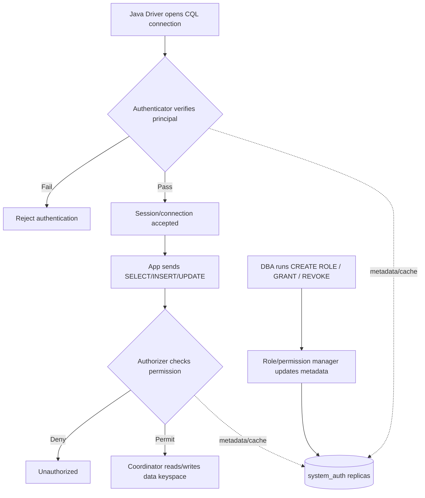
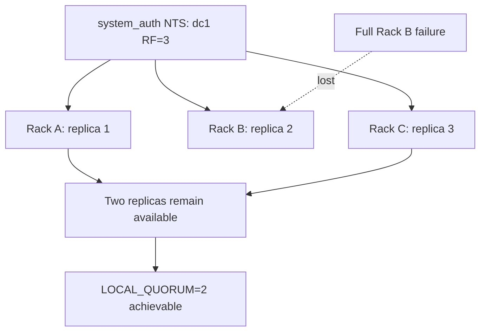
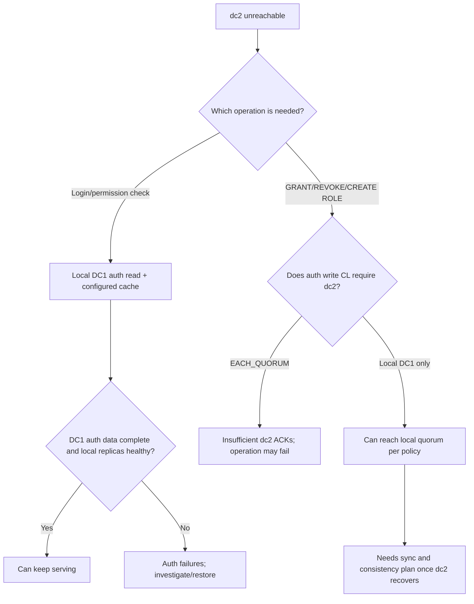

# system_auth, Replication Factor, and Access Availability When a Failure Domain Fails in Apache Cassandra

## 1. A Cluster Is Alive, Yet Applications Cannot Log In

Consider a six-node **Apache Cassandra** cluster split across two data centers (DCs), with three nodes per DC. Business data lives in a keyspace using `NetworkTopologyStrategy` with RF = 3 per DC. Existing requests from Java applications still read and write normally at `LOCAL_QUORUM`, yet when new application pods start, many CQL connections receive authentication errors; an administrator attempting to `GRANT` a permission to a new role also fails.

One hypothesis worth checking is that **the internal `system_auth` keyspace was not designed with enough replicas or was not synchronized after increasing RF**. In Cassandra setups using built-in authentication/authorization, user metadata, roles, and permissions are stored using Cassandra's own distributed mechanism. When a node/rack/DC holding replicas of security data fails, the authentication and permission-management paths can become unavailable **even while some business tables continue serving normally**.

It is essential to separate three questions:

1. **New logins (authentication):** can the cluster read credentials/roles to accept or reject connections?
2. **Query execution (authorization):** can the cluster verify the principal's permissions on resources, and are cached results still valid?
3. **Permission/admin changes (role/permission management):** can the cluster write security metadata at the applicable consistency level when a failure domain is lost?

This lesson belongs to the **Security** chapter of module `DATABASE_ENGINE_WIDE_COLUMN_CASSANDRA`; related topics include distributed architecture, wide-column storage, partition keys, replication/consistency, CQL, repair, troubleshooting, and the Java Driver. The focus is **`system_auth`, RF, replica placement, consistency of security operations, and accessibility under failure scenarios**—not a guide to disabling authentication when errors occur.

### Learning Objectives

After studying this lesson, you will be able to:

- Explain what `system_auth` is used for and when the system does **not** use it as the primary authentication data source.
- Inspect `system_auth` replication, evaluate per-DC/rack RF, and assess the impact of losing a node, rack, or entire DC.
- Distinguish **CL for business CQL** from **CL for reading/writing auth metadata**, along with the effect of auth caches.
- Plan safely increasing RF from a weak setup to `NetworkTopologyStrategy`: schema change, **full repair/backfill**, verification, then failure testing.
- Distinguish already-open sessions continuing to work from new logins and new role changes when a failure domain fails.
- Build an observation and verification runbook using CQL/`nodetool` and the Java Driver, with **GO/NO-GO** criteria, rollback, and proper handling of sensitive security data.

## 2. What Is `system_auth`?

`system_auth` is an **internal keyspace** that Cassandra security components can use to store authentication/authorization metadata, such as:

- **Roles/principals** and login credentials for `PasswordAuthenticator` and matching role manager implementations.
- **Role membership** relationships (which role is granted to which role).
- **Permissions** on keyspaces, tables, roles, and other resources per `CassandraAuthorizer`.
- Additional metadata depending on version and implementation.

Internal table/column names may vary across versions: `system_auth.roles`, `system_auth.role_members`, and `system_auth.role_permissions` are common examples, **not** an application API or stable administrative protocol for manual writes. During normal operations, use the **CQL role/permission statements** supported by Cassandra; never manually `INSERT`/`UPDATE` into `system_auth` as a "quick permission fix."

### 2.1. Applicability Conditions

Not every cluster relies on `system_auth` to govern the entire access path:

| Configuration or System | Role of `system_auth` |
| --- | --- |
| `PasswordAuthenticator` + `CassandraRoleManager` + `CassandraAuthorizer` | Typically the central store for role/credential/permission metadata that must be protected |
| `AllowAllAuthenticator` or `AllowAllAuthorizer` | Does not provide the same login/authorization guarantees; **never** use to "fix" production availability errors |
| Custom LDAP/SSO/authorizer or commercial distribution | May use a different role source, authn/authz provider, or additional caching |
| TLS/mTLS at the network layer | Secures/binds transport identity, **does not replace** Cassandra role/permission policies |

Before analyzing `system_auth`, record the **Cassandra version, authenticator, role manager, authorizer, network authorizer (if any), TLS mode, and actual identity backend**. Do not apply a `system_auth` mental model to a cluster backed by an external identity service and blame this keyspace.

### 2.2. Why Are Roles and Permissions Also Subject to Partitioning?

Records for roles, role memberships, and permissions are placed by the **partition keys of those internal tables**. Each partition is hashed to a token, and `system_auth`'s replication strategy selects nodes to hold replicas.

This has two consequences:

1. A down node with too low an RF can make **some security records** unreadable, rather than necessarily breaking every user simultaneously.
2. A login/authorization lookup may require **multiple records/partitions**. Being able to read one record does not prove every step of the authn/authz path is available.

## 3. Authentication, Authorization, Role Management: Three Paths with Different Failure Modes



**Authentication** verifies who is logging in. **Authorization** decides what that principal may do on a resource. **Role management** creates/modifies principals and permission relationships; admin operations themselves undergo permission checks before writing metadata.

Do not lump everything under "Cassandra login error." Symptoms map differently:

| Symptom | Path to Check First |
| --- | --- |
| Java fails authentication when opening a new session | Authenticator, credential info, auth read/role lookup, network/TLS |
| Old sessions still work, new pods cannot connect | Connection lifecycle, auth caches, node placement, auth backend availability |
| `SELECT` gets `Unauthorized` after successful login | Authorizer, resource permissions, role membership, propagation/cache |
| `CREATE ROLE`/`GRANT`/`REVOKE` fails | Auth write consistency, coordinator/`system_auth` replicas, caller permissions |
| DBA sees new role in DC1 but it cannot be used in DC2 yet | Cross-DC data propagation, read CL, cache validity, schema/topology |

**Never use "existing logins still work" as proof that a recent permission change is visible across all coordinators.**

## 4. `system_auth` Replication Is Independent of Business Keyspaces

Each keyspace has its **own replication strategy and RF**. For example:

```sql
-- Inspect metadata; do not query tables storing credentials directly.
SELECT keyspace_name, replication
FROM system_schema.keyspaces
WHERE keyspace_name IN ('system_auth', 'orders');
```

Illustrative example output:

```text
system_auth -> {'class':'SimpleStrategy', 'replication_factor':'1'}
orders      -> {'class':'NetworkTopologyStrategy', 'dc1':'3', 'dc2':'3'}
```

**This illustrates** an unhardened setup, not a guaranteed default for every version or cluster. Some initial setups may leave `system_auth` with low RF or `SimpleStrategy`; after deployment, always **inspect the real configuration**.

Key takeaways:

- `orders` having RF = 3 **does not** protect `system_auth` metadata if `system_auth` has RF = 1.
- `SimpleStrategy` does not model DC/rack placement the way `NetworkTopologyStrategy` does. With multiple DCs, evaluate `NetworkTopologyStrategy` and appropriate RF in **every DC hosting clients that need auth**.
- High RF without **replicas placed across independent failure domains** still risks losing multiple copies together.
- Increasing RF metadata **does not automatically backfill all historical roles/permissions**. You need a **full repair** plan and real data verification.

### 4.1. Why Not Default to RF = Total Cluster Nodes?

RF must balance **availability, durability, latency, storage cost, and failure-domain count**. With three nodes across three racks in one DC, RF = 3 is a common choice for auth metadata. However, if a DC only has two nodes, setting RF 3 **cannot create three independent replicas**; and if three nodes sit in the same rack, a single rack outage can affect all of them.

Never treat RF as a promise of "absolute safety": always verify **actual placement, node health, timeouts, CL, and backup/restore**.

## 5. Losing a Node, Rack, or DC: Different Blast Radii

A **failure domain** is a unit that can fail together: node, disk, rack/availability zone (AZ), DC/region, or WAN link. Replication aims to place enough copies across independent failure domains.



This diagram assumes three replicas are **actually** distributed across three distinct racks, each rack holds only one replica of the partition in question, and no other replica is slow. `NetworkTopologyStrategy` tries to distribute replicas across racks, but can only use **declared failure domains that actually contain nodes**.

### 5.1. Overall Impact Matrix

| Incident | With Low RF / Misplaced `system_auth` | With NTS RF=3 per DC Across Three Healthy Racks |
| --- | --- | --- |
| One node down | Some role/permission records may lose their sole replica | If only one replica/range is affected, two copies remain in the DC |
| One rack/AZ down | May lose most or all replicas for many partitions | Can retain 2/3 copies per partition if placed across three racks |
| Entire DC down | No local replicas if keyspace is not replicated to the surviving DC | Surviving DC can read auth metadata **if backfilled and enough replicas/CL remain** |
| WAN partition | A DC may fail to read/write auth per configured CL | Local reads can continue, while cross-DC/quorum writes may fail |
| Node returns after long outage | Stale/missing records may affect authn/authz | Must assess repair, hints, and data safety before cutover |

Never conclude a DC is healthy solely because `nodetool status` shows `UN` nodes. **Auth availability must also be proven via fresh logins, permitted reads, denied writes, and role-management checks.**

## 6. Quorum Math: How Many Replicas Must Security Metadata Reads/Writes Wait For?

In a DC with RF = `r` full replicas, local quorum is:

\[
Q(r) = \left\lfloor \frac{r}{2} \right\rfloor + 1
\]

| DC RF | `LOCAL_ONE` Needs | `LOCAL_QUORUM` Needs | Replicas Tolerated Down While Keeping `LOCAL_QUORUM` |
| ---: | ---: | ---: | ---: |
| 1 | 1 | 1 | 0 |
| 2 | 1 | 2 | 0 |
| 3 | 1 | 2 | 1 |
| 4 | 1 | 3 | 1 |
| 5 | 1 | 3 | 2 |

For example: in `dc1` with RF 3, `LOCAL_QUORUM` requires 2 replicas to respond; if one replica goes down while the other two respond in time, quorum **can** succeed. `LOCAL_ONE` requires only one local response, helping availability/latency, but **does not guarantee** seeing the latest role/permission change if unsynchronized.

### 6.1. `EACH_QUORUM` Across Two DCs

Suppose `system_auth` uses NTS with `dc1=3` and `dc2=3`. A write at `EACH_QUORUM` (where applicable) must receive **at least two ACKs from each DC**. Losing one node in `dc1` can still succeed if the remaining two nodes are healthy; however, **losing all of `dc2`** prevents `EACH_QUORUM` writes from achieving `dc2` quorum.

Therefore:

- **Authentication/authorization reads** using a local CL can keep working in `dc1` when `dc2` is lost.
- **Creating roles, changing passwords, and `GRANT`/`REVOKE`** using a write CL that requires both DCs can fail during that window, **even while DC1 is healthy**.
- Weakening CL to regain role-write capability can cause **permission metadata divergence** between DCs, requiring sync/repair policies, monitoring, and security approval.

**Availability of an operation depends on the actual configured CL**, not RF alone. If CL is `QUORUM` across total replicas or a local variant, re-evaluate the exact replica set the request waits on.

## 7. Auth Read/Write Consistency Differs from Application CL

In Cassandra versions supporting these options, operators may encounter:

```yaml
# ILLUSTRATIVE example of configuration keys that may exist in cassandra.yaml.
# Do not copy as a production config before checking your release.
authenticator: PasswordAuthenticator
authorizer: CassandraAuthorizer
role_manager: CassandraRoleManager

# Some Cassandra releases support these two options:
auth_read_consistency_level: LOCAL_ONE
auth_write_consistency_level: EACH_QUORUM
```

The values above are **not presented as defaults for every version**. Read your active `cassandra.yaml` and exact version/distribution docs to confirm whether these options are supported. Config changes may require a rollout/restart per documentation and must be planned and verified across **all coordinator nodes**.

### 7.1. Four Consistency Layers Never to Confuse

| Layer | Who Controls It? | Example | Mistake When Confused |
| --- | --- | --- | --- |
| **App data reads/writes** | Statement/driver/profile | `LOCAL_QUORUM` | Assuming quorum app reads mean auth metadata also uses quorum |
| **Auth metadata read** | Cassandra server/auth subsystem per version/config | `LOCAL_ONE` | Logins may read stale/missing local replicas |
| **Auth metadata write** | Cassandra server/auth subsystem per version/config | `EACH_QUORUM` | `GRANT` fails when remote DC is down even though app queries still run |
| **Serial consistency for LWT** | Statement/protocol when using LWT | `SERIAL`/`LOCAL_SERIAL` | Does not substitute for auth read/write CL |

In Java, `statement.setConsistencyLevel(LOCAL_QUORUM)` **only sets the CL for that data query**; it does not force **internal server-side role/permission lookups** to use the same CL.

### 7.2. Never Optimize Latency by Silently Lowering Security CL

Choosing too weak an auth read CL right after a permission change can create a **window where stale policies are observed**; choosing multi-DC auth writes can raise latency and reduce administrative availability during WAN outages. This is a **security and availability decision** requiring policy-owner approval, propagation measurement, and partition-handling procedures.

Never apply temporary workarounds like `AllowAllAuthenticator`, `AllowAllAuthorizer`, or disabling TLS to "restore service" when `system_auth` fails. That opens unprotected access without resolving the root cause.

## 8. Caching Can Mask Underlying Failures

Cassandra caches **credentials, roles, and permissions** depending on version and configuration, reducing `system_auth` reads per operation. You may see options such as `credentials_validity_in_ms`, `roles_validity_in_ms`, and `permissions_validity_in_ms` along with refresh intervals and cache sizes depending on the release.

**A cache is an optimization, not a new durable replica.**

### 8.1. Three Misleading Scenarios

1. **Already-open sessions:** authentication may have completed when the connection opened; requests on existing connections may keep succeeding under certain conditions even when new sessions fail to authenticate. Do not cite that as proof the auth system is healthy.
2. **Coordinator with cached permissions:** the same query may continue succeeding from cache on one coordinator, while another coordinator without cache or with an expired entry must read `system_auth`. Behavior can differ across nodes.
3. **Right after `REVOKE` of a role/permission:** revocation may **not take effect immediately** on every node if caches/propagation have not updated. This is a real security risk, not just a UX glitch.

### 8.2. What Should You Measure?

| Test | Meaning |
| --- | --- |
| **New** Java connection with a valid principal | Authentication path truly works, not just old sessions |
| New connection with an invalid principal | Rejection still works, not failing open |
| `SELECT` with a read-only role | Authorization path allows permitted resources |
| `INSERT` with a read-only role | Denied per policy; avoid testing on production data |
| `GRANT`/`REVOKE` in lab by authorized DBA | Verifies auth metadata write path |
| Repeat across **each DC/coordinator** after cache expiry/refresh | Catches caches hiding missing replicas or stale permissions |

Do not flush all caches or set cache validity to 0 cluster-wide during an incident just to "test." That can flood `system_auth` with requests and turn a latent issue into an outage. Use scoped canaries and supported cache-invalidation procedures per **version runbook** only when genuinely needed.

## 9. Designing RF by Node, Rack, DC, and Consistency

### 9.1. One DC with Three Racks

Suppose `dc1` has three racks A/B/C, one node per rack, and `system_auth` RF=3:

```text
dc1:
  rack A: N1 — auth replica
  rack B: N2 — auth replica
  rack C: N3 — auth replica

Auth read LOCAL_ONE:    can read if one replica is up and holds data.
Auth read LOCAL_QUORUM: needs 2/3 replicas.
Rack B down:            N1, N3 remain; LOCAL_QUORUM can succeed.
```

Do not turn an illustration into a guarantee for every keyspace: three independent racks must genuinely exist and the snitch must report accurate rack topology. With vnodes and multiple partitions, verify actual placement using proper tools/tests rather than trusting a diagram.

### 9.2. Two DCs, Three Replicas per DC

```text
system_auth NTS:
  dc1: RF=3
  dc2: RF=3

DC1 can read auth with LOCAL_ONE/LOCAL_QUORUM if local replicas are healthy.
DC2 can similarly read auth if historical data is already present.
Auth writes at EACH_QUORUM require quorum in both dc1 and dc2.
Full DC2 outage -> auth writes at EACH_QUORUM fail.
```

**A DC outage** and **a rack outage** are not equivalent. With NTS, if DCs hold full replicas, losing DC1 does not remove data in DC2; however, clients in DC2 still need **the right driver local DC, working native/TLS connectivity, and synchronized auth caches/records**.

### 9.3. RF2 Can Be Worse Than RF3 for Some CLs

With RF=2 in DC1, `LOCAL_QUORUM` = 2/2. If one replica goes down, quorum is lost; with RF=3, quorum is 2/3, tolerating one replica down. Thus lowering RF from 3 → 2 just to save a copy of `system_auth` can break admin/permission lookups on a single node failure. Auth metadata is tiny compared to business data; **never sacrifice failure domains and access recovery just to save disk space**.

## 10. When One Rack Fails: Three-Path Access Matrix

Assume `system_auth` uses NTS RF=3 in `dc1`, replicas of each partition are properly spread across three racks, and one rack goes down:

| Operation | Replica Condition for Success | Other Conditions Also Required |
| --- | --- | --- |
| Java opens new connection, auth read `LOCAL_ONE` | At least one local replica holding the relevant record responds | Correct credentials, `LOGIN` role, cache/schema/network/TLS |
| Java opens new connection, auth read `LOCAL_QUORUM` | Two local replicas respond in time for each lookup | Role/permission lookups may involve multiple partitions |
| Open session continues querying | May not need to repeat initial authentication; authorization depends on cache/policy | Data keyspace RF/CL, healthy coordinator/replicas |
| DBA changes password/`GRANT` at auth write `LOCAL_QUORUM` | Two local replicas respond per config | DBA permissions, propagation/caches, rollback/validation |
| DBA changes permissions at `EACH_QUORUM` with two DCs | Quorum required in **each DC**; one rack down in `dc1` can still survive | `dc2` and WAN must remain reachable; metadata backfill complete |

**If one rack fails while all three auth replicas actually reside in that rack, RF=3 will not save you.** That is why topology/failure domains must be verified, rather than treating RF as an automatic guarantee.

## 11. When an Entire DC Fails: Availability vs. Consistency Trade-Offs

Suppose `dc2` is down and `dc1` is healthy:



The model itself does not pick the best setting; that decision depends on SLAs and **delayed revocation** risk. If the organization requires **emergency credential rotation immediately during a DC outage**, a runbook must be tested **before the incident**. If policy requires every permission change to be ACKed by both DCs to succeed, a DC outage will intentionally make admin writes unavailable by design.

### 11.1. You Cannot Unconditionally "Keep Everything" During a WAN Partition

During a network partition, requiring multi-DC quorum for security metadata writes and requiring writes to succeed while DCs are split **conflict with each other**. Choosing a weaker CL so each side can modify permissions independently increases the risk of **stale permissions and diverging policies**. Prioritize according to policy: fail-closed for sensitive operations, approved break-glass procedures, or restricted functionality until DCs converge.

**Never** allow a node/cluster to bypass authentication/authorization because it lost connectivity to the auth data store. When permissions cannot be determined, the safe behavior is to deny the operation rather than unconditionally allowing it.

## 12. Safe Observation with CQL: Inspecting Replication and Role Policies

Before making changes, an authorized DBA can inspect:

```sql
SELECT keyspace_name, replication
FROM system_schema.keyspaces
WHERE keyspace_name = 'system_auth';
```

In `cqlsh`, if the principal has role-management rights:

```sql
LIST ROLES;

-- Depending on version and caller permissions:
LIST ALL PERMISSIONS OF app_service;
```

**Never** run `SELECT * FROM system_auth.roles` and paste output into public tickets: internal tables may contain credential hashes and sensitive metadata, and system schemas are not stable admin APIs. **Never** edit `system_auth` tables directly; use `CREATE ROLE`, `ALTER ROLE`, `GRANT`, and `REVOKE` per standard CQL and permissions.

### 12.1. Lab: A `SELECT`-Only Role

This example is **only for a lab cluster** with an appropriate authenticator/authorizer enabled—do not create real production app accounts this way:

```sql
CREATE KEYSPACE IF NOT EXISTS security_lab
WITH replication = {
    'class': 'NetworkTopologyStrategy',
    'dc1': 3
};

CREATE TABLE IF NOT EXISTS security_lab.orders_by_id (
    order_id uuid PRIMARY KEY,
    status text
);

INSERT INTO security_lab.orders_by_id (order_id, status)
VALUES (11111111-1111-1111-1111-111111111111, 'CREATED');

-- Non-login role used solely to group permissions.
CREATE ROLE IF NOT EXISTS order_reader WITH LOGIN = false;
GRANT SELECT ON TABLE security_lab.orders_by_id TO order_reader;

-- Grant the read role to a login role already managed/initialized
-- through the lab environment's credential/secret-store workflow.
GRANT order_reader TO app_service;
```

The last statement requires `app_service` to **already exist**, the admin principal to hold `GRANT` rights, and the cluster to actually have an enforcing authorizer enabled. Never put real passwords in CQL commands recorded in shell history; create login roles via approved secret workflows. For production, run `GRANT`/`REVOKE` only through owned, permission-controlled change workflows.

### 12.2. Testing Permitted and Denied Operations

Log in as `app_service` in the lab and test:

```sql
-- Expected to succeed once role inheritance/permission cache updates.
SELECT status
FROM security_lab.orders_by_id
WHERE order_id = 11111111-1111-1111-1111-111111111111;

-- Expected to be denied if app_service only holds SELECT:
INSERT INTO security_lab.orders_by_id (order_id, status)
VALUES (22222222-2222-2222-2222-222222222222, 'PAID');
```

If `INSERT` succeeds, **do not conclude Cassandra ignores auth**: the role may inherit another permission, the principal may be a superuser, or the authorizer may not be enabled. Inspect the role hierarchy, effective grants, and configuration. Never continue testing destructive operations on production data to verify denial.

## 13. Increasing `system_auth` RF: Metadata Change Is Only the First Step

Suppose investigation shows `system_auth` has insufficient RF to survive a node/rack outage or lacks replicas in a standby DC. Example plan:

```sql
-- Illustrates a cluster with enough nodes/racks in dc1 and dc2.
-- Execute via an approved DBA process, never ad hoc in production.
ALTER KEYSPACE system_auth
WITH replication = {
    'class': 'NetworkTopologyStrategy',
    'dc1': 3,
    'dc2': 3
};
```

**Include all relevant DCs in the replication map**; omitting an active DC from the map can inadvertently remove auth data placement from that DC. Ensure DC names match the snitch, each DC has enough nodes/racks, and network/availability plans fit. Deploy only after evaluating auth read/write CLs.

### 13.1. What Happens Immediately After `ALTER KEYSPACE`?

Target placement changes; newly assigned replicas for `system_auth` token ranges may **not yet hold** prior role/permission records. Some new connections may fail authentication if queries hit unbackfilled replicas, especially under weak auth read CL or expired caches.

**Never** equate schema agreement with data synchronization. Increasing `system_auth` RF requires an appropriate **full repair/backfill** across new token ranges/replicas, just like a normal keyspace, followed by verification. When adding a DC without data yet, you may also need **rebuild/streaming** per the exact version's add-DC runbook before routing traffic/auth operations to that DC.

### 13.2. Safe RF-Change Checklist

1. **Lock down architecture:** Cassandra/driver versions, authenticator/role manager/authorizer, current RF/DC, rack topology, client local DC, auth read/write CL.
2. **Backups and admin access:** snapshot/back up auth metadata per policy, verify recovery sources, check DBA rights, and ensure no lockout risk. `system_auth` backups are **sensitive data** requiring encryption/tight ACLs.
3. **Node preflight:** `nodetool status` and schema agreement; avoid overlapping with unresolved bootstrap/decommission/replace or conflicting repairs.
4. **Metadata change:** run `ALTER KEYSPACE system_auth` with the full approved map; wait for schema agreement.
5. **Full repair/backfill:** identify primary/token ranges and participating nodes/replicas. Schedule full repair covering **all relevant ranges**—avoid running one task on one node and declaring it done.
6. **Validation:** inspect repair/streaming logs, task success/failure, role lookups, and permission tests in **every DC**; test fresh logins, denied access, and role management in lab/canary.
7. **Post-change monitoring:** authentication/authorization error rates, permission propagation, coordinator/replica latencies, client reconnects, disk/network, and pending repairs.
8. **Close the change only** when data and auth-path SLOs pass; otherwise mark **INCOMPLETE** and halt cutover/cleanup.

### 13.3. Sample Tooling Commands

```bash
nodetool status system_auth
nodetool describecluster
nodetool netstats
nodetool compactionstats

# Example full repair on a node responsible for its ranges.
# Schedule across all token ranges/nodes; do not run on one node and assume cluster-wide completion.
nodetool repair -full system_auth

# If using -pr, plan primary-range coverage across
# all relevant nodes; check options for your running Cassandra release.
nodetool repair -full -pr system_auth
nodetool help repair
```

**Version note:** `-full`, `-pr`, DC/host scoping, and repair behavior differ across releases; verify commands on your exact version. Full repair consumes disk I/O, CPU, and network, potentially affecting business data as well. Never run repair across all nodes concurrently without concurrency limits.

### 13.4. Why Incremental Repair May Not Be Enough

Historical role/permission data may sit in SSTables **already marked repaired** under the old placement. After increasing RF, incremental repair may skip historical data that needs backfilling. Therefore, full repair is usually needed when **adding replicas**. Reports must specify **successfully repaired ranges** and verify valid source data—not merely a single command's exit code.

## 14. Reducing RF and Topology Changes: Do Not Erase the Last Security Copy

Lowering `system_auth` RF can eliminate node/rack outage tolerance and force CLs like `LOCAL_QUORUM` to depend on every remaining replica. Dropping from RF3 to RF2 in a DC changes `LOCAL_QUORUM` from 2/3 to 2/2; if one node in the replica set goes down, lookups/admin using that CL can become unavailable.

**Cleanup is not repair.** After lowering RF, `nodetool cleanup` on nodes holding data they no longer own reclaims surplus copies. Running cleanup before ensuring **remaining replicas hold all role/permission records** can wipe out security recovery data.

RF-reduction runbook:

- Confirm justification and assess failure-domain/CL impact.
- Verify data on replicas that will keep ownership, syncing/repairing as needed.
- Update metadata and wait for schema agreement.
- Run cleanup only after backups and data-coverage/availability validation.
- Test authn/authz and role management under a single-node-down scenario before finalizing.

**Rolling back after cleanup** is not just reversing `ALTER KEYSPACE`; it may require full repair/streaming/restoring metadata deleted from some nodes.

## 15. Role/Permission Propagation and the Revocation Window

Two change types must be evaluated separately:

1. **Granting permissions (GRANT):** a newly granted principal may not yet use the permission on one coordinator/DC due to replica lag or stale caches.
2. **Revoking permissions (REVOKE) or rotating credentials:** a principal may still be permitted for a period if old caches remain valid, sessions stay open, or new metadata has not reached the queried replica.

The second case has **far more severe security consequences than a UX glitch**. Operators cannot simply say "eventual consistency will settle" if policy demands emergency revocation within seconds.

### 15.1. Revocation Contracts Must Be Quantified

An example policy (values illustrative only, not a default Cassandra SLA):

```text
Event: REVOKE SELECT from role R at t0.
Requirement: within at most 60s, every coordinator in DC1/DC2
             must reject new SELECT requests from principal R.
Preconditions:
  - Auth write meets approved CL.
  - Replicas see the new metadata.
  - Permission/role caches refresh/expire per policy.
  - Both new and existing clients tested across multiple nodes/DCs.
On failure:
  - Escalate security incident.
  - Apply temporary blocks at network/app gateway per policy.
  - Do not declare revocation complete.
```

This is an **organization-defined test contract**, not a built-in Cassandra guarantee. Verify cache semantics, invalidation capabilities, session behavior, and policy cost via drills on your actual release.

### 15.2. Authentication Caching Differs from Data Repair

Full repair converges **data replicas** within scope, but **does not automatically force every coordinator's cache to update immediately**. Conversely, clearing caches does not raise RF or recreate lost role records. That is why runbooks require **both data synchronization and cache propagation validation**.

## 16. Java Driver 4.x: Verifying the Real Access Path

Java applications must never verify `system_auth` by querying credential tables directly. Verify through **a valid login path and a permitted query** from the target regions/DCs. The Java 17+ and Java Driver 4.x example below uses a test contact point (replace IP with a real node), with TLS/authentication configured per system policy:

```java
import com.datastax.oss.driver.api.core.CqlSession;
import com.datastax.oss.driver.api.core.DefaultConsistencyLevel;
import com.datastax.oss.driver.api.core.cql.PreparedStatement;
import com.datastax.oss.driver.api.core.cql.Row;
import java.net.InetSocketAddress;
import java.util.Objects;
import java.util.UUID;

// Lab only: retrieve password from a secret manager in production.
// Environment variables also need protection; never print/log.
String password = Objects.requireNonNull(
    System.getenv("CASSANDRA_LAB_PASSWORD"),
    "Missing lab credential");

// Run from an environment that can route to dc1 with valid certificates.
try (CqlSession session = CqlSession.builder()
        .addContactPoint(new InetSocketAddress("127.0.0.1", 9042))
        .withLocalDatacenter("dc1")
        .withAuthCredentials("app_service", password)
        .build()) {

    PreparedStatement ps = session.prepare("""
        SELECT status FROM security_lab.orders_by_id
        WHERE order_id = ?
        """);

    long started = System.nanoTime();
    Row row = session.execute(
        ps.boundStatementBuilder()
            .setUuid(0, UUID.fromString(
                "11111111-1111-1111-1111-111111111111"))
            .setConsistencyLevel(DefaultConsistencyLevel.LOCAL_QUORUM)
            .build()).one();

    long durationNs = System.nanoTime() - started;
    // Log success, duration, local DC, query fingerprint.
    // Never log passwords or raw auth metadata.
}
```

`127.0.0.1` is a **placeholder** only, not representative of a real DC. When production applications require TLS, configure truststores/identity verification and secure connections per driver version docs. This example focuses on checking **principal and read rights**, and does not replace TLS configuration.

### 16.1. Four Tests by Failure-Domain State

| Test | Lab/Canary Method | What It Proves |
| --- | --- | --- |
| **Fresh login** | Open a new session with valid credentials in each DC | Authentication works genuinely, not just via old sessions |
| **Authorized query** | Read role runs `SELECT` on the exact table | Role inheritance and permission lookups work |
| **Denied query** | Read-only role attempts `INSERT` into a separate lab table | Authorizer genuinely denies out-of-scope actions |
| **Admin role mutation** | Authorized DBA tests `GRANT`/`REVOKE` in lab | Auth write CL and metadata propagation are verifiable |

Measure **connection setup latency, authentication failures, unauthorized denials, query latency/errors, and elapsed permission propagation** separately. A `SELECT` at `LOCAL_QUORUM` uses **data keyspace RF/CL**; if it succeeds, that does **not** imply auth write `EACH_QUORUM` will also succeed while another DC is down.

### 16.2. Accurate Error Classification

- **Authentication failed:** may stem from wrong password, `LOGIN=false`, missing/stale auth data, backend timeout, or TLS/auth handshake; inspect messages and server logs safely rather than guessing "wrong password."
- **Unauthorized:** authenticator accepted the principal, but the authorizer denied the resource. Could be policy working as intended or unrefreshed metadata/cache.
- **Unavailable/timeout during query:** distinguish **data keyspace CL/replicas** from internal errors during auth lookups using stack traces and server metrics.
- **All nodes failed/TLS failure:** may come from client routing/network/certificates, unrelated directly to `system_auth`.

Never log credentials, tokens, or password-hash outputs into tracing systems or tickets.

## 17. Cluster Observation and Evidence Bundle When Auth Is Disrupted

### 17.1. Read-Only Commands

```bash
nodetool status system_auth
nodetool describecluster
nodetool tpstats
nodetool netstats
nodetool compactionstats
nodetool tablestats system_auth
```

Depending on version, `tablestats` shows table-level status and read/write/space/SSTable metrics. `tpstats` shows thread-pool queues/stages, not which exact role is failing. `netstats` reports streaming/bootstrap/repair, **not** a meter of every auth mutation from DC1 to DC2. `status` only shows node membership, not whether auth replicas are synced or caches are valid.

### 17.2. Minimum Evidence Bundle

| Category | Collect |
| --- | --- |
| **Security config** | Cassandra version/distribution, effective authenticator, role manager, authorizer, auth read/write CL, and cache settings |
| **Placement** | `system_auth` RF before/after per DC, strategy, rack mapping, node UN/DN, and schema agreement |
| **Failure events** | UTC timeline of node/rack/DC outages, network partitions, rollouts/restarts, repair/streaming |
| **Application** | Driver local DC, fresh login success rate, authn/unauthorized errors, connection timeouts, failed query classes |
| **Administration** | `GRANT`/`REVOKE`/role-create results in lab/canary, propagation across DCs |
| **Repair** | Node/range/task coverage, success/failure, streaming, and pending state |
| **Safety** | TLS status, backups, audit events, cache validity, redacted sensitive records |

Collect in **UTC** across multiple nodes/coordinators. One successful admin login on node A does not prove all roles and coordinators in other DCs are healthy.

## 18. Runbook When a Failure Domain Is Lost and Users Cannot Access

### Phase A — Triage and Protect the System

1. Determine whether the incident is **fresh authentication**, **authorization**, **role management**, or **CQL data requests**.
2. Record which node/rack/DC is lost, UTC timestamp, keyspace names, and affected services/DCs.
3. Keep TLS/auth protections intact; **never** switch to `AllowAllAuthorizer` or disable credential checks.
4. Determine whether apps are **using existing sessions** or **opening new connections**.
5. Ensure admin/break-glass accounts have permissions and follow approved usage procedures; never share secrets in incident tickets.

### Phase B — Investigate RF, CL, and Placement

1. Read `system_schema.keyspaces` for `system_auth` and verify per-DC NTS/RF; never infer from business keyspaces.
2. Cross-check snitch DC/rack and replica placement against real topology.
3. Inspect **effective** auth read/write CL and cache TTL/refresh per Cassandra version.
4. Measure login success/denials and `GRANT`/`REVOKE` in an appropriate **lab/canary** scope; log each error class separately.
5. If RF was recently increased, verify **full repair/backfill covered all token ranges** and auth data reached new DCs/replicas.

### Phase C — Remediate by Root Cause

| Investigation Finding | Remediation Path |
| --- | --- |
| RF=1 and the node holding auth partitions was lost | Recover node/backup source, then design proper RF/NTS and repair; do not assume metadata lives on other nodes |
| RF increased, new replicas lack history | Complete full repair/backfill and validation; delay cutover/failover |
| Rack down leaves `LOCAL_QUORUM` short on replicas | Restore rack/node or apply SLA failover plan; audit independent rack placement of RF |
| DC down, `EACH_QUORUM` auth writes fail | Per policy, accept temporary freeze on role changes or trigger security-approved runbook; never silently lower CL |
| Fresh logins fail while old sessions run | Inspect auth reads/caches, credentials, TLS, node availability, and session lifecycles |
| `REVOKE` succeeded yet access remains | Inspect propagation/caches, test across multiple coordinators, apply temporary blocks per security policy |
| Auth metadata lost, no valid replicas remain | Recover from verified backup/restore, audit role/permission safety; never hope repair invents lost data |

### Phase D — Verify and Close the Incident

1. **Fresh logins** succeed in every serving DC from routed nodes/coordinators.
2. Permitted queries are **allowed**; ungranted queries are **denied**.
3. Policy-required auth metadata writes are verified in relevant DCs, or admin limitations during WAN/DC faults are explicitly documented.
4. Repaired/streamed token ranges reach full coverage; backups and rollback paths remain valid.
5. Java Driver error rates/latencies, TLS, coordinators, and auth caches stabilize post-recovery; schedule follow-up failure-domain drills.

If any group remains unverified, set status to **INCOMPLETE**—never cite `nodetool status UN` as closure proof.

## 19. Chaos / Fault-Injection Drills in a Safe Environment

**Run only in an isolated lab/staging environment** with approval and recovery readiness. Killing/partitioning nodes in production without a maintenance plan is unacceptable.

### Scenario 1 — RF1 and Losing One Node

Assume `system_auth` has RF1 in a lab cluster. Identify a node storing some auth partitions and stop it safely per lab procedure.

**Observe:** which fresh logins/permissions fail, and do old sessions behave differently? Why can some roles still log in while others fail? That reflects **partition placement and caching**, not all roles living on one default node.

### Scenario 2 — NTS RF3 and Losing One Rack

Spread three replicas across three independent racks, simulate losing one rack, and compare:

- Supported `LOCAL_ONE`/`LOCAL_QUORUM` auth reads once role metadata has converged.
- Fresh logins and `SELECT`/denied queries on surviving coordinators.
- `GRANT` under auth write CL and behavior while one replica is down.

**Requirement:** separate **auth CL** results from **data CL** results, rather than only comparing `SELECT` response times.

### Scenario 3 — Losing All of DC2 While DC1 Stays Healthy

With NTS RF3 in both DCs, simulate WAN isolation between DC1 and DC2. With local auth reads and backfilled data, logins in DC1 can continue; with `EACH_QUORUM` auth writes, permission changes may fail to complete. Record timeouts vs. unauthorized errors, recovery RTO, and what policy allows.

### Scenario 4 — `REVOKE` and Cache Propagation

In the lab, grant a read role, connect from DC1/DC2, then run `REVOKE SELECT` both with healthy networking and during a WAN partition. Measure time until new requests are denied across all coordinators per cache configuration. If access persists longer than policy permits, design supported **cache invalidation/expiry** procedures or temporary network/app-tier blocks rather than touching internal tables.

## 20. Common Mistakes

| Mistake | Why It Is Wrong | Right Practice |
| --- | --- | --- |
| "App keyspace is RF3 so auth is RF3 too" | RF is independent per keyspace | Inspect `system_auth` replication separately |
| "Nodes are `UN` so login definitely works" | Auth partitions, caches, or role metadata may still be missing | Run fresh login and auth-path validation |
| "RF3 always survives one rack down" | Depends on snitch/placement and real racks | Verify 3 independent failure domains |
| "RF2 also survives one replica down at `LOCAL_QUORUM`" | RF2 requires 2/2 | Calculate quorum and test failures |
| "Writing roles at app `LOCAL_QUORUM` is enough" | Auth write CL is governed by its own subsystem | Check actual auth write config |
| "Queries work so `GRANT` must work too" | Auth reads/data ops differ from auth writes | Test the management path separately |
| "Old sessions work so new logins are fine" | Caching and connection auth lifecycles differ | Open a new session to verify |
| "`REVOKE` succeeded so all nodes block immediately" | Caching/propagation can lag | Measure revocation across multiple DCs/coordinators |
| "Increasing RF completes the job" | Metadata does not backfill history automatically | Full repair/stream coverage then validate |
| "Incremental repair fixes all records after RF increase" | Previously repaired SSTables may be skipped | Run full repair for the altered scope |
| "Disable auth to fix an outage" | Opens severe unauthenticated access gaps | Safely restore data/CL/placement |
| "Grant full admin rights for a canary" | Excessive privileges, hard to unwind | Use least privilege and test in lab |
| "Query `system_auth.roles` to debug and paste into ticket" | Leaks credential hashes/sensitive metadata | Use CQL role APIs, redact, and audit |
| "Directly editing `system_auth` tables is faster" | Bypasses management, corrupts caches/indexes/schemas | Use supported CQL `ROLE`/`GRANT`/`REVOKE` |

## 21. Change/Incident Report Template for `system_auth`

```text
CHANGE / INCIDENT:
  id, owner, UTC window, environment, Cassandra version
  affected domain: node / rack / DC / WAN partition
  business impact: fresh login? authorization? role management? query?

AUTH CONFIG (EFFECTIVE):
  authenticator, role_manager, authorizer, network_authorizer
  auth_read_consistency_level, auth_write_consistency_level
  roles/credentials/permissions cache validity + refresh
  Java driver local DC, TLS and trust configuration

TOPOLOGY / REPLICATION:
  system_auth strategy, RF per DC BEFORE/AFTER
  node status, snitch/DC/rack, expected replica placement
  schema agreement and topology change timeline

BACKUP / DATA VALIDATION:
  system_auth backup/restore evidence (restricted access)
  full repair/streaming tasks and token-range coverage
  failed/pending sessions; missing data warning

TEST MATRIX:
  fresh valid login per DC: PASS/FAIL
  invalid login denied: PASS/FAIL
  authorized SELECT per DC: PASS/FAIL
  unauthorized INSERT denied: PASS/FAIL
  role/permission management under required CL: PASS/FAIL
  cache propagation/REVOKE: measured elapsed, policy threshold
  one rack/one DC outage simulation in lab: PASS/FAIL

SECURITY:
  encrypted/limited-access artifacts; no credentials in logs
  audit events, break-glass approver, incident classification

FINAL:
  GO / NO-GO for cutover
  COMPLETED / INCOMPLETE / ROLLED_BACK
  remaining risks, owner, next test, restore path
```

Never embed `system_auth.roles` contents or passwords in the report. Customer role names, node addresses, and topology details may also be restricted and require access controls.

## 22. Practice Questions

### Scenario A — App Still Runs, New Pods Fail to Log In

A three-node `dc1` cluster has an app keyspace with RF3 and `system_auth` with RF1. N2 goes down; existing Java sessions keep running, but new Java pods experience a 40% authentication failure rate.

1. Why did RF3 on the app keyspace not protect the login path?
2. Why did **not every** role fail simultaneously?
3. What evidence would you collect regarding auth CL/cache and token placement?
4. Outline the sequence to fix RF/backfill and test fresh logins without disabling auth.

### Scenario B — One Rack Fails Under Two Configurations

A cluster has three racks. Config X: `system_auth` RF2; Config Y: RF3 NTS with three replicas across three racks. Auth read is `LOCAL_QUORUM`.

1. Under RF2, how many ACKs are required, and does quorum survive losing one replica?
2. Under RF3, how many ACKs are required, and how many remain after losing one replica?
3. If all three nodes sit in the same rack, can RF3 survive a **rack outage**?
4. What disk/network/timeout conditions matter beyond quorum?

### Scenario C — DC2 Lost While `REVOKE` Is Needed

Two DCs each have RF3 for `system_auth`. Auth reads are local; auth writes require `EACH_QUORUM`. DC2 becomes isolated, and a DBA in DC1 needs to revoke read access from a role whose credentials may have leaked.

1. Why **can** logins in DC1 still succeed while `REVOKE` may fail?
2. What must be evaluated regarding security policy, caches, and open sessions?
3. Is it acceptable to disable the authorizer or silently lower CL just to get the revocation "done"?
4. How should temporary app/network-tier blocking and post-DC2-recovery reconciliation be described?

### Scenario D — RF Increased Yet Random Errors Persist

A DBA changes `system_auth` from RF1 to NTS RF3; all nodes are `UN`. Some new logins succeed on N1 but fail on N3. No full repair logs exist.

1. Why is a successful `ALTER KEYSPACE` metadata change insufficient?
2. How can `LOCAL_ONE` auth reads behave differently between backfilled and unbackfilled replicas?
3. What range-based full repair plan and auth cache/data verification steps are needed?
4. Why shouldn't you run incremental repair alone and close the ticket?

### Short Questions

1. How does `system_auth` differ from a business keyspace in data and RF?
2. Do authentication, authorization, and role management share the same goals and failure modes?
3. What does NTS RF3 mean if there is only one rack or insufficient nodes in a DC?
4. Using the `LOCAL_QUORUM` formula, how many ACKs does RF4 require?
5. How can `EACH_QUORUM` affect `GRANT` operations when one DC is down?
6. Does driver `LOCAL_QUORUM` force auth metadata to be read at `LOCAL_QUORUM`?
7. What kinds of faults can permission caches mask?
8. Why does a successful `REVOKE` not prove every coordinator has stopped granting access?
9. After increasing RF, when is full repair needed over incremental repair?
10. Why must you never directly edit `system_auth` tables or disable the authorizer during an outage?
11. Must you test fresh logins or only reuse an existing connection?
12. Which types of security data must never be exported into incident tickets?

## 23. Version Notes and References

Details such as **`system_auth` table names, auth read/write consistency options, cache settings, dynamic config reloadability, and node/DC-down behavior** depend on the Cassandra release and distribution. Before applying in production, consult:

- Apache Cassandra Documentation: **Security / Authentication**, **Authorization**, **Roles and Permissions**.
- Apache Cassandra Documentation: **NetworkTopologyStrategy / Replication**, **Consistency Levels**.
- Apache Cassandra Documentation: **nodetool repair** and **full repair after changing RF**.
- `nodetool help repair` and the active `cassandra.yaml` for your running version.
- Java Driver 4.x documentation: **authentication, local datacenter routing, connection/session lifecycle, and exception mapping**.

Do not treat a Cassandra 3.x deployment example as proof that options or table names remain identical in Cassandra 5.x. For production, runbooks must be reviewed by DBAs and security policy owners before changing RF, caches, or auth CL.

## 24. Conclusion

**`system_auth` is operational security data that must be replicated and recovered like a real distributed system.** Business keyspace RF **does not** protect login/permission metadata if `system_auth` has low RF or replicas sharing a failure domain. `NetworkTopologyStrategy` with sufficient replicas spread across DCs/racks, appropriate auth read/write consistency, and full repair after RF changes improve fault tolerance—yet **RF does not replace actual placement, cache semantics, backups, and Java client access verification**.

When losing a node/rack/DC, verify **new logins, permission checks, and role-management operations** independently. Old sessions, warm caches, or a passing `SELECT` do not prove `GRANT`/`REVOKE` can succeed or that revoked access is blocked on all coordinators. A change is only complete once **metadata/placement, repair/backfill, fresh logins/denied permissions, propagation/caching, and SLOs** are proven under designed failure scenarios. If anything remains unverified, the honest status is **INCOMPLETE with clear boundaries and recovery plans**—never disable security controls to hide the problem.
