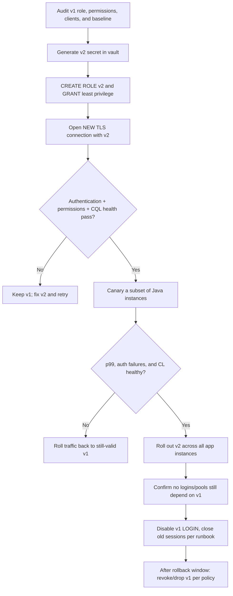

# Credentials, Secret Managers, and Password Rotation in Apache Cassandra

## 1. Goal: Protecting Access Identities Without Disrupting the Cluster

Apache Cassandra is a **distributed wide-column** database: Java applications use CQL to read/write partitions, data is placed on multiple **replicas** per replication factor (RF), and results are acknowledged per consistency level (CL). However, **RF = 3** and **`LOCAL_QUORUM`** protect data/availability properties—they **do not** replace authentication and authorization.

Suppose a service `orders-api` stores a Cassandra account `app_orders_v1` with its password hardcoded in `application.yml`. When the repository is exposed, operations must rotate the password. Running only `ALTER ROLE` and updating a subset of Java pods leaves pods holding the old password unable to open new connections; updating only the secret store without changing the password in Cassandra leaves the leaked credential usable.

This lesson targets four capabilities:

1. **Provisioning:** create dedicated identities per service/context, applying least privilege.
2. **Storage:** store credentials in a secret management system without exposing them via source code, logs, command lines, or CQL history.
3. **Rotation:** rotate credentials in sequence, verifying the new connection path before disabling the old one.
4. **Incident response:** detect and respond to credential leaks while preserving revocation, recovery, and auditing.

**Key principle:** changing a password is a change **on Cassandra, the application, and the secret store**. A single CQL command succeeding does not mean all Java Driver sessions are using the new credential.

## 2. Distinguishing Authentication, Authorization, Encryption, and Identity

| Concept | Question | Cassandra Example |
| --- | --- | --- |
| **Authentication** | Who is connecting? | `PasswordAuthenticator` checks username/password |
| **Authorization** | What is that identity allowed to do? | `CassandraAuthorizer` checks `SELECT`, `MODIFY`,… |
| **Role management** | Who creates roles, modifies permissions, locks logins? | `CassandraRoleManager` manages roles |
| **Transport security** | Is traffic protected over the network? | Client ↔ node TLS, node-to-node TLS as configured |
| **Secret management** | Where are credentials stored, issued, rotated, and audited? | Secret manager and service identity |
| **Audit/observability** | Which user/app encountered auth errors or role changes? | Audit trail, sanitized logs |

For example, `PasswordAuthenticator` identifies the caller as `app_orders_v2`, yet that role still needs `SELECT` or `MODIFY` on the target resources. **Successful authentication does not automatically grant access to all keyspaces.**

TLS and passwords also solve two different problems. **Never use having a password to justify plaintext CQL connections.** Username/password authentication requires a properly configured TLS transport, trusted certificates, and server identity verification to avoid exposing credentials in transit.

### Three Attack Surfaces to Account For

- **Client ↔ coordinator:** susceptible to eavesdropping, misconfigured trust stores, or connecting to the wrong endpoint.
- **Coordinator ↔ replica:** internode traffic impacts security and multi-DC operation; internal TLS configuration is a separate responsibility.
- **Control plane:** anyone or any tool authorized to create roles, change passwords, or read the secret manager can establish new access paths even without directly reading business tables.

Good design protects both **credentials** and the **permission to change credentials**.

## 3. Cassandra Security Configuration: Check Before Provisioning Accounts

In self-managed Apache Cassandra deployments, common entries in `cassandra.yaml` include:

```yaml
# Conceptual example; verify against your exact version config and runbook.
authenticator: PasswordAuthenticator
authorizer: CassandraAuthorizer
role_manager: CassandraRoleManager
```

Meaning:

- `PasswordAuthenticator` enables password authentication for client connections via supported mechanisms.
- `CassandraAuthorizer` enforces permissions instead of allowing every account to execute any CQL statement.
- `CassandraRoleManager` supports creating, altering, and managing roles.

**Do not apply these three lines to an open production cluster without a migration plan.** Enabling auth/authz before clients, internal tooling, and admin accounts are ready can lock services and operational tools out of the cluster.

Configuration changes may require node-by-node restarts depending on version and operator setup; plan transitions and validate before cluster-wide rollout.

### TLS Is a Separate Requirement—Do Not Skip It

A conceptual client-encryption block might look like:

```yaml
client_encryption_options:
  enabled: true
  optional: false
```

This illustrates only **the intent to require TLS**, not a complete TLS configuration. Production requires certificates/keys, trust stores, TLS versions, hostname/identity verification, and certificate rotation policies; option names and file specifications vary across Cassandra 3.x/4.x/5.x and distributions.

Note that `client_encryption_options` and `server_encryption_options`/internode TLS are two distinct sections. Protecting passwords between Java and the coordinator **does not mean** replica traffic across DCs is encrypted.

## 4. Default Accounts and Admin Rights: Large Blast Radius

Some deployments using `PasswordAuthenticator` have a bootstrap account with high admin rights, commonly known as `cassandra` in default Cassandra configurations. Production procedures must:

1. Use a secure admin channel to initialize **individual admin identities**, verifying logins and permissions.
2. Disable or rotate the default credential **per runbook** after confirming administrative access will not be lost.
3. Provision separate **break-glass access** that is controlled, audited, and periodically tested for recovery.
4. Never use superuser as the default account for microservices.
5. Never put bootstrap passwords in container images, charts, source code, widely shared docs, or tickets.

**Do not rush to DROP the sole admin role.** Especially while changing authenticators/role managers, if the new role is not yet working properly, deleting the old access path can lock operations out of the cluster.

### `system_auth` Must Also Stay Available

With built-in authentication/authorization mechanisms, role and permission data typically reside in tables in the `system_auth` system keyspace. If `system_auth` becomes unavailable or has insufficient replication, authentication can fail even while business data remains healthy.

When designing across multiple DCs:

- Evaluate `system_auth` RF for the real topology; never assume auth data automatically shares the RF of application keyspaces.
- Plan repairs and backups for role/metadata per version capabilities.
- Test connections **from each DC** at the appropriate local CL/context.
- Never alter system keyspace RF without a plan; replication changes require data synchronization and verification procedures.

Credential governance depends on **the authentication platform itself**, not just the secret manager.

## 5. Designing Roles Around Least Privilege

An easily auditable convention:

| Role | `LOGIN` | Example Permissions | Consumer |
| --- | --- | --- | --- |
| `app_orders_reader` | false | `SELECT` on required read tables | Permission group |
| `app_orders_writer` | false | `MODIFY` on required write tables | Permission group |
| `app_orders_v1` | true | Granted `app_orders_reader` and/or `app_orders_writer` | Old login identity |
| `app_orders_v2` | true | Equivalent rights, new credential | Identity used during rotation |
| `db_security_admin` | true | Only approved admin permissions | Admin user/tool |

Separating **non-login roles** (grouping permissions) from **login roles** (used by applications) makes rotating identities easy without repeating dozens of manual `GRANT` statements. However, verify role inheritance, admin privileges, and supported permission types for your version.

### CQL Role-Granting Example

Assuming the business keyspace and table already exist:

```sql
-- Permission groups, not login accounts.
CREATE ROLE IF NOT EXISTS app_orders_reader
WITH LOGIN = false AND SUPERUSER = false;

CREATE ROLE IF NOT EXISTS app_orders_writer
WITH LOGIN = false AND SUPERUSER = false;

GRANT SELECT ON TABLE sales.orders_by_id
TO app_orders_reader;

GRANT MODIFY ON TABLE sales.orders_by_id
TO app_orders_writer;

-- Assign permission groups to the login identity per policy.
GRANT app_orders_reader TO app_orders_v2;
GRANT app_orders_writer TO app_orders_v2;
```

The last two `GRANT` commands **assume `app_orders_v2` was already created separately** with a randomly generated password via a secure workflow. Do not execute the whole snippet before the login role exists.

When an app only reads, do not grant `MODIFY`. When a job writes to one specific table, do not grant `ALL PERMISSIONS ON ALL KEYSPACES` just because it is quick. `CREATE`, `ALTER`, `DROP`, `AUTHORIZE`, or `DESCRIBE` (where supported) must be treated as distinct from data read/write rights.

### Verifying Effective Permissions

Common inspection commands:

```sql
LIST ROLES;
LIST ALL PERMISSIONS OF app_orders_v2;
```

Exact syntax/capability for listing role inheritance and metadata-read requirements depend on version. After checking from the admin side, **log in directly with the app account in a fresh session** to verify:

1. `SELECT` is permitted on the expected table.
2. `INSERT`/`UPDATE` matches granted permissions.
3. An out-of-scope table returns an authorization error.
4. The identity cannot `CREATE ROLE`, delegate permissions, or access another tenant's data against policy.

**Cassandra role permissions do not automatically enforce per-row ACLs by `tenant_id`.** Multi-tenant designs require keyspace/table boundaries, application-layer authorization, or other appropriate isolation mechanisms.

## 6. Credential Lifecycle: More Than a `PASSWORD` Field

A reliable secret moves through multiple states:


Attributes to track alongside metadata, **without exposing passwords in public metadata**:

| Attribute | Purpose |
| --- | --- |
| Credential/secret ID | Logical identifier, avoiding direct secret paths hardcoded in code |
| Owner/team/service | Who is responsible for rotation and incident response |
| Cluster/environment | Prevents accidentally using a `dev` credential in `prod` |
| Cassandra role | Role to authenticate as; do not infer permissions from secret paths |
| Secret version | Supports cutover, canary, and controlled rollback |
| Issued/rotation due | Tracks secret age and rotation schedule |
| Last validated | Last verified connection opening and least-privilege check |
| Audit reference | Trail of role/secret changes, containing no plaintext |

In production, passwords must be **strong, random, and unique per identity**, never reused across clusters or services. Rotation schedules should reflect security policy and actual risk; **suspected compromised passwords must be revoked early**, without waiting for the scheduled cycle.

## 7. What Does a Secret Manager Provide?

A secret manager may be an enterprise vault, a cloud secrets service, or an equivalent solution. What matters is not the vendor name, but these capabilities:

1. **Encryption at rest and in transit:** protects secrets during storage and retrieval.
2. **IAM/service identity:** authenticates applications calling the secret manager using workload identity or equivalent, rather than another hardcoded master password.
3. **Least privilege:** `orders-api` only reads its own secret; **write/rotate** permissions belong to an admin job, not the service data plane.
4. **Versioning:** tracks active secrets, new secrets, and cutover state.
5. **Audit:** logs *who read/changed a secret*, when, and from which identity; **never logs the secret value**.
6. **Availability:** handles secret-store slowness/outages, expired tokens, or unreachable KMS.
7. **Rotation orchestration:** coordinates updating Cassandra, updating the secret version, and rolling out the application.
8. **Revocation:** deletes/revokes access and retires old secret versions after the rollback window closes.

### Do Not Equate "Kubernetes Secret" with Complete Security

If using Kubernetes:

- A `Secret` object may only be base64-encoded in its API representation; **base64 is not security encryption**.
- You still need service-account RBAC, etcd encryption at rest, network policies, auditing, and secret-manager integration where required.
- Secrets injected as **environment variables** can persist in process snapshots, debug tools, and process environments; rotating an env var does not automatically update values inside a running JVM.
- File mounts may support data updates depending on the deployment mechanism, yet **an active Java Driver session does not automatically re-authenticate** just because a file changes.

**Managing secrets at the platform layer does not replace managing accounts/permissions inside Cassandra.** If the secret manager updates while the Cassandra role remains unchanged, the old credential stays valid.

## 8. Common Credential Leakage Channels

| Leakage Channel | Bad Example | Good Practice |
| --- | --- | --- |
| Git/repository | `password: "myProdPassword"` | Store only secret references, never values |
| Docker image | `ENV CASSANDRA_PASSWORD=...` in image | Inject at runtime via workload identity and secrets |
| Shell command | `cqlsh -u user -p actual-password` | Avoid passwords in CLI args/process lists; use tool-supported secure prompts |
| CQL history | `CREATE/ALTER ROLE ... PASSWORD = '...'` retained | Run via controlled admin channels; protect/purge history per policy |
| Logs/tracing | Printing full driver configs or secret snapshots | Redact; log secret ID/version instead of values |
| CI/CD | Echoing env vars containing passwords | Encrypt, mask, use least-privilege jobs; never print secrets |
| Chat/tickets | Pasting passwords to ask for connection troubleshooting | Share secret references and sanitized error descriptions |
| Backups | Configs/heap dumps containing plaintext passwords | Encrypt and enforce backup retention/access controls |
| Metrics labels | Putting secrets/tenants/customer IDs in labels | Use query templates, roles, and error codes; avoid high-cardinality/sensitive labels |

If a secret is committed to Git, **removing it only in a new commit is not enough**: old versions remain in history, caches, forks, or artifacts. Treat the secret as compromised, **revoke/rotate** it, and remediate history and access per incident-response policy.

### Do Not Invent "Encryption" by Partially Masking Passwords

Logging `password=abcd******` still leaks partial data and encourages logging credentials. Log `credential_version`, `secret_id`, or controlled reference IDs; **never log any characters of a password**.

## 9. Java Driver 4.x: Connecting with Credentials from a Secret Manager

Java Driver 4.x supports username/password authentication when building a `CqlSession`. The example below intentionally **avoids** implementing a specific secret-manager SDK; `CredentialProvider` represents an adapter configured with workload identity.

```java
import java.net.InetSocketAddress;
import javax.net.ssl.SSLContext;

import com.datastax.oss.driver.api.core.CqlSession;

public final class SecureCassandraSessionFactory {
    public interface CredentialProvider {
        Credentials loadCurrent(String secretId);
    }

    public interface Credentials {
        String username();
        String password();
        String version();
    }

    private SecureCassandraSessionFactory() {
    }

    public static CqlSession open(
            CredentialProvider provider,
            SSLContext trustedTlsContext) {

        Credentials credentials =
            provider.loadCurrent("prod/orders-api/cassandra");

        // trustedTlsContext must be built from verified trust material.
        // Never log the credentials object or password string.
        return CqlSession.builder()
            .addContactPoint(new InetSocketAddress("10.30.0.11", 9042))
            .addContactPoint(new InetSocketAddress("10.30.0.12", 9042))
            .withLocalDatacenter("dc1")
            .withSslContext(trustedTlsContext)
            .withAuthCredentials(
                credentials.username(), credentials.password())
            .build();
    }
}
```

These addresses, DC, and secret ID are **illustrative**, not real endpoints or secrets. In real systems:

- `SSLContext` must use a trusted trust store/certificate policy; enforce hostname/identity verification per driver settings and test against connecting to the wrong server.
- Never disable TLS verification or trust all certificates to bypass certificate errors.
- The secret manager must authenticate the application independently of Cassandra passwords, such as platform-supported workload identity.
- Never open a `CqlSession` per request; reuse a long-lived session with managed lifecycle/pooling.
- Java `String` holds sensitive data in memory and is hard to clear immediately; limit lifetime, never log, never include in `toString()`/exceptions, and control heap dumps.
- Never let a secret-manager SDK retry infinitely or make every API request depend synchronously on secret-store calls.

**`withAuthCredentials(...)` is not a password hot-reload mechanism.** When the password changes in the secret manager, existing connections may continue for a while; new connections may use the old credential snapshot. Applications need a strategy to **open a new session, verify it, shift traffic, and close the old session**—or use a refresh mechanism supported and verified on your driver version.

## 10. Why Rotation Is Tricky: Accounts and Connection Pools Do Not Switch Together

Suppose a service runs 20 instances, each holding a `CqlSession`; the secret manager switches from secret version `v1` to `v2`.

```text
T0: 20 instances use user=app_orders, password=v1.
T1: Cassandra changes app_orders password to v2.
T2: 10 instances have reloaded, 10 instances still hold v1.
T3: Network closes some existing connections.
T4: Instances still on v1 open new connections => authentication failed.
```

Even when already-authenticated connections continue serving CQL, **they are not proof that the old password is still valid for new logins**. Failure detection latency can depend on connection pools, caches, and topology; therefore, measure **new-connection authentication**, not just running a `SELECT` on an already-live session.

### Two Basic Strategies

| Strategy | Benefit | Risk |
| --- | --- | --- |
| **In-place password change** (`ALTER ROLE` on same username) | Role names and grants stay unchanged | Only one password is active at a time, making mismatched clients fail; no zero-downtime guarantee |
| **Dual A/B identities** (`app_orders_v1` → `app_orders_v2`) | Allows two credential sets in parallel during a transition window | Requires creating roles/grants, testing permissions, then revoking the old role and tracking audits |

In environments requiring **rolling rollouts and avoiding disruption**, A/B rotation is usually easier to control. However, never leave both identities active indefinitely; enforce a clear revocation deadline.

## 11. Preferred Workflow: Rotating Two A/B Roles

Suppose `app_orders_v1` is serving production with permission group `app_orders_reader`, and we want to transition to `app_orders_v2`.



### Step 1 — Inventory Credential Scope

Identify all **consumers** of `app_orders_v1`: services/pods/jobs, dashboards, backup agents, ETL, environments, connection pools, and ops scripts. Never scan or print plaintext secrets into reports.

Set measurable criteria:

- New logins with v2 succeed over TLS to target nodes.
- Permitted queries succeed at `LOCAL_QUORUM`/actual CL.
- Out-of-scope queries are denied as expected.
- Auth failure/unauthorized counts, connection creation, driver retries, and API p95/p99 remain within SLO.
- A clear procedure exists to halt rollout and restore traffic to v1 before revocation.

### Step 2 — Generate Secret Version and Create New Login Role

Use an approved tool to generate a random password and store it in the secret manager. **Never paste real passwords into examples, docs, Git, or tickets.**

CQL template **not to be run verbatim**; the bracketed string is a placeholder to be substituted inside a secure admin session:

```sql
-- TEMPLATE ONLY; never use the literal placeholder as a password.
CREATE ROLE app_orders_v2
WITH PASSWORD = '<GENERATED_SECRET_FROM_VAULT>'
AND LOGIN = true
AND SUPERUSER = false;

GRANT app_orders_reader TO app_orders_v2;
GRANT app_orders_writer TO app_orders_v2;
```

Execute in a CQL session over **verified TLS**, with restricted privileges, protecting anywhere the statement could be recorded (shell/`cqlsh` history, audit logs, CI traces). A secret manager cannot hide a `CREATE ROLE ... PASSWORD` command if the admin script itself prints or logs it.

To narrow permissions, replace `writer` with a read-only group. The goal is for **v2 to match the exact permissions the app needs**, not accidentally become broader than v1.

### Step 3 — Verify with a Real Connection

Using **a new CqlSession** with v2, verify:

1. Cassandra authenticates successfully against configured endpoints.
2. `SELECT` on valid tables succeeds at the target CL.
3. `MODIFY` succeeds only if granted write rights.
4. Reading an out-of-scope table or running `CREATE ROLE` is denied.
5. Logs contain no username/password values beyond permitted identifier fields.

Verification query in a lab:

```sql
SELECT order_id, status
FROM sales.orders_by_id
WHERE order_id = 11111111-1111-4111-8111-111111111111;
```

This is a **partition-key sample query**: `sales.orders_by_id` must already exist, and returning 0 rows still proves `SELECT` permission and connectivity if execution succeeds.

### Step 4 — Canary, Rollout, and Session Management

Deploy a subset of instances using secret version v2. Because the driver pools connections, ensure:

- Each canary **opens a new session with v2**, rather than merely updating an environment variable.
- Once the new session is healthy, shift traffic gradually; allow the old session to drain in-flight requests before closing.
- Bound connection churn and retries; avoid all pods reconnecting at the exact same instant.
- If a Cassandra node restarts during rollout, new connections still authenticate properly.
- Sessions use `dc1`/local DC and proper TLS; never lower CL arbitrarily to pass health checks.

Only after the canary passes, roll out to the rest of the service and periodic tasks that open connections infrequently (batch jobs, cron, ETL).

### Step 5 — Revoke v1 and Control the Transition

Only after proving **no components still rely on v1**, disable the old login:

```sql
ALTER ROLE app_orders_v1 WITH LOGIN = false;
```

Then monitor auth errors and handle remaining open sessions per runbook. Setting `LOGIN = false` **does not guarantee all already-authenticated connections drop instantaneously**; caches/connection lifecycles may keep them alive briefly. Once the policy rollback window expires, consider revoking remaining roles and dropping the old role:

```sql
-- Only after dependency inventory and rollback window completion.
REVOKE app_orders_reader FROM app_orders_v1;
REVOKE app_orders_writer FROM app_orders_v1;
DROP ROLE app_orders_v1;
```

**Never delete a role that may still be used by jobs or management systems.** Role/permission changes are subject to caching; to verify revocation, test **new authentication and denied operations** from a controlled test client.

## 12. When You Must Rotate the Password on the Same Role

Sometimes policy or integration constraints do not allow parallel roles, requiring `ALTER ROLE`:

```sql
-- TEMPLATE: never execute with the placeholder as a real password.
ALTER ROLE app_orders
WITH PASSWORD = '<NEW_GENERATED_SECRET>';
```

**Caution:** Cassandra normally supports only one active password per password-based identity in this model; there are no built-in "two parallel passwords" for the same role as in the A/B approach.

A runbook may include:

1. Stage the new credential in the secret manager in a **staged** state without switching clients while the server still expects v1.
2. Agree on a maintenance/change window and inventory workloads, especially batch jobs.
3. Update the password in Cassandra via a secure admin channel.
4. Activate the new secret version in clients, create **new sessions**, and shift traffic gradually or together as supported.
5. Monitor `AuthenticationException`, `AllNodesFailedException`, connection attempts, and p99.
6. On failure, roll back via a coordinated update per policy; **never assume reverting only the secret store restores v1 once the server password has changed**.

This approach creates a **state-skew window between server and clients**. Never promise zero downtime without testing on your exact Cassandra version, driver, topology, and rollout mechanism.

### Why Cutting Traffic Does Not Replace Password Rotation

Blocking `app_orders` at an application gateway stops the API from using the credential, yet anyone holding the old password can still try connecting directly to Cassandra if network/authorization allow. **Revocation at the authentication source** is essential for rotation and incident response.

## 13. Secure Authentication in the Java Driver: Lifecycle and Errors to Watch

Different failure modes:

| Symptom at Application | Suspect Layer | First Check |
| --- | --- | --- |
| New logins fail authentication | Wrong password/username, `LOGIN=false`, unavailable auth backend | Secret version, role, TLS handshake, redacted logs |
| Login works but `SELECT` is denied | Authorization/grants | Role inheritance, table permissions, auth cache |
| TLS handshake failed | Certificate/trust/hostname/TLS version | Certificates, trust store, cert expiry, endpoint |
| `AllNodesFailedException` | No node could execute the request; multiple possible causes | Per-node root causes (network/auth/TLS); avoid lumping together |
| Old connections work, new connections fail | Server/client credential mismatch after rotation | Test new session with exact secret version |
| Only nightly batch jobs fail | Job still uses v1 secret or revoked secret | Periodic workload inventory, deployment/job configs |
| Permissions changed yet requests still succeed | Session/cache unrefreshed or broader grants than expected | Inspect effective permissions, cache/re-auth, and logs |

**Never print full exception objects if they contain URLs or sensitive config.** Logs should include service, permitted role name, secret version, cluster/DC, exception class, request correlation ID, and timestamp; never log passwords, tokens, or credential object contents.

### Do Not Abuse Retries

A wrong password cannot be fixed by blind retries. If 500 instances repeatedly try connecting with a revoked v1 secret, they can:

- Flood the cluster with authentication attempts.
- Saturate connection pools and degrade QPS.
- Trigger false alarms or mask other failures.
- Inflate log and audit volume.

Drivers/applications should bound reconnect/backoff per version capabilities, add jitter where appropriate, and **route auth errors to configuration/credential remediation** rather than read/write retry policies.

## 14. CQL Lab: Verifiable Roles and Permissions

**Practice only on an isolated lab cluster** with authentication, authorization, and TLS enabled for your version. Never create real admin accounts with passwords printed in documentation.

### Step 1 — Create Keyspace/Table

Assume the lab has DC `dc1` with three replicas:

```sql
CREATE KEYSPACE IF NOT EXISTS sales
WITH replication = {
    'class': 'NetworkTopologyStrategy',
    'dc1': 3
}
AND durable_writes = true;

CREATE TABLE IF NOT EXISTS sales.orders_by_id (
    order_id uuid PRIMARY KEY,
    customer_id text,
    status text,
    updated_at timestamp
);

INSERT INTO sales.orders_by_id (
    order_id, customer_id, status, updated_at
) VALUES (
    11111111-1111-4111-8111-111111111111,
    'customer-42', 'CREATED',
    '2026-11-20 10:00:00+0000'
);
```

DDL and seed data are executed by the **lab admin account**. On clusters with fewer nodes than RF3, `LOCAL_QUORUM` may be unavailable; adjust RF/CL to match the lab instead of skipping verification.

### Step 2 — Create a Read-Only Permission Group

```sql
CREATE ROLE IF NOT EXISTS lab_orders_reader
WITH LOGIN = false AND SUPERUSER = false;

GRANT SELECT ON TABLE sales.orders_by_id
TO lab_orders_reader;
```

### Step 3 — Create Two Identities per Pattern

These two statements contain **placeholders** that must be replaced with distinct, randomly generated passwords from the lab secret store and entered via a **private admin channel**:

```sql
CREATE ROLE lab_orders_a
WITH PASSWORD = '<GENERATED_LAB_SECRET_A>'
AND LOGIN = true AND SUPERUSER = false;

CREATE ROLE lab_orders_b
WITH PASSWORD = '<GENERATED_LAB_SECRET_B>'
AND LOGIN = true AND SUPERUSER = false;

GRANT lab_orders_reader TO lab_orders_a;
GRANT lab_orders_reader TO lab_orders_b;
```

If role names already exist from a prior run, inspect them first rather than colliding or overwriting credentials. Role examples in this lesson are illustrative; **never use literal placeholders as passwords**.

### Step 4 — Test Real Behavior

Open two fresh CQL/Java sessions using the two issued credentials:

```sql
-- Must succeed for both A and B.
SELECT order_id, status
FROM sales.orders_by_id
WHERE order_id = 11111111-1111-4111-8111-111111111111;

-- Lab test: read-only account must be denied.
UPDATE sales.orders_by_id
SET status = 'PAID'
WHERE order_id = 11111111-1111-4111-8111-111111111111;
```

Denial of `UPDATE` is the **expected authorization test signal**, not a Cassandra error. Never run unauthorized write tests in production or against real data. If the update unexpectedly succeeds, inspect inherited permissions/superuser flags and auth cache rules before claiming least privilege.

### Step 5 — Simulate Locking the Old Account

After confirming B works with the right permissions:

```sql
ALTER ROLE lab_orders_a WITH LOGIN = false;
```

Test **new connections** with credentials A and B to observe the difference. An A session opened before the change may persist depending on caches/connection lifecycles; that is why testing only via queries on an old session is insufficient.

When finishing the lab, revoke/clean up roles and secret versions via approved procedures; do not leave test accounts behind in shared clusters.

## 15. Incident Response When Credential Exposure Is Suspected

A safe response order balances **revoking unauthorized access paths** and **maintaining service**:

1. **Assess exposure severity:** which secret, cluster/env, role permissions, timestamp, logs/audits, and network reachability.
2. **Isolate urgently if required:** block network/identity/role per incident procedure, accepting necessary downtime if risk is too high.
3. **Issue replacement credentials:** prefer A/B identities when feasible; never send passwords over chat/tickets.
4. **Verify new connections/permissions** over TLS from a clean client.
5. **Migrate services and jobs** to the new credential while watching failed auth.
6. **Revoke the leaked credential in Cassandra**, not merely deleting the secret version in the vault.
7. **Investigate blast radius:** what data the privileges could read/write, and whether extra roles or permission changes were created.
8. **Clean up leakage sources:** CI traces, Git history, artifacts, dashboards, compromised hosts/heap dumps, and backups per policy.
9. **Report and improve:** update owners, rotation SLAs, audit/alerts, hardening, and follow-up drills.

If a **superuser credential** leaks, the risk scope is far greater: an attacker could alter roles/permissions and data. Changing one account's password does not guarantee no backdoor roles or schema edits were created. Audit all roles, schemas, and suspicious actions.

## 16. Monitoring Password Rotation Effectiveness

A rotation dashboard should track **time, service, cluster/DC, and credential version**, never plaintext secrets:

| Signal | Expected on Healthy Rollout | Stop Signal |
| --- | --- | --- |
| New authentication success rate | v2 rises and stabilizes | Auth errors rise on canary or specific nodes |
| Unauthorized CQL | No increase outside intentional tests | Service lacks permissions or wrong grant |
| TLS handshake failures | Near baseline | Trust/hostname mismatch |
| Java Driver connection creation | Controlled transition to new connections | Reconnect storm, pool exhaustion |
| API p95/p99 and timeouts | Within SLO | Increases after cutover |
| Secret access audit | Service reads only its assigned secret | Unfamiliar role/address accessing secret |
| Old role active usage | Drops to 0 before revocation | Batch jobs/workers still using v1 |
| Rotation completion | Evidence v1 was revoked in Cassandra | Only vault updated without changing Cassandra |

Authentication metrics across Cassandra/JMX/logs/audits vary by version or distribution; verify available telemetry sources. **Never declare revocation complete solely because the secret manager no longer displays v1.**

### Alerting Rules

- Secret past policy rotation deadline with no assigned owner.
- Superuser account used from the service data plane.
- Elevated login failures following a rotation.
- A new service accessing a secret outside the approved allowlist.
- Old role still authenticating after the rollback window.
- `GRANT`, `ALTER ROLE`, or `DROP ROLE` events outside a change window.

Audits must avoid recording passwords. Never put passwords or tokens in metric labels, traces, or multi-channel alert payloads.

## 17. Resilience When the Secret Manager or Auth Backend Fails

Note two layers that can fail independently:

1. **Secret manager unreachable:** new Java instances cannot fetch credentials to open sessions; running instances may continue with previously fetched credentials.
2. **Cassandra auth metadata/roles unavailable:** the secret may be right, yet nodes cannot authenticate/authorize per version mechanism.

A controlled application strategy:

- Fetch credentials at **startup/controlled refresh**, avoiding synchronous secret-store calls on every CQL request.
- Cache in memory with appropriate TTL and refresh policies; **never write casually to disk/logs**.
- On transient refresh failures, enforce expiry bounds and fail-closed behavior commensurate with sensitivity; never retain stale credentials indefinitely.
- Apply rate limiting/backoff so instances do not stampede the secret store upon recovery.
- Maintain an independently protected, rehearsed, and audited **break-glass** admin channel.
- Across multiple DCs, test auth and secret retrieval from each region per network policy.

**Do not guarantee "just caching passwords keeps the system up forever."** If Cassandra has disabled the old role, that cache will not let new connections authenticate; if an attacker extracts the host's cache, it remains a credential requiring protection.

### Security-Related Backup/Restore

Operations must restore not only business tables, but also schemas, roles/permissions, TLS configs, and secret-manager access per runbook. **Never store plaintext passwords inside backups for faster recovery.** Managing recovery keys, IAM, and credential re-issuance is part of DR.

## 18. Self-Assessment Scenarios

### Scenario A — Secret Store Changed While Cassandra Still Uses the Old Password

An admin job creates secret version v2 in the vault and marks "rotation done" without running `ALTER ROLE` or creating a new role. Password v1 once appeared in logs. Is it safe yet?

**Answer:** No. As long as the Cassandra role still accepts v1, the leaked credential remains valid. You must rotate/revoke in Cassandra and verify new v1 logins fail while v2 logins succeed.

### Scenario B — In-Place Password Change, API Errors an Hour Later

`app_orders`'s password was changed in place, and most APIs kept running. An hour later, a node restart forces some instances to open new connections and `AuthenticationException` spikes. Why?

**Answer:** Existing live connections could keep working; new connections from instances still holding secret v1 fail authentication. Monitor **new sessions** and ensure all instances/jobs update together; A/B roles usually shrink this conflict window.

### Scenario C — Role Has `SELECT` Yet Reads Across Tenants

Service A holds `SELECT ON TABLE shared.orders`. It queries tenant B's partition and Cassandra allows it. Is `CassandraAuthorizer` broken?

**Answer:** Not necessarily. Table permissions do not check per-row `tenant_id`. Enforce authorization in the application and/or use proper data-isolation boundaries; never confuse table-level GRANTs with row-level access control.

### Scenario D — Kubernetes `Secret` Encoded in Base64

A team argues that encoding `data.password` in base64 keeps the secret safe even though every pod in the namespace can read the Secret. Is that right?

**Answer:** No. Base64 is only encoding. You need RBAC, encryption at rest, workload identity, auditing, protected secret delivery, and rotation policies.

### Scenario E — Old Role Revoked Yet One Session Still Reads

`ALTER ROLE app_orders_v1 WITH LOGIN = false` was run; new v1 logins fail, yet an old session keeps reading. Can we declare revocation complete?

**Answer:** No. Authenticated connections or version-specific caches may remain active. Close/recycle connections and verify permissions, cache expiry, logs, and network controls per the incident runbook.

### Scenario F — Strong Password Without TLS on CQL

A client uses a long random password but connects to CQL over an unencrypted network. Is that acceptable because the credential is hard to guess?

**Answer:** No. A strong password does not protect against interception in transit. Enforce TLS with proper certificate/server identity verification, and protect internode traffic as required.

## 19. Production Checklist

**Identity and Secret Vault Design**

- [ ] Authenticator/authorizer/role manager configured per version and tested for safe migration.
- [ ] Application accounts are **not superusers** and hold least privilege on required tables/keyspaces.
- [ ] Services, environments, and clusters have separate login roles/secrets; no shared passwords.
- [ ] `system_auth` and auth paths have proper RF, repair, availability, and backups.
- [ ] Secrets are randomly generated and held by a secret manager; IAM/write access and auditing are separated.
- [ ] No passwords in Git, Docker images, shell flags, tickets, logs, or metrics.
- [ ] Client TLS enabled with trust/hostname checks; internode TLS evaluated separately.

**Executing Rotation**

- [ ] Inventoried every Java service, cron/batch job, CI tool, and connection pool using the old credential.
- [ ] Secret version, owner, stop thresholds, and rollback window defined.
- [ ] Prefer **A/B roles** so two credentials stay valid during transition when zero downtime is needed.
- [ ] Verified **new connections**, proper GRANTs, and denial of unauthorized operations.
- [ ] Canary then rollout; never assume updating the secret store hot-reloads `CqlSession`.
- [ ] Monitor login errors, unauthorized denials, API p99, timeouts, reconnects, and retry storms.
- [ ] Never revoke v1 before all consumers migrate; never keep v1 forever.
- [ ] Verified v1 can no longer open connections and handled old sessions per runbook.

**Recovery and Auditing**

- [ ] Incident plan exists for compromised credentials, including superusers and rogue roles/grants.
- [ ] Independent break-glass access exists, audited, rehearsed, and revoked after use.
- [ ] Audit logs **without secrets** capture `GRANT`, `ALTER ROLE`, `DROP ROLE`, and secret reads.
- [ ] Runbook exists for secret-store or auth-metadata unavailability.
- [ ] Cutover and revocation are verified from a fresh client, not solely from the secret manager UI.

**Key Takeaway:** In Cassandra, **credentials** establish identity, **roles/permissions** bound actions, and **TLS** protects transport. Secret managers govern secret lifecycles but **do not change Cassandra passwords automatically**; Java Driver pools connections/sessions so it **does not reload credentials just because a secret version changed**. Safe rotation requires issuing a new secret, verifying permissions on a **new connection**, rolling out under control, revoking the old identity, and monitoring impacts on availability, p95/p99, and security audits.
