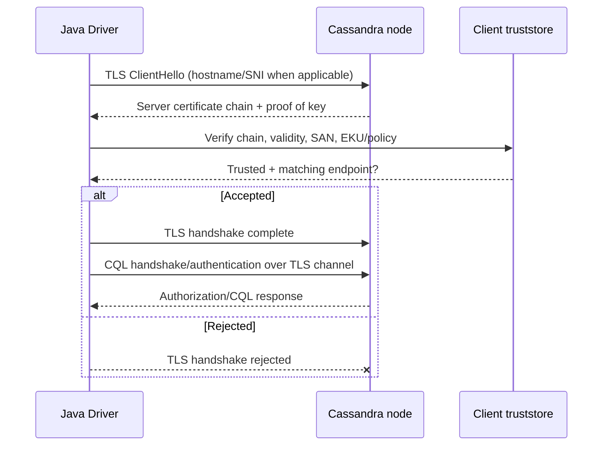
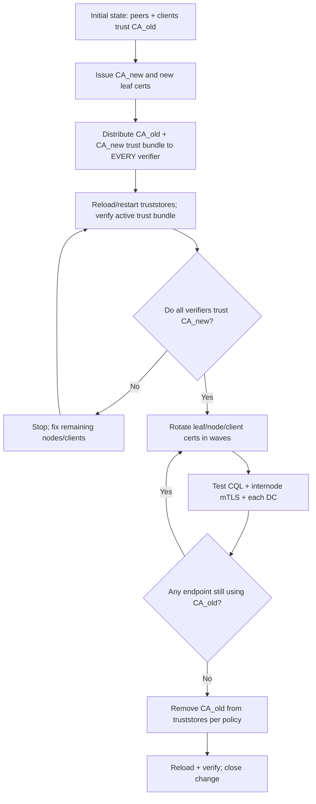
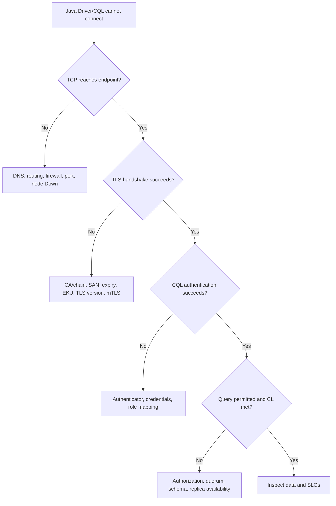

# Truststores, Keystores, Identity Verification, and Certificate Rotation

> **Chapter:** Security  
> **Module:** `DATABASE_ENGINE_WIDE_COLUMN_CASSANDRA` — understanding Apache Cassandra's distributed architecture and wide-column model, partition keys, query-driven table design, read/write consistency, CQL, replication, compaction, repair, troubleshooting, and Java connectivity.  
> **Focus:** Protecting client–node and node–node channels with TLS, understanding truststores/keystores and identity verification, and rotating certificates without disrupting Cassandra availability.

In a Cassandra cluster, data traverses at least two kinds of communication paths: **Java application/cqlsh ↔ Cassandra node** and **Cassandra node ↔ Cassandra node**. These paths carry CQL, inter-replica requests, gossip, streaming, hints, or other traffic depending on version and design. Simply configuring a CQL username/password **does not guarantee** traffic is encrypted or that a node is talking to the intended peer.

For a TLS session to be trustworthy, three questions must be answered:

1. **What identity does the connecting party present?** An X.509 certificate, public key, and **matching private key**, typically loaded from a *keystore* or from key/certificate files managed by an SSL-context factory.
2. **Is the remote peer trusted?** The certificate chain must lead to a CA/trust anchor trusted by the verifier, typically stored in a *truststore*.
3. **Does that identity match the intended destination?** Hostname/IP, SAN, certificate usage, validity window, and verification policy must match. Merely trusting an arbitrary CA is **not enough** to prove you connected to the right node.

During certificate rotation, getting the order wrong can disconnect every replica in a DC even while SSTable data remains intact. This lesson builds an understanding and safe runbook grounded in **overlapping trust chains, step-by-step identity replacement, and real verification**.

> **Version constraints:** Examples primarily follow Apache Cassandra 4.x/5.x and Java Driver 4.x. Configuration names, SSL-context factories, hot reload, certificate validation algorithms, ciphers, and certificate authentication setups may differ by release, JDK, and distribution. Check the documentation for **your exact running version** before changing production.

## 1. Learning Objectives

After this lesson, you will be able to:

- Distinguish **private key**, **leaf certificate**, **certificate chain**, **CA**, **keystore**, and **truststore**.
- Explain that one-way TLS, mTLS, server identity verification, CQL role authentication, and authorization are **distinct** layers.
- Understand `client_encryption_options` and `server_encryption_options` in `cassandra.yaml`.
- Design SANs/hostnames/IPs to verify nodes accurately across multi-DC, NAT, and private DNS networks.
- Inspect keystores/truststores with `keytool`, certificates/handshakes with `openssl`, and connections with the Java Driver.
- Execute server/CA certificate rotation using **trust old+new → swap leaf → trust new only**.
- Use `nodetool reloadssl` when supported by your version, and understand hot-reload limits on established connections.
- Diagnose `PKIX path building failed`, `unknown_ca`, SAN mismatches, certificate expiration, and mutual TLS issues.
- Build a runbook covering preflight, canary, post-change checks, rollback, monitoring, and near-expiry drills.
- Connect TLS risks to quorum, topology, repair, streaming, backups, and Java application availability.

## 2. Terminology: How Truststores and Keystores Differ

### 2.1. From Private Keys to X.509 Certificates

A TLS certificate typically contains:

- **Subject**: certified identity in certificate format.
- **Subject Alternative Name (SAN)**: DNS names/IPs (or other identifiers) permitted for matching.
- **Public key**: public key paired with the subject's private key.
- **Issuer**: organization/CA that signed the certificate.
- **Validity**: `NotBefore`, `NotAfter`.
- **Key Usage (KU)** and **Extended Key Usage (EKU)**: valid purposes, such as `serverAuth` or `clientAuth`.
- **Signature**: digital signature of the issuing authority.

A certificate **does not contain the private key**. The CA attests to the binding between the public key and the identity within the CA's policy. An adversary trying to impersonate a server must possess the matching private key or bypass verification.

### 2.2. Keystore: "Who Am I?"

A **keystore** typically holds a *private key entry* and its accompanying certificate chain. When a Cassandra node acts as a TLS server, it presents its leaf certificate and proves possession of the private key during the handshake.

Example:

```text
node-a-keystore.p12  (PKCS#12)
└── alias: node-a
    ├── Private key            [SECRET: never output to tickets/logs]
    ├── Leaf certificate       CN/SAN = node-a.dc1.internal
    ├── Intermediate CA cert
    └── Root CA cert           [if chain policy requires]
```

In **mTLS**, the same Cassandra node can act as both a TLS server (accepting peer connections) and a TLS client (opening connections to peers). Certificates used in the client role must meet configuration and EKU policy requirements. Newer Cassandra releases can configure `outbound_keystore` separately from the inbound keystore.

### 2.3. Truststore: "Whom Do I Trust?"

A **truststore** is the set of trust anchors/certificates a verifier uses to decide **whether to trust the remote party's signature/certificate chain**.

Example:

```text
node-a-truststore.p12  (PKCS#12)
├── alias: cassandra-root-ca-old
│   └── Public CA certificate
└── alias: cassandra-root-ca-new
    └── Public CA certificate
```

A truststore **ordinarily does not need private keys** to verify peers; a PKCS#12 store can hold different entry types, yet policy should keep key material and trust anchors separate. Never send a keystore containing private keys to a partner just so they "trust your cert"; provide only the required **CA/public certificates**.

### 2.4. Quick Comparison Table

| Component | Contents | Purpose | Security |
|---|---|---|---|
| **Private key** | Secret key | Proves identity, signs handshake steps | Owner only, minimal read permissions |
| **Leaf certificate** | Public key, identity, SAN, CA signature | Presented to the remote peer | Publicly distributable |
| **Certificate chain** | Leaf + intermediate CAs | Helps verifier build trust path | Publicly distributable |
| **Root CA / trust anchor** | Trusted public certificate | Root of verification path | Controlled distribution/trust policy |
| **Keystore** | Usually private key + cert chain | Establishes local identity | Encrypted with strict access controls |
| **Truststore** | Trusted CA/public certs | Verifies peer identity | Protected against unauthorized tampering |
| **Store password** | Secret unlocking the store/key entry when applicable | Decrypts/loads key material | Never hardcode in Git/logs |
| **CQL credentials** | Role/password/token per authenticator | Authenticates to database | Kept separate from TLS key material |

**Names depend on tooling.** JKS and PKCS#12 are Java store formats. With PEM-based SSL factories, private keys/certificates can be `.pem` files instead of JKS/PKCS#12, while **the distinction between identity and trust remains unchanged**.

## 3. TLS Handshake: Encryption, Verification, and Authentication

### 3.1. One-Way TLS from Application to Node

With **server-authenticated TLS**:

1. The Java Driver opens TCP to a Cassandra endpoint.
2. The node sends its server certificate chain.
3. The driver validates the chain up to a trusted CA in the client's truststore.
4. The driver checks that **SAN matches the hostname/IP it is connecting to** if hostname verification is enabled.
5. The driver verifies certificate validity, KU/EKU/policy compliance, and completes the encrypted handshake.
6. Afterward, Cassandra may still require **CQL username/password or the configured authenticator mechanism**.



An encrypted channel **does not mean** the application has been granted `SELECT`/`INSERT`. Cassandra's authenticator and authorizer control data permissions; TLS secures the transport and peer identity as configured.

### 3.2. mTLS: Mutual Certificate Presentation

In **mutual TLS**:

- The Cassandra node presents its certificate; the client verifies it using the **client truststore**.
- The client presents its certificate/private key; Cassandra verifies it using the **server truststore**.
- For internode mTLS, nodes act as both TLS servers and clients on different connections; each direction needs matching material and policy.

```text
Java Application                          Cassandra
──────────────────                        ──────────────────
Client keystore ──> client certificate ──> Server truststore
Client truststore <── server certificate <── Server keystore

2-way TLS handshake ≠ automatic CQL permissions.
CQL role mapping/authenticator/authorizer is a separate control layer.
```

Some setups integrate certificate-based or SPIFFE authenticators, yet **a successful mTLS handshake does not automatically map a subject to a Cassandra role** in every deployment. Verify the real authenticator/authorizer rather than assuming it from `require_client_auth=true`.

### 3.3. Common Mistakes

- **Enabling encryption without hostname verification:** a certificate issued by a trusted CA for another machine could be accepted if the target name is not checked properly.
- **Disabling certificate checks "to make it connect":** hides CA/SAN/expiry errors and opens MITM paths.
- **Confusing truststores with keystores:** clients need the server's CA to verify; servers need private keys to prove identity.
- **Trusting self-signed node certs without a rotation process:** adding/replacing nodes requires updating truststores everywhere and invites mistakes.
- **Thinking mTLS provides row-level authorization:** untrue if CQL authz is not configured.
- **Reusing one private key across all nodes:** expands blast radius if one host is compromised; issue distinct identities/keys per node.

## 4. Identity Verification: A Valid CA Is Not Enough—SAN Must Match

### 4.1. SAN Is the Primary Data for Endpoint Validation

Suppose the Java Driver connects to:

```text
node-a.dc1.internal:9042
```

The server certificate should include a SAN like:

```text
DNS:node-a.dc1.internal
```

If apps/peers connect via IP `10.20.1.11`, the certificate needs a matching **IP SAN**, not only a DNS SAN. Certificates containing only `CN=node-a.dc1.internal` without SANs may be rejected or handled differently by modern clients/JDKs; never rely on CN fallback in new designs.

### 4.2. Which Addresses Does Cassandra Actually Use?

Map every path:

| Connection Path | Names/Addresses to Consider | What to Check |
|---|---|---|
| Java Driver → Cassandra native transport | Contact points and **discovered node endpoints** | Each node's SAN, trust chain, driver hostname validation |
| Node A → Node B internode | `broadcast_address`/`listen_address` or actual configured endpoint | Server SAN/DNS/IP and endpoint verification |
| Cross-datacenter | Addresses used for cross-DC/NAT/routing | SAN matching the address checked by the TLS verifier |
| Proxy/LB if present | DNS dialed by clients and TLS termination point | Where TLS terminates; how backend certs differ |
| JMX/nodetool | Admin/JMX port and dedicated security mechanism | Not protected by `client_encryption_options` by default |

**A SAN is not "the more the better."** Overly broad lists like uncontrolled wildcards or sharing one identity across all nodes weaken identity binding. Scope SANs to actual addresses and PKI policy.

### 4.3. ServerAuth, ClientAuth, and Key Usage

Certificates must match their role:

- `serverAuth` for the party verified as a TLS server.
- `clientAuth` for the party verified as a TLS client in mTLS.
- `Key Usage` matching algorithms and handshake requirements.
- Algorithms, signatures, and key lengths meeting security/JDK policies.
- Full certificate validity and chain, including intermediate CAs where required.

A certificate with a valid chain whose EKU only specifies `serverAuth` may be rejected as a client certificate in environments enforcing strict EKU checks.

### 4.4. Name Mismatches from DNS/NAT/Service Discovery

Common scenario:

1. Certificate is issued for `node-b.dc2.internal`.
2. Cassandra advertises `10.30.2.12` to peers/drivers.
3. Clients/peers validate the **IP**, while the certificate only has a DNS SAN.
4. TLS handshake fails even though the CA is trusted.

Fix the **certificate SAN or address advertisement/routing** so both sides agree, rather than disabling endpoint verification. With Kubernetes, LoadBalancers, proxies, or NAT, know **where TLS actually terminates** and which name is verified; a service name does not automatically replace per-node identities.

## 5. Client-to-Node and Internode: Two Independent Config Domains

In `cassandra.yaml`:

- `client_encryption_options` governs **native CQL transport TLS**, typically on port `9042` unless reconfigured.
- `server_encryption_options` governs **inter-node TLS**, where nodes act as both clients and servers across peer links.

Protecting one path **does not automatically protect the other**. Neither encrypts JMX, metrics, backup object storage, commit logs, or SSTable files on disk.

### 5.1. Client-to-Node: Mandatory TLS

**Illustrative** configuration example—do not copy verbatim into production:

```yaml
client_encryption_options:
  enabled: true
  optional: false
  keystore: /etc/cassandra/tls/client-server-identity.p12
  keystore_password: "<managed-secret>"
  store_type: PKCS12
  require_client_auth: false
```

Explanation:

- `enabled=true`: enables TLS for native transport.
- `optional=false`: **rejects unencrypted native CQL** under this config.
- `keystore`: node server identity; certificate SANs match endpoints the driver will connect to.
- `require_client_auth=false`: does not require TLS clients to present certificates; **CQL authenticator/authorizer may still require credentials**.
- To enable **client-to-node mTLS**, set `require_client_auth=true` and configure the **server truststore** once clients hold valid certificates.

Secret fields are **descriptive placeholders**. Cassandra does not automatically substitute `"<managed-secret>"` from a secret manager or env var just because the text looks like a placeholder; production must supply secrets through an authorized config/SSL-factory mechanism with strict read permissions.

### 5.2. Internode: Encrypting All Peer Traffic in Scope

Target example for a cluster with fully prepared keystores/truststores, especially with mTLS:

```yaml
server_encryption_options:
  internode_encryption: all
  optional: false
  keystore: /etc/cassandra/tls/internode-identity.p12
  keystore_password: "<managed-secret>"
  store_type: PKCS12
  truststore: /etc/cassandra/tls/internode-trust.p12
  truststore_password: "<managed-secret>"
  require_client_auth: true
  require_endpoint_verification: true
```

**This is the target state, not a one-shot upgrade step.** Switching an unencrypted or old-CA cluster directly to `all + require_client_auth=true + require_endpoint_verification=true` before nodes hold valid keys/certs/trust breaks internode connectivity and quorum.

`require_endpoint_verification` enforces matching endpoint names against certificates per Cassandra/version behavior; check SANs for the addresses nodes actually use. When operating mTLS, verify both inbound and outbound directions, especially if a separate `outbound_keystore` is configured.

### 5.3. Internode Encryption Options

| Value | General Meaning | Risk When Misused |
|---|---|---|
| `none` | Does not encrypt internode traffic via this mechanism | Data/gossip/replication exposed on the network |
| `dc` | Encrypts connections between DCs | Intra-DC traffic may remain unencrypted |
| `rack` | Encrypts connections between racks per config | Same-rack traffic may remain unencrypted |
| `all` | Encrypts internode links between all nodes | Must ensure cluster-wide certs/trust/CPU/compatibility |

In environments requiring end-to-end traffic protection, `all` is usually the target, though version and network policy must be verified. Never treat `dc` or `rack` as "encrypted everywhere."

### 5.4. `optional=true` Is Only for Controlled Transitions

Apache Cassandra documentation outlines the transition model:

- Enable TLS and temporarily set `optional=true` to allow a phase with **both encrypted and unencrypted connections**.
- Update all peers/clients and verify TLS.
- Set `optional=false` once ready to mandate TLS.

**Never leave `optional=true` long-term** if policy requires mandatory encryption. It leaves an unencrypted fallback open. When switching modes, follow **exact version instructions**; some changes require rolling restarts rather than assuming hot reload applies to every flag.

### 5.5. Never Confuse TLS with Other Protection Layers

| Feature | Solves | Does Not Replace |
|---|---|---|
| Client TLS | Encryption + node verification on CQL path | CQL roles/authorization |
| Internode TLS | Protects paths between Cassandra nodes | Proper DC/rack/replication setup |
| mTLS | Receiver verifies peer certificate | Automatic data authorization |
| PasswordAuthenticator | Verifies CQL credentials | Network encryption |
| CassandraAuthorizer | Permissions on keyspace/table/role | TLS identity validation |
| Encryption at rest | Protects files/disks via storage layer | Internode/client TLS |
| Backup encryption | Protects exported backups | Restorability, RPO/RTO |
| JMX auth/TLS/network policy | Protects admin ports | Native transport TLS |

When a DC becomes isolated or TLS breaks, replication/repair/hints/streaming can all suffer. **A security misconfiguration can become an availability incident**, not just a security alert.

## 6. Preparing Certificates and Keystores Properly

### 6.1. Design PKI Before Generating Files

In production, prefer a PKI/CA with formal issuance, revocation, and auditing:

1. Choose a root CA (offline/highly protected) and issuing intermediate CAs per policy.
2. Define certificate profiles for **internode server/client** and **CQL server/client**.
3. Issue **separate private keys** for each node or workload.
4. Put real DNS/IP SANs for each endpoint—never share meaningless identities.
5. Choose bounded `NotBefore/NotAfter`, algorithms, KU/EKU, and rotation intervals.
6. Define trust bundles distributed to Java Drivers, Cassandra peers, and required backup/monitoring clients.
7. Store private keys in a secret manager or minimal-permission volumes; never commit to Git.

With multi-tier chains, the certificate presenter typically needs to send **leaf + intermediate certificates**; the root CA serves as the trust anchor on the verifier. Do not assume that having the root in the truststore lets the sender omit all intermediates.

### 6.2. Example Generating Keypairs and CSRs in a Lab

Using `keytool` from the JDK. The example below is **illustrative only** with fictional DNS/IPs:

```bash
# LAB: keytool will prompt for passwords.
keytool -genkeypair \
  -alias node-a \
  -keyalg RSA -keysize 3072 \
  -storetype PKCS12 \
  -keystore node-a.p12 \
  -dname "CN=node-a.dc1.internal,OU=Database,O=Example" \
  -ext "SAN=dns:node-a.dc1.internal,ip:10.20.1.11" \
  -validity 30

# Generate a Certificate Signing Request for the internal CA to sign.
keytool -certreq \
  -alias node-a \
  -storetype PKCS12 \
  -keystore node-a.p12 \
  -file node-a.csr \
  -ext "SAN=dns:node-a.dc1.internal,ip:10.20.1.11"
```

The CA signs the CSR with the appropriate profile, after which you import the chain/leaf certificate into the **exact private-key alias**. Exact steps depend on your PKI and issued format. **Never generate self-signed certificates and deploy them straight to production** just because the lab connected. If using EC keys, choose algorithms/ciphers matching security policy and JDK/Cassandra support.

### 6.3. Building a Truststore from Public CA Certs

Suppose PKI issued public files `cassandra-ca-old.pem` and `cassandra-ca-new.pem`:

```bash
# LAB/PROVISIONING: import public CA certificates only.
keytool -importcert -trustcacerts \
  -alias cassandra-ca-old \
  -file cassandra-ca-old.pem \
  -storetype PKCS12 \
  -keystore cassandra-trust.p12

keytool -importcert -trustcacerts \
  -alias cassandra-ca-new \
  -file cassandra-ca-new.pem \
  -storetype PKCS12 \
  -keystore cassandra-trust.p12

# Inspect public/trust entries; does not print private keys.
keytool -list -v \
  -storetype PKCS12 \
  -keystore cassandra-trust.p12
```

Trust only CAs appropriate to the role. A truststore holding an overly broad CA can let **unexpected certificates** pass chain validation; when binding specific nodes is required, enforce endpoint verification/identity policies and tight trust scope.

### 6.4. Inspecting Issued Certificates

```bash
# Public cert: verify validity, subject/issuer, SAN, and EKU.
openssl x509 \
  -in node-a.crt \
  -noout -subject -issuer -dates \
  -ext subjectAltName,extendedKeyUsage

# Verify chain against root CA and intermediate chain.
openssl verify \
  -CAfile cassandra-root-ca.pem \
  -untrusted cassandra-intermediate-ca.pem \
  node-a.crt
```

These commands use public files. Before deploying, also confirm that **the private key in the keystore matches the leaf certificate's public key**, alias, and full certificate chain. With PKCS#12:

```bash
keytool -list -v \
  -storetype PKCS12 \
  -keystore node-a.p12
```

Check that the entry is `PrivateKeyEntry` when an identity keystore is needed, not only `trustedCertEntry`. Having a public certificate in a keystore is **not enough** for a server to complete TLS handshakes.

### 6.5. Passwords and Private Keys

Avoid:

- Writing real passwords into shell history, issue trackers, or training examples.
- Pasting keys/private certificates into logs or chat tools.
- Setting world-readable permissions on keystores, PEM keys, or secrets.
- Using the same private key across all nodes, DCs, or environments.
- Baking certs/keys into images without a rotation workflow.
- Changing keystore passwords at the same time as certificate rotation without a compatible config-reload plan.

Placeholders in this lesson are **dummy names**, not values to paste straight into configs. With Cassandra's file-based hot reload, verify where the password is read from; changing the password may require a different change procedure than swapping store contents.

## 7. Java Driver: Truststores, Keystores, and Hostname Validation

### 7.1. Driver Needs to Trust Node CAs

Java Driver 4.x supports TLS via an **SSL engine factory** or `SSLContext` configuration. Using file-based config per driver docs, an `application.conf` example is:

```hocon
datastax-java-driver {
  advanced.ssl-engine-factory {
    class = DefaultSslEngineFactory

    # In production, paths/secrets are injected via secure configuration.
    truststore-path = "/etc/app/tls/cassandra-client-trust.p12"
    truststore-password = "<managed-secret>"

    # Keep hostname validation enabled; do not disable it to mask SAN errors.
    hostname-validation = true

    # ONLY use if Cassandra requires mTLS client certificates:
    # keystore-path = "/etc/app/tls/cassandra-client-identity.p12"
    # keystore-password = "<managed-secret>"
  }
}
```

This configuration is **conceptual**: placeholder passwords must be replaced via your app's real secret mechanism; never commit secrets to repos. If the driver uses a custom `SSLContext`, confirm hostname validation remains enabled in the engine factory/driver; loading a CA into `SSLContext` alone **is not hostname verification**.

### 7.2. Example `CqlSession` Using Configured TLS

```java
import com.datastax.oss.driver.api.core.CqlSession;
import com.datastax.oss.driver.api.core.DefaultConsistencyLevel;
import com.datastax.oss.driver.api.core.cql.PreparedStatement;
import com.datastax.oss.driver.api.core.cql.BoundStatement;

import java.net.InetSocketAddress;

public final class SecureCassandraRead {
    public static void main(String[] args) {
        String user = System.getenv("CASSANDRA_USERNAME");
        String password = System.getenv("CASSANDRA_PASSWORD");

        if (user == null || password == null) {
            throw new IllegalStateException("Missing CQL credentials");
        }

        // Driver SSL configuration is loaded from application.conf.
        try (CqlSession session = CqlSession.builder()
                .addContactPoint(new InetSocketAddress(
                    "node-a.dc1.internal", 9042))
                .withLocalDatacenter("dc1")
                .withAuthCredentials(user, password)
                .build()) {

            PreparedStatement ps = session.prepare(
                "SELECT account_id, state " +
                "FROM app.accounts_by_id WHERE account_id = ?");

            BoundStatement stmt = ps.bind("user-001")
                .setConsistencyLevel(
                    DefaultConsistencyLevel.LOCAL_QUORUM);

            session.execute(stmt).forEach(row ->
                System.out.println(
                    row.getString("account_id") + ": " +
                    row.getString("state")));
        }
    }
}
```

**Prerequisites:** The example assumes `app.accounts_by_id` exists with a matching PK, Cassandra has TLS configured, the authenticator uses credentials from env, real truststores/keystores are supplied, and the local DC is `dc1`. If the environment does not use `PasswordAuthenticator`, adapt credentials to the active authenticator; never assume every cluster uses passwords.

### 7.3. Contact Points Are Not All Endpoints

The driver connects to **initial contact points**, then discovers additional nodes via Cassandra metadata. In multi-DC environments:

- Certificates must contain SANs matching **every endpoint the driver can connect to**, not only the initially configured `node-a`.
- If the driver discovers IPs and connects by IP, a DNS-only SAN may be insufficient.
- Advertised names/addresses, TLS SNI, and certificate profiles must align.
- Never disable hostname verification when adding/replacing nodes; update PKI and endpoint discovery.

### 7.4. A Valid SSL Handshake Alone Does Not Prove Data Security

Once the Java Driver establishes TLS:

- CQL authentication/authorization must succeed.
- Reads/writes must target the right tables and **partition keys** per query design.
- RF/CL and local DC health must meet requirements; TLS does not turn `LOCAL_QUORUM` into `ALL`.
- Repair/replica freshness still require independent monitoring.
- TLS **does not provide encryption at rest for SSTables, commit logs, or backups**.

## 8. Testing TLS with `openssl`, `keytool`, and `nodetool`

### 8.1. Verifying Certificate Chains and Endpoint Names

On a machine authorized for network testing:

```bash
openssl s_client \
  -connect node-a.dc1.internal:9042 \
  -servername node-a.dc1.internal \
  -CAfile cassandra-ca-bundle.pem \
  -verify_hostname node-a.dc1.internal \
  -verify_return_error \
  -showcerts
```

When verifying by IP and the certificate has an IP SAN:

```bash
openssl s_client \
  -connect 10.20.1.11:9042 \
  -CAfile cassandra-ca-bundle.pem \
  -verify_ip 10.20.1.11 \
  -verify_return_error
```

**Note:** `openssl s_client` checks TLS; it does not perform CQL protocol/authentication, nor prove data access or quorum. Probing through a proxy may inspect the **proxy cert** rather than the backend node certificate; know where TLS terminates.

### 8.2. mTLS Client Test

If Cassandra requires client certificates:

```bash
openssl s_client \
  -connect node-a.dc1.internal:9042 \
  -servername node-a.dc1.internal \
  -CAfile cassandra-ca-bundle.pem \
  -cert lab-client.crt \
  -key lab-client.key \
  -verify_hostname node-a.dc1.internal \
  -verify_return_error
```

Perform only in a lab or secure host with a dedicated issued key. Never share `lab-client.key` "to test from everyone's laptop." A passing mTLS handshake still does not prove CQL role/permissions.

### 8.3. Checking Cluster State with `nodetool`

```bash
# Read-only operations to check availability:
nodetool status
nodetool describecluster
nodetool netstats
nodetool tpstats

# Apache Cassandra 4+ where supported:
nodetool reloadssl
```

`nodetool` commands connect over the admin/JMX channel; they do **not** confirm native CQL TLS/handshakes work. `reloadssl` **mutates TLS state** and must follow a runbook; the earlier commands are observational.

### 8.4. Mandatory Negative Testing

A sound PKI test proves the system **rejects**:

1. Server certificates signed by a CA **not** in the client truststore.
2. Server certs whose SAN does not match the connected endpoint.
3. Expired certs or certs before `NotBefore`.
4. Missing mTLS client certificates or missing `clientAuth`/valid chain.
5. Revoked certificates (if PKI integrates revocation checks).
6. Plaintext connections when `optional=false` and native TLS is mandatory.

**Never run TLS-breaking experiments on production**; use an isolated lab/staging cluster. A test proving only "happy-path connect works" is insufficient to validate identity-verification policies.

## 9. Certificate Lifecycle: Expiration Dates and Ownership

### 9.1. Milestones to Record

Every certificate must track:

- Certificate ID/serial, fingerprint, issuer/chain.
- `NotBefore` and `NotAfter`; UTC timezone.
- Node/service identity, DNS SAN/IP SAN, key usage/EKU.
- Owner, workload, cluster/DC/rack, and environment.
- Private key storage location, secret manager, and read permissions.
- CA/PKI source and reissuance lead time.
- Verified rotation timestamp and rollback window.
- Revocation/CRL/OCSP policy if supported and required.
- Persons responsible for renewal, approval, deployment, and monitoring.

### 9.2. Do Not Wait Until Near Expiry

If a certificate expires at `T_expiry`, start rotation no later than:

\[
T_{\mathrm{start}}
\le T_{\mathrm{expiry}} -
(T_{\mathrm{issue}}+T_{\mathrm{deploy}}+
T_{\mathrm{verify}}+T_{\mathrm{rollback}}+
T_{\mathrm{margin}})
\]

These components are **organizational time budgets**, not Cassandra defaults. For example, 2 days issuance, 1 day rollout, 1 day verify/rollback, and 7 days margin → start **at least 11 days early**. Across multiple DCs or slower PKIs, allow a larger margin.

Node and client clocks must stay synchronized; a cert still valid at the CA does not mean every node/client evaluates it identically if clocks drift. Monitor both certificates and clock skew/NTP.

### 9.3. Monitor the Served Certificate, Not Just Files on Disk

A system may have a new `node-a.p12` file while the process keeps using an old `SSLContext` or drivers hold long-lived connections. Compare:

- Fingerprint/serial of the **new file/keystore**.
- Fingerprint/serial of the **certificate presented by the TLS endpoint in a new handshake**.
- Cassandra logs after `reloadssl`/polling.
- Java Driver reconnects and certificate validation errors.
- Node health/repair/streaming after rotation.

If the two fingerprints differ, never mark "rotation complete" just because the file timestamp is newer.

## 10. Rotating Leaf Certificates Under the Same CA

This is usually the simplest rotation: **the CA/trust anchor stays unchanged**, and only a node's cert/private key changes. Even so, control SANs and cluster availability carefully.

### 10.1. Safe Sequence

1. **Preflight:** check CA trust, SANs, current leaf, expiry, topology, RF/CL, and connection baseline.
2. **Issue:** PKI issues new leaf + dedicated private key, with required SAN/identity and EKU.
3. **Verify offline:** chain, key match, keystore alias, passwords, file permissions, `NotBefore`/`NotAfter`.
4. **Distribute:** deliver files to the new path securely; avoid overwriting a file being read in place if tooling/mounts lack atomic semantics.
5. **Canary:** update **one node** or a small group per maintenance policy.
6. **Reload:** run hot reload or rolling restart **per exact version**, inspecting logs.
7. **New handshake:** verify the node serves the new leaf on both CQL and internode paths.
8. **Health:** monitor `UN`, CL success, Java Driver errors, p99, internode traffic, and streaming/repair.
9. **Controlled rollout:** proceed node/rack/DC by step without breaking quorum.
10. **Post-check:** count of new served certs, fingerprint inventory, logs, negative tests, and new expiry dates.

### 10.2. Hot Reload in Cassandra 4+

Apache Cassandra documentation states that starting in Cassandra 4:

- With TLS enabled and **file-based key/trust material** using the built-in/default SSL context factory, Cassandra polls for store changes approximately **every 10 minutes**.
- `nodetool reloadssl` can trigger a faster reload.
- New SSL contexts normally apply to **connections established after** reload succeeds.
- With a custom `ssl_context_factory`, reload behavior depends on the implementation.
- Keystore/truststore passwords in config must match the replacement files; **changing passwords cannot be assumed to hot reload like swapping certs**.

Never advertise this as **absolute zero downtime**: reloads can fail, mTLS can break, or clients may hold stale connections. Test new handshakes and prepare a rollback plan.

### 10.3. Certificates Held by Existing Connections

The TLS handshake happens at **connection establishment**. A long-lived Java Driver/TCP connection can keep running after a node updates its certificate. Therefore:

- Test a **new connection** to prove the new cert is served.
- Do not force all clients to reconnect simultaneously, which risks a connection storm.
- To confirm new clients trust the cert, verify deployed driver versions and truststores.
- Existing live connections do not prove the old cert will succeed on the next reconnect.
- Schedule controlled session/connection-pool rollovers if policy requires.

### 10.4. Rollback for Leaf Rotation

If a canary node serves a new cert and drivers report `No subject alternative names matching`:

1. **Halt rollout**; preserve logs and fingerprints.
2. Verify advertised endpoints and certificate SANs.
3. If the old cert/key is still valid and its chain is trusted, restore the old files per runbook and reload or restart as appropriate.
4. Verify handshakes and CQL at the target CL before resuming rollout.
5. Reissue the new cert with accurate SANs; **never disable hostname verification** as a rollback.

Retain old private keys **only for the approved rollback window**, with restricted access and secure destruction afterward.

## 11. Rotating a CA: The "Trust Both Old and New" Phase

Replacing a **CA/trust anchor** is harder than swapping leaves under one CA because every verifier must **trust the new CA before any peer begins presenting certs signed by it**.

### 11.1. Standard Order

Suppose the system trusts `CA_old` and wants to migrate to `CA_new`.



**Never invert the order** by placing a `CA_new`-signed leaf on a node before peers and clients trust `CA_new`. With mTLS, verify **both directions**: servers trust client certs, and clients trust server certs.

### 11.2. Trust State Table

| Phase | Presented Certificate | Verifier Truststore | Goal |
|---|---|---|---|
| 0. Initial | Leaf signed by `CA_old` | `CA_old` | Normal operation |
| 1. Expand trust | Old leaf | `CA_old + CA_new` | No traffic disruption; ready for new leaves |
| 2. Swap identities | Mix of old and new | `CA_old + CA_new` | Both generations interoperate |
| 3. Complete leaves | All new | `CA_old + CA_new` | Confirm zero legacy clients/nodes remain |
| 4. Narrow trust | All new | `CA_new` | Remove old trust after verification |

This table captures trust-management principles. In multi-intermediate PKIs, you may need full new chains while keeping appropriate root anchors; **merely importing one new CA file does not guarantee every chain validates**.

### 11.3. Who Counts as "Every Verifier"?

In multi-DC Cassandra:

- Every node verifying **internode peers**.
- Every Java Driver/`cqlsh`/BI/export/backup client verifying **CQL servers**.
- Every node verifying **mTLS client certificates** if `require_client_auth=true`.
- Monitoring/backup tools connecting over native transport TLS also have their own truststores.
- Older container images/app versions not yet rolled out.
- WAN links or gateways may have **separate TLS termination** requiring their own inventory.

One node in DC2 without an updated truststore can lose connectivity to rotated nodes in DC1. Likewise, a Java service may keep running on an existing connection and then **suddenly fail after a restart** because it does not yet trust `CA_new`.

### 11.4. When to Remove `CA_old`

Remove `CA_old` only when:

1. Inventory shows **all server/client identities** needing connectivity have moved to the new chain.
2. Active clients/peers have been verified on **new handshakes**.
3. No periodic external tools/workers still trust only `CA_old`.
4. Rollback policy accepts that removing `CA_old` invalidates old certs.
5. Security team approved the overlap duration and revocation.
6. Negative tests confirm certs signed only by `CA_old` are rejected if policy requires.

If rollback is needed after Phase 4, redeploy old trust under change control or issue compatible certs; never assume a "free fallback" remains once trust is narrowed.

## 12. Rotation in Multi-DC Clusters and RF/CL

### 12.1. Broken TLS Can Cause False "Down" States

Suppose `NetworkTopologyStrategy` has RF=3 in `dc1` and RF=3 in `dc2`. A truststore mismatch prevents node A from completing TLS handshakes with B/C. From Cassandra's network view:

- Gossip/internode messaging fails.
- Nodes appear Down/unreachable.
- Hint delivery, streaming, and repair stall.
- Writes/reads at `LOCAL_QUORUM` may lack enough replicas.
- Cross-DC consistency/replication lags.

**Data is not necessarily deleted**, yet the cluster can temporarily lose quorum or accumulate replica divergence requiring repair later.

### 12.2. Preserving Quorum Across Waves

With local RF=3, `LOCAL_QUORUM` needs two matching full replicas to respond. During rotation:

1. Plan by DC/rack and avoid taking down multiple replicas of the same token range simultaneously.
2. Canary first; monitor node health and CQL latency.
3. When restarts are needed, run **rolling restarts** per runbook (never assume one Down node is always harmless for every keyspace and failure mode).
4. Keep other topology/repair schedules steady; avoid overlapping major bootstrap/decommission operations with TLS rotation unless planned.
5. Inspect peer connections, streaming, hints, and request errors after each wave.
6. Advance to the next DC only once the current DC is confirmed healthy.

If clients write with `EACH_QUORUM` or another cross-DC CL, a TLS failure in a remote DC can affect clients even while the local DC is healthy. Never assume `LOCAL_QUORUM` and `EACH_QUORUM` share the same availability.

### 12.3. Cross-DC Security Checks

A runbook should verify:

- Internode certs on nodes in every DC have SANs matching actual advertised endpoints.
- CA/trust bundles are distributed to both sides of the WAN.
- Firewall/TCP and TLS handshakes work from DC1 to DC2 and vice versa.
- Java clients in each DC use the right local DC and carry the new CA truststore.
- Nodes have no clock skew causing mis-evaluated `NotBefore`/`NotAfter`.
- Post-rotation, expected repair/streaming runs cleanly over the WAN.

If TLS endpoint handshakes succeed yet `nodetool status` still shows nodes Down, inspect **gossip, ports, internode addresses, and cluster state**; `openssl s_client` alone does not prove all Cassandra subsystems are healthy.

## 13. `nodetool reloadssl` and What Must Not Be Assumed

### 13.1. Illustrative Syntax

On supporting Cassandra releases:

```bash
# On a lab node after keystore/truststore files were validly replaced.
nodetool reloadssl
```

This command sends an SSL-material reload request to the node over the admin channel. It does **not**:

- Generate certificates or CAs.
- Distribute keystores/truststores to other nodes.
- Edit `cassandra.yaml` or secret managers.
- Enable TLS if TLS is not configured yet.
- Force drivers holding existing connections to re-handshake.
- Prove new certs are accepted on both client-to-node and internode paths.
- Prove every node in the cluster has rotated.

### 13.2. Post-Reload Verification

Immediately after running the command:

1. Check Cassandra logs on the node for reload success/failure.
2. Use `keytool` to verify the keystore/truststore on disk.
3. Open a **new TLS connection** and inspect the served certificate's fingerprint/issuer/SAN/expiry.
4. Open a **new CQL session** from Java Driver/`cqlsh`.
5. Check internode connections and `UN` health.
6. Verify other nodes see the canary node normally.
7. Watch timeouts, handshake failures, and retries over time.
8. On failure, freeze canary expansion and roll back per plan.

### 13.3. Cases Where a Restart Is Still Required

- The Cassandra release does not support corresponding hot reload.
- Changing **TLS/encryption modes**, passwords, or SSL factories/JVM providers in ways that cannot hot reload.
- Secrets mounted or configured via a custom factory lacking reload support.
- Rollout requires updating driver app configs or recycling connection pools.
- Reload errors occur that file replacement alone cannot resolve.

Never market `reloadssl` as "guaranteed zero downtime for any security change." If restarting, assess CL, RF, and rolling maintenance properly.

## 14. Diagnosing TLS Errors by Symptom

| Error/Symptom | Common Cause | What to Check |
|---|---|---|
| `PKIX path building failed` | Missing CA/intermediate in truststore; broken chain | `keytool -list`, issuer/chain, `openssl verify` |
| `unable to find valid certification path` | Trust anchor not imported or wrong store used | Java Driver truststore path, real CA bundle |
| `No subject alternative DNS name matching` | DNS endpoint absent from SAN | Advertised name, SAN, driver `hostname-validation` |
| `No subject alternative names matching IP` | Connecting by IP while cert only has DNS SAN | IP SAN, discovered endpoints |
| `certificate expired` | Leaf/intermediate expired | `NotAfter`, clock skew, each cert in chain |
| `certificate not yet valid` | `NotBefore` in the future or wrong clock | UTC/NTP, `NotBefore` |
| `unknown_ca` | Receiver does not trust presenter's issuer cert | Truststore **on the receiving side**, bidirectional mTLS |
| `bad_certificate` | Wrong cert profile, chain, KU/EKU, or policy | EKU `clientAuth`/`serverAuth`, cert parser |
| `handshake_failure` | No shared suite/protocol, bad mTLS cert, key/cert error | JDK/TLS versions, cipher list, logs on both ends |
| `UnrecoverableKeyException` | Password, alias, or private-key entry cannot be opened | Keystore type/password/key entry |
| `Keystore was tampered with` | Wrong store password or invalid format | File integrity, JKS/PKCS12 type |
| TLS probe OK, CQL login fails | Authenticator/credentials/roles differ from TLS | Cassandra auth logs, role permissions |
| CQL on node A OK, A ↔ B fails | Separate internode TLS/trust/endpoint config | `server_encryption_options`, peer logs |
| Initially OK after rotation, then fails | Driver reconnect uses old truststore / expired leaf | New TLS handshake, app rollout, CA inventory |
| After replace, only the new node fails | New SAN, CA chain, changed hostname/host ID | Node certificate, topology metadata |
| `reloadssl` succeeded yet old cert persists | Existing connections, wrong file path, ignored reload failure | **New** handshake, path/alias/fingerprint, logs |

Error messages are **clues**, not substitutes for full logs. A `handshake_failure` can have multiple causes; inspect **both sides** to see who sent the TLS alert first.

### 14.1. Never Fix SAN Errors by Disabling Verification

If an app reports `No subject alternative name matching`:

- Record the exact hostname/IP the app actually uses.
- Compare against the SANs in the certificate served by the node.
- Inspect contact points and discovered peers.
- Reissue the right certificate or fix routing/advertisement under change control.

**Never** set `hostname-validation=false` or bypass `TrustManager` in production as a fix. That strips protection against connecting to wrong or spoofed servers.

### 14.2. Know Which Side Does Not Trust Which

An mTLS example:

```text
Java Driver -> Cassandra:
- Client rejects server cert -> error on Java side.
- Server rejects client cert -> TLS alert on Cassandra side.
- Mutual trust passes, wrong CQL role -> TLS OK, CQL auth fails.

Internode A <-> B:
- A outbound rejects B server cert -> error in A outbound.
- B inbound rejects A client cert -> error in B inbound.
- B endpoint SAN misses A's target address -> A rejects B.
```

Runbooks should include a **directional identity/trust matrix**, not just a generic CA list.

## 15. Practical Flow: Rotating a Certificate on One Node

Suppose `node-a.dc1.internal` serves CQL and internode TLS under `CA_old`. PKI issues a new leaf under `CA_old` with matching SANs.

### 15.1. Preflight Checklist

- [ ] Checked Cassandra/JDK/driver versions, TLS provider, and how the SSL factory supports reload.
- [ ] Inventoried current certificate, fingerprints, `NotAfter`, CA chain, SAN, and EKU.
- [ ] Verified keystore/truststore paths, aliases, store types, passwords, and file permissions.
- [ ] Node `UN`, DC/rack, RF/CL, streaming/repair/topology jobs, and CQL SLO baselines are healthy.
- [ ] Valid old key/cert retained separately and securely for rollback.
- [ ] New certificate includes full chain and matching private key, valid for real hostnames.
- [ ] Canary scope, maintenance owner, notifications, and stop plan on handshake errors are ready.
- [ ] Java clients can open **new connections**; mTLS clients hold compatible keys/trust.
- [ ] Backup/secret manager ensures file replacement will not expose private keys.

### 15.2. Running the Canary

1. Safely back up current material and metadata (never copy keys to insecure storage).
2. Place the new keystore at the exact path via supported atomic update/file mount.
3. Verify file, alias, cert chain, and permissions **before reloading**.
4. Run `nodetool reloadssl` on the canary node if supported; otherwise perform a rolling restart per runbook.
5. Check reload logs; probe a **new handshake** from a client.
6. Open a new Java Driver session and run a query with partition key and chosen CL.
7. Check `nodetool status`, node-peer communication, and CQL from another node.
8. Watch p95/p99, connection errors, login failures, and TLS logs for the defined observation window.
9. If healthy, expand rollout by rack/DC; if failing, halt rollout and roll back.

### 15.3. Limits of a Narrow CQL Test

Example narrow CQL check after rotation:

```sql
CONSISTENCY LOCAL_QUORUM;

SELECT account_id, state
FROM app.accounts_by_id
WHERE account_id = 'user-001';
```

Success proves **the client→coordinator path, authentication, authorization, and replica reads at that CL at that moment**. It does **not** prove:

- Every node in the DC has switched certificates.
- Every internode peer has handshaked with the new chain.
- Streaming/repair can connect to other peers later.
- Every app or background worker has updated its truststore.
- Truststores have removed `CA_old` as planned.

Therefore, supplement with tests across the endpoint/DC matrix and verify handshakes from multiple sides.

## 16. Rotating a CA Across a Multi-DC Cluster: End-to-End Runbook

### Phase 0 — Preparation

- List **every verifier**: Cassandra nodes, Java apps, `cqlsh`, ETL, backups, monitoring, admin tools.
- Record current SANs and driver/JDK versions; identify peer endpoints advertised across the WAN.
- Build `CA_new` and leaf issuance policy; verify root/intermediate chains and EKUs.
- Map RF/CL and failure domains: which nodes cannot go down together.
- Prepare a rollback plan **before** removing `CA_old` from truststores.
- Rehearse in staging with at least two simulated DCs if production is multi-DC.

### Phase 1 — Expand Trust

- Distribute the `CA_old + CA_new` trust bundle to **all verifiers**.
- Reload/restart truststores per app/driver/node.
- Test with a sample cert issued by `CA_new` in lab/canary scope.
- Keep all old production leaf certs unchanged; do **not** swap endpoint issuers yet.
- Collect coverage evidence: trust-bundle versions/fingerprints per node/app.

### Phase 2 — Rotate Server/Client Identities

- Issue new leaf certs with exact SANs, KU/EKUs, and unique private keys.
- Rotate server CQL cert on a canary; test Java Driver + mTLS if applicable.
- Rotate internode cert on canary; verify bidirectional peers, including remote DCs.
- Expand rack by rack and DC by DC, watching TLS alerts, gossip, quorum, and SLOs.
- Rotate client certificates in apps using mTLS; do not forget infrequent periodic jobs.
- Confirm each batch before advancing to the next.

### Phase 3 — Narrow Trust

Only when **zero** valid server/client leaf certs remain on the `CA_old` chain:

- Remove `CA_old` from trust bundles per policy, retaining an approved rollback plan.
- Reload/restart verifiers and verify handshakes on the `CA_new` chain.
- Run negative tests: old certs signed only by `CA_old` are rejected if policy requires.
- Retain logs, certificate inventories, and timestamps; prove no "legacy trust" remains.
- If a client cannot update yet, process an approved exception or finish its migration **before** revoking the old CA.

### Phase 4 — Close the Change

- Verify all nodes are `UN`, zero handshake/auth errors remain, and replication/streaming/repair are healthy.
- Test CQL from every DC at target CL and across critical Java applications.
- Record post-rotation fingerprints/serials/expirations and confirm `CA_old` removal where required.
- Update pre-expiry alerts and the next rotation schedule.
- Confirm rollback materials are securely retired per retention.

**The trust-first sequence is core.** Swapping certs before trust causes outages; removing `CA_old` before every client/node swaps certs also causes outages.

## 17. Observability and Alerting

### 17.1. PKI/TLS Signals

| Category | Recommended Metric | Action on Anomaly |
|---|---|---|
| Certificate expiry | Days remaining until `NotAfter` for leaf/intermediate/root | Start rotation before safety margin |
| Served certificate | Fingerprint/serial from a **new handshake** per endpoint | Catch unapplied reloads |
| Trust bundle version | Fingerprint/manifest from verifiers | Catch Java apps/nodes still holding old CA |
| Handshake failures | Count/rate of TLS alerts by peer/DC/client | Isolate SAN/CA/expiry/EKU |
| CQL connectivity | Connection failures/timeouts/auth errors | Separate TLS from CQL auth |
| Internode health | Gossip, peer reachability, `nodetool status` | Detect cluster partitions |
| Streaming/repair | Session failures, bytes/s, repair coverage | Prevent stale-data buildup from failed links |
| Clock health | NTP offset, certificate validity errors | Prevent false `not yet valid` from clock skew |
| Secret lifecycle | File permissions, versions, update success, rollback age | Catch exposed keys / reload failures |
| User SLO | Read/write p99, unavailable, retries per DC | Decide availability rollback |

### 17.2. Alert on More Than Expiration Dates

A dashboard showing "90 days left on certificate" can still break if the **Java Driver uses the wrong truststore**. Therefore monitor all of:

- **Expiry alert**: remaining time drops below issue/rollout/rollback budget.
- **Fingerprint drift alert**: served certificate differs from expected.
- **Trust distribution alert**: new CA has not reached all verifiers within target window.
- **Handshake error alert**: spike in TLS/PKIX failures.
- **Quorum/availability alert**: Down nodes or CL timeouts after rollout.
- **Certificate inventory completeness**: unscanned or ownerless endpoints.

### 17.3. Which Layer Surfaces the Error?



**Do not lump every exception under "Cassandra SSL error."** For instance, `UnauthorizedException` occurs after TLS and authentication already succeeded—very different from `SSLHandshakeException` when the client cannot establish a trusted channel.

## 18. Controlled Lab: Proving Trusted Connections and Rotation

Practice in a **lab cluster**; never intentionally expire or break certificates in production.

### 18.1. Preparation

- A Cassandra lab cluster with client-to-node TLS enabled and at least three nodes if practicing RF=3.
- `serverAuth` certificate profile, with SANs matching real lab DNS/IPs.
- Test `CA_old` and `CA_new`, plus a truststore for the Java test app.
- `cqlsh`/Java Driver 4.x, `openssl`, `keytool`, and log access.
- A CQL table `lab_tls.events_by_account` with a concrete partition key.
- An environment supporting file swaps or version-accurate rolling restarts.

### 18.2. Create a Table for CQL Verification

```sql
CREATE KEYSPACE IF NOT EXISTS lab_tls
WITH replication = {
  'class': 'NetworkTopologyStrategy',
  'dc1': 3
};

CREATE TABLE IF NOT EXISTS lab_tls.events_by_account (
    account_id text,
    event_time timestamp,
    event_id timeuuid,
    kind text,
    PRIMARY KEY ((account_id), event_time, event_id)
) WITH CLUSTERING ORDER BY (event_time DESC, event_id DESC);

INSERT INTO lab_tls.events_by_account (
    account_id, event_time, event_id, kind
) VALUES (
    'user-001', '2026-11-21 08:00:00+0000',
    7c627d5a-a6b0-11ef-8ae8-0242ac120002, 'LOGIN'
);
```

RF=3 requires three nodes in `dc1` in the lab cluster. Before testing TLS rotation, confirm reads/writes/CL work normally; never mix schema or quorum errors with certificate errors.

### 18.3. Pre-Change Baseline

- `openssl s_client` to each node: record certificate serial/fingerprint, chain, SAN, handshake status.
- Java Driver opens a session and runs `SELECT` at `LOCAL_QUORUM`; record latency and errors.
- `nodetool status`, internode/JMX logs, and streaming/repair status are normal.
- Document cert expirations, truststore aliases, and file permissions.
- Confirm a negative test with an unknown CA or wrong hostname **fails**, rather than being bypassed.

### 18.4. Lab Rotation

1. Import `CA_new` into client/server truststores (keep `CA_old`).
2. Reload/restart trust on each side per version; verify before changing leaves.
3. Swap the canary node's leaf to `CA_new` with matching SAN and a new private key.
4. Run `nodetool reloadssl` if supported; open a new handshake.
5. Verify the served cert fingerprint changed; does Java Driver still connect?
6. Rotate certificates on remaining lab nodes step by step.
7. Narrow trust by removing `CA_old`; verify new connections succeed and old certs are rejected per policy.
8. Verify CQL reads/writes at `LOCAL_QUORUM` and post-rotation health.

### 18.5. Failure Injection and Rollback

| Lab-Induced Fault | Expected Result | Recovery |
|---|---|---|
| `CA_new` not yet trusted by client | TLS handshake fails | Update truststore before leaf rotation |
| DNS-only SAN, client connects by IP | Hostname/IP verification fails | Issue cert with IP SAN or use matching DNS |
| Server requires mTLS, client lacks keystore | Client-cert handshake fails | Issue valid client cert/key |
| Expired leaf | TLS verifier rejects | Issue valid cert and deploy |
| Keystore password mismatch | Reload/opening key fails | Fix secret/store compatibility |
| `CA_old` removed too early | Clients/nodes still on old leaf fail | Halt change; temporarily restore old trust under control |
| Node loses internode links after rotation | `DN`, gossip/quorum errors | Roll back canary and verify peer trust/endpoints |

### 18.6. Lab Report

```text
Cluster/version/JDK:
Node/DC/rack:
TLS path: client-to-node / internode / both
Old served certificate fingerprint:
New served certificate fingerprint:
Old and new issuer / SAN / EKU / expiry:
Truststore version before/after:
nodetool reloadssl result:
New handshake: pass/fail
CQL authentication/authorization: pass/fail
LOCAL_QUORUM read/write: pass/fail
Internode connectivity: pass/fail
Replication/repair checks:
Rollback result and remaining risks:
```

Never include private keys, store passwords, or user passwords in the report.

## 19. Scenario Questions

**Question 1 — Truststore/keystore.** Java Driver uses one-way TLS to connect to Cassandra. Which side needs the private key? Which side needs the CA truststore? When switching to mTLS, what extra material is needed?

**Question 2 — Right CA, wrong name.** The client trusts the CA that signed `node-b.dc1.internal`'s certificate, yet connects to `node-a.dc1.internal`. Why shouldn't it accept solely because the chain is valid?

**Question 3 — SAN/IP.** A leaf certificate has only `DNS:node-a.dc1.internal`. The driver discovers node `10.20.1.11` and connects by IP. What happens when hostname verification is enabled?

**Question 4 — Rotating leaf under the same CA.** Why might swapping a leaf not require issuing a new truststore, yet still require checking SAN/EKU/handshakes?

**Question 5 — Rotating CA.** You have two CAs: old and new. Order these three actions: (A) remove old CA; (B) add new CA to verifiers; (C) swap leaf certs to new CA.

**Question 6 — Local quorum.** With RF=3 in `dc1`, two nodes suffer internode TLS failures and cannot communicate. What can happen to `LOCAL_QUORUM` even though every node's SSTables remain intact on disk?

**Question 7 — Java Driver.** `openssl s_client` to node-a succeeds, yet Java Driver fails with `PKIX path building failed`. What should you inspect besides whether node-a has a certificate?

**Question 8 — Hot reload.** After `nodetool reloadssl`, an old Java connection keeps working and logs show no errors. Does that prove the new certificate is being served? What test is needed?

**Question 9 — Authentication.** The mTLS handshake succeeds, yet Cassandra returns `UnauthorizedException` on `SELECT`. Does the cause belong to TLS, CQL authentication, or authorization?

**Question 10 — Missing trust in dc2.** While rotating CA in `dc1`, one node in `dc2` lacks `CA_new` in its truststore. What symptoms do you expect for internode, repair/streaming, and clients?

**Question 11 — Store file.** `node.p12` contains only a `trustedCertEntry`, no private key entry. Is it a valid TLS server keystore for certificate-based identity?

**Question 12 — Certificate expiry.** A certificate has 9 days remaining; issuance takes 2 days, deployment 2 days, verify/rollback 1 day, policy margin 7 days. Is there enough time if starting now?

### Answer Hints

1. Server holds the private key/cert keystore; client holds the server-CA truststore; mTLS adds a client key/cert keystore and a server truststore.
2. A valid chain only proves the issuer; SAN must match the endpoint to prevent impersonation.
3. The verifier can reject because the IP lacks an IP SAN; fix the cert/endpoint rather than disabling validation.
4. The trust anchor remains the old CA, yet the leaf can have wrong SAN/EKU/expiry/key and must be checked via a new handshake.
5. **B → C → A**; keep `old+new` overlap throughout the swap.
6. Nodes may be marked Down/unreachable, causing missing replica ACKs; replication/repair stalls even though physical data remains intact.
7. Driver may use a different truststore, miss a CA/intermediate, or have wrong path/password/chain; also inspect the cert served by the endpoint.
8. Not yet. Open a **new TLS connection** and check serial/fingerprint plus CQL/peer health.
9. Authorization/role permissions (or related identity mapping), not a failed TLS handshake.
10. Cross-DC handshakes fail; gossip/replication/repair/streaming suffer; queries at CLs requiring remote DCs can throw `Unavailable`.
11. No. A TLS identity requires the matching private key to prove certificate ownership.
12. Requires \(2+2+1+7=12\) days; with 9 days left the margin is insufficient—prioritize urgently and manage risk.

## 20. Final Runbook and Checklist

**Before issuing certificates**

- [ ] Inventoried hostnames/IPs/SANs of all CQL, internode, and multi-DC nodes.
- [ ] Verified certificate chains, key usage/EKU, algorithms, expirations, and issuers.
- [ ] Unique private keys per identity, never placed in Git/tickets/logs.
- [ ] Every verifier's truststore contains only appropriately scoped CAs.
- [ ] Audited CQL authenticator/authorizer and JMX management security separately.
- [ ] Prepared owner notifications, change windows, CL/RF/quorum impact, canary, and rollback.
- [ ] Collected baselines for node health, read/write p99, TLS errors, and repair/streaming.

**During deployment**

- [ ] For CA rotation: **add new trust before swapping leaves**.
- [ ] Update keystores/truststores via secure channels with right path/store type/password.
- [ ] Reload/restart per exact version; never assume hot reload for every setting.
- [ ] Verify the cert from a **new handshake**, not just files on disk.
- [ ] Open fresh Java Driver/`cqlsh` sessions and verify CQL auth and queries at target CL.
- [ ] Check internode links including cross-DC, streaming/repair, and node status.
- [ ] Roll out by canary/rack/DC without losing quorum.
- [ ] On failure, halt expansion and execute a controlled rollback; never disable certificate verification.

**After deployment**

- [ ] All served certificates show expected serials/fingerprints and expirations.
- [ ] Every client/node/verifier updated trust/identity per inventory.
- [ ] Remove `CA_old` only when zero endpoints need it; run negative tests afterward.
- [ ] Zero TLS handshake errors remain; client p99/timeouts and `Unavailable` match SLOs.
- [ ] RF/CL and repair/streaming run normally once peers reconnect.
- [ ] Updated logs, change records, key retirement, and next rotation schedules.
- [ ] Scheduled periodic drills simulating expiry, wrong SAN, unknown CA, and failure domains.

## 21. References

- [Apache Cassandra — Security: TLS, client-to-node, inter-node, and certificate hot reloading](https://cassandra.apache.org/doc/stable/cassandra/managing/operating/security.html).
- [Apache Cassandra — cassandra.yaml: client_encryption_options and server_encryption_options](https://cassandra.apache.org/doc/stable/cassandra/managing/configuration/cass_yaml_file.html).
- [Apache Cassandra — nodetool reloadssl](https://cassandra.apache.org/doc/stable/cassandra/managing/tools/nodetool/reloadssl.html).
- [Apache Cassandra Java Driver 4.19 — SSL and host verification](https://apache.github.io/cassandra-java-driver/4.19.0/core/ssl/).
- [Oracle Java — JSSE Reference Guide](https://docs.oracle.com/en/java/javase/17/security/java-secure-socket-extension-jsse-reference-guide.html).
- [OpenSSL — s_client and certificate verification](https://docs.openssl.org/master/man1/openssl-s_client/).

"Stable/latest" docs may correspond to a different Cassandra/JDK/Driver release than your real cluster. When deploying, verify **option names, default values, reload behavior, store formats, and certificate validation** against your exact version, config/runtime logs, and security policy.

## 22. Key Takeaways

- **Keystores** hold the identity and private key a node/client presents; **truststores** hold the CAs/certificates the peer trusts. Their roles are not interchangeable.
- **TLS encrypts connections, PKI verifies peers, and CQL auth/authorization govern data access.** mTLS does not automatically grant `SELECT`.
- **A trusted CA is not enough:** check SAN hostname/IP, EKU, validity, and chain; never disable hostname verification to mask errors.
- Cassandra has **two separate TLS domains**: client-to-node and internode. A node can serve CQL while losing replica links if internode TLS is misconfigured.
- **Hot reload since Cassandra 4** applies to file-based key/trust material under supported conditions; `nodetool reloadssl` does not issue certs, distribute trust, or force existing connections to re-handshake.
- **Leaf rotation under the same CA** still requires canaries and new handshakes; **CA rotation must trust-new first, swap leaves second, and remove old last**.
- In multi-DC clusters, bad truststores can break peer reachability and quorum, stall repair/hints/streaming, and risk stale replicas.
- Proof of success requires **served certificate fingerprints**, Java Driver/CQL connections, internode health, SLOs, and verification in every DC—not just file timestamps.
- Always maintain inventories, expiry alerts, secret management, rollbacks, and negative tests. The goal is not merely "TLS enabled," but **verified identity, right permissions, zero dropped traffic, and verifiable certificate rotation**.
