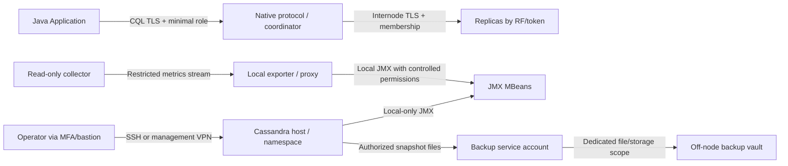
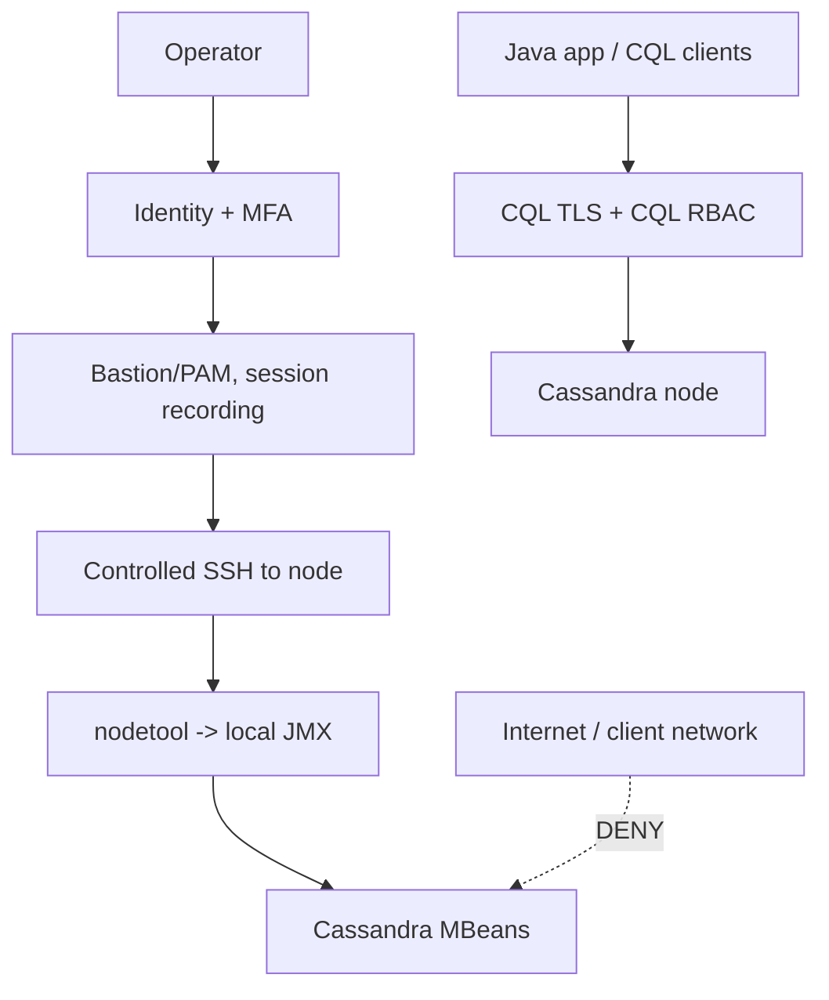
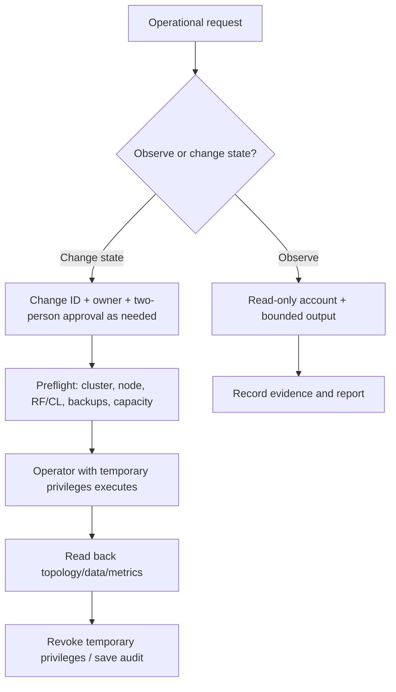
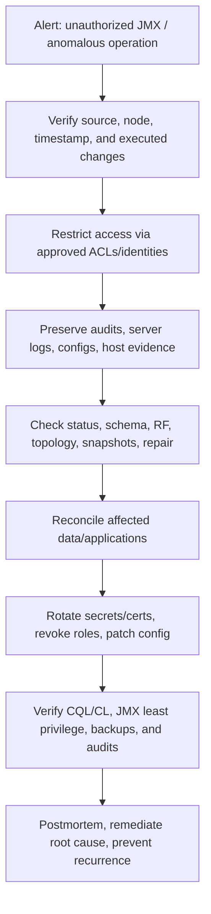

# JMX, Operational Tooling, and Restricting Administrative Access

An Apache Cassandra cluster may already enforce username/password authentication for CQL, TLS for the Java Driver, and tight `SELECT` permissions, yet still suffer unauthorized operations if the **JMX administration port** is overly exposed or operational accounts hold excessive rights. Unlike ordinary data queries, many `nodetool` commands invoke **MBean/JMX operations** capable of affecting the whole node or token ring: stopping services, throttling compaction, triggering repairs, snapshots, decommissions, or other emergency actions. An account allowed to view dashboards must not automatically be allowed to run those operations.

This lesson belongs to the **Security** chapter of module **DATABASE_ENGINE_WIDE_COLUMN_CASSANDRA**, supporting distributed/wide-column architecture, partition keys, query-driven design, consistency, CQL, replication, compaction, repair, troubleshooting, and Java connectivity. Its focus is **protecting the management plane**: identifying JMX entry points, authentication and authorization methods, network/OS restrictions, boundaries between `nodetool`/`cqlsh`/drivers, and safe configuration-change and incident-response workflows.

> **Principle:** `nodetool status` is usually an observational query, yet **the JMX permission required to run it does not necessarily grant read-only access**. Evaluate the exact MBeans and methods invoked by each tool on your **running Cassandra version**—never grant `EXECUTE ON ALL MBEANS` just to silence a permission error.

## 1. Learning Objectives

After this lesson, you will be able to:

1. Distinguish **native CQL plane**, **internode communication**, **JMX management plane**, **OS/service plane**, and **backup/observability plane**.
2. Explain why CQL security and `GRANT SELECT ON TABLE` do not protect JMX; identify `nodetool`'s use of JMX/RMI in traditional Cassandra deployments.
3. Describe the **JMX local-only** default in common Cassandra releases and the mandatory prerequisites if remote management must be opened.
4. Distinguish **standard JMX file-based authentication/authorization** from **Cassandra-integrated JMX authentication/authorization** via roles/MBeans.
5. Evaluate **least privilege**, especially `SELECT`, `DESCRIBE`, and `EXECUTE` on MBeans; understand why a "read-only nodetool role" is easy to misconfigure.
6. Design network barriers, TLS, jump hosts, OS permissions, secret management, auditing, and separation between monitoring and write-capable operations.
7. Run a lab reading status via `nodetool status/info/describecluster` and querying CQL with a scoped role without destructive commands.
8. Build a deployment/credential-rotation checklist, JMX troubleshooting guide, and response workflow for suspected unauthorized admin access.

## 2. The Data Plane and Management Plane Are Different

In a Cassandra cluster, the same host often serves multiple protocols/management endpoints:

| Plane | Examples | Who Should Access? | Risk If Exposed |
| --- | --- | --- | --- |
| **CQL/native protocol** | Java Driver, `cqlsh`, typically on `9042` or custom port. | Applications/staff with properly scoped DB accounts over permitted networks. | Reading/modifying data per CQL rights, credential leakage. |
| **Internode/gossip/streaming** | Connections between Cassandra nodes on version-specific ports and TLS. | Approved cluster nodes/endpoints only. | Peer spoofing, corrupting metadata/replication, or availability outages if unprotected. |
| **JMX management plane** | `nodetool`, remote JMX clients, JMX monitoring collectors; commonly port `7199`. | Dedicated operators/management agents, typically from localhost or a narrow admin network. | Invoking state-changing MBean operations, leaking JVM metadata, outages/data risk. |
| **OS/service plane** | SSH, systemd, Kubernetes exec, read access to `cassandra.yaml`, data files, keystores. | Authorized infrastructure team via RBAC/sudo/MFA. | Direct access to raw bytes/credentials, killing processes, or altering configs bypassing CQL permissions. |
| **Metrics/log/backup plane** | JMX exporter, Prometheus, log collectors, snapshot uploaders, backup vaults. | Narrowly scoped service accounts and trusted storage systems. | Exposing topology, operational details, backup data, or node control if agents are over-privileged. |

**No single port represents "Cassandra security."** Blocking `9042` from the Internet is necessary but insufficient; JMX ports, internode traffic, data directories, backups, and secret distribution also need boundaries.



The diagram illustrates a **target design**, not an out-of-the-box Cassandra configuration. In particular, an exporter accessing local JMX is not automatically "read-only": inspect OS/JMX permissions and exporter code, restrict its command surface, and never let a metrics endpoint turn into an arbitrary MBean proxy.

## 3. Why Is JMX a High-Value Security Target?

**Java Management Extensions (JMX)** allow reading attributes, receiving notifications, and invoking operations on **MBeans** registered by the JVM/application. Cassandra exposes many MBeans covering cluster state, caches, thread pools, compaction, repair, and administrative operations. `nodetool` connects to a node's JMX agent to invoke the relevant methods.

For example, the same MBean subsystem can provide:

- **Information:** node status, rack/DC, ring, uptime, heap, thread metrics, streaming.
- **Local controls:** changing logging levels, cache behavior, compaction/streaming throughput, or refreshing state.
- **Heavy tasks:** flush, compaction, repair, rebuild/snapshot, data streaming.
- **Membership actions:** decommission, remove/replace, or topology changes per version-supported commands.

Each command carries different consequences and resource costs. What matters is not merely labeling a command `status`/`repair`, but **which operations on which MBeans the actual JMX permissions allow**.

### JMX and CQL Do Not Share Default Authentication

Apache Cassandra provides CQL `authenticator` / `authorizer` components (such as `PasswordAuthenticator`, `CassandraAuthorizer`) and **separate JMX settings**. Enabling only CQL authentication leaves a misconfigured JMX endpoint as an exposed attack surface. JMX options include:

1. **Standard Java JMX auth**: credentials and authorization via JMX password/access files.
2. **Cassandra-integrated JMX auth**: uses Cassandra roles and permissions on **MBean resources** when the integrated provider is configured properly.

**Never assume** a role with `SELECT ON TABLE myks.mytable` can access JMX or vice versa. Only when integrated JMX auth is enabled do Cassandra roles/grants govern JMX; even then, evaluate `SELECT`/`DESCRIBE`/`EXECUTE` permissions on MBeans carefully.

## 4. Threats: One Misconfiguration Can Expose the Entire Cluster

| Scenario | Attack Vector or Mistake | Potential Impact |
| --- | --- | --- |
| Remote JMX without auth/TLS, exposed to Internet/flat VPC | Unauthorized clients connect to JMX and invoke MBeans. | Metadata/JVM disclosure; interfering with nodes and background tasks. |
| Shared `readwrite` JMX account for monitoring | Monitoring credential leaks and is reused for admin commands. | Escalating from reading metrics to invoking side-effect operations. |
| Password in `nodetool -pw ...` | Shell history, process listings, CI/CD logs, or tickets retain the secret. | Admin credential theft without exploiting Cassandra. |
| Remote JMX enabled without TLS | Secrets/management traffic intercepted or tampered with on untrusted networks. | Credential/session hijacking, node takeover. |
| RMI connects via unexpected address/port | JMX registry is reachable, then connector stub redirects to another endpoint. | Broken connections or unintended admin network paths opened. |
| JMX exporter or agent runs with excessive OS privileges | Buggy agent, exposed endpoint, or host compromise. | Reading data files/secrets or invoking arbitrary MBeans. |
| Forgotten access after an incident | Elevated break-glass/sudo account remains active after shift ends. | Prolonged unauthorized access, poor attribution. |
| Copying lab configs to production | `LOCAL_JMX=no`, auth disabled, wide firewalls, or sample passwords. | Full production exposure. |

### Defense in Depth

No single safeguard suffices:

1. **Network:** JMX local-only by default; if remote is mandatory, restrict to a management segment with source/destination ACLs.
2. **Authentication:** dedicated identities, strong rotated secrets, never default/shared credentials.
3. **Authorization:** roles separating metrics, read-only, operator, and break-glass duties.
4. **Encryption:** properly configured JMX/RMI TLS with matching server/client identity checks.
5. **OS & workload:** SSH/sudo/Kubernetes RBAC, file permissions, service accounts, container hardening, and audits.
6. **Monitoring:** detect unexpected JMX listeners, auth failures, side-effect MBean invocations, `nodetool` runs, and lost telemetry.
7. **Recoverability:** backups, repair/consistency, and runbooks to contain damage if a bad operation occurs.

## 5. Local-Only Default and What `LOCAL_JMX` Means

In common Cassandra releases, JMX config typically restricts access **to localhost** by default. On Linux, `cassandra-env.sh` may use the `LOCAL_JMX` variable; exact paths/variables and bind/transport mechanics vary by Cassandra release, distribution, and packaging.

```bash
# Illustrates secure config intent in releases using LOCAL_JMX:
LOCAL_JMX=yes

# Only when a process requires protected remote JMX:
# LOCAL_JMX=no
```

The snippet above **is not a script to run in a production shell**. `LOCAL_JMX=yes` enables local management per the Cassandra release's mechanism; it does **not** mean **every local process is harmless**. Whenever someone can SSH/`exec` into the host/namespace, local JMX access still depends on OS accounts, local JMX auth, and user separation.

### Recommended Pattern: JMX Has No Public Address



In practice, you may use a VPN, private endpoint, SSH tunnel, or management agent instead of a traditional bastion. Safety requires **identity, network bounds, authorization, auditing, and zero public bypasses**—never build ad-hoc tunnels to evade organizational policy.

### Remote JMX Only with Approved Justification

Dashboards using a JMX exporter can run **right on the node**, exposing metrics over a tightly scoped HTTP endpoint so Prometheus never touches Cassandra remote JMX directly. If monitoring/orchestration systems must connect to remote JMX, require:

- Access restricted strictly to management-host **IPs/subnets/identities**; block the Internet and unrelated workload VLANs.
- JMX authentication and server TLS (plus mTLS if required by policy), with standardized truststores/keystores.
- Control of both **RMI registry + connector endpoints** (JMX may use multiple ports); firewall all paths, not just 7199.
- Consistent TLS/certificate identity behind load balancers/NAT; avoid uncontrolled public hostnames.
- Least-privilege accounts with owners, TTLs, rotation, and logging/alerting on failed logins or anomalous access.
- Testing on a canary node first with rollback; bad JMX changes can break all `nodetool`/monitoring connections.

## 6. RMI/JMX: Why Opening One Port May Not Be Enough

Remote JMX uses **Java RMI** in many Cassandra versions. Clients typically contact the **RMI registry** first, receive a connector stub, and then open a second connection to the endpoint/port/hostname advertised by that stub. Some setups reuse one port or configure a second port; TLS for registry and RMI connections may be separate settings.

```text
nodetool/JMX client
    |
    | 1. Connect to JMX registry at configured host:port
    v
RMI registry
    |
    | 2. Return connector stub (host/port/transport)
    v
RMI connector endpoint
    |
    | 3. Authenticate + TLS/authorization + MBean operation
    v
Cassandra JMX server
```

**Two distinct symptoms:**

- `nodetool` reports **connection refused/timeout**: listener/bind/ACL/JMX process may be unreachable, not necessarily that the Cassandra node is Down on the CQL port.
- TCP handshake to the registry **succeeds** yet the tool still times out: the RMI stub may advertise an unreachable hostname/port, TLS trust may mismatch, a firewall may block the second channel, or JMX auth lacks permission.

Never fix this by **opening all ports** or disabling TLS/auth. Verify exact endpoints per config/JVM version and firewall rules, then test from the **authorized source**. Running `curl` against a JMX port is not a valid JMX check because JMX/RMI is not HTTP.

## 7. Standard JMX Authentication: Password File and Access File

In **standard Java JMX**, a password file defines who can authenticate and an access file (if configured) restricts operations. These are **separate** from CQL login accounts in `system_auth` unless an integration is explicitly configured.

### Configuration Concept (Illustrative, Not a Production Patch)

```text
# Typical JVM system properties provided by cassandra-env.sh/packaging:
-Dcom.sun.management.jmxremote.authenticate=true
-Dcom.sun.management.jmxremote.password.file=/etc/cassandra/jmxremote.password
-Dcom.sun.management.jmxremote.access.file=/etc/cassandra/jmxremote.access
```

Example standard Java JMX **access file**:

```text
# /etc/cassandra/jmxremote.access  (sample only)
metrics_reader readonly
ops_admin      readwrite
```

Note that some Cassandra operational tools invoke **MBean operations** even to gather status, so standard JMX `readonly` **may fail on some `nodetool status/info` commands**. Conversely, `readwrite` is broad at the JMX layer and **does not** mean "only allowed `nodetool status`." Verify the command matrix and choose a different monitoring approach if truly narrow read-only access is required.

### Protecting Secrets and Files

On Linux running as user `cassandra`, password/access files and their parent directories must have tight ownership and permissions; operational policies typically require the password file to be **readable only by the Cassandra service user**:

```bash
# Illustrative commands; run only after verifying paths/users with approval:
# chown cassandra:cassandra /etc/cassandra/jmxremote.password
# chmod 400 /etc/cassandra/jmxremote.password
```

In Kubernetes, use Secret providers/mounts with strict permissions; avoid leaking secrets in image layers, public ConfigMaps, init logs, or shell history. If no secure secret provider exists, **do not enable remote JMX** only to pass usernames/passwords on the command line.

### Dangerous Mistakes

- Enabling `authenticate=true` with sample/short passwords and no TLS over untrusted networks.
- Leaving password files readable by all users/processes.
- Sharing the same `readwrite` JMX account across metrics collectors, automation, DBAs, and developers.
- Rotating a password file on one node without coordinating collectors/automation, breaking monitoring or incident tools.
- Assuming `jmxremote.access` can express every safe operation on Cassandra MBeans accurately; this mechanism is **relatively coarse**, requires testing, and may warrant switching to integrated auth.

## 8. Cassandra-Integrated JMX Auth: Roles and MBean Resources

Cassandra supports integrating JMX authentication/authorization with Cassandra's role/permission subsystem in applicable versions. Accounts can then be managed centrally, and CQL `GRANT`/`REVOKE` can assign permissions on MBeans. **This feature is not active automatically just because CQL `CassandraAuthorizer` is enabled**: you must explicitly configure the JMX provider in JVM/JAAS settings and test on your deployment.

### Conceptual Provider Configuration

Apache Cassandra docs describe JVM properties for JMX integration such as:

```text
# Example JVM property names in supporting Cassandra releases:
-Dcassandra.jmx.remote.login.config=CassandraLogin
-Djava.security.auth.login.config=<path-to-cassandra-jaas.config>
-Dcassandra.jmx.authorizer=org.apache.cassandra.auth.jmx.AuthorizationProxy
```

This snippet is **not a complete config**, omits network/TLS, and does not disable conflicting standard JMX properties. Never enable conflicting providers together or roll out to all nodes simultaneously. Cross-check `cassandra-env.sh`, `cassandra-jaas.config`, auth mechanisms, and your exact Cassandra version before rollout.

### MBean Permissions Described in Cassandra

| Permission | General Capability | Administrative Risk |
| --- | --- | --- |
| `DESCRIBE` | List/discover MBeans in scope. | May expose management-plane structural metadata. |
| `SELECT` | Read attributes of matching MBeans. | Attributes may reveal node info, paths, or JVM state; scope carefully. |
| `EXECUTE` | Invoke operations on granted MBeans. | **Can cause side effects**, even when a tool calls an operation that sounds read-only. |
| `AUTHORIZE` | Manage permissions on resources per Cassandra's model. | Never for observers or ordinary apps. |

**Grant granularity does not guarantee "only one safe method."** `EXECUTE ON MBEAN 'org.apache.cassandra.db:type=StorageService'` can allow invoking other operations on **the same MBean**, not solely the method `nodetool status` needs. Verify exact release behavior and avoid granting side-effect commands to read-only groups.

### CQL Example for an Observer Group (Lab Only, When Integrated Auth Is Configured)

```sql
-- Role used solely to bundle permissions, with no direct login capability.
CREATE ROLE IF NOT EXISTS ops_jmx_observer
WITH LOGIN = false AND SUPERUSER = false;

-- Allow reading/discovering MBean attributes.
GRANT SELECT ON ALL MBEANS TO ops_jmx_observer;
GRANT DESCRIBE ON ALL MBEANS TO ops_jmx_observer;

-- DO NOT grant blanket EXECUTE to this group.
-- Some nodetool status/info commands may still fail authorization
-- because they call MBean methods; design and test those separately.
```

This is a **starting example**, not a guaranteed production-safe read-only policy: `SELECT/DESCRIBE ON ALL MBEANS` is still broad in **exposed metadata**. For stricter least privilege, grant per specific MBean or collect metrics through a tightly scoped exporter.

### Granting an MBean Does Not Equal Granting One `nodetool` Command

The syntax below is **for contrast only—do not run in production**:

```sql
-- DANGEROUS IF USED AS "status-only read permission":
-- GRANT EXECUTE ON MBEAN
--   'org.apache.cassandra.db:type=StorageService'
-- TO ops_jmx_observer;
```

Granting `EXECUTE` on an MBean with many operations does not check **which `nodetool` CLI subcommand** the user typed. An operator can use another JMX client to call any permitted operation on that MBean without going through a curated CLI wrapper. Infrastructure/network controls, allowlisted wrappers, and auditing remain essential.

### Bootstrap Caveat

Apache Cassandra notes that **Cassandra-integrated JMX auth may be unavailable until a node joins the ring**, because the auth subsystem is not fully initialized during bootstrap. If you need observability/troubleshooting during bootstrap, design **protected, controlled local JMX access** and switch to integrated remote auth once the node stabilizes—never wait until an incident to discover JMX tools are locked out.

## 9. Separating Roles: Monitor, Operator, DBA, and Break-Glass

| Role / Workflow | Recommended Rights | Should Not Have by Default |
| --- | --- | --- |
| **Metrics collector** | Read required metric MBeans or scrape local exporter; minimal OS rights. | Unrestricted JMX method calls, root sudo, snapshot deletion. |
| **App service account** | CQL `SELECT/MODIFY` on exact keyspaces/tables, local DC/TLS, secrets from vault. | JMX, OS root, Cassandra superuser, DDL rights, or internode network access. |
| **Support/on-call observer** | `status/info/describecluster` and logs/metrics through restricted channels. | `decommission/removenode/cleanup/clearsnapshot`; broad unapproved EXECUTE. |
| **Change-approved DBA/operator** | Scoped remediation tasks: repair, snapshot, tuning, restarts per runbook. | Permanent superuser, unlimited duration, self-approving risky changes. |
| **Topology/DR operator** | Execute replace/remove/decommission/restore with two-person approval. | Cluster-wide open rights outside change windows, skipping backup/replica checks. |
| **Break-glass** | Temporary elevated privileges with conditions, for severe incidents. | Permanent credentials in CI/shared secrets or unaudited personal accounts. |

### An Effective Two-Tier Split

1. **Observation:** read-only dashboards/APIs or JMX exporters that can detect faults but **cannot** mutate Cassandra.
2. **Action:** operators authenticate via MFA bastion/host, executing approved commands tied to a change ticket; audit command, node, approver, and outcome.

If monitoring must invoke an `EXECUTE` MBean method to read status, never call it "read-only" just because of the method name—build an exporter/wrapper service restricted to **exact allowed queries** (and scope underlying privileges). Test the wrapper against arbitrary input and command injection.

## 10. `nodetool`: Classifying Commands by Impact

Not all `nodetool` commands are read-only. Several mutate data, metadata, resources, or membership:

| Category | Example Commands | Impact / Guardrails |
| --- | --- | --- |
| **Topology observation** | `status`, `info`, `describecluster`, `ring`. | Primarily observational; verify JMX method/attribute requirements per version. |
| **Resource/workload observation** | `tpstats`, `tablestats`, `compactionstats`, `netstats`. | May expose sensitive metrics and add minor load if polled aggressively; throttle collectors. |
| **Create recovery point** | `snapshot`. | Creates hard links/retains SSTables, growing disk usage after compaction; needs retention policy. |
| **Remove recovery point** | `clearsnapshot`. | **Destructive:** deletes snapshot files in scope; requires remote backup verification and approval. |
| **Repair/sync** | `repair`, `rebuild`. | Heavy I/O/CPU/network; can affect SLAs/replicas; needs scoping and scheduling. |
| **Data maintenance** | `flush`, `compact`, `cleanup`, `scrub`. | Alters local SSTables/data, adds disk pressure; `cleanup` after topology changes requires careful timing. |
| **Temporary behavior tuning** | `setcompactionthroughput`, `setlogginglevel`, or tuning equivalents. | Affects performance/logging, may reset on restart; requires baseline/rollback. |
| **Membership/topology changes** | `decommission`, `removenode`, `move` where supported. | Changes token ownership/replica placement, risks quorum loss; requires strict runbooks. |
| **Extreme-risk operations** | Force/metadata-recovery commands like `assassinate` where supported. | Never use as a quick fix; risks data loss if bypassing re-replication flows. |

**A command named "status" does not mean a role can invoke that command without being able to invoke others.** Real authorization lives at the JMX MBeans/JVM level and host/CLI entry points, not in a doc's allowlist table.

### Action Gate: Read-Only vs. State-Changing



Not every `nodetool info` requires a process as heavy as `decommission`, yet **provisioning access** for the people/tools running it must be designed upfront so write privileges are not accidentally opened.

## 11. Using `nodetool` with Safe Credentials

Cassandra releases support options like `-h`, `-p`, `-u`, and `-pwf`. Always check `nodetool help` on your actual version first.

```bash
# Local-only JMX case: run from an authorized host/namespace.
nodetool status
nodetool info
nodetool describecluster

# Approved remote JMX case with TLS/auth:
# --password-file points to a protected client-side password file.
nodetool -h cassandra-mgmt.internal -p 7199 \
  -u ops_observer --password-file /secure/path/nodetool-client-password status
```

Hostnames/paths are **illustrative**, not real endpoints. Run only in labs or authorized environments. The example assumes **JMX/TLS/truststores are fully configured for `nodetool`**; `--password-file` alone does not enable TLS.

### Avoid Passing Passwords on the Command Line

Never use this pattern in automation docs:

```bash
# DO NOT DO THIS: passwords can leak in history/process listings/CI logs.
# nodetool -h node.example -u admin -pw 'plaintext-secret' status
```

The client-side `--password-file` is **not** the server's `jmxremote.password` file; `nodetool` parses it in its own supported format. Secrets must come from a vault/secret provider mounted with minimal permissions, never committed to Git or baked into build artifacts. Verify exact file format and handling per version without guessing.

### Why `nodetool -h` Is Not `cqlsh`

`nodetool -h` targets **JMX management**. `cqlsh host 9042` uses **CQL/native protocol**. A node may serve `9042` and answer CQL normally while JMX is firewalled, or local JMX may work while native transport is disabled. **Never declare a cluster DOWN just because JMX is unreachable.**

## 12. TLS for JMX vs. CQL and Internode TLS

Three connection types must be configured and tested independently:

| Flow | Required Protection | What Not to Infer |
| --- | --- | --- |
| Java Driver ↔ Cassandra native protocol | CQL auth, client TLS/server identity, table/keyspace permissions. | Client TLS does not mean JMX uses TLS. |
| Cassandra node ↔ node | Internode encryption, endpoint/cluster verification, network segmentation. | Internode TLS does not mean JMX ports are protected. |
| `nodetool`/collector ↔ JMX | JMX authn/authz, TLS keystore/truststore, right RMI/registry endpoints, management ACLs. | JMX TLS does not authorize MBeans or protect OS/backups. |

Relevant JVM properties for JMX TLS per Java/Cassandra docs:

```text
-Dcom.sun.management.jmxremote.ssl=true
-Dcom.sun.management.jmxremote.ssl.need.client.auth=true
-Dcom.sun.management.jmxremote.registry.ssl=true
-Dcom.sun.management.jmxremote.ssl.enabled.protocols=<approved-protocols>
-Djavax.net.ssl.keyStore=<protected-key-store>
-Djavax.net.ssl.trustStore=<protected-trust-store>
```

These are **configuration knobs to understand**, not a copy-paste production recipe: aligning JVM/Cassandra versions, registry SSL, RMI ports, certificate SANs, key/truststore passwords, and client JVM flags is critical. Some releases support newer JMX TLS settings in `cassandra.yaml`; **never** enable two conflicting mechanisms together. Read documentation for your **exact release**.

### Diagnosing TLS Errors

- `SSLHandshakeException`: certificate/truststore/protocol/cipher or client-certificate requirement mismatch.
- Client reaches registry yet fails MBean calls: secondary RMI connection or mismatched registry/connector TLS settings.
- Certificate issued for an IP/hostname differing from `RMI hostname`: identity verification failure or connecting to the wrong endpoint.
- After certificate rotation, some collectors lose connectivity: check secret mounts/trust reloads/restarts per component runbooks—never disable verification for a "quick test" in production.

**Never use a trust-all truststore** or disable hostname verification as a long-term solution. If used in a lab test, explicitly document it as failing security acceptance.

## 13. Protecting OS, SSH/sudo, Containers, and Automation

Local-only JMX only works if **whoever can execute processes on the host/namespace** is controlled. Anyone allowed to `kubectl exec` into a Cassandra pod or `sudo` to the Cassandra service account can reach local JMX, data directories, or secret mounts regardless of public network policies.

### Minimum Controls

1. **SSH and bastions:** MFA/SSO, role groups, session timeouts, command recording, no shared root passwords.
2. **sudo:** allow only approved commands/roles; check shell escapes, `sudo -u cassandra`, and secret readability.
3. **Kubernetes:** RBAC on `pods/exec`, `pods/portforward`, Secret reads, StatefulSet edits, and `hostPath`; NetworkPolicies across app/metrics/management namespaces.
4. **Service accounts:** separate identities for the Cassandra process, JMX exporter, backup uploader, and automation; minimal file permissions and credentials.
5. **Data files:** SSTables, commit logs, snapshots, `system_auth` data, certificates, and keystores are sensitive assets; OS access usually bypasses the CQL permission model.
6. **CI/CD:** never give build/test pipelines default JMX admin credentials; production actions need approvals and audits.
7. **Secret rotation:** vaults/short-lived credentials, never print to stdout, never paste in chat/tickets or source control.

### A Dangerous Bypass

If Prometheus scrapes an exporter at `/metrics`, ensure the exporter **does not expose any endpoint letting callers pick arbitrary MBean operations**. A frontend dashboard with "view charts only" permissions helps nothing if its backend agent uses unprotected `readwrite` JMX and users can send other admin requests to that backend.

## 14. JMX Exporters and Metrics: Narrowly Scoped Observation

For Cassandra monitoring, common targets are MBeans/JMX attributes for read/write latencies, thread pools, caches, compaction, JVM/GC, and disk/resources. A collector should never hold rights to invoke `decommission` or `clearsnapshot`.

### Reference Design

```text
Prometheus / metrics system
   |
   | mTLS / private network / read-only scrape
   v
Exporter endpoint (no arbitrary MBean invocation)
   |
   | local-only JMX; read-only privileges per version capability
   v
Cassandra MBean attributes
```

Understand the **dual risk**:

1. If the exporter runs as a Java agent **inside the Cassandra JVM**, it inherits process/JVM privileges; no separate "JMX user boundary" exists automatically. Protect the artifact/code and endpoint, use trusted releases, and manage its lifecycle.
2. If the exporter runs as a separate process connecting to JMX via username/password, apply role/file permissions and privilege limits like any other JMX client.

**Metric labels** should hold only bounded values like `cluster`, `dc`, `rack`, `node`, `table`, and stable `query_name`. Never put raw partition keys, tenant IDs, operation IDs, or secrets into Prometheus labels. Metrics systems can still leak topology/hostnames and require RBAC, retention, and encryption.

### Separating Collectors from Admin Rights

| Check | Criteria |
| --- | --- |
| Exporter bind address | Private/approved interface only; never exposed to the Internet. |
| Scrape identity | Service account with network/certificate allowlist. |
| JMX privilege | Read only required attributes or use a controlled in-process agent; no arbitrary `EXECUTE`. |
| CPU/GC overhead | Sampling/poll intervals do not cause latency spikes or dropped metrics. |
| Logs/secrets | Never log JMX passwords, TLS keys, or sensitive payloads. |
| Availability | If monitoring fails, Cassandra keeps serving; alert separately on lost telemetry. |

## 15. Auditing and Identifying Operational Requests

During an incident, you need to know **who ran what command, on which node, when, and under which approval**—not merely a line saying `nodetool completed`. Default JMX server logs may **not** record every method invocation with human identity and change ID in your team's format. Combine auditing across bastions/PAM, automation runners, OS/SSH, collectors, and Cassandra logs.

### Suggested Log Schema

```json
{
  "time_utc": "2026-11-21T11:20:30Z",
  "event": "cassandra.management.command",
  "environment": "lab",
  "cluster_id": "cassandra-lab",
  "change_id": "CHG-LAB-42",
  "actor_identity": "ops-oncall-service",
  "approval_id": "APPROVED-LAB-17",
  "node_host_id": "11111111-1111-4111-8111-111111111111",
  "tool": "nodetool",
  "command_name": "status",
  "scope": "keyspace=security_lab",
  "intent": "OBSERVE",
  "result": "SUCCESS",
  "duration_ms": 126,
  "jmx_credential_reference": "vault://ops/jmx-observer",
  "secret_value": null
}
```

This is a **custom-designed log format**; Cassandra does not emit all these fields automatically. Good implementation links `change_id` with bastion/session identity, normalized CLI commands, output hashes, and request metadata. Never store passwords, private keys, or tokens in logs. When someone runs a JMX client directly bypassing wrappers, app-layer audits may miss it—so **network and privilege controls** must restrict bypass paths.

### Actions That Should Trigger Alerts

- A JMX listener detected on an interface/port outside inventory.
- Repeated JMX login failures from new hosts, unusual certificates, or changes to management ACLs.
- Metrics or support accounts invoking side-effect operations.
- Multiple repair/compaction/decommission/snapshot commands started outside change windows.
- `nodetool status`/metrics collectors losing connectivity together after TLS/credential changes.
- Break-glass accounts activated, used past TTL, or missing approvers.
- Unapproved edits to `cassandra-env.sh`/JMX configs, password files, firewalls, NetworkPolicies, or Kubernetes RoleBindings.

Audit logs require retention, UTC synchronization, tamper/delete protection, and incident retrieval procedures. Across multiple DCs, host clocks can drift, so use NTP and correlation IDs to align timelines.

## 16. Safe Lab: Distinguishing CQL Permissions from JMX Permissions

**Environment:** an isolated Cassandra lab with at least one DC named per configuration, an authorized lab admin account, backups, and rollback. This lab does **not** require opening remote JMX, changing production auth, editing real password files, or executing topology-altering commands.

### Step 1 — Read-Only via Local `nodetool`

```bash
# Run from an authorized Cassandra lab host/namespace.
nodetool help
nodetool version
nodetool status
nodetool info
nodetool describecluster
```

Record `time_utc`, node JMX/Host ID, version, `LOCAL_JMX` policy, and redacted output. If JMX fails to connect, do not blindly open firewalls; check the exact host, OS permissions, and JMX config first.

### Step 2 — Create CQL Lab Data for Comparison

This keyspace example uses `dc1` with RF=3, requiring at least three healthy nodes in that DC. If running a single-node lab, **adjust lab RF to fit before running**—never change production replication for an exercise.

```sql
CREATE KEYSPACE IF NOT EXISTS security_lab
WITH replication = {
  'class': 'NetworkTopologyStrategy',
  'dc1': 3
}
AND durable_writes = true;

CREATE TABLE IF NOT EXISTS security_lab.events_by_tenant_day (
  tenant_id text,
  event_day date,
  event_id uuid,
  event_type text,
  PRIMARY KEY ((tenant_id, event_day), event_id)
);

CONSISTENCY LOCAL_QUORUM;

INSERT INTO security_lab.events_by_tenant_day
  (tenant_id, event_day, event_id, event_type)
VALUES ('tenant-lab', '2026-11-21',
        11111111-1111-4111-8111-111111111111,
        'SECURITY_BASELINE');

SELECT event_id, event_type
FROM security_lab.events_by_tenant_day
WHERE tenant_id = 'tenant-lab'
  AND event_day = '2026-11-21';
```

The table uses `(tenant_id, event_day)` as its partition key for efficient lookups. RF/CL govern **replicas**, not **who may query**. A CQL role denied `SELECT` due to missing permissions does not mean a node is Down or quorum failed.

### Step 3 — Test a CQL Role Without Admin Rights

Only when the lab enables `PasswordAuthenticator`/`CassandraAuthorizer` and the caller has role-management rights:

```sql
-- Group role granting read access to one table only.
CREATE ROLE IF NOT EXISTS security_lab_reader
WITH LOGIN = false AND SUPERUSER = false;

GRANT SELECT ON TABLE security_lab.events_by_tenant_day
TO security_lab_reader;

-- A login role managed by the secret provider will be
-- granted security_lab_reader per the organizational runbook.
-- NEVER put real passwords in lesson/CI files.
```

Test using a **lab login account assigned this role**: `SELECT` on the table is allowed, while `INSERT`/`ALTER`/`DROP` are denied without other grants. Having `SELECT` does **not** grant JMX access; test JMX access only through the lab's policy-approved path to confirm the boundary.

### Step 4 — Test JMX Least Privilege in the Lab

If **Cassandra-integrated JMX authentication/authorization** is configured with a lab observer account:

```sql
CREATE ROLE IF NOT EXISTS ops_jmx_lab_viewer
WITH LOGIN = false AND SUPERUSER = false;

GRANT SELECT ON ALL MBEANS TO ops_jmx_lab_viewer;
GRANT DESCRIBE ON ALL MBEANS TO ops_jmx_lab_viewer;
```

This is **not yet** a production "least MBeans" policy; it only proves CQL table permissions and JMX permissions are distinct. Use an authorized JMX viewer tool to confirm attributes can be read while operations requiring `EXECUTE` are denied. If `nodetool status` fails, **do not** grant `EXECUTE ON ALL MBEANS`: read permission logs, identify the method/MBean, evaluate risks, and propose a narrower rule or exporter.

### Step 5 — Check Network/OS Boundaries via Checklist

Never port-scan unrelated environments or try bypassing firewalls. On the authorized lab node, inspect listeners with OS tools:

```bash
# Read-only; Linux commands, output depends on privileges.
ss -lntp
nodetool status

# To verify network policy from a management host:
# connect only to approved endpoints/JMX.
```

Record whether JMX listens only on loopback/private interfaces, which approved sources remote management clients connect from, whether exporters expose any write/control APIs, and whether CQL/internode ports have separate firewall policies.

### Step 6 — Evaluate Results

| Check | Expected | If Failed |
| --- | --- | --- |
| Local `nodetool status/info` | Observable per granted rights without opening public JMX. | Inspect JMX listener/auth/TLS/roles; do not weaken security. |
| CQL reader `SELECT` on granted table | Query succeeds at matching CL. | Separate CQL auth failure from replica/CL failure. |
| CQL reader `DROP/ALTER` table | Denied when lacking corresponding grants. | Inspect role inheritance/superuser/authorizer config. |
| JMX viewer reads granted MBeans | Matches role and information policy. | Adjust `READ`/`DESCRIBE` scope with approval. |
| JMX viewer invokes side-effect operation | **Blocked**. | Review `EXECUTE` grants, access files, exporter/agent OS rights. |
| JMX from non-allowlisted network | **Unreachable** per network policy. | Fix ACL/bind; never rely on auth failures as the sole barrier. |

## 17. Java Driver 4.x: Application Accounts Do Not Need JMX

Regular Java applications should use the native CQL protocol with **an account holding `SELECT`/`MODIFY` on exact tables**, never JMX credentials or Cassandra superuser. A request succeeding at `LOCAL_QUORUM` proves enough replicas satisfied CL for that request—it does **not** validate JMX permissions.

Java Driver 4.x example, assuming `CqlSession session` is configured with **local datacenter, credentials from a secret manager, and CQL TLS**:

```java
import java.time.LocalDate;
import com.datastax.oss.driver.api.core.ConsistencyLevel;
import com.datastax.oss.driver.api.core.cql.PreparedStatement;
import com.datastax.oss.driver.api.core.cql.BoundStatement;
import com.datastax.oss.driver.api.core.cql.ResultSet;

PreparedStatement select = session.prepare(
    "SELECT event_id, event_type " +
    "FROM security_lab.events_by_tenant_day " +
    "WHERE tenant_id = ? AND event_day = ?");

BoundStatement query = select.bind(
        "tenant-lab", LocalDate.of(2026, 11, 21))
    .setConsistencyLevel(ConsistencyLevel.LOCAL_QUORUM)
    .setIdempotent(true)
    .setPageSize(100);

ResultSet result = session.execute(query);
// Log query_name, consistency, elapsed, and coordinator when available;
// never log raw bind values, credentials, or full session config.
```

### Protecting Applications in Practice

- **Never store secrets in source code** or `application.properties` committed to repositories. Use vaults/secret managers with restricted read access, rotation, and auditing.
- **Enable native protocol TLS and hostname/server identity verification.** TLS in the Java Driver does not enable JMX TLS; configure both flows separately.
- **Minimize CQL permissions:** services only get `SELECT`/`INSERT`/`UPDATE`/`DELETE` on needed tables; no `SUPERUSER`, `CREATE`/`DROP`/`ALTER`/`GRANT` unless the workload requires them.
- **One identity per service:** separate environments/tenants with different security needs; never share DBA accounts.
- **Never lower CL** on auth errors; `UnauthorizedException` is not `UnavailableException`—distinguish permission denials from replica/quorum errors.
- **Structured logging:** `operation_id`, `query_name`, CL, DC, elapsed, outcome/error class; never put PII/secrets in metric labels.
- **Never connect to JMX from business code** except in dedicated approved admin apps with network boundaries and auditing; admin APIs must be separated from data APIs.

## 18. Step-by-Step Runbook for JMX Hardening

Changing JMX configurations can break `nodetool`/monitoring connections, impacting response during node bootstrap, repair, or disk-full events. Execute **in sequence**—never turn on auth/TLS everywhere at once or mark success without testing.

### Phase A — Discovery and Design

1. **Inventory:** Cassandra versions, host OS/containers, `7199` (or equivalent) endpoints, bind addresses, RMI registry/connector ports.
2. **List clients:** operators, scripts, JMX exporters, monitoring, backup/repair automation; identify which commands/MBeans they genuinely need.
3. **Assess exposure:** public/private listeners, firewalls/security groups, bastions, Kubernetes NetworkPolicies/port-forward/privileged exec.
4. **Choose auth model:** local-only is the preferred default; if remote is truly needed, choose standard file-based or Cassandra-integrated fitting bootstrap/operations.
5. **Design roles:** metrics monitor; on-call observer; state-changing operator; TTL/approval-gated break-glass.
6. **Design TLS/PKI:** RMI registry/connector, hostnames, certs/keys/truststores, and rotation.
7. **Prepare rollback:** saved safe config, controlled console/host access channel, and break-glass rights independent of the remote JMX path being edited.

### Phase B — Canary / Rollout

8. Test in a **lab**, verifying read commands, MBean grants, and **negative tests** for prohibited operations; collect audits.
9. Pick a canary node without single-point load risk; capture baseline RF/CL, `UN` state, repair/streaming, and app p99.
10. Update **one node at a time** via change process, verify file/secret permissions, and restart if JVM properties require it; do not mix with topology changes.
11. Verify **local JMX**, remote (if permitted), role-scoped `nodetool status/info/describecluster`, exporter/metrics, and valid TLS handshakes.
12. Verify **native CQL** from Java Driver and that replicas still satisfy CL without new auth failures, tail-latency spikes, or abnormal repair backlogs.
13. Rotate clients/credentials gradually while preserving a controlled rollback window; **never** open unauthenticated remote JMX "to help the collector reconnect."
14. Proceed to remaining nodes once the canary stabilizes, checking fault tolerance across each node restart (especially in low-RF DCs).

### Phase C — Acceptance and Operations

15. Verify JMX is unreachable from **unauthorized networks** and old credentials are rejected after rotation.
16. Run negative tests: viewers cannot modify MBeans, monitoring cannot mutate nodes, operators lack out-of-scope permissions.
17. Cross-check telemetry/app CL/RF, backup/repair monitoring, job schedulers, and alerts; record evidence in the change ticket.
18. Delete/revoke old credentials per policy, set owner/expiry/rotation cadence, and run audit/secret scans.

### Acceptance Gates

| Gate | Evidence |
| --- | --- |
| **Network isolation** | JMX ports bound only to loopback/management subnets per policy; RMI connector exposes no bypass. |
| **Authentication** | Every remote connection is authenticated, secrets protected; no default users/passwords remain. |
| **Transport** | TLS verified for registry/connector per config; certificates checked for exact identity. |
| **Authorization** | Metrics/viewers cannot invoke side-effect methods; operational roles hold minimal scope. |
| **Availability** | `nodetool` and monitoring stay usable during node issues; bootstrap/recovery runbooks work. |
| **CQL unaffected** | Java Driver/CQL roles, RF/CL, p95/p99, and repairs show no rollout regressions. |
| **Audit & rollback** | Who changed what, when, approval, config version, PASS/FAIL tests, and recovery plan. |

Close the change only when all gates pass. Seeing all nodes `UN` **does not prove** JMX is hardened or that operators can still access it during an incident.

## 19. Rotating Secrets/Certificates Without Losing Operability

### Standard JMX Password Rotation

1. List all **server files** and **client secret references** in use (monitoring, `nodetool`, automation).
2. Define a short overlap or controlled credential switchover per current JMX mechanism; **never** leave both old and new secrets active indefinitely.
3. Deploy secrets into protected vaults/mounts; verify ownership/permissions and ensure logs print no secrets.
4. Migrate clients/collectors in batches; verify `status`/metrics with the new credentials.
5. Revoke old credentials after confirming all consumers switched; verify old credentials fail.
6. Keep an incident/rollback plan if JMX auth config changes require JVM restarts; never assume editing a password file takes effect immediately across all versions/JMX agents.

### Certificate Rotation

JMX certificates may use a separate keystore/truststore from native CQL/internode TLS. During rotation, ensure trust chains and SANs/hostnames match the RMI connector; a client hitting a different endpoint than the registry may hit TLS mismatches. Check version restart/reload requirements beforehand; **never** claim "just swap the file and TLS updates itself" without proof.

### Break-Glass on Lockout

If a config locks out all JMX clients, use the **approved console/host channel** and saved config rather than exposing management ports publicly or disabling authentication. Before restarting a node, assess RF/CL, peer states, and repair/topology work so availability never drops below safe levels.

## 20. Diagnosing JMX Access Errors vs. Cassandra Data-Plane Faults

| Symptom | Possibilities to Check | What Not to Do |
| --- | --- | --- |
| `nodetool` fails to connect while Java `SELECT` works | JMX bind/port, auth/TLS, OS/network policy, RMI stub, stalled JVM. | Declare the Cassandra data plane Down or drop native TLS. |
| `Connection refused` to JMX | Listener disabled/wrong endpoint, firewall, `LOCAL_JMX=yes` called remotely. | Open JMX port to the Internet. |
| TCP reaches JMX port yet methods time out | RMI connector/registry port, hostname, JVM/GC, TLS/method permissions. | Disable firewalls/TLS globally in production to test. |
| `SecurityException` / authentication failed | User/password, credential rotation, JAAS, disabled role, TLS client identity. | Use a shared superuser account. |
| `AccessControlException` / unauthorized MBean | Standard access `readonly` or missing Cassandra-integrated `EXECUTE` on bean. | Grant `EXECUTE ON ALL MBEANS` to every viewer. |
| `SSLHandshakeException` | Certificate SAN, truststore, TLS protocol/cipher, mutual TLS/registry SSL. | Permanently disable certificate/hostname checks. |
| `status` shows node `DN`, `info` from healthy peer works | Gossip/membership view differs from direct connection to suspect node. | Delete node/ring metadata reflexively. |
| Monitoring loses metrics after rollout | Collector lacks new secret/truststore, missing MBean permission, exporter bug. | Open all permissions and disable auth just to turn dashboards green. |
| App gets CQL `UnauthorizedException` | CQL role/authorizer/table permissions, rotated credential. | Edit JMX access files—the two planes are unrelated. |
| App gets `UnavailableException` | RF/CL, live replicas for partition/DC, topology, peer availability. | Edit JMX `GRANT SELECT` or raise timeouts infinitely. |

### Ordered Troubleshooting Workflow

1. Record **timestamp**, client/tool version, node/port/network source, and exact **redacted error class**.
2. Remember CQL/native protocol and JMX are separate paths; test local `nodetool` on an authorized host if needed.
3. Check listeners/firewalls/RMI registry/connector/hostnames per config; never scan unauthorized networks.
4. Check active auth provider, password/JAAS/roles, TLS trust, and auth audits.
5. Inspect MBean authorization at the bean/operation level; never grant broad access to test.
6. Verify JVM/GC/OS are not stalled or Down; inspect `system.log` and service health.
7. Retry a **non-destructive observational command** and confirm prohibited operations remain blocked.
8. Document root cause, controlled change, rollback/monitoring, and incident closure criteria.

## 21. Runbook When Admin JMX Abuse Is Suspected

For example, the SOC detects JMX connections from an unknown host or unapproved background-task events lacking a change ID. **Do not rush to stop or restart the entire Cassandra cluster**: doing so can break quorum, disrupt streaming/repair, and destroy evidence.



### Detailed Steps

1. **Classify severity:** the management plane may have been accessed without authorization, though data tampering is not yet confirmed.
2. **Bound scope:** host/source, JMX user, node/Host ID, timestamps, and invoked MBeans/jobs if audits capture them.
3. **Contain:** block the unauthorized source via network/identity policies while preserving operational access needed for response; never blindly block internode traffic.
4. **Collect evidence:** bastion/SSH logs, automation jobs, JMX auth events if available, Cassandra `system.log`, metrics, node configs, cloud security events.
5. **Check sensitive operations:** were `decommission`/`removenode`, repair/rebuild, compact, `clearsnapshot`, schema/RF edits, or snapshot/backup changes executed?
6. **Assess correctness:** token/replica placement, schema agreement, remaining snapshots, backup vault, repair gaps, query results, and business audits.
7. **Revoke/rotate:** JMX passwords/certs, OS service accounts, CI secrets, role grants; coordinate client availability.
8. **Recover:** follow version runbooks to restore/repair based on evidence; never manually edit `system` tables/SSTables reflexively.
9. **Verify:** unauthorized path blocked, observational tools still work, roles lack out-of-scope rights, app p99/quorum/data checks pass.
10. **Postmortem:** root cause of exposed port/secret/permission, detection gaps, and preventive actions with owners/deadlines.

If data deletion or backup deletion is suspected, preserve remaining recovery copies and assess state before any cleanup; **repair does not replace backups** and cannot recover logical deletes properly propagated across replicas.

## 22. Common Misconceptions

| Misconception | Accurate Understanding |
| --- | --- |
| "Enabling CQL `PasswordAuthenticator` protects `nodetool`." | JMX auth/authorization are configured separately or must be explicitly integrated with Cassandra roles. |
| "Blocking 9042 makes Cassandra secure." | You must also secure JMX/RMI, internode, OS/SSH, backup, and metrics planes. |
| "Local-only JMX means nobody on the host can reach it." | Local-only is a network boundary; local process/OS privileges and local JMX auth still matter. |
| "Opening port 7199 for monitoring is harmless." | Remote JMX exposes management methods; require auth/TLS/ACLs and control the RMI connector. |
| "CQL TLS automatically encrypts JMX." | The two connection paths have separate TLS configurations. |
| "Reaching the RMI registry means all JMX calls work." | Stubs can point to another port/host; TLS/authorization can still reject calls. |
| "JMX `readonly` can run all `nodetool status/info` commands." | Some read commands invoke methods requiring `EXECUTE`; test against exact MBeans/versions. |
| "`GRANT EXECUTE` on `StorageService` only allows `nodetool status`." | The same MBean exposes multiple operations, including side-effect actions. |
| "`GRANT SELECT ON ALL MBEANS` is absolute minimum privilege." | That still exposes broad metadata; prefer narrowing MBeans/attributes to actual needs. |
| "JMX exporter only exposes GET endpoints so its account is read-only." | The underlying agent/JMX user may carry sweeping rights; frontend paths do not prove backend safety. |
| "Passing `-pw` in scripts is convenient and safe since only admins see it." | Secrets leak easily via shell/process/CI logs; use vaults or controlled password files. |
| "Losing JMX connectivity means Cassandra is Down." | JMX, native CQL, and gossip are separate subsystems. |
| "Apps use CQL superuser to avoid permission errors." | Violates least privilege and maximizes blast radius if app secrets leak. |
| "Granting `EXECUTE ALL` to restore monitoring is acceptable." | Opens the entire management plane; find the exact MBean/method or use a narrower exporter. |
| "Testing only the happy path suffices for JMX hardening." | You must test **denied** permissions, network blocks, old secret rotation, and bootstrap recovery. |
| "Editing a JMX password file takes effect immediately in every release." | Verify load/restart/caching behavior per JVM/Cassandra version. |
| "All nodes `UN` in `nodetool` proves hardening succeeded." | `UN` reflects membership; verify auth, TLS, permissions, audits, and operational readiness. |

## 23. Hands-On Exercises and Scenarios

### Exercise A — Draw the Boundaries

Given two DCs `dc1` and `dc2`, Java services, Prometheus, a bastion, and a backup uploader:

1. Diagram the CQL, internode, JMX, exporter, and OS/backup planes; list the account used on each path.
2. Identify which ports/subnets may open and the conditions for using remote JMX.
3. Which TLS/auth/authorization controls protect each path? Never substitute CQL TLS for JMX TLS.
4. If the bastion goes down, does the team retain an authorized break-glass way to observe nodes?

### Exercise B — Analyzing Dangerous Permissions

A team creates a "read-only monitoring" role and grants:

```sql
-- DANGEROUS configuration for learner analysis—do not execute:
-- GRANT EXECUTE ON ALL MBEANS TO ops_jmx_observer;
```

Explain why this permission allows invoking side-effect operations, why `nodetool status` needing an MBean method does not make full `EXECUTE` safe, and how to replace it with a bounded exporter/allowlist.

### Exercise C — Auth Succeeds Yet `status` Fails

After enabling a standard JMX access file, `nodetool` authenticates as `metrics_reader readonly` but `status` is denied method access. The team wants to switch all accounts to `readwrite`.

Propose three safer alternatives, the risks of each, and **negative tests** to confirm viewers cannot alter data or topology.

### Exercise D — CQL Roles Differ from JMX Roles

A role holds `SELECT ON TABLE security_lab.events_by_tenant_day` yet cannot run `nodetool info`.

1. Is this a Cassandra database engine bug?
2. When integrated JMX auth is enabled, how are MBean permissions granted?
3. When integrated JMX auth is not enabled, why doesn't a CQL `MBEAN` GRANT help remote standard JMX?
4. When an application needs to read a partition, should it receive JMX rights?

### Exercise E — Exposing JMX on Kubernetes

Cassandra runs in a StatefulSet; each Pod binds JMX to localhost, an exporter runs in the same Pod, and a metrics service runs in another namespace. A NetworkPolicy blocks JMX from the app namespace, yet every developer has `pods/exec` rights into Cassandra Pods.

1. Does local-only still protect against developers with `exec`?
2. Which Kubernetes rights must be reduced (`exec`, `port-forward`, Secret read, StatefulSet edit)?
3. How should the exporter endpoint be protected?
4. How should an auth/TLS canary rollout verify CQL health, `nodetool`, and the exporter together?

### Exercise F — TLS/RMI Connectivity Issues

An operator reaches `7199` over the management VPN yet `nodetool info` times out; Cassandra CQL keeps working. JMX TLS is enabled, but the RMI connector advertises an internal hostname unresolvable from the bastion.

Specify the exact order to check the registry, connector stub, firewall/hostname, certificate SAN, and truststore. Why shouldn't you open the entire port range or disable SSL for a "quick fix"?

### Exercise G — Credential Rotation and Bootstrap

The team migrates to Cassandra-integrated JMX auth, yet a new node that has not joined the ring needs JMX observability during bootstrap. Design a secure local JMX access approach for this step and migration to policy post-join, avoiding leaving local-only credentials as a permanent remote backdoor.

### Exercise H — Incident Response

The SOC sees a non-allowlisted IP connecting to JMX right as an unscheduled `removenode` runs. Other nodes are `UN`, yet apps time out and repair is incomplete.

1. What evidence must be preserved from the bastion, JMX, Cassandra logs, automation, and cloud network?
2. Which changes should be blocked immediately, and which running tasks should not be blindly killed?
3. How do you check RF/CL/quorum, token ownership, and backups?
4. Why must secrets be rotated after containment without restarting the entire cluster at once?
5. What conditions must pass before resuming normal operations?

### Passing Criteria

Learners must demonstrate:

1. **Plane separation:** understanding CQL auth ≠ JMX auth ≠ OS/backup access.
2. **Narrow privilege design:** knowing MBean `SELECT`/`DESCRIBE`/`EXECUTE`, risks of group grants, and read-only commands invoking methods.
3. **Path protection:** local JMX whenever possible; remote with network ACLs + TLS + proper credentials/roles protecting both RMI registry and connector.
4. **Two-way verification:** legitimate admins can observe/remediate within approved scope, while users/monitors cannot invoke side-effect operations.
5. **Safe operations:** rollout, rotation, auditing, incident response, and correctness/RF/CL preserved after changes.

## 24. Self-Check Questions

1. Why does enabling CQL `PasswordAuthenticator` not automatically protect JMX?
2. How does local-only JMX differ from remote JMX in risk and incident resilience?
3. Why can JMX require both an RMI registry port and a connector port/hostname?
4. State four differences among `nodetool`, `cqlsh`, the Java Driver, and a JMX exporter.
5. How do standard JMX password/access files differ from Cassandra-integrated JMX auth?
6. Why might a `readonly` role in the access file fail to run some observational `nodetool` commands?
7. Why does `EXECUTE ON MBEAN 'org.apache.cassandra.db:type=StorageService'` not mean "only call status"?
8. Should `GRANT EXECUTE ON ALL MBEANS` be used to quickly restore monitoring? Why?
9. Which roles must be separated across apps, metrics collectors, on-call staff, and topology operators?
10. How do JMX TLS, native CQL TLS, and internode TLS differ?
11. If JMX fails while CQL runs normally, what does that tell you about the fault path?
12. What are the risks of passing passwords to `nodetool -pw`?
13. Why must `pods/exec` and SSH privileges be audited even when JMX binds only to localhost?
14. When Cassandra-integrated JMX auth is unavailable during bootstrap, what safe access options exist?
15. Which fields should an audit record of a `repair` or `decommission` command capture?
16. Why does an all-`UN` cluster not prove JMX hardening is complete?
17. What rollback conditions must exist before enabling JMX TLS/auth on a production node?
18. Why does having backups/repairs not excuse leaving `clearsnapshot` or `removenode` access unguarded?

## 25. References and Version Cross-Checks

- [Apache Cassandra — Security](https://cassandra.apache.org/doc/latest/cassandra/managing/operating/security.html): authentication/authorization, local/remote JMX, standard JMX auth, integrated auth, and JMX SSL.
- [Apache Cassandra — Database Roles](https://cassandra.apache.org/doc/latest/cassandra/developing/cql/security.html): `CREATE ROLE`, `GRANT`, `REVOKE`, `SELECT/DESCRIBE/EXECUTE` on MBeans when a matching provider is enabled.
- [Apache Cassandra — nodetool](https://cassandra.apache.org/doc/latest/cassandra/managing/tools/nodetool/nodetool.html): CLI syntax and `-h`, `-p`, `-u`, `-pwf` options; separating observation from state-changing operations.
- [Apache Cassandra — nodetool status](https://cassandra.apache.org/doc/latest/cassandra/managing/tools/nodetool/status.html): reading ring/member state and release options.
- [Apache Cassandra — Architecture](https://cassandra.apache.org/doc/latest/cassandra/architecture/): replication, partition/token placement, consistency, and internode transport.
- [Apache Cassandra — Metrics](https://cassandra.apache.org/doc/latest/cassandra/managing/operating/metrics.html): MBeans and JVM/node/table monitoring.
- [Apache Cassandra — Operating Cassandra](https://cassandra.apache.org/doc/latest/cassandra/managing/operating/): repair, topology, backups, and safe operational preconditions.
- [Apache Cassandra Java Driver 4.x](https://apache.github.io/cassandra-java-driver/): CQL authentication, TLS, prepared statements, local DC, and metadata; **not** a general JMX management client.

**Key Takeaway:** JMX is **a management plane capable of mutating node state**, not just a metrics port. Securing Cassandra requires separating **CQL/internode/JMX/OS/backup**, preferring local-only JMX; if remote access is required, enforce **network + RMI + TLS + authn/authz + audit**. A broad `EXECUTE` permission on an MBean can grant far more than the single `nodetool` command you intended, so test both **permitted** and **denied** operations while keeping recovery runbooks ready when nodes or monitoring fail.
