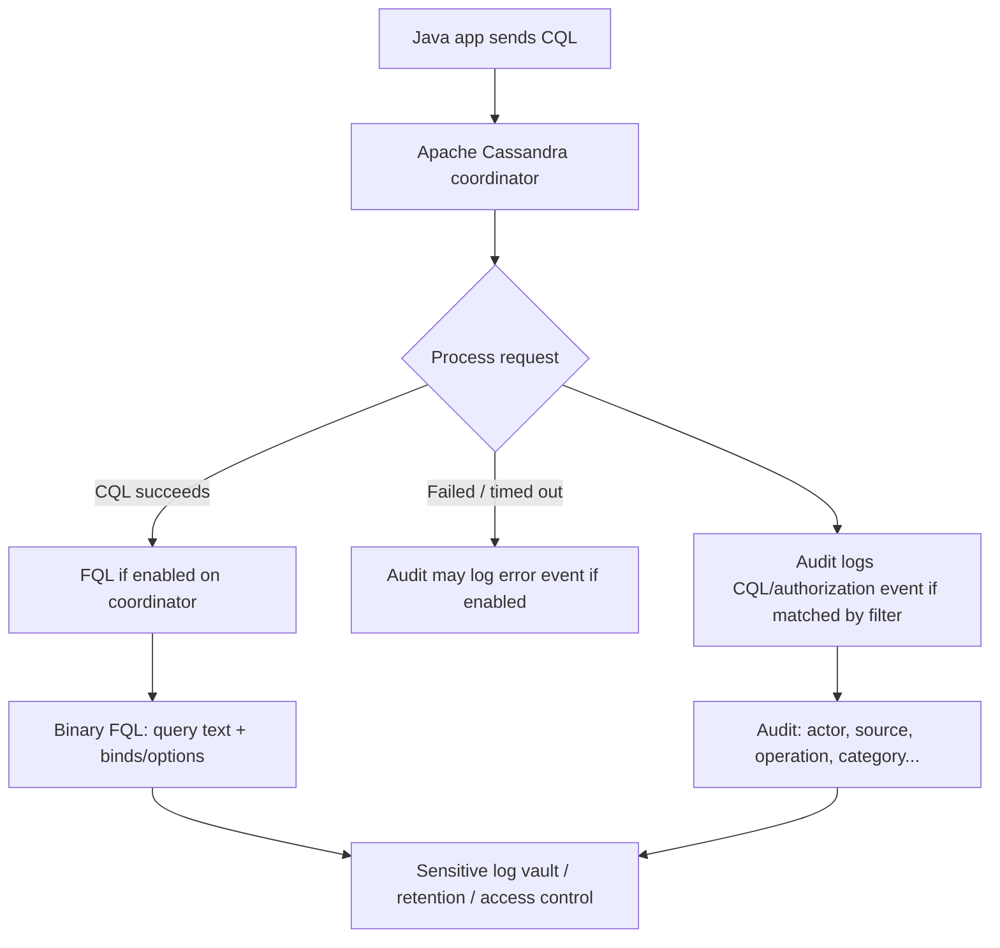
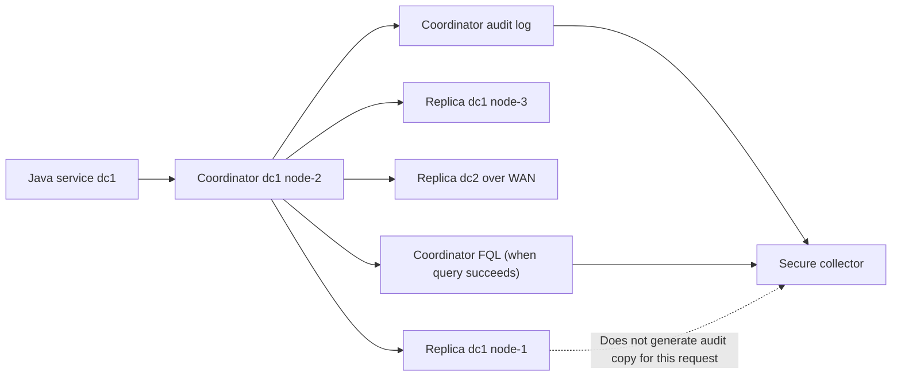
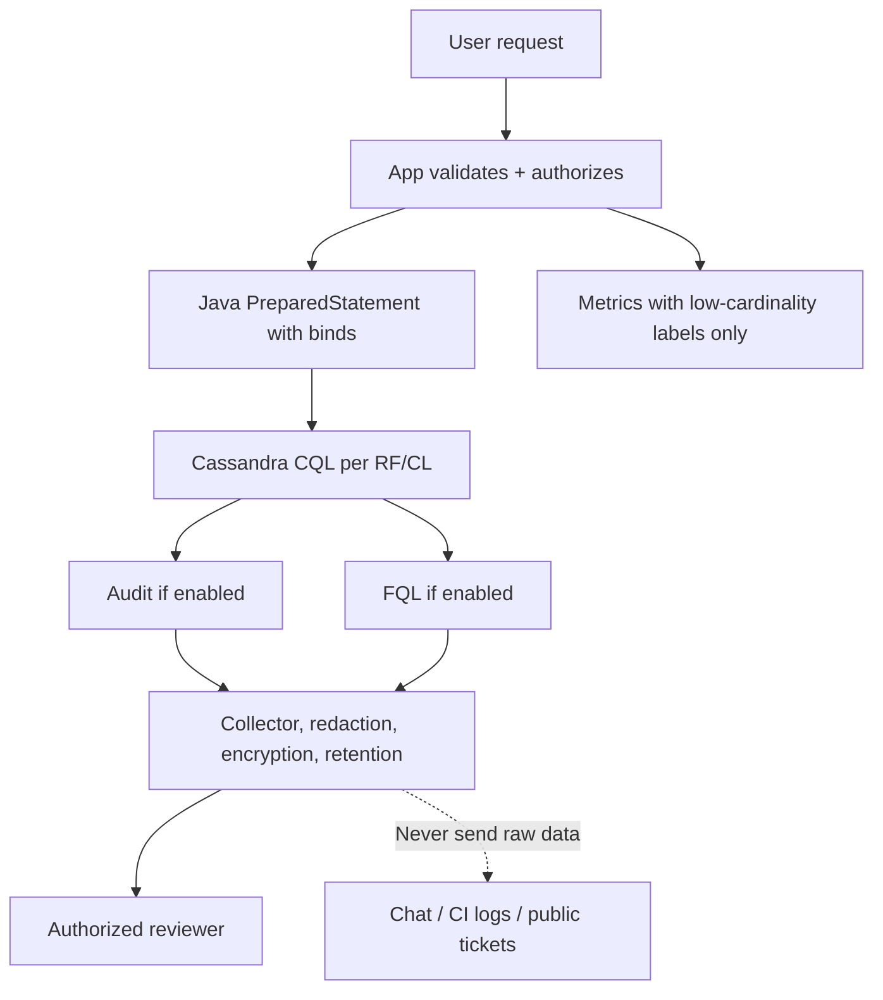

# Audit, Full Query Logging, and Sensitive Data by Supported Capability

> **Chapter:** Security  
> **Module:** `DATABASE_ENGINE_WIDE_COLUMN_CASSANDRA` — Apache Cassandra

A Java application connecting to Apache Cassandra may read customer records, update orders, run `DELETE`, or send administrative queries. When a data leak or accidental deletion occurs, operations teams immediately ask: **Who issued the command? Which node handled it? Which parameters were sent? Did the command succeed or fail? Can the request be replayed to reproduce a bug?**

Apache Cassandra provides **Audit Logging** and **Full Query Logging (FQL)** on supporting versions. These two mechanisms differ in purpose, captured data, and limitations:

- **Audit Logging** focuses on tracing CQL actions, authentication, authorization, and errors, serving access reviews and incident investigations.
- **Full Query Logging** records completed successful CQL queries, including options and bind values needed for load analysis, `dump`, `replay`, and comparison.
- **Neither is automatically an immutable monitoring system or safe against unauthorized access.** Logs can contain statements, identities, partition keys, business values, and sensitive data; furthermore, logs are generated **on each coordinator**, not replicated per table RF.

This topic sits in the distributed wide-column Cassandra module: a partition key determines the token, replicas depend on `NetworkTopologyStrategy`, and consistency level governs read/write acknowledgments. **Logging configuration does not alter replica mechanics, nor replace RBAC/TLS, backups, repair, or Java Driver query controls.**

This lesson focuses on **real version-supported capabilities**, choosing between Audit and FQL for your needs, protecting sensitive data in the pipeline, sizing resources, and building safe deployment/incident-response runbooks.

## 1. Start with the Security Requirement, Not a Logging Flag

Common goals:

| Goal | Minimum Data Needed | Preferred Source | Limitation to State Explicitly |
| --- | --- | --- | --- |
| Detect bad logins or unauthorized access | User, connection source, timestamp, authn/authz error type | **Audit Logging**, plus auth/infra logs | Not every JMX, OS, or config-edit action is recorded by CQL audit. |
| Trace who ran `DROP TABLE`, `TRUNCATE`, `GRANT` | CQL operation, user, timestamp, coordinator, scope | **Audit Logging** | Must be enabled on all nodes acting as coordinators with durable log shipping. |
| Replay query load for upgrade benchmarks | CQL, bind values, query options, approximate timing | **FQL** over a controlled window | Excludes failed/timed-out queries; replay can mutate data and expose info. |
| Investigate slow queries or heavy tombstones | Query ID, latency, CL, table, metrics/tracing | Metrics, Java Driver, selective tracing; FQL when appropriate | FQL does not explain p99 causes by itself or replace metrics. |
| Meet long-term retention regulations | Event scope, integrity, retention, access control, anti-loss | Audit + collector/immutable store per policy | Local logs can rotate/delete; audit does not automatically mean tamper-proof evidence. |
| Inspect specific parameter values | Bind values or authorized event payloads | FQL/CDC/event logs **if authorized** | Bind values are sensitive data themselves; never collect "just in case." |
| Determine final state of a partition | Primary key, CQL read at CL, replicas/repair | CQL, backups, audit/event provenance | Request logs are **not** the live logical state or proof a write reached all replicas. |

**Data minimization principle:** collect only **needed fields, for only the needed duration, accessible only to authorized personnel**. Enabling FQL cluster-wide forever just to answer a DDL question is overly broad, costly, and expands the leakage surface.

## 2. Version and Environment Support Matrix

Apache Cassandra documentation describes **Audit Logging** (CASSANDRA-12151) and **Full Query Logging** (CASSANDRA-13983) as features introduced in **Apache Cassandra 4.0**.

| Environment | Built-In Audit Logging | Built-In FQL | What to Verify |
| --- | --- | --- | --- |
| **Apache Cassandra 3.11 and earlier** | Not built in via the 4.0 mechanism discussed here | Not built in via 4.0 mechanism | Use logging/audit solutions suited to that version and app tier; never guess 4.0+ commands. |
| **Apache Cassandra 4.0 / 4.1** | Yes, version-configured | Yes, `nodetool enablefullquerylog` | Exact syntax, logger class, path, options, JDK, and JMX rights. |
| **Apache Cassandra 5.0.x** | Yes | Yes | Cross-check exact release/patch docs, configs, and CLI/JMX limits. |
| **Newer versions or vendor/managed editions** | May add/remove features or alter configuration | May be restricted or use custom pipelines | Vendor docs, operator rights, security policies, and log export options. |

**Do not treat a docs URL labeled "latest" as proof your cluster runs that version.** Before enabling/disabling features:

```bash
# Observational, does not mutate system state:
nodetool version
nodetool status

# Use the exact running binary to inspect real options:
nodetool help enableauditlog
nodetool help enablefullquerylog
nodetool help disableauditlog
nodetool help disablefullquerylog
```

During a rolling upgrade, nodes may run different versions with different logging capabilities. Never issue an admin command unsupported on a node's version and assume cluster-wide coverage.

## 3. What Does Audit Logging Capture?

Audit Logging records attempted/successful CQL events and failures, including **authentication/authorization** activity per implementation and configured filters. Each entry may include:

- Authenticated **User** (if any), source address/port, and coordinator.
- Event **Timestamp**, action type, category, and scope (keyspace/table/function…).
- CQL **Operation** or statement; batch/option details depending on the event.
- **`AUTH`/`ERROR`** events, such as login success/failure or unauthorized attempts, if not filtered out.
- Exact fields depend on logger/version and event type. Never build parsers assuming *every* line contains every attribute.

Commonly documented categories:

| Category | Example Cases | Why It Matters |
| --- | --- | --- |
| `AUTH` | Successful/failed logins, unauthorized access | Detects abuse, brute force, use of revoked credentials. |
| `DCL` | `CREATE ROLE`, `ALTER ROLE`, `GRANT`, `REVOKE` | Privilege changes; supports privilege audits. |
| `DDL` | `CREATE TABLE`, `ALTER TABLE`, `DROP`, `TRUNCATE` | Schema changes or large-scale data deletion. |
| `DML` | Updates, deletes, batches, and related mutations | Investigates data-modifying actions. |
| `QUERY` | `SELECT` | Audits read paths accessing sensitive data. |
| `PREPARE` | Statement preparation | Tracks prepared queries, though not necessarily each bound value. |
| `ERROR` | Request failures | Investigates failed operations and rejected requests. |
| `OTHER` | Auxiliary CQL commands | Do not assume all other types are harmless. |

For **prepared statements**, audit logging docs note it can log **the prepared CQL statement without displaying actual bind values on every EXECUTE**. Conversely, statements using **inline literals** (such as `WHERE email = '...'`) can expose those literals in the logged operation.

**Audit does not record every administrative action.** Official docs state explicitly that it **does not** capture `cassandra.yaml` edits or `nodetool` commands. To audit config edits, JMX, infrastructure changes, or OS actions, supplement with OS audit logs, change management, secret manager logs, and admin tool logs.

### 3.1. What Can a Single Audit Event Tell You?

**Simulated** example entry, not a fixed format:

```text
timestamp=2026-11-21T10:00:00Z
user=orders_readonly
source=192.0.2.25
category=QUERY
scope=commerce.orders_by_customer_month
operation=SELECT ... WHERE tenant_id=? AND customer_id=?
coordinator=node-dc1-02
```

This line helps establish **who/where/what command type**. It does **not** show the bound `customer_id`, returned row count, response contents, or state across replicas. If the system uses `AllowAllAuthenticator` allowing anonymous access, the user field cannot even attribute an individual; meaningful auditing requires proper authentication/authorization first.

### 3.2. Are Passwords Automatically Protected?

Audit Logging obfuscates passwords in DCL statements recognized properly by the parser. However, documentation warns that **malformed statements or unrecognized `password` tokens may appear unmasked**. Never rely on this obfuscation to justify writing secrets into CQL, query strings, error messages, or comments.

That is one of many reasons logs must be classified as **sensitive data**, even though logs are not business tables.

## 4. What Does Full Query Logging Capture and Why Is It More Sensitive?

FQL logs **successfully completed** CQL requests after completion so they can be inspected, replayed, or compared. Per Apache Cassandra docs, records may contain:

- CQL **query text** or list of queries in a batch.
- **Query options** (e.g., request execution parameters).
- **Bind values** substituted for `?` markers in prepared statements.
- Approximate query state/timestamp and auxiliary single-query/batch metadata.
- Data needed by `fqltool dump`, `fqltool replay`, and `fqltool compare`.

FQL is not designed to record **failed or timed-out** CQL requests, nor does it record login failures like Audit Logging. That is why **FQL must never be your sole evidence** for unauthorized access attempts, failed `DELETE`s, or missed requests.



**FQL can expose data that Audit intentionally omits.** Consider a Java request:

```sql
SELECT status
FROM commerce.orders_by_customer_month
WHERE tenant_id = ?
  AND customer_id = ?
  AND order_month = ?;
```

If real tenant/customer IDs are bound, those values can appear in **FQL** even though the CQL template shows `?`. There is no built-in guarantee that FQL hashes, anonymizes, or encrypts business fields for you.

### FQL Is Neither CDC Nor Backup

- FQL reflects only CQL captured by its mechanism—**not an immutable, complete changelog of all mutations**.
- A request succeeding at the coordinator still requires checking RF/CL, hints, and repair to confirm other replicas caught up.
- Replaying queries can re-apply **counter increments**, `INSERT`s with new TTLs, `DELETE`s, `TRUNCATE`s, LWTs, or data-modifying queries; it is not a restore command.
- FQL **does not record query responses** and does not replace snapshots/commit-log archives for PITR.
- Bound values may hold sensitive data or belong to a user whose access has since expired; replay can leak data or exceed original authorization scope.

**Rule:** `fqltool replay` must run only in an **isolated, data-sanitized, approved environment**, with scoped accounts/permissions. Never replay raw logs into production.

## 5. Key Differences Between Audit and FQL

| Dimension | Audit Logging | Full Query Logging |
| --- | --- | --- |
| Introduced in OSS | Apache Cassandra 4.0+ | Apache Cassandra 4.0+ |
| Primary goal | Access/CQL/auth traceability, compliance, investigation | Capturing query traffic, benchmarking, replay, comparison |
| Successful CQL | Yes if event type falls within audit filters | Yes if FQL is enabled and record writes succeed |
| Failed, rejected CQL | Yes per category/filter/version | **Not a source for failed/timed-out requests** |
| Authentication events | `AUTH` events unless excluded | No |
| DCL/DDL | Yes with category/scope/actor | Successful CQL statements may appear |
| Query text | Operation text | Query text |
| **Prepared bind values** | Usually **not** shown in prepared-statement audits | **Can be saved** for replay |
| Log replication by RF | **No**; recorded on coordinator | **No**; recorded on coordinator |
| Reader tool | `auditlogviewer` for `BinAuditLogger`; text for `FileAuditLogger` | `fqltool dump` |
| Replay tool | Not its goal | `fqltool replay/compare`, **isolated lab/cluster only** |
| Filtering by user/ks/category | Audit filters per documentation | FQL is primarily per-node; do not assume Audit-like filters |
| Sensitive data risk | Query literals, user/IP, role/scope, operation | Query text **and bind values**, potentially far richer in data |
| Impact when queue fills | `block`: blocks writers or drops records | `block`: blocks writers or drops records |
| Storage durability | Local files; needs separate archiving/protection | Local files; needs separate archiving/retention |

There is no "Audit = safer FQL" setting. They answer different questions. Both can be enabled when needed, provided you account for **double log sources, operational cost, and distinct access policies**.

## 6. Configuring Audit Logging Safely on Supporting Versions

### 6.1. Lab `cassandra.yaml` Example

Below is a **reference example for Cassandra 5.0**, not a default config to copy into production. Paths must be pre-created with proper permissions and **contain no existing data that needs preserving**.

```yaml
# cassandra.yaml — LAB with admin privileges, only when binary supports it.
audit_logging_options:
    enabled: true
    logger:
      - class_name: BinAuditLogger
    audit_logs_dir: /var/lib/cassandra-secure/audit
    excluded_keyspaces: system, system_schema, system_virtual_schema
    roll_cycle: HOURLY
    block: true
    max_queue_weight: 268435456
    max_log_size: 17179869184
    # archive_command: /path/to/approved-archive-script %path
```

Meaning:

- `enabled: true` enables logging at node startup; `nodetool enableauditlog` can enable/override options at runtime per version.
- `BinAuditLogger` is a Chronicle Queue–based binary logger, typically better suited for high throughput than synchronous file loggers; `FileAuditLogger` emits text via `logback.xml` with different operational characteristics.
- `excluded_keyspaces` typically excludes system keyspaces by default; if changing filters, verify `AUTH`/`DCL` categories are still captured per policy.
- `block: true` prioritizes **not dropping records when the queue fills**, at the risk of **applying query backpressure** if disk/archiving slows down.
- `max_queue_weight` is a memory cap for the queue (bytes), not a CQL row count.
- `max_log_size` caps local rolled logs under default rotation/cleanup; if `archive_command` is set, docs note this setting may **no longer govern local retention**.

**Directory security:** audit/FQL directories must be owned by the Cassandra service user, never world-readable, protected by filesystem permissions/ACLs, encryption, monitoring, and quotas. Demo guides sometimes use loose permissions for convenience; **never use those permissions in production**.

### 6.2. Per-Node Audit Enable/Disable Commands

```bash
# STATE-CHANGING logging commands: lab or approved change only.
nodetool enableauditlog

# Stop audit capture per approved request:
nodetool disableauditlog

# Inspect exact options and filters for your binary:
nodetool help enableauditlog
```

`cassandra.yaml` settings and runtime commands can diverge. If audit is a mandatory compliance control, never disable it on your own "to reduce load" without an approved alternative evidence mechanism and control-owner sign-off.

**For rolling restarts:** verify configuration persists across restarts; runtime changes do not always update config files or all nodes.

## 7. Configuring FQL: Log Paths Risk Recursive Deletion

This is FQL's most critical safety caveat: Apache documentation warns that **`log_dir` contents may be recursively deleted upon FQL reinitialization**, and `nodetool enablefullquerylog --path <path>` likewise warns the path **will have its contents deleted**.

**Never** point `--path` at:

- Cassandra data roots (`data_file_directories`), `commitlog_directory`, hints, or snapshots.
- Backup directories, audit logs, home directories, or shared log folders.
- Directories containing symlinks to other data or forensic evidence that must be preserved.
- Any path not verified by the operator as **dedicated solely to FQL and safe to wipe**.

### 7.1. Sample `cassandra.yaml` (Reference)

```yaml
# Configure only on supporting versions and a directory dedicated to FQL.
full_query_logging_options:
    log_dir: /var/lib/cassandra-secure/fql
    roll_cycle: HOURLY
    block: true
    max_queue_weight: 268435456
    max_log_size: 17179869184
    # archive_command: /path/to/approved-archive-script %path
```

FQL requires **configuration + enabling**:

```bash
# IMPACTING OPERATION: approved lab only,
# when the directory holds only FQL data and old contents need not be kept.
nodetool enablefullquerylog --path /var/lib/cassandra-secure/fql

# Disable FQL after the planned capture window:
nodetool disablefullquerylog

# The line below only prints help; it does not enable logging:
nodetool help enablefullquerylog
```

Both `audit_logging_options` and `full_query_logging_options` apply **per node**; to capture requests across the cluster, deploy and monitor across all **coordinators that may receive client traffic** per topology.

### 7.2. Do Not Use `resetfullquerylog` for Casual Disk Cleanup

`nodetool resetfullquerylog` is an admin command meant to delete/reset FQL data on disk per version. During an incident, it can **destroy forensic evidence**, just like manual directory deletion. Run it only once data owners approve retention, archives/backups are verified, and an audit trail is recorded.

### 7.3. Inspecting Logs with Supported Tools

```bash
# Use matching tool versions; inspect log copies in a protected area.
auditlogviewer /var/lib/cassandra-secure/audit
fqltool dump /var/lib/cassandra-secure/fql

# Read usage before trying replay-capable subcommands:
fqltool --help
```

`auditlogviewer` is used when Audit writes with `BinAuditLogger`; with `FileAuditLogger`, files are text processed through matching log pipelines. `fqltool dump` can print bind values to stdout, risking exposure via shell history, screen recordings, redirected files, or centralized log collectors. **Never dump raw FQL into CI logs, chats, public issues, or unauthorized support channels.**

`fqltool replay` and `compare` replay/diff workloads; `compare` itself can handle query/result files containing sensitive data. When needed, check exact version `--help` and run only in an **isolated, sanitized test cluster**.

## 8. Protecting Sensitive Data: Treat Logs as a Secondary Database

### 8.1. What Data Can Leak?

| Data Type | Risk in Audit/FQL | Required Control |
| --- | --- | --- |
| User, source IP, port, timestamp | Can correlate to a person or device | Restrict viewers, retention, and purpose. |
| `tenant_id`, `customer_id`, email in queries | Audit stores **literals** if written inline; FQL can store **bind values** | Prepared statements, pipeline tokenization/masking, enable FQL only when needed. |
| Passwords/API tokens/session keys | May appear in malformed DCL, CQL text, binds, errors, or traces | Never put secrets in query text/logs; redact before export; rotate on suspected leak. |
| Medical/payment/personal payloads | If present in `INSERT/UPDATE` binds or literals, FQL may record them | Data classification, least privilege, encryption at rest, restrict dump/replay. |
| Table names, schemas, org structure | Reveals sensitive objects and app surface | Separate prod/lab, log RBAC, limit sharing. |
| Query responses/result sets | FQL is not meant as a response store | Result reconciliation requires separate systems and data policies. |

**Prepared statements do not "hide data" from FQL.** They stop literals from being glued into CQL strings and improve query safety, yet FQL can still store parameter values for replay. Conversely, Audit does not guarantee masking literals embedded directly by query authors.

### 8.2. Minimum Pipeline Controls

1. **Encryption in transit/at rest:** TLS to collectors, storage encryption at rest, and KMS. Never assume Chronicle Queue binary files are encrypted by default.
2. **RBAC and separation of duties:** a DBA operating the cluster does not automatically need to view PII inside FQL. Audit reviewers, incident responders, and backup admins need independent, scoped permissions.
3. **Fixed retention:** short for raw FQL, aligned with contracts/compliance for Audit, with managed purge and legal-hold mechanisms.
4. **Integrity:** ship logs from multiple nodes to durable storage with checksums, synchronized clocks, append-only/WORM where needed, and auditing on every read/delete/export.
5. **Source scoping:** filter Audit by keyspace/category/user; for FQL, consider enabling **only for short capture windows on approved nodes** after verifying sample representativeness.
6. **Zero secrets in queries/logs:** use vaults/secret managers; avoid logging raw requests/exceptions in Java apps.
7. **Leak response plan:** detect raw dumps, revoke shares, check who downloaded logs, rotate potentially exposed secrets, and notify per policy.
8. **Secure deletion at expiry:** ensure archives, replicas, backups, object versions, and temp files obey retention too—"original log deleted" does not mean all copies vanished.

### 8.3. Audit Does Not Replace Authorization

Enabling Audit Logging **does not enforce permissions**. To block unauthorized access, configure proper authenticators/authorizers (such as Cassandra-supported password/role mechanisms), RBAC, network isolation, TLS, and JMX security. If the system still allows anonymous access or broad role privileges, good logs only show unauthorized access **after it happened**.

With CQL, `GRANT`/`REVOKE` restrict resources and permission types—that is a **preventive control**; Audit is a **detective control**; log retention/integrity is an **evidentiary control**. Three distinct goals that must be engineered together.

## 9. Quantifying Capacity, Resources, and the `block` Trade-Off

Never turn on FQL across all nodes and check disk usage a week later. Budget capacity beforehand:

\[
V_{\text{log,day}} \approx
QPS_{\text{captured}} \times S_{\text{log-record}} \times 86\,400
\]

Where `QPS_captured` is the event rate recorded on **coordinators with logging enabled**, and `S_log-record` is the **measured** average bytes including query text, binds/options, and file overhead.

**Illustrative** example: 2,000 recorded requests/s total, averaging 600 bytes per FQL record:

\[
2{,}000 \times 600 \times 86\,400
= 103{,}680{,}000{,}000\text{ bytes}
\approx 103.68\ \text{GB/day}
\]

Retaining seven days requires roughly **725.76 GB** before extra headroom for indexes/metadata, archiving, peak bursts, and disk safety margins. Never treat `max_log_size` as a backup/retention guarantee: once capped, old segments may be deleted while archived segments follow separate policies.

| Parameter | Choice Effect | Risk |
| --- | --- | --- |
| `block: true` | Producers wait when the queue falls behind, preserving event capture | **Can raise latency or hurt availability** when disk/archive slows down. |
| `block: false` | Never blocks queries on a full queue; may drop records | **Lost coverage**; unacceptable if compliance mandates complete capture. |
| `max_queue_weight` | Raising absorbs bounded bursts | Consumes RAM; only delays disk/network faults without solving unbounded backlogs. |
| `max_log_size` | Caps rolled segments when no matching archive runs | May delete older evidence; does not control archive retention when `archive_command` is set. |
| `roll_cycle` | Controls segment rollover cadence | Changing on an existing Chronicle Queue dir requires dedicated procedures; never alter casually. |
| `archive_command` | Ships rolled segments to durable storage via script | Slow/failing archive creates backlogs, retention gaps, and admin errors; must be tested. |

**Monitor the right metrics:** heap/GC, queue fullness, dropped-record counters if exposed by collector/logger, disk usage/inodes, archive command failures, upload latency, newest event timestamp, CQL p99, and per-node coverage. A dashboard saying only "logging enabled" does not prove events reach central storage.

### 9.1. Is `block: true` a Complete Compliance Solution?

No. It prevents **voluntarily dropping records when the queue fills**, yet disk failure, node death, or unarchived logs can still lose evidence. Strict compliance requires **end-to-end** engineering from request → coordinator local log → durable archive → integrity verification → retention, plus incident procedures if any link fails.

Conversely, if halting critical transactions for log storage is unacceptable, decide the *availability vs. completeness* boundary at the policy level—never flip to `block: false` unilaterally during an incident without approval.

## 10. Multi-DC: Why RF=3 Does Not Triple Audit Records

In Cassandra, a request enters a **coordinator**, which fans out mutations/reads to replicas and waits for ACKs per CL. **Audit/FQL records are generated on the coordinator where logging is enabled**, not replicated as extra audit entries across replicas just because RF=3.



Operational consequences:

- **Enabling audit on only one node** misses requests routed by drivers to coordinators on other nodes.
- **Enabling across all nodes** gives broader coverage, requiring collectors to aggregate by `cluster/DC/host_id`, preserve timestamps, and avoid miscounting when requests retry on another coordinator.
- Each client retry can generate **multiple request attempts**, so audit logs may show multiple entries for one query/user. Never treat log line count as unique business transaction count.
- If a node loses its disk before archiving, **CQL data replicas do not carry its audit logs**. Independent export is mandatory.
- With `LOCAL_QUORUM`, a coordinator returns success once local replicas ACK, so an audit event showing "command succeeded" does not prove another DC has received every mutation.
- Across multiple DCs, design collectors around **data residency requirements**: never ship raw PII-bearing FQL from one DC to another region merely for cheaper storage.

## 11. CQL Example: Generating Sample Events and Lab Permissions

Auditing can be practiced with a synthetic workload **containing no real data**. On an approved Cassandra 4.0+ LAB cluster with Audit/FQL:

```sql
-- Assumes a three-node dc1 LAB. Never use verbatim in production.
CREATE KEYSPACE IF NOT EXISTS security_lab
WITH replication = {
    'class': 'NetworkTopologyStrategy',
    'dc1': 3
};

CREATE TABLE IF NOT EXISTS security_lab.events_by_tenant (
    tenant_id text,
    event_day date,
    event_id uuid,
    category text,
    PRIMARY KEY ((tenant_id, event_day), event_id)
);

INSERT INTO security_lab.events_by_tenant
    (tenant_id, event_day, event_id, category)
VALUES (
    'demo-tenant', '2026-11-21',
    11111111-1111-4111-8111-111111111111,
    'demo-access'
);

SELECT category
FROM security_lab.events_by_tenant
WHERE tenant_id = 'demo-tenant'
  AND event_day = '2026-11-21'
  AND event_id = 11111111-1111-4111-8111-111111111111;
```

Illustrative DCL, only in a lab with an appropriate authenticator/authorizer and an authorized admin account:

```sql
-- Non-login role used to group permissions, no password needed.
CREATE ROLE IF NOT EXISTS security_lab_reader WITH LOGIN = false;

GRANT SELECT
ON TABLE security_lab.events_by_tenant
TO security_lab_reader;
```

These statements can produce Audit DDL/DML/QUERY/DCL events depending on category, user, filters, and coordinator placement. FQL records only the **successful CQL requests** captured while enabled. **Never use DCL statements containing real passwords to "test masking."**

If you do not see logs, check first:

1. Is Audit/FQL enabled on the **actual coordinator receiving the request**?
2. Is the category/keyspace/user excluded by Audit filters?
3. Did the CQL request succeed or fail? FQL does not log failed requests.
4. Has the log rolled/flushed, are disk/queue/archiver healthy, and are directory permissions right?
5. Does the viewer match the binary log version and `roll_cycle`?

## 12. Java Driver 4.x: Using Prepared Statements and Minimal Logging

Application example querying by the full partition key without interpolating tenant/customer literals into CQL strings:

```java
import java.time.LocalDate;
import java.util.UUID;
import java.util.concurrent.TimeUnit;
import java.util.logging.Level;
import java.util.logging.Logger;

import com.datastax.oss.driver.api.core.CqlSession;
import com.datastax.oss.driver.api.core.DefaultConsistencyLevel;
import com.datastax.oss.driver.api.core.DriverException;
import com.datastax.oss.driver.api.core.cql.PreparedStatement;
import com.datastax.oss.driver.api.core.cql.Row;

public final class SecureAuditProbe {
    private static final Logger LOG =
        Logger.getLogger(SecureAuditProbe.class.getName());

    private final CqlSession session;
    private final PreparedStatement read;

    public SecureAuditProbe(CqlSession session) {
        this.session = session;
        this.read = session.prepare(
            "SELECT category FROM security_lab.events_by_tenant " +
            "WHERE tenant_id = ? AND event_day = ? AND event_id = ?");
    }

    public String readCategory(String tenantId, LocalDate day, UUID eventId) {
        long startedNanos = System.nanoTime();
        try {
            Row row = session.execute(
                read.bind(tenantId, day, eventId)
                    .setConsistencyLevel(DefaultConsistencyLevel.LOCAL_QUORUM)
                    .setIdempotent(true)
            ).one();
            return row == null ? null : row.getString("category");
        } catch (DriverException e) {
            // Never log raw CQL/bind values/tenantId/credentials/payloads.
            LOG.log(Level.WARNING,
                "Cassandra read failed: " + e.getClass().getSimpleName());
            throw e;
        } finally {
            long elapsedMs = TimeUnit.NANOSECONDS.toMillis(
                System.nanoTime() - startedNanos);
            // Production: histogram/tag query-template-id, do not print every call.
            LOG.log(Level.FINE, "read_by_partition_ms=" + elapsedMs);
        }
    }
}
```

**Security explanation:**

- Prepared statements prevent building CQL by concatenating untrusted data. They do **not** make FQL skip bind values required for replay.
- Java logs only **error class and latency**, omitting `tenantId`, `eventId`, payloads, and raw queries. In production, also govern stack traces, request interceptors, and built-in driver tracing.
- `LOCAL_QUORUM` is a consistency decision; it does **not** replicate logs to a quorum of replicas.
- `setIdempotent(true)` fits the illustrative `SELECT`, not counters, LWTs, or side-effect mutations.
- `CqlSession` must configure local DC, authentication, and TLS properly; never hardcode passwords or tokens in source code.
- Application event logs may need a **correlation ID** generated outside the payload; if correlating with audit logs, account for the fact that audits may not retain all application IDs.

### Blocking Sensitive Data Across Multiple Layers



If privacy policy forbids collecting raw PII, **never rely solely on redaction after FQL writes to local disk**: the data already existed there. Consider disabling FQL, using synthetic/masked data, or deploying an aggregate query-telemetry solution that omits bind values.

## 13. Deployment Runbook: From Requirement to Operational Evidence

### Phase A — Pre-Deployment Design

1. Define the **objective**: audit compliance, DCL investigation, or replay benchmarking.
2. Classify sensitive keyspaces and columns; lock down log viewers, storage regions, retention, legal holds, and deletion paths.
3. Verify Cassandra version, `nodetool`/viewer binaries, supported loggers, and managed-service capabilities.
4. Pick **Audit** for `AUTH`/`ERROR`/`DDL`/`DCL`; pick **FQL** only when bound values/replay are genuinely required.
5. Size peak log throughput, disk headroom, queue weight, archive cost, collector unavailability, and `block` policy.
6. Provision a **dedicated, empty** directory; verify ownership/ACLs, no symlinks, encryption, and backup/archive config.
7. Assign owner, change ticket, capture window, stop criteria, rollback, and required evidence.

### Phase B — Controlled Canary

1. Configure one suitable node/lab (or a small approved production scope) with directory and filters.
2. Enable Audit and/or FQL via the exact version mechanism.
3. Send **synthetic** requests: partition-key SELECT, demo INSERT, secret-free DCL, and one controlled query error.
4. Read a **copy** of audit/FQL logs using the viewer; verify expected success/failure events and bind values.
5. Watch CQL p95/p99, error rates, free disk, queue/backpressure, and exporters.
6. Expand only when zero unintended secrets appear, required coverage holds, and durable archiving works.

### Phase C — Cluster-Wide Rollout

1. Roll out by node/DC/rack respecting CL/quorum; enabling via `nodetool` where supported may avoid restarts, yet persistent config files must still be managed.
2. Confirm all nodes able to serve as coordinators have logging enabled, directories ready, and active collectors.
3. Compare event rate arriving in central storage against request volume and expected audit events; fix filtered/dropped gaps.
4. Record baseline config, JMX access policy, authorized log viewers, and file rotation deadlines.
5. Schedule regular checks on integrity, retention, and archive health.

### Phase D — Closing an FQL Window

- Stop FQL per approved change using `nodetool disablefullquerylog` on all relevant nodes.
- Verify all segments archived properly alongside integrity and access logs; never `reset`/wipe directories before owner confirmation.
- Keep raw data for the shortest reasonable retention, relying on PII-stripped analysis results where possible.
- Evaluate CPU/disk/p99 post-disable; update runbooks and document any gaps found.

## 14. Security and Logging Incident Runbooks

### RB-01 — Suspected Unauthorized `DROP TABLE` or Privilege Change

**Verify:** UTC window, `DDL`/`DCL` categories, actor, source IP, scope, coordinator, schema history, deployment/change tickets, and cluster status. Never infer a specific human individual from one log line when roles are shared.

**Respond:** lock/revoke compromised roles/credentials with approval; preserve audit logs, schemas/backups, and halt harmful jobs; assess impact per keyspace/table and engage legal/security teams if PII is involved.

**Do not:** use raw FQL replay to "undo" DDL; delete logs to free disk; run restores before confirming what data must be preserved.

**Close:** dangerous permissions revoked, timeline/actor reconciled with change systems, data recovered per RPO, and evidence preserved.

### RB-02 — FQL Causing Disk Pressure or p99 Spikes

**Verify:** `log_dir`, rolled-file size/growth rate, archive backlog, `block`, queue fullness, whether disk is shared with data/commitlog, and client p99/timeouts. Never stare only at Cassandra read latency while ignoring disk loggers.

**Respond:** per policy, **stop FQL** before availability outage spreads; safely offload/archive rolled segments; expand disk if needed and fix collectors/archivers. If Audit is a mandatory control, align with compliance owners before altering `block` or disabling.

**Do not:** run `resetfullquerylog`/`rm -rf` or re-point `--path` at a directory holding evidence. Never delete SSTables "to make room" for logs.

**Close:** healthy disk headroom, request SLOs restored, report documenting any lost/incomplete logs, and remediation plan.

### RB-03 — Raw FQL Dump Containing PII/Secrets Discovered

**Verify:** where the dump surfaced, who had read/download access, retention, exposure duration, exposed data types, and share locations. Stop further propagation while investigating.

**Respond:** isolate files/dumps, revoke permissions, rotate exposed credentials, collect access logs, evaluate notification duties, purge unauthorized copies per policy, and retain forensic evidence in a controlled vault.

**Do not:** paste FQL snippets into chat channels for analysis, or claim secrets are safe merely because CQL used prepared statements.

**Close:** scope determined, permissions fixed, log retention tightened, incident review completed, and affected parties notified per policy.

### RB-04 — Audit Enabled Yet Missing Events

**Verify:** coordinator node of sample requests, `included/excluded_keyspaces/categories/users` filters, `AUTH`/`ERROR` events, exporter/collector, disk/queue, clocks, `block: false`, and active logger.

**Respond:** fix filters, add node coverage, restore archives, and re-enable only with approval; if events were genuinely dropped, document the **evidence gap** rather than fabricating entries.

**Do not:** conclude audits are complete because one recent file exists or because RF=3; never use FQL to reconstruct failed auth events it never logs.

**Close:** test matrix shows traces from every required DC/coordinator, event rates match expectations, and collector/node log alerts are active.

## 15. Production Readiness Checklist

| Check | PASS Condition |
| --- | --- |
| **Version** | Exact Apache Cassandra binary/nodes support the feature; verified against patch/vendor docs. |
| **Need** | Clear use case and owner; Audit vs. FQL chosen appropriately. |
| **Limitations** | Documented what is **not logged**: `nodetool`/configs, failed FQL, result sets, non-coordinator replicas. |
| **PII protection** | Data classification, encryption, RBAC, no raw dump permissions for unneeded roles. |
| **Log directory** | Dedicated directory, right permissions, no symlinks; especially FQL `--path` wipe risk accounted for. |
| **Resources** | Sufficient disk/queue/archive capacity, `block` behavior decided, backlog/p99 alerts active. |
| **Retention** | Clear local max size and archive retention; purge, hold, and integrity plans ready. |
| **Coverage** | All potential coordinators across DCs log properly; collectors miss no nodes. |
| **Success/fail tests** | Audit logs expected categories, FQL captures successful requests; zero unintended secret exposure. |
| **Runbook** | Procedures for enable/disable, disk/collector/PII incidents, rollback, and on-call ownership. |
| **Reconciliation** | Request volume vs. logged events checked; never treat one log line as a complete transaction/replica ACK. |
| **Training** | On-call staff understand `auditlogviewer`, `fqltool dump`, replay limits, and access approval. |

## 16. Self-Check Exercises

**Question 1.** An OSS Cassandra 3.11 cluster wants to run `nodetool enablefullquerylog`. Can we assume the command will work? If not, what should we do?

**Question 2.** A Java app executes `SELECT ... WHERE tenant_id = ?` with a prepared statement. Audit shows only `?` in the statement, while `fqltool dump` displays the real tenant ID. Is this a masking bug or an intentional design difference?

**Question 3.** An auditor wants to see failed login attempts. Should you use Audit or FQL? Why?

**Question 4.** In a two-DC RF=3 cluster, audit is enabled **on only one node**. Can we assume all `DELETE` statements were captured? Explain.

**Question 5.** An operator runs `nodetool enablefullquerylog --path /var/lib/cassandra/data` to "reuse disk space." What specific catastrophic risk occurs?

**Question 6.** At 2,000 requests/s and 600 bytes average per record, roughly how many GB/day of logs are produced theoretically? Why shouldn't you use that number as an exact disk limit?

**Question 7.** Audit `block: false` lowers peak-hour latency. Why might a compliance team reject that configuration?

**Question 8.** The security team finds `fqltool dump` output in a public CI job log. What data may be exposed, and what are the first three actions?

**Question 9.** A Java request timed out, yet the mutation later appears in a CQL read. Can FQL be used to prove the complete history of attempts and replicas definitively? Why or why not?

**Question 10.** Audit logs show a `DROP TABLE` event; ops wants to know whether an admin ran `nodetool repair` before or after it. Does Cassandra Audit Logging alone provide enough evidence?

<details>
<summary>Answer Hints</summary>

1. No. Built-in Audit/FQL arrived in Cassandra 4.0; on 3.11, choose version-appropriate solutions or plan an upgrade.
2. It is a difference in purpose. Prepared-statement audits can omit bind values; FQL needs bind values for replay. FQL must be treated as sensitive data.
3. Audit Logging, because it records `AUTH`/login failures and rejected requests; FQL primarily logs successfully completed CQL.
4. No. Logs are written **on the coordinator with logging enabled**, not replicated alongside RF=3 data. Drivers can pick other coordinator nodes.
5. The FQL path can be **recursively wiped** on enable/reset per docs, destroying SSTables or vital data; strictly use a dedicated FQL directory.
6. About **103.68 GB/day** decimal, before accounting for overhead, peaks, segment rolls, archiving, and retention.
7. It may **drop records** when the queue fills, creating evidence gaps even while CQL keeps serving. Weigh completeness vs. availability with the control owner.
8. Query text, bind values, and PII/secrets may be exposed. Isolate the dump and revoke access, determine who accessed it and scope, rotate affected secrets, and trigger security incident response.
9. No. FQL does not guarantee capturing failed/timed-out requests, is not a changelog/backup, and does not prove all replicas synced.
10. No. Cassandra Audit does not record `nodetool` commands or `cassandra.yaml` edits; independent OS/JMX/change-management logs are required.

</details>

## Key Takeaways

- **Built-in Audit Logging and FQL exist from OSS Apache Cassandra 4.0 onward**; verify exact version/vendor support and admin rights before deploying.
- **Audit** fits user/source/category tracing, authn/authz, and failed events; **FQL** captures successful CQL requests with binds/options for dump/replay/compare.
- **FQL can contain sensitive data even when applications use prepared statements.** Protect it from initial local disk write onward—never rely solely on masking at report export.
- Logs are generated **per coordinator**, not replicated per keyspace RF, and never replace backups, repair, authn/authz, TLS, or OS auditing.
- FQL `--path` risks **wiping directory contents**; never point it at data/commitlog/snapshot/backup or shared directories.
- `block: true` vs. `block: false` trades **availability ↔ risk of dropped records** and must be approved explicitly.
- An auditing system is only complete with **all-node coverage, encryption, RBAC, archiving, integrity, retention, testing, and incident response**.

### Official References

- [Apache Cassandra — Audit Logging: data, configuration, durability, filters, and viewer](https://cassandra.apache.org/doc/stable/cassandra/managing/operating/auditlogging.html)
- [Apache Cassandra — Full Query Logging: configuration, limits, fqltool, and replay](https://cassandra.apache.org/doc/stable/cassandra/managing/operating/fqllogging.html)
- [Apache Cassandra — Audit Logging: distinguishing prepared binds and statements](https://cassandra.apache.org/doc/stable/cassandra/managing/operating/audit_logging.html)
- [Apache Cassandra — nodetool enableauditlog](https://cassandra.apache.org/doc/stable/cassandra/managing/tools/nodetool/enableauditlog.html)
- [Apache Cassandra — nodetool enablefullquerylog and --path warning](https://cassandra.apache.org/doc/stable/cassandra/managing/tools/nodetool/enablefullquerylog.html)
- [Apache Cassandra — cassandra.yaml: audit_logging_options and full_query_logging_options](https://cassandra.apache.org/doc/stable/cassandra/managing/configuration/cass_yaml_file.html)
- [Apache Cassandra — Security: authentication, authorization, TLS](https://cassandra.apache.org/doc/stable/cassandra/managing/operating/security.html)
