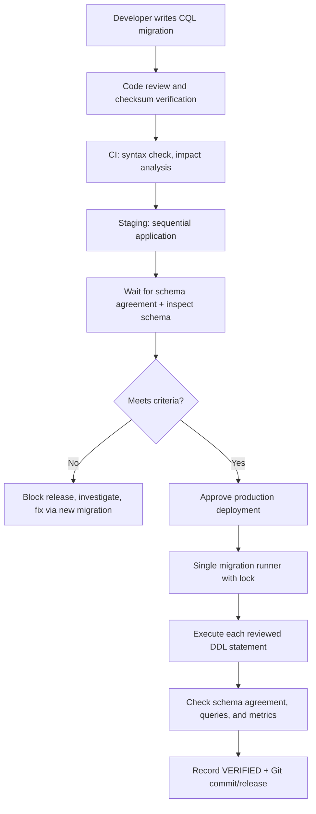

# Managing DDL, Table Options, and Schema History with Version Control in Apache Cassandra

## 1. Why manage schema as source code?

Apache Cassandra is a distributed **wide-column** database: data is partitioned by **partition key**, replicated across replicas according to the replication factor, and tables are typically designed around **query patterns**. As Java applications, CQL, and cluster topology evolve together, schema changes become part of the **software release lifecycle**, not merely commands typed into `cqlsh`.

Suppose an order service has three environments: `dev`, `staging`, and `production`. One person adds the `status_changed_at` column in dev, another changes the compaction strategy in staging, while production is still running an older application version. Without an auditable change history:

- The Java application may send CQL referencing a column not yet created in production.
- Two environments may share the same table name but differ in column types, `default_time_to_live`, or compaction strategy.
- An option-altering statement may increase I/O and disk usage while the cluster is serving live queries.
- It is impossible to determine who changed the DDL, why, on which version, and whether it was tested.
- When a deployment fails midway, the operations team cannot tell which steps completed or how to proceed.

The solution is to put **DDL and table option changes under version control**: every change has an ordered migration file, is peer-reviewed, tested in a production-like environment, executed through a single orchestrated pipeline, and reconciled against the **actual schema** after application.

This lesson belongs to the `DATABASE_ENGINE_WIDE_COLUMN_CASSANDRA` module, **Migration and Schema** chapter. After completing it, you should be able to classify DDL statements, manage table options, design an immutable migration repository, verify schema agreement, operate compatible changes alongside Java applications, and handle **schema drift** or interrupted migrations.

## 2. Which components belong in schema history?

Not only `CREATE TABLE` belongs under management. The following components affect system correctness or performance:

| Category | CQL / Configuration Example | Why it must be tracked |
| --- | --- | --- |
| **Keyspace** | `CREATE KEYSPACE`, `ALTER KEYSPACE` with replication | RF and topology affect fault tolerance, read/write consistency, and streaming |
| **Tables and primary keys** | `CREATE TABLE`, clustering order, partition key | Determines where data lives and which queries can execute efficiently |
| **Columns and data types** | `ALTER TABLE ... ADD`, storage representation changes | Can make old/new application versions incompatible |
| **Table options** | `compaction`, `compression`, `default_time_to_live`, `gc_grace_seconds`, `caching` | Affects I/O, CPU, memory, TTL, tombstones, and recovery time |
| **Dependent objects** | User-defined types, indexes, materialized views if used | Must account for creation/deletion order and query/restore behavior |
| **Access permissions** | Roles and `GRANT`/`REVOKE` per governance policy | Services and workers need table-specific permissions; avoid superuser |
| **Data migration** | Backfill, dual-write, reconciliation, creating `_v2` tables | CQL DDL does not automatically copy data from old designs to new ones |

Within the scope of this lesson, **version control stores intent and deployment history**, while Cassandra stores the current schema state. Business data in SSTables, token ownership, repair, and replication must be operated separately, even though they affect migration success.

### CQL schema is not like RDBMS migrations

Cassandra has a mechanism to propagate schema metadata across the cluster, but it does not provide a general-purpose SQL transaction to group multiple DDL statements into a single atomic commit/rollback. DDL statements apply operation by operation and may take time for nodes to reach schema agreement.

Therefore, **do not assume** that:

- A file `V005.cql` containing five DDL statements will roll back completely if the fourth statement fails.
- `ALTER TABLE` can alter a partition key, clustering key, or convert arbitrary column types as in some RDBMS engines.
- `IF NOT EXISTS` proves the existing structure matches the migration definition.
- The new schema is immediately visible to every coordinator and Java Driver instance right after one node returns success.
- Updating RF via DDL means data has already streamed to all replicas.

Every change requires an application compatibility plan, cluster verification, and a **forward recovery path**.

## 3. Foundational CQL DDL: keyspace, table, column

Consider a test cluster with a real datacenter named `dc1` and at least three suitable nodes. DC/RF names here are learning examples and **must be replaced to match actual topology** during deployment.

```sql
CREATE KEYSPACE commerce
WITH replication = {
  'class': 'NetworkTopologyStrategy',
  'dc1': 3
}
AND durable_writes = true;
```

`NetworkTopologyStrategy` allows declaring replica counts per datacenter. Setting RF and read/write consistency levels are separate yet closely coupled decisions: `LOCAL_QUORUM` with RF 3 requires two replicas in that DC to respond. If changing RF or adding a DC, you must plan for streaming, repair/reconciliation, and validation; `ALTER KEYSPACE` alone does not complete data movement.

Creating a table to serve lookups by `order_id`:

```sql
CREATE TABLE commerce.orders_by_id (
  order_id uuid PRIMARY KEY,
  customer_id uuid,
  status text,
  total_amount decimal,
  updated_at timestamp
)
WITH comment = 'Order lookup by order_id'
 AND compaction = {'class': 'SizeTieredCompactionStrategy'}
 AND compression = {'class': 'LZ4Compressor'}
 AND default_time_to_live = 0;
```

In this example:

- `order_id` is the partition key, so every `SELECT ... WHERE order_id = ?` targets a single partition.
- `PRIMARY KEY` **does not play the same role as cross-table foreign keys or unique constraints** in an RDBMS.
- `default_time_to_live = 0` means no table-level default TTL is set; data can still be written with an explicit per-write TTL when appropriate.
- `compaction` and `compression` are stated explicitly so reviewers see the intent, though values must be checked against the Cassandra version and workload; distribution defaults may vary.

If an optional column needs to be added:

```sql
ALTER TABLE commerce.orders_by_id
ADD status_changed_at timestamp;
```

This is a type of change that can usually follow an **expand** pattern: older applications that do not use the new column continue working; existing rows without a value return `null` for that column. You cannot infer that historical data has been backfilled merely because the DDL command succeeded.

### Changes that require redesigning the table

When you want to change `order_id` into a composite partition key, change clustering keys, or convert a column type that does not support in-place alteration, consider **creating a new table** shaped for the new query, migrating the data, and switching the application. In Cassandra, **partition key design is a data-distribution decision**, not a simple metadata rename.

`DROP TABLE`, `TRUNCATE`, or dropping columns are operations that can lose data or break older application versions. Always have backups, dependency checks, and review gates before running them in production.

## 4. Table options: which configurations belong in history and what do they do?

Table options should be reviewed as operational changes capable of affecting the entire cluster. Avoid editing them directly via `cqlsh` in production and updating documentation afterward.

| Option | Role | What must be evaluated |
| --- | --- | --- |
| `compaction` | Controls how SSTables are merged/rewritten | Read/write profile, SSTable count, write amplification, free disk space, I/O volume when switching strategies |
| `compression` | Compresses SSTable data | CPU, compression ratio, disk usage, SSTable compatibility, compaction impact |
| `default_time_to_live` | Default TTL for data written to the table | Business retention period, existing data, tombstones, queries, and recoverability |
| `gc_grace_seconds` | Minimum tombstone retention window for delete/repair mechanics | Repair schedule, offline nodes, risk of deleted data reappearing |
| `caching` | Key/row cache behavior by version | Memory usage, hit rate, workload type |
| `bloom_filter_fp_chance` | Bloom filter false-positive probability | RAM and SSTable read I/O; depends on compaction strategy |
| `speculative_retry` | Sends backup read requests when a replica is slow | Tail latency, extra load on replicas, overload control |
| `read_repair` (if supported by version) | Policy for handling replica mismatches on the read path | Blocking/read behavior trade-offs; verify for your exact version |
| `comment` | Table purpose note | Helpful for auditing; does not determine data layout or performance |

**There is no single optimal option set for every table.** A key-lookup orders table differs from a continuously written time-series table with TTL. `TimeWindowCompactionStrategy` (TWCS) can fit time-windowed data, but requires understanding timestamps, TTL, updates to older data, and late arrivals. Switching from STCS to LCS or TWCS is not "just a metadata update"; subsequent compaction can consume significant CPU, I/O, and disk.

### 4.1. Low-risk option migration

For example, updating only descriptive metadata:

```sql
ALTER TABLE commerce.orders_by_id
WITH comment = 'Order lookup API; owner=orders-team; migration=V003';
```

This is an easy change to verify, yet you still must wait for schema agreement and inspect the actual schema after deployment.

### 4.2. Compaction-changing migrations require a maintenance window

Suppose after benchmarking, the team wants to switch from STCS to LCS for a read-heavy table:

```sql
-- Example of a change with significant operational impact; run only after load testing.
ALTER TABLE commerce.orders_by_id
WITH compaction = {'class': 'LeveledCompactionStrategy'};
```

Before merging, record:

1. Why the change is needed: read/write metrics, p95/p99, SSTables per read, storage size, and improvement targets.
2. Cassandra version and supported options.
3. Compaction I/O, CPU, disk headroom forecast, and repair/snapshot status.
4. Deployment window, stabilization period after the change, and criteria to throttle or pause.
5. Revert criteria and consequences if SSTable/compaction debt remains from the old strategy.

**Do not measure success solely by CQL returning `OK`.** Monitor pending compactions, read latency, disk space, and convergence after the change.

### 4.3. TTL and tombstones must align with data retention policy

Example:

```sql
-- Example table for short-lived events, not applicable to a permanent orders table.
ALTER TABLE commerce.short_lived_events
WITH default_time_to_live = 604800;
```

`604800` seconds equals 7 days. Changing the default TTL **does not simply expire all existing data after 7 days**; you must verify its behavior across new mutations/rewrites and the TTL rules of the running Cassandra version. Test against both data existing before the change and data written after it.

`gc_grace_seconds` is not an "immediate tombstone cleanup" switch. Lowering it without justification when nodes may be offline for long periods or repairs do not run reliably can contribute to **zombie data** (deleted data reappearing). Changing retention windows requires reviewing repair schedules, retention/TTL, fault tolerance, and topology.

## 5. Organizing migration history in Git

An illustrative structure of an **application repository**, not files created by this lesson:

```text
orders-service/
  db/
    cassandra/
      README.md
      manifest.yaml
      migrations/
        V001__create_commerce_keyspace.cql
        V002__create_orders_by_id.cql
        V003__add_status_changed_at.cql
        V004__describe_orders_table.cql
      checks/
        expected-schema.md
        validation-queries.cql
  src/
    main/
      java/
        ...
```

The layout should enforce:

- **Unique identifier per change**: `V001`, `V002`, …; do not rely on `ls` ordering or arbitrary timestamps generated across developer machines.
- **Executed migrations are immutable**: do not edit `V002` after it has been deployed; create `V005` if further adjustments are needed.
- **Contextual review**: business rationale, read/write impact, application dependencies, expected schema, backfill/rollback plan, and verification metrics.
- **Checksums**: store a hash of migration contents in the manifest and deployment state to detect tampering with historical files.
- **Release mapping**: identify which application commit/tag requires which migration.
- **Keep secrets out of Git**: Cassandra passwords, object-storage tokens, and sensitive credentials must come from a secret manager or CI secrets.

An **illustrative** manifest example, not a format Cassandra natively understands:

```yaml
service: orders-service
database: cassandra
migrations:
  - id: V001
    file: migrations/V001__create_commerce_keyspace.cql
    sha256: "<ci-computed-hash>"
    affects: [keyspace:commerce]
  - id: V002
    file: migrations/V002__create_orders_by_id.cql
    sha256: "<ci-computed-hash>"
    affects: [table:commerce.orders_by_id]
  - id: V003
    file: migrations/V003__add_status_changed_at.cql
    sha256: "<ci-computed-hash>"
    affects: [table:commerce.orders_by_id]
```

Hashes verify immutability after content is reviewed; they are **not** a concurrency lock against parallel execution. The `README.md` path in the example represents a documentation file in a real repository and does not require a worker to create or read it.

### Where should schema history be stored?

You can use an organization-approved migration tool with Cassandra support, or a CI/CD deploy runner with an exclusive lock and dedicated ledger. If using a ledger, record at minimum:

| Field | Meaning |
| --- | --- |
| `migration_id` | Identifier of the approved change |
| `checksum` | Hash of executed content to detect history edits |
| `environment` / `cluster_id` | Prevents mixing dev/staging/prod state |
| `started_at` / `finished_at` | Tracks deployment timing and duration |
| `status` | `PENDING`, `RUNNING`, `APPLIED`, `VERIFIED`, `FAILED` |
| `executor` / `git_commit` | Actor and release build executing the change |
| `verification` | Schema agreement, drift check, acceptance checks |
| `error` / `resolution` | Details needed to resume an interrupted migration |

**The ledger does not share a transaction with Cassandra DDL.** If the runner writes `RUNNING` and crashes after the DDL succeeds, the system must inspect the **actual schema before retrying**. Marking `VERIFIED` before verifying schema can cause the ledger to report false state. The ledger provides auditing and coordination, not a substitute for cluster verification.

## 6. Safe deployment workflow: one source of truth, one runner

With multiple Java application instances or pods, do not let every instance run DDL on startup. If ten pods execute `ALTER TABLE` concurrently, they can collide, write inconsistent ledger state, or trigger schema disagreement. Use an **exclusively coordinated migration runner** separated from the normal request lifecycle.



Minimum sequence:

1. **Preflight:** identify cluster/DC/version, healthy nodes, admin permissions, current schema state, and latest backup.
2. **Acquire deployment lock:** ensure only one runner modifies the same schema/scope; the lock must have a recovery mechanism if the runner crashes.
3. **Read state:** compare applied `migration_id`/checksums against the manifest. If history was altered, **block deployment**.
4. **Check preconditions:** verify existing tables/columns and compatibility before execution.
5. **Apply each DDL statement** in exact order, logging timestamps and outcomes.
6. **Wait for schema agreement** across reachable nodes; inspect the actual schema rather than trusting only the exit code.
7. **Run application smoke tests** and relevant metrics checks; mark `VERIFIED` only after passing acceptance criteria.
8. **Release lock and deploy application** according to the defined compatibility sequence.

No single tool is mandated here. `cqlsh -f` can execute a CQL file, but on its own it **does not** provide a migration ledger, distributed lock, automatic rollback, or multi-environment orchestration.

### 6.1. Observing schema agreement

Depending on the Cassandra version and setup, you can inspect state using read-only commands:

```bash
nodetool status
nodetool describecluster
nodetool version
```

`nodetool describecluster` typically groups nodes by schema version, helping detect nodes that have not converged or are unresponsive. However, querying a single node does not guarantee the cluster has no isolated nodes; combine this with the expected node list, health checks, and runner/driver validation.

In `cqlsh`, metadata can be inspected via:

```sql
DESCRIBE KEYSPACE commerce;

SELECT keyspace_name, table_name
FROM system_schema.tables
WHERE keyspace_name = 'commerce';

SELECT schema_version FROM system.local;
```

`system.local.schema_version` reflects the schema state known to the queried node; this value is **not `V003` from Git**, is not the migration hash, and does not provide change history. `DESCRIBE` shows the current schema and helps compare against expected definitions, but does not fully reveal who changed it or why.

With the Java Cassandra Driver, the schema metadata layer can also observe metadata/schema agreement via version-appropriate APIs. During a release, the runner should enforce an explicit timeout and fail if expected agreement is not reached rather than waiting indefinitely.

## 7. Compatible schema changes: expand – migrate – contract

An application change often has to run during a window where **both old and new versions coexist**, especially during rolling deploys or when multiple services share a keyspace. The safe pattern is:

1. **Expand:** add the new schema while keeping older software working.
2. **Migrate:** backfill/reconcile data and move the application to the new read/write path.
3. **Contract:** remove the old path once no users or data depend on it.

### Example: adding a status transition timestamp

The old application version only writes `status` and `updated_at`. The new version wants to store `status_changed_at`:

```sql
-- Migration V003:
ALTER TABLE commerce.orders_by_id
ADD status_changed_at timestamp;
```

**Expand phase:**

- Apply the schema migration before deploying the new Java code.
- Wait for schema agreement and verify existing queries still succeed.
- Ensure new code tolerates `status_changed_at = null` on older rows.

**Migrate phase:**

- Release the worker/Java service that also writes `status_changed_at` on status transitions.
- Backfill older rows if required by the business, iterating by partition key with rate limiting to avoid overloading the cluster via full-table scans.
- Measure how many rows/entities have been reconciled; make backfills **idempotent** and checkpointed.

Java Driver 4.x example using a prepared statement and a reused session:

```java
import java.time.Instant;
import java.util.UUID;
import com.datastax.oss.driver.api.core.CqlSession;
import com.datastax.oss.driver.api.core.cql.PreparedStatement;
import com.datastax.oss.driver.api.core.cql.BoundStatement;

public final class OrderStatusWriter {
    private final CqlSession session;
    private final PreparedStatement updateStatus;

    public OrderStatusWriter(CqlSession session) {
        this.session = session;
        this.updateStatus = session.prepare(
            "UPDATE commerce.orders_by_id " +
            "SET status = ?, status_changed_at = ?, updated_at = ? " +
            "WHERE order_id = ?");
    }

    public void update(UUID orderId, String status, Instant changedAt) {
        BoundStatement statement = updateStatus.bind(
            status, changedAt, changedAt, orderId);
        session.execute(statement);
    }
}
```

This snippet assumes the service role has `MODIFY` permission and the driver is configured with the appropriate cluster, local DC, TLS, and consistency level. **Concurrent writes:** a plain `UPDATE` does not protect state-transition rules against two competing writers; if the business requires version checks or concurrency control, use LWT/`IF` or an appropriate coordinator. Do not try to solve that business-logic issue with a schema migration.

**Contract phase:**

- Switch all readers to the new field and confirm via metrics/traces that no application still uses the old path.
- Wait for the rolling deploy and all consumers/backfills to complete.
- If the old field must be removed, create a separate migration with breaking-change controls; do not bundle `ADD` and `DROP` in the same release.

### When changing partition keys or data types is required

Suppose the application needs to list orders by `customer_id` instead of `order_id`. You cannot solve this with `ALTER TABLE` by adding a column and making it the new partition key. You must **design a new query-driven table**:

```sql
CREATE TABLE commerce.orders_by_customer (
  customer_id uuid,
  order_id uuid,
  status text,
  updated_at timestamp,
  PRIMARY KEY ((customer_id), order_id)
);
```

Then backfill from the source of truth or a job reading from a valid source, write to both tables during the transition window, and verify data before pointing readers to `orders_by_customer`. **Do not assume a `SELECT * FROM orders_by_id` query is a viable backfill method on a large cluster**; you need partitioned token-range jobs, controlled scans, or a properly designed CDC/event pipeline.

Cassandra commonly relies on denormalization, yet it has no cross-partition atomicity in the RDBMS sense. You must measure and handle drift/synchronization between old and new tables as well as retry/timeout scenarios.

## 8. Special rules for replication and table option changes

### 8.1. Changing replication is a distributed data change

Example adding datacenter `dc2`:

```sql
-- Only the RF metadata update step, not the full DC expansion procedure.
ALTER KEYSPACE commerce
WITH replication = {
  'class': 'NetworkTopologyStrategy',
  'dc1': 3,
  'dc2': 3
};
```

After the DDL, data must be distributed to the new replicas using topology- and version-appropriate streaming/rebuild/repair procedures with scheduling, metrics, and capacity checks. Changing RF can also affect `LOCAL_QUORUM`, `UNAVAILABLE` errors, write latency, and recovery. Never deploy an RF migration and immediately mark it complete just because `ALTER KEYSPACE` returned success.

### 8.2. Compaction changes require post-deployment monitoring

When switching compaction strategies, Cassandra processes SSTables under the new strategy's rules via compaction over time. Monitor:

- CPU, heap/GC, disk I/O, pending compactions, and free disk space.
- Read latency/p99, write throughput, SSTables per partition, and tombstone counts.
- Old snapshots using hard links still pin SSTables; disk usage can rise even though the migration adds no logical data.
- Concurrent repair/backfill jobs can compete for I/O; coordinate deployment windows.

### 8.3. TTL/retention changes alter the data contract

Setting `default_time_to_live` can cause newly written data to expire automatically. Before merging the migration:

1. Confirm data-retention obligations and deletion policies.
2. Test records with and without explicit TTL, covering both old and new rows.
3. Evaluate tombstones, `gc_grace_seconds`, repair, and compaction efficiency.
4. Check what happens after snapshot/restore once real wall-clock time has elapsed.

A syntactically valid CQL migration can still cause **unintended data loss over time** if TTL is misconfigured.

## 9. Automated CI checks and deployment gates

Two kinds of checks are needed: **migration quality in Git** and **schema compatibility with the live cluster**.

| Stage | Check | Blocking condition |
| --- | --- | --- |
| Pull request | Unique migration name/ID, immutable checksums of prior files | Previously executed migration edited or duplicate ID |
| DDL review | Classify non-breaking/breaking, dependencies, table options, permissions | No justification for `DROP`, RF, TTL, or compaction changes |
| Syntax check | Run against matching Cassandra version in test environment | Unsupported CQL or invalid option for target version |
| Schema diff | Compare expected DDL against actual staging schema | Unresolved drift |
| Load test | p95/p99, compaction, heap, disk, timeouts for option/backfill changes | SLO degradation or insufficient disk headroom |
| Rolling deploy test | Old and new app versions run together on transitional schema | Either version fails to read/write |
| Production preflight | Nodes/replicas, schema agreement, backup, permissions/lock | Unhealthy cluster or another runner active |
| Post-deploy | Schema agreement, permissions, CQL/Java queries, sample data, metrics | Wrong structure, elevated error rate, compaction backlog |
| Audit | Record `migration_id`, checksum, executor, git commit, outcome | Insufficient evidence confirming completion |

Notes on evaluating **backward/forward compatibility**:

- Adding a column usually allows old apps to continue, provided old queries do not improperly rely on a rigid schema assumption.
- Adding a new table is usually a safe expansion step, though corresponding roles/permissions must be updated.
- Dropping/renaming columns, dropping tables, or changing query shapes are breaking changes; migrate applications first.
- Some table options do not alter CQL shape yet carry severe operational risk, so they must pass an operational review gate.

**Do not put passwords or tokens inside migration files.** The DDL execution account needs controlled privileges; the Java application account does not need `CREATE KEYSPACE`, `ALTER TABLE`, or `DROP TABLE` in the request path.

## 10. Controlling schema drift

**Schema drift** occurs when the cluster's actual schema differs from the expected state derived from migration history without a corresponding reviewed change.

Examples:

- The ledger says `V004` changed `comment`, yet production has a different `compaction` setting than staging.
- A DBA ran `ALTER TABLE ... ADD` directly in production, while no Git migration exists.
- The same `V002` has different contents across two release branches.
- `CREATE TABLE IF NOT EXISTS` silently skips a pre-existing table with the wrong definition, causing CI to report a false success.

Detection method:

1. Derive the expected schema from the **immutable migration history** and release manifest.
2. Read the live schema via `DESCRIBE KEYSPACE` and `system_schema` metadata.
3. Normalize insignificant differences (formatting order, version-dependent default options) before comparing; avoid naive string diffs that produce false positives.
4. Inspect meaningful attributes: partition/clustering keys, column types, indexes/views, compaction, compression, TTL, replication, and required permissions.
5. Open an incident/change request when drift is detected; identify who, when, and why before fixing it.

**Never automatically "sync" schema by dropping unknown tables or columns missing from Git.** First determine whether it was a legitimate unrecorded change or an unintended deviation. Use a new migration or a reviewed reconciliation process.

### Difference between Cassandra schema version and migration version

| Item | Cassandra schema version | Migration version in Git |
| --- | --- | --- |
| Source | Cluster/node schema metadata | Migration files + manifest/ledger |
| Purpose | Detect schema agreement across nodes | Track ordered, reviewed change history |
| Where to read | `nodetool describecluster`, `system.local`, version-specific driver API | Git commit, release tag, migration ledger |
| Records author/reason? | Not completely | Yes, via PR/commit/changelog |
| Interchangeable? | **No** | **No** |

To prevent confusion, the migration dashboard should display **two separate states**: cluster schema agreement and the deployed migration version/checksum.

## 11. Handling failed or interrupted migrations

DDL changes can be interrupted by network issues, slow nodes, missing permissions, or a runner crash after a statement has already applied. Never assume "failure means nothing changed."

| Scenario | What may have happened | How to handle |
| --- | --- | --- |
| Runner timeout after `ALTER TABLE ADD` | Column may already exist while the client missed the ACK | Read current schema across nodes, check schema agreement, then decide how to resume |
| `CREATE TABLE IF NOT EXISTS` returns success | Table may already exist with a different definition | Compare primary key, columns, and options against expected schema |
| Two deploy pipelines run concurrently | DDL collision, out-of-order ledger entries | Lock/serialize deployments; halt one runner and reconcile |
| One node receives schema slowly | App may temporarily hit `UNPREPARED`/unknown column | Wait for agreement, inspect node health, retry with control; do not continue blindly |
| p99 spikes after compaction change | Compaction I/O and disk pressure | Throttle backfill/background traffic, inspect metrics and runbook option-tuning steps |
| Backfill migration stops midway | Some partitions migrated, others did not | Resume via checkpoints, idempotent writes, and reconciliation |
| TTL change causes expected data loss | New mutations already have expiration attached | Stop offending writer, assess scope, restore from backup per plan |
| Wrong table dropped | Data/schema may be lost | Halt changes, locate snapshots/backups and execute restore drill; do not recreate empty schema and treat as recovered |

### Rollback and forward fix

Many migrations **cannot be safely reversed** with a single CQL statement. For example, after dropping a table, `CREATE TABLE` with the same name does not restore lost SSTables; adding a column already actively written cannot simply be `DROP COLUMN` without impacting new data. Options such as `comment` can be reverted with a new forward migration, though schema agreement must still be checked.

For every change, document:

- **Stop conditions** and the decision-maker if the cluster degrades.
- **Backups** before destructive operations, plus confirmation that data is restorable.
- **Recovery method**: forward migration, reverting app to compatible old code, isolated restore, or backfill.
- **Point of no return**: once data is written under the new schema, does the old contract still hold?
- **Partial-failure plan**: can it resume idempotently and re-verify?

## 12. Illustrative release runbook

**Context:** the team wants to add `status_changed_at` to `commerce.orders_by_id` to support a new API without full service downtime.

### Before running

- Lock in the Git commit containing `V003__add_status_changed_at.cql`, its checksum, and approver.
- Confirm production schema does not yet have the column, or if retrying, that the existing column matches the exact type and semantics.
- Assess cluster health, RF/CL, schema agreement, disk space, repair status, and backups.
- Verify the old Java version still operates properly when the new column is present.
- Verify the migration runner has `ALTER` privileges while the application role only has business-level permissions.

### During execution

```bash
# Check status beforehand, targeting the chosen environment and node:
nodetool status
nodetool describecluster

# Example runner holding the deployment lock and selecting the right CQL version.
# cqlsh -f does not manage locks, ledgers, or checksums on its own.
cqlsh -f db/cassandra/migrations/V003__add_status_changed_at.cql
```

After execution, the runner must wait for/verify schema agreement, then confirm the new definition:

```sql
DESCRIBE TABLE commerce.orders_by_id;

SELECT keyspace_name, table_name
FROM system_schema.tables
WHERE keyspace_name = 'commerce';
```

`DESCRIBE TABLE` verifies the new column, but you must also check against the application contract, especially prepared CQL statements. Until cluster agreement completes, **do not release binaries that require the new column**.

### After running

- Run Java Driver smoke tests with `SELECT`/`UPDATE` by partition key in the target environment.
- Deploy new code capable of handling `null` values on older rows.
- Enable feature flags/gradual rollout if supported.
- Start rate-limited backfill; monitor timeouts, p99, compaction, disk, and reconciled records.
- Once criteria are met, record `V003` as `VERIFIED` in the ledger along with its checksum and commit.
- If drift or unexpected errors appear, halt rollout, preserve evidence, and follow the defined recovery procedure.

## 13. Case study

A team manages a two-datacenter Cassandra cluster with `RF(dc1)=3` and `RF(dc2)=3`. Their order system uses `commerce.orders_by_id` keyed by `order_id`. They plan to deploy three changes on the same day:

1. Add `status_changed_at timestamp` so the new Java API can record transition times.
2. Switch `compaction` from STCS to LCS due to high read p99.
3. Change order listing queries from `order_id` to `customer_id`.

Meanwhile, an engineer already ran `ALTER TABLE` manually in staging without committing it to Git.

**Questions:**

1. Which change can be done via `ALTER TABLE ADD`? Which requires a new query-driven table?
2. Why should you not combine all three changes into a single migration file and deploy them together during peak hours?
3. Propose an expand/migrate/contract sequence for the old and new Java APIs.
4. For the compaction change, list at least four metrics to monitor and one stop condition.
5. If `cqlsh -f` times out at the end of `ALTER TABLE ADD`, how do you determine whether to re-run or resume?
6. How do you handle staging drift when Git is missing a migration?
7. If adding a new DC, is updating `NetworkTopologyStrategy` sufficient for data to be served accurately in that DC?

**Suggested answers:**

- `status_changed_at` can be added first while the old application continues running; handle `null` on existing rows and backfill.
- Changing compaction is a table-option migration requiring benchmarks/a maintenance window and monitoring of I/O/disk/p99; isolate it from feature schema changes for easier diagnosis.
- Querying by `customer_id` typically requires designing a new `orders_by_customer` table, running backfill/dual-write, and reconciling, because `order_id` is the current partition key.
- Wait for schema agreement; read the actual schema, verify the definition and ledger before retrying. Do not equate a client timeout with an unapplied DDL statement.
- Bring staging schema back under tracked history: investigate the manual change, create a properly reviewed/checksummed migration or run a controlled reconciliation; never edit previously executed history files.
- Changing RF/DC requires additional streaming/rebuild/repair steps and read/write CL validation, not just updating metadata.

## 14. Pre-production schema management checklist

- [ ] Every DDL/table-option change has a migration ID, purpose, owner, PR review, and checksum.
- [ ] Executed migration files are kept immutable; never rewrite history to "tidy up" Git.
- [ ] Migration runner responsibilities are separated from the Java account used for business queries.
- [ ] Cassandra version, topology, RF, schema agreement, and current table options have been verified.
- [ ] Expected-vs-actual schema comparison passed, including primary keys, columns, compaction, TTL, and replication.
- [ ] Permissions, TTL/tombstones, compaction/repair, hot partitions, and data impact have been evaluated.
- [ ] Migration includes an execution order plan, retry idempotency, lock/ledger, and crash-handling strategy.
- [ ] Old and new apps can coexist on the transitional schema during rolling deploy.
- [ ] Data backfill/dual-write is rate-limited, checkpointed, and reconciled.
- [ ] Restorable backups are taken prior to destructive migrations, with timestamp and scope recorded.
- [ ] Tested on production-like staging, measuring CQL timeouts, p95/p99 latency, and disk/compaction.
- [ ] Post-deploy evidence recorded: agreement, schema diff, migration ID/checksum, commit, and smoke tests.
- [ ] Forward fix/application rollback plan and incident owner are designated.

**Key takeaway:** In Cassandra, **schema is the shared contract between the distributed data model, CQL, and Java applications**. Git stores reviewed DDL/table-option history; a migration runner applies changes sequentially; the cluster confirms the live schema; and applications transition through compatible steps. Declare a migration complete only after verifying **schema agreement, affected data, and operational impact**, not merely when a CQL command returns success.
