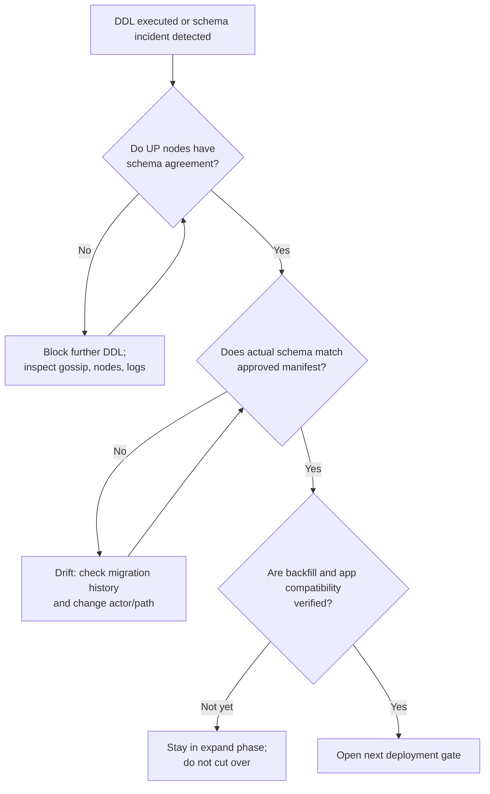
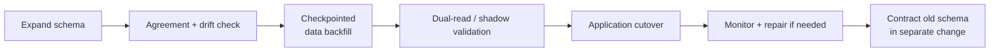

# Detecting Schema Drift and Verifying Schema Agreement

**Chapter:** Migration and Schema  
**Module:** `DATABASE_ENGINE_WIDE_COLUMN_CASSANDRA` — Apache Cassandra

In Apache Cassandra, schema is not a configuration file residing on a single machine. Definitions of **keyspaces, tables, columns, indexes, materialized views, and user-defined types/functions** are propagated across the cluster's nodes. When an `ALTER TABLE` statement runs, the coordinator may update its schema before all peers learn about the change. If an application immediately sends requests through a coordinator that has not yet received the schema, it may encounter *unconfigured table*, *unknown column*, or prepared statement re-preparation errors.

The problem becomes even harder when someone modifies a table directly outside the migration pipeline. Every node may reach agreement on the new schema, yet that schema **does not match the approved configuration in Git**. That is **schema drift**.

This lesson belongs to the `DATABASE_ENGINE_WIDE_COLUMN_CASSANDRA` module, connecting distributed architecture and the wide-column model, partition keys, query-driven table design, replication/consistency levels, compaction/repair, CQL, error handling, and the Java Driver. We will build a **two-layer** process: verify whether the cluster has schema agreement, then verify whether the converged schema matches the *desired schema*. Finally, we cover a runbook to deploy schema changes without accidentally losing data or breaking read/write capability during the transition window.

> **Scope:** Examples target Apache Cassandra 4.1/5.x, Java Driver 4.x, and the corresponding `cqlsh`/`nodetool` tools. Some system tables, flags, and metadata APIs differ across versions and distributions. Run experimental DDL only on a **disposable cluster**; do not attempt to induce schema disagreement by isolating nodes or editing system tables directly in production. Real schema changes require a runbook, backups, compatibility checks, and approval.

## 1. Learning objectives

After this lesson, you will be able to:

1. Distinguish **schema agreement**, **schema drift**, and **incomplete schema/data migration**.
2. Explain schema propagation and the meaning of the **schema version UUID** reported by Cassandra.
3. Inspect node status using `nodetool status`, `describecluster`, `gossipinfo`, `system.local`, and `system.peers_v2`.
4. Inspect keyspaces/tables/columns/indexes/options via `system_schema` and `DESCRIBE`, without mistaking one coordinator's output for the entire cluster.
5. Create a desired-schema manifest, normalize key attributes, and compare it against the actual schema.
6. Design **expand → backfill/dual-read → cutover → contract** migrations that avoid breaking compatibility with older applications.
7. Handle schema agreement timeouts in the Java Driver using `ExecutionInfo.isSchemaInAgreement()` and `session.checkSchemaAgreement()`.
8. Understand why successful schema agreement **does not guarantee** that data has been backfilled, a new RF has finished streaming, or indexes/views are ready.
9. Diagnose failures caused by Down nodes, gossip/network issues, competing DDL, driver metadata caches, wrong DC names, or schema divergence from the manifest.
10. Build CI/CD checklists, alerts, and safe migration records with stop criteria and recovery paths.

**Most important takeaway:** A cluster can have **agreement = true** and **drift = true** at the same time. The two checks answer different questions; neither replaces the other.

## 2. Three easily confused states

### 2.1. Schema agreement — have all nodes received the same definition?

Schema agreement is the state in which all nodes considered by the check advertise the same **schema version**. It commonly appears in:

- `nodetool describecluster` under the schema versions section.
- Metadata/diagnostics in `system.local`, `system.peers_v2`, or gossip.
- The Java Driver's post-DDL wait mechanism.
- Logs containing schema pull/push, migration, or disagreement entries.

Cassandra propagates schema asynchronously via internal mechanisms/gossip. When a node receives enough changes, it computes and advertises a version representing its current schema.

**The schema version is not an application semantic version**, not a migration number `001`/`002`, and not the total table count. It is a marker for comparing schema state across nodes where supported by the version. Two different UUIDs warrant investigation, whereas a single agreed UUID **does not prove the deployed configuration matches Git**.

### 2.2. Schema drift — has reality diverged from the source of truth?

Schema drift is any divergence between the organization-controlled **desired schema** and the cluster's **actual schema**:

- A new column was added manually outside the migration pipeline.
- A column from an expected migration is missing.
- `default_time_to_live`, `gc_grace_seconds`, or compaction changed outside the plan.
- Keyspace replication factor changed without an approved topology decision.
- Indexes/views/types/functions differ from the manifest.
- Schema permissions or migration tooling ran against the wrong environment.
- Staging and production clusters share a table name but have different definitions beyond approved exceptions.

**Example:** Nodes A, B, and C all report the same schema UUID after a DBA directly changed a table's `default_time_to_live` from 0 to 86400. Agreement can be 100%, yet if the desired schema in Git still specifies TTL = 0, this is drift carrying the risk of silent data expiration.

### 2.3. Incomplete data migration — has data caught up with the new schema?

Adding a column successfully **does not automatically populate values** for historical rows. Changing RF or adding a datacenter **does not automatically guarantee** every new replica holds existing data. Creating a new table to change a partition key **does not move data** from the old table to the new one.

That is a third state: **data-readiness** or migration readiness. It requires verifying backfills, token ranges, shadow reads, and dual-write/snapshot/CDC flows by design—not just checking schema versions.

| Check | Question answered | Does not prove |
| --- | --- | --- |
| Agreement | Do the inspected nodes share the same schema UUID? | That the schema matches the manifest; that Down nodes converged |
| Drift | Does the actual schema match the desired schema? | That historical data was migrated completely |
| Data readiness | Did backfill/replica/data validation pass? | That all apps moved to the compatible version |
| Application readiness | Are driver, prepared statements, old/new code working? | That every node is healthy if only one coordinator was tested |

### 2.4. Two-axis diagnostic flowchart



Do not try to cure drift by "waiting for schema agreement" again. If an out-of-band change has already been received by every node, waiting longer will not return the configuration to the desired state.

## 3. Schema versioning mechanics in a distributed cluster

### 3.1. DDL is not a cross-node atomic transaction

A DDL statement such as:

```sql
ALTER TABLE lab_schema.orders_by_id
ADD reconciliation_tag text;
```

is processed by a coordinator and propagated. After DDL, a brief window may exist:

```text
T0   A, B, C: schema S1

T1   Coordinator A accepts ALTER TABLE
     A: schema S2
     B: schema S1
     C: schema S1

T2   Gossip/schema propagation
     A: S2
     B: S2
     C: S1

T3   Schema agreement
     A: S2
     B: S2
     C: S2
```

This is a conceptual diagram. Cassandra's migration, versioning, and wait logic varies by version; the A→B→C order is **not guaranteed** in every cluster. A coordinator may return DDL success before all peers have updated. The Java Driver includes a post-DDL agreement wait to reduce race conditions, but a timeout does not necessarily mean the DDL rolled back.

### 3.2. Errors when an application deploys too early

Suppose node A knows about `reconciliation_tag` and the new application sends:

```sql
SELECT order_id, reconciliation_tag
FROM lab_schema.orders_by_id
WHERE order_id = 20000000-0000-4000-8000-000000000201;
```

If the request lands on node B before it updates its schema, it may fail with an unrecognized-column error. If the DDL was `CREATE TABLE` and a request hits a coordinator unaware of the table, the error may be *unconfigured table*. Prepared statements created before the new schema appears on some nodes may also need to be re-prepared.

**Rule:** Never run DDL and immediately roll out code requiring the new schema without an agreement gate and metadata verification.

### 3.3. Down nodes: agreement can look fine while incomplete

The driver typically checks schema versions of nodes it considers **UP**. If C is Down while A and B share S2, `session.checkSchemaAgreement()` can return `true`. This **does not certify that C has S2**; when C comes back online, it must synchronize its schema and may go through a transitional window.

Therefore, during a migration window:

- Record the exact expected node count, Up/Down nodes, and datacenter/rack layout.
- Distinguish clearly between "agreement among Up nodes" and "all expected nodes are Up and in agreement."
- Never mark a migration complete if an unreachable node has no recovery plan.
- If the cluster is mid-rolling upgrade across server versions, avoid DDL per the runbook and account for version differences in schema-version calculation.

## 4. Observational evidence: `nodetool`, CQL, and logs

### 4.1. Check health first

On each selected lab node:

```bash
nodetool status
nodetool describecluster
nodetool gossipinfo
nodetool version
```

**`nodetool status`** shows Up/Down and membership/topology state; it **does not directly prove schema parity**.

**`nodetool describecluster`** displays the cluster name, snitch, partitioner, and schema versions as known by the queried node. If multiple version UUIDs appear here, investigate before running additional DDL.

**`nodetool gossipinfo`** reveals endpoint states and schema version/gossip info where displayed by the version. Output can be very long; archive it separately for incidents and do not parse fixed line positions without verifying the exact format.

**`nodetool version`** records the node version; during a rolling upgrade, schema-version comparisons must be interpreted alongside the upgrade runbook.

### 4.2. Inspecting schema version with CQL

In `cqlsh` **on the observed node**:

```sql
SELECT host_id, release_version, data_center, schema_version
FROM system.local;

SELECT peer, peer_port, host_id, data_center, rack, schema_version
FROM system.peers_v2;
```

In Cassandra 4.x/5.x, `system.local` reflects the local node's details, while `system.peers_v2` is **that node's view of its known peers**. Older versions may use `system.peers` with a different column set.

Key points:

- Querying `system.peers_v2` on A returns **A's view**, not a cluster-wide transactional snapshot.
- Undiscovered peers or stale state may exist during network faults.
- A Down node may not have an up-to-date `schema_version` column at that moment.
- `peer`/`peer_port` should be cross-checked against actual internode endpoints and token/host IDs.
- Do not read these tables from a single coordinator and claim you "independently queried" every node.

For stronger evidence, run the same query **directly against each representative node/endpoint**, record UTC timestamps, and correlate `host_id`; also check `nodetool status` to spot omitted nodes.

### 4.3. Agreement outcome matrix

| Observation | Reasonable interpretation | Action |
| --- | --- | --- |
| All expected nodes `UN`, same schema version across multiple views | Good evidence schema converged at measurement time | Proceed to compare with desired schema |
| Two versions appear right after DDL | May be normal propagation | Wait within bounded window, monitor logs; do not run next DDL |
| Two versions persist past a reasonable wait | Possible stuck network/gossip/schema migration | Inspect peers, logs, coordinator, node health |
| Node C Down, A/B share version | Agreement among Up nodes may hold | Do not conclude C has the new schema |
| Same schema UUID but wrong table option | True schema drift vs. manifest | Review migration history and out-of-band changes |
| DDL timed out but versions eventually converged | DDL outcome must be verified | Inspect actual schema before retrying |
| Two different server versions during rolling upgrade | Schema-version comparison may be noisy/incompatible | Defer DDL; follow mixed-version runbook |

**Do not reflexively run `nodetool repair` when schema versions diverge.** Repair synchronizes replica data across token ranges; it is not a tool to "force schema UUIDs to match." Never edit `system_schema` or `system.local` directly to change version UUIDs.

## 5. Reading actual schema at keyspace/table level

### 5.1. `cqlsh` `DESCRIBE`

`cqlsh` provides built-in commands (not CQL executed through the driver):

```text
DESCRIBE KEYSPACE lab_schema
DESCRIBE TABLE lab_schema.orders_by_id
DESCRIBE SCHEMA
```

`DESCRIBE` is useful for generating reference DDL and visual inspection. However, its output depends on tool/version/formatting/option defaults and reflects the schema known to the connected coordinator. Therefore, **do not rely on raw string diffs of full `DESCRIBE` output** as your sole drift-detection mechanism.

### 5.2. `system_schema.keyspaces`

```sql
SELECT keyspace_name, replication, durable_writes
FROM system_schema.keyspaces
WHERE keyspace_name = 'lab_schema';
```

Example replication map:

```text
{'class': 'org.apache.cassandra.locator.NetworkTopologyStrategy',
 'datacenter1': '3'}
```

This is a **conceptual illustration**, not a guarantee of exact formatting across versions. When comparing desired vs. actual, normalize strategy names, DCs, and RF values semantically; do not flag drift merely because output uses a fully qualified class name or reorders map keys. **Never strip out a DC** during normalization—that could hide a critical data-placement difference.

### 5.3. `system_schema.tables` and `columns`

```sql
SELECT keyspace_name, table_name, comment,
       compaction, compression, caching,
       default_time_to_live, gc_grace_seconds
FROM system_schema.tables
WHERE keyspace_name = 'lab_schema'
  AND table_name = 'orders_by_id';

SELECT keyspace_name, table_name, column_name,
       kind, position, type
FROM system_schema.columns
WHERE keyspace_name = 'lab_schema'
  AND table_name = 'orders_by_id';
```

Attributes have varying operational impact:

| Attribute | Why it matters | Example drift risk |
| --- | --- | --- |
| Partition key columns and `position` order | Determines token ownership and query model | New table has different partition key; old code queries wrong key |
| Clustering columns/order | Determines sort order and range scans | API reads events in a different order |
| Column `type` | Driver serialization/deserialization | Driver fails to decode or prepared statement breaks |
| `default_time_to_live` | Retention of new mutations | Data expires unexpectedly |
| `gc_grace_seconds` | Tombstone protection window | Risk of data resurrection if nodes go offline/repair lags |
| `compaction` | Read/write profile and TTL handling | I/O amplification / p99 shifts |
| `compression` | Storage size and I/O/CPU | Disk usage spikes or latency degrades |
| `caching` | Memory/read performance | Node memory pressure or poor cache hit rate |
| `comment` | Descriptive metadata | Documentation drift, lower severity |

**Do not check only column names** while ignoring types, partition/clustering keys, and table options. Option changes can silently alter retention or performance without causing any DDL error.

### 5.4. Indexes, materialized views, types, functions

Depending on features actually used, verify:

```sql
SELECT keyspace_name, table_name, index_name, kind, options
FROM system_schema.indexes
WHERE keyspace_name = 'lab_schema';

SELECT keyspace_name, view_name, base_table_name
FROM system_schema.views
WHERE keyspace_name = 'lab_schema';

SELECT keyspace_name, type_name, field_names, field_types
FROM system_schema.types
WHERE keyspace_name = 'lab_schema';

SELECT keyspace_name, function_name, argument_types
FROM system_schema.functions
WHERE keyspace_name = 'lab_schema';
```

These system tables cover multiple metadata types; exact syntax and columns should be verified against your target version. If a cluster uses SAI/custom indexes, UDTs/UDFs/aggregates, or materialized views, **the manifest must cover them**. Identical table columns with a missing index still constitute drift affecting the query path. A newly created index may also require its own build/state initialization; **schema agreement does not mean the index is ready for all existing data**.

## 6. Desired-schema manifest: the source of truth must be explicitly defined

### 6.1. You cannot detect drift without defining what "correct" looks like

A system should have:

- Reviewed and versioned DDL migrations in Git.
- A desired manifest/schema snapshot per environment.
- An approved exceptions list (per-DC RF, workload-specific table options, provider-specific settings).
- Change ID, deployer actor, commit hash, application version, and timestamp.
- Policy defining who can run `ALTER`/`CREATE`, who handles rollbacks, and CQL admin privileges.

Cassandra does not natively store ordered **application migration history** like a schema migration tool. You need an external migration registry or a carefully designed tracking table with concurrency control. **The schema UUID is not a sequential migration number.**

### 6.2. Illustrative manifest example

```yaml
# Manifest for lab cluster, not a Cassandra configuration file.
manifest_version: orders-schema-v2
environment: lab
keyspace: lab_schema
replication:
  class: NetworkTopologyStrategy
  datacenters:
    datacenter1: 3
durable_writes: true
tables:
  orders_by_id:
    partition_key: [order_id]
    clustering_key: []
    columns:
      order_id: uuid
      tenant_id: text
      state: text
      updated_at: timestamp
      reconciliation_tag: text
    options:
      default_time_to_live: 0
      gc_grace_seconds: 864000
      comment: "orders schema v2"
    indexes: []
```

These values are **lab choices**, not blanket production recommendations for grace periods or RF. Ensure the manifest reflects the designed DDL. If `gc_grace_seconds` differs because of an approved retention/repair policy, document the reason in the manifest/exceptions rather than letting an automated drift check "fix" the option.

### 6.3. Canonical normalization before comparison

| Issue | Safe normalization | Must not ignore |
| --- | --- | --- |
| Replication/compaction map ordering | Compare by key-value pairs, not print order | DCs, RF, strategy class, and actual options |
| Short vs. full strategy class names | Normalize to canonical class when checking equivalence | Never treat NTS and SimpleStrategy as equivalent |
| Identifier casing | Distinguish unquoted lowercase CQL from quoted case-sensitive identifiers | `Orders` and `"Orders"` can differ |
| Numeric/string encoding | Validated type coercion (e.g., RF `"3"` vs `3`) | Never coerce invalid values to 0 |
| Table options | Compare value types and intentional defaults | Drift in TTL/grace/compaction is hazardous |
| Column ordering | Compare regular columns as a set; compare PK/clustering by `position` | Never sort PK columns and lose key order |
| Environments | Allow approved exceptions per DC/region | Never unconditionally merge staging/prod baselines |
| Schema version UUID | Use for agreement, not compared to commit hashes | Never treat a different UUID alone as "missing migration" |

### 6.4. Drift severity levels

| Detected drift | Suggested priority | Response direction |
| --- | --- | --- |
| Wrong partition/clustering key on target table | Critical | Halt cutover; requires new table/backfill, cannot alter PK in place |
| Wrong RF/DC/keyspace replication | Critical | Assess replica placement, streaming/repair, consistency |
| Unplanned reduction in TTL/grace | Critical | Assess data-loss/tombstone risk; do not adjust blindly |
| Different column type | High | Halt app rollout; check compatibility/migration |
| Missing required column | High | Block releases depending on column; verify agreement and DDL |
| Missing index/view | High/Medium | Check queries and index build/readiness |
| Altered compaction/compression | Medium/High | Measure I/O, disk, and rollout impact |
| Different comment | Low in most cases | Investigate out-of-band change and reconcile via proper source |

Never apply blind auto-remediation to all drift types. An `ALTER KEYSPACE` or `ALTER TABLE ... WITH default_time_to_live` has consequences for data, streaming, and recoverability; require an explicit change review.

## 7. Preflight before DDL or drift checks

### 7.1. Topology and safety

On an authorized test cluster:

```bash
nodetool status
nodetool describecluster
nodetool gossipinfo
nodetool version
```

Record: cluster name, DC/rack, expected node count, Up/Down states, schema versions, binary versions, and whether any migration is active. Avoid executing DDL while a node is bootstrapping/replacing, unreachable for extended periods, or mid-rolling upgrade, unless governed by a dedicated risk-assessed runbook.

### 7.2. Protecting schema and data

- Have backups/snapshots/schema exports according to environment policy.
- Have an approved manifest and migration script, not just a `cqlsh` screenshot.
- Have required CQL `CREATE`/`ALTER` privileges without defaulting to `SUPERUSER`.
- Have a maintenance window and a single **migration lock** owner to prevent concurrent pipelines.
- Have an inventory of old/new applications and a deployment plan that avoids prepared-statement errors.
- Have a DDL timeout policy: **inspect actual state before retrying**.
- Have stop thresholds: schema disagreement, `unconfigured/invalid` error rates, Down nodes, p99 exceeding SLO.
- Have a contingency plan if schema migration finishes while backfill is still incomplete.

### 7.3. Single source of truth: never let drift checks become a second DDL writer

Schema inventory/monitoring should **read and alert**, not issue `ALTER` by default to fix discrepancies. Only one migration controller/change owner should issue DDL; if two systems both "auto-fix drift," they can fight each other and flip table options back and forth.

## 8. CQL Lab: baseline, migration, agreement, drift

This lab uses **three nodes in a single datacenter** hypothetically named `datacenter1`, RF=3. If you only have one node, adjust RF/CL to match your topology and note that **multi-node propagation is not verified**. Never spin up lab keyspaces or induce network partitions in production.

### 8.1. Create keyspace and table with a deterministic partition key

In `cqlsh` (authenticated with a lab admin account):

```sql
CREATE KEYSPACE IF NOT EXISTS lab_schema
WITH replication = {
    'class': 'NetworkTopologyStrategy',
    'datacenter1': 3
}
AND durable_writes = true;

CREATE TABLE IF NOT EXISTS lab_schema.orders_by_id (
    order_id uuid PRIMARY KEY,
    tenant_id text,
    state text,
    updated_at timestamp
) WITH comment = 'orders schema v1'
  AND default_time_to_live = 0;

CONSISTENCY ALL

INSERT INTO lab_schema.orders_by_id
    (order_id, tenant_id, state, updated_at)
VALUES (
    20000000-0000-4000-8000-000000000201,
    'tenant-a', 'CREATED', '2026-11-21T00:00:00Z'
);

INSERT INTO lab_schema.orders_by_id
    (order_id, tenant_id, state, updated_at)
VALUES (
    20000000-0000-4000-8000-000000000202,
    'tenant-b', 'CREATED', '2026-11-21T00:01:00Z'
);
```

Proceed only if the keyspace/table were created, schema reached agreement, and both INSERTs were acknowledged at `ALL`. `ALL` with RF=3 requires all three replicas to respond; if an error or timeout occurs, **do not assume all replicas received the baseline**. Once the cluster recovers, inspect actual state before retrying with distinct keys.

### 8.2. Capture baseline schema before changes

```text
DESCRIBE KEYSPACE lab_schema
DESCRIBE TABLE lab_schema.orders_by_id
```

```sql
SELECT keyspace_name, replication, durable_writes
FROM system_schema.keyspaces
WHERE keyspace_name = 'lab_schema';

SELECT table_name, comment, default_time_to_live, gc_grace_seconds
FROM system_schema.tables
WHERE keyspace_name = 'lab_schema'
  AND table_name = 'orders_by_id';

SELECT column_name, kind, position, type
FROM system_schema.columns
WHERE keyspace_name = 'lab_schema'
  AND table_name = 'orders_by_id';
```

From the terminal:

```bash
nodetool describecluster
nodetool status
```

Record the actual schema from **at least two independent nodes** along with schema version and UTC timestamp. Acceptance requires a shared schema UUID across Up nodes and actual baseline matching desired v1. If they do not match, **do not** proceed with the migration.

### 8.3. Expand migration: add an optional column

In the lab only:

```sql
ALTER TABLE lab_schema.orders_by_id
ADD reconciliation_tag text;
```

A regular nullable column is added without altering the partition key. Existing rows **do not automatically receive** a `reconciliation_tag` value; when queried, the new column returns `null` for un-updated rows.

Wait for agreement, then verify:

```bash
nodetool describecluster
```

```sql
SELECT column_name, kind, position, type
FROM system_schema.columns
WHERE keyspace_name = 'lab_schema'
  AND table_name = 'orders_by_id';
```

If two schema versions remain, keep the old application running and wait/investigate instead of running the next migration. **Do not** assume the DDL failed merely because the client reported an agreement timeout.

### 8.4. Write new data and reconcile state

Once schema is confirmed across healthy peers:

```sql
CONSISTENCY LOCAL_QUORUM

UPDATE lab_schema.orders_by_id
SET reconciliation_tag = 'batch-001'
WHERE order_id = 20000000-0000-4000-8000-000000000201;

SELECT order_id, state, reconciliation_tag
FROM lab_schema.orders_by_id
WHERE order_id = 20000000-0000-4000-8000-000000000201;

SELECT order_id, state, reconciliation_tag
FROM lab_schema.orders_by_id
WHERE order_id = 20000000-0000-4000-8000-000000000202;
```

Expected in the lab without concurrent writes: row `201` has `batch-001`; row `202` has `null`. **This is data-readiness**, distinct from agreement: the schema includes the new column, but no backfill job has populated all rows yet.

### 8.5. Create a reversible, non-destructive configuration drift

**Only in a disposable cluster**, after confirming no other migration is running, modify `comment`—the property with the lowest data impact in this example:

```sql
ALTER TABLE lab_schema.orders_by_id
WITH comment = 'manual-hotfix-unreviewed';
```

Wait for schema agreement, then read:

```sql
SELECT table_name, comment
FROM system_schema.tables
WHERE keyspace_name = 'lab_schema'
  AND table_name = 'orders_by_id';
```

Suppose the approved manifest expects the comment `orders schema v2`. At this point:

```text
Schema agreement: TRUE (e.g., A/B/C share schema UUID S3)
Desired comment:   orders schema v2
Actual comment:    manual-hotfix-unreviewed
Schema drift:      TRUE
```

**No contradiction:** Cassandra successfully propagated an *unapproved* change. This lab needs neither node isolation nor system-table edits to demonstrate drift.

Restore the state **only after verifying no one else made concurrent changes**:

```sql
ALTER TABLE lab_schema.orders_by_id
WITH comment = 'orders schema v2';
```

Wait for agreement and confirm actual matches desired. Never run a naive "revert to v1" command in production: if a real change affects data or interacts with other migrations, any rollback must be explicitly designed.

### 8.6. Lab observations to record

| Milestone | Schema version/metadata | Desired | Actual | Agreement | Drift |
| --- | --- | --- | --- | --- | --- |
| T0 — Baseline | S1 | v1 | v1 | Expected true | Expected false |
| T1 — After ADD column | S2 | v2 | v2 | May be transiently false, then true | Expected false |
| T2 — After out-of-band comment edit | S3 | v2 | different comment | May be true | **True** |
| T3 — After controlled comment fix | S4 | v2 | v2 | Expected true | Expected false |

`S1…S4` are **diagram labels**, not real UUIDs. Record the real schema UUIDs and observed results; never mark "true" based on expectation if not actually observed.

## 9. Drift detection algorithm in CI/CD

### 9.1. Two mandatory steps

**Step A — Agreement and cluster health gate:**

1. Fetch the expected node list and DC/rack inventory from management/driver configuration.
2. Confirm required nodes are `UN` and no other DDL is active.
3. Check schema agreement with a bounded timeout.
4. If disagreement persists, **do not** capture a single schema snapshot and claim drift; the actual state is still in flux.
5. If any node is Down, explicitly report that checks cover only Up nodes.

**Step B — Compare actual against desired:**

1. Read schema from `system_schema` via a chosen coordinator.
2. When high confidence is required, cross-check across independent nodes/regions.
3. Normalize identifiers, maps, column types, PK order, and options without discarding meaningful differences.
4. Compare against the manifest for the exact environment and revision.
5. Classify drift: missing, extra, wrong type, wrong PK, wrong replication, wrong options.
6. Store the diff with version/timestamp/approval metadata; avoid logging sensitive data.
7. **Block migration/cutover** if drift is severe or unexplained.

### 9.2. Comparison pseudocode

```text
expected = load_approved_manifest(env="lab", revision="orders-v2")
nodes    = discover_expected_nodes_from_inventory()
health   = query_nodetool_status_and_versions()

if not all_required_nodes_healthy(health, nodes):
    report("HEALTH_INCOMPLETE", affected_nodes)
    stop_migration()

if not schema_agreement_with_bounded_wait():
    report("SCHEMA_DISAGREEMENT", versions_by_endpoint)
    stop_migration()

actual = read_system_schema_from_selected_coordinators()
diff   = compare_canonical(expected, actual)

if diff.non_empty:
    report("SCHEMA_DRIFT", diff)
    require_human_review()
else:
    report("SCHEMA_MATCHED")

# After the schema gate, backfill and application compatibility gates still apply.
```

This is **pseudocode**, not a built-in Cassandra API. A drift management system must account for *intentional differences* such as per-DC RF or provider-managed keyspaces. Never compute a diff and auto-issue `DROP TABLE`/`ALTER KEYSPACE` to "remediate" without a change owner.

### 9.3. Why not compare raw `DESCRIBE SCHEMA` output?

- Element ordering and formatting can vary across `cqlsh` versions.
- Default properties may be printed or omitted differently.
- Managed services may include extensions.
- Quoted identifiers and map string formatting easily create false positives.
- `system_*` keyspace schemas managed by Cassandra differ across server versions.
- `DESCRIBE` on a coordinator without agreement yields a non-representative view of the cluster.

You can archive `DESCRIBE SCHEMA` as manual review evidence, but drift automation should perform typed/semantic structural comparison wherever possible.

## 10. Java Driver 4.x: schema agreement and metadata guard

Apache Cassandra Java Driver 4.x provides mechanisms to check schema agreement after DDL and refresh schema metadata. Checks must distinguish **DDL execution success**, **agreement result**, and **desired-schema validation**.

### 10.1. Non-mutating check example

```java
import com.datastax.oss.driver.api.core.CqlIdentifier;
import com.datastax.oss.driver.api.core.CqlSession;
import com.datastax.oss.driver.api.core.metadata.schema.KeyspaceMetadata;
import com.datastax.oss.driver.api.core.metadata.schema.TableMetadata;

public final class CassandraSchemaGuard {
    public static boolean check(CqlSession session) {
        // Checks only nodes the driver currently considers UP.
        if (!session.checkSchemaAgreement()) {
            System.err.println("SCHEMA_DISAGREEMENT");
            return false;
        }

        // Refresh when a fresh schema snapshot is needed post-migration.
        // Blocking API: do not call on a driver I/O thread.
        session.refreshSchema();

        KeyspaceMetadata keyspace = session.getMetadata()
            .getKeyspace(CqlIdentifier.fromCql("lab_schema"))
            .orElse(null);

        if (keyspace == null) {
            System.err.println("MISSING_KEYSPACE: lab_schema");
            return false;
        }

        TableMetadata table = keyspace
            .getTable(CqlIdentifier.fromCql("orders_by_id"))
            .orElse(null);

        if (table == null) {
            System.err.println("MISSING_TABLE: orders_by_id");
            return false;
        }

        boolean hasColumn = table.getColumns().containsKey(
            CqlIdentifier.fromCql("reconciliation_tag")
        );
        if (!hasColumn) {
            System.err.println("MISSING_COLUMN: reconciliation_tag");
            return false;
        }

        System.out.println("Agreement and sample metadata gate passed");
        return true;
    }
}
```

**Important notes:**

- `checkSchemaAgreement()` checks only **agreement across nodes the driver sees as UP**, not against the Git manifest.
- `refreshSchema()` updates driver metadata; it **does not force Cassandra nodes to change schema**.
- `getMetadata()` returns a point-in-time immutable snapshot; never reuse an old `Metadata` reference to verify post-DDL state.
- Checking `containsKey` is just **one check**; it does not replace verifying all columns, PKs, types, options, indexes, and replication.
- Schema metadata can be disabled or filtered in driver configuration; if so, verify metadata settings or query `system_schema` directly.
- This snippet does not detect Down nodes, run CQL data validation, or act as a recovery mechanism.

### 10.2. Inspecting `ExecutionInfo` after a DDL statement

The following example is for **lab migration pipelines only** where the owner holds DDL privileges:

```java
import com.datastax.oss.driver.api.core.CqlSession;
import com.datastax.oss.driver.api.core.cql.ResultSet;

public final class SchemaMigrationStep {
    public static void expand(CqlSession session) {
        ResultSet result = session.execute(
            "ALTER TABLE lab_schema.orders_by_id " +
            "ADD reconciliation_tag text"
        );

        if (!result.getExecutionInfo().isSchemaInAgreement()) {
            System.err.println(
                "DDL accepted, schema agreement not reached in wait window"
            );

            if (!session.checkSchemaAgreement()) {
                throw new IllegalStateException(
                    "Stop migration: schema still disagrees"
                );
            }
        }
    }
}
```

**Do not blindly re-run the same DDL just because `isSchemaInAgreement()==false`.** The DDL may already be applied while peers are still converging; read back the actual schema first. Running `ADD reconciliation_tag` twice can fail the second time because the column already exists. Automatic retries must not turn an **unknown outcome** into a harder-to-diagnose failure.

**Pitfall:** `ExecutionInfo.isSchemaInAgreement()` only carries special post-DDL meaning after a **schema-altering query**. On ordinary SELECT/INSERT queries, the driver may return `true` because **no schema check was performed** for that request. Never use `isSchemaInAgreement()` from a `SELECT` as a health gate.

### 10.3. Bounded polling instead of sleeping indefinitely

If `checkSchemaAgreement()` has not converged:

- Pause the pipeline in `PENDING_AGREEMENT`.
- Log endpoints/versions and UTC timestamp.
- Wait within a runbook-defined **deadline**.
- Re-check node health/logs; do not spam DDL or poll aggressively.
- If the deadline expires, raise an incident/escalation while preserving the source of truth and migration lock.
- Do not extend timeouts infinitely to "mask" a network-partitioned node.

The driver exposes schema-agreement check interval and timeout settings; verify them for your Java Driver 4.x version. Lowering timeouts in the app or disabling schema metadata may make DDL report faster, but **will not make the cluster converge any faster**.

### 10.4. Driver metadata cache and prepared statements

The driver caches keyspace/table metadata client-side and receives schema change events over the control connection. When a prepared statement was created beforehand:

- Some schema changes require re-preparing statements or cause decode/mapping errors.
- Renaming/retyping columns breaks `Row.getXxx()` calls until compatible code is rolled out.
- Driver schema metadata may be updated while old application binaries still issue old queries.
- Quoted CQL identifiers are case-sensitive; manifest comparisons must account for this.

**Never** treat `session.refreshSchema()` as a cure-all for `InvalidQueryException`. Inspect the query, actual columns/types, and application version.

## 11. Safe schema deployment: expand, backfill, cutover, contract

### 11.1. Why multiple phases are required

Changing schema **does not automatically change data and application code simultaneously**. If new code reads a newly added column before backfill completes, it may see nulls; if old code ignores the new column, it can continue running. Choose a sequence that guarantees an overlap window where both application versions can coexist.



### 11.2. Phase 1 — Expand

- Add new tables/columns or indexes required by the migration.
- Avoid dropping or altering columns still used by old code.
- Record the exact migration ID and DDL.
- Wait for agreement within the deadline; archive `nodetool describecluster`/versions and actual diff.
- Allow new code to use the new schema only after passing the gate.

### 11.3. Phase 2 — Backfill and handling dual-writes

For example, adding `reconciliation_tag` does not populate historical rows. If the business requires values for old rows:

- Read across bounded partition keys/token ranges; avoid raw full-table `SELECT *` scans.
- Use an idempotent batch/backfill worker with checkpoints, rate limiting, and p99/disk monitoring.
- Avoid cross-partition logged batches in an attempt to boost throughput.
- Handle concurrent writes (watermarks/CDC/dual-write or source-of-truth ordering) so backfill does not overwrite newer mutations.
- Track processed record counts, errors, unverified records, and consistency levels.
- Declare backfill complete only with **coverage evidence**, not merely "job exit code 0."

### 11.4. Phase 3 — Cutover

Once data reaches readiness:

- Canary the new application on a fraction of traffic.
- Read/write against the new schema while monitoring invalid-query, unprepared, timeout, and p95/p99 metrics.
- If dual-reading, compare against the old table/schema on **matching keys and time windows**.
- Do not drop old columns/tables while old application instances may still read/write them.
- Keep application rollback viable against the expanded schema.

### 11.5. Phase 4 — Contract

Remove the old schema **only after**:

- No old producers/consumers remain.
- Retained data has been migrated, backed up, and verified.
- TTL/tombstone/repair windows have been evaluated.
- Index/view/function dependencies have been checked.
- Deletion approval and a recovery plan exist if rollback is needed.

**Caution:** In Cassandra, changing the **partition key** or **clustering key** of an existing table is not a simple `ALTER COLUMN` to change query design. It usually requires **a new table with the new primary key**, backfill, and cutover. Dropping a column and re-creating it with the same name/type carries version-specific constraints from schema/tombstones/types; never assume it is a safe default rollback.

## 12. Drift when changing replication, compaction, or TTL

### 12.1. Replication factor / datacenter

```sql
-- Metadata inspection example only; do not run ALTER blindly:
SELECT keyspace_name, replication
FROM system_schema.keyspaces
WHERE keyspace_name = 'lab_schema';
```

If desired is `datacenter1:3` but actual is `datacenter1:2`:

- This is **critical schema drift** because it affects replica placement and CL.
- Adjusting RF may require full repair/rebuild/streaming depending on topology and version.
- Schema agreement can be true immediately after `ALTER KEYSPACE`, while **historical data does not yet reside on the new replicas**.
- Never let a drift auto-fix run `ALTER KEYSPACE` and mark the task done once the UUID converges.

Likewise, when adding a new datacenter, you must follow a controlled bootstrap/rebuild-from-source, repair, and traffic-shift process. DDL confirming the new RF is only a **schema milestone**, not data convergence.

### 12.2. TTL and gc_grace

If a drift check finds `default_time_to_live` was changed from 0 to 86400, new mutations may expire under a different policy. If `gc_grace_seconds` was lowered, tombstone resurrection risk rises if a replica misses a DELETE and rejoins later.

Restoring the option to its prior value **does not revive data whose TTL already expired**, nor does it restore purged tombstones. Therefore, retention-related drift requires **investigating data impact and mutation history**, not merely running an `ALTER` to reset the option.

### 12.3. Compaction and compression

Changing compaction strategy or compression may not immediately rewrite all existing SSTables. `system_schema.tables` may display the new option while physical SSTables remain in mixed states. Never declare resources/performance healthy solely because desired equals actual. Monitor `nodetool compactionstats`, SSTable counts, disk I/O, and p99.

## 13. Detecting and resolving schema disagreement

### 13.1. Common symptoms

- `nodetool describecluster` shows two or more schema versions.
- Java Driver reports schema agreement wait timeouts.
- Requests hit `unconfigured table` or `unknown column` depending on the coordinator.
- Nodes display differing DDL/metadata during a rollout.
- After a node restart/upgrade, gossip or schema pull logs warnings.
- Multiple migration controllers are executing competing DDL.

Do not jump from a "schema disagreement" alert to assuming SSTable data is corrupted. It is a schema propagation/metadata issue; diagnose the root cause first.

### 13.2. Step-by-step diagnostic runbook

**Step 1 — Freeze new DDL changes.** Lock CI/CD migrations and record recently executed commands, timestamps, and the source of truth. Never issue extra `ALTER` statements "to force it to sync."

**Step 2 — Collect health/topology:**

```bash
nodetool status
nodetool describecluster
nodetool gossipinfo
nodetool version
```

**Step 3 — Inspect multi-node perspectives:** compare `system.local.schema_version`, `system.peers_v2.schema_version`, host IDs, and gossip state across A/B/C.

**Step 4 — Check logs around the UTC timestamp:** migration manager, schema pull/push, transport errors, network partitions, GC pauses, version mismatches, pending peers. Never paste logs containing sensitive data into public tickets.

**Step 5 — Classify:**

- Transient after valid DDL: wait within deadline and re-check.
- Node Down or network split: restore availability/gossip first; **do not** force DDL while nodes are unhealthy.
- Two competing DDLs: establish **actual execution order** and expected state; avoid blind retries.
- Mixed server versions: check compatibility; normally defer schema changes during rolling upgrades.
- One node persistently lags on schema metadata: consult version-specific runbook; consider specialized schema-reload commands only with backups and approval.

**Step 6 — Prove agreement post-resolution:** confirm all required nodes are Up, share the same UUID across multiple views, then diff actual against the manifest and test the application.

### 13.3. Do not abuse metadata repair commands

Some Cassandra versions provide `nodetool reloadlocalschema` to reload local schema from system tables. It is **not a universal fix** for all disagreements; it does not replace the source of truth and may not address root causes like gossip/network issues. Use it only when documented for your exact version and explicitly specified by a runbook.

**Never** directly `UPDATE system_schema.tables`, delete `system.local`, edit schema UUIDs, or copy system keyspace files between nodes. Doing so can severely corrupt metadata or host identity and is not a supported migration path.

## 14. Common false-alarm and pitfall scenarios

### A. Cluster shares a single schema UUID, yet DDL differs from Git

This is **schema drift**. A coordinator/admin applied an out-of-band change and all peers received it. Capture the manifest/actual diff and DDL/audit logs if available, and identify change ownership. Do not wait longer for agreement.

### B. Immediately after `ALTER TABLE`, two UUIDs appear for 1–2 seconds

This can be normal propagation, though **no 1–2 second SLA is guaranteed** across environments. Wait within the migration tool's deadline while monitoring metadata and errors. Do not send subsequent DDL until the gate passes.

### C. Node C is Down while A and B match schema

The driver may report agreement among Up nodes, leaving C unverified. If production requires all three nodes, keep the gate in **PARTIAL_HEALTH** and do not declare the ring complete.

### D. During a rolling upgrade, schema versions differ

Mixed Cassandra versions can compute schema UUIDs differently; some drivers fail agreement checks even when logical schemas are compatible. Follow the upgrade runbook, avoid DDL during mixed-version windows, and reconcile schema once the upgrade finishes.

### E. `CREATE TABLE IF NOT EXISTS` succeeds, yet the table has wrong types

`IF NOT EXISTS` only suppresses errors when a table already exists; it **does not verify that the existing definition matches your intended DDL**. Drift checkers must compare full columns/PKs/options afterward.

### F. Pipeline hits a DDL timeout and re-runs everything

The DDL outcome is ambiguous: the server may have applied it while the client missed the response or hit the agreement timeout. Inspect actual metadata/schema version and the migration registry before retrying. Never drop/recreate a table to "reset" it if real data exists.

### G. Java Driver metadata lacks the new column even though the cluster agrees

The driver may hold a stale metadata snapshot, or metadata filtering/refresh has not completed. Check a **fresh** `session.getMetadata()`, call `refreshSchema()` if appropriate, and verify schema-metadata settings and actual `system_schema`. Do not mistake a stale client cache for cluster drift.

### H. Uppercase column name causes check for `"State"` to fail

Unquoted CQL identifiers normalize to lowercase, whereas quoted identifiers are case-sensitive. A manifest comparing `State` and `state` as arbitrary strings may falsely flag drift or miss objects. Use canonical CQL identifiers.

### I. After `ALTER KEYSPACE` adds a DC, agreement is true but reads from the new DC miss old rows

This is **incomplete data readiness**. Rebuild/repair and verify replication coverage; do not run more DDL to fix missing data.

### J. Out-of-band TTL/grace edit was reverted, yet impact remains

Even after actual matches desired again, mutations written during the mismatched window may still carry the altered TTL/tombstones. Inspect timestamps/TTL/tombstones and backups/retention instead of merely closing the drift alert.

### K. Index created, yet query p99 stays high

Schema agreement on an index definition does not prove the index has finished building or is ready across all data and replicas. Check build status, logs, query plans, and performance for your index type and version.

### L. DDL ran through one coordinator and was assumed cluster-wide

Cassandra propagates schema, but convergence must be **observed**; querying one `system.local` or one `DESCRIBE` is insufficient. Correlate node health, `describecluster`, and multi-node views.

## 15. Monitoring and alerting

### 15.1. Minimum signals

| Signal | Source | Meaning |
| --- | --- | --- |
| Multiple schema versions among Up nodes | `nodetool describecluster`/gossip | Potential disagreement |
| Down/missing node | `nodetool status`, inventory, driver events | Agreement may cover only a subset of nodes |
| Driver DDL schema agreement timeout | Java Driver logs/metrics, `isSchemaInAgreement` | DDL executed, agreement check timed out |
| Invalid/unconfigured column/table errors | Client/server logs | Code/schema mismatch or slow propagation |
| Actual-vs-manifest drift diff | CI/CD inventory checker | Out-of-band change or missing migration |
| Migration version/checkpoint | Migration registry | Tracks applied scripts; does not replace schema UUID |
| Index/view/backfill readiness | Job metrics and sample queries | Schema exists but data is not ready |
| JMX/CQL auth errors | Logs/audit | Tool lacks permissions to read metadata; not schema mismatch |
| Read/write p99 and timeouts | App + Cassandra metrics | Real impact on SLO |

### 15.2. Do not alert on schema UUID changes alone

Schema version changes are normal during valid migrations. Useful alerts evaluate:

- **Duration:** disagreement persisting past the configured threshold.
- **Scope:** whether an Up node still holds an old version, or only an unverified Down peer.
- **Context:** whether an approved DDL/rolling upgrade/change is underway.
- **Impact:** invalid queries, blocked deploys, app errors, or merely lagging metadata.
- **Desired schema:** after convergence, whether actual matches the commit/schema manifest.

Conceptual monitoring rule example:

```text
IF any_expected_node_down:
    status = HEALTH_INCOMPLETE
ELSE IF multiple_schema_versions_up_for_longer_than(deadline):
    status = SCHEMA_DISAGREEMENT
ELSE IF actual_schema_differs_from_approved_manifest:
    status = SCHEMA_DRIFT
ELSE IF backfill_or_compatibility_gate_failed:
    status = DATA_OR_APP_NOT_READY
ELSE:
    status = READY_FOR_NEXT_MIGRATION_STEP
```

Do not force pseudocode into a single PromQL expression if your exporter lacks the necessary data and labels. Store schema snapshots/metadata in an access-controlled repository; avoid pushing secrets or role credentials into dashboards.

### 15.3. Configuring the wait window

Java Driver 4.x exposes schema-agreement check interval and timeout settings, as illustrated in driver documentation:

```hocon
datastax-java-driver.advanced.control-connection.schema-agreement {
  interval = 200 milliseconds
  timeout = 10 seconds
  warn-on-failure = true
}
```

This is a **driver configuration example**, not `cassandra.yaml`, and not a universal timeout value. Increasing timeout lets clients wait longer for normal propagation, but will not fix a node losing gossip or out-of-band drift.

**Do not disable agreement checks in migration pipelines just for speed** if new code relies on the new schema across multiple coordinators.

## 16. Separation of duties and security

### 16.1. Managing schema privileges

- Application services should have `SELECT`/`MODIFY` on specific tables, not `ALTER`/`CREATE` or default superuser.
- Separate the migration role from the app role, granting only required keyspace/table privileges used by a reviewed pipeline.
- Drift scanners only need metadata-read access; they must **never** hold schema-modification privileges.
- When using `cqlsh DESCRIBE`/system schema, verify provider- and version-specific permission/metadata visibility rules.
- Centralize coordinator CQL audit logs from relevant nodes; the migration history should also record change ID and commit.
- Store database migration secrets in a vault, never embedded in Git scripts or CI logs.

### 16.2. Why competing DDL is dangerous

If two pipelines run concurrently:

```text
Pipeline A: ALTER TABLE orders_by_id ADD reconciliation_tag text
Pipeline B: ALTER TABLE orders_by_id WITH default_time_to_live = 86400
```

Cassandra applies/propagates schema changes via its versioning mechanism, but deployment order and preconditions are not managed as a multi-step business transaction. Pipeline A may assume the schema only added a column while Pipeline B altered retention. **Sharing a single UUID after convergence does not prove two change requests were reviewed together.**

Enforce migration locks/ownership at the CI/CD layer, verify the manifest after **each step**, and never let a drift scanner/auto-fixer act as a second writer.

## 17. Schema drift/disagreement incident runbook

### P0 — Freeze changes

- Halt further DDL and schema-dependent app rollouts.
- Record ticket/change ID, UTC timestamp, migration commit, and executing user/pipeline.
- Do not issue emergency `DROP`/`CREATE`/`ALTER` statements to "re-sync" before gathering evidence.

### P1 — Collect cluster evidence

```bash
nodetool status
nodetool describecluster
nodetool gossipinfo
nodetool version
```

Across multiple endpoints, query:

```sql
SELECT host_id, schema_version, release_version FROM system.local;
SELECT peer, peer_port, host_id, schema_version FROM system.peers_v2;
```

Record Up/Down nodes/DCs/racks, unreachable segments, schema UUIDs, and binary versions.

### P2 — Classify root cause

| P1 result | Failure category | Next direction |
| --- | --- | --- |
| Two schema versions on Up nodes | Unresolved agreement | Inspect recent DDL, gossip, network, logs |
| Same version, manifest diff | True drift | Inspect DDL/audit history and raise an approved change |
| Same version, manifest matches, app still failing | App/driver compatibility | Check prepared statements, client metadata, code version |
| Same schema, missing data | Data migration/readiness | Check backfill, RF, streaming/repair |
| Node Down or rolling upgrade | Health/mixed-version | Complete recovery/upgrade before more DDL |

### P3 — Apply layered remediation

- **Transient agreement:** wait within deadline and confirm across multiple nodes.
- **Network/gossip:** restore connectivity/peer health; never edit raw schema tables.
- **Drift:** inspect diff and migration registry, evaluate data consequences, issue a properly scoped fix change.
- **Stale driver:** refresh metadata/inspect sessions and prepared statements; do not force DDL.
- **Data readiness:** complete backfill/rebuild/repair as required; never use UUID as a proxy.
- **Destructive schema change:** prefer forward fix/restore from backups with app compatibility; never blindly drop/recreate to roll back.

### P4 — Verify and close incident

Mark resolved only when:

1. Required nodes are healthy and share the same schema UUID within the observed scope.
2. Actual schema matches the approved desired manifest.
3. DDL pipeline/migration registry aligns with actual state.
4. Backfill/data validation meets scope, and error rate and p99 meet SLOs.
5. Old/new applications operate cleanly with prepared statements and schema.
6. Unverified scope (Down nodes, disconnected datacenters, out-of-scope keyspaces) is documented.
7. Follow-up owner/monitoring is assigned and no competing DDL remains active.

## 18. Verification and handoff record

```text
CHANGE_ID / INCIDENT_ID:
CASSANDRA_VERSION / JAVA_DRIVER_VERSION:
CLUSTER / DATACENTERS / NODE_INVENTORY:
UTC_START / UTC_END:
DESIRED_MANIFEST_REVISION:
MIGRATION_ID / COMMIT_HASH:
MIGRATION_OWNER / EXECUTOR:
DDL_ACTUALLY_EXECUTED:
EXPECTED_NODES:
NODE_STATUS_PER_ENDPOINT:
SCHEMA_VERSION_PER_NODE:
SCHEMA_AGREEMENT_RESULT / TIMEOUT:
SYSTEM_SCHEMA_CAPTURED_FROM:
KEYSPACE_REPLICATION_DIFF:
TABLE_COLUMN_AND_PK_DIFF:
TABLE_OPTIONS_DIFF:
INDEX_VIEW_TYPE_FUNCTION_DIFF:
INTENTIONAL_ENVIRONMENT_EXCEPTIONS:
MIGRATION_REGISTRY_STATE:
BACKFILL_STATUS_AND_CHECKPOINTS:
VALIDATION_KEYS / CONSISTENCY_LEVEL / RESULTS:
APP_VERSION_COMPATIBILITY:
INVALID_QUERY / UNCONFIGURED_TABLE_ERRORS:
READ_P99 / WRITE_P99 / ERROR_RATE:
BACKUP / ROLLBACK_OR_FORWARD_FIX:
OPEN_RISKS_AND_UNVERIFIED_NODES:
APPROVAL / NEXT_ACTION:
```

Never fill in "PASS" if you only checked one node or never read the manifest. Missing items must be recorded as **"not observed"** with a reason, never replaced with assumed values.

## 19. Self-check questions

1. How do schema agreement and schema drift differ in the questions they answer?
2. Can `agreement=true` and `drift=true` happen simultaneously? Give an example involving TTL or comment changes.
3. Why does `system.local.schema_version` differ from an application's `001/002` migration number?
4. Why does reading `system.peers_v2` on node A not prove you directly queried nodes B and C?
5. When node C is Down, can the Java Driver return `checkSchemaAgreement()==true`? What remains unknown then?
6. How do `nodetool status` and `nodetool describecluster` complement each other as evidence?
7. Why is comparing actual schema against desired still required after `CREATE TABLE IF NOT EXISTS`?
8. Which fields in `system_schema.columns` identify partition/clustering keys and their order?
9. Why should replication map key order not be flagged as drift, whereas DC/RF differences are critical?
10. Is `DESCRIBE SCHEMA` sufficient for automated drift detection across all versions?
11. If driver metadata lacks a newly added column despite cluster agreement, what should you investigate?
12. Why is `isSchemaInAgreement()` from a `SELECT` not a reliable agreement check?
13. Why should you not automatically retry an `ALTER TABLE ... ADD` after a DDL timeout?
14. Does adding a column successfully populate values for all historical rows?
15. How should you design a migration when an existing table's partition key must change?
16. Why does increasing RF or adding a datacenter require extra steps beyond schema agreement?
17. If schema UUIDs converge but `default_time_to_live` differs from Git, what is the proper response?
18. Why does rolling back a TTL change not automatically restore expired data?
19. When two DDL pipelines run concurrently, at which layer should ownership/locks be enforced?
20. What characteristics of a mixed-version cluster make agreement checks misleading?
21. Why is `nodetool repair` not the right tool for fixing schema disagreement?
22. When `cqlsh DESCRIBE` looks correct yet the app still throws *unconfigured table*, what should you check?
23. Design a metric/alert set distinguishing disagreement, drift, data-not-ready, and app-incompatible.
24. Write out the lab timeline with S1–S4, marking where drift exists despite agreement.
25. Draft a runbook to migrate from a table keyed by `order_id` to one keyed by `(tenant_id, bucket_day)` with safe backfill and cutover.

### Pre-approval migration checklist

- [ ] Reviewed manifest/DDL matches the target environment and commit hash.
- [ ] Owner/migration lock is in place with no concurrent DDL writers.
- [ ] Node/cluster health, DC/rack, and binary versions are recorded.
- [ ] `nodetool describecluster` shows no lingering disagreement among required nodes.
- [ ] Down or mixed-version nodes are treated as **unverified**, not ignored.
- [ ] `system_schema` inspected at appropriate scope, not just `DESCRIBE` from one coordinator.
- [ ] Canonical comparison covers keyspace/table/PK/types/options/indexes/views.
- [ ] Actual schema matches the manifest, with no drift outside approved exceptions.
- [ ] Driver DDL agreement results and metadata refresh are handled properly; no blind DDL retries.
- [ ] Old and new applications can coexist during the expand phase.
- [ ] Backfill/dual-read/cutover include checkpoints and data validation tests.
- [ ] RF/DC, TTL/grace, or compaction changes have dedicated data and resource assessments.
- [ ] Partition keys are never altered in place; a new read model is created when needed.
- [ ] Metrics for query errors, p95/p99, node health, and drift alerts are in place.
- [ ] Backups, forward-fix/rollback policy, and stop thresholds are defined.
- [ ] Schema agreement and desired-schema diff are archived as evidence.
- [ ] Report explicitly states what was not proven; never declare completion from a single UUID.

**Key takeaway:** **Schema agreement** confirms that inspected nodes share the **same schema version**. **Schema drift detection** compares that schema against the **approved definition**. **Data readiness** verifies that data and applications are compatible. A reliable Cassandra migration must pass all three layers; never use matching UUIDs as a substitute for a Git manifest, and never treat DDL success as a substitute for backfill/replication validation.

## References

- [Apache Cassandra — nodetool describecluster](https://cassandra.apache.org/doc/latest/cassandra/managing/tools/nodetool/describecluster.html).
- [Apache Cassandra — cqlsh DESCRIBE SCHEMA](https://cassandra.apache.org/doc/latest/cassandra/managing/tools/cqlsh.html).
- [Apache Cassandra — nodetool and diagnostic tools](https://cassandra.apache.org/doc/latest/cassandra/managing/tools/nodetool/nodetool.html).
- [Apache Cassandra Java Driver 4.x — Schema metadata and schema agreement](https://apache.github.io/cassandra-java-driver/4.18.1/core/metadata/schema/).
- [Apache Cassandra Java Driver 4.x — ExecutionInfo.isSchemaInAgreement()](https://apache.github.io/cassandra-java-driver/4.18.1/api/com/datastax/oss/driver/api/core/cql/ExecutionInfo.html).
- [Apache Cassandra Java Driver 4.x — Session.checkSchemaAgreement()](https://apache.github.io/cassandra-java-driver/4.18.1/api/com/datastax/oss/driver/api/core/session/Session.html).

These URLs reference Cassandra OSS / Java Driver 4.x documentation. Before placing any command into an operational runbook, verify syntax, behavior, and metadata fields against the **exact Cassandra and driver versions you are deploying**.
