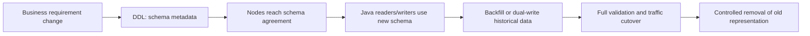
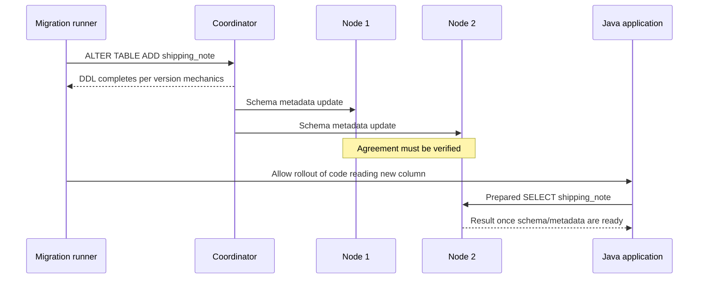
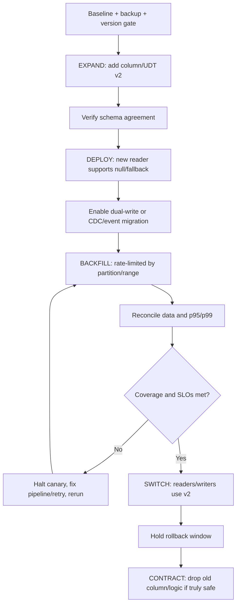

# Adding Columns, Altering UDTs, or Changing Properties Conditionally by Version in Apache Cassandra

## 1. Why do Cassandra schema migrations require a dedicated plan?

Apache Cassandra is a **distributed wide-column** database: the **partition key** determines where data is stored, **clustering columns** determine ordering within a partition, data is replicated according to the **replication factor (RF)**, and Java applications read/write CQL with a **consistency level (CL)**. A live production cluster may run multiple application versions, nodes, and datacenters simultaneously.

When product requirements call for adding a delivery note, extending an address type, or tuning TTL/compaction configuration, the operation may look simple:

- `ALTER TABLE ... ADD` a column.
- `ALTER TYPE ... ADD` a field to a **user-defined type (UDT)**.
- `ALTER TABLE ... WITH ...` to modify table properties.

However, **published schema does not mean historical data has been converted**, and **DDL success does not mean all running applications are immediately compatible**. CQL, Java Driver codecs, cross-node schema state, existing SSTables, TTL/tombstones, and backup tooling must all be considered.

Learning objectives for this lesson:

1. Distinguish **additive** changes that can be rolled out gradually from **breaking** changes requiring a new data representation.
2. Add new columns without assuming historical rows already hold values.
3. Understand UDT evolution and version-dependent **frozen/non-frozen** boundaries.
4. Change table properties without mistaking metadata updates for rewriting all SSTables.
5. Practice the **expand → deploy → backfill → switch → contract** workflow with CQL and Java Driver 4.x.
6. Establish **version gates, schema agreement, rollback, and observability** before altering production.

> Principle: treat every schema migration as **a protocol change between data and application versions**, not merely an administrative command.

## 2. Classifying changes before writing DDL

| Business requirement | Candidate operation | Risk level | What must be verified |
| --- | --- | --- | --- |
| Add nullable `shipping_note text` | `ALTER TABLE ... ADD` | Usually compatible with old readers | Version, column name, mapper/driver, existing data |
| Add `postal_code` to UDT | `ALTER TYPE ... ADD` if supported | Depends on UDT storage and codecs | Frozen/non-frozen, nested UDTs, all clients |
| Change type `text` to `bigint` | Create `amount_v2` or new table | Breaking | Data conversion, backfill, dual-read |
| Change partition/clustering key | Create new query-driven table | Breaking; affects placement | RF/CL, data migration, traffic cutover |
| Change table `comment` | `ALTER TABLE ... WITH comment` | Usually low data impact | Syntax and DDL privileges |
| Change `default_time_to_live` | `ALTER TABLE ... WITH ...` | Affects future writes | Retention, tombstones, backfill |
| Change compaction strategy | `ALTER TABLE ... WITH compaction` | I/O and latency impact | Version, backlog, disk headroom, runbook |
| Change `gc_grace_seconds` | `ALTER TABLE ... WITH ...` | Data correctness risk | Repair, deletes, offline replicas |
| Drop or rename column | Controlled contract process | Potentially breaking | Prepared CQL, clients, schema history |

Do not treat the command names in this table as identically supported across all Cassandra releases. Schema-altering capabilities have changed between versions; some operations are restricted or no longer recommended.

### DDL metadata differs from data migration



`ALTER TABLE ADD` can apply quickly because Cassandra mainly updates schema metadata, **without scanning every SSTable to populate new column values for every row**. The remaining steps belong to migration and deployment engineering.

## 3. Version gate: mandatory check before running commands

For this lesson, do not assume a single syntax applies unchanged across Apache Cassandra 3.x, 4.x, and 5.x, nor treat a managed-service Cassandra offering as identical to upstream.

### Capabilities that usually require verification

| Topic | Directional guidance | How to verify |
| --- | --- | --- |
| Adding regular columns | Available across versions via `ALTER TABLE ... ADD` | `nodetool version`, CQL syntax for target version |
| Changing an existing column's type in place | Heavily restricted/historically changed; **do not treat as safe migration** | Create a v2 column/table unless explicit compatibility docs apply |
| `ALTER TYPE ... ADD` | Available in versions supporting UDT evolution | Test in a same-version lab; check frozen/nested references |
| Renaming UDT fields | Conditionally supported; affects consumers | Do not treat as zero-downtime rename without verification |
| Changing UDT field type or dropping field | No safe default in-place alteration | Create a v2 type and migrate data |
| `ALTER TABLE ... WITH` | Many properties are mutable, but keys/impacts vary | Version schema docs/help; benchmark storage-impacting options |
| Schema agreement/DDL propagation | Cluster state that must be verified | Node/schema status, driver metadata, logs |
| Java Driver 4.x with UDTs | Supports UDT/codecs via metadata | Test prepared statements and real UDT serialization |

### Initial inspection commands

```bash
nodetool version
nodetool status
nodetool describecluster
```

In `cqlsh`:

```text
DESCRIBE KEYSPACE migration_lab;
DESCRIBE TABLE migration_lab.orders_by_id;
```

These two `DESCRIBE` commands are meaningful only **after the lab schema exists** (created in Section 5). `DESCRIBE` is a `cqlsh` utility, **not a standard DML query issued from the Java Driver**.

Before rollout, record **each node's version, the Java Driver compatibility matrix, distribution-supported features, initial schema version, and rollback plan**. During a rolling upgrade, never introduce DDL relying on new features while older nodes cannot parse that format.

## 4. Preflight: know who uses the schema and who will be impacted

A baseline pre-change checklist:

1. **Current schema:** keyspace, tables, UDTs, indexes, materialized views (if any), column types, and table options.
2. **Application contract:** which services run `SELECT *`, which list explicit columns, which ORM/mappers rely on fixed mappings, and which versions are deployed.
3. **Partition model:** do the partition key/clustering keys still match the query shape after the change?
4. **Load and capacity:** QPS, p95/p99, free disk, compaction backlog, active repair/streaming.
5. **Topology/CL:** RF per DC, local/global CL, and node fault tolerance during the maintenance window.
6. **Rollback:** can old readers/writers run again while the schema remains expanded? When is it safe to drop old columns?
7. **Backfill:** row/partition counts, token-range scanning strategy, rate limits, and resume mechanics.
8. **Privileges:** the deployment role holds required `ALTER`/`CREATE` rights without embedding superuser passwords in scripts.

In production, avoid bundling schema changes, RF increases, compaction-strategy switches, and multi-node restarts into one window. If timeouts occur, root-cause isolation and rollback become much harder.

### Protecting DDL

- Run only **one coordinated migration stream** per resource; prevent multiple services from racing on `ALTER TABLE` at startup.
- Record change ID, initial schema version, time window, operator, and outcome **without secrets**.
- Test syntax and behavior on a **staging cluster matching version/topology**.
- Consider backups/snapshots when migrations involve deletes, type conversions, or large backfills.
- Avoid relying on `IF NOT EXISTS` to mask mismatches: an existing column name with the **wrong type** must still be caught.

## 5. CQL Lab: building a schema with an explicit partition key

Assume the lab has a datacenter named `dc1` and enough replicas for RF3. If your lab has only one node, adjust RF and CL accordingly; do not test `LOCAL_QUORUM` with RF3 and mistake `Unavailable` for a DDL error.

### Step 1 — Create initial keyspace and UDT

```sql
CREATE KEYSPACE IF NOT EXISTS migration_lab
WITH replication = {
    'class': 'NetworkTopologyStrategy',
    'dc1': 3
}
AND durable_writes = true;

CREATE TYPE IF NOT EXISTS migration_lab.delivery_address (
    line1 text,
    city text
);
```

### Step 2 — Create a table keyed by `order_id`

```sql
CREATE TABLE IF NOT EXISTS migration_lab.orders_by_id (
    order_id uuid PRIMARY KEY,
    customer_id text,
    status text,
    shipping_address delivery_address,
    updated_at timestamp
) WITH comment = 'Order lookup by id - initial schema';
```

In this example, `shipping_address` is declared as a UDT **without `frozen<>` on the column** to illustrate field updates in versions supporting non-frozen UDTs. Do not turn this into a blanket default for every nested collection or primary key.

Try inserting a row:

```sql
INSERT INTO migration_lab.orders_by_id (
    order_id, customer_id, status, shipping_address, updated_at
) VALUES (
    11111111-1111-4111-8111-111111111111,
    'customer-42',
    'CREATED',
    {line1: '12 Nguyen Hue', city: 'Ho Chi Minh City'},
    '2026-11-20 09:00:00+0000'
);

SELECT order_id, customer_id, status, shipping_address
FROM migration_lab.orders_by_id
WHERE order_id = 11111111-1111-4111-8111-111111111111;
```

The output shows the UDT with its two initial fields. The UDT structure does not make Cassandra semantically understand addresses; it remains data inside **a single row keyed by partition key `order_id`**.

## 6. Adding columns with `ALTER TABLE ... ADD`

Product requirement: store an optional delivery note without changing the partition key.

```sql
ALTER TABLE migration_lab.orders_by_id
ADD shipping_note text;
```

After the schema is applied and agreement is verified, query the new column:

```sql
SELECT order_id, status, shipping_note
FROM migration_lab.orders_by_id
WHERE order_id = 11111111-1111-4111-8111-111111111111;
```

Rows created prior to the DDL typically return **`null`** for `shipping_note` because no mutation has written to that column yet. **Adding a column does not backfill** notes for historical rows.

Update a specific partition:

```sql
UPDATE migration_lab.orders_by_id
SET shipping_note = 'Call before delivery'
WHERE order_id = 11111111-1111-4111-8111-111111111111;
```

### What `ADD` does not do

| Expectation | Reality to understand |
| --- | --- |
| "All old rows get a default value" | No automatic backfill; readers must handle null |
| "Old apps safely ignore the extra column" | Safe only if old queries/mappers/codecs are compatible |
| "Adding a column creates new partitions" | Partition key stays unchanged; token distribution does not move |
| "Adding a column builds an index" | No; any index must be designed separately with performance evaluated |
| "Java `status` automatically switches to new schema" | Metadata/prepared statements have their own lifecycle and must be tested |
| "DDL populates data on every replica immediately" | Schema propagation differs from writing mutations and replica sync |

### Null is not a single business default

Depending on context, `null` may mean:

- The row was created before `shipping_note` existed.
- A new row intentionally omitted a note.
- An operation deleted/nulled the column per CQL semantics.
- A record has not been backfilled yet or a projection is lagging.

If the business must distinguish all four cases, **a single nullable column may be insufficient**. You can introduce an explicit `schema_version` or migration state field; never deduce "null means not backfilled" when new application writes can also leave the column unset.

### Never use `ADD` to change primary keys

Partition keys and clustering columns belong to the **placement and query model**. Changing from `order_id` to `(customer_id, month_bucket)` to query by customer/month requires creating **a new query-driven table**, backfilling, and switching endpoints; no `ALTER TABLE ADD` can turn an old partition layout into a new one.

## 7. Changing column types: why create a versioned column?

Suppose a legacy `total_cents text` column stores `'125000'`, while the new model wants `bigint` for numeric comparisons.

Do not assume a statement like:

```sql
-- NOT an instruction to run; in-place type alteration syntax/support
-- may be rejected or unsafe depending on version.
-- ALTER TABLE migration_lab.orders_by_id
-- ALTER total_cents TYPE bigint;
```

A clearer migration approach:

1. Add a `total_cents_v2 bigint` column.
2. Deploy readers that read v2 if present, falling back to v1 during transition.
3. Have new writers populate both v1/v2 while v1 consumers remain; control concurrency and timestamps.
4. Backfill v2 from v1 data via controlled conversion.
5. Measure coverage and cut over readers/writers completely to v2.
6. Only consider dropping v1 after the rollback window closes.

Example adding the new column in a **lab that already has `total_cents text`**, not directly on Section 5's table since it lacks that source column:

```sql
-- Applies to a table that actually contains total_cents text.
ALTER TABLE migration_lab.orders_by_id
ADD total_cents_v2 bigint;
```

Even on the lab table above, the new column can be created, though **there is no legacy data to convert**. The point is illustrating the workflow, not running ad-hoc cluster-wide scans.

### Renaming columns is also a contract change

`RENAME` capabilities and restrictions vary by version; many column renames do not have metadata-only semantics safe for all clients. For columns actively used by multiple services, **add new → dual-read/write → backfill → contract** is usually far more controllable than a rename that breaks prepared CQL immediately.

Never change **column type, column name, and primary key** in the same release without partial testing and rollback capability.

## 8. UDTs: a structured data type, not an independent table

A **User-Defined Type (UDT)** groups semantically related fields, such as an address:

```sql
CREATE TYPE IF NOT EXISTS migration_lab.delivery_address (
    line1 text,
    city text
);
```

A row can store this UDT in `shipping_address`. A UDT has no independent partition key or replication; its data lives inside the row/table containing it.

### How do frozen and non-frozen differ?

| Property | `frozen<delivery_address>` | Non-frozen `delivery_address` |
| --- | --- | --- |
| Value representation | Single unit encoded as one value | May support field-level operations |
| Updating one field | Typically requires rewriting the entire value | Can update a specific field depending on version |
| Use in nested collections/keys | Follows frozen rules | More restricted depending on reference site |
| Altering UDT schema | Must assess reading old values and codecs | Must assess field data, codecs, and version |
| Compatibility | Does not guarantee old drivers can read new fields | Equally does not guarantee old mappers remain compatible |

**Do not interpret "non-frozen" as independent cross-replica transactions per field.** Fields still obey Cassandra's consistency, timestamp, TTL, and tombstone mechanics.

### When are UDTs useful?

- Grouping address/metadata fields with a clear schema typically read alongside the row.
- Reducing unrelated top-level columns when an object has a relatively stable shape.
- Integrating with prepared CQL and Java Driver UDT codecs.

When an object changes frequently, nests multiple collection types, or needs independent querying/filtering per field, evaluate whether top-level columns or a query-specific table fit better.

## 9. Adding a UDT field with `ALTER TYPE ... ADD`

Requirement: add a postal code to the address:

```sql
ALTER TYPE migration_lab.delivery_address
ADD postal_code text;
```

This is an **additive UDT evolution** example. Use it only after confirming your Cassandra version supports the operation and references to the UDT (especially `frozen`/nested ones) do not forbid it.

In versions allowing field updates on **non-frozen UDTs**:

```sql
UPDATE migration_lab.orders_by_id
SET shipping_address.postal_code = '700000'
WHERE order_id = 11111111-1111-4111-8111-111111111111;

SELECT shipping_address
FROM migration_lab.orders_by_id
WHERE order_id = 11111111-1111-4111-8111-111111111111;
```

In the lab, old rows without an assigned `postal_code` may return `null` for the new field. **The new schema does not infer postal codes** from `city`; if the business needs them, backfill from an authoritative data source.

### Crucial compatibility boundaries

- **Field ordering/definitions in a UDT** can affect serialization and codecs; older Java clients must be tested against rows containing the new field.
- When a UDT is **frozen** or inside nested collections/UDTs, some alterations may be disallowed or have version-specific constraints.
- Adding a UDT field is **not equivalent** to changing an existing field from `text` to `int` or dropping a field.
- Never try to "fix" an existing field of the wrong type by re-running `ALTER TYPE ADD`.
- If a Java mapper expects exactly two fields, test decoding both old and new values; never assume all mappers ignore newly added fields.

**If `ALTER TYPE` is rejected in the lab, never bypass it by editing system tables or SSTables directly.** Switch to the versioned UDT design described next.

## 10. Breaking UDT changes: creating type v2 and column v2

Suppose the address does not merely add a postal code, but restructures:

- `line1 text` is split into `street_name` and `building_number`.
- Multiple legacy consumers still expect `delivery_address`.
- Some columns already use the UDT frozen inside nested structures.

In this case, altering the UDT in place may be both poorly supported in CQL and **incompatible with legacy codecs**. A safer option is creating a new version:

```sql
CREATE TYPE IF NOT EXISTS migration_lab.delivery_address_v2 (
    street_name text,
    building_number text,
    city text,
    postal_code text
);

ALTER TABLE migration_lab.orders_by_id
ADD shipping_address_v2 frozen<delivery_address_v2>;
```

Write a v2 value once the type and column exist:

```sql
UPDATE migration_lab.orders_by_id
SET shipping_address_v2 = {
    street_name: 'Nguyen Hue',
    building_number: '12',
    city: 'Ho Chi Minh City',
    postal_code: '700000'
}
WHERE order_id = 11111111-1111-4111-8111-111111111111;
```

The application can keep v1 and v2 on the same row during the transition window. On read:

1. If v2 is present and valid, use v2.
2. If v2 is absent, read v1 and transform according to business rules.
3. For new writers, decide whether to **dual-write** or use a single source of truth with separate event/projection updates.
4. After all new consumers stabilize, remove v1 logic in a separate release.

### Data is not always deterministically convertible

From `line1 = '12 Nguyen Hue'`, you cannot always reliably parse `building_number = '12'` and `street_name = 'Nguyen Hue'` across every country. **Backfill is a business transformation**, not merely a CQL type change.

Track parse failures/missing fields, an "unconvertible" status, verified record counts, and manual remediation workflows. Never fabricate fake precision out of ambiguous strings.

## 11. Changing properties with `ALTER TABLE ... WITH`

Modifying table properties is a distinct class of operations from adding columns. Not every property has the same effect on existing data.

### 11.1. Low-risk metadata property: `comment`

```sql
ALTER TABLE migration_lab.orders_by_id
WITH comment = 'Order lookup by id - schema migration v2';
```

A comment updates descriptive metadata without touching partition keys or backfilling data. Although low-risk, DDL still requires proper permissions and schema propagation.

### 11.2. Default TTL: changing the policy for new data

An example to test **only on a lab table meant for expiring data**:

```sql
-- DO NOT apply blindly to a production orders table.
ALTER TABLE migration_lab.orders_by_id
WITH default_time_to_live = 604800;
```

`604800` seconds = 7 days. Default TTL primarily affects **mutations written after the change** per version semantics; it **does not retroactively apply TTL to all historical cells**. Newly written values, updates, and explicit per-write TTLs interact; never assume changing the property immediately expires all old rows.

Specifically:

- For orders that must be retained long-term for reconciliation, **never set a 7-day TTL** just to save disk space.
- TTLs and DELETEs produce tombstones; compaction only purges them once safety conditions are satisfied.
- Operators must understand interactions with **repair, offline replicas, and `gc_grace_seconds`**.
- Setting `default_time_to_live = 0` later does not resurrect already-expired data.

### 11.3. Compaction strategy

```sql
-- CQL example of a strategy change; evaluate in lab only.
ALTER TABLE migration_lab.orders_by_id
WITH compaction = {
    'class': 'SizeTieredCompactionStrategy'
};
```

Compaction strategy governs how SSTables are merged. Changing the property **does not immediately rewrite all existing SSTables into the new layout**, yet it can trigger compaction backlogs, heavy I/O, and shifted read/write/space amplification later. Monitor `nodetool compactionstats`, disk headroom, read/write p99, and SSTables per read.

STCS, LCS, TWCS, and UCS (if supported by your version) each carry trade-offs. Do not switch from STCS to TWCS simply because a table has a timestamp column; evaluate time windows, TTLs, late writes, and SSTable expiration eligibility.

### 11.4. Properties requiring extra caution

| Common property | Risks to analyze |
| --- | --- |
| `gc_grace_seconds` | Lowering too early when replicas are offline or repair is unreliable can resurrect deleted data |
| `compression` | Affects I/O/CPU and future SSTable compression; does not instantaneously recompress all existing files |
| `caching` | Alters cache usage, affecting RAM and latency depending on workload |
| `bloom_filter_fp_chance` | Trades memory for lookup I/O; applies to SSTables per version mechanics |
| `speculative_retry` | Can shift extra read load and tail latency if supported and tuned properly |
| `default_time_to_live` | Alters retention and tombstones for future mutations |
| `compaction` | Alters background task scheduling and I/O intensity |

These option names are **common examples, not guaranteed across all versions or distributions**. Check schema documentation for your deployed version, test syntax, and change **only one parameter group per rollout** to isolate root causes.

## 12. Schema agreement: executing DDL is not enough

Schema is metadata that must propagate across the cluster. When altering types or columns:



This diagram is simplified. Cassandra's schema propagation and cluster metadata mechanics differ by version; **do not assume DDL messages flow exactly as drawn across every release**.

### What must be verified?

- All required nodes received the new schema with no lingering schema disagreement.
- Any node Down during DDL has a plan to rejoin, catch up on schema, and undergo data validation.
- `DESCRIBE TABLE` / `system_schema.columns` reflect expected names/types on relevant nodes.
- The Java Driver detects the metadata/schema update and can prepare new queries.
- No spike in `InvalidQuery`, `Unknown column`, or UDT codec mismatch errors occurs post-rollout.

Inspection commands:

```bash
nodetool status
nodetool describecluster
```

In `cqlsh`:

```sql
SELECT column_name, kind, type
FROM system_schema.columns
WHERE keyspace_name = 'migration_lab'
  AND table_name = 'orders_by_id';
```

`system_schema` is metadata for **reading**, not a place operators may modify with `UPDATE`. Output can vary by version; when strict schema agreement checks are needed, use tooling/drivers validated for that version.

## 13. Java 4.x applications: prepared statements and compatibility windows

Java Driver 4.x uses prepared statements, metadata, and codecs to execute/decode CQL. During a schema change, old and new application versions may run side by side:

| Application | CQL/mapper | Compatibility |
| --- | --- | --- |
| v1 reads only `order_id, status` | New column not referenced | Typically continues working after adding nullable column |
| v2 reads `shipping_note` | Requires schema with new column | Deploying too early can fail with unknown column |
| v2 uses `delivery_address_v2` | Requires new type/column and codec | Must test UDT mapping across driver versions |
| v1 uses `SELECT *`/rigid mapper | May unexpectedly see extra columns | Not guaranteed backward compatible by default |
| New writer uses different TTL/options | Can alter data semantics | Must test TTL, timestamps, backfill, and old-app reads |

**Recommendation:** use explicit column lists and prepare new `SELECT` statements only after schema agreement; never treat `SELECT *` as a stable API contract.

### Java Driver 4.x example after adding a column

```java
import java.util.Optional;
import java.util.UUID;

import com.datastax.oss.driver.api.core.CqlSession;
import com.datastax.oss.driver.api.core.DefaultConsistencyLevel;
import com.datastax.oss.driver.api.core.cql.BoundStatement;
import com.datastax.oss.driver.api.core.cql.PreparedStatement;
import com.datastax.oss.driver.api.core.cql.Row;

public final class OrderShippingNoteRepository {
    private final CqlSession session;
    private final PreparedStatement selectNote;
    private final PreparedStatement updateNote;

    public OrderShippingNoteRepository(CqlSession session) {
        this.session = session;
        // Prepare after DDL and schema agreement are verified.
        this.selectNote = session.prepare(
            "SELECT shipping_note FROM migration_lab.orders_by_id " +
            "WHERE order_id = ?"
        );
        this.updateNote = session.prepare(
            "UPDATE migration_lab.orders_by_id " +
            "SET shipping_note = ? WHERE order_id = ?"
        );
    }

    public Optional<String> findNote(UUID orderId) {
        BoundStatement stmt = selectNote.bind(orderId)
            .setConsistencyLevel(DefaultConsistencyLevel.LOCAL_QUORUM)
            .setIdempotent(true);
        Row row = session.execute(stmt).one();
        if (row == null || row.isNull("shipping_note")) {
            return Optional.empty();
        }
        return Optional.of(row.getString("shipping_note"));
    }

    public void putNote(UUID orderId, String note) {
        BoundStatement stmt = updateNote.bind(note, orderId)
            .setConsistencyLevel(DefaultConsistencyLevel.LOCAL_QUORUM);
        session.execute(stmt);
    }
}
```

This Java class is a minimal example assuming `CqlSession` is configured with proper **TLS/auth, local DC, and contact points**. `LOCAL_QUORUM` requires enough replicas per the DC's RF; never downgrade to `ONE` just to make a migration pass. Reuse the session across the service lifecycle rather than opening one per request.

`putNote` intentionally **does not** blindly set `setIdempotent(true)`: write idempotency depends on timestamps, concurrent writes, retries, and business side effects. A write timeout can leave an ambiguous outcome; production systems need operation IDs or reconciliation if retrying.

### UDTs from Java: new fields need updated codecs/metadata

Snippet for reading a UDT after extending its type:

```java
import com.datastax.oss.driver.api.core.data.UdtValue;
import com.datastax.oss.driver.api.core.cql.Row;

// Place inside a row-mapping method where shipping_address was queried.
UdtValue address = row.getUdtValue("shipping_address");
String postalCode = null;
if (address != null && !address.isNull("postal_code")) {
    postalCode = address.getString("postal_code");
}
```

This is a **snippet**, not a complete Java class. Before using it, ensure the type alteration succeeded, the driver received fresh metadata, the query explicitly selects `shipping_address`, and no codec is hard-coded to the old UDT shape. For `frozen<...>` or UDT v2, test serialization separately.

## 14. Expand → deploy → backfill → switch → contract

A reliable migration should allow **old and new versions to coexist** during a controlled window.



### Phase 1 — Expand

- Run supported `ALTER TABLE ADD`, `ALTER TYPE ADD`, or create type/table v2.
- Wait for schema agreement and verify all required nodes.
- Do not require non-null reads from the new column while historical rows are still null.
- Record DDL timestamps and configuration to support rollback logic.

### Phase 2 — Deploy dual-compatible applications

- Old readers keep running; new readers are **null-safe** and fall back when v2 is absent.
- New writers write v2 and optionally continue writing v1 while v1 consumers remain.
- Feature flags allow disabling the v2 read path without immediately dropping DDL.
- Avoid changing query shapes or CL arbitrarily in the same rollout.

### Phase 3 — Historical backfill

- Scan source data by token range or controlled keys/manifests; **never run unbounded CQL `ALLOW FILTERING` scans in production**.
- Cap concurrent requests, page size, bandwidth, retries, and throughput.
- Write by **full partition key**; never bundle millions of partitions into a huge batch.
- Use checkpoints/idempotency keys and batch logging; restarting a job must not corrupt data.
- Define ordering against **ongoing live writes** so backfill never overwrites newer values with stale ones.

### Phase 4 — Switch and contract

- Reconcile v1/v2 data, measure peak performance, and test restarts/rollouts.
- Switch the read path first, then stop updating v1 per policy.
- Maintain the old version during a defined rollback window.
- Drop old columns/UDTs only after confirming zero clients, prepared CQL statements, jobs, or backups still depend on them.

**Schema rollback differs from data rollback:** flipping a feature flag can make clients read v1 again, but once a column is dropped or data is rewritten under new semantics, "reversing DDL" will not reconstruct lost old data.

## 15. Safe backfill: do not lose newer updates

Suppose `shipping_address_v2` must be derived from v1 while live orders can still update addresses.

```text
T1  Backfill job reads address_v1 = A
T2  New app writes address_v2 = B (newer address)
T3  Backfill job uses data read at T1, writes address_v2 = A

Result: B risks being overwritten by A if timestamps/write rules allow it.
```

Cassandra often reconciles mutations using timestamps; if a backfill job sends an **older value with a newer timestamp**, it can beat a real business update.

A pipeline must explicitly define:

1. **Source of truth:** is v1 or v2 authoritative in each phase?
2. **Event ordering:** how do versions/sequences/timestamps distinguish newer updates?
3. **Idempotency:** re-running a batch does not alter data semantics.
4. **Conflict resolution:** if v1 and v2 change concurrently, which wins?
5. **Checkpoints:** which partitions/token ranges completed and how many errors need manual repair.
6. **Resume:** can the job resume cleanly after timeouts, node outages, or deploys?
7. **Rate limiting:** prevent compaction/disk pressure spikes that push API p99 past SLO.

Never arbitrarily inject `USING TIMESTAMP` with far-past or future timestamps to "solve" races. Client-supplied timestamps can diverge from wall clocks and interact poorly with TTLs, tombstones, and LWT; using them requires a **consistent data-versioning model**.

### Is LWT a universal solution?

LWT (`IF`) provides Paxos-based conditional mutations within a scoped context, carrying latency and availability trade-offs. It does **not** create arbitrary multi-table/multi-partition ACID transactions for backfills. If a row must be protected from overwrite, design explicit conditions, understand serial consistency, and benchmark under your workload.

### Measuring coverage

Never just count "backfill sent N UPDATEs." Track:

- Expected total partitions/rows from a reliable source count.
- Successful reads/writes **acknowledged at the required CL**.
- Rows newly read from v2 vs. rows still falling back to v1.
- Records failing parsing/type conversion or missing source fields.
- Discrepancies when comparing v1↔v2 across representative samples, tenants, and time buckets.
- Error rates, p95/p99, compaction backlog, and disk space throughout the backfill.

Some counters are **estimates or shift with compaction**; do not treat every `nodetool tablestats` figure as an exact row count to sign off a backfill.

## 16. Coordinating with replication and multiple DCs

Schema changes belong to cluster metadata, yet backfill mutations still flow through **replica placement** and **CL**. With `NetworkTopologyStrategy`, each DC has its own RF:

```text
             Java migration service
                    |
              Coordinator dc1
                    |
       +------------+------------+
       |            |            |
       R1           R2           R3     (RF(dc1)=3)

Schema must be compatible on serving nodes.
Backfill mutations must satisfy chosen CL.
Other DCs may lag in replication if WAN degrades.
```

If a client uses `LOCAL_QUORUM` in `dc1`, an UPDATE is acknowledged once enough `dc1` replicas respond; this **does not prove every replica in `dc2` received the mutation**. After topology stabilizes, run anti-entropy repair per your runbook for diverged replicas/ranges; schema agreement **is not a substitute for data convergence**.

For multi-DC migrations:

- Deploy schema before v2 clients across all relevant DCs.
- Verify reads/writes from each local DC, not just a single coordinator.
- Account for WAN latency, token ranges, replica counts, and degraded-DC scenarios.
- Avoid running massive concurrent backfills across two DCs with conflicting timestamp rules.
- If a node was absent for long, check hinted handoff/repair before claiming all v2 data is synchronized.

**Changing RF or moving nodes/DCs is not a side task of adding a column.** If the real goal is migrating data to a different keyspace, build a dedicated replication/streaming runbook.

## 17. Observing migrations with `nodetool` and Java metrics

Useful commands on the **queried node**:

```bash
nodetool status
nodetool describecluster
nodetool tpstats
nodetool compactionstats
nodetool tablestats migration_lab.orders_by_id
nodetool tablehistograms migration_lab orders_by_id
nodetool netstats
```

| Observation source | Metric | Question |
| --- | --- | --- |
| Schema/driver | InvalidQuery, unknown column/type, UDT codec errors | Did an app prepare/run queries before schema agreement? |
| `nodetool status` | Up/Down, DC/rack, joining/leaving | Which nodes were not fully participating during DDL/backfill? |
| `tpstats` | Pending tasks, dropped messages | Is backfill causing overdue queue growth? |
| `compactionstats` | Active/pending compactions | Are v2 writes growing SSTable/compaction backlogs? |
| `tablestats` | SSTable count, memtable, local latency, tombstones | Is a table suffering write amplification or hot partitions? |
| `tablehistograms` | p95/p99, partition size, cells, SSTables/read | Did read tail latency worsen after v2? |
| `netstats` | Streaming/network activity by version | Is bootstrap/repair competing for resources during migration? |
| Java Driver/API | QPS, p99, retries, timeouts, new/old reader ratio | Are users experiencing errors or latency? |
| Migration job | Checkpoints, converted, skipped, conflicts, failures | Is the backfill complete and accurate? |

`nodetool` metrics are typically **node-local**, and names/units vary across versions. Never use one `UN` node or one successful `SELECT` as proof that the entire cluster has migrated.

### Sample canary dashboard

| Signal | Hypothetical baseline | Hypothetical post-canary | Action |
| --- | ---: | ---: | --- |
| API Read p99 | 45 ms | 50 ms | Watch trend/SLO |
| API Write p99 | 30 ms | 110 ms | Investigate dual-write/backfill |
| Schema errors | 0/min | 12/min | Halt v2 rollout |
| Backfill conflicts | 0 | 25 | Pause job and fix write rules |
| Pending compactions | 20 | 145 | Check rate limits/disk |
| Disk free | 40% | 22% | Assess headroom before continuing |

These numbers **only illustrate how to detect issues**, not thresholds for every cluster. Rollout thresholds must reflect real SLOs and capacity headroom.

## 18. Rollback procedures by severity of change

| Change | Relatively safe rollback | What not to do |
| --- | --- | --- |
| Add nullable column | Disable v2 writers/readers; leave extra column during investigation | Immediately DROP column over one canary error |
| Add UDT field | Switch clients back to old reader if compatible | Assume field can be trivially dropped/encoding reversed |
| Add type/column v2 | Stop v2 reads/writes; retain v1 for reconciliation | Delete v2 before checking for v2-only writes |
| Change `comment` | Update comment back via DDL | Treat that as data recovery |
| Change TTL | Stop misconfigured setting for new mutations; inspect affected data | Believe setting TTL back to 0 undoes expiration |
| Change compaction | Tune/revert strategy with runbook and headroom | Expect all SSTables to revert immediately |
| DROP column/type/table | Restore using backups/pre-planned migration | Re-run `ADD` and expect old data to reappear |

### Regarding `DROP COLUMN` and name reuse

Dropping a column is a **destructive** schema/data-contract operation. Cassandra tracks dropped-column metadata and timestamps to handle older SSTable data; re-adding a column with the same name—especially with a different type—may be restricted or behave unexpectedly depending on version.

**Never use DROP/ADD with the same name as an in-place type change.** If you truly must contract:

1. Back up/take snapshots and verify restore.
2. Stop all old consumers, including batch/reporting jobs.
3. Prove no required data exists exclusively in the old column.
4. Assess TTL/tombstone impact and rollback window.
5. Apply DDL during an approved window and monitor.

If you need to change the **partition key**, design a new table; a `DROP`/`ADD` on the same table will not magically redistribute SSTables to new token ownership.

## 19. Practice scenarios and guided answers

### Scenario A — Column added, old data returns null

You run `ALTER TABLE orders_by_id ADD shipping_note text` successfully. The new Java app assumes every row has a note and throws an exception reading old rows. Is Cassandra at fault?

**Hint:** No. New schema does not backfill existing rows. Readers must handle null/optional values, using fallbacks or backfilling when a business source exists.

### Scenario B — UDT field added, old client fails decoding

The cluster accepts `ALTER TYPE delivery_address ADD postal_code text`, yet an old service uses a rigid UDT mapper. What should be done?

**Hint:** Halt rollout, test with the old version's metadata/codec, upgrade the mapper, or switch to UDT v2. DDL success does not replace compatibility testing across all consumers.

### Scenario C — Changing TTL to save disk space

An operator sets `default_time_to_live = 604800` on an orders table subject to legal retention. A week later, new data expires. Does resetting TTL to 0 bring the data back?

**Hint:** No. The new TTL affects data written after the DDL; reverting the property does not restore expired data. Backups/recovery and prior retention review are required.

### Scenario D — Backfill overwrites live updates

A job reads address v1 at T1, the app writes a new address v2 at T2, and the job writes v2 from old data at T3. Why is this wrong?

**Hint:** Timestamp reconciliation can allow the later backfill mutation to overwrite the genuine update. You need versions/sequences, conditional updates, or ordered replay—not just more retries.

### Scenario E — Schema agreement reached, yet another DC reads stale data

`ALTER TABLE ADD` propagated to both DCs; v2 updates are written in `dc1` with `LOCAL_QUORUM`. Moments later, `dc2` reads old values amid WAN instability. Is this a contradiction?

**Hint:** No. Schema agreement is metadata; data replication and local CL are separate concerns. Inspect WAN health, replica catch-up/repair, and confirm apps read from the expected DC.

### Scenario F — Changing type via DROP/ADD of the same name

Operations plans to `DROP total_cents` and then `ADD total_cents bigint` to replace a text column. Why is this dangerous?

**Hint:** Old data may be lost or inaccessible; reusing the name/type has version restrictions; active prepared queries/codecs can break. Use `total_cents_v2` or a v2 table with controlled backfill.

### Scenario G — Lowering `gc_grace_seconds` right during schema migration

During a rollout, one replica is offline for an extended period; the team wants to lower grace so compaction "cleans tombstones faster." Is that safe?

**Hint:** Not by default. Grace and anti-entropy repair protect deletes while replicas are absent; lowering it too soon can resurrect deleted data. Never bundle this tuning with a schema migration.

## 20. Production deployment checklist

**Before the change**

- [ ] Verify exact **Cassandra version/distribution** and supported syntax across the cluster.
- [ ] Document baseline schema, owner, change window, table/column/UDT references, and Java consumers.
- [ ] Understand partition/clustering keys, RF, DC, CL, and pre/post-DDL query contracts.
- [ ] Test on staging, including legacy rows, nulls, frozen/non-frozen UDTs, and old mappers.
- [ ] Prepare backup/restore plans for breaking changes and verify disk/CPU/compaction headroom.
- [ ] Do not combine DDL, RF changes, compaction switches, GC grace edits, and multi-node restarts.

**During expand and application rollout**

- [ ] Prefer **adding v2 columns/types** over incompatible type edits or field removals.
- [ ] Verify schema agreement and node/driver metadata before preparing new CQL.
- [ ] New readers are null-safe; writers have explicit dual-write and concurrency policies.
- [ ] Backfill uses rate limits, checkpoints, idempotency, partitioning, and parse-error handling.
- [ ] Prevent races between backfill and live updates with a single source-of-truth rule.
- [ ] Measure p95/p99, timeouts, read/write throughput, SSTables/compaction, and free disk.
- [ ] Test from each DC at the required CL; never confuse schema agreement with replica catch-up.

**After switching**

- [ ] Reconcile data across multiple partitions/tenants and business rules, not just one row.
- [ ] Confirm no legacy consumers or prepared statements still depend on the old schema.
- [ ] Maintain the rollback window and verify the ability to read v1 again.
- [ ] Drop legacy columns/UDTs only after verifying backups, retention, and impact.
- [ ] Record new schema/driver versions, metric baselines, and migration results.

**Key takeaway:** In Cassandra, `ALTER TABLE ADD` typically **expands metadata without generating values for old rows**; `ALTER TYPE` requires checking **frozen/non-frozen UDT boundaries and version constraints**; `ALTER TABLE WITH` changes properties with potential impacts on **TTL, compaction, and correctness**. The safe way to evolve a live schema is **version gate → expand → deploy compatible readers/writers → backfill/reconcile → switch → contract**, always preserving rollback capability and observing p99, replicas, schema agreement, and actual data.
