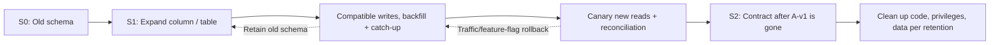
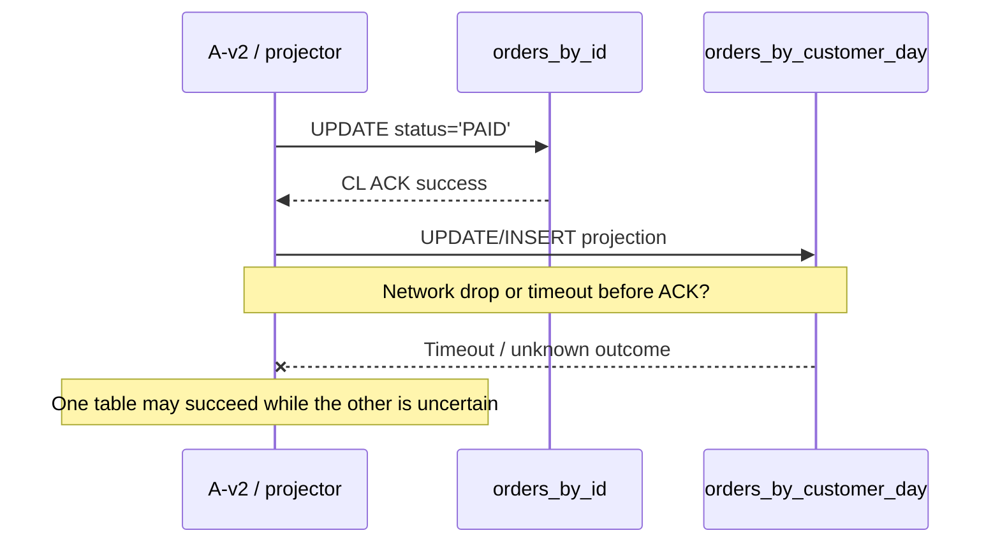

# Expand/Contract with Multiple Coexisting Application Versions

## 1. Real-world problem: Cassandra cannot "wait for every app to upgrade"

In a Java system using rolling deployments, application version **A-v1** and **A-v2** may handle live traffic concurrently for minutes, hours, or longer: old pods not yet drained, consumers draining backlog messages, legacy scheduled batch jobs, an un-upgraded region/DC, or a canary rollback. Throughout that window, both versions read and write against Apache Cassandra.

A seemingly minor change like "rename `status` to `status_detail`," "move `order_id` to a day-bucketed partition key," or "drop `legacy_code`" can cause A-v1 to hit CQL errors while A-v2 runs normally. A query-driven table redesign is never just DDL: existing data must be migrated, concurrent writes during migration must be captured, and rollback requires a viable data path back.

This lesson belongs to the **Migration and Schema** chapter of the `DATABASE_ENGINE_WIDE_COLUMN_CASSANDRA` module, connecting distributed/wide-column architecture, partition-key and query-driven table design, read/write consistency, CQL, replication, compaction, repair, troubleshooting, and the Java Driver.

**Goal:** establish an **expand → migrate → contract** workflow in which *every allowed application version* keeps reading/writing within contract, old and new data do not silently diverge, DDL rolls out safely, and retiring old structures is gated on evidence.

After this lesson, you will be able to:

1. Identify **compatibility invariants** while A-v1/A-v2 run concurrently.
2. Distinguish **adding a column on the same table** from **changing primary keys/query patterns requiring a new table**.
3. Design **dual-write/CDC or replay, backfill, completeness checks, cutover, and rollback**.
4. Understand the effects of schema agreement, prepared statements, TTL, tombstones, timestamps, and consistency levels (CL).
5. Practice CQL/Java Driver on synthetic data and define evidence-based phase-exit criteria rather than guessing.

## 2. Expand/contract principle: compatibility first, cleanup last

**Expand** adds new capabilities **without breaking the old contract**: optional columns, new tables, new write paths, or fallback read logic. **Migrate** moves data and processing onto the new structure. **Contract** removes the old structure only when no version needs it and the rollback window has closed.



**Central invariant:** no deployment step forces A-v1 to execute CQL, decode payloads, or interpret business states it was never built to support. Likewise, A-v2 must be able to read data written by A-v1 throughout the entire coexistence window.

### Two independent state axes

- **App version:** A-v1 knows only the old table/columns; A-v1.5 may also write the new structure while still reading old; A-v2 reads new with fallback; A-v3 drops the old path.
- **Schema/data version:** S0 has only the old table; S1 adds new structures without full data yet; S1-ready has completed backfill/catch-up; S2 drops the old structure.

Never equate "application deploy succeeded" with "new data is complete," nor treat "DDL succeeded" as permission to delete old code.

## 3. Compatibility matrix written before running DDL

Suppose A-v1 accesses `orders_by_id(order_id, customer_id, status)`; A-v2 wants to also read `status_note`.

| Schema state | A-v1 reads/writes old columns | A-v2 also reads new column | A-v2 falls back when new column is null | Rollback A-v2 → A-v1 |
| --- | --- | --- | --- | --- |
| **S0: without `status_note`** | Yes | **No**, query references non-existent column | Only while **feature reading new column is disabled** | Yes |
| **S1: `status_note` added** | Yes, if A-v1 uses explicit CQL without needing new column | Possible, though old rows return null | Yes | Yes, if A-v2 still writes old data A-v1 needs |
| **S1-ready: required data backfilled** | Yes | Can shift gradually after validation | Yes, keep during transition window | Yes, under compatible write rules |
| **S2: `status` dropped** | **No** | **No for any A-v2 selecting `status`**; only versions free of old references run | Cannot save any version still querying `status` | **No** via binary rollback alone |

**New column = null** on older rows is the normal state of an additive migration; never misinterpret null as "completed" or let it silently change business semantics. A-v2 must define explicit defaults/fallbacks, including when null is valid real data.

### Coexistence timeline

```text
Time       ------------------------------------------------------------>

Schema:      S0 |------------- S1 (expanded) --------------| S2 contract
A-v1 pods:   ██████████████████───────────────(0 instances)────────────
A-v1 jobs:   ████████████████████████─────────(0 jobs)─────────────────
A-v2 pods:              █████████████████████████████████████████████
Old writers: ███████████████████████████──────(0 writers)──────────────
Backfill:                    █████████████████
Catch-up:                             ██████████████
Read cutover:                                       ███████████████████
Rollback window:          <------------------------->
```

**Closing the A-v1 window** requires proof that every API instance, worker, cron job, consumer, region, internal tool, and legacy client has stopped **writing or reading** the fields slated for removal. Do not check only the primary deployment while overlooking retry queues and scheduled batch jobs that wake up the next day.

## 4. Case A — Adding a column to the same table: simplest expand

### 4.1. Create lab schema and data

Example with one DC `dc1` and enough nodes for RF = 3. Run only on a **lab cluster**; adjust when DC names or topologies differ.

```sql
CREATE KEYSPACE migration_lab_ks
WITH replication = {'class': 'NetworkTopologyStrategy', 'dc1': 3}
AND durable_writes = true;

CREATE TABLE migration_lab_ks.orders_by_id (
    order_id uuid PRIMARY KEY,
    customer_id text,
    created_at timestamp,
    status text,
    updated_at timestamp
);

INSERT INTO migration_lab_ks.orders_by_id
    (order_id, customer_id, created_at, status, updated_at)
VALUES (
    11111111-2222-4333-8444-555555555555,
    'synthetic-customer-1',
    '2026-11-21T08:00:00+0000',
    'CREATED',
    '2026-11-21T08:00:00+0000'
);
```

For lookups by order ID, `order_id` is the **partition key**; adding a regular column does not alter token placement or RF.

### 4.2. Expand before deploying A-v2

```sql
ALTER TABLE migration_lab_ks.orders_by_id
ADD status_note text;

-- Inspect declared schema:
SELECT column_name, kind, type
FROM system_schema.columns
WHERE keyspace_name = 'migration_lab_ks'
  AND table_name = 'orders_by_id';
```

Adding a column **does not backfill** existing rows; until written, `status_note` returns null. DDL must be executed by a **schema migrator** with proper privileges—never embed "auto-run `ALTER TABLE` on app startup" in every pod.

A-v1 continues querying with an explicit projection:

```sql
SELECT order_id, customer_id, status, updated_at
FROM migration_lab_ks.orders_by_id
WHERE order_id = 11111111-2222-4333-8444-555555555555;
```

A-v2 reads the additional optional column:

```sql
SELECT order_id, customer_id, status, status_note, updated_at
FROM migration_lab_ks.orders_by_id
WHERE order_id = 11111111-2222-4333-8444-555555555555;
```

**Contract in S1:** `status` remains the canonical state A-v1 understands, and `status_note` is strictly supplementary. A-v2 tolerates null. If `status_note` becomes mandatory with new business semantics, a separate data-population and validation phase is required before enabling it.

### 4.3. Why avoid `SELECT *` in prepared statements?

When schema changes, returned column lists/types may differ from metadata cached in the driver. **Especially in Cassandra 3.x and older native protocols**, a prepared `SELECT *` after ADD/DROP column risks mis-decoding results or failing. Newer driver/protocol combinations refresh result metadata better, yet safe rolling-deploy practice remains **explicitly listing the columns each app expects**.

Do not reuse a prepared statement whose output column count or types shift mid-flight in A-v1. After DDL, verify schema agreement, metadata refresh, `UNPREPARED`/schema errors, and test reads across coordinators.

## 5. Case B — Changing partition key/query pattern: a new table is required

Suppose the application must list a customer's orders by day; `orders_by_id` partitioned by `order_id` optimizes only single-order lookups. Cassandra **does not allow changing an existing table's primary key via `ALTER TABLE`** to re-partition in place. Therefore, create **a new query-driven table**:

```sql
CREATE TABLE migration_lab_ks.orders_by_customer_day (
    customer_id text,
    bucket_day date,
    created_at timestamp,
    order_id uuid,
    status text,
    updated_at timestamp,
    PRIMARY KEY ((customer_id, bucket_day), created_at, order_id)
) WITH CLUSTERING ORDER BY (created_at DESC, order_id DESC);
```

```text
Legacy read (A-v1):
  GET /orders/{orderId}
         -> orders_by_id
            partition key = order_id

New read (A-v2):
  GET /customers/{customerId}/orders?day=...
         -> orders_by_customer_day
            partition key = (customer_id, bucket_day)
            clustering = (created_at DESC, order_id DESC)

Old + new tables may contain the same business order,
but Cassandra does not magically keep them synchronized.
```

**Wide-column model consequence:** the new table is a **projection/denormalized table** maintained by the application or pipeline. Cassandra does not automatically propagate mutations from the old table to the new one merely because both share an `order_id` column.

Changing column types, key semantics, merging/splitting partitions, or altering clustering order must also be treated as **a new data problem**, without assuming `ALTER TABLE` supports safe in-place type or primary-key edits.

## 6. Standard roadmap for a new table while A-v1 and A-v2 coexist

### Phase E0 — Lock down contract and rollback capability

Before writing code:

- Inventory all legacy apps/jobs/consumers and their active CQL statements.
- Identify the authoritative source table, logical key `order_id`, update/delete/TTL mechanics, and **all allowed writers**.
- Draft the **A-v1/A-v2 compatibility matrix** across every schema/data state.
- Lock in RF/CL, multi-DC routing, and retry policies. Changing CL mid-migration skews correctness comparisons.
- Choose an event log/CDC/outbox or capture mechanism covering **every writer**, especially A-v1.
- Prepare valid snapshots/backups and a *logical* rollback plan; backups do not replace dual-write controls.

### Phase E1 — Expand schema and permissions

Create the new table, keyspace/table settings, and permissions for migration workers. A-v1 still uses only the old table; A-v2 does not switch reads yet. Wait for schema agreement across UP nodes and verify A-v1 still executes its prepared CQL cleanly.

### Phase E2 — Ensure every new mutation is captured

Three common approaches exist, none "free":

1. **Compatibility writers:** upgrade **all writers** to A-v1.5 so they write the old source and populate the new projection before enabling new reads. While any un-upgraded A-v1 remains, it still writes only to the old table.
2. **Log/outbox/CDC:** all mutations come from a durable event source; an independent projector applies mutations to the new table, including those originated by A-v1. Verify CDC actually captures all writes/DELETEs/TTLs in your topology and retention limits.
3. **Bounded backfill + catch-up:** take a baseline at a cutoff, then replay **all changes since that cutoff**, handling retries and deletes. Never treat a single source-table scan as sufficient while writers are active.

**Golden rule:** as long as A-v1 can still write **only to the old table**, never conclude the new table is up to date unless A-v1's writes are captured or reconciled. Upgrading only A-v2 to dual-write covers only requests handled by A-v2.

### Phase M1 — Scoped historical backfill

Read legacy rows, derive `bucket_day` from `created_at` in the agreed timezone (e.g., UTC), and write idempotently to the new table. Split work into token ranges with checkpoints, cap rate/concurrency, protect disk headroom, and validate row types.

### Phase M2 — Catch-up and data-race protection

During backfill, live versions may still UPDATE/DELETE rows. Replay mutations from an **ordered/versioned source** or use reconciliation tight enough that stale backfill reads never overwrite newer projection values.

### Phase R1 — Shadow reads, then canary

A-v2 still returns results from the old table while reading the new table on a sampled percentage of requests to **compare keys/values** at a sensible cutoff. Once coverage passes criteria, gradually shift read traffic (via feature flag) while keeping a well-defined fallback policy.

### Phase R2 — Only new writers remain; evaluate rollback

Confirm zero A-v1 instances or old jobs remain; stop dual-writing **only if** the rollback window has ended and legacy data is no longer needed as a fallback source. Never stop writing to the old source prematurely if reverting to A-v1 remains possible.

### Phase C — True contract

Only once all running versions, queues, and rollback processes no longer need the old structure should you revoke privileges, remove legacy read/write code, and schedule table/column cleanup per retention. Dropping tables/columns is **hard to reverse**: rolling back binaries **does not recreate** dropped columns, SSTables, tombstones, or schemas.

## 7. Key insight one: dual-write is not an atomic cross-table transaction

Suppose A-v2 processes "order transitions from CREATED to PAID":



**Two separate CQL statements do not form an atomic transaction.** Cassandra offers CQL batches, but batches do not provide distributed business transactions with isolation and cross-partition conditions; using a **multi-partition logged batch** as a "2-phase commit" to avoid building a durable projector is wrong. Batches also add coordinator/batchlog overhead and can create hotspots.

### Failure cases that must be handled

| Case | Consequence | Mitigation |
| --- | --- | --- |
| Old write succeeds, new write fails | Projection missing or stale | Idempotent retry from event log/outbox with checkpoints |
| New write succeeds, old write fails | A-v1 may read stale data | Keep old source authoritative in window; alert/reconcile |
| Timeout after new write, yet server applied it | Retry may re-execute mutation | Use business event IDs and idempotent upserts with valid timestamps/versions |
| A-v1 writes only to old source | Projection misses mutation | Upgrade all writers or capture A-v1 via CDC/replay |
| Backfill writes stale snapshot after live update | Can overwrite newer state | Ordering/version guards, log replay, post-backfill reconciliation |
| DELETE on source fails to reach projection | Deleted record stays visible | Capture tombstone/delete event; delete projection by primary key |
| Persistent queue/projector lag | New reads fail freshness SLO | Monitor lag, delay cutover, use policy-bound fallback |

### Why timestamps and TTLs complicate dual-write

Cassandra resolves cell conflicts using **write timestamps and reconciliation rules**, not an application's `updated_at` column as a row-wide CAS version. Clock skew, wrong explicit `USING TIMESTAMP`, or out-of-order replays can let older values beat newer ones or resurrect invalid state.

- `updated_at timestamp` is a **business column**, not Cassandra's final cell-winning arbitration rule.
- `WRITETIME(column)` helps inspect **a cell's actual write timestamp**, not a business-wide commit sequence; applicability also varies across types and options.
- If TTL is used, backfill must not reset lifetime by applying a fresh full TTL. Preserve the **original expiration time** or compute remaining TTL per policy.
- DELETE must be treated as a **business event**, not merely "row absent so do nothing." A row deleted mid-backfill can be resurrected in the projection unless stale writes are blocked.
- For LWT/`IF ...`, understand serial consistency and partition scope; **never** assume LWT across two different-partition tables makes them atomic.

**More durable design:** an event source with controlled business sequence/version numbers, an idempotent projector with checkpoints, retries, a DLQ, and periodic reconciliation. Any conditional update on the projection table must be verified against exact version/CQL semantics—never assume a simple `IF updated_at < ?` handles every race.

## 8. Key insight two: backfill must converge with live writes

### 8.1. The single-scan race

```text
t0: backfill reads order-42 = CREATED
t1: A-v1 UPDATEs order-42 = PAID in old table
t2: projector receives PAID event, writes PAID to new table
t3: slow backfill writes CREATED to new table

Without proper versioning/timestamps and stale-write guards,
the projection can revert to CREATED.
```

This is a **data race**, not a schema agreement bug. Reading at a higher CL will not fix the race if copy/replay lacks ordering or versioning.

### 8.2. Checkpoint design

| Component | Purpose | Requirement |
| --- | --- | --- |
| Range/partition checkpoint | Know which ranges were read | Never mark complete before target writes are acknowledged |
| Event offset/watermark | Know how far source writes have replayed | Durable, recoverable, with ordering rules |
| Idempotency key | Retries do not duplicate data/effects | Based on business event ID or immutable key |
| Failure queue / dead letter | Capture type/TTL/permission failures | Never "skip and report completed" |
| Rate limiter | Keep production disk/compaction/GC within SLO | Monitor coordinator, source, and target replicas |
| Validation manifest | Backfill scope and final reconciliation | Compare key sets, values, deletes, and cutoffs—not just row counts |

### 8.3. CQL you should not use for reckless full scans

In Cassandra, `SELECT * FROM huge_table`, indiscriminate `ALLOW FILTERING`, and `COUNT(*)` over billions of rows incur heavy cost without producing a cluster-wide logical snapshot. To backfill a whole table:

- Split into **token ranges** with checkpoints; use bulk/Spark/export tooling verified for data scale, schema/driver versions, and network limits.
- Use **controlled paging** and low enough concurrency to avoid overwhelming replicas; remember paging does not provide snapshot isolation.
- When data is actively written, start event capture **before scanning**, followed by catch-up and final verification.
- Denormalized targets can re-key by `customer_id/bucket_day`; ensure zero dropped buckets/timezones, duplicate event IDs, or missed DELETEs.
- Write in sensible batches; never use giant batches to "speed up" migration.

Never write ad-hoc token queries for arbitrary partition keys without testing `token(...)`, the partitioner, and read performance in your environment. Backfill is an operational workload with its own resource SLO.

## 9. Schema agreement and Java Driver: DDL success does not mean immediate cluster-wide visibility

Cassandra is distributed; DDL metadata updates propagate to nodes. Between states, coordinator A may recognize a new column while coordinator B does not, causing `Undefined column name`/`unconfigured table` or metadata errors in some cases.

**Recommended order:** execute DDL once in the schema migrator → verify schema agreement across UP nodes → verify metadata/table columns → smoke-test A-v1 → only then allow A-v2 to use new columns/tables. Avoid firing concurrent `ALTER TABLE` calls from multiple pods.

```bash
# Inspect cluster and schema version distribution from a lab node:
nodetool status
nodetool describecluster
```

```sql
SELECT column_name, type
FROM system_schema.columns
WHERE keyspace_name = 'migration_lab_ks'
  AND table_name = 'orders_by_id';
```

With Java Driver 4.x, you can check schema agreement programmatically:

```java
// session is the migration controller's CqlSession;
// never execute DDL from every application pod.
boolean agreed = session.checkSchemaAgreement();
if (!agreed) {
    throw new IllegalStateException(
        "Schema agreement not reached; do not enable new read feature");
}
```

This is a **necessary gate, not proof that data backfill is done**. When a node is DOWN, the driver may check only UP nodes; schema must still converge when that node returns. Client metadata refresh/caching and Cassandra versions also affect observation. **Avoid schema changes while a cluster is mid-rolling upgrade across differing server versions** unless specific compatibility is proven.

### Prepared statements and application versions

An A-v1 binary can hold prepared statements in memory throughout deployment. Especially with Cassandra 3.x/older protocols, `SELECT *` risks stale result metadata when columns are added/removed; even where newer versions handle this better, **explicit projections** keep API contracts stable.

Never let A-v1 issue queries referencing columns introduced in S1, and never let A-v2 query new columns **before** the schema gate passes. If `UNPREPARED` errors occur after DDL or reconnects, monitor bounded driver re-prepare/retry behavior; never solve it with infinite retries that overload the cluster.

## 10. Java Driver 4.x: maintaining dual read/write paths in the transition window

The snippets below assume an active `CqlSession session` connected to the right local DC, the lab tables, and standard `UUID`/Java Driver imports. This is **illustrative transition logic**, not a complete outbox system.

### 10.1. Prepared statements with explicit projections

```java
PreparedStatement oldRead = session.prepare(
    "SELECT order_id, customer_id, created_at, status, updated_at " +
    "FROM migration_lab_ks.orders_by_id WHERE order_id = ?"
);

PreparedStatement newRead = session.prepare(
    "SELECT order_id, customer_id, created_at, status, status_note, updated_at " +
    "FROM migration_lab_ks.orders_by_id WHERE order_id = ?"
);

PreparedStatement newList = session.prepare(
    "SELECT created_at, order_id, status, updated_at " +
    "FROM migration_lab_ks.orders_by_customer_day " +
    "WHERE customer_id = ? AND bucket_day = ? LIMIT 50"
);
```

Prepare `newRead` and `newList` only after S1 schema exists and metadata/permissions are verified; while both versions run, A-v1 keeps using `oldRead`. During code migration, preserve `LOCAL_QUORUM` if that was the prior contract; never downgrade CL to "reduce migration timeouts."

### 10.2. A-v2 fallback on supplementary column

```java
UUID id = UUID.fromString("11111111-2222-4333-8444-555555555555");
Row row = session.execute(
    newRead.bind(id)
        .setConsistencyLevel(DefaultConsistencyLevel.LOCAL_QUORUM)
).one();

if (row != null) {
    String canonicalStatus = row.getString("status"); // Still understood by A-v1.
    String note = row.getString("status_note");          // May be null.
    String visibleNote = note == null ? "" : note;
    System.out.println(canonicalStatus + " / " + visibleNote);
}
```

Null fallback here applies only to an **optional note**, not as a blanket rule for every column. If a new column supersedes canonical status, define an explicit versioned mapping so A-v2 never misreads A-v1 data.

### 10.3. Writing both tables: illustrating limits, not claiming atomicity

```java
PreparedStatement updateLegacy = session.prepare(
    "UPDATE migration_lab_ks.orders_by_id " +
    "SET status = ?, updated_at = ? WHERE order_id = ?"
);
PreparedStatement upsertProjection = session.prepare(
    "INSERT INTO migration_lab_ks.orders_by_customer_day " +
    "(customer_id, bucket_day, created_at, order_id, status, updated_at) " +
    "VALUES (?, ?, ?, ?, ?, ?)"
);

// customerId, bucketDay, createdAt, updatedAt come from a verified
// business event; never use arbitrary Date.now values.
session.execute(
    updateLegacy.bind(status, updatedAt, orderId)
        .setConsistencyLevel(DefaultConsistencyLevel.LOCAL_QUORUM)
);
session.execute(
    upsertProjection.bind(customerId, bucketDay, createdAt, orderId, status, updatedAt)
        .setConsistencyLevel(DefaultConsistencyLevel.LOCAL_QUORUM)
);

// If the second step times out, the two tables may diverge.
// Requires outbox/event log + projector retry/idempotency outside this snippet.
```

This snippet intentionally **does not** swallow exceptions after one write succeeds; real applications must design **unknown-outcome states, outboxes, retries, and reconciliation** beforehand. If A-v1 can still update the old table, the projector must **capture those mutations** so the new table does not lag behind.

### 10.4. Reading the new table only after the gate

```java
ResultSet page = session.execute(
    newList.bind(customerId, bucketDay)
        .setConsistencyLevel(DefaultConsistencyLevel.LOCAL_QUORUM)
        .setPageSize(50)
);

for (Row order : page) {
    UUID orderId = order.getUuid("order_id");
    // Validate/read business fields; do not merely check that ResultSet is non-empty.
}
```

If changing page sizes or query limits during the migration, also measure **result accuracy and latency across all pages**; `pageSize` is not `LIMIT`. Never treat one successful page as coverage of all orders.

## 11. Data reconciliation: tables need business equivalence, not identical columns

The goal is not comparing raw SSTable bytes between old and new tables. They have **different primary keys** and clustering orders; define a logical mapping:

```text
Source row:
  orders_by_id
  key = order_id
  data = customer_id, created_at, status, updated_at

Target row:
  orders_by_customer_day
  partition = (customer_id, UTC_date(created_at))
  clustering = (created_at, order_id)
  data = status, updated_at

Invariant:
  For every valid order at the cutoff within migration scope,
  there must be exactly one target row with matching order_id/status/updated_at.
  All valid DELETEs/TTLs must also be reflected per policy.
```

### Verification checks by stage

| Stage | Verification | Insufficient alone |
| --- | --- | --- |
| E1 schema | `DESCRIBE TABLE`/schema agreement, A-v1 still works | Does not prove target holds data |
| Backfill | Key/range checkpoints, succeeded/failed rows, target ACKs | A counter saying "99% rows copied" |
| Catch-up | Event offset/watermark, zero lag and replay failures over a window | Seeing an empty queue for one second |
| Shadow read | Compare order ID sets, status, timestamps at matching cutoff and tenant/day | Comparing row count of one page |
| Canary | p95/p99, errors, success QPS, fallback/mismatch rate, DC/CL | One test passing from one client |
| Contract gate | Zero A-v1 writers/readers, rollback window closed, backups/retention verified | Seeing only that new deployment is healthy |

A test suite should cover: new orders, old orders, rapid updates, two events sharing a timestamp, deletes, expired TTLs, empty partitions, duplicate-inducing retries, sustained backlogs, and a temporarily unreachable region/DC. Because Cassandra can return stale data under weaker CLs, comparisons must use **consistent CL/local DC** or document acceptable staleness bounds.

### Avoiding verification checks that overload the cluster

`SELECT COUNT(*)` on huge tables triggers wide scans without yielding a consistent snapshot. Better approaches: **token-range/checkpoint manifests, stratified sampling, key-normalized hashes**, and event-source reconciliation. Digests/hashes must deterministically serialize UUIDs, timestamps, decimals, nulls, and ordering; matching hashes still do not prove correctness outside the sampled scope.

## 12. Deleted data, TTL, and new tables: silent corruption risks

### 12.1. UPDATE on a shifted key can leave "orphan" rows

Suppose `customer_id` or `bucket_day` changes: the target primary key changes. Cassandra does not "move rows" when key values change like a regular column UPDATE. You must **delete the old target by full primary key** and insert the new target, while handling partial failures and replays.

### 12.2. DELETE is an event, not merely a missing row

If an order is deleted during backfill, the projector must receive the DELETE with the full **target primary key** to delete the new row. Backfill must never re-insert stale state when replicas/commitlogs/tombstones already indicate deletion.

In particular, a replica offline longer than the tombstone/repair lifecycle can cause zombie data under certain conditions. Migration does not replace repair; topology recovery must follow anti-entropy repair and `gc_grace_seconds` plans.

### 12.3. TTL must not be accidentally refreshed

If a source row has 1 hour of TTL remaining, writing the target with a 30-day TTL retains data longer than policy allows. Writing with no TTL keeps the target alive indefinitely. Compute **remaining TTL at target write time** or preserve expiration from the event store, and define handling for nearly expired rows. Remember TTL in Cassandra is **cell-scoped**, not simply an immutable row property.

### 12.4. CQL write timestamps and wall clocks

LWW timestamps can be affected by client/coordinator clocks and replays. Never stamp old backfill retries with "current" timestamps if doing so lets stale data beat live updates. Define a clear version/ordering strategy and discrepancy-repair rules; test consequences before choosing `USING TIMESTAMP` or LWT.

## 13. Contract is a hazardous operation, not "code cleanup"

In Cassandra, `ALTER TABLE ... DROP column` makes column data unqueryable immediately while physical removal happens later via storage/compaction. **DROP followed by ADD of the same name does not restore old values**; reusing a column name with a different type carries severe risks for SSTables and commitlogs.

```sql
-- WARNING: CONTRACT EXAMPLE only for a lab that passed every gate.
-- Do not run if A-v1 still reads 'status' or rollback needs the old column.
-- ALTER TABLE migration_lab_ks.orders_by_id DROP status;

-- For old denormalized tables, DROP TABLE destroys the recovery path.
-- Execute only after approval, retention checks, and verified backups.
-- DROP TABLE migration_lab_ks.orders_by_id;
```

**Never** try to change a partition key by dropping/re-adding key columns, as keys define token placement and layout. **Never** roll back a database schema by dropping the new table while A-v2 writes events not yet projected back to the old table. In many cases, contract should happen **one release or one backup/retention cycle after cutover**, not the instant canary hits 100%.

### Three strict disqualifiers

1. **Old apps still live:** workers, crons, old canaries, or an un-upgraded region still read/write old columns.
2. **A-v1 rollback still possible:** rolling back binaries after contract fails immediately because schema compatibility is gone.
3. **Old data is the sole recovery source:** deleting it before verifying backups/retention, catch-up, and in-flight requests creates a recovery gap.

## 14. Phase-specific rollback

| Stage where failure occurs | Preferred response | Why it is safer |
| --- | --- | --- |
| S1 column/table added, no data migration yet | Disable feature, keep additive schema; A-v1 keeps running | Avoids rushing DROP and churning schema |
| Dual-write/new projector failing | Halt read cutover, route traffic to old source, fix projector, replay from log | Old source still holds valid writes |
| Partial backfill | Keep A-v1 reads, fix checkpoint/rate, resume | Users never read incomplete target |
| Shadow-read mismatch | Keep old reads, investigate by order ID/cutoff, check updates/deletes/TTL | Avoids masking bugs with unbounded fallback |
| A-v2 canary fails before schema contract | Roll back binary/feature flag, **keep compatible writers** | A-v1 remains fully supported |
| A-v2 stopped writing old source, need rollback to A-v1 | **Cannot just roll back binary**; replay target→source or restore compatible writer first | Old source may miss recent mutations |
| Old column/table already dropped | Rollback is a **dedicated data recovery/migration** with RPO/RTO/backups | Re-running ADD does not recreate data |

**Do not use full-cluster database restore as a default reflex** to roll back an app deploy: restoring an older backup discards valid writes made after the backup and impacts unrelated applications. Prefer feature/traffic rollback while the schema remains expanded, or controlled replay if you have already progressed past that point.

## 15. Multi-version application deployment runbook

### P0 — Inventory versions and data paths

Record A-v1/A-v2, all APIs/consumers/batch jobs, CQL statements, CL/RF/local DC, roles/permissions, and replay sources. Include services in standby regions, retry queues, and un-upgraded legacy clients. Set a **rollback deadline** and a contract decision owner.

### P1 — Set acceptance criteria and resource caps

Lock in correctness rules (keys/status/TTL/deletes), completeness by range/offset, allowed projector lag, p95/p99, successful QPS, error rate, free disk, compaction backlog, and repair schedule. Cap **concurrent backfill tasks** so they do not starve foreground queries of disk/CPU.

### P2 — Back up and expand DDL with a single owner

Verify appropriate snapshots/backups/restores; run DDL sequentially through the schema migrator, never from every Java pod. Monitor schema agreement, coordinator metadata, new role privileges, and A-v1 CQL smoke tests.

### P3 — Deploy compatibility writers/capture

Upgrade writers or enable log/CDC so **every active version** feeds mutations to the target, including deletes and TTLs. Before starting backfill, establish a **durable capture starting point/offset** and downtime recovery plan.

### P4 — Checkpointed backfill

Split token ranges, copy with rate limits, record checkpoints only after target ACKs at required CL, route failures to a queue, and monitor disk/GC/compaction. Do not block the application for hours unless a maintenance window is approved; while live writes occur, apply catch-up to resolve races.

### P5 — Catch-up and reconciliation

Once projector lag and failures meet thresholds, compare key sets/values at a cutoff; verify updates/deletes, TTLs, moved keys, nulls, and idempotency edge cases. Communicate clearly that "100% backfill" **does not mean** "projection has caught up to current mutations."

### P6 — Shadow reads and canary

Enable new reads in A-v2 for a portion of traffic with mismatch/fallback/timeout metrics per query shape. Keep agreed CL and driver local DC, compare against A-v1 on valid data, and retain ability to revert to the old read path.

### P7 — Stop all old writers and close the rollback window

Verify zero active A-v1 instances and message consumers operationally; ensure one-off jobs, manual releases, and failover environments are upgraded. If even one old writer remains, **do not** stop capture or drop the source.

### P8 — Approved contract

Remove old columns/tables and privileges only when unused, target data and backups are verified, and rollback loss is acceptable. Deploy contract DDL separately for easier attribution; watch schema agreement, slow queries, client errors, and storage.

### P9 — Close migration with evidence

Archive schema milestone manifest, commit/release IDs, processed ranges/offsets, row/key mismatches, lag, retry counts, backfill cost, p99, and backup status. Clean up stale crons/feature flags, retain audit/retention records per policy, and update runbooks for future releases.

## 16. Common diagnostic scenarios

| Symptom | Questions to ask | Action |
| --- | --- | --- |
| A-v2 query reports `Undefined column` after ADD | Schema agreement incomplete? Query ran before DDL? Stale driver metadata? | Disable feature; check schema versions, CQL, and driver cache |
| A-v1 fails right after DROP | Old readers/writers still active? | Halt contract; restore old path per backup/runbook; never blindly re-ADD |
| Target missing some orders despite backfill saying completed | A-v1 writing only to old source? Event replay lag? Skipped checkpoint? | Verify all-writer capture, offsets, and compare key sets |
| Target returns old status after live update | Backfill overwrite; wrong timestamp/version ordering? | Inspect source events, write timestamps; fix replay/idempotency |
| Deleted order reappears in new table | DELETE missed or resurrected by backfill? | Fix tombstone/delete pipeline; audit before cutover |
| New table has duplicate records on fan-out | Unstable event ID, wrong key mapping, retry generated new key? | Standardize business key and dedup; verify UTC buckets |
| Errors rise at `LOCAL_QUORUM` | Replica/CL issue or backfill overload? | Compare coordinator/replica metrics, disk/CPU/compaction; throttle backfill |
| Canary new reads are fast but missing data | LIMIT/page size or projection/mapping changed? | Block rollout on correctness gate; never trade accuracy for latency |
| Backfill and repair run concurrently, p99 degrades | Competing I/O/CPU, TTL/compaction backlog? | Reduce concurrency, stagger schedules, track SLOs |
| A-v1 rollback succeeds but misses recent writes | A-v2 already stopped writing old source | Replay projection→source from event log before rolling back reads |
| Massive driver `UNPREPARED` errors | Schema change/restart, server prepare cache, client retry storm? | Check versions, prepared-statement policy, cap retry storms |

## 17. Verified lab: from S0 to S1 without breaking the old structure

> This lab uses `migration_lab_ks.orders_by_id` and `orders_by_customer_day` from earlier sections. Never run DDL on production. All UUIDs/IDs are synthetic. **Do not run DROP COLUMN/DROP TABLE** to complete this lesson.

**Step A — A-v1 baseline:**

```sql
CONSISTENCY LOCAL_QUORUM
SELECT order_id, customer_id, created_at, status, updated_at
FROM migration_lab_ks.orders_by_id
WHERE order_id = 11111111-2222-4333-8444-555555555555;
```

**Step B — Expand:** execute `ALTER TABLE ... ADD status_note text` once and `CREATE TABLE orders_by_customer_day`, verify schema agreement, then re-run A-v1's SELECT. A-v1 does not need to know the new table exists.

**Step C — Valid supplementary writes:**

```sql
UPDATE migration_lab_ks.orders_by_id
SET status_note = 'lab-only'
WHERE order_id = 11111111-2222-4333-8444-555555555555;

INSERT INTO migration_lab_ks.orders_by_customer_day
    (customer_id, bucket_day, created_at, order_id, status, updated_at)
VALUES (
    'synthetic-customer-1',
    '2026-11-21',
    '2026-11-21T08:00:00+0000',
    11111111-2222-4333-8444-555555555555,
    'CREATED',
    '2026-11-21T08:00:00+0000'
);
```

**Step D — Compare old/new by business ID:**

```sql
SELECT order_id, customer_id, created_at, status, status_note, updated_at
FROM migration_lab_ks.orders_by_id
WHERE order_id = 11111111-2222-4333-8444-555555555555;

SELECT order_id, created_at, status, updated_at
FROM migration_lab_ks.orders_by_customer_day
WHERE customer_id = 'synthetic-customer-1'
  AND bucket_day = '2026-11-21';
```

Observations:

- A-v1 still reads `status` via the old partition key.
- A-v2 sees `status_note` without forcing A-v1 to know about it.
- The target holds the exact `order_id/status/updated_at` per the mapping.
- **Both INSERT/UPDATE statements succeeding together in the lab** does not prove dual-write is atomic under timeouts.

**Step E — Tabletop failure simulation:** suppose an A-v1 instance updates `status='PAID'` while the projector is paused. Describe which event/offset must be replayed, how the target is backfilled, and what gates allow enabling the read canary. Never induce real cluster failures to "test migration."

## 18. Review questions and case-study exercises

1. Why is a release putting A-v2 into the main deployment still insufficient to permit dropping an old column? List places where A-v1 may still run.
2. Why is `ALTER TABLE ADD status_note` an expand step while `DROP status` is a contract step?
3. Does Cassandra let you change `orders_by_id`'s partition key to `(customer_id, bucket_day)` via `ALTER TABLE`? How must query-driven tables be designed instead?
4. Why is prepared `SELECT *` risky across schema changes, especially on older Cassandra/protocol versions?
5. An A-v1 writer still updates the old table while A-v2 dual-writes. Is the current setup sufficient to shift 100% of reads to the new table? What is missing?
6. An order is backfilled as CREATED, a live write updates it to PAID, and a backfill retry writes CREATED. Why does `updated_at` alone fail to guarantee PAID wins?
7. State the difference between "100% backfill scan" and "100% event-log catch-up to watermark."
8. Why is a multi-partition logged batch not an adequate transaction replacement for an outbox/projector?
9. The old table row has 30 minutes of TTL remaining; backfill inserts into the new table with no TTL. What breaks regarding retention?
10. If a row's `customer_id` changes, how must old and new target primary keys be handled?
11. What does `schema agreement = true` prove? Does it prove data backfill is complete?
12. A new read feature flag shows a 0.1% mismatch rate while improving p99 by 50%. Should you roll it out? Along which dimensions would you investigate?
13. A-v2 stopped writing to the old table for one hour, and now a rollback to A-v1 is needed. What data must be replayed first?
14. Why can `ALTER TABLE DROP` followed by `ADD` of the same column never serve as a safe schema rollback?
15. Build an A-v1/A-v2 matrix against S0/S1/S2 and indicate the "allowed deployment window" for each state.

**Completion criteria:** the learner can map out **expand DDL → compatible writers/capture → backfill → catch-up → shadow reads/canary → stop old writers → close rollback window → contract**, define an authoritative source and consistency checks between old/new tables, avoid altering primary keys in place, select phase-appropriate rollbacks, and never delete legacy structures while multiple app versions coexist.

## 19. References

- [Apache Cassandra 5.0 — ALTER TABLE](https://cassandra.apache.org/doc/latest/cassandra/reference/cql-commands/alter-table.html): ADD/DROP/RENAME restrictions, primary keys, and risks of re-adding columns.
- [Apache Cassandra — Data modeling](https://cassandra.apache.org/doc/stable/cassandra/data_modeling/): query-driven tables, partition/clustering keys, and denormalized design.
- [Apache Cassandra — CQL DDL](https://cassandra.apache.org/doc/stable/cassandra/developing/cql/ddl.html): schema modification limits and DDL consequences.
- [Apache Cassandra — CQL DML](https://cassandra.apache.org/doc/stable/cassandra/developing/cql/dml.html): mutations, batches, TTL, timestamps, and SELECT.
- [Apache Cassandra Java Driver 4.x — Schema metadata/agreement](https://apache.github.io/cassandra-java-driver/4.18.1/core/metadata/schema/): metadata updates and checking schema agreement.
- [Apache Cassandra Java Driver 4.x — Prepared statements](https://apache.github.io/cassandra-java-driver/4.18.1/core/statements/prepared/): result metadata, re-preparation, and `SELECT *` risks on older versions.
- [Apache Cassandra Java Driver 4.x — Paging](https://apache.github.io/cassandra-java-driver/4.18.1/core/paging/): reading complete result sets during data verification.
- [Apache Cassandra — Repair](https://cassandra.apache.org/doc/stable/cassandra/managing/operating/repair.html): replica anti-entropy, distinct from migration/projection backfill.

**Conclusion:** Safe expand/contract in Cassandra is not "run `ALTER TABLE` and deploy new app code," but a **time-ordered compatibility protocol** across schema, data, and all running application versions. Always **add first, capture all writers, verify backfill and catch-up, shift reads gradually, preserve a rollback path, and drop legacy structures only after zero old readers/writers remain**. Denormalized data, token placement, CL, TTL/tombstones, and schema agreement determine whether a migration truly converges or only survives the happy path.
