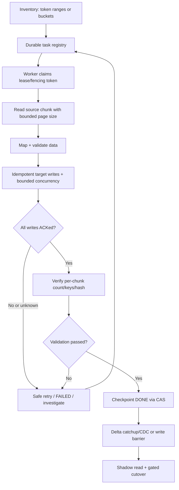
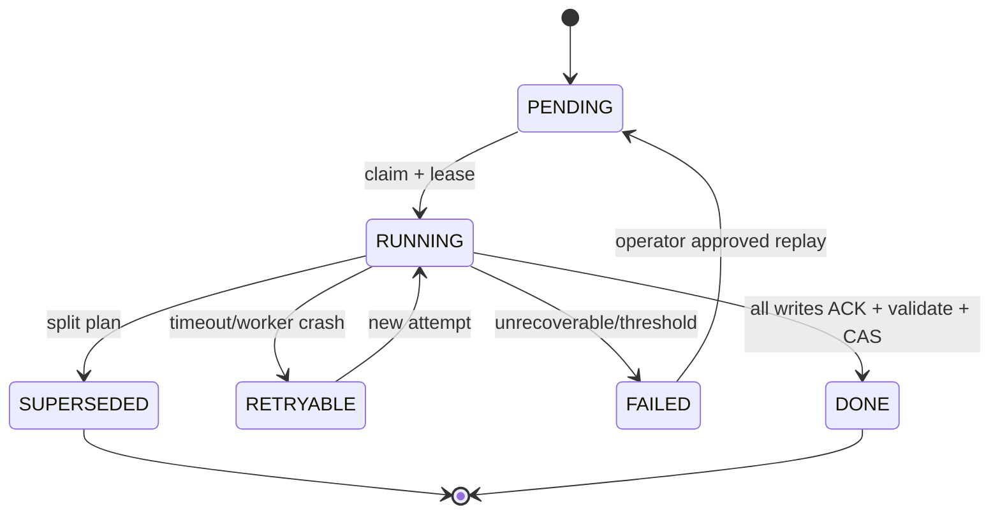
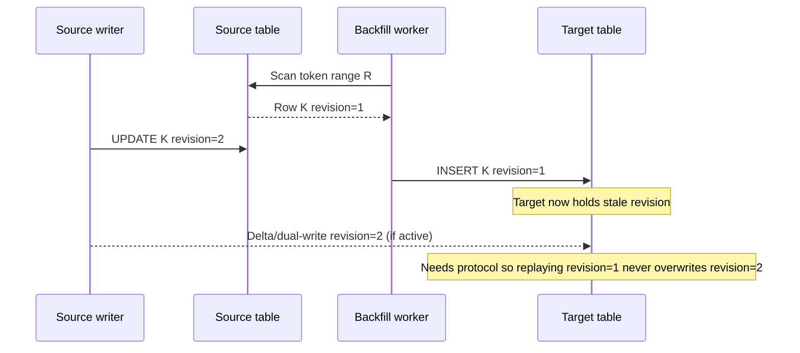
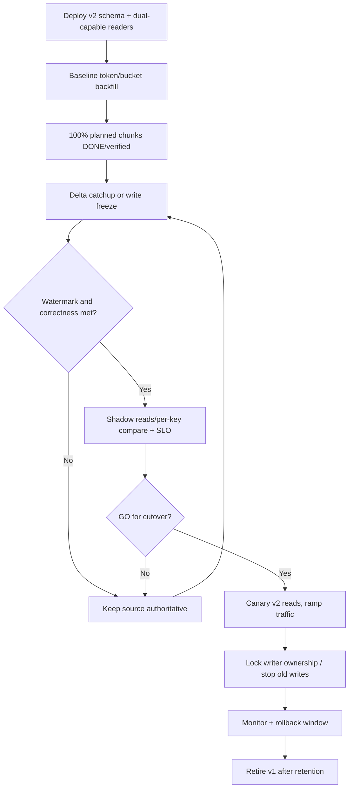

# Token-Range / Bucket Backfill and Resumability After Failures in Apache Cassandra

## 1. Problem: migrating billions of rows without starting over from scratch

Suppose a Java application stores IoT events in `events_by_id`, partitioned by `event_id`. New requirements demand fast queries for all events of a tenant on a given day. Because **Apache Cassandra designs tables around queries**, the team creates a new table `events_by_tenant_day` with partition key `(tenant_id, event_day)` and clustering keys `(event_time, event_id)`.

The team must migrate historical data from the old table to the new one while the system continues serving writes. A full-table scan takes hours and can fail due to node restarts, timeouts, worker deployments, or network drops. If the job only logs "read 78%," after a failure operations does not know:

- Does 78% mean **token space**, **row count**, or **byte volume**?
- Which records were **successfully written** to the target table?
- Will repeating a chunk cause **duplicates, out-of-order overwrites, or resurrection of deleted data**?
- Were any records **inserted or updated during the scan** missed?
- When a worker dies, where should a replacement worker resume **without leaving gaps in token ranges or buckets**?

That is why backfill must be engineered as a **workflow with bounded work units, durable checkpoints, idempotent replay, data validation, and a dedicated cutover process**.

This lesson belongs to the **Migration and Schema** chapter of the `DATABASE_ENGINE_WIDE_COLUMN_CASSANDRA` module. Background concepts include distributed/wide-column architecture, partition keys and query-driven table design, CQL, replication, consistency levels, compaction/repair, troubleshooting, and the Java Driver. **The focus** is splitting backfill by **token range** or **bucket** while proving **resumability after failures** without corrupting data.

### Learning objectives

After this lesson, you will be able to:

1. Distinguish **data-model-transforming backfill** from replica repair/streaming and ordinary schema migrations.
2. Build a **disjoint, exhaustive chunk list across the token ring**, accounting for signed tokens and boundary endpoints.
3. Partition work by **business bucket** and clustering range while controlling large/hot partitions.
4. Design checkpoints/leases/fencing, **at-least-once** retries, and **idempotent** target writes.
5. Handle concurrent writes, deletes/TTL, timestamps, paging, and **unknown** write outcomes.
6. Use CQL and Java Driver 4.x to execute backfills with bounded concurrency and page sizes.
7. Build coverage, content, and SLO verification plus gated cutover/rollback procedures.

## 2. What is backfill? Not every data movement mechanism is the same

| Mechanism | Purpose | Transforms partition key / data model? |
| --- | --- | --- |
| **CQL schema change** | `ALTER TABLE`/`CREATE TABLE` metadata changes | Does not scan and rewrite historical rows under a new partition key |
| **Application backfill** | Reads source data, transforms, and writes to target table/model | **Yes**, the focus of this lesson |
| **Replica repair** | Anti-entropy reconciliation of replicas for the same data and token ranges | **Does not** move rows into a redesigned table |
| **Bootstrap/streaming** | Transfers token ownership and SSTable data on topology changes | Does not perform business projection/repartitioning |
| **SSTable snapshot/restore** | Restores data across compatible file/schema formats | Not an ETL tool; constrained by schema/table IDs |
| **CDC / event log** | Captures mutations/deltas to sync targets while source mutates | Can support backfill, but requires consumer and replay semantics |
| **Dual writes** | App writes both source and target during transition | Suffers partial failures; does not create cross-table transactions |

**Example:** raising RF from 2 to 3 in *the same keyspace* normally requires full repair so new replicas receive historical data. Moving from `events_by_id` to `events_by_tenant_day` is **application backfill**: repair cannot compute `event_day` or build a new clustering key.

## 3. Two ways to partition work: token ranges and business buckets

### 3.1. Token ranges

Cassandra uses a **partitioner** to map partition keys to tokens. With the common `Murmur3Partitioner`, tokens are **signed 64-bit** integers. Splitting the token space into disjoint intervals lets workers read distinct partitions independently.

Conceptual example:

```text
R1 = [MIN_TOKEN, t1)
R2 = [t1, t2)
R3 = [t2, t3)
R4 = [t3, MAX_TOKEN]    # final interval includes MAX_TOKEN
```

The union of all intervals covers the entire token space, with each token belonging to **exactly one chunk**. Using **half-open** intervals `[start, end)` prevents boundary overlap, while the last chunk uses `<= MAX_TOKEN` or an equivalent terminal predicate so the maximum token is never dropped.

### 3.2. Business buckets

If the source table is already organized by `(tenant_id, day_bucket)` or `(device_id, hour_bucket)`, tasks can map to buckets: **one partition or one partition plus a clustering window**. Buckets align naturally with business requirements and allow tracking coverage per day/tenant.

```text
B1 = tenant_A / 2026-11-19
B2 = tenant_A / 2026-11-20
B3 = tenant_B / 2026-11-19
B4 = tenant_B / 2026-11-20
...
```

**Never** assume you can discover all tenants/days via a cluster-wide `SELECT DISTINCT` scan and treat that as a complete inventory. Use a bucket registry, authoritative metadata store, event catalog, or a verified constructed list.

### 3.3. Which approach should you choose?

| Criterion | Token range | Bucket |
| --- | --- | --- |
| Source table has distributed partition keys and no bucket inventory | Usually fits discovery and scanning | Hard without knowing existing buckets |
| Source already partitioned by tenant/day | Works, but misses key locality | **Strong fit** |
| One massive partition | Token split **cannot** split a single partition | Clustering-range split helps |
| Must track SLA per tenant/day | Requires regrouping post-scan | Maps directly to business buckets |
| Heavily skewed data across keys | Equal token span **does not** equal bytes/rows | Bucket sizes can also skew; split windows further |
| Failure recovery | Retry chunk/range from checkpoint | Retry bucket/window from checkpoint |
| Multiple independent workers | Task queue + leases, per-node caps | Task queue + per-tenant fairness |

You can **combine** them: scan the old table by token ranges and write into target buckets, or partition jobs by bucket and split huge buckets into clustering time windows.

## 4. Why not simply use LIMIT, OFFSET, or one full-table SELECT?

In Cassandra, `LIMIT` caps returned rows; it **does not provide relational OFFSET pagination**. Running `SELECT *` without a partition key on a multi-TB table triggers an expensive, fragile cluster-wide scan.

Problems with a single long-running scan:

- A paging cursor is not a **stable transactional snapshot** of the table.
- A request can time out on page 150; without checkpoints, you must restart or guess position from logs.
- Topology changes, schema changes, or driver/statement changes can invalidate saved paging states.
- Source data mutates during the scan; inserted/updated/deleted rows may not appear as expected.
- One large partition can dominate runtime even in a narrow token range.

**Explicit work chunking** combined with **idempotent replay** is far easier to verify than maintaining one giant "offset."

## 5. Resumable backfill pipeline architecture



A production pipeline has at least **three state planes**:

1. **Source and target:** actual CQL data replicated by Cassandra according to RF/CL.
2. **Control plane:** task ownership, leases, attempts/epochs, checkpoints, counters, and errors.
3. **Cutover/delta plane:** post-start mutations, sync watermarks, and traffic-cutover gates.

You cannot infer plane 2 or 3 merely by counting rows in the target table.

## 6. Example CQL design: from ID lookup to tenant/day lookup

Assume **source events are immutable**: each `event_id` is created once, never updated/deleted, and has no TTL. This simplifies demonstrating verifiable idempotent backfill. **Mutable data, TTLs, and deletes** are addressed separately in later sections.

```sql
-- Lab requires at least three nodes in dc1 when using RF=3.
CREATE KEYSPACE IF NOT EXISTS migrate_lab
WITH replication = {
    'class': 'NetworkTopologyStrategy',
    'dc1': 3
};

-- Old table: lookup by event ID.
CREATE TABLE IF NOT EXISTS migrate_lab.events_by_id (
    event_id uuid PRIMARY KEY,
    tenant_id text,
    event_time timestamp,
    payload text
);

-- New table: partitioned by tenant/day, sorted by time.
CREATE TABLE IF NOT EXISTS migrate_lab.events_by_tenant_day (
    tenant_id text,
    event_day date,
    event_time timestamp,
    event_id uuid,
    payload text,
    PRIMARY KEY ((tenant_id, event_day), event_time, event_id)
) WITH CLUSTERING ORDER BY (event_time DESC, event_id ASC);

INSERT INTO migrate_lab.events_by_id
    (event_id, tenant_id, event_time, payload)
VALUES (
    11111111-1111-1111-1111-111111111111,
    'tenant_lab',
    '2026-11-21T08:30:00Z',
    'immutable-event-payload'
);
```

Transformation mapping:

```text
source.event_id                 -> target.event_id (preserved)
source.tenant_id                -> target.tenant_id
UTC date(source.event_time)     -> target.event_day
source.event_time               -> target.event_time
source.payload                  -> target.payload
```

**Use UTC for bucketing** or a fixed canonical business timezone. If a worker computes dates in UTC while the Java app uses another timezone, the same event lands in two different partitions. Capture the conversion rule as a **versioned data contract**.

## 7. CQL token-range scans and boundary pitfalls

With `Murmur3Partitioner`, `token(<partition_key>)` can scan a slice of the partition token space in CQL:

```sql
-- Read half-open chunk [startToken, endToken).
-- Bind two bigint token boundaries; DO NOT treat as an ordinary OLTP query.
SELECT event_id, tenant_id, event_time, payload
FROM migrate_lab.events_by_id
WHERE token(event_id) >= ?
  AND token(event_id) < ?;
```

The final task must include `Long.MAX_VALUE`; depending on boundary representation, use a separate predicate:

```sql
-- Final chunk [startToken, MAX_TOKEN], inclusive of MAX_TOKEN.
SELECT event_id, tenant_id, event_time, payload
FROM migrate_lab.events_by_id
WHERE token(event_id) >= ?;
```

If using another boundary model or a partitioner other than Murmur3, build and test token splitting for that partitioner. **Never blindly apply `Long.MIN_VALUE`/`Long.MAX_VALUE` to `RandomPartitioner`** or any partitioner with a different token representation.

### 7.1. Four coverage invariants

1. **Exhaustive:** the union of all tasks covers the entire source token domain.
2. **Disjoint:** intervals never overlap under `[start,end)`, with an explicit inclusive boundary on the final chunk.
3. **Stable inventory:** task lists and boundaries are persisted before execution; any split/merge keeps lineage.
4. **Correct partition expression:** `token(event_id)` matches the source PK; composite keys require **all partition key columns in exact order**, e.g., `token(tenant_id, event_day)`.

### 7.2. Ring wrap-around

An interval whose start numerically exceeds its end wraps around the ring. Never pass `token(pk) >= start AND token(pk) < end` with `start > end` expecting Cassandra to interpret wrap-around automatically. Split it into **two non-wrapping ranges** or generate a normalized range list. Store tokens as **signed** integers; never sort them lexicographically as strings where `-100` orders inconsistently relative to `-2`.

### 7.3. Equal token-space ≠ equal data

Scanning 1/1000th of the token space does not mean reading 1/1000th of the data. Token hashes distribute evenly, yet table skew, partition sizes, compression, and TTLs vary. Plan based on **observed rows/bytes/time per chunk** and sub-split heavy chunks **before marking DONE**, rather than assuming uniform runtimes.

## 8. Splitting tasks by token range without losing boundaries

Illustrative inventory:

| Task | Token interval | Estimate | Status |
| --- | --- | --- | --- |
| R00 | `[MIN_TOKEN, T1)` | 120 MiB | PENDING |
| R01 | `[T1, T2)` | 480 MiB | PENDING |
| R02 | `[T2, T3)` | 72 MiB | PENDING |
| R03 | `[T3, MAX_TOKEN]` | 310 MiB | PENDING |

**Figures are hypothetical**, not actual measurements. `T1,T2,T3` must be computed and validated token boundaries. Never construct chunks by eyeballing `nodetool status` load percentages.

### 8.1. When a chunk is too heavy

Suppose R01 runs dramatically longer than others. It can be split:

```text
R01: [T1,T2) -> SUPERSEDED
R01a: [T1,Tmid) -> PENDING
R01b: [Tmid,T2) -> PENDING
```

Conditions:

- Stop or fence the old worker so it cannot later mark R01 `DONE`.
- Record **parent→children** in the control plane using an appropriate conditional/transactional update.
- Prove the two child ranges exactly cover R01 with zero gaps or overlaps.
- Never count the parent plus two children as **three independent completed chunks**.
- Partial writes from R01 may already exist at the target, so child replays must be idempotent.

**Token-range splitting never breaks up a single partition** because an entire partition hashes to one token. If a wide partition is the bottleneck, split by clustering range or fix bucket design.

## 9. Backfilling by business bucket and clustering window

When the **source** table already uses a partition key like `(tenant_id, month_bucket)` or `(device_id, event_day)`, bucket partitioning is more natural than token scans.

Example of another source table:

```sql
CREATE TABLE IF NOT EXISTS migrate_lab.events_v1_by_tenant_month (
    tenant_id text,
    month_bucket text,
    event_time timestamp,
    event_id uuid,
    payload text,
    PRIMARY KEY ((tenant_id, month_bucket), event_time, event_id)
) WITH CLUSTERING ORDER BY (event_time ASC, event_id ASC);
```

A task per bucket and time slice:

```sql
SELECT event_time, event_id, payload
FROM migrate_lab.events_v1_by_tenant_month
WHERE tenant_id = ?
  AND month_bucket = ?
  AND event_time >= ?
  AND event_time < ?;
```

**The first parameters supply the full partition key**; the remaining ones bound the clustering range. A monthly bucket with 40 million events can be split into 30–31 days or hourly windows as needed. When **clustering keys allow identical timestamps**, `event_id` acts as tie-breaker and row identifier; on resume, never save only the timestamp and drop co-occurring events.

### 9.1. Bucket inventory must be exhaustive

Inventory sources can be a **control table**, domain service catalog, or job index maintained on write. Verify:

- Which authoritative snapshot/log enumerates every tenant and bucket containing data?
- Can older buckets appear late due to late-arriving events?
- Can new tenants create new buckets mid-backfill?
- Can expired-TTL or deleted buckets still appear in the inventory with zero live rows?
- If re-run tomorrow, do boundaries, timezones, and transform versions remain identical?

An **empty bucket** is a valid outcome once verified; never treat every empty result as an error. By contrast, a **missing bucket from the inventory** is a coverage gap that must be closed before cutover.

## 10. Control plane: task registry, leases, and checkpoints

A job may run across many Java workers or Kubernetes pods. For resumability, tasks need durable identities and states—**not just in-memory state or worker HTTP lifetimes**.

### 10.1. Minimum state machine



Each task stores at minimum:

| Field | Meaning |
| --- | --- |
| `job_id`, `task_id` | Immutable identifier across retries; never reuse for a different migration version |
| `source_table`, `target_table`, `transform_version` | Prevents replaying an old task with an uncontrolled new transform |
| `start_token/end_token` or `tenant/bucket/window` | Exact scope with inclusive/exclusive convention |
| `status` | PENDING, RUNNING, DONE, RETRYABLE, FAILED, SUPERSEDED |
| `owner`, `lease_until`, `epoch` | Authorized worker; epoch serves as a fencing generation |
| `attempt`, `last_error` | Retry history and stop reason |
| `started_at/finished_at` | UTC timeline for investigation |
| `rows_read/rows_acked/bytes` | **Observational** counters; do not prove correctness alone |
| `validation_status/hash` | Proof that chunk results passed verification |

### 10.2. Progress table CQL (lab)

```sql
CREATE TABLE IF NOT EXISTS migrate_lab.backfill_tasks (
    job_id text,
    shard smallint,
    task_id text,
    start_token bigint,
    end_token bigint,
    status text,
    owner text,
    lease_until timestamp,
    epoch bigint,
    attempts int,
    rows_read bigint,
    rows_acked bigint,
    updated_at timestamp,
    PRIMARY KEY ((job_id, shard), task_id)
);
```

Sharding splits control-plane partitions so a job with hundreds of thousands of tasks does not overload one giant Cassandra partition. `backfill_tasks` sits in the same keyspace here for **illustration**, though in production the control plane is often separated onto an **independently operated store** away from the migrating cluster so coordination survives source-cluster faults. Never let progress-table polling overwhelm the scan itself.

### 10.3. Claiming with conditional updates

Example for an **already-created** task in `status='PENDING'`:

```sql
-- Illustrative LWT conditional claim, not a complete lease scheduler.
UPDATE migrate_lab.backfill_tasks
SET status = 'RUNNING',
    owner = 'worker-07',
    lease_until = '2026-11-21T09:10:00Z',
    epoch = 12,
    attempts = 3,
    updated_at = '2026-11-21T09:00:00Z'
WHERE job_id = 'job-events-v2'
  AND shard = 4
  AND task_id = 'R0042'
IF status = 'PENDING';
```

If `[applied]=false`, the worker **does not own the task**; it must read current state and follow scheduler rules. On lease expiry, update `owner/epoch/lease_until` conditionally with clock awareness and proper CAS; **never** fire an unconditional `UPDATE` simply because local clock checks show expiration.

If an LWT times out, claim outcome is **unknown**; read back status/owner/epoch and apply safe retry rules. Never assume a timeout means CAS did not apply.

### 10.4. Marking completion

```sql
-- Only after full chunk scan, target ACKs, and validation pass.
UPDATE migrate_lab.backfill_tasks
SET status = 'DONE',
    rows_read = 12500,
    rows_acked = 12500,
    updated_at = '2026-11-21T09:07:30Z'
WHERE job_id = 'job-events-v2'
  AND shard = 4
  AND task_id = 'R0042'
IF status = 'RUNNING'
   AND owner = 'worker-07'
   AND epoch = 12;
```

If `[applied]=false`, another worker may have claimed the task after lease expiry. The stale worker **must not force DONE**. In reality, target writes and checkpoint writes are **two separate operations** with no distributed transaction spanning all rows and the progress table. Therefore, the design must tolerate **target data already written while the task remains PENDING/RUNNING**.

## 11. At-least-once + idempotent replay: the foundational principle

Under failures, "send every row exactly once" is practically impossible to guarantee with client retries alone.

Suppose a worker:

1. Sends an `INSERT` to the target.
2. The coordinator reaches `LOCAL_QUORUM`, yet the response drops.
3. The client hits a timeout without knowing whether the write succeeded.
4. The worker crashes before updating the checkpoint.

Upon restart, **retrying the chunk must be allowed**. If writes are idempotent, replaying the same key/value converges the target to the exact desired state.

### 11.1. An immutable data model makes replay straightforward

With immutable `events_by_id` and target PK `((tenant_id,event_day), event_time,event_id)`:

```sql
INSERT INTO migrate_lab.events_by_tenant_day
    (tenant_id, event_day, event_time, event_id, payload)
VALUES (?, ?, ?, ?, ?);
```

Re-sending **the same full primary key and values** does not create a duplicate row. However, **never equate that** with universal idempotence for mutable data:

- Cassandra uses **last-write-wins by timestamp**; a later retry with a newer timestamp can **overwrite a newer business mutation**.
- `COUNTER` increments are not idempotent: retries double-count.
- State-dependent writes (read-modify-write) are not naturally idempotent.
- TTLs can be **reset** if a fresh INSERT specifies a fresh TTL, shifting expiration time.
- Tombstones and concurrent-writer conflicts require explicit handling.

Thus you must verify **semantic migration idempotence**, not merely `INSERT` syntax.

### 11.2. Why never "checkpoint before writing"?

```text
WRONG:
  mark chunk DONE
  -> write rows
  -> worker dies midway
  => chunk skipped, target missing data

RIGHT FOR AT-LEAST-ONCE:
  read chunk
  -> write target and await ACK
  -> validate chunk
  -> CAS mark DONE
  -> worker dies anytime before DONE: replay chunk safely
```

`DONE` proves the job **executed and verified the scope** at run time; it **does not** prove the source will never receive new mutations afterward. Delta sync and cutover are separate steps.

## 12. Chunk-level or page-level checkpoints?

### 12.1. Chunk-level checkpoints: simple default

Define each task as **a small token interval or bucket window**. After a crash, re-run the whole task. Pros:

- No dependency on long-lived paging states.
- Easy to prove DONE tasks cover the entire scope.
- Simple idempotent retries with minimal control-plane edge cases.

Con: if a chunk is huge, replay takes time. Keep **chunks reasonably sized** based on measured bytes, rows, and duration.

### 12.2. Page-level checkpoints: heavy assumptions

The Java Driver exposes paging state to fetch subsequent pages. However, paging state is **query protocol state** tied to versions, statements, bind values, schema/topology, and time. It is **not a durable business offset** guaranteeing exact row resumption while the source mutates.

If you insist on page-level checkpoints:

- Store exact query fingerprint, bind parameters, CL, page size, schema version, driver/server versions, and API-supported paging-state encoding.
- Mark a page DONE **after** all target rows in that page are ACKed.
- Fall back to **replaying the chunk from the beginning** whenever paging state becomes invalid or the environment shifts.
- Never treat paging state as a substitute for source consistency or snapshot semantics.
- Consider explicit cursors over **full primary key/clustering order** where table design permits, not just timestamps or tokens.

**Lesson recommendation:** prefer **small chunks + idempotent replay**. It is far easier to prove and operate in recovery than relying solely on saved `pagingState`.

## 13. Java Driver 4.x: worker backfilling one token chunk

The Java 17+ example below illustrates an **immutable source** using separate source/target `CqlSession` instances (which may point to two clusters), with credentials, TLS, and local DC configured by the application. Sessions are created **once and reused**, never per row.

```java
import com.datastax.oss.driver.api.core.CqlSession;
import com.datastax.oss.driver.api.core.DefaultConsistencyLevel;
import com.datastax.oss.driver.api.core.cql.BoundStatement;
import com.datastax.oss.driver.api.core.cql.PreparedStatement;
import com.datastax.oss.driver.api.core.cql.ResultSet;
import com.datastax.oss.driver.api.core.cql.Row;
import java.time.Instant;
import java.time.LocalDate;
import java.time.ZoneOffset;
import java.util.UUID;

public final class ImmutableEventBackfill {
    private final CqlSession source;
    private final CqlSession target;
    private final PreparedStatement scanRange;
    private final PreparedStatement scanFinalRange;
    private final PreparedStatement insertTarget;

    public ImmutableEventBackfill(CqlSession source, CqlSession target) {
        this.source = source;
        this.target = target;
        this.scanRange = source.prepare("""
            SELECT event_id, tenant_id, event_time, payload
            FROM migrate_lab.events_by_id
            WHERE token(event_id) >= ? AND token(event_id) < ?
            """);
        this.scanFinalRange = source.prepare("""
            SELECT event_id, tenant_id, event_time, payload
            FROM migrate_lab.events_by_id
            WHERE token(event_id) >= ?
            """);
        this.insertTarget = target.prepare("""
            INSERT INTO migrate_lab.events_by_tenant_day
                (tenant_id, event_day, event_time, event_id, payload)
            VALUES (?, ?, ?, ?, ?)
            """);
    }

    // endExclusive is null ONLY for the FINAL chunk including Long.MAX_VALUE.
    // Lease claims and checkpoint persistence are handled by an external scheduler.
    public long copyChunk(long startInclusive, Long endExclusive) {
        BoundStatement read = (endExclusive == null
            ? scanFinalRange.boundStatementBuilder().setLong(0, startInclusive)
            : scanRange.boundStatementBuilder()
                .setLong(0, startInclusive)
                .setLong(1, endExclusive))
            .setPageSize(500)
            .setConsistencyLevel(DefaultConsistencyLevel.LOCAL_QUORUM)
            .build();

        long rowsAcked = 0;
        ResultSet result = source.execute(read);
        for (Row row : result) { // Driver fetches subsequent pages automatically.
            UUID eventId = row.getUuid("event_id");
            String tenant = row.getString("tenant_id");
            Instant eventTime = row.getInstant("event_time");
            String payload = row.getString("payload");
            if (eventId == null || tenant == null || eventTime == null) {
                throw new IllegalStateException("Source row violates migration contract");
            }
            LocalDate day = eventTime.atZone(ZoneOffset.UTC).toLocalDate();

            BoundStatement write = insertTarget.boundStatementBuilder()
                .setString(0, tenant)
                .setLocalDate(1, day)
                .setInstant(2, eventTime)
                .setUuid(3, eventId)
                .setString(4, payload)
                .setConsistencyLevel(DefaultConsistencyLevel.LOCAL_QUORUM)
                .build();

            // Sequential for clarity: awaits ACK per row.
            // Production uses bounded concurrency, never unbounded async fan-out.
            target.execute(write);
            rowsAcked++;
        }
        return rowsAcked; // DO NOT mark the chunk DONE here.
    }
}
```

**Critical preconditions of this code:**

- **`Murmur3Partitioner`** and signed `long` boundaries; other partitioners require adapting the token strategy.
- **Immutable source data with no TTL or deletes**, where each event is uniquely identified by `event_id` and stable target values. For mutable sources, this code **is not safe enough**.
- Iterating `ResultSet` fetches subsequent pages lazily; an error on a later page fails the task. Already-written rows from earlier pages are normal under **at-least-once**.
- `target.execute` succeeding means the request met its CL—it **does not** verify historical replica convergence or business correctness.
- No `LIMIT` slices the task: **token boundaries** define scope while page size controls fetch batching.
- No concurrency limiter, scheduler, retry/backoff, CAS progress tracking, or validation logic exists in this snippet. Those layers must be added before production.
- If target DC differs from source DC, verify each session's `LOCAL_QUORUM` routes to its intended DC. Never assume identical CL/placement.
- If `event_time` can be null or source values invalid, define a quarantine/error policy; never silently skip rows and still mark DONE.

### 13.1. Tuning throughput without choking Cassandra

In production, use `executeAsync` with a **bounded semaphore / queue** instead of sequential calls:

```text
max_global_inflight_writes = 200      # example test configuration
max_per_target_node        = 30       # must be benchmarked on real cluster
page_size                  = 500
retry_backoff              = bounded + jitter
max_chunk_duration         = based on measured budget
```

These numbers are **illustrative**, not fixed recommendations. Tune against Java p95/p99, timeouts/unavailables, CPU, GC, disk I/O, network, compaction backlogs, and business load. When server throughput plateaus while in-flight requests climb, **reduce concurrency / apply backpressure** instead of pushing more retries.

## 14. Ongoing writes: scans do not provide a global consistent snapshot

A multi-hour scan has no guaranteed Cassandra-enforced "all rows at exact instant t0" snapshot. Consider this timeline:



Two additional races:

1. **New insert after a range was scanned:** the row hashes into an already-DONE range and **is never scanned again** without delta capture.
2. **Delete after a row was read:** the worker writes the old row after the delete already reached the target, causing deleted data to **reappear** unless write timestamps/ordering are controlled.

Therefore, **DONE on a baseline scan is insufficient for cutover** while the source remains writable. You need one of the synchronization models below.

## 15. Three consistency strategies during migration

### 15.1. Strategy A — pause writes at the source

Simplest when a maintenance window is allowed:

1. Switch source to **verified read-only or stop-writes**.
2. Drain all in-flight requests or resolve unknown outcomes.
3. Establish a barrier/timestamp and confirm source stability.
4. Run backfill chunks, validate, and shift reads/writes to target.
5. Open writes on target after successful cutover.

**Pros:** minimal races; straightforward coverage proof. **Cons:** downtime or reduced availability, often unacceptable for 24/7 services.

### 15.2. Strategy B — CDC/outbox/changelog + catchup

Commonly fits mutable data:

1. Enable or deploy a **reliable mutation log** with per-key versioning/ordering/idempotency and sufficient retention.
2. Record marker `L0`; ensure mutation capture begins from `L0` before starting the baseline scan.
3. Scan historical data via token/bucket chunks to establish the baseline.
4. Apply deltas/mutations **in per-key order**, preserving updates, deletes, and TTL semantics.
5. Monitor lag and watermarks; briefly isolate/fence writes if needed to hit a clean cutover barrier.
6. Switch reads only after the target passes the sync watermark and validation checks.

**Never mistake Cassandra CDC for a cluster-wide ordered transaction log**: Cassandra CDC is a version-specific commit-log mechanism; extraction, dedup, ordering, checkpointing, and delete semantics require dedicated pipeline engineering. A client-supplied `event_time` **does not automatically establish** total order across concurrent writers.

### 15.3. Strategy C — dual-write + reconciliation

The application writes both source and target during migration:

- Use **deterministic target primary keys** and mutation IDs/sequences for retries.
- Handle **partial failures**: source success/target failure and vice versa.
- Maintain a retry queue or source–target reconciliation job to backfill missed mutations.
- On timeout, treat outcome as **UNKNOWN**, never assuming the write did not apply.
- Enforce version ordering when backfill runs concurrently with dual-writes.

**Never use CQL BATCH as a promise of system-wide transactions** across different tables/partitions, especially across two clusters: batches do not replace migration idempotence, auditing, ordering, and reconciliation protocols.

### Selection guide by workload

| Source data | Relatively safe strategy | What must be proven |
| --- | --- | --- |
| **Immutable append-only**, continuous new writes | Backfill + delta sync via log/dual-write or cutover barrier | Zero missed late events inside DONE ranges |
| **Mutable status**, concurrent writers | CDC/outbox or versioned-write protocol + reconciliation | Older versions never overwrite newer versions |
| **Frequent deletes/TTLs** | Mutation capture including tombstone/expiry semantics + verification | Zero zombies, zero accidental TTL resets |
| **Counters, read-modify-write** | Specialized migration logic and dedup/aggregation | Retries never double-apply operations |
| **Approved downtime window** | Stop writes + baseline scan + validate + cutover | Barrier truly blocks all writers |

## 16. Timestamps, TTL, and tombstones: pitfalls with mutable backfill

Cassandra normally reconciles cell versions by **write timestamp**, not "whichever job ran last on wall-clock time" is business-correct. This is a major failure mode during replays.

### 16.1. Newer records overwritten by stale backfill

```text
t0: source status=CREATED, version=1
t1: backfill reads version=1, hasn't written target yet
t2: dual-write sends status=PAID, version=2 to target
t3: backfill INSERTs status=CREATED with a newer CQL timestamp
=> target can revert to CREATED even though PAID is newer in business logic
```

To prevent this, enforce **a single ordering rule**: per-key mutation logs, atomically updated version fences, writer-ownership cutover barriers, or proven-safe preservation of source write timestamps. **Never** store a `revision` number in a column expecting Cassandra to automatically pick the higher revision; Cassandra does not inspect regular-column revisions before overwriting cells.

### 16.2. When to use `WRITETIME`/`TTL`?

On supported columns, CQL can inspect:

```sql
SELECT payload, WRITETIME(payload), TTL(payload)
FROM migrate_lab.events_by_id
WHERE event_id = 11111111-1111-1111-1111-111111111111;
```

`WRITETIME` and `TTL` have applicability limits by column type, Cassandra version, and table configuration. They can help preserve per-cell timestamps and remaining TTLs, yet **they are not a full copy of complete tombstone history**. Never blindly inject `USING TIMESTAMP` on every column without understanding per-cell timestamps, LWT, and concurrency behavior.

### 16.3. TTL does not safely "reset" on its own

If the source wrote an event with a 7-day TTL, and a worker migrates it 5 days later using `INSERT ... USING TTL 604800`, the event lives another 7 days from migration time: **violating retention**. To preserve expiration, compute remaining TTL from verified metadata or design an explicit TTL translation rule; if remaining TTL is invalid or expired, do not recreate expired rows.

### 16.4. Tombstones and zombie data

Deletes must propagate as **delete events** or guarantee the target has no stale row—never merely "scan currently live rows." If a row is deleted at the source while an older baseline copy exists in the target, omitting delete propagation creates a zombie in the new table. `gc_grace_seconds` and repair govern safe tombstone purging across replicas **within each table**, not cross-table deletion sync across schemas.

## 17. Validation: row counts do not prove success

A migration can have matching `COUNT(*)` values yet disagree on business keys, payloads, or TTLs. Conversely, if the source has TTLs/deletes and the target is a projection, total row counts between the two tables **need not match**.

### 17.1. Three verification layers

| Layer | Question | Evidence |
| --- | --- | --- |
| **Coverage** | Does every in-scope token range/bucket have a DONE/valid task? | Durable inventory, zero gaps/overlaps, task states, split lineage |
| **Content correctness** | Do corresponding records match keys, values, versions, deletes, and TTLs? | Deterministic sampled keys, per-bucket aggregates/digests, mismatch reports |
| **Serving readiness** | Does the Java app read/write target within SLO and CL with no hot-partition errors? | Shadow reads, p95/p99, error rate, successful RPS, replica availability |

### 17.2. Checksums and mismatch reports

For a token range or bucket, compute a digest over a **canonical business representation**, such as sorted tuples `(event_id,tenant_id,event_day,event_time,payload_hash)` excluding non-contract metadata. Key requirements:

- Both source and target must use **the same transform version**, normalization, timezone, and null handling.
- Chunk hashes must be order-independent or canonically sorted; never hash rows in arbitrary page arrival order.
- Digests/counters help detect divergence yet **do not identify which keys differ**; pair them with key-level sampling/reconciliation.
- `COUNT(*)` across billions of partitions is expensive; never run continuous full-table counts in production. Combine job counters, offline/distributed aggregations, and sampled verification.
- If the source remains writable, validation must bind to a **watermark/snapshot contract**; otherwise mismatches may be normal concurrent races rather than transform bugs.

### 17.3. Sampling never replaces coverage

One million sampled keys matching **does not prove** two skipped token ranges were backfilled. Conversely, a 100% DONE task ledger where workers used the wrong timezone still creates wrong buckets. **Coverage and correctness are two independent proofs.**

## 18. Monitoring throughput, errors, and Cassandra impact

| Group | Metrics to collect | How to use |
| --- | --- | --- |
| **Progress** | Planned/DONE/FAILED ranges, buckets, bytes, rows | Separate task progress from true data progress |
| **Throughput** | Source rows read/s, target writes ACK/s, bytes/s | Estimate conservative ETAs and spot bottlenecks |
| **Retries** | Attempt counts, transient/permanent errors, timeout/unknown | Detect retry storms and excessive replays |
| **Driver** | Per-node in-flight, throttling, pools, p50/p95/p99, CL | Spot client-side queuing |
| **Cassandra** | `tpstats`, `proxyhistograms`, `tablestats`, compaction, repair | Locate coordinator/replica bottlenecks |
| **Infrastructure** | CPU/heap/GC, disk latency/free, network, cross-DC throughput | Protect production headroom |
| **Validation** | Missing/extra/mismatched keys, digest failures, delete/TTL diffs | Cutover gating |
| **Business** | API successful RPS, read/write p99, timeouts, tenant impact | Never "finish backfill" by breaking live service |

```bash
# Diagnostic commands, run on source and target nodes respectively.
nodetool status
nodetool tpstats
nodetool proxyhistograms
nodetool tablestats migrate_lab.events_by_id
nodetool tablestats migrate_lab.events_by_tenant_day
nodetool compactionstats
nodetool netstats
```

`netstats` tracks streaming/bootstrap/repair, **not normal CQL INSERTs from backfill workers**. `status` shows Up/Down nodes, not p99 or target data correctness. Always correlate with Java worker and application metrics.

### 18.1. Choosing rate limiters

Each worker should enforce in-flight and rate limits across **source reads, target writes, and DC/nodes**, paired with circuit breakers/backoff when p99 or errors exceed thresholds. Global limits must account for **worker pod count** and autoscaling: 20 pods × 100 in-flight equals 2,000 concurrent requests even if each pod caps itself at 100.

Keep live business traffic prioritized. If Cassandra is running repair/compaction or loses capacity, pause/throttle backfill while preserving checkpoints; never race to "beat a deadline" by saturating disk I/O.

## 19. Estimating runtime and avoiding "stuck at 99% forever"

Percentage of DONE tasks is only meaningful when tasks represent roughly equal work. Example:

```text
1000 token-range tasks:
  990 small tasks, 10 MiB each
   10 huge tasks, 100 GiB each

DONE count = 990/1000 = 99%
Yet bytes processed so far may be a tiny fraction of total volume.
```

Therefore, dashboards need at minimum:

- `tasks_done / tasks_total` with split-lineage annotation;
- `bytes_read / estimated_total_bytes` where estimates are trustworthy;
- `rows_acked`, `retry/replay_bytes`, failed/leased/expired tasks;
- rolling-window average and p99 throughput;
- long-tail chunk durations and top 10 slowest buckets/ranges;
- remaining delta catch-up and validation time.

**ETAs are estimates**, never proof of completion. When splitting a chunk, update denominators and parent lineage without double-counting prior rows.

## 20. Failure matrix: what to do at each failure point

| Failure point | Could target have writes? | Valid checkpoint | Safe recovery |
| --- | --- | --- | --- |
| Worker dies before claiming | No | PENDING | Another worker claims |
| Claim LWT times out | Ownership uncertain | UNKNOWN | Read back owner/epoch; never double-claim blindly |
| Source read times out on page 2 | Page 1 rows may be written | RUNNING/RETRYABLE | Replay chunk if idempotent |
| Target INSERT times out | **Yes, possible** on replicas | RUNNING | Retry per idempotency/unknown-outcome policy |
| Worker dies after write ACK, before DONE | Yes | RUNNING | Replay chunk, CAS completion |
| Old worker wakes after lease expiry | May still be writing | Stale epoch | Do not mark DONE; safe for immutable replay, mutable requires target fencing |
| Job marks DONE before validation | Rows may be missing | **Design flaw** | Reconcile/audit; do not trust checkpoint |
| Target schema changes mid-job | Mixed transforms possible | Halt | Version fence, check compatibility, launch new job if needed |
| Source node/DC unavailable | Reads may fail CL | Task failed/paused | Restore availability; retry under approved topology/CL |
| Delta consumer lag exceeds retention | Baseline present, updates missing | Baseline DONE insufficient | Block cutover; rebuild/catch up from authoritative source |
| Worker repeats non-idempotent DELETE/counter | Business state may corrupt | Unverified | Halt, switch to specialized protocol, and reconcile |
| Target p99/timeouts exceed SLO | Data may be partially migrated | Tasks paused | Apply backpressure, lower concurrency, keep clear leases/checkpoints |

**A queue or lease does not automatically provide exactly-once data transformation.** Systems need **at-least-once + semantically idempotent operations + validation**, or a stronger protocol matched to each mutation class.

## 21. Cutover: separating baseline completion from read/write readiness



### 21.1. Mandatory cutover gates

1. **Schema:** target tables/UDTs/keyspaces exist with right RF/CL and placement; schema agreement achieved.
2. **Data coverage:** full task inventory complete with zero unresolved `FAILED`/`RETRYABLE` tasks.
3. **Data correctness:** verifiable checks per chunk/bucket, including deletes/TTLs if applicable.
4. **Catchup:** all required source mutations reached target per proven watermark/barrier.
5. **Application:** Java Driver routing/local DC, prepared statements, page sizes, query shapes, latency, and error rates meet SLOs.
6. **Operational:** backup/restore, monitoring, rollback, and owners signed off.

### 21.2. What does rollback require?

**Before transferring writer ownership:** you can revert reads to the old source if it remains authoritative and all writes continued syncing to it.

**After the target becomes the primary writer:** rollback is **not** simply flipping a read feature flag back to source. Any target-only writes must be reverse-reconciled or writes paused and replayed back in order. Define upfront:

- Up to which point is **simple rollback** possible?
- After which point is **forward-fix** or reverse migration required?
- When can the **source be dropped**? Usually only after a safe retention window and a restore drill.

Never drop the old table while only a tiny canary slice is reading v2.

## 22. Twelve-step operational procedure for resumable backfill

| Step | Action | Evidence |
| --- | --- | --- |
| 1 | Lock data contract: source/target schema, transform version, TTL/delete/concurrency | Approved contract |
| 2 | Choose token ranges or buckets/windows; ensure exhaustive/disjoint inventory | Task set and boundary tests |
| 3 | Define source mutation handling: freeze/CDC/dual-write | RPO/cutover agreement |
| 4 | Create source/target keyspaces/tables and pre-migration backups | DDL/RF/CL, verified backups |
| 5 | Initialize control-plane registry and small schedule | Task IDs, owners, leases/epochs |
| 6 | Run canary on a few ranges/buckets | Row mapping, qps/p99, retry behavior |
| 7 | Scale parallelism within caps | Source/target resource headroom |
| 8 | Persist DONE **after** ACKs + chunk validation | CAS results, checksums/audits |
| 9 | Retry FAILED/expired tasks; split slow chunks safely | Zero gaps or duplicate coverage |
| 10 | Catch up deltas; handle deletes/TTLs and unknown outcomes | Watermark, zero contract mismatches |
| 11 | Run shadow reads/canary cutover and ramp traffic | Business SLOs, query results |
| 12 | Hold rollback window, run restore drill, then retire source with approval | Final report, owner, retention |

If any step fails, keep the job `INCOMPLETE` and list the failing chunks/buckets. **Never cite a high DONE task count as an excuse to skip validation.**

## 23. Sample manifest/checkpoint report

```yaml
job_id: events-v1-to-v2-20261121
service: DATABASE_ENGINE_WIDE_COLUMN_CASSANDRA
language: en
environment: staging
source_table: migrate_lab.events_by_id
target_table: migrate_lab.events_by_tenant_day
transform_version: 3
partitioner: Murmur3Partitioner
time_zone_rule: UTC
source_contract: immutable_append_only_no_ttl
source_change_capture: mutation_log_from_L0
chunk_strategy: token_range
boundaries:
  ordinary: "[startInclusive,endExclusive)"
  last: "[startInclusive,MAX_TOKEN]"
inventory:
  version: 1
  total_tasks: 1024
  done: 1000
  failed: 2
  pending: 22
checkpoint:
  durable: true
  lease_epoch_fencing: true
  completion_requires_ack_and_validation: true
client:
  read_cl: LOCAL_QUORUM
  write_cl: LOCAL_QUORUM
  page_size: 500
  concurrency_limit: "RECORD_ACTUAL_LIMIT"
progress:
  rows_read: "RECORD_MEASURED_VALUE"
  rows_acked: "RECORD_MEASURED_VALUE"
  bytes_streamed: "RECORD_MEASURED_VALUE"
validation:
  verified_chunks: 1000
  mismatched_keys: "RECORD_MEASURED_VALUE"
  deletion_ttl_checked: false
  delta_watermark_caught_up: false
cutover:
  decision: NO_GO
  reason: "Tasks and delta catchup not finished yet"
owner_role: migration_oncall
```

This is an **illustrative template**. `done`/`verified_chunks` must only be populated from an auditable control plane; never copy placeholder numbers and claim the job ran. A production manifest needs full source/target cluster/DC mappings, UTC start/end times, task failures, source snapshot/barrier markers, and secure artifact paths.

## 24. Practice exercises and scenarios

### Exercise A — token boundary gaps

Worker R1 uses `token(id) > -100 AND token(id) < 0`; worker R2 uses `token(id) > 0 AND token(id) < 100`.

1. Do the two tasks cover tokens `-100`, `0`, and `100`?
2. Redesign both as non-overlapping half-open intervals with no gaps.
3. To scan the full Murmur3 ring, how must `Long.MIN_VALUE`/`Long.MAX_VALUE` be handled?
4. If a token range contains one giant partition, does token splitting help?

### Exercise B — worker crash after target writes

Immutable source; worker writes 8,000/10,000 rows to target and crashes **before** marking DONE.

1. Why is replaying the whole chunk safe for **row count** when target PKs and values are stable?
2. Why does "rewriting merely updates timestamps" still need care if rows have TTLs, deletes, or concurrent updates?
3. What happens if code marks DONE before all rows are written?
4. Design the exact sequence of ACKs, validation, CAS progress updates, and failure states.

### Exercise C — source has both updates and deletes

Backfill reads `status=CREATED`, source updates `status=PAID` and then `DELETE`s the row before the worker writes to target.

1. Why can the stale row "resurrect" in the target?
2. Why does repeating full scans multiple times fail to guarantee consistency for all mutations?
3. Design a CDC/outbox or barrier/version-fence pipeline, including deletes.
4. Which metrics prove the target caught up to the source before cutover?

### Exercise D — skewed large buckets

98% of tenant/day buckets have under 100,000 rows; 2% have over 10 million rows. Each worker claims one bucket.

1. Why can the job report 98% tasks DONE while most bytes remain unprocessed?
2. Split large buckets into clustering time windows and disambiguate rows sharing `event_time` using `event_id`.
3. How do you record parent/children lineage without double-counting DONE?
4. If load-test p99 spikes mid-backfill, what mechanisms throttle workload?

### Exercise E — cross-DC migration

Source keyspace has RF=3 in `dc1`, target has RF=3 in `dc2`, Java worker writes target with `LOCAL_QUORUM`. The WAN experiences packet loss.

1. Which session's local DC governs the worker's `LOCAL_QUORUM`?
2. Does a target write timeout prove the data **was not written**?
3. What metrics/timeouts must be collected across source, target, WAN, and driver?
4. Why must you never arbitrarily drop CL to `ONE` to speed up the job?

## 25. Self-check questions

1. How does token-based backfill differ from post-RF-change repair in goal and mechanism?
2. For a composite partition key, which columns must `token(...)` take?
3. Why are `[start,end)` intervals easier to verify for coverage than `>` on both ends?
4. Do equal-width token ranges guarantee equal byte sizes?
5. Why does token splitting not solve a single massive partition?
6. What happens if a bucket inventory misses one tenant/day?
7. Can a page cursor serve as a durable checkpoint for mutable data?
8. Can an LWT claim timeout leave two workers believing they own the task?
9. Why must task DONE be recorded only after target ACKs and validation?
10. How do at-least-once and idempotent replay help when a write timeout has an unknown outcome?
11. Why can `INSERT` with a fresh TTL make data outlive its intended retention?
12. How can a backfill replay overwrite a newer dual-write?
13. Why is matching `COUNT(*)` between source and target insufficient to prove correctness?
14. Why is 100% baseline DONE insufficient for cutover while the source keeps receiving writes?
15. What data must be captured in a report to diagnose a worker crash or chunk timeout?

## 26. References and version notes

- Apache Cassandra CQL documentation: **`SELECT`**, partition-key predicates, `token()`, paging, timestamps, `WRITETIME`, and `TTL`.
- Apache Cassandra architecture documentation: **partitioners, tokens, replica placement, and tunable consistency**.
- Apache Cassandra Java Driver 4.x documentation: **prepared/bound statements, execution paging, retries, idempotence, async execution, and local datacenter**.
- Apache Cassandra operations documentation: **`nodetool status`, `tpstats`, `tablestats`, repair, compaction**.
- Apache Cassandra documentation on **CDC, TTL, and tombstones**—verify exact constraints and syntax for your running version.

CQL, driver behavior, paging states, CDC, and consistency/repair implementations vary across Cassandra versions and distributions. Always verify `Murmur3Partitioner`, cluster topology, driver APIs, and available options before running production jobs. This lesson uses illustrative CQL/Java snippets and **does not treat sample code as a complete production migration framework**.

## 27. Conclusion

**Token-range or business-bucket backfill turns one massive scan into small, bounded, parallelizable, and resumable tasks.** True resumability requires more than saving "how far we read": it demands **exhaustive inventory coverage, task leases/epochs, semantically idempotent target writes, DONE checkpoints only after ACK and validation, and bounded retries**.

Token-range scans work well when the source lacks a bucket inventory; buckets/windows fit naturally when the source is already partitioned by a business key, especially for wide partitions. **Token space does not equal byte volume; page size is not a durable checkpoint; a timed-out INSERT may already be applied; and a DONE baseline batch does not mean mutable data has converged.**

For a safe cutover, prove **coverage + content correctness + delta catchup/write barriers + Java application SLOs**, while explicitly handling TTLs, tombstones, concurrent writes, rollback, and multi-DC topologies. If any scope or watermark remains unverified, the honest status is **INCOMPLETE**—never "almost 100%, good enough to switch traffic."
