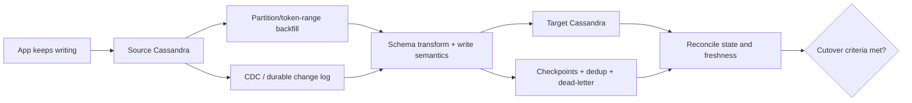
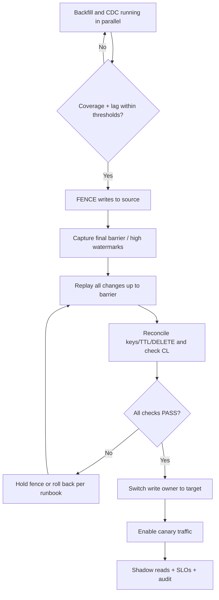

# Synchronizing Incremental Changes While the Source Keeps Receiving Writes

> **Chapter:** Migration and Schema  
> **Module:** `DATABASE_ENGINE_WIDE_COLUMN_CASSANDRA` — distributed and wide-column architecture of Apache Cassandra, partition keys, query-driven table design, read/write consistency levels, CQL, replication, compaction, repair, troubleshooting, and the Java Driver.  
> **Focus:** Migrating data to a target Cassandra table/cluster while the source continues receiving `INSERT`, `UPDATE`, and `DELETE` mutations. Combines **background data scans (backfill)** with **capturing and applying incremental changes (CDC/change stream)**, preserving timestamp, TTL, and tombstone semantics, measuring sync lag, shifting traffic with control, and maintaining a rollback plan.

A single full-table copy from source Cassandra to target Cassandra is rarely the whole online migration problem. Suppose a tool begins scanning 100 million rows at 09:00 and finishes at 12:00. During those three hours, the app keeps writing: new rows arrive, existing rows update, data expires by TTL, or rows are `DELETE`d. If you switch the application to the target right after the copy, part of those changes may **be missing from the copied dataset**, even though the job reported "100% of ranges completed."

The core challenge is not merely *how many bytes were copied*, but **preserving logical data state over time** and **proving the target caught up to the source at a defined point**. A sound workflow must be designed upfront for concurrency across live writes, background scans, retries, Down nodes, schema evolution, tombstones, and Cassandra's read/write consistency model.

## 1. Learning outcomes

After this lesson, you will be able to:

1. Explain why a one-shot backfill never yields a cluster-wide consistent snapshot while Cassandra keeps receiving writes.
2. Distinguish **commit-log/CDC capture**, **application event logs**, **dual-writes**, and periodic polling by `updated_at`.
3. Design a pipeline: **start capture first → backfill → replay changes → reconcile → cut over traffic**.
4. Understand Cassandra CDC limits: table/node scope, log retention, duplicates/ordering, lack of before-images, and `cdc_raw` disk pressure.
5. Handle **write timestamps (microseconds)**, last-write-wins, remaining TTL, tombstones, and deleted rows.
6. Design **idempotency, deduplication, checkpoints, and retries** per partition/token range.
7. Build methods to measure **replication lag, high-watermarks, and coverage**, without confusing "consumer is running" with "caught up."
8. Use CQL and Java Driver 4.x to illustrate backfills, prepared statements, and reconciliation queries.
9. Write a traffic-cutover runbook with **fencing/write freezes**, rollback, and stop conditions.
10. Recognize when a dedicated streaming/CDC service, event-sourced pipeline, or brief downtime is needed to guarantee correctness.

## 2. Problem model: "copy complete" can still be missing data

### 2.1. Timeline of a live-write migration

Suppose the source has `orders_by_tenant_day` and the target is being populated:

```text
09:00  Begin backfill (scanning token ranges sequentially)
09:05  Backfill reads order A: state=CREATED
09:07  App UPDATEs A to PAID on source
09:08  App INSERTs order B
09:10  App DELETEs order C
11:59  Backfill finishes
12:00  App switches reads/writes to target
```

With backfill alone, the target may:

- Still hold `A=CREATED` instead of `A=PAID`.
- Miss order B if its range was scanned before 09:08.
- Retain order C if the copy read C prior to the DELETE.
- Reflect partition states captured at **many different points in time**.

Even scanning a table at `LOCAL_QUORUM` **does not** create a table-wide transactional snapshot at 09:00. Every page, partition, or token range can be read at a different instant.

### 2.2. Why simply re-running backfill is not good enough

Repeated full-table scans sync most live rows, yet:

- Read/streaming cost is prohibitive on large tables.
- You cannot detect deletes if rows **no longer appear** on the source.
- Fresh writes still arrive between scan passes.
- Long scans can outlast TTL/retention windows.
- Rewriting older versions can conflict with newer target versions if timestamps are mishandled.
- Token ranges and repair/replica states may shift during topology changes.

Online migration requires a **continuous change stream** running alongside backfill, plus an audited convergence step before cutover.

### 2.3. Two data streams converging at the target



**Non-negotiable condition:** you must guarantee **no changes are lost between backfill start and target catch-up**, even across worker or server restarts.

## 3. Comparing four ways to capture incremental changes

| Method | Change source | Benefits | Risks / limitations |
|---|---|---|---|
| **Cassandra CDC** | Commit logs for CDC-enabled tables | Captures mutations directly on Cassandra's write path | Node-local; needs parser/connector, retention/disk pressure, dedup, and ordering |
| **Durable app event log** | Durable Kafka/Pulsar/outbox or business event stream | Explicit event IDs, partition keys, schemas, and workflows | Must guarantee the event log is complete with no bypass writers |
| **Dual-write** | App writes to both source and target | Simple to prototype with few writers; low latency | Partial successes, no atomic cross-cluster commit, retries cause drift |
| **Polling by `updated_at`** | Queries rows by updated timestamp | Avoids CDC if schema supports it | Misses hard DELETEs, TTLs, late writes, clock skew, and lacks suitable indexes |

There is no standard "single CQL `SELECT CHANGES` query" across arbitrary Cassandra tables like SQL transaction-log CDC. Choose an architecture based on **correctness**, **write sources**, and **operability**.

### 3.1. When to choose each approach?

- **Complete business event log** where all writes flow through one pipeline: consider replaying from that log.
- **Cassandra source** with multiple writers where DB-level mutations must be captured: evaluate Cassandra-version-compatible CDC and connectors.
- **Small migration** where a **brief write pause** plus range reconciliation is viable: short downtime/fencing is often safer than a custom CDC stack.
- **Zero loss of DELETEs/TTLs required:** never rely solely on `updated_at` polling without explicit tombstone/deletion events.
- **Dual-write chosen:** requires **reconciliation and idempotent retries**; never treat it as a two-phase commit across clusters.

## 4. Data invariants to write down before migrating

A solid plan defines **invariants** before picking tools:

1. **Coverage:** every partition/range in scope is either backfilled or created by the change stream.
2. **Change completeness:** every mutation in `[capture_start, cutover]` has a reliable path to target.
3. **Ordering:** concurrent changes to the same logical entity/partition follow a deterministic winning rule.
4. **Idempotency:** replaying the same event creates no duplicate logical rows, double counts, or unintended side effects.
5. **Deletes:** DELETEs/tombstones are never dropped merely because a row is absent from `SELECT`.
6. **TTL:** target values never outlive their intended retention due to migration.
7. **Schema mapping:** partition key changes, types, defaults, and denormalized projections are deterministic.
8. **Read validation:** target serves critical business queries accurately at the committed cutoff.
9. **Cutover fencing:** once write ownership shifts, two uncoordinated sources of truth never coexist.
10. **Rollback:** know where post-cutover writes live and in which direction they must replay on revert.

Turn every invariant into **measurable pass/fail criteria**, not just prose on a project slide.

## 5. How does Cassandra CDC operate?

### 5.1. CDC is tied to mutations and commit logs

In Apache Cassandra, CDC can be enabled per table:

```sql
ALTER TABLE app.orders_by_tenant_day WITH cdc = true;
```

For CDC-enabled tables, Cassandra flags/writes relevant mutations in the commit log and retains segments containing CDC data for consumer processing, typically via a `cdc_raw` directory and version-specific metadata/indexes.

**CDC does not automatically publish JSON messages to Kafka.** An agent/connector must parse commit-log formats and node state, transform mutations into metadata-rich events, and push them into a checkpointed pipeline. Merely enabling CDC does not mean changes are durably persisted off-cluster.

### 5.2. Node-local, not a cluster-wide totally ordered log

Cassandra uses a replication factor (RF). A single logical write normally lands on multiple replicas, so:

- CDC events may be emitted on **multiple nodes** for the same mutation.
- Nodes maintain independent commit-log segments; there is no cluster-wide global commit sequence.
- A node may go Down and miss writes; reading CDC from that node alone yields an incomplete stream.
- A mutation can reach replicas at different times or replay via hints/repairs differently.
- Running redundant CDC agents or retries produces duplicate events.

**Never assume "CDC gives one event per CQL statement in exact cluster-wide order."** Consumers need deduplication, RF/DC-aware coverage, and Cassandra/business-layer conflict resolution.

### 5.3. Capacity limits and backpressure

CDC retains segments awaiting consumption, consuming disk space. Settings like `cdc_total_space_in_mb` (names/semantics vary by version) cap the local CDC disk budget; if backlogs fill it, writes to CDC-enabled tables may be rejected or fail due to CDC space exhaustion.

This is an **availability risk**: a stalled CDC consumer not only lags migration, it can block live source writes. Monitor:

- `cdc_raw` directory space used/free and pending segment counts.
- Age of the oldest unacknowledged log segment.
- Parser errors, connector restarts, checkpoint lag, and upload/Kafka lag.
- Cassandra commit-log/disk pressure and write timeouts.
- Per-node/replica coverage across your CDC topology.
- Stop/throttle thresholds **before** the CDC disk budget exhausts.

Never manually delete files in `cdc_raw` just to clear disk-full alerts; that drops unsynchronized mutations. Cleanup must be managed by connectors and runbooks.

### 5.4. CDC does not automatically include before-images

An `UPDATE` or `DELETE` in Cassandra may contain **only the primary key and mutated columns**, without the full prior row ("before-image"). This becomes critical when migrating from `order_id` to `(tenant_id, event_day)`:

- A source DELETE specifying only `order_id` may **lack the old `tenant_id` and `event_day`**.
- If the target partition key depends on a formerly non-PK column, the consumer may not know which target row to delete.
- An UPDATE changing tenant/day must delete the **old target key** and insert the **new target key**, not merely upsert.

You need a **state store, mapping index, event-log before-image, reliable historical lookup, or rebuild/reconciliation workflow**. Never promise that any partition-key-changing schema migration works by simply "copying CDC events to the new table."

### 5.5. CDC and commit log archiving are not the same

| Concept | Purpose | Usable as migration stream? |
|---|---|---|
| **CDC-enabled table** | Exposes mutations to consumers via commit-log mechanism | Yes, with a version-matched connector and full coverage |
| **Commit log archiving** | Archives segments for PITR/recovery workflows | Possible source for specialized tools, not a ready decoded CDC stream |
| **Repair/streaming** | Synchronizes replicas/token ownership | Not an ordered change audit log |
| **Hinted handoff** | Replays missed writes to recovering replicas | Not a complete event log |
| **SSTable incremental backup** | Captures SSTable files after flushes/streams | Not a row-level change stream |

Never treat flush times or SSTable backup timestamps as "mutation offsets" in place of CDC checkpoints.

## 6. Start capturing **before** running the background scan

### 6.1. The dangerous gap

Suppose:

```text
10:00  Start full export
10:05  Source DELETEs row X
10:08  Enable CDC
11:00  Full export finishes
```

The DELETE at 10:05 can happen **after X's range was already exported**, yet **before CDC started**. The target retains X, and CDC cannot reconstruct a DELETE from an uncaptured event.

The safety invariant must be:

\[
T_{\mathrm{capture\ ready}} \le T_{\mathrm{backfill\ start}}
\]

and capture must retain all relevant mutations from that point until cutover. *Ready* means **enabled across all required sources with consumers durably receiving data and zero blind spots**—not merely that the config command ran.

### 6.2. Barrier-based startup sequence

1. Inventory all writers, hosts, keys, and tables involved.
2. Enable CDC or verify the app event log is already the sole write path.
3. Start consumers, verify a **canary mutation** arrives, and commit a checkpoint.
4. Record capture-start point \(C_0\) in the manifest.
5. Check CDC disk budgets, lag, node Up/Down status, and versions.
6. Launch token/partition-range backfill.
7. Run incremental replay concurrently under version/merge rules.
8. Reconcile range coverage and changes after \(C_0\).
9. Consider cutover only while capture stays uninterrupted and target catches up.

**Note:** with an application event log, \(C_0\) is usually a **durable per-partition/topic offset**, not just a wall-clock timestamp. With node-local Cassandra CDC, checkpoints track node/segment/position and topology mappings per connector format.

### 6.3. Is a brief write freeze at the start needed?

If you cannot prove CDC covers every writer right before backfill begins, a **short write fence** to establish the barrier and verify consumers is a safe option. Measure the required duration rather than assuming hours of downtime.

## 7. Backfill: copying baseline state without overriding new changes

### 7.1. Scanning by partition key and token ranges

For large datasets, backfill can use:

- Jobs iterating **known partition keys** when an authoritative key catalog exists.
- **Token-range scans** with disjoint intervals covering the entire ring.
- Tools like DSBulk unload, Spark Cassandra Connector, or supported migration tools with rate limits/metrics.
- Snapshot-based exports where a consistent protocol and recovery path exist.

For composite partition keys:

```sql
-- Illustrative example; pick non-wrapping token ranges with real bounds.
SELECT tenant_id, event_day, event_id, event_type
FROM app.events_by_tenant_day
WHERE token(tenant_id, event_day) > ?
  AND token(tenant_id, event_day) <= ?;
```

Both `?` placeholders are partitioner token bounds. Under `Murmur3Partitioner`, tokens are signed 64-bit integers; handle wrap-around and boundaries cleanly so no ranges are dropped or duplicated.

**Equal token ranges do not hold equal byte volumes.** Large partitions, tombstones, and vnodes skew load heavily; track checkpoints and progress by bytes, rows, and cluster health.

### 7.2. Paged backfill provides no global snapshot

A page size of 500 bounds each fetch batch. It **does not**:

- Limit total rows read to 500.
- Snapshot the entire table at start time.
- Prevent rows from mutating between pages.
- Capture INSERTs/DELETEs happening mid-scan.

If a stronger cutoff snapshot is needed than Cassandra natively provides, use an **application write barrier, immutable partitions, event-log replay, or a dedicated protocol**.

### 7.3. Race: older version arrives after newer version

A critical race:

```text
10:00  Backfill reads X=CREATED, source write timestamp = 100
10:01  CDC receives UPDATE X=PAID, write timestamp = 200
10:02  CDC writes X=PAID to target
10:03  Backfill writes X=CREATED to target
```

If backfill uses a **fresh timestamp assigned by the target coordinator at 10:03**, Cassandra treats `CREATED` as newer than `PAID`, **regressing state** even though CDC worked properly.

**Fix:** preserve/reapply **version/timestamp semantics** or implement version-checked merges—never write blindly in arrival order.

### 7.4. Never rely on "CDC always runs after backfill"

Even if you intend "scan first, replay second," pipelines involve parallel workers, retries, gaps, bad markers, and slow pages. A global flag cannot enforce strict ordering while nodes and partitions operate concurrently.

A safe design tolerates:
- A CDC mutation replaying multiple times.
- A backfill page arriving later than a CDC event.
- A worker restarting and retrying a range.
- A DELETE arriving before a stale INSERT.
- Node/repartition shifts mid-job.

## 8. Cassandra timestamp reconciliation

### 8.1. Cassandra resolves cell conflicts via timestamps

Cassandra reconciles cells and tombstones by **write timestamp**, typically via **last-write-wins on timestamp** alongside tie-breakers and tombstone precedence. CQL `USING TIMESTAMP` expects **microseconds since Unix epoch**—not Java milliseconds.

Example:

```sql
-- Lab: illustrates explicit write timestamp syntax.
UPDATE lab_migrate.orders_by_tenant_day
USING TIMESTAMP 1795255200000000
SET order_state = 'PAID'
WHERE tenant_id = 11111111-1111-1111-1111-111111111111
  AND order_day = '2026-11-21'
  AND order_id = 22222222-2222-2222-2222-222222222222;
```

**Note:** the timestamp above is illustrative. Production pipelines must pull authoritative timestamps from the mutation/source row; never stamp backfills with `System.currentTimeMillis() * 1000` where they could override CDC.

### 8.2. Reading `WRITETIME` of a column

For a simple regular column:

```sql
SELECT order_state, WRITETIME(order_state) AS state_writetime
FROM lab_migrate.orders_by_tenant_day
WHERE tenant_id = 11111111-1111-1111-1111-111111111111
  AND order_day = '2026-11-21'
  AND order_id = 22222222-2222-2222-2222-222222222222;
```

However, this is not a universal "row timestamp":

- Different non-key columns can have **different timestamps**.
- Static columns, collections/UDTs, and counters have distinct semantics.
- Tombstoned rows disappear from SELECT, so you cannot read a DELETE's `WRITETIME` here.
- One `INSERT` may set many columns; an `UPDATE` modifies a subset.
- You cannot reconstruct complete mutation history solely from current `WRITETIME` values.

When exact conflict preservation is required, consumers need **complete mutation metadata**, or migrations should use explicit **business versions** rather than inferring from one column.

### 8.3. Timestamps are not global event order

Two writers with clock skew or custom timestamps can produce:

```text
Wall-clock time:
10:00 writer A writes state=CREATED with ts=5000
10:01 writer B writes state=PAID    with ts=4000
```

Under LWW, Cassandra keeps `CREATED` due to the higher timestamp even though `PAID` arrived later in real time. Migrations must reflect **source semantics** or explicit business versions rather than assuming "later arrival always wins."

**Never replace source timestamps with consumer arrival time** when source state must be preserved.

## 9. TTL, expiration, and DELETE during incremental sync

### 9.1. TTL represents an expiration deadline, not an arbitrary second count

Example:

```sql
UPDATE lab_migrate.orders_by_tenant_day
USING TTL 3600
SET temporary_note = 'needs-review'
WHERE tenant_id = 11111111-1111-1111-1111-111111111111
  AND order_day = '2026-11-21'
  AND order_id = 22222222-2222-2222-2222-222222222222;
```

If a value was written with a 3,600-second TTL at 10:00 and backfill reads it at 10:40:

- Rewriting with `TTL 3600` at 10:40 keeps data alive until 11:40 instead of 11:00.
- Using **remaining TTL** (~1,200 seconds) aligns expiration near the target deadline.
- If it already expired on source while an older copy exists on target, ensure tombstone/delete semantics are not lost.

### 9.2. Reading remaining TTL

```sql
SELECT temporary_note,
       TTL(temporary_note) AS note_ttl_seconds,
       WRITETIME(temporary_note) AS note_writetime
FROM lab_migrate.orders_by_tenant_day
WHERE tenant_id = 11111111-1111-1111-1111-111111111111
  AND order_day = '2026-11-21'
  AND order_id = 22222222-2222-2222-2222-222222222222;
```

`TTL(column)` returns remaining seconds when a TTL exists, or `null` when none applies (subject to null/expired cases). With export lag, recompute **remaining** seconds at target write time, accounting for clock sync and whole-second resolution.

**You cannot call `TTL()` on a deleted row to reconstruct historical tombstones.**

### 9.3. DELETE looks like an absent row in SELECT

Suppose backfill copies row X to target, and then the source DELETEs X. If a consumer merely polls:

```sql
SELECT * FROM lab_migrate.orders_by_tenant_day
WHERE ...;
```

and observes "X is gone," that does not tell the consumer **that X was deleted, when, or with what target timestamp**. Accurate DELETE replay requires:

- CDC mutations carrying keys and deletion timestamps.
- Business delete events containing before/after primary keys where needed.
- A state store/mapping index to resolve old target keys.
- Key-set reconciliation where permitted.

Deleted rows retain tombstones in SSTables for `gc_grace_seconds` days; never lower grace merely to reduce migration overhead.

### 9.4. Extra care when changing primary keys

When target PK differs from source PK, copying live rows is straightforward, yet **UPDATEs and DELETEs** grow complex:

| Source operation | Target action | Required context |
|---|---|---|
| INSERT | Insert row by target PK | All target partition/clustering key fields |
| UPDATE regular column | Update row at matching target PK | Mapping from source PK to target PK |
| UPDATE field in target PK | Delete old target key, insert new target key | **Before-image** or history mapping |
| DELETE source row | Delete corresponding target row | Source PK and **pre-DELETE target PK** |
| TTL expiry | Ensure target row/column expires equivalently | Expiry timestamp or propagated tombstone |

If fields needed to build the target PK are **absent from the delete event**, you cannot construct the target delete from the missing row alone. Schema-change designs must solve this **before** starting migration.

## 10. Idempotency and duplicate handling

### 10.1. Why can consumers process duplicates?

In distributed pipelines, a consumer can:

1. Read a CDC event.
2. Write the event to target successfully.
3. Crash before committing its checkpoint.
4. Restart and re-read the event.
5. Write the same event a second time.

Such **at-least-once delivery** is far more realistic across source/queue/target boundaries than "processed strictly once." The target must tolerate replays.

### 10.2. For CQL upserts, "same key" is not always enough

When replaying an `INSERT` to the same primary key:

- With identical **write timestamps**, column values, and TTL semantics, logical duplicates are usually avoided.
- If replay assigns a **newer write timestamp**, it can override a subsequent UPDATE or DELETE.
- Reapplying `USING TTL` from scratch extends expiration.
- For **counter increments**, retries double-count.
- If one event updates multiple denormalized tables, handle partial failures/compensation.

Hence idempotency must rest on **event IDs/source offsets, deterministic mappings, logical versions, and semantically stable target writes**.

### 10.3. Event IDs and durable keys

Example business event:

```json
{
  "event_id": "7e3601d4-8b6e-4ca1-8ee3-91a94b348b01",
  "entity_key": {
    "tenant_id": "11111111-1111-1111-1111-111111111111",
    "order_day": "2026-11-21",
    "order_id": "22222222-2222-2222-2222-222222222222"
  },
  "operation": "UPDATE",
  "column": "order_state",
  "value": "PAID",
  "source_write_timestamp_us": 1795255200000000,
  "source_partition": 12,
  "source_offset": 982311
}
```

**This event schema is migration-pipeline-defined**, not Cassandra CDC's built-in JSON format. Use `event_id` and `source_partition + source_offset` for deduplication/checkpointing, and timestamp/sequence metadata for merge rules.

When a logical write arrives from multiple replica CDC streams, commit-log offsets **cannot** deduplicate across nodes. You need a logical mutation fingerprint/event ID; `(timestamp, PK, value)` helps but **cannot always distinguish two distinct mutations sharing payload/timestamp**, especially for counters or non-idempotent operations.

### 10.4. Avoid marketing "exactly once" labels

A connector may claim exactly-once within one subsystem (e.g., queue offset commits), yet **writing to Cassandra target and committing offsets** do not automatically share an atomic cross-system transaction. You still need:

- Idempotent writes.
- Durable, ordered checkpoints.
- Retries/reconciliation.
- Recovery logic for crashes *between target write and checkpoint commit*.
- Business data audits.

For strict financial exactly-once guarantees, build a **ledger/event source of truth** with dedicated invariants rather than relying on CQL batches.

## 11. Ordering and partitioning of event streams

### 11.1. Per-entity ordering matters more than cluster-wide order

No reliable global total order exists across all Cassandra mutations. However, changes to the same entity/partition generally need controlled processing.

When using Kafka or a queue:

- Partition by `(tenant_id, order_id)` so events for one entity land on the same ordered partition **when producer semantics permit**.
- Attach explicit business versions or write timestamps.
- Never equate connector system timestamps with CQL write timestamps.
- Consumers must still deduplicate across rebalances and retries.
- Across multiple writers, resolve ties and clock skew using source rules.

### 11.2. Backfill and CDC sharing a merge policy

A common approach:

```text
Source row/cell snapshot:
  value = CREATED
  source timestamp = 100

CDC update:
  value = PAID
  source timestamp = 200

Target:
  Regardless of arrival order, version=200 must win.
```

However, if a source row has cells with different timestamps, replaying the whole row under **one single write timestamp** breaks cell-level reconciliation. Choose among:

1. Applying **cell-level mutations/timestamps** where supported by the connector.
2. Enforcing a **business-level entity version** with explicit compare/approve rules.
3. Setting a brief write pause/barrier and copying state at a clean cutoff to avoid hard conflicts.
4. Routing unresolvable conflicts to **manual reconciliation/quarantine** instead of overwriting blindly.

### 11.3. CQL batches do not create cross-cluster atomicity

A `BEGIN BATCH` on the target cluster has Cassandra-internal batch semantics; it does not bind together a source Cassandra write or an external checkpoint. Never write:

```sql
BEGIN BATCH
  ...;
  ...;
APPLY BATCH;
```

and claim cross-cluster transactions. Specifically, **multi-partition unlogged batches** raise coordinator overhead without commensurate benefit. Design per-partition/aggregate event application and validation tailored to the use case.

## 12. Checkpoints and crash-resilient progress

### 12.1. Two kinds of checkpoints

**Backfill checkpoints** track which token ranges/partitions were read and committed:

```yaml
backfill:
  job_id: migrate-orders-2026-11
  ranges:
    - id: r001
      start_exclusive: "-9223372036854775808"
      end_inclusive: "-5000000000000000000"
      status: VERIFIED
      rows: 120034
      checksum_manifest: "sha256:example-placeholder"
    - id: r002
      status: RUNNING
```

**CDC/change-stream checkpoints** track which source positions were processed and applied:

```yaml
change_stream:
  source: durable-event-log
  topic: orders-mutations
  offsets:
    "0": 912340
    "1": 892331
    "2": 902200
  status: RUNNING
  target_apply_verified_until: null
```

**Both YAML blocks are illustrative manifests**, not Cassandra configs. Checkpoints alone never prove full correctness without idempotent writes and verification.

### 12.2. When is it safe to checkpoint an event?

Standard at-least-once sequence:

1. Receive event E from source.
2. Validate schema, keys, and version metadata.
3. Apply mutation to target **and receive ACK at target CL**.
4. Record E as applied in the state store (if used).
5. **Only then** commit source offset/checkpoint.

Checkpointing **before** durable target writes risks **permanently losing events** on crash. Checkpointing afterward means crashes can trigger **duplicate replays**, making idempotency mandatory.

### 12.3. Per-shard/per-range checkpoints

A worker handling 10 ranges must never mark the entire job DONE after finishing only the first range. Manifests should record:

- Cluster, keyspace, table, schema version, and partitioner.
- Token boundaries with inclusive/exclusive convention.
- Worker/attempt, last completed offset, row/byte counts.
- Status `PENDING / RUNNING / VERIFIED / FAILED`.
- Checksums or sample reconciliation evidence.
- Cutoffs/CDC coverage matching backfilled ranges.
- Output staging location and commit markers.

On retry, re-run the **entire range** under idempotent mapping rather than saving a single naive "last token" that risks skipping partition collisions or boundary rows.

### 12.4. Never mark `VERIFIED` merely because a file exists

An export file or target table can hold **partial** data after network timeouts. Distinguish:

- `SCANNED`: source range read.
- `APPLIED`: target writes ACKed.
- `RECONCILED`: checked under the chosen reconciliation strategy.
- `VERIFIED`: manifest/checkpoints and coverage complete with zero unresolved errors.

Never use "% data copied" to imply "target is ready for cutover."

## 13. Lag and watermarks: knowing when the target has caught up

### 13.1. One lag metric is not enough

Latencies to track:

| Type | Meaning | How to measure |
|---|---|---|
| **Source-to-capture lag** | Source mutation to connector/queue | Source commit/event time → capture time via reliable clock/offset |
| **Queue backlog** | Unconsumed events | High watermark minus committed offsets per shard |
| **Apply lag** | Consumed events awaiting target ACK | Consumer processing, retries, DLQ |
| **End-to-end visibility lag** | Source write visible vs. target query visibility | Probe/sentinel events and target read CL |
| **Backfill coverage** | Scanned/verified fraction of data/ranges | Per-range manifests, rows/bytes, validation checks |
| **Deletion/TTL convergence** | Deletes/expiries reflected accurately on target | Tombstone/reconciliation/negative checks |

Never blindly sum offsets across source partitions running at different speeds and spans into one global number.

### 13.2. High watermarks are **scoped** milestones

Suppose a stream has three shards:

```text
At barrier B:
  shard 0 high watermark = 1,000,000
  shard 1 high watermark =   900,000
  shard 2 high watermark = 1,100,000

Target applied checkpoints:
  shard 0 = 1,000,000
  shard 1 =   899,995
  shard 2 = 1,100,000
```

Although only 5 messages remain on shard 1, **you cannot declare barrier B caught up**. Every in-scope shard/producer/CDC source must apply at least up to its watermark, with zero unresolved DLQ items and passing reconciliation.

### 13.3. Timestamp lag can mislead

Using:

\[
\mathrm{lag}_{\mathrm{time}}
= t_{\mathrm{now}} - t_{\mathrm{source\ event}}
\]

is intuitive, yet:

- Writer clocks can skew.
- Client-supplied source timestamps may be backdated.
- Silence on an idle shard does not mean it is broken.
- Replaying one old batch spikes max age even as the backlog is nearly drained.

Measure **offset lag + oldest-unapplied event age + heartbeat/sentinel freshness** broken down by DC/table/shard.

### 13.4. Setting cutover thresholds from business requirements

For a hypothetical target allowing at most 30s lag:

- CDC consumers intact with zero missing segments.
- 100% of backfill ranges VERIFIED.
- All relevant shards at or above barrier watermarks.
- Stable-window end-to-end p99 lag < 30 seconds.
- DLQ/poison events drained; zero skipped DELETEs.
- Data reconciliation passes for hot partitions and deleted records.
- Source/target CQL p95/p99 and CL health within SLO.

These are **illustrative SLO thresholds**, not Cassandra defaults. When **the source keeps receiving writes**, low lag alone is never enough for cutover; closing the final gap requires fencing or an explicit atomic write-ownership handoff.

## 14. Coordinated traffic cutover strategy

### 14.1. The "fence → drain → verify → cutover" plan

A typical safe sequence:



### 14.2. Why is write fencing required?

During cutover, this race can occur:

```text
T0  Sampled CDC lag = 0
T1  App writes order X to source
T2  Reads switch to target
T3  CDC delivers T1 write to target
```

Even with lag = 0 at T0, there is **no guarantee** the T1 write landed before T2. If the business requires read-your-writes across cutover, you must:

- Pause or queue writes to source.
- Confirm all writers stopped or drained in-flight requests.
- Capture a final barrier with durable offsets.
- Wait for target to apply up to the barrier.
- Transfer write/read ownership to target.
- Ramp traffic via canary and monitor.

**Fencing at the app/gateway or write-privilege level** must be enforceable; merely "asking teams to stop writing" does not stop a stray legacy worker.

### 14.3. "Zero downtime" demands stricter protocols

If writes cannot pause even for seconds, you need **single-writer epoch/lease fencing**, buffered queues, or a transactionally ordered event log capable of ownership transfer. No built-in atomic transaction spans Cassandra A and B.

A credible zero-downtime design often includes:

- Writes land in a durable log first; source/target sinks consume by offset.
- Active writer epochs/fencing tokens.
- Idempotent application logic.
- Canary/shadow reads gated by watermarks.
- Read-your-write routing when target lags.
- DLQ, retry, and rollback handling even if source becomes unreachable.

**Never claim "zero downtime" unless end-to-end semantics survived fault injection.**

### 14.4. Cutover rollback is a reverse migration

Once target accepts new writes, the source becomes **stale**. Reverting to source requires:

- **Reverse CDC** or replaying writes from target back to source, or
- **Fencing target writes** and copying the reverse delta cleanly, or
- Accepting loss of post-cutover writes within an approved RPO.

Never flip DNS or Java Driver endpoints back to source before syncing new writes. "Application rollback" and "data-state rollback" are **two separate operations**.

## 15. Schema evolution during migration

### 15.1. Manage schema versions separately from data

When modifying Cassandra schema:

- `ALTER TABLE` can add certain columns per CQL rules, yet **cannot** arbitrarily turn an existing partition key into a new one.
- Changing primary keys or query-driven denormalization usually requires **new table + backfill + dual/change stream**.
- Cluster schema agreement is not instantaneous across all nodes in every state.
- CDC decoders and target mappers must understand **the schema at the moment each mutation was written**.
- Mixed source/target versions risk value/type incompatibilities.

Therefore split deployments into **expand → migrate → cutover → contract**.

### 15.2. Expand/migrate/contract sequence

| Phase | Actions | What must be verified |
|---|---|---|
| **Expand** | Create target tables, add columns/compatibility code, enable capture | Old CQL clients keep working |
| **Migrate** | Backfill + CDC replay, mapping + reconciliation | Data, deletes, TTLs, and lag accurate |
| **Cutover** | Fence source, drain, switch read/write owner | Zero stale source writers remain |
| **Contract** | Disable old write path, deprecate old schema post-retention | Rollback window closed, backups verified |

**Never drop the source table right after one canary read succeeds.** Allow time for reconciliation, backups, rollback windows, and retention sign-off.

### 15.3. Primary-key changes require understanding all queries

Suppose source stores `orders_by_id` keyed by `order_id`, and target serves `orders_by_tenant_day` keyed by `((tenant_id,order_day), order_id)`:

```sql
CREATE TABLE IF NOT EXISTS lab_migrate.orders_by_id (
    order_id uuid PRIMARY KEY,
    tenant_id uuid,
    order_day date,
    order_state text
);

CREATE TABLE IF NOT EXISTS lab_migrate.orders_by_tenant_day (
    tenant_id uuid,
    order_day date,
    order_id uuid,
    order_state text,
    PRIMARY KEY ((tenant_id, order_day), order_id)
);
```

Backfill from `orders_by_id` can read tenant/day and write target. Yet a CDC DELETE on `orders_by_id` may carry only `order_id` **without tenant/day**. You need a historical lookup index/mapping or business delete events holding full target keys. If an update changes tenant/day, delete the old target key before inserting the new one.

Cassandra has **no implicit JOIN** letting consumers look up target rows by regular columns on a table not keyed for that lookup.

## 16. CQL lab: matching-key source and target

To avoid cluttering the lab with primary-key remapping, the first lab uses **two tables with identical PKs** in one lab keyspace. Production may span two separate clusters with CQL routed to distinct source/target sessions.

### 16.1. Set up keyspace and tables

Assume the lab DC is `dc1` with enough nodes for RF=3:

```sql
CREATE KEYSPACE IF NOT EXISTS lab_migrate
WITH replication = {
  'class': 'NetworkTopologyStrategy',
  'dc1': 3
};

CREATE TABLE IF NOT EXISTS lab_migrate.orders_source (
    tenant_id uuid,
    order_day date,
    order_id uuid,
    order_state text,
    temporary_note text,
    PRIMARY KEY ((tenant_id, order_day), order_id)
) WITH cdc = true;

CREATE TABLE IF NOT EXISTS lab_migrate.orders_target (
    tenant_id uuid,
    order_day date,
    order_id uuid,
    order_state text,
    temporary_note text,
    PRIMARY KEY ((tenant_id, order_day), order_id)
);
```

`cdc=true` merely illustrates enabling CDC on the source table. **The lab does not run a built-in CDC consumer**; viewing stream events requires a version-matched CDC reader. Without CDC tooling/budget, simulate an application event log to practice mapping and replay.

### 16.2. Write source data

```sql
CONSISTENCY LOCAL_QUORUM;

INSERT INTO lab_migrate.orders_source (
    tenant_id, order_day, order_id, order_state, temporary_note
) VALUES (
    11111111-1111-1111-1111-111111111111,
    '2026-11-21',
    22222222-2222-2222-2222-222222222222,
    'CREATED',
    'temporary'
) USING TIMESTAMP 1795255200000000 AND TTL 3600;

SELECT tenant_id, order_day, order_id,
       order_state,
       WRITETIME(order_state) AS state_writetime,
       TTL(order_state) AS state_ttl
FROM lab_migrate.orders_source
WHERE tenant_id = 11111111-1111-1111-1111-111111111111
  AND order_day = '2026-11-21';
```

**Note:** `USING TIMESTAMP` here is solely for learning semantics—do not hard-code arbitrary values in production. `TTL 3600` applies to eligible regular columns in the INSERT; if the lab runs long, rows will expire.

### 16.3. Copy observed state

A controlled backfill reads `WRITETIME(order_state)` and `TTL(order_state)`, then writes target with matching **timestamp and remaining TTL**. Simplified example:

```sql
-- Illustrative; timestamp and TTL must be read from source at processing time.
INSERT INTO lab_migrate.orders_target (
    tenant_id, order_day, order_id, order_state
) VALUES (
    11111111-1111-1111-1111-111111111111,
    '2026-11-21',
    22222222-2222-2222-2222-222222222222,
    'CREATED'
) USING TIMESTAMP 1795255200000000 AND TTL 3500;
```

`3500` is **not an actual measurement**; it illustrates TTL ticking down from 3600. If another column has a different TTL/timestamp, never merge all columns into one INSERT with a shared timestamp/TTL and claim exact source semantics were preserved.

### 16.4. UPDATE then DELETE on source

```sql
UPDATE lab_migrate.orders_source
USING TIMESTAMP 1795255260000000
SET order_state = 'PAID'
WHERE tenant_id = 11111111-1111-1111-1111-111111111111
  AND order_day = '2026-11-21'
  AND order_id = 22222222-2222-2222-2222-222222222222;

DELETE FROM lab_migrate.orders_source
USING TIMESTAMP 1795255320000000
WHERE tenant_id = 11111111-1111-1111-1111-111111111111
  AND order_day = '2026-11-21'
  AND order_id = 22222222-2222-2222-2222-222222222222;
```

In a real pipeline, CDC/delete events must **apply to target** with accurate timing semantics. Simply querying source via SELECT after DELETE provides no tombstone timestamp to replay.

### 16.5. Observing the "backfill resurrects data" hazard

After DELETE has been applied to target, try writing the old value **in the lab** with a *lower* timestamp:

```sql
INSERT INTO lab_migrate.orders_target (
    tenant_id, order_day, order_id, order_state
) VALUES (
    11111111-1111-1111-1111-111111111111,
    '2026-11-21',
    22222222-2222-2222-2222-222222222222,
    'CREATED'
) USING TIMESTAMP 1795255200000000;
```

While the target tombstone at `1795255320000000` remains active, the stale write will not resurrect the row. **Never assume this holds once tombstones are purged**, if replicas changed, or if source timestamps were wrong. Understand `gc_grace_seconds` and repair timelines.

Do not test by injecting huge future timestamps and concluding Cassandra is buggy; high custom timestamps mask legitimate future writes.

## 17. Java Driver 4.x: controlled backfill preserving timestamps

The code below reads **one partition** on source and copies **one regular column** to target with matching write timestamp and TTL (if present). It uses two tables in one lab cluster for clarity; across two clusters, initialize **two separate `CqlSession`s** with proper contact points, local DCs, auth, and TLS.

This code intentionally **does not** claim to handle CDC, DELETEs, multi-column timestamps, or full-ring checkpoints—those belong to a complete migration framework.

```java
import com.datastax.oss.driver.api.core.CqlSession;
import com.datastax.oss.driver.api.core.DefaultConsistencyLevel;
import com.datastax.oss.driver.api.core.cql.PreparedStatement;
import com.datastax.oss.driver.api.core.cql.BoundStatement;
import com.datastax.oss.driver.api.core.cql.Row;
import java.net.InetSocketAddress;
import java.time.LocalDate;
import java.util.UUID;

public final class SinglePartitionBackfill {
    public static void main(String[] args) {
        UUID tenant = UUID.fromString(
            "11111111-1111-1111-1111-111111111111");
        LocalDate day = LocalDate.of(2026, 11, 21);

        try (CqlSession session = CqlSession.builder()
                .addContactPoint(new InetSocketAddress("127.0.0.1", 9042))
                .withLocalDatacenter("dc1")
                .build()) {

            PreparedStatement read = session.prepare(
                "SELECT tenant_id, order_day, order_id, order_state, " +
                "WRITETIME(order_state) AS wt, " +
                "TTL(order_state) AS ttl_remaining " +
                "FROM lab_migrate.orders_source " +
                "WHERE tenant_id = ? AND order_day = ?");

            PreparedStatement writeNoTtl = session.prepare(
                "INSERT INTO lab_migrate.orders_target " +
                "(tenant_id, order_day, order_id, order_state) " +
                "VALUES (?, ?, ?, ?) USING TIMESTAMP ?");

            PreparedStatement writeWithTtl = session.prepare(
                "INSERT INTO lab_migrate.orders_target " +
                "(tenant_id, order_day, order_id, order_state) " +
                "VALUES (?, ?, ?, ?) USING TIMESTAMP ? AND TTL ?");

            BoundStatement query = read.bind(tenant, day)
                .setConsistencyLevel(DefaultConsistencyLevel.LOCAL_QUORUM)
                .setPageSize(200);

            for (Row row : session.execute(query)) {
                if (row.isNull("order_state") || row.isNull("wt")) {
                    continue; // NOT a substitute for replaying tombstones.
                }

                UUID orderId = row.getUuid("order_id");
                String state = row.getString("order_state");
                long sourceWriteTimestampUs = row.getLong("wt");

                BoundStatement command;
                if (row.isNull("ttl_remaining")) {
                    command = writeNoTtl.bind(
                        tenant, day, orderId, state,
                        sourceWriteTimestampUs);
                } else {
                    int remaining = row.getInt("ttl_remaining");
                    // Near-expiry TTL is a race; production needs
                    // an expiry/deletion policy, not silent skipping.
                    if (remaining <= 0) continue;
                    command = writeWithTtl.bind(
                        tenant, day, orderId, state,
                        sourceWriteTimestampUs, remaining);
                }

                session.execute(command.setConsistencyLevel(
                    DefaultConsistencyLevel.LOCAL_QUORUM));
            }
        }
    }
}
```

### 17.1. Limitations to review before use

- **Single partition**: copies one `tenant/day`, not the full ring.
- **Single-column semantics**: preserves only `order_state`'s timestamp/TTL; other columns need separate handling.
- **Blind to tombstones**: deleted rows/columns vanish from SELECT; CDC or business events remain essential to delete from target.
- **TTL race**: `remaining` is read on source; target writes happen later, extending expiry slightly unless transfer lag is subtracted. Near-zero TTLs need explicit expiration handling.
- **CL**: source and target `LOCAL_QUORUM` are independent checks when spanning two clusters—no cross-cluster transaction exists.
- **Retries**: on execution timeouts, writes may already be applied on some target replicas. Enforce idempotent timestamps/values and checkpoints.
- **Paging**: page size caps memory/response size, not total cluster load. Add rate limiters, worker concurrency caps, and checkpoints for multi-partition scans.
- **Credentials/TLS**: production requires auth, truststores/keystores, and exact local DCs per cluster.
- **Consistency**: source versions can shift between pages; only migration + CDC/reconciliation establishes full state.

### 17.2. Never use `currentTimeMillis()` as the source write timestamp

A frequent mistake:

```java
// DO NOT USE as a history-preserving version source.
long wrongTimestampUs = System.currentTimeMillis() * 1000L;
```

Using this in backfill lets older values **beat** newer CDC updates carrying smaller source timestamps. Whenever setting timestamps manually, verify **microsecond units** and source/target policies. If relying on application versions instead of CQL timestamps, implement full compare/update logic and concurrency guards.

## 18. Dual-write: when it works and when it fails

### 18.1. Two writes are not an atomic transaction

Suppose an API writes the same order to two clusters:

```text
App ----> SOURCE: SUCCESS
  |
  +-----> TARGET: TIMEOUT
```

At least three outcomes are possible:

1. Target wrote nothing at all.
2. One target replica wrote, short of CL.
3. Target met CL, yet the response dropped on the network.

Blindly retrying target can duplicate side effects or alter write timestamps. If the API returns success after the source write, you still need a **durable intent/retry queue** so target eventually converges.

### 18.2. Two practical patterns

**Pattern A — Source-of-truth + durable event log**

```text
Client → App → durable event log (event ID)
                     ├──> Source writer
                     └──> Target writer
```

Replay is easier to control when every write genuinely flows through an ordered, idempotent event log. Even then, CQL writes to two clusters can experience **partial success**, requiring reconciliation.

**Pattern B — Best-effort dual-write + repair jobs**

```text
App → Source write → Target write (best-effort)
                           ↘ failure log + retry
Nightly range reconciliation → repair target gaps
```

Fits cases tolerating temporary eventual lag and drift. Unsuitable for zero-loss requirements if the failure log is not durable and complete.

### 18.3. When to avoid dual-write

- Uncontrolled writers write straight to CQL bypassing the app.
- Mutations include counters or non-idempotent operations hard to replay.
- Target schema needs before-images the app does not retain.
- No durable failure queue or checkpoints exist.
- Source of truth becomes ambiguous when the two clusters diverge.
- Strict rollback is required with no reverse data pipeline.

Merely "flipping a feature flag to write to two places" **solves none of these preconditions**.

## 19. Reconciling source and target without choking the cluster

### 19.1. Do not compare only table-wide `COUNT(*)`

Both source and target having 10 million rows **can still hide divergent contents**: one missing row and one extra row cancel out in counts. Full-table `COUNT(*)` also triggers heavy scans.

Reconcile in layers:

1. **Manifest coverage:** all ranges/buckets scanned and applied.
2. **Key identity:** full primary-key sets within closed buckets.
3. **Content:** canonical representation hashes independent of column order/serialization quirks.
4. **Temporal semantics:** timestamps, remaining TTL, DELETEs, and tombstone state in scope.
5. **Business invariants:** monetary totals, order states, cross-table consistency across query-first tables.
6. **Read-path validation:** real application queries at target CL.

### 19.2. Live data cannot be compared at arbitrary instants

While the source mutates during reconciliation:

- A source read at T1 and target read at T2 can legitimately differ due to lag.
- TTLs may expire between the two reads.
- Backfill and CDC may still be applying specific keys.
- Clocks and read consistency levels can skew observations.

For meaningful checks, compare **closed time buckets / durable barriers / write-fenced samples** or enforce lag tolerances. Do not treat every transient mismatch in a live window as data loss.

### 19.3. Hash logical rows, not SSTable files

Two clusters' SSTables differ in format, compaction state, compression, generations, and replica layouts even when **logical data is identical**. Comparing SSTable file checksums is not semantic row validation.

A logical digest must normalize:

- Key/column order and NULL handling.
- Data types, UUIDs, and timestamp precision.
- Collection/UDT serialization.
- TTL/expiration and delete semantics in scope.
- Comparison cutoff markers.

Drill down any mismatch to **full primary key and column-level versions**—never reflexively run full repair or overwrite the entire table.

## 20. Monitoring load and availability during migration

Online migration consumes Cassandra resources like a major workload:

| Layer | Metrics to track | Risk scenario |
|---|---|---|
| Backfill | Ranges DONE, rows/s, bytes/s, page latency, retries | Hot ranges/large partitions, illusory progress |
| CDC capture | `cdc_raw` used, oldest unconsumed segment age, capture errors | Backlog stalls live source writes |
| Queue/consumer | Offsets, backlog, DLQ, apply failures | Lost/duplicate mutations, stale target |
| Target | Write p95/p99, timeouts, queue depth, pending compactions | Replay causes write storms |
| Source | Read p95/p99, read amplification, tombstones, GC | Backfill starves live app I/O |
| Disk | SSTable/compaction/CDC free space per node | Disk-full outages |
| Network | Cross-DC MiB/s, retransmits, ingress/egress | Streaming starves RF replication |
| Data | Reconciliation mismatches, lost deletes, TTL drift | Migration "finishes" with corrupt state |
| Topology | `UN/DN/UJ/UL`, vnodes, RF/CL, repair sessions | Down nodes create coverage holes |
| Application | Request success, read-your-write, retry counts | Cutover degrades UX |

### 20.1. Cassandra toolset

```bash
nodetool status
nodetool describecluster
nodetool netstats
nodetool compactionstats
nodetool tpstats
nodetool tablestats lab_migrate.orders_source
```

These commands inspect node, streaming, compaction, and table stats, **not end-to-end CDC consumer offsets or target migration watermarks**. Those belong in connector, queue, backup, and migration-orchestration metrics.

### 20.2. Example thresholds to pause or throttle

Suppose a cluster has read p99 SLO = 80 ms (normal baseline 30 ms):

- When backfill pushes p99 to 60–70 ms, do not add workers; inspect backlogs and I/O.
- When p99 exceeds 80 ms, timeouts rise, or free disk drops below policy limits, pause or throttle concurrency.
- When CDC backlog spikes or segments near exhaustion, **prioritize protecting change capture** over padding backfill % completion.
- During major repairs or topology changes, pause migration per runbook if combined risk exceeds budget.
- Whenever lag or capture gaps cannot be proven closed, **do not cut over**.

Numbers are illustrative; derive real thresholds from actual SLOs and capacity.

## 21. Failure scenarios and remediation

### 21.1. CDC consumer Down for 30 minutes

**Symptoms:** offsets stall, CDC directory grows, source keeps taking writes.

**Remediation:**
1. Diagnose connector/queue failure and confirm logs remain intact from last checkpoint.
2. Check CDC disk headroom, write timeouts, and impacted nodes.
3. Recover consumer from durable checkpoint.
4. Throttle backfill if competing for resources; prioritize draining CDC backlog.
5. If any segment was lost, mark a **GAP**—never silently skip.
6. Reconcile/reseed the gapped range or recover from another trusted event log.
7. Proceed to cutover only after coverage and lag recover.

### 21.2. CDC UPDATE reaches target before stale backfill

**Symptoms:** target looks right briefly, then reverts to old state.

**Cause:** backfill used a target-assigned timestamp newer than the source UPDATE.

**Fix:** fix the mapper to preserve source cell timestamps or business versions, then rebuild/reconcile affected keys. Never just "re-run CDC" while backfill can still stamp higher timestamps.

### 21.3. DELETE missed during primary-key change

**Symptoms:** row vanishes on source yet stays alive on query-first target.

**Cause:** CDC delete carried only source PK without fields needed to build target PK prior to DELETE.

**Fix:** add durable source-to-target key mapping, before-images/business events, and reconciliation, then replay missed deletes. Never scan the entire target by regular column in production as a Band-Aid.

### 21.4. TTL expires later on target

**Symptoms:** source dropped `temporary_note`, target still returns it.

**Cause:** backfill restarted `TTL 3600` from scratch instead of remaining expiry, or clocks/cutoffs drifted.

**Fix:** store absolute expiry/remaining TTL and reprocess per policy, checking source `WRITETIME/TTL`, dedup, and timestamps. For near-expiry cells, skip or delete appropriately rather than resetting TTL.

### 21.5. Dual-write succeeds on one side only

**Symptoms:** API returns success yet target lacks the row, or source failed while target wrote.

**Fix:** identify source of truth, inspect durable retry queues and idempotency keys, reconcile writes by event ID—never infinitely replay counter increments.

### 21.6. Offsets "caught up to high watermark" yet data still diverges

**Symptoms:** consumer checkpoints look clean, reconciliation still reports mismatches.

**Possible causes:** backfill missed a token range, CDC capture gap before barrier, poison events sent to DLQ, bad schema mapper, unapplied tombstones, inconsistent source, or checkpoint committed before write.

**Fix:** audit **capture-start barriers, range manifests, per-shard offsets, DLQs, target writes, and content reconciliation**. Lag=0 is a necessary check, **not a certificate of data accuracy**.

### 21.7. Rollback to source loses new writes

**Symptoms:** post-cutover target received order D, DNS reverted to source, and D is missing.

**Cause:** target→source sync was absent during the rollback window.

**Fix:** fence target, replay reverse deltas (or consume from shared durable log), verify barrier, and only then flip read/write ownership back. Never roll back merely by switching endpoints.

## 22. Online migration runbook

### Phase A — Discovery and architecture selection

- [ ] Document source and target, Cassandra versions, schemas, partitioners, RF/DC, CL, and query patterns.
- [ ] Inventory all writers: apps, batch jobs, `cqlsh`, ETL, background services—zero hidden writers.
- [ ] Measure live partition/range sizes, large partitions, tombstones, and write rates.
- [ ] Catalog mutation types: INSERT, UPDATE, DELETE, TTL, counters, LWT, collections, schema changes.
- [ ] Choose CDC/event log/dual-write and prove completeness of the change source.
- [ ] Define event IDs, source versions, PK mappings (including before/after on key edits), and retry semantics.
- [ ] Protect source CDC disk/retention and target compaction/write capacity.
- [ ] Define RPO/RTO, downtime/fencing windows, rollback strategy, and backup recovery points.

### Phase B — Expand and start capture

- [ ] Create query-aligned target schema; verify schema agreement.
- [ ] Enable/verify CDC per node/table, or verify durable app event log.
- [ ] Start consumers, verify a test event arrives, and commit checkpoints cleanly.
- [ ] Record durable capture-start barriers/offsets and topology/version metadata.
- [ ] Monitor lag, queue backlogs, DLQs, source write latency, and `cdc_raw` headroom.
- [ ] Never start backfill while unexplained capture gaps exist.

### Phase C — Parallel backfill and incremental apply

- [ ] Partition token ranges/partitions with manifests, retries, and stop/pause policies.
- [ ] Enforce concurrency, page-size, and MiB/s caps per client SLOs.
- [ ] Apply CQL mappings preserving source timestamps/versions and TTL/deletes.
- [ ] Handle duplicates/out-of-order arrivals and commit checkpoints only post-ACK.
- [ ] Monitor source/target p95/p99, disk, GC, compaction, and repair/topology.
- [ ] Mark ranges VERIFIED only after reconciliation, not merely SELECT/export.
- [ ] Throttle backfill when CDC backlogs spike; prioritize uninterrupted change capture.

### Phase D — Reconciliation and cutover prep

- [ ] 100% of in-scope ranges/partitions VERIFIED or explicitly waived.
- [ ] Change-stream offsets/high watermarks reach chosen barriers; zero unresolved DLQs.
- [ ] Hash/full-PK/value/TTL/DELETE mismatches within approved thresholds.
- [ ] Shadow reads on target validate real queries, especially hot tenants and deletes.
- [ ] Target app/driver configs, TLS/auth, and CL ready.
- [ ] Rollback has reverse target→source sync or approved downtime/RPO.
- [ ] Write fencing and in-flight write draining rehearsed.

### Phase E — Cutover

1. Fence all writes to source using a verifiable mechanism.
2. Drain in-flight writes or record uncertain-outcome keys.
3. Capture final barriers/durable offsets for every source/shard.
4. Drain and apply all changes to final barriers with zero poison/unresolved failures.
5. Reconcile data/queries at the agreed cutoff.
6. Shift write ownership and read traffic to target via canary.
7. Monitor read-your-write, CL success, p99, retries, and data correctness.
8. Do not drop/alter source schema immediately; hold rollback/retention per policy.

### Phase F — Post-cutover verification and contract

- [ ] All writers routed cleanly; legacy jobs no longer write to source.
- [ ] Target RF/CL, repair, backups, and security configured per runbook.
- [ ] CDC/queue backlogs drained or cleanly decommissioned; never manually delete raw files arbitrarily.
- [ ] Post-cutover writes backed up with rollback/tracing intact.
- [ ] Report completed covering source→target end-to-end lag, mismatches, DLQs, retries, and outages.
- [ ] Drop old tables/clusters only after rollback window closes, backups verify, and approval is granted.

## 23. Calculation and design exercises

### Exercise 1 — Capture gap

Backfill starts at 10:00. Source DELETEs row X at 10:05; CDC is enabled at 10:10. Backfill already read X at 10:03. What happens on target, and how must the workflow order change?

### Exercise 2 — Timestamp race

Backfill reads `state=CREATED, writetime=100`; CDC applies `state=PAID, writetime=200` to target. Backfill arrives later at 10:15. What happens if backfill writes with timestamp 300? What if it writes with timestamp 100?

### Exercise 3 — Remaining TTL

A value was written on source at 11:00 with TTL=3,600 seconds. Backfill reads it at 11:40 and applies on target at 11:42. Should target use TTL 3,600 seconds? Approximately what remaining TTL matches real time?

### Exercise 4 — Multi-replica CDC

With RF=3, one logical write can appear in CDC logs of nodes A, B, and C. Why can you not simply sum event counts to measure "logical orders," and how do you deduplicate?

### Exercise 5 — DELETE with changed primary key

Source PK=`order_id`, target PK=`(tenant_id, day, order_id)`. Source CDC DELETE contains only `order_id`. What is missing to delete the right target record?

### Exercise 6 — At-least-once replay

A consumer applies event E to target successfully and crashes before committing its offset. Upon restart, E is read again. How do you design retries so data is never corrupted?

### Exercise 7 — Per-shard watermarks

Barrier offsets: `[100, 200, 300]`; target applied: `[100, 200, 299]`. Can you declare catch-up complete since only one event remains?

### Exercise 8 — Two CQL statements and consistency

An app writes source at `LOCAL_QUORUM` and target at `LOCAL_QUORUM`. Why does that still not make dual-write an atomic transaction across two Cassandra clusters?

### Exercise 9 — Reconciliation

Source and target both show 5 million rows in a count query. Can you certify identical data? List other reconciliation levels.

### Exercise 10 — Fencing source writes

At time T, consumer lag reads 0 while the app still writes to source. Why can you not cut over immediately if strong read-your-write is required? Design the final fence/barrier.

### Exercise 11 — Rollback

Post-cutover, target accepted 10,000 writes. The app wants to revert to source due to performance. Since source stopped receiving writes, what must happen before switching traffic back?

### Exercise 12 — Handling full CDC disk

The CDC connector stalls, `cdc_raw` usage climbs, and source write timeouts appear. What takes priority? May operators manually delete unconsumed commit-log/CDC files?

### Suggested answers

1. Target may keep X because the DELETE fell inside the gap; enable and **verify** capture before backfill, anchoring durable offsets/barriers.
2. Timestamp 300 causes `CREATED` to overwrite `PAID`; timestamp 100 loses to version 200 under reconciliation, assuming consistent tombstones/metadata.
3. No. TTL should approximate remaining time until 12:00—about 18 minutes at 11:42 (1,080 seconds), factoring in lag and whole-second granularity.
4. CDC emits duplicates across replicas and retries; use logical event identities/PK+version and dedup rules rather than summing raw counts.
5. You need a historical mapping or before-image carrying the old `tenant_id/day`; a post-DELETE SELECT cannot supply them.
6. Use stable event IDs, idempotent version/timestamp target writes, post-apply checkpoints, and reconciliation.
7. Not yet; shard 3 has not reached barrier 300.
8. No cross-cluster atomic commit exists; each request can succeed or fail independently.
9. No; equal counts can hide missing, extra, or differing rows. Compare ranges, full keys, canonical hashes, deletes, TTLs, and business invariants.
10. New writes can arrive after the lag=0 sample; fence writes, drain in-flight requests, capture final offsets, wait for apply, verify, and only then transfer ownership.
11. Fence target and replay deltas back to source (or use a shared durable event log), reconcile to a barrier, and never just flip DNS.
12. Protect live source writes and CDC data, restore the consumer, and manage backpressure/disk headroom; never delete unconsumed files by hand.

## 24. Further reading

Verify against your **exact Cassandra, driver, and connector versions**:

- [Apache Cassandra — Change Data Capture (CDC)](https://cassandra.apache.org/doc/latest/cassandra/managing/operating/cdc.html): `cdc=true`, commit-log mutation data, and CDC configuration.
- [Apache Cassandra — Storage Engine](https://cassandra.apache.org/doc/latest/cassandra/architecture/storage-engine.html): commit log, memtables, SSTables, and compaction.
- [Apache Cassandra — CQL Data Manipulation](https://cassandra.apache.org/doc/latest/cassandra/developing/cql/dml.html): `USING TIMESTAMP`, `USING TTL`, `WRITETIME`, `TTL`, and DELETE.
- [Apache Cassandra — Data Modeling](https://cassandra.apache.org/doc/latest/cassandra/developing/data-modeling/): partition keys, query-first design, and denormalization.
- [Apache Cassandra — Repair](https://cassandra.apache.org/doc/latest/cassandra/managing/operating/repair.html): anti-entropy repair, tombstones, and replica consistency.
- [Apache Cassandra — Monitoring metrics](https://cassandra.apache.org/doc/latest/cassandra/managing/operating/metrics.html): read/write latency, range scans, GC/compaction.
- [Apache Cassandra Java Driver 4.x — Core Manual](https://apache.github.io/cassandra-java-driver/4.19.0/): prepared statements, paging, token-aware routing, retries, and consistency levels.

Cassandra 4.x, 5.x, vendor distributions, and third-party CDC tools differ in commit-log formats, connector capabilities, and retry semantics. **Never apply examples or option names from another version without testing in a lab.**

## 25. Key takeaways

- **Backfilling a live-write source does not yield a full-table snapshot.** Converging the target requires a complete incremental change stream plus a disciplined cutover protocol.
- **Capture must be ready before backfill starts**; any pre-CDC gap can drop DELETEs unrecoverable by ordinary SELECTs.
- **Cassandra CDC is not a cluster-wide ordered JSON stream.** It relies on node/table commit logs, requiring connectors, disk budgets, deduplication, and coverage checks.
- **Late-arriving backfill must never overwrite earlier CDC updates.** Preserve source timestamps or business versions and respect per-cell LWW/tombstone reconciliation.
- **TTLs and DELETEs must be treated as data.** Restarting TTLs from zero extends lifetimes; missing tombstones resurrect deleted rows.
- **Changing primary keys complicates DELETE/UPDATE replay.** You need before-images or mapping history, not merely current row copies.
- **Commit checkpoints only after target apply**, and pair with idempotency and reconciliation because crashes still cause duplicate replays.
- **Lag=0 is not enough for cutover.** Require range coverage, per-shard high watermarks, clean DLQs, data validation, and **write fencing** to close the final gap.
- **Rollback means reverse data synchronization**, not merely pointing the Java Driver back at source.
- **Protect source SLOs and CDC headroom** throughout. A migration that triggers disk-full outages, quorum loss, or blocked repairs is not a successful migration.
- The ultimate goal is **source and target proven consistent at an audited milestone, the app serving accurate queries at target CL, and tested recovery if any step fails**.
