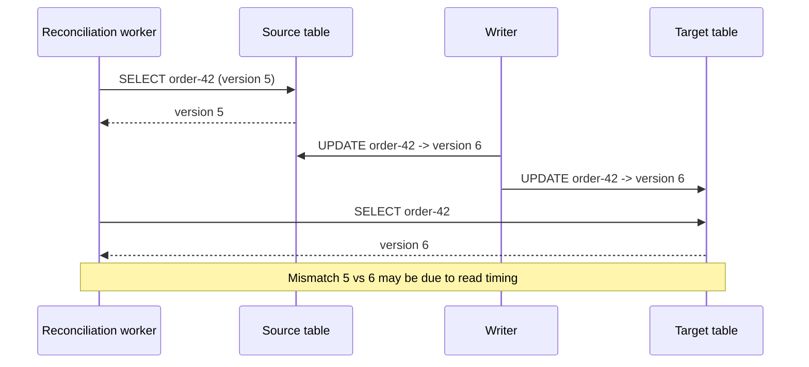
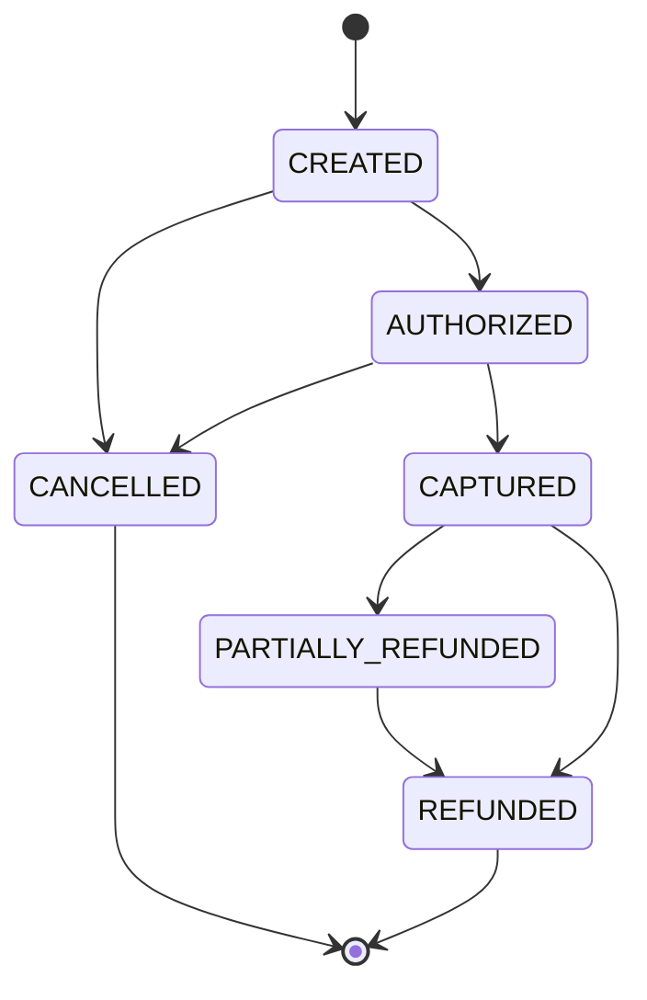
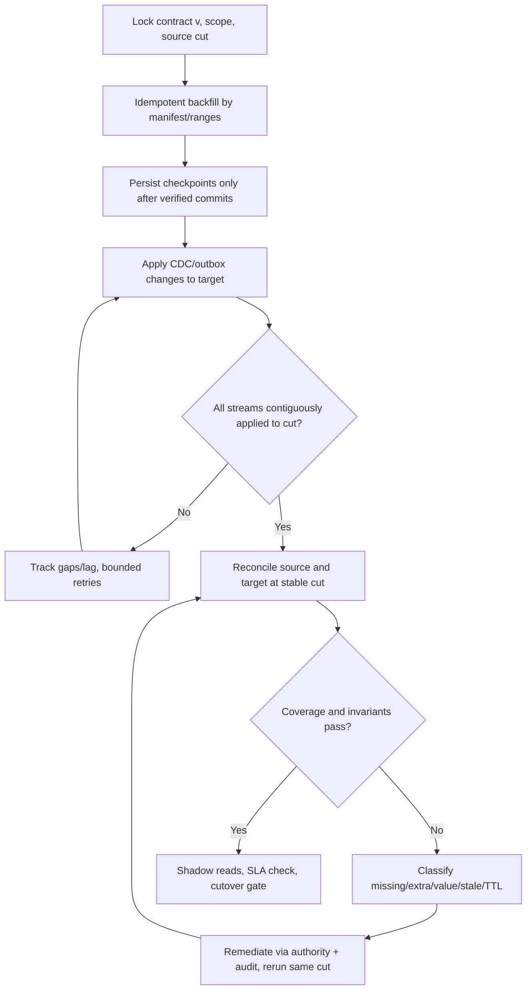
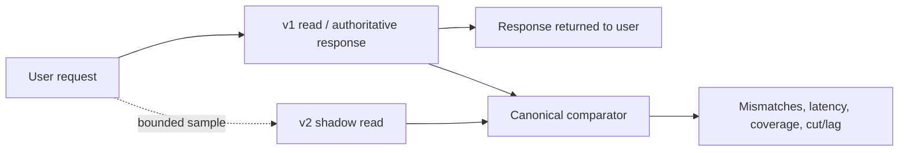
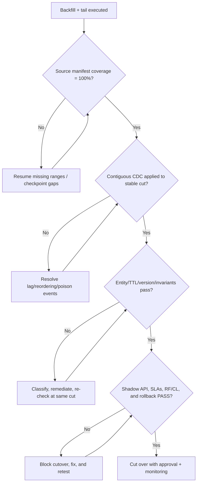

# Reconciling Source/Target Data and Business Invariants

Migrating data to a new Cassandra table, changing partition keys, splitting data across multiple query-driven tables, or moving from another source system into Cassandra all come down to one decisive question: **"What evidence proves the target data is complete, accurate, and satisfies the same business rules as the source?"** A backfill job reporting `SUCCESS` or two tables having the same row count is not enough. The target could be missing a partition, holding a stale value from a timestamp overwrite, duplicating a transaction, breaking TTLs, or serving an invalid order state.

This lesson belongs to the **Migration and Schema** chapter of the **DATABASE_ENGINE_WIDE_COLUMN_CASSANDRA** module. The focus is designing **repeatable reconciliation**, distinguishing completeness from correctness, verifying **business invariants**, handling concurrently mutating data, and building auditable **cutover/rollback** gates. Examples use CQL, `NetworkTopologyStrategy`, partition/clustering keys, read/write consistency levels, SSTables/tombstones/repair, and Java Driver 4.x.

> **Principle:** "Zero discrepancies found" is meaningful only when you know **which entities were checked**, **which data cutoff was compared**, **which transformation rules applied**, **which slice lacks evidence**, and **how concurrent writes were handled**.

## 1. Learning objectives

After this lesson, you will be able to:

1. Define source/target scope, entity keys, schema mappings, and expected projections for a Cassandra migration.
2. Distinguish **coverage, completeness, value equality, semantic equivalence, integrity, and business invariants**.
3. Compare by key/partition and canonical representation rather than trusting `COUNT(*)` or a single table-wide checksum.
4. Build **watermarks/checkpoints** and backfill + CDC/dual-write strategies to verify data while writes continue.
5. Recognize the impact of **LWW timestamps**, clock skew, TTLs, tombstones, consistency levels, replica convergence, and key transformations.
6. Write CQL to verify specific records and Java Driver 4.x reconciliation with bounded partitions, rates, and retries.
7. Design invariant suites covering monetary amounts, state machines, uniqueness, aggregates, entity relationships, and security.
8. Classify discrepancies, perform controlled remediation, track residual errors, and make evidence-based cutover/rollback decisions.

## 2. What does "source equals target" mean?

A migration does not necessarily copy schemas verbatim. For instance, the source stores each order by `(tenant_id, order_id)`, while the target serves "orders by day" keyed by `(tenant_id, order_day)` with `order_id` as a clustering column. The two tables **do not share the same partition shape**, yet they can represent **the exact same set of business orders**.

To compare them, define a versioned transformation function:

\[
T_v: \text{SourceRecord} \longrightarrow
      \text{ExpectedTargetRecord(s)}
\]

Given the same input and version `v`, the function must be **deterministic** or explicitly declare external inputs and cutoff conditions. Reconcile a target record against `T_v(source)`, rather than expecting byte-for-byte or column-for-column identity with the source table.

### Six verification layers

| Layer | Question | Example discrepancy |
| --- | --- | --- |
| **Scope / coverage** | Were all required tenants, token ranges, days, shards, and changelogs inspected? | Job scanned only 95/100 ranges yet reported zero mismatches. |
| **Completeness** | Does every entity that **should exist** exist on target? Are there "extra rows"? | Missing `order-42`, or deleted order still present. |
| **Field equivalence** | Do transformed values, types, precision, and nulls match? | `amount_cents` 12,500 became 1,250; timezone shifted the date. |
| **Temporal correctness** | Are update order, versions, TTLs, and deletes right "as of" the cutoff? | Replay wrote an old value with a newer timestamp, regressing status. |
| **Business invariants** | Does data obey business rules even if individual rows look valid? | Captured total exceeds authorization; CANCELLED order has active shipment. |
| **Operational readiness** | Does target read/write within SLA/CL, do replicas converge, and is rollback viable? | All compared rows match, yet target query needs `ALLOW FILTERING` and breaches p99 SLA. |

**Each layer can independently be PASS/FAIL/INCOMPLETE.** Checking 1 million of 10 million records with zero discrepancies is **sample PASS / coverage INCOMPLETE**, not a fully VERIFIED migration.

## 3. Cassandra assumptions to declare before reconciling

### No atomic cross-table or cross-partition snapshot transactions

Cassandra is partitioned by token; a source read and a target read normally execute at **different instants** on different coordinators/replicas. There is no built-in way to take an atomic transactional snapshot of an **entire keyspace** via two `SELECT` statements. Nor does a `LOGGED BATCH` turn cross-partition mutations into RDBMS-isolated transactions.



When reconciling amid live writes, **a transient mismatch is not always a migration bug**. However, never dismiss all mismatches as "eventual consistency": enforce **watermarks, bounded retries, a lag budget**, and a point by which discrepancies must disappear.

### Replica consistency differs from business correctness

- `LOCAL_QUORUM` with RF=3 in a DC with at least 3 replicas normally requires 2 local responses. It does not create a global snapshot or prove another DC caught up.
- When Cassandra throws `ReadTimeout`/`WriteTimeout`, mutation outcome can be **uncertain**; reconcile via idempotency/commit logs—never generate new IDs and duplicate writes.
- **Repair** converges replicas under Cassandra's model; it **does not** fix miscomputed `amount_cents` from a bad transform, rows skipped by a missing range, or business-rule violations.
- SSTable data uses **last-write-wins (LWW)** by timestamp and tombstones; network arrival order does not necessarily decide the final winning version.

### Require an auditable entity inventory

Cassandra optimizes partition-key lookups, **not frequent full-table `SELECT *` scans**. Your `(tenant_id, order_id, order_day)` list for reconciliation should come from durable changelogs/outboxes, backfill manifests, snapshot exports, token-range jobs, or an indexed upstream catalog. **Never assume** you can cheaply list all partitions with one CQL query.

## 4. Migration contract: from source schema to target schema

Suppose both source and target reside in Cassandra, changing the partition key for a new access pattern. These are **two illustrative tables**; never apply the DDL below directly to production.

### Source table v1 — lookup one order by ID

```sql
CREATE KEYSPACE IF NOT EXISTS migration_lab
WITH replication = {
  'class': 'NetworkTopologyStrategy',
  'dc1': 3
}
AND durable_writes = true;

CREATE TABLE IF NOT EXISTS migration_lab.orders_by_id_v1 (
  tenant_id text,
  order_id uuid,
  order_day date,
  amount_cents bigint,
  currency text,
  status text,
  version bigint,
  updated_at timestamp,
  PRIMARY KEY ((tenant_id, order_id))
);
```

The partition key combines `tenant_id` and `order_id`, so fetching one order requires both values without scanning an entire tenant.

### Target table v2 — query orders by tenant/day

```sql
CREATE TABLE IF NOT EXISTS migration_lab.orders_by_tenant_day_v2 (
  tenant_id text,
  order_day date,
  order_id uuid,
  amount_cents bigint,
  currency text,
  status text,
  version bigint,
  updated_at timestamp,
  PRIMARY KEY ((tenant_id, order_day), order_id)
) WITH CLUSTERING ORDER BY (order_id ASC);
```

The target groups a day's orders inside `(tenant_id, order_day)` sorted by `order_id`. **This key does not support querying "globally unique `order_id`" without tenant and day.** If the business still needs lookup by `order_id`, keep a separate lookup/read model instead of running `ALLOW FILTERING` across every partition.

### Mandatory mapping contract

| Field / condition | Source v1 | Expected target v2 | Rule |
| --- | --- | --- | --- |
| Identity | `tenant_id, order_id` | `tenant_id, order_day, order_id` | `order_id` belongs to tenant; day follows fixed rule. |
| Day | `order_day` | Partition key component | Never reinterpret using the job host's local timezone. |
| Amount | `amount_cents bigint` | `amount_cents bigint` | Keep integer minor units; never route through imprecise floats. |
| Currency | `currency text` | `currency text` | Normalize to business-allowed ISO codes, e.g., `VND/USD`. |
| Status | `status text` | `status text` | Preserve status or map via a versioned transition table. |
| Version | `version bigint` | `version bigint` | Controlled monotonic version to detect stale projections. |
| Updated at | `updated_at timestamp` | `updated_at timestamp` | Exact UTC instant at defined precision; never use backfill time as business update time. |
| Deleted/expired | Tombstone/TTL per v1 policy | Target state per migration contract | Never resurrect deleted rows or extend TTL unintentionally. |

**Important:** Cassandra does not enforce constraints like `amount_cents >= 0`, `status in allowed set`, or "order_id unique per tenant." Those invariants must have domain/application owners and independent reconciliation.

## 5. Defining reconciliation keys and zero-data-loss scope

Reconciliation requires a **stable entity key**, not merely the partition key of one table. In our example:

```text
Business entity key: (tenant_id, order_id)
Source locator:      (tenant_id, order_id)
Target locator:      (tenant_id, order_day, order_id)

Expected:
  each eligible business entity -> exactly one v2 projection row
  each v2 row maps back to exactly one source entity per contract

Must never silently omit:
  - DELETEd or TTL-expired orders
  - orders shifted across day buckets by timezone bugs
  - huge tenants / hot token ranges
  - duplicate target rows caused by order_day mutations
  - events updated after the backfill cutoff
```

### One source record can map to multiple target records

Not every migration is 1:1. Mapping an order with `items[]` to `order_items_by_order` expands one order into N rows. Define a **cardinality contract**: expected row count per entity, item keys, empty `items=[]` handling, and tombstones. Comparing global `source_count == target_count` is wrong by design.

### A record changes partitions when a partition-key column mutates

With target `(tenant_id, order_day)`, `order_day` must be defined as an **immutable creation date** or have a controlled old-key → new-key move workflow. If an app updates `order_day`, Cassandra **does not automatically move rows** between partitions: you must write the new key and delete the old one cleanly. Reconciliation must catch **extra target rows in the old bucket**, not just confirm the new row exists.

## 6. Business invariants to codify as checks

A table can have all rows present yet hold corrupted business state. Start with an explicit requirements and ownership table:

| Invariant | Example check | Severity | Owner |
| --- | --- | --- | --- |
| **Identity** | Each `(tenant_id, order_id)` represents at most one order. | Critical | Order domain |
| **Existence / no orphans** | Target order must trace to a source entity or valid creation event in logs. | Critical | Migration |
| **Amount non-negative** | `amount_cents >= 0` for eligible orders; valid currency. | High | Billing |
| **Totals** | Sum of item line cents + shipping - discount = order total per rounding policy. | Critical | Billing |
| **Payment cap** | `captured_total <= authorized_total` and refunds never exceed allowed limit. | Critical | Payments |
| **State machine** | `CREATED → AUTHORIZED → CAPTURED` or valid CANCELLED paths. | Critical | Orders |
| **Version monotonicity** | Projections never regress `version` during replays/fixes. | High | Platform |
| **Temporal semantics** | `updated_at` and TTLs never reset to backfill execution time. | High | Platform |
| **Tenant isolation** | Tenant A's order never maps to tenant B. | Critical | Security |
| **Query readiness** | New API returns accurate row sets, ordering, and pagination within SLA. | High | API |

**Every invariant must document exceptions.** For example, a discounted order might record a negative adjustment in a ledger table while `amount_cents` on the order remains non-negative. If partial refunds exist, `refunded_total <= captured_total` must consider currency units, transaction statuses, and recorded adjustments—not blindly sum every `REFUND` event.

### Checking state machines



This diagram is an example, **not a universal industry payment standard**. A record showing `status=CAPTURED` may have a valid enum value yet be invalid if no authorization event ever occurred. Comparing only current state between two tables **cannot prove valid state-transition history**; you need event logs/audit trails or an authoritative business source.

## 7. Source of truth: is the "source" truly authoritative?

Before comparing, designate the **authoritative data source** for each phase:

| Phase | Write authority | What is the target used for? |
| --- | --- | --- |
| Prep | v1 or external non-Cassandra source | Target does not serve production yet. |
| Backfill | v1 remains authoritative | v2 receives historical data with sample checks. |
| Tail/CDC | v1 + durable event log per policy | v2 catches up with post-backfill changes. |
| Shadow read | v1 serves user responses; v2 compared in parallel | Detects query/partition mismatches without breaking responses. |
| Cutover | v2 becomes authoritative **after gate** | v1 may stay temporarily synced for planned rollback. |
| Post-cutover | v2 authoritative | v1 retired only after rollback window/retention ends. |

Never write vaguely "dual-write keeps both in sync": two CQL writes to **two partitions/tables** can fail independently. **Logged batches provide no cross-partition isolation** and do not turn multi-step business logic into ACID transactions. When ordering guarantees are needed, use outbox/CDC/event logs with domain-idempotent projectors and test timeouts, retries, duplicates, and reordering.

## 8. Backfill + ongoing mutations: watermarks and high-water marks

Suppose backfill processed through `offset=5000` while live writes continue arriving. If reconciliation checks source at `offset=6000` while target is only at `offset=5500`, mismatches do not necessarily mean data loss—target may simply be **lagging**. Conversely, if the stream dropped offset 5400 while monitoring checks only "last seen offset=6000," a gap goes unnoticed.

### Concepts to keep separate

| Concept | Definition | Warning |
| --- | --- | --- |
| **Backfill cursor** | Last position safely **read/written and checkpointed** in the source dataset. | Never checkpoint before target writes ACK per policy. |
| **Source watermark** | Closed, durable **source event/time boundary** with explicit ordering rules. | Wall-clock `now()` or `updated_at` is not a total-order offset. |
| **Target applied watermark** | Point up to which changes were **contiguously applied without gaps**. | "Highest offset seen" does not prove earlier offsets weren't missed. |
| **Reconciliation cut** | Fixed set of entities/changes guaranteed comparable across both sides. | Without a stable cut, comparisons suffer live-write races. |
| **Lag budget** | Business-tolerated delay during the tail catch-up phase. | Never ignore mismatches indefinitely without thresholds and deadlines. |

A key-partitioned CDC stream normally guarantees ordering only **within a partition/stream**, not a single global offset across all tenants. Never take a "cluster-wide max offset" and mark every partition caught up. With multiple streams, store **per-stream/per-partition vector checkpoints** and confirm zero gaps.

### Verifiable convergence workflow



### When a stable cut cannot be taken

Use **windowed convergence**: compare at `t`, record mismatches, wait out the source update window/CDC lag, and re-read after a bounded interval. Report **transient mismatches** separately from **persistent mismatches**. For business-critical domains, require checkpointed event/transaction logs or an approved app-level write quiesce—never "freeze" merely by pausing the backfill job.

## 9. Timestamps and LWW: why replays can regress data

Cassandra uses **last-write-wins** on cell timestamps: when concurrent updates hit the same cell, the higher timestamp wins under Cassandra's tie-break rules. A mutation arriving "later" over the network is not necessarily newer in business terms, and client/driver timestamps can skew across clocks.

### Stale replay example

```text
t1: source order=42 status=AUTHORIZED, version=4
t2: business update status=CAPTURED, version=5
t3: slow backfill reads snapshot version=4 and writes to v2

If backfill writes with a HIGHER timestamp than the version=5 update:
  version=4 overwrites version=5 under LWW
  even though the business knows version 4 is stale.
```

**Never** assume an app-managed `version` column acts as automatic CAS: Cassandra will not reject `UPDATE version = 4` when `version = 5` is stored. To prevent regressions:

- Apply updates through **an ordered, checkpointed projector** per entity; backfill must precede tail updates or obey version order.
- Preserve consistent source write timestamps per contract while respecting tie-breakers, TTLs, and timestamp bounds; **not** a universal substitute for business ordering across columns/collections/deletes.
- Use **same-partition LWT/CAS** to guard versions where appropriate, analyzing throughput/latency and multi-table transitions.
- Reconcile continuously after replay batches, flagging non-monotonic versions and repairing from the source of truth.

**Warning:** CQL `USING TIMESTAMP` sets the storage write timestamp, not business `updated_at`. Extreme past/future timestamps disrupt tombstones and TTLs. Never inject future timestamps to "force a fix to win" during mismatch remediation.

## 10. TTL, tombstones, DELETEs, and temporal equivalence

TTLs and DELETEs complicate reconciliation because **absent rows** can be either valid or buggy:

| Source state | Target state | Possible cause |
| --- | --- | --- |
| Source live, target absent | Missing backfill, CDC lag, wrong day routing, or premature target expiry. |
| Source absent, target live | Extra/stale target, reset TTL, missed DELETE, or source already expired. |
| Both absent | May be valid expiry, **yet** insufficient if audits require proof of prior existence. |
| Same value, widely differing TTL | Target may outlive or expire earlier than security/retention mandates. |
| Same key, differing timestamp/version | Unconverged state or bad replay; inspect cut and mutation history. |

### TTL must not "refresh" on backfill

Suppose a source record was written at `t0` with a 30-day TTL, and backfill runs on day 20. Writing the row to target on day 20 with `USING TTL 2592000` (30 days in CQL seconds) keeps it alive **30 more days from backfill**, instead of the **10 remaining days** required by source policy. That retention bug violates compliance and breaks reconciliation.

To preserve expiration:

1. Compute the **expiration instant** or remaining TTL from source/metadata within acceptable latency/precision bounds.
2. When the projector writes to target, compute remaining TTL against a **unified clock**, accounting for Cassandra's TTL rounding and error tolerances.
3. If TTL already elapsed, handle absence/tombstones per contract—**never** resurrect expired data.
4. For columns with independent TTLs, reconcile **per column**; a row may retain only a subset of columns.
5. Keep deletion evidence if audits demand proof of deletion rather than treating `SELECT` returning `null` as complete history.

In CQL, `TTL(column)` returns **current remaining TTL** for eligible columns; it is not an immutable expiration timestamp across two reads. `WRITETIME(column)` returns cell write timestamps (microseconds) where supported; **never** read `TTL()` a few seconds apart and demand exact equality.

### Tombstones and repair

Tombstones protect deleted data from resurrecting when a replica recovers late. Lowering `gc_grace_seconds` to "speed up migration" risks **zombie data** if replicas miss deletes. Repair converges Cassandra replicas **within the same table**; it **never synchronizes v1 and v2**. Reconcilers must propagate DELETEs to target per contract and verify after CDC lag drains.

## 11. Canonicalization: compare "meaning" instead of arbitrary bytes

Two business-equivalent records can serialize differently:

- `updated_at` is a UTC instant; one system prints `Z`, another prints `+07:00`.
- Money must be **integer minor units (cents) per currency**, never `double` or floating-point arithmetic.
- Unicode strings may differ in NFC/NFD normalization; apply `trim/lowercase` only if domain rules specify.
- `null`, omitted fields, empty strings, and `UNSET` mutations have **distinct semantics**.
- Collections/maps/sets may print in unstable order; sort by key **only if domain order is irrelevant**.
- `timeuuid`, UUID, `timestamp`, and `date` must canonicalize by typed value, not tool formatting quirks.
- Target-generated metadata (`indexed_at`, `migration_run_id`) should be excluded from business equality checks unless contracted.

### Canonical record contract

```text
CanonicalOrder/v3:
  entity_key: tenant_id + order_id  (length-prefixed)
  order_day: ISO local date per UTC business policy
  amount_cents: signed 64-bit integer, non-null
  currency: uppercase ISO 4217
  status: enum defined in contract v3
  version: signed 64-bit integer, non-null
  updated_at: UTC epoch milliseconds
  deleted: tombstone/expiry semantics as of cut

Exclude:
  - coordinator, host_id, token, last_scanned_at
  - migration_job_start_time, index metadata
  - query latency or job-runtime randomness
```

**Never** concatenate fields with a bare `|` delimiter without escaping or length-prefixing: values like `a|b` collide with two fields `a` and `b`. Hash only **explicitly specified canonical bytes**, tagging every comparison result with `CanonicalOrder/v3` and the migration transform version.

## 12. Hashes/checksums and token-range comparisons

Checksums detect large-scale divergence fast, yet **never replace business-invariant checks**. Two records can share an identical SHA-256 hash between source and target while both violate domain rules.

### Methods and limitations

| Method | Strengths | Risks |
| --- | --- | --- |
| **Pointwise exact compare** by business key | Pinpoints exact differing fields for targeted repair. | High I/O across billions of keys; needs manifest and bounded concurrency. |
| **Stratified sampling** | Spots broad error classes fast during early phases. | Does not prove all records match; report rate/seed/strata. |
| **Counts by bucket/tenant/day** | Catches large missing/extra gaps; feeds dashboards. | Matching counts do not prove values/keys; table-wide Cassandra COUNT is expensive. |
| **Per-record canonical SHA-256** | Compares values without shipping full fields to dashboards. | Requires identical schema/version; misses uniqueness, temporal, or invariant bugs. |
| **Sorted chunk/Merkle-style digests** | Isolates differing chunks for deep inspection and reruns. | Needs stable boundaries/cuts; duplicate keys or sort drift break digests. |
| **Token-range scans via compatible tooling** | Covers full source/target partitions when scan pipelines exist. | v1 and v2 hash different partition keys; source token ranges do not map 1:1 to target ranges. |

### When partition keys change, do not compare token ranges as identical

v1 hashes `(tenant_id, order_id)`; v2 hashes `(tenant_id, order_day)`. One order moves to an **entirely different token**. Therefore, never compare "checksum of token range X in v1" against "checksum of token range X in v2." Map **source entity key → expected target key** first, then aggregate checksums by workflow-defined buckets/keys.

### Basic set-difference formulas

Let `S` be valid source entities at the cut, `E = T_v(S)` be the multiset of expected target rows, and `D` be normalized target data:

\[
\text{Missing}=E\setminus D,\qquad
\text{Extra}=D\setminus E.
\]

Using multisets preserves **multiplicity per identity**: a Cassandra table never holds two rows with the exact same primary key, yet it can hold **two projection rows for the same business entity** under two different partition keys. Tracking sets solely by `order_id` would hide duplicate-bucket bugs.

### Do not abuse `COUNT(*)`

`SELECT COUNT(*) FROM keyspace.table` in Cassandra scans wide ranges, causing timeouts and heavy load. Likewise, `ALLOW FILTERING` does not turn an unindexed table into an efficient query target. At scale, use rate-limited exports/token-range scans (e.g., via a compatible Spark Cassandra Connector), logs/outboxes, or pre-designed aggregate tables reconciled offline.

## 13. Reconciliation metrics sufficient for decisions

A dashboard showing only `mismatch_rate=0.1%` misleads if samples are tiny or errors are silently dropped. Track explicit denominators:

```text
expected_entities          source entities in scope/cut
manifest_entities          business keys scheduled for checking
attempted_entities         keys queried on source/target
completed_comparisons      keys yielding reliable comparisons
matched_entities           keys passing semantic match
missing_target             expected row absent on target
extra_target               target row outside expected projection
value_mismatch             key present, field value differs
stale_version              target version older than expected
ttl_mismatch               expiry skew exceeds tolerance
invariant_violations       records breaking business rules
inconclusive               timeouts, partial scans, unknown cuts, CDC lag

coverage = completed_comparisons / expected_entities
mismatch_rate = true_mismatched_keys / completed_comparisons

Never claim coverage=100% if expected_entities is unknown
or any bucket/token range was excluded from the denominator.
```

Break counters down by `tenant_tier`, partition-size bucket, day, order/status type, schema/transform version, and backfill/CDC stream. **Never use raw tenant IDs or order IDs as Prometheus labels** (causing high cardinality and PII leaks); store entity details in RBAC-protected, retention-bound reconciliation logs.

### Severity thresholds

| Class | Pre-cutover handling |
| --- | --- |
| Missing/extra monetary order | Usually **zero tolerance** per business owner. |
| Amount/currency/status/tenant invariant violation | **Block cutover**; investigate source and target. |
| CDC lag within budget | Continue observing, but do not declare caught-up. |
| `INCONCLUSIVE` from timeouts/missing ranges | Never count as PASS; retry or report incomplete coverage. |
| Non-critical target-only metadata diffs | Apply explicit allowlist/versioned transform; never ignore all diffs blindly. |
| Near-expiry TTL records | Compare within expiry window/cut and policy; separate transient from persistent. |

**Numeric thresholds belong to the domain/SLO**, never a blanket 1% rule for all migrations: 1% of 10 million transactions equals 100,000 corrupted transactions.

## 14. CQL lab: creating observable mismatches and fixing in scope

This lab requires a DC named `dc1` and **at least three nodes** for RF=3 with `LOCAL_QUORUM`. On a single-node lab, adjust RF appropriately **in the lab**—never alter production keyspaces to practice. All UUIDs and amounts are synthetic with no real payments.

### Step 1 — Create schema

Execute the `CREATE KEYSPACE` and `CREATE TABLE` statements from Section 4, then verify:

```sql
DESCRIBE KEYSPACE migration_lab;
CONSISTENCY LOCAL_QUORUM;
```

Never start backfilling before schema agreement/DDL and role privileges are verified on the lab cluster. Metadata convergence mechanics vary across Cassandra 5.x and other releases; use version-appropriate checks.

### Step 2 — Insert two source entities

```sql
INSERT INTO migration_lab.orders_by_id_v1
  (tenant_id, order_id, order_day, amount_cents,
   currency, status, version, updated_at)
VALUES (
  'tenant-lab', 11111111-1111-4111-8111-111111111111,
  '2026-11-21', 12500, 'VND', 'CAPTURED', 4,
  '2026-11-21T08:00:00+0000'
);

INSERT INTO migration_lab.orders_by_id_v1
  (tenant_id, order_id, order_day, amount_cents,
   currency, status, version, updated_at)
VALUES (
  'tenant-lab', 22222222-2222-4222-8222-222222222222,
  '2026-11-21', 7500, 'VND', 'AUTHORIZED', 2,
  '2026-11-21T08:30:00+0000'
);
```

### Step 3 — Insert target with one deliberate error

```sql
INSERT INTO migration_lab.orders_by_tenant_day_v2
  (tenant_id, order_day, order_id, amount_cents,
   currency, status, version, updated_at)
VALUES (
  'tenant-lab', '2026-11-21',
  11111111-1111-4111-8111-111111111111,
  12500, 'VND', 'CAPTURED', 4,
  '2026-11-21T08:00:00+0000'
);

-- Deliberate error: amount 7000 instead of 7500 and version 1 instead of 2.
INSERT INTO migration_lab.orders_by_tenant_day_v2
  (tenant_id, order_day, order_id, amount_cents,
   currency, status, version, updated_at)
VALUES (
  'tenant-lab', '2026-11-21',
  22222222-2222-4222-8222-222222222222,
  7000, 'VND', 'AUTHORIZED', 1,
  '2026-11-21T08:30:00+0000'
);
```

### Step 4 — Query exact source partition and target row

```sql
SELECT order_day, amount_cents, currency, status, version, updated_at
FROM migration_lab.orders_by_id_v1
WHERE tenant_id = 'tenant-lab'
  AND order_id = 22222222-2222-4222-8222-222222222222;

SELECT amount_cents, currency, status, version, updated_at
FROM migration_lab.orders_by_tenant_day_v2
WHERE tenant_id = 'tenant-lab'
  AND order_day = '2026-11-21'
  AND order_id = 22222222-2222-4222-8222-222222222222;
```

Lab expectation: both rows exist, yet `amount_cents` and `version` mismatch. A `COUNT(*)` returning 2 on both tables **misses this error completely**. Both `SELECT`s supply full primary keys—no `ALLOW FILTERING` needed.

### Step 5 — Inspect timestamp/TTL on a regular column

```sql
SELECT amount_cents, version,
       WRITETIME(amount_cents), TTL(status)
FROM migration_lab.orders_by_tenant_day_v2
WHERE tenant_id = 'tenant-lab'
  AND order_day = '2026-11-21'
  AND order_id = 22222222-2222-4222-8222-222222222222;
```

`WRITETIME(amount_cents)` returns the cell's storage timestamp (typically microseconds), **distinct** from business `updated_at`. `TTL(status)` does not mean the whole row shares a TTL; columns without TTL return `null`. Never apply `WRITETIME` to primary-key columns.

### Step 6 — Analyze and fix the mismatch in the lab

Before repairing in production, **confirm v1 is authoritative with zero newer writes** advancing version. With lab writes paused, update v2:

```sql
UPDATE migration_lab.orders_by_tenant_day_v2
SET amount_cents = 7500,
    currency = 'VND',
    status = 'AUTHORIZED',
    version = 2,
    updated_at = '2026-11-21T08:30:00+0000'
WHERE tenant_id = 'tenant-lab'
  AND order_day = '2026-11-21'
  AND order_id = 22222222-2222-4222-8222-222222222222;
```

Re-run both `SELECT`s. **Never treat this static UPDATE as production remediation**: if v2 already held version 3 from a newer write, an UPDATE with a higher storage timestamp would overwrite valid data. Production needs a serialized projector or contract-compliant conditional update verified against source versions/watermarks and audited.

### Step 7 — Validate reads under the new query pattern

```sql
SELECT order_id, amount_cents, currency, status, version
FROM migration_lab.orders_by_tenant_day_v2
WHERE tenant_id = 'tenant-lab'
  AND order_day = '2026-11-21'
LIMIT 100;
```

This matches v2's daily access pattern. If a tenant generates millions of orders/day, `(tenant_id, order_day)` can grow huge; migration correctness PASS alone does not clear the query for production. Benchmark partition-size distributions, paging, p99, and tombstone/SSTable scans, adding finer buckets or shards as needed.

## 15. Java Driver 4.x: pointwise reconciliation by business key

The example below uses **Java Driver 4.x** and a `CqlSession session` configured with the lab's local DC, auth, and TLS. It compares one order by **full source/target primary keys** and returns a structured diff without mutating data.

### Data types and comparator

```java
import java.time.Instant;
import java.time.LocalDate;
import java.util.Objects;
import java.util.UUID;

record OrderKey(String tenantId, UUID orderId) {}

record OrderProjection(
    String tenantId,
    UUID orderId,
    LocalDate orderDay,
    long amountCents,
    String currency,
    String status,
    long version,
    Instant updatedAt) {}

record ReconcileResult(
    OrderKey key,
    String category,
    String detail) {}

static ReconcileResult compare(OrderKey key,
                               OrderProjection source,
                               OrderProjection target) {
    if (source == null && target == null) {
        return new ReconcileResult(key, "INCONCLUSIVE",
            "Must prove entity is in scope and expected absent");
    }
    if (source != null && target == null) {
        return new ReconcileResult(key, "MISSING_TARGET",
            "Row absent at expected target locator");
    }
    if (source == null) {
        return new ReconcileResult(key, "EXTRA_OR_UNKNOWN",
            "Target exists while source absent as of cut");
    }
    if (source.version() != target.version()) {
        return new ReconcileResult(key, "VERSION_MISMATCH",
            "Target and source versions differ");
    }
    if (!source.equals(target)) {
        return new ReconcileResult(key, "VALUE_MISMATCH",
            "Business fields violate canonical contract");
    }
    return new ReconcileResult(key, "MATCH", "Canonical projection matches");
}
```

In a real workflow, `OrderProjection source` should be the **output of `T_v(source)`**; the snippet stays simple because v1 and v2 share business columns. Record `equals()` works here for `Instant/LocalDate/UUID/long/String`, but fails if domain rules require timezone/Unicode/decimal normalization or TTL comparisons with tolerance.

### Fetching via prepared statements

```java
import com.datastax.oss.driver.api.core.CqlSession;
import com.datastax.oss.driver.api.core.ConsistencyLevel;
import com.datastax.oss.driver.api.core.cql.PreparedStatement;
import com.datastax.oss.driver.api.core.cql.ResultSet;
import com.datastax.oss.driver.api.core.cql.Row;

// Assume session exists; prepare statements once during init.
PreparedStatement sourceStmt = session.prepare(
    "SELECT tenant_id, order_id, order_day, amount_cents, " +
    "currency, status, version, updated_at " +
    "FROM migration_lab.orders_by_id_v1 " +
    "WHERE tenant_id = ? AND order_id = ?");

PreparedStatement targetStmt = session.prepare(
    "SELECT tenant_id, order_day, order_id, amount_cents, " +
    "currency, status, version, updated_at " +
    "FROM migration_lab.orders_by_tenant_day_v2 " +
    "WHERE tenant_id = ? AND order_day = ? AND order_id = ?");

static OrderProjection decode(Row row) {
    if (row == null) return null;
    // These fields are mandatory under the business contract.
    if (row.isNull("amount_cents") || row.isNull("version") ||
        row.isNull("order_day") || row.isNull("updated_at") ||
        row.isNull("currency") || row.isNull("status")) {
        throw new IllegalStateException("Required business field is null");
    }
    return new OrderProjection(
        row.getString("tenant_id"),
        row.getUuid("order_id"),
        row.getLocalDate("order_day"),
        row.getLong("amount_cents"),
        row.getString("currency"),
        row.getString("status"),
        row.getLong("version"),
        row.getInstant("updated_at"));
}

static ReconcileResult reconcileOne(
    CqlSession session, PreparedStatement sourceStmt,
    PreparedStatement targetStmt, OrderKey key) {

    ResultSet sourceResult = session.execute(
        sourceStmt.bind(key.tenantId(), key.orderId())
            .setConsistencyLevel(ConsistencyLevel.LOCAL_QUORUM)
            .setIdempotent(true));

    OrderProjection source = decode(sourceResult.one());
    if (source == null) {
        // Cannot infer target locator from absent source row alone;
        // requires manifest/canonical keys or deletion audit log.
        return new ReconcileResult(key, "INCONCLUSIVE",
            "Source absent; requires manifest/order_day and deletion semantics");
    }

    ResultSet targetResult = session.execute(
        targetStmt.bind(
            source.tenantId(), source.orderDay(), source.orderId())
            .setConsistencyLevel(ConsistencyLevel.LOCAL_QUORUM)
            .setIdempotent(true));

    OrderProjection target = decode(targetResult.one());
    return compare(key, source, target);
}
```

### Limitations of this Java snippet

- `session.execute()` reads source then target **without cross-table snapshot isolation**. Declare mismatches only after a **stable cut**, or re-check after a lag window.
- When `source == null`, you cannot tell an "extra" target row from TTL/DELETE because the target partition key needs `order_day`. Maintain a manifest carrying `order_day` and deletion records.
- `ResultSet.one()` is valid here because full primary keys match at most one row. Large range queries need paging and separate budgets.
- `LOCAL_QUORUM` within one DC follows Cassandra consistency semantics without proving all replicas or remote DCs converged.
- Never log raw `tenant_id`, `order_id`, or payment fields to Prometheus dashboards. Log `run_id`, hashed entity locators, and mismatch categories to access-controlled channels.
- Never auto-UPDATE inside the comparison loop on mismatch: repairs require an owner, CAS/ordering, and separate auditing.

## 16. Large-scale reconciliation scans: bounded concurrency and sound checkpoints

A reconciliation job must never load millions of entity keys and spawn millions of `CompletableFuture`s at once. That saturates driver pools, coordinators, and disk I/O, spiking timeouts and invalidating comparisons.

### Bounded orchestration pseudocode

```java
// Illustrative code; OrderKey/Result/manifest come from setup components.
// Key source: resumable manifest, NEVER online SELECT *.
final int MAX_IN_FLIGHT = 8;
ExecutorService pool = Executors.newFixedThreadPool(MAX_IN_FLIGHT);
List<Future<ReconcileResult>> inFlight = new ArrayList<>();

try {
    while (manifest.hasNext() || !inFlight.isEmpty()) {
        while (manifest.hasNext() && inFlight.size() < MAX_IN_FLIGHT) {
            OrderKey key = manifest.next();
            inFlight.add(pool.submit(() ->
                reconcileOne(session, sourceStmt, targetStmt, key)));
        }

        // Drain one result before enqueueing more; avoid holding all Futures in RAM.
        Future<ReconcileResult> oldest = inFlight.remove(0);
        ReconcileResult result = oldest.get();
        auditSink.record(result);

        // Checkpoint only after result and evidence are durably stored;
        // if per-key offset is needed, persist cursor alongside committed state.
        checkpointStore.markCompleted(result.key());
    }
} finally {
    pool.shutdown();
}
```

This illustrates **bounding principles**, not a ready-to-compile production library: `manifest`, `auditSink`, and `checkpointStore` are placeholder dependencies. A fixed thread pool still holds an **unbounded queue if producers submit unboundedly**; this loop ensures at most `MAX_IN_FLIGHT` un-drained tasks exist. Each task may trigger driver retries internally, so total CQL requests can exceed task count.

### Operational rules

1. Cap **RPS and in-flight**, partitioned by DC/table/token bucket; avoid hammering hot partitions simultaneously.
2. Enforce request deadlines and error-class backoff; **timeouts count as INCONCLUSIVE**, never MISSING.
3. Persist checkpoints **after evidence is durably written**; crash restarts can repeat comparisons, so audit sinks must be idempotent by `run_id + entity_key + cut`.
4. Keep raw PII out of mismatch reports; enforce retention and RBAC.
5. Support **pause/resume** when Cassandra p99, pending tasks, disk I/O, repairs/compactions, or GC exceed thresholds.
6. When error rates climb, lower concurrency instead of raising timeouts/retries endlessly.
7. Never declare an SLA of "full coverage" before enumerating total source and target entities/chunks to scan.

### CQL CL and driver routing

Prepared statements aware of partition keys enable token-aware routing. Lookups in v1 `(tenant,orderId)` and v2 `(tenant,day)` hit **different replica sets**. When validating across multiple DCs, run checks per DC/CL and scope; a `dc1 LOCAL_QUORUM` check does not prove `dc2` converged.

## 17. Mismatch taxonomy and controlled remediation

| Category | Symptom | Likely cause | Response |
| --- | --- | --- | --- |
| `MISSING_TARGET` | Present on source, absent on target. | Skipped range, CDC gap, wrong target PK, premature TTL expiry. | Inspect manifest/watermark, check version, replay idempotently via projector. |
| `EXTRA_TARGET` | Target row lacks expected source. | Stale key/bucket, missed delete, extended TTL, incomplete source scan. | Verify cut/scope; never DELETE before confirming authoritative source. |
| `VALUE_MISMATCH` | Same entity, fields differ. | Transform bug, precision/timezone bug, stale replay, mis-mapped field. | Compare raw/canonical against spec; fix code and rerun chunk. |
| `STALE_VERSION` | Target version lags source. | CDC lag, backfill overwrote update, out-of-order apply. | Inspect gaps/lag and LWW timestamps; enforce ordered apply. |
| `FUTURE_VERSION` | Target version exceeds source. | Source read lag, dual-write error, target took newer write first. | Wait for cut/re-read, check authority; never "regress" to older source. |
| `TTL_MISMATCH` | Expiry too long/short. | Backfill reset TTL, omitted USING TTL, clock/per-cell TTL skew. | Fix policy/projector; compare expiries against cutoff within tolerance. |
| `DUPLICATE_PROJECTION` | Same order appears in two day buckets. | `order_day` changed, deleting old key failed. | Scan reverse index/manifest; fix key migration with audit. |
| `INVARIANT_VIOLATION` | Totals/status/tenant invalid. | Business logic or source corruption, not necessarily copy bug. | Escalate to domain owner; block cutover until resolved. |
| `INCONCLUSIVE` | Timeout, incomplete scan, unknown cut. | Overload/replica/network/CDC gaps. | Bounded retry, gather more evidence; never count as MATCH. |

### Evidence-based data fixes

A remediation plan should record **source authority, expected version, current target version, field delta, storage timestamps if relevant, operation ID, approver, and post-fix verification**. Blindly running `UPDATE ... USING TIMESTAMP` can override legitimate newer writes. Deleting an `extra row` against the wrong cut can erase a valid newly created order.

### Why a logged batch is insufficient

To atomically delete an old bucket's projection and insert into a new bucket, a `LOGGED BATCH` ensures batch delivery to replicas per Cassandra's design, yet **provides zero isolation or cross-partition uniqueness**. Readers can see intermediate states. Design idempotent migrations with transitional states, version/authority rules, and reconcilers instead of promising transaction semantics Cassandra lacks.

## 18. Aggregate invariants: "matching counts" ≠ "accurate totals"

Suppose a target dashboard table `order_totals_by_tenant_day` aggregates `amount_cents`. Verify:

1. **Eligible order set**: are cancelled/refunded orders excluded, and under what rules?
2. **Currencies/units**: never sum VND and USD into one meaningless figure.
3. **Deduplication**: replayed events or dual-writes must never double-count.
4. **Late arrivals**: do events arriving after a day window closes backfill the aggregate?
5. **Rounding**: integer minor units, discount/shipping allocation, taxes, and refunds.
6. **Reconciliation keys**: tenant/day/currency/status/semantic version—not just date.

### Conceptual example

```text
Date 2026-11-21, currency=VND:
  order A: CAPTURED 12500
  order B: AUTHORIZED 7500

If dashboard is "captured_amount_cents":
  expected = 12500 (exclude AUTHORIZED)

If dashboard is "open_order_value_cents":
  expected depends on business status definition (distinct from captured).

A target total of 20000 can be right for one metric and WRONG for another.
```

Cassandra does not maintain cross-partition sums automatically when an app updates two separate tables. With counters, account for **non-idempotent retry semantics**; never assume summing counters from an at-least-once log yields accurate totals. Aggregate reconciliation must derive from **authoritative entities/events** and idempotency keys, separating pending, captured, and refunded states per contract.

## 19. Checking uniqueness and relationships without foreign keys

Cassandra enforces neither foreign keys nor cluster-wide unique constraints like an RDBMS. For unique usernames or order references within a **defined scope**, you may need a dedicated claim table with LWT:

```sql
CREATE TABLE IF NOT EXISTS migration_lab.order_reference_claims (
  tenant_id text,
  external_ref text,
  order_id uuid,
  PRIMARY KEY ((tenant_id, external_ref))
);

-- When a service claims a reference, LWT prevents duplicates
-- within this claim partition:
INSERT INTO migration_lab.order_reference_claims
  (tenant_id, external_ref, order_id)
VALUES ('tenant-lab', 'ref-lab-001',
        11111111-1111-4111-8111-111111111111)
IF NOT EXISTS;
```

**Limits:** `IF NOT EXISTS` guards conditional inserts on **one claim partition key**; it does not turn writing `order_reference_claims` and writing `orders_by_tenant_day_v2` into one atomic transaction. Workflows must handle claim-succeeded/order-failed states, unknown-outcome timeouts, retries with the same `external_ref`, and claim release on rollback.

### Checking orphan relationships

If migration creates `shipments_by_order` and `payments_by_order`, every shipment/payment must reference a valid order per contract. Without foreign keys, the reconciler must:

- Pull keys from authoritative orders and shipment/payment streams.
- Verify existence and cross-entity status/timestamps at a stable cut.
- Flag orphans, duplicate external references, and mismatched tenant IDs.
- Separate **eventually consistent transitional states** (acceptable within lag bounds) from persistent violations.

## 20. Shadow reads: validating the new API instead of only tables

Reconciling raw entities is necessary yet insufficient when schema changes serve new queries. In **shadow mode**, the service keeps returning v1 responses to users while issuing v2 reads on a traffic sample and comparing against the contract:



**Mandatory rules:**

- Never let shadow reads breach primary request SLAs; enforce bulkheads, timeouts, and sampling caps.
- Compare **identical business parameters** while accounting for version differences from non-atomic dual reads.
- Test **pagination, sort order, filters, sparse data, and TTL/tombstones**—not just single-row lookups.
- Measure p95/p99 and Cassandra read amplification by tenant and partition-size bucket.
- Never log raw source/target payloads into ordinary metrics logs.
- If a v2 shadow read fails, record `SHADOW_INCONCLUSIVE/ERROR`—**never** count it as a match or fail the primary request unless policy dictates.

### Query parity

v1 may serve single-order lookups while v2 serves tenant/day listings. To prove the daily endpoint returns accurate lists, compare against **expected results from an authoritative source** (such as batch exports or event logs), never by running `ALLOW FILTERING` scans on v1 in production.

## 21. Cutover acceptance: gates that must PASS

| Gate | Mandatory evidence | If failed |
| --- | --- | --- |
| **Schema/contract** | DDL/RF/DC/partition key and transform version locked; schema agreement reached. | Do not switch clients; fix schema/contract safely. |
| **Source coverage** | All manifest keys/token ranges/tenants processed; zero hidden gaps or failed chunks. | `INCOMPLETE`; resume backfill. |
| **CDC catch-up** | Target contiguously applied to source cut for all streams; lag within SLA; zero missing offsets. | Continue tail/repair pipeline; never substitute max offset for coverage. |
| **Entity correctness** | Missing/extra/field/version/TTL diffs within approved budgets. | Classify/fix and re-run reconciliation. |
| **Business invariants** | Zero critical violations across amounts, currencies, statuses, uniqueness, tenant isolation, payments. | Block cutover; domain owner reviews. |
| **Read/query parity** | Shadow API matches filters/sorting/paging; p95/p99 meet targets. | Fix data model, queries, or driver. |
| **Replica health** | Node topology, CL/RF, repair/streaming healthy; disk/compaction headroom sufficient. | Block cutover if target availability is at risk. |
| **Rollback readiness** | v1 remains trustworthy; reverse catch-up/dual-write and decision window tested. | Do not rush transferring write authority. |
| **Security/audit** | Roles, TLS, PII redaction, backup/restore points, approvals, and evidence retention complete. | Complete controls first. |

### Separating "PASS" from "INCONCLUSIVE"

```text
BACKFILL: PASS / FAILED / INCOMPLETE
CDC_CATCH_UP: PASS / LAGGING / GAP / UNKNOWN
ENTITY_COMPARE: PASS / MISMATCH / INCONCLUSIVE
INVARIANT_CHECKS: PASS / VIOLATION / NOT_TESTED
SHADOW_READ: PASS / REGRESSION / INCOMPLETE
REPLICA_HEALTH: PASS / DEGRADED / UNKNOWN
ROLLBACK_READY: PASS / FAILED / NOT_TESTED

CUTOVER_READY = PASS only if every mandatory gate is PASS
per business/DBA/SRE-approved acceptance criteria.
```

There is no universal "mismatch < 1%" threshold across all migrations. For monetary/identity data, **even one critical violation** may block cutover. For non-critical metadata, domains may accept owned, scheduled exceptions—provided they are explicitly documented and never mask missing coverage.

## 22. Rollback: more than flipping a feature flag

Suppose post-cutover the system wrote **only to v2** for two hours before hitting a bug. Reverting the Java API to v1 **without** syncing those new mutations back to v1 exposes stale data and risks overwriting valid newer changes.

### Three rollback design options

1. **Keep v1 updated** throughout the rollback window via a durable v2 → v1 projector (or shared event source) with accurate checkpoints and reverse reconciliation.
2. **Controlled write quiesce**, reverse backfill from the new authority back to v1, reconcile, and only then switch routing back.
3. **Forward-fix** instead of rolling back if v1 can no longer serve accurately—decide by severity/SLA rather than reverting to an incomplete schema.

### Rollback gate

```text
BEFORE_ROLLBACK:
  - Lock new authority and source cut
  - Capture the v2-only mutation interval
  - Confirm reverse pipeline/replay supports v1 schema
  - Reconcile v1 at new cut with zero gaps/critical mismatches
  - Assess TTL/tombstone/LWW impact
  - Verify RF/CL/replicas and app privileges
  - Plan traffic shift and rollback-of-rollback if needed
```

Rollback never means dropping v2, downgrading schemas, or restoring old snapshots directly onto a live cluster. **SSTable timestamps/tombstones** can cause restored data to race with newer writes; any restore must follow a runbook tested on an isolated cluster.

## 23. Real-world failure scenarios and diagnosis

### A — Matching row counts, wrong amounts

Source has 10,000 orders, target has 10,000 orders; `amount_cents` was multiplied by 100 due to a unit bug. **Count PASS, field equality FAIL, business invariant FAIL.** Inspect canonical money formatting, separate currencies, verify by key, fix the transform version, and rerun affected chunks.

### B — Target missing an entire day

Backfill wrote tenant days 20–21 while the manifest also held day 19. Random sampling hit only the newer two days and saw zero errors. **Coverage FAIL**, even with 0% sampled mismatch rate. Solution: track a coverage ledger by tenant/day/token range, not just request counters.

### C — CDC saw a high offset yet missed a middle event

The consumer tracked maximum observed offset instead of **contiguous applied offset**. When event 5010 failed while 5011–5020 applied, dashboards reported caught-up. Reconciliation caught a stale order. Retry/DLQ/repair **gap 5010** rather than advancing max offset blindly.

### D — Target still holds a deleted record

Source issued DELETE, and the target projector missed the tombstone; after the lag window, source is absent while target holds the row. Reconciler must **never** recreate source from target: confirm the deletion event, TTL, and retention policy, then delete from target with proper semantics.

### E — Backfill regresses version

v2 received `status=CAPTURED version=5` from live writes, then backfill sent `AUTHORIZED version=4` with a higher timestamp. Cassandra lets version 4 win. Enforce ordered/conditional projectors; backfill must never override a newer target.

### F — One-DC checks PASS while remote DC lags

The app in `dc1` uses `LOCAL_QUORUM`, and reconciliation queried only `dc1`. Meanwhile `dc2` suffered a WAN gap. `dc1 PASS` does not prove `dc2` converged. Verify per-DC RF/CL, hints/repairs, and lag bounds per DR contracts.

### G — Shadow read fails due to sorting/paging

v1 and v2 hold identical records, yet v2 changed clustering order and the API ran `LIMIT 50` before sorting, returning the wrong top-K. Entity equality PASSES while **query parity FAILS**. Design target clustering around access patterns and validate sort order, tie-breakers, and cursor-based paging.

## 24. Fifteen-step migration reconciliation runbook

1. **Lock scope:** cluster/DCs, keyspaces/tables, tenant cohorts, token ranges, days/shards, RPO, and cutover window.
2. **Define ownership:** which table/system is authoritative at each stage; who approves exceptions.
3. **Version the contract:** source → target mapping, normalization, cardinality, TTL/deletes, money/status rules.
4. **Verify schema:** DDL, partition/clustering keys, RF/CL, schema agreement, and app read patterns.
5. **Build key/coverage inventory:** manifests, token-range scans/exports, event logs—zero skipped failed ranges.
6. **Capture source cut:** contiguous per-stream event/CDC checkpoints; never use wall clock as a global offset.
7. **Chunked backfill:** bounded rate/concurrency, idempotent projector, per-range audits, and watermarks.
8. **Tail changes:** apply CDC/outbox events, handling duplicates, reordering, gaps, TTLs, and deletes.
9. **Wait for stable cut:** all streams contiguously applied to cut, lag within budget; classify unknowns explicitly.
10. **Entity reconciliation:** existence, extras, canonical values, versions, and timestamps/TTLs within tolerance.
11. **Business reconciliation:** uniqueness, amounts/currencies, state transitions, orphans/relations, aggregates.
12. **Shadow reads:** API filters/sorting/paging, hot-partition performance, and per-DC consistency.
13. **Controlled remediation:** diagnose root cause, fix code/records via authority, rerun exact chunks.
14. **Cutover/rollback gates:** coverage, zero critical violations, SLAs/replicas/backups/security, and reverse path.
15. **Archive evidence:** run ID, schema/transform versions, manifest checksums, completed/failed/inconclusive counts, approvals, and post-check logs.

### Decision flow



## 25. Practice exercises

### Exercise A — Drafting contracts and keys

v1 uses `PRIMARY KEY ((tenant_id, order_id))`; v2 uses `PRIMARY KEY ((tenant_id, order_day), order_id)`.

1. Define the business entity key and source/target locators.
2. When `order_day` shifts from 20 to 21 due to a timezone fix, which rows must be deleted/inserted?
3. Why can v1 and v2 token-range checksums differ even when business data matches?
4. Design a manifest capable of detecting **extra projections** in the old bucket.

### Exercise B — Reconciling two lab rows

Using Section 14:

1. Create the schemas and load two source/target rows with one mismatch.
2. Run pointwise SELECTs and report `MATCH`/`VALUE_MISMATCH`/`VERSION_MISMATCH`.
3. Explain why `COUNT(*)` returning 2 on both tables proves neither completeness nor accuracy.
4. After confirming source authority and pausing lab writes, fix v2 and re-read.
5. Record an evidence table: `entity_key, field, source_value, target_value, status` (synthetic data only).

### Exercise C — Concurrent-write race

The reconciler reads source version 7, a writer updates both tables to version 8, and the reconciler reads target version 8.

1. Can you conclude the migration corrupted the target?
2. Which stable cut/watermark or re-check distinguishes transient from persistent mismatches?
3. If target lags 10 minutes continuously despite a 30-second SLA, which gate fails?
4. If a stream has offsets 100–105 with 103 failing, why is `max_observed=105` insufficient?

### Exercise D — TTL/DELETE and privacy

A source cell has a 30-day TTL and is 20 days old during backfill. The projector writes it to target with a 30-day TTL.

1. By how long did the target extend lifetime compared to source?
2. Design remaining-TTL calculation and tolerance logic.
3. If source already DELETEd the row while target retains it, what evidence classifies it properly?
4. Why are lowering `gc_grace_seconds` or injecting future timestamps wrong fixes?
5. Which privacy/retention rules must be verified?

### Exercise E — Payment invariants

An order has captured=120,000 cents, authorized=100,000 cents, refunded=10,000 cents. Both source and target projections hold identical values.

1. Does entity equality PASS?
2. Does the invariant `captured <= authorized` PASS?
3. Should identical tables clear cutover?
4. Which authoritative records/events are required to resolve the violation?

### Exercise F — Scaling reconciliation

You must reconcile 80 million orders on a Cassandra cluster serving live traffic. The team proposes full-table `SELECT COUNT(*)`, `ALLOW FILTERING` per tenant, and spawning 80 million futures.

1. Identify risks across read amplification, tombstones, coordinator load, memory, and retry storms.
2. Propose chunked manifest/token-range scans, bounded concurrency, rate limits, and pause conditions.
3. Define `expected/attempted/completed/matched/mismatch/inconclusive` counters without ambiguous denominators.
4. Design dry-runs and checkpoints so jobs resume cleanly after node failures.

### Exercise G — Cutover/rollback

All entity comparisons in `dc1` PASS, yet `dc2` lags 20 minutes behind, one CDC partition has a gap, and the new query still has 3× higher p99 than source.

1. Which gates fail?
2. Why not ignore `dc2`, drop CL, and cut traffic over anyway?
3. If cutover already occurred and v1 missed two hours of new writes, what is required before rolling back?
4. Draft an evidence summary for the domain owner/DBA/SRE decision.

### Exercise H — Debating "zero mismatches"

A report states: "10,000 random samples, zero mismatches, migration 100% accurate."

1. What does this evidence prove, and what does it **fail** to prove?
2. How should sampling be stratified to cover hot tenants, TTL-dense partitions, rare statuses, and other DCs?
3. Can you compute valid confidence intervals if the sampling method is biased?
4. When are full-scan/offline reconciliations and reverse target scans necessary?

### Completion criteria

Learners should produce **an auditable migration run** containing:

- Exact schema mapping/version and business entity locators.
- Trustworthy coverage ledger and cut/checkpoints without hiding unknowns.
- Canonical field checks and business invariants with owners and severities.
- Explicit strategies for TTLs/tombstones/LWW, lag/retries, and per-DC consistency.
- Remediation/cutover/rollback gates backed by CQL, driver, and metric evidence.

## 26. Self-check questions

1. Why does matching `COUNT(*)` not prove source and target hold identical records?
2. What is the difference between `coverage=100%` and `mismatch_rate=0%`?
3. When partition keys change, do v1 reconciliation token ranges map directly to v2?
4. Why do two `SELECT`s on two tables not form an atomic transactional snapshot?
5. Does `LOCAL_QUORUM` confirm data converged in another DC?
6. When should reconciliation return `INCONCLUSIVE` instead of `MISSING_TARGET`?
7. How are clock skew, LWW timestamps, and business versions related?
8. Why can backfilling with original TTL extend data lifetime?
9. How does `WRITETIME(column)` differ from `updated_at`?
10. What evidence source is needed to detect a missed DELETE?
11. Why does matching SHA-256 hashes on two records not prove business validity?
12. How does "max observed offset" differ from "contiguous applied checkpoint"?
13. Why does `LOGGED BATCH` not replace cross-partition transaction isolation?
14. When using LWT `IF NOT EXISTS` on a claim table, over what scope is uniqueness guaranteed?
15. Why can changing `order_day` produce two target projection rows?
16. When should a shadow read be classified as `INCONCLUSIVE`?
17. Beyond entity equality, what must be measured before declaring new queries ready?
18. Why is reverting to v1 unsafe after two hours of v2-only writes?
19. Why does `repair` not fix transformation bugs between v1 and v2?
20. Which gates must PASS before cutting over payment-critical data?

## 27. References and version verification

- [Apache Cassandra — Data modeling](https://cassandra.apache.org/doc/latest/cassandra/developing/data-modeling/): partition/clustering keys, query-driven tables, and denormalization.
- [Apache Cassandra — CQL](https://cassandra.apache.org/doc/latest/cassandra/developing/cql/): `SELECT`, `WRITETIME`, `TTL`, `IF NOT EXISTS`, `USING TIMESTAMP`, DDL, and consistency.
- [Apache Cassandra — Consistency](https://cassandra.apache.org/doc/latest/cassandra/architecture/dynamo.html): replication, quorums, coordinators, and eventual consistency.
- [Apache Cassandra — Tombstones](https://cassandra.apache.org/doc/latest/cassandra/managing/operating/compaction/tombstones.html): TTL/DELETE, grace periods, and resurrection risks.
- [Apache Cassandra — Repair](https://cassandra.apache.org/doc/latest/cassandra/managing/operating/repair.html): replica reconciliation **within the same table**, distinct from source/target migration.
- [Apache Cassandra — Storage engine](https://cassandra.apache.org/doc/latest/cassandra/architecture/storage_engine.html): commit logs, SSTables, timestamps, and compaction.
- [Apache Cassandra — CDC](https://cassandra.apache.org/doc/latest/cassandra/managing/operating/cdc.html): change data capture mechanics and version-specific constraints.
- [Apache Cassandra Java Driver 4.x](https://apache.github.io/cassandra-java-driver/): prepared statements, consistency levels, paging, retry policies, node metrics, and request tracing.

**Key takeaway:** Cassandra migration reconciliation is never "count rows and compare two numbers." You must prove **exact source/target scope, accurate entity keys and transforms, stable cuts/CDC checkpoints, respect for LWW/TTL/tombstones, field-level and business-invariant checks**, followed by query parity/SLA/replica-health and rollback readiness. Two tables can match identically yet **both be wrong in business logic**; cut over only once **coverage, correctness, business invariants, and operational readiness** all pass approved evidence gates.
