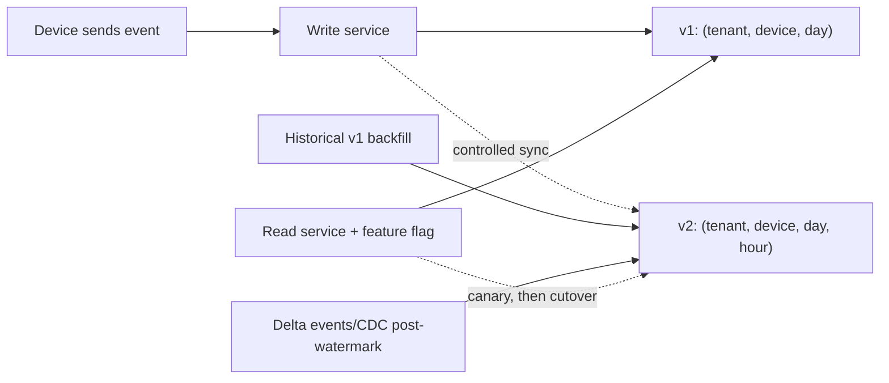
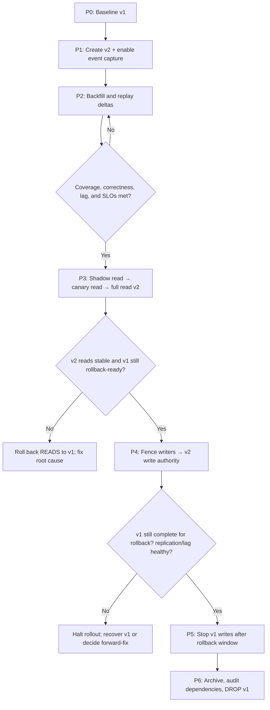
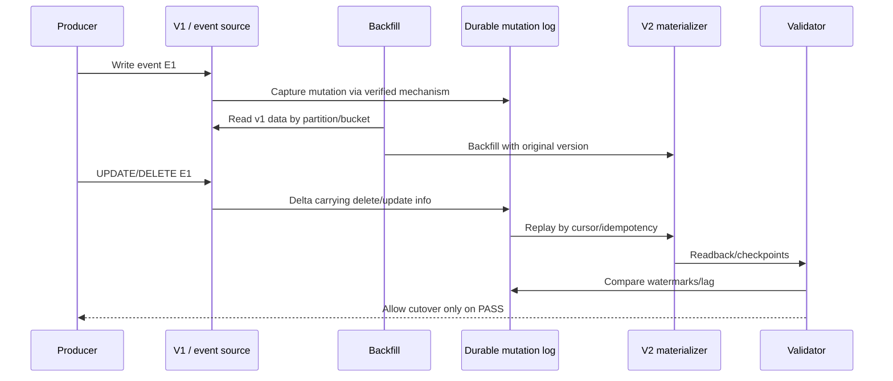

# Planned Read/Write Cutover, Rollback, and Old Table Retirement

> **Chapter:** Migration and Schema  
> **Module:** `DATABASE_ENGINE_WIDE_COLUMN_CASSANDRA` — Apache Cassandra

When an Apache Cassandra table grows too large, develops hot partitions, or no longer fits business queries, the standard solution is **creating a new query-driven table**, migrating historical data (*backfill*), synchronizing mutations arriving during migration, and **cutting over** (*cutover*) the application from the old table to the new one. The hard part is not merely running `CREATE TABLE` or copying rows, but answering:

- When is it safe to **read from the new table** without returning missing or stale data?
- When can you **shift writes** to the new table while still keeping a rollback path?
- If the migration fails midway, can you flip a feature flag back immediately?
- When is the old table **truly unused by all apps, jobs, and recovery workflows** and safe to drop?

Cassandra is a distributed *wide-column* database: the **partition key** hashes to a token selecting replicas, **clustering keys** determine sort order inside a partition, and **replication factor (RF)** plus **consistency level (CL)** govern latency and availability. Changing a primary key or bucket is not a simple column rename—it changes data distribution, read paths, write paths, compaction, repair, and streaming costs across nodes and DCs.

This lesson builds a **gated v1 → v2 workflow**, covering data architecture, CQL, Java Driver 4.x, watermarks/delta replay, phase-specific rollbacks, metrics, incident runbooks, and criteria to *retire/drop* the old table. Any create/drop commands in examples are strictly for labs or approved changes; **never run `DROP TABLE` in production** until every retirement condition is satisfied.

## 1. Why a new table is needed instead of ALTER TABLE

Suppose a telemetry system records events by device and day, and the old table develops oversized partitions when one device emits millions of events per day. The new application must look up events by **tenant, device, day, and hour** to serve one-hour window APIs.

The old table puts an entire day into one partition:

```sql
-- Assumes the telemetry keyspace already uses NetworkTopologyStrategy.
CREATE TABLE IF NOT EXISTS telemetry.events_by_device_day_v1 (
    tenant_id text,
    device_id text,
    event_day date,
    event_at timestamp,
    event_id uuid,
    payload text,
    PRIMARY KEY ((tenant_id, device_id, event_day), event_at, event_id)
) WITH CLUSTERING ORDER BY (event_at ASC, event_id ASC);
```

The new table adds an **hour bucket** to the partition key, computed by the app from `event_at` in UTC:

```sql
CREATE TABLE IF NOT EXISTS telemetry.events_by_device_hour_v2 (
    tenant_id text,
    device_id text,
    event_day date,
    event_hour tinyint,
    event_at timestamp,
    event_id uuid,
    payload text,
    PRIMARY KEY ((tenant_id, device_id, event_day, event_hour),
                 event_at, event_id)
) WITH CLUSTERING ORDER BY (event_at ASC, event_id ASC);
```

In v1, the partition key is `(tenant_id, device_id, event_day)`; in v2, it is `(tenant_id, device_id, event_day, event_hour)`. The exact same event may now map to a **different token and replica set**. With v2, an API viewing an entire day must query **up to 24 hour buckets** and merge them boundedly. If a single device still runs too hot within one hour, add sharding; design around **real load distribution** rather than assuming adding one key column solves everything.

**CQL boundary:** Apache Cassandra does not support `ALTER TABLE` to modify primary keys or arbitrarily convert column types like an RDBMS. `ALTER TABLE ADD` adds regular columns, yet **cannot alter an existing partition key**. Changes like this example require **a new table + data and query migration pipelines**. Likewise, never use `RENAME` on primary-key columns hoping to redistribute tokens; that does not change partitioning.



### Requirements to lock down before writing migration code

| Requirement | Questions to answer |
| --- | --- |
| **Correctness** | Are events immutable? Are there updates, deletes, TTLs, or late arrivals? |
| **Identity key** | Is `event_id` stable across retries/backfills? Can duplicate payloads carry different IDs? |
| **Timestamps** | Does device or server set `event_at`? Can events fall outside the current UTC hour? |
| **Performance** | Partition size p99/max, read/write QPS, bucket fan-out, and p99 SLOs? |
| **Consistency** | What are RF/CL/DC? How much v2 projection lag is acceptable? |
| **Rollback** | Do we want rollback of **reads only** or also **authoritative writes**? For how long? |
| **Retention** | TTL/default TTL, tombstones, GDPR/legal deletes, backup duration, and old-table retention? |
| **Ownership** | Who owns producers, event logs, backfills, Java clients, dashboards, runbooks, and DROP authority? |

A plan missing answers for **deletes, timestamps, and rollback windows** is not ready for production even if the v2 table already exists.

## 2. Standard phases: prepare → sync → switch reads → switch writes → soak → retire

There should never be a single `MIGRATE_ALL` button. Split the rollout into phases with **explicit read/write ownership**:

| Phase | Default read source | Write authority | v1 table | v2 table | Rollback via flag? |
| --- | --- | --- | --- | --- | --- |
| **P0 — Baseline** | v1 | v1 | Serves reads/writes | Does not exist | No cutover yet. |
| **P1 — Create & capture** | v1 | v1 | Normal | Created, receiving events/deltas or ready | Yes, while v1 never stopped. |
| **P2 — Backfill & shadow** | v1 | v1 | Normal | Backfill + delta; shadow reads | Can disable shadow/v2, preserving v1. |
| **P3 — Read canary/cutover** | v2 for selected cohort | v1 still authoritative | Receives writes; keeps read rollback | Serves live reads while catching up | **Yes**, if v1 stays complete and accurate. |
| **P4 — Write authority switch** | v2 | v2 authoritative; v1 may stay mirrored for rollback | Mirror/fallback only if fidelity holds | Receives all canonical mutations | **Conditional**, no longer a simple flag. |
| **P5 — Retire v1 writers** | v2 | v2 | Read-only or frozen | Fully serving | **No** simple revert once v2-only writes exist. |
| **P6 — Archive/Drop v1** | v2 | v2 | Snapshotted/backed up, then dropped with approval | Primary | Requires **restore/reverse migration**, no hot rollback. |

**Meaning of "source of truth":** the authoritative business store that settles discrepancies when two tables differ—Cassandra **does not** automatically know one table is primary and another is secondary. Authority must be enforced by **app data flows, event logs, timestamp rules, and operations**.



**Never reorder phases arbitrarily:** switching reads to v2 before backfill/deltas complete exposes missing rows to users. Switching writes to v2 and stopping v1 before designing write rollback makes flipping a flag back to v1 lose visibility of recent valid writes.

## 3. The hardest part: backfilling amid inserts, updates, and deletes

A migration does not just copy current rows. While backfill runs for hours or days, producers keep mutating data:

- New events land in v1 after a worker already scanned that partition.
- Clients update payloads, modify columns, or send late-arriving events.
- Cleanup jobs delete events per policy; tombstones carry timestamps.
- Cell TTLs approach expiration or expire between read and re-insert.
- A retry to v1 actually succeeded while the client timed out and resent.
- CDC consumers or backfill workers restart and replay already-processed ranges.

### 3.1. You cannot simply "scan v1 once and flip"

Simple example:

```text
09:00  Backfill reads event_id=E, payload="A" from v1
09:01  App updates E to payload="B" on v1
09:02  Backfill writes payload="A" to v2
09:03  App switches reads to v2
=> v2 may return "A" even though v1 holds "B"
```

If historical copy uses a **new timestamp generated at backfill time**, stale mutation `A` can **beat** valid mutation `B` in v2. A regular `source_version` column helps auditing, yet **does not automatically make Cassandra compare versions on that column**: Cassandra resolves cells by storage timestamp, not arbitrary regular-column version numbers.

If backfill reads **only live rows**, it also **misses DELETE tombstones**, potentially resurrecting deleted records in v2. You need a **delta stream including deletes** or a stable write barrier—not just CQL reads from v1.

### 3.2. Snapshot/backfill + delta stream model

A sound structure:

1. Establish a **durable event source** (outbox/event log/CDC consumer) capturing all relevant INSERT/UPDATE/DELETE mutations, starting **before** baseline/backfill begins.
2. Persist **watermarks/cursors** per shard/partition of the event source so you know which events applied to v2.
3. Backfill historical keys/ranges from an explicit inventory using **idempotent** writes honoring source versions/timestamps/TTLs.
4. Continue applying deltas during backfill; consumers must process **tombstones/deletes, updates, and new rows**.
5. Once all keys finish backfilling and delta lag drops below threshold, run **reconciliation** across the processed scope.
6. Close the gate only after proving zero gap between **snapshot/backfill start** and **delta capture start**, with zero unapplied stuck events.



This diagram shows **logical architecture**. Two Cassandra writes `INSERT v1` + `INSERT outbox` in **different partitions** do not automatically form an isolated transaction. When zero lost deltas are required, choose an event-first durable log or a tested capture pipeline with replay and reconciliation. If the business lacks a reliable delta stream, you may need a **short write freeze**, final backfill, verification, and flip. Never claim "dual-write is atomic" just because you wrapped it in `BATCH`.

### 3.3. Cassandra CDC: useful, not a complete message bus

Apache Cassandra supports **Change Data Capture (CDC)** on compatible releases: enable node options and `cdc=true` on the table, paired with a consumer processing **commit-log segments**. CDC is node/segment-local; operations must handle offsets, durability, replays, disk capacity, and restarts.

```sql
-- Apply only in a LAB with an active CDC consumer and proper node config.
ALTER TABLE telemetry.events_by_device_day_v1 WITH cdc = true;
```

**Operational risk:** Apache docs explicitly warn against enabling CDC **without an active consumer**. When `cdc_raw` hits its configured limit, writes to CDC-enabled tables may be blocked/rejected depending on version and config. CDC also **does not provide** a cluster-wide consistent snapshot, consumer exactly-once semantics, automatic transformation to v2 schemas, or infinite retention.

Mandatory CDC tasks: distinguish source nodes/mutations, deduplicate, preserve per-key ordering, propagate tombstones, commit cursors **after** successful apply, monitor missing segments, track checkpoints/lag, and maintain a reprocess workflow. If CDC starts after migration began, use an **overlap window** or reconciliation to close the gap.

## 4. Idempotency, timestamps, TTLs, and tombstones as cutover prerequisites

### 4.1. Rewriting must never generate random new records

For immutable events, v2 reuses the same `event_id` and clustering key semantics as v1. Backfills/replays may resend an event, overwriting the same primary key and payload. **Never generate a fresh random UUID on retries**; doing so creates duplicate rows and corrupts counts.

However, `INSERT` idempotency still depends on **timestamps and TTLs**:

- If retries generate fresh coordinator timestamps, late replays can override other mutations unexpectedly.
- Supplying a deterministic `USING TIMESTAMP` per event/version stabilizes server reconciliation, though **deletes and concurrent updates** still need explicit rules.
- Reapplying relative TTLs on retry **extends expiration**. To keep original deadlines, compute from an absolute `expires_at` and **skip** already-expired records.
- `USING TTL 0` means **no TTL** (per CQL semantics), not immediate expiration.

### 4.2. LWW is not a business version check

Example of two writes to the same cell in v2:

```text
live source update:   payload=B, timestamp=200
stale backfill:       payload=A, timestamp=300 generated from backfill's "now"
Result on v2:         A beats B — WRONG even though backfill ran LATER.
```

If the business has a **per-key monotonic version**, you can map versions consistently to mutation timestamps (tested carefully) or apply mutations via a consumer with **single-writer per-key ordering** and version checks. A plain `version bigint` column cannot serialize concurrent CQL writes without conditional logic.

**Never stamp far-future timestamps** just to "overwrite everything old": they mask valid post-cutover mutations for years. If ordering cannot be guaranteed, consider a temporary **write fence** and reconciliation before flipping.

### 4.3. Deletes/tombstones are mutations that must migrate

For mutable data, a DELETE in v1 must take effect in v2 **under the new primary key**. Once an event is deleted from v1, a backfill scanning only live rows cannot tell what to delete in v2. You need reliable mutation history or business-source reconciliation.

```sql
-- Illustrative CQL deleting the EXACT row in v2. LAB only:
DELETE FROM telemetry.events_by_device_hour_v2
WHERE tenant_id = 'tenant-a'
  AND device_id = 'sensor-07'
  AND event_day = '2026-11-21'
  AND event_hour = 9
  AND event_at = '2026-11-21T09:15:00Z'
  AND event_id = 11111111-1111-4111-8111-111111111111;
```

**Critical requirement:** to delete the exact v2 row, the consumer must know `event_hour` and `event_at` **of the deleted row**. If a delete event carries only `event_id` with no lookup by ID, Cassandra cannot magically route to the v2 partition; maintain metadata or a lookup table.

Never run `nodetool repair` expecting to sync **two differently structured tables**: repair reconciles **replicas of the same table/token ranges**, not v1-to-v2 transformations. Avoid lowering `gc_grace_seconds` while migration lags, which risks zombie resurrection.

## 5. Planning backfill: partition properly, avoid unbounded scans

### 5.1. Build the inventory first

Obtain a readable list of v1 partitions/buckets—such as `tenant_id`, `device_id`, and `event_day` from an existing catalog/event index—without assuming Cassandra supports full-table SQL `WHERE event_day BETWEEN ...` scans.

One worker reads **one known partition**:

```sql
SELECT event_at, event_id, payload
FROM telemetry.events_by_device_day_v1
WHERE tenant_id = 'tenant-a'
  AND device_id = 'sensor-07'
  AND event_day = '2026-11-21'
  AND event_at >= '2026-11-21T09:00:00Z'
  AND event_at < '2026-11-21T10:00:00Z';
```

To backfill a full month, orchestrate workers across **explicit partitions**, never cluster-wide `SELECT *`. Without a partition-key catalog, use a dedicated I/O-budgeted token-range scan or upstream export. **Never** run ad-hoc `ALLOW FILTERING` loops in production.

### 5.2. Chunk work into resumable units

| Checkpoint field | Meaning |
| --- | --- |
| `migration_id` | Change identifier distinguishing multiple backfill runs. |
| `source_partition` / range | Partition/bucket or token-range work unit. |
| `page_state` / cursor | Continuation point within a task per driver/statement contract. |
| `source_snapshot_id` / log watermark | Boundary linking baseline and delta stream. |
| `last_event_version` | Per-key version/timestamp where ordering is guaranteed. |
| `attempts`, `status`, `error_type` | Bounded resume/retries and failure diagnostics. |
| `started_at`, `verified_at` | Task age and evidence timestamps. |
| `checksum/hash` / sample IDs | Auditable verification evidence. |

**Note on paging state:** Java Driver paging state is not an immutable, eternal cursor or transactional snapshot. While data mutates, base checkpoints on **clustering sort keys and business watermarks** wherever possible rather than hoarding a paging-state blob across days and upgrades.

### 5.3. Backfill must respect resource budgets

Track v1 read QPS, v2 write QPS, app p95/p99, coordinator timeouts, `PendingCompactions`, free disk, network, and repair. Backfill can trigger **read amplification on v1 and write/compaction load on v2** simultaneously; at RF=3, every new write replicates across replicas.

Start with low concurrency, cap rates **per DC/node and per hot tenant**, and scale up only within SLO headroom. Pause whenever queues/latency breach thresholds. Never stack cluster-wide full repairs, bulk backups, and full backfills over thin WAN links.

## 6. Shadow reads and v2 verification criteria

**Shadow reading** means the app continues serving v1 responses while querying v2 on selected requests and **comparing results without returning v2 data to clients**. The goal is catching bugs before shifting real traffic.

### Reconcile by contract, not just row counts

| Check | Why it matters |
| --- | --- |
| **Event ID set** per hour window | Detects misses/duplicates from mapping or late arrivals. |
| **Payload and clustering order** | Confirms identical query logic after partition-key changes. |
| **TTL/retention** | Ensures v2 does not serve expired or legitimately deleted events. |
| **Updates/deletes near backfill time** | Proves delta sync dropped zero concurrent mutations. |
| **Empty-result queries** | Catches deleted rows resurrected improperly. |
| **Tenant isolation** | Ensures v2 never leaks rows across tenants with new key parts. |
| **p95/p99 latency and timeouts** | Prevents shipping accurate data with broken SLAs. |
| **RF/CL/DC health** | Confirms both v1/v2 have healthy replicas in every serving DC. |
| **Backfill coverage and delta lag** | Verifies all scoped partitions completed and watermarks converged. |

Never compare only table-wide `COUNT(*)`. Cassandra must scan widely to count, and equal counts never prove **matching keys, payloads, and deletes/TTLs**. Prefer **per-partition/per-hour** comparisons, versioned canonical checksums, deterministic sampling, and deletion-event audits.

**Near-real-time windows:** if v2 carries an accepted lag (say, a few seconds), never fire requests simultaneously at t0 and call lag a bug. Tie comparisons to **watermarks/offsets**: compare once both paths applied through the same version. For critical workloads, cut reads over only once lag meets the freshness SLO.

### Sample quantitative gate

```text
GATE R (read cutover readiness) — customize per system
- source partitions inventoried and backfill checkpoint complete
- durable delta stream captures inserts, updates, deletes since baseline
- no uncovered CDC gaps / missing event segments
- v2 lag p99 below agreed freshness SLO (e.g. 5 seconds)
- exact match of critical sampled event_id/payload/expiry at same watermark
- no mismatch in cross-tenant access tests
- v2 read p99 and errors within SLO at peak representative load
- repair/compaction/disk/network headroom healthy
- fallback to v1 rehearsed while v1 remains current
- owner / change ticket approval: PASS
```

Numbers shown are **not Cassandra defaults**. Payments may tolerate zero seconds of staleness, whereas analytics may tolerate minutes. Lock down business SLAs first.

## 7. READ cutover: shadow → canary → ramp → 100%

Control read cutover through **application feature flags**, scoped cleanly by service, tenant, or DC. Never flip the entire system at once just because a few shadow requests matched.

### Recommended progression

1. **0% user-facing shadow:** all responses come from v1; a bounded sample queries v2 and emits masked mismatch metrics.
2. **1–5% canary** on approved test tenants/cohorts: return v2 while monitoring p99, errors, correctness, and lag.
3. **Checkpointed ramp:** 10% → 25% → 50% → 100% across representative traffic windows, avoiding unstaffed peak windows.
4. **Keep v1 accurate:** during P3, authoritative writes still target v1 while v2 receives deltas. That keeps **read-route** rollback to v1 straightforward.
5. **Evaluate per DC:** clients in `dc2` may observe lagging replicas even while `dc1` looks healthy; verify `LOCAL_QUORUM`/RF and probe from every serving DC.

**Never use automatic v2 → v1 read fallback to mask data bugs** on delete, permission, or retention queries. If v2 returns *not found* because an event was legitimately deleted, falling back to v1 **exposes deleted data**. Allow fallback only under explicit freshness/semantics contracts, with alerts and tight bounds.

### Post-canary stop signals

| Signal | When to STOP / roll back reads? |
| --- | --- |
| Key/payload mismatch at matching watermark | Any critical data mismatch above approved budget. |
| Cross-tenant leak or deleted row reappearing | **STOP immediately**; treat as security/correctness incident. |
| v2 p99 breaches SLO and trends upward | Halt ramp; revert reads to v1. |
| Delta lag climbs steadily past freshness budget | Halt cutover; inspect consumers/CDC. |
| Dangerous disk/compaction/repair backlog | Shed v2 read/backfill load; protect cluster health. |
| A DC lacks schema agreement or healthy replicas | Do not open cutover in that DC. |

When rolling back reads, **do not immediately delete v2**: preserve data, logs, and checkpoints for diagnosis while keeping v2 updated if safe so you avoid re-backfilling from scratch.

## 8. WRITE cutover: the boundary where flag rollback ends

The riskiest step is not switching `SELECT` queries, but **switching the authoritative write target**.

### 8.1. Why naive "write both tables" dual-write is not atomic

An application might attempt:

```text
write(v1) => success
write(v2) => timeout/unknown
return success?  => v2 may be missing the row
return failure?  => v1 already persisted; retries may duplicate side effects
```

Cassandra supports `BATCH` in specific cases, yet **batches do not provide multi-partition RDBMS transaction isolation**. Since v1 and v2 have different primary keys, they likely hash to different token partitions and replica sets. Packing both into a logged batch does not deliver a complete cutover contract or solve driver timeouts, TTLs, duplicates, and timestamp races.

**Preferred approach:** designate one authoritative write pipeline with clear semantics—a durable event log, producers with stable event IDs, tested CDC/outbox, and materializers for v1/v2. Then define **the write-authority switch moment** and **fence** legacy producers.

### 8.2. Fencing: stopping stale writers from writing late

Across multiple Java instances, once a feature flag flips to v2, an older pod may hold stale config, a legacy cron job may still write v1, or a lagging queue consumer may emit out-of-order writes. Without fencing, cutover creates **application-tier split-brain**.

A write-authority switch runbook requires:

1. Enforcing a durable **migration epoch** or config version validated on writes.
2. Pausing/throttling ingest or buffering into a durable queue across the switch window when business rules allow.
3. Draining queues to the chosen watermark; confirming pre-cutoff events applied to v2.
4. Switching **single writer authority** to v2, disabling legacy writers or routing them solely through the canonical endpoint.
5. Verifying write-after behavior across **all client versions and DCs**, including retries and late arrivals; confirm zero unauthorized v1 writes.
6. If write rollback is promised, continuously running a **v2 → v1 mirror** with full semantic parity and reverse reconciliation.

That last condition is crucial: **can v1 even represent every new v2 mutation?** If v2 introduces event types v1 lacks, or v1 expires data sooner under retention, lossless rollback to v1 is impossible even with a mirror running.

### 8.3. Decision table for WRITE rollback

| State | Action when v2 fails |
| --- | --- |
| **Before write authority switch** (P0–P3) | Flip read flag back to v1; v1 is still authoritative, fix/rebuild v2. |
| **Right after switch, v1 mirrored completely with evidence** | Can revert write authority to v1 **after fencing v2 writers**, draining the mirror, and verifying matching watermarks. |
| **v2 holds v2-only writes** | **Never flip back to v1** before reverse-backfilling/replaying missing writes, even if v1 serves most older data. |
| **v2 uses schemas/features unrepresentable in v1** | Requires forward-fix or a custom rollback accepting explicit data loss/translation. |
| **v1 already dropped** | No hot rollback; restore schema/data from backups or build a new table. |

### Sample WRITE gate closure criteria

```text
GATE W (write authority cutover) — signed approval
- all writer instances and batch jobs inventoried
- durable event stream / CDC history continuous, no unknown gap
- v2 read validation passed at agreed watermark
- all mutation types mapped (insert/update/delete/TTL/late writes)
- migration epoch/fencing enforced; old writers cannot write after switch
- rollback route and reverse sync tested OR owner accepts forward-only change
- v1 mirror complete for the rollback window if rollback is promised
- retry/idempotency rules tested for write timeouts
- latency/error, resource budgets and paging on-call ready
- go/no-go decision recorded with UTC timestamp
```

Without **Gate W**, promising "single-flag read/write cutover" is dangerous.

## 9. Java Driver 4.x: applying the new schema with query templates and feature flags

The snippets below illustrate **immutable events**, two read routes over one UTC hour, and a v2 write materializer. They **do not** implement atomic dual-write or a durable event log, nor handle counters/LWTs/deletes directly. In production, consumers ACK event cursors only after v2 writes succeed and checkpoint durably.

### 9.1. Reading v1 or v2 for **one specific hour**

```java
import java.time.Instant;
import java.time.LocalDate;
import java.time.ZoneOffset;
import java.util.ArrayList;
import java.util.List;
import java.util.UUID;

import com.datastax.oss.driver.api.core.CqlSession;
import com.datastax.oss.driver.api.core.DefaultConsistencyLevel;
import com.datastax.oss.driver.api.core.cql.PreparedStatement;
import com.datastax.oss.driver.api.core.cql.Row;

public final class EventHourReader {
    public enum ReadRoute { V1, V2 }

    private final CqlSession session;
    private final PreparedStatement queryV1;
    private final PreparedStatement queryV2;

    public EventHourReader(CqlSession session) {
        this.session = session;
        this.queryV1 = session.prepare(
            "SELECT event_at, event_id, payload " +
            "FROM telemetry.events_by_device_day_v1 " +
            "WHERE tenant_id=? AND device_id=? AND event_day=? " +
            "AND event_at >= ? AND event_at < ? LIMIT 100");
        this.queryV2 = session.prepare(
            "SELECT event_at, event_id, payload " +
            "FROM telemetry.events_by_device_hour_v2 " +
            "WHERE tenant_id=? AND device_id=? AND event_day=? " +
            "AND event_hour=? AND event_at >= ? AND event_at < ? LIMIT 100");
    }

    public List<UUID> sampleIds(
            String tenantId, String deviceId,
            Instant fromUtcInclusive, ReadRoute route) {
        // Contract: window [from, until) spans one exact UTC hour;
        // from must align to hour start so only one v2 partition is hit.
        if (fromUtcInclusive.atOffset(ZoneOffset.UTC).getMinute() != 0
                || fromUtcInclusive.atOffset(ZoneOffset.UTC).getSecond() != 0
                || fromUtcInclusive.getNano() != 0) {
            throw new IllegalArgumentException("Must start at UTC hour");
        }
        Instant untilUtcExclusive = fromUtcInclusive.plusSeconds(3600);
        LocalDate day = fromUtcInclusive.atZone(ZoneOffset.UTC).toLocalDate();
        byte hour = (byte) fromUtcInclusive.atZone(ZoneOffset.UTC).getHour();

        PreparedStatement q = route == ReadRoute.V1 ? queryV1 : queryV2;
        var bound = route == ReadRoute.V1
            ? q.bind(tenantId, deviceId, day,
                     fromUtcInclusive, untilUtcExclusive)
            : q.bind(tenantId, deviceId, day, hour,
                     fromUtcInclusive, untilUtcExclusive);

        List<UUID> ids = new ArrayList<>();
        for (Row row : session.execute(
                bound.setConsistencyLevel(DefaultConsistencyLevel.LOCAL_QUORUM)
                     .setIdempotent(true))) {
            ids.add(row.getUuid("event_id"));
        }
        return ids;
    }
}
```

**Limits of this reader:** `LIMIT 100` suits **controlled sampling**, not proving all events in the hour migrated; full reconciliation requires dedicated paging/cursors. If a real API needs an entire day, query the **valid hour buckets** and merge by `(event_at, event_id)` with fan-out/in-flight caps to avoid wide scans.

### 9.2. v2 materializer for immutable events

```java
import java.time.Instant;
import java.time.LocalDate;
import java.time.ZoneOffset;
import java.util.UUID;

import com.datastax.oss.driver.api.core.CqlSession;
import com.datastax.oss.driver.api.core.DefaultConsistencyLevel;
import com.datastax.oss.driver.api.core.cql.PreparedStatement;

public final class V2EventMaterializer {
    private final CqlSession session;
    private final PreparedStatement insertV2;

    public V2EventMaterializer(CqlSession session) {
        this.session = session;
        this.insertV2 = session.prepare(
            "INSERT INTO telemetry.events_by_device_hour_v2 " +
            "(tenant_id, device_id, event_day, event_hour, " +
            "event_at, event_id, payload) VALUES (?, ?, ?, ?, ?, ?, ?) " +
            "USING TIMESTAMP ?");
    }

    public void applyImmutableEvent(
            String tenantId, String deviceId, Instant eventAt,
            UUID eventId, String payload, long approvedWriteTimeMicros) {

        LocalDate day = eventAt.atZone(ZoneOffset.UTC).toLocalDate();
        byte hour = (byte) eventAt.atZone(ZoneOffset.UTC).getHour();

        session.execute(insertV2.bind(
                tenantId, deviceId, day, hour,
                eventAt, eventId, payload, approvedWriteTimeMicros)
            .setConsistencyLevel(DefaultConsistencyLevel.LOCAL_QUORUM)
            .setIdempotent(true));
    }
}
```

**Preconditions for this materializer to be valid:**

- `eventId`, `payload`, `eventAt`, and `approvedWriteTimeMicros` come from a **trusted source and stay fixed across retries**. Never generate fresh timestamps per retry.
- This example uses **no TTL**; to preserve original retention, derive remaining TTL from `expires_at` and use matching CQL. Re-inserting with a fresh TTL without checking original expiry extends lifetime improperly.
- This applies only to **immutable, never-deleted** events. With updates, deletes, or corrections, build a materializer enforcing **explicit mutation order and tombstones**, never blindly re-INSERTing old values.
- Consumers must bound in-flight requests, track CL timeouts/unavailables, maintain dead-letter queues and safe replays, and **never ACK event logs before v2 writes succeed** per delivery contract.
- `LOCAL_QUORUM` ensures local-DC quorum per RF, **not** cluster-wide synchronization across all replicas/DCs. Repair schedules and monitoring remain necessary.
- `setIdempotent(true)` holds under the **immutable-event + fixed-timestamp constraints** above; never apply it to `counter + 1` or side-effecting writes.

## 10. Phase-specific rollback: four distinct procedures

A single "flip the flag OFF" checklist is insufficient. Each phase has different data-authority boundaries.

### RB-R1 — Rollback during P1/P2 (v1 still serves reads/writes)

1. Stop backfill workers and v2 materializer consumers—**do not** stop v1 producers.
2. Verify apps still read/write v1 at original CL with zero v2 queries in the hot path.
3. Preserve v2 and checkpoints for diagnostics, recording unprocessed gaps/deltas; do not drop v2 before investigating.
4. When retrying migration, backfill/replay idempotently from checkpoints without stamping stale values with newer timestamps.

**Fast rollback is safe** because v1 never lost write authority.

### RB-R2 — READ rollback during P3 (v1 write authority)

1. Disable the v2 read flag per cohort/DC, avoiding config skew across app instances.
2. Confirm v1 remains complete and was not stripped of v2-present data by new TTL/cleanup policies.
3. Monitor p99/errors and sample keys from v1 post-rollback.
4. Keep v2 delta capture running if planning to fix and re-roll out, with an owner watching lag.
5. Close the incident only once user-facing errors subside and mismatches are isolated.

**Warning:** if any P3 write accidentally went only to v2, this is **no longer** a simple READ rollback.

### RB-R3 — WRITE rollback after P4 (v2 already canonical)

1. **Close the new write gate** or divert events into a durable buffer; never let two write authorities run concurrently.
2. Use migration epochs/fencing to block stale v2 writers after switching.
3. Verify the **v1 mirror received every v2 mutation**, including DELETEs, TTLs, and late events, with zero lag past the final watermark.
4. If v1 missed any data, run **reverse-replay/reconciliation** from verified event sources before restoring v1 write authority.
5. Confirm v1's schema can still represent every record; if not, **rollback is unsafe**—use a forward-fix or an approved alternative.
6. Re-enable v1 writes by cohort while monitoring duplicates/misses/latency, keeping v2 intact for investigation.

Skipping steps 3–4 and merely flipping a flag risks **losing visibility of valid post-cutover writes**. If the system already emitted v2-only event types, lossless rollback is impossible even if v1 tables remain intact.

### RB-R4 — After P5/P6 (v1 frozen or DROPPED)

At this point **no hot rollback exists**. Returning to v1 requires:

- Restoring v1 schema and data from verified backups with manifests/checksums.
- Replaying mutations occurring **since v1 backup/stop** back into v1 if schema permits.
- Reconciling TTLs/deletes/updates against authoritative sources without resurrecting tombstones or overwriting valid events.
- Running read/write probes, checking RF/CL/DCs, and upgrading clients before reverse cutover.

If no source exists to rebuild, choose a **v2 forward-fix**. Replace promises of "rollback after DROP TABLE" with "**restore/rebuild** under defined RPO/RTO."

## 11. When is it safe to stop v1 writes?

A common mistake is **"v2 reads look good → stop v1 immediately to save write cost."** Once v2 holds write authority, stopping v1 mutations widens the **rollback gap** every minute.

Before stopping v1 writes, confirm all of the following:

- The **rollback window** has elapsed; business and operations accept that hot rollback is no longer available.
- Zero clients, batch jobs, ETLs, reports, DR pipelines, CDC consumers, or legacy APIs still **read v1**.
- Independent v2 backups, restore drills, and RPO/RTO policies are active—never treat v1 as a disguised backup.
- All v2 mutations/late events process cleanly with no pending v1 mirror backlog needed for rollback.
- Security/data-retention requirements for keeping vs. dropping v1 are reviewed; retaining duplicated sensitive data too long increases exposure.
- v2 has weathered multiple peak-load, repair, node-restart, GC, and compaction cycles with stable SLOs.

**Make stopping v1 writes explicit** in deployment configs and dashboards (`v1_write_enabled=false`, an **application setting**, not a Cassandra option). Afterward, monitor mutation/traffic attempts against v1 to catch overlooked writers.

### "Silent" tables do not prove zero dependencies

Seven days of zero queries on v1 does not guarantee safety if a **month-end** batch job or disaster-recovery script only runs occasionally. Obtain **owner-signed inventories** covering services, scheduled jobs, notebooks, BI/reporting, cache warmers, credentials/roles, CDC/backups, and restore procedures. Use authorized Java Driver metrics or scoped audit logging if needed—never turn on unbounded raw FQL just to hunt legacy readers.

## 12. When is it safe to retire the old table? Gated DROP procedure

`DROP TABLE` is not a "quick disk-cost saving" right after v2 hits production. Cassandra removes the table's schema and logical data; `auto_snapshot` may help depending on config, yet **guarantees neither instant restore nor off-cluster backup**.

### 12.1. Quarantine / deprecation phase

1. Mark `events_by_device_day_v1` **deprecated** in your organizational catalog and change tickets (not a CQL keyword).
2. Replace all v1 query templates in code, crons, data jobs, and dashboards; verify whether old mobile/desktop API clients still invoke v1 paths.
3. Revoke v1 write privileges **with approval** and monitor for stray writers, avoiding breaking unmigrated accounting/recovery jobs.
4. Keep v1 **read-only** through a quarantine window long enough to catch infrequent readers and satisfy rollback/retention.
5. Take snapshots per procedure, copy off-DC to remote storage, verify manifests/schemas/checksums, and rehearse restoring **a sample of partitions** onto an isolated cluster.
6. Verify deletes/TTLs/legal holds and privacy policies; if v1 contains data slated for deletion, purge backups per retention rules too.

### 12.2. Final gate to DROP

```text
GATE D (Drop old table) — destructive operation, needs approval
- no client/service/BI/batch/DR/backup restore dependency on v1
- application versions requiring v1 are sunset and access confirmed
- v2 data coverage and correctness verified through retention cycle
- no outstanding delta gap, repair risk or data-reconciliation incident
- write authority v2 and all v1 writer paths disabled/fenced
- rollback window closed and restore RPO/RTO explicitly accepted
- v1 schema + snapshots backed up offsite; restore drill passed
- legal hold, privacy and data deletion policy checked
- change ticket, two-person approval and maintenance window recorded
- post-DROP schema, application, disk and audit checks planned
```

In production, **never execute DROP if any critical condition fails**. When in doubt about a consumer, delaying DROP is far cheaper than rebuilding v1 from backups during an outage.

### 12.3. Example commands and warnings

```bash
# Inspect before considering DROP (read-only commands):
nodetool status
nodetool describecluster
nodetool tablestats telemetry.events_by_device_day_v1
nodetool compactionstats
nodetool listsnapshots

# REQUIRES BACKUP POLICY and admin rights; snapshot applies only to
# the targeted node and must be coordinated across all nodes/ranges in plan.
nodetool snapshot --tag pre-retire-v1 --table events_by_device_day_v1 telemetry
```

```sql
-- DESTRUCTIVE command example for LAB or approved change ONLY.
-- Do not run unless GATE D passed; never auto-retry to "fix errors."
DROP TABLE IF EXISTS telemetry.events_by_device_day_v1;
```

**Important:**

- `IF EXISTS` merely suppresses errors if the table is absent—it **neither** makes the command safer **nor** provides rollback.
- Snapshots are typically hard links to SSTables on a node and pin disk usage; never treat local copies as offsite/DR backups.
- Post-DROP, nodes reclaim SSTable space according to version mechanics, yet **never promise instant free-disk gains equal to logical size**: snapshots, backups, and compaction/file lifecycles can pin bytes.
- Never run `nodetool clearsnapshot --all` as routine cleanup; it can wipe restore points for other tables or violate retention.
- Post-DROP, verify cluster schema agreement and zero v1 CQL queries; any "table not found" error signals an overlooked dependency—never "fix" it by creating an empty table with the old name.

## 13. Monitoring during migration: data, performance, and progress

A solid dashboard separates **migration progress** from **Cassandra health** and **business correctness**.

| Metric group | Examples | Action trigger |
| --- | --- | --- |
| **Backfill progress** | Partitions/ranges completed, bytes/hr, cursor age, retry counts | Stalled progress, repeated failures, overdue tasks. |
| **Delta/capture** | CDC lag, last offset/segment, missing segments, consumer restarts, DLQ size | Block read/write gates unless delta continuity is proven. |
| **Data validation** | Sample checksum diffs, missing event IDs, duplicate IDs, delete/TTL violations | Critical mismatches must STOP canary. |
| **Routing** | % v2 reads, % v2 writes, v1 write attempts, feature epoch/version spread | Stray legacy writers or uneven cross-DC ramp. |
| **Client SLOs** | Read/write p95/p99, timeouts, unavailables, retry rates, request rates | Roll back reads or throttle backfill if APIs degrade. |
| **Cassandra resources** | CPU, GC, free disk, IO await, `PendingCompactions`, `PendingFlushes` | Throttle backfill/deltas; pause ramping. |
| **Replica state** | `nodetool status`, keyspace RF, CL errors, repair coverage, hints | Halt cutover on quorum loss or dangerous repair/disk state. |
| **Multi-DC** | WAN traffic, cross-DC streaming/hints, per-DC v2 lag | Never judge health solely from the healthiest DC. |
| **Retention/security** | TTL mismatches, deleted rows reappearing, tenant boundary leaks | Correctness/security incident—halt immediately. |

### Why can a "right-looking" timestamp still hide a bug?

`WRITETIME(payload)` reads only the **current live cell's** timestamp in Cassandra; it reveals nothing about partition tombstones, range tombstones, expired TTLs, or update history. Business/CDC sources must retain metadata needed for reconciliation.

```sql
-- Read-only check using full partition key in LAB:
SELECT payload, WRITETIME(payload) AS write_time_us, TTL(payload) AS ttl_left_s
FROM telemetry.events_by_device_day_v1
WHERE tenant_id = 'tenant-a'
  AND device_id = 'sensor-07'
  AND event_day = '2026-11-21'
  AND event_at = '2026-11-21T09:15:00Z'
  AND event_id = 11111111-1111-4111-8111-111111111111;
```

Once `payload` is `DELETE`d, CQL returns no cell, and a backfill relying on current `SELECT` results **cannot reconstruct historical tombstones**. Always verify **delta capture includes deletes** before declaring completion.

### Never use one row count to judge data accuracy

If v1 has 1 million events and v2 has 1 million events, **the tables need not match**: 10,000 events could be missing while 10,000 others are duplicated. Validate by keys/hashes, deletion history, TTLs, partition distributions, and watermarks. On large tables, avoid full-table `COUNT(*)`; run bounded per-partition/bucket batch validations.

## 14. Incident troubleshooting: deciding STOP vs. proceed

### Incident A — v2 misses older events during READ canary

**Signal:** pre-cutover event IDs exist in v1 while v2 returns `null`; read SLOs look fine.

**Investigation:** UTC bucketing logic, inventory, skipped checkpoints, failed backfill workers, CDC gaps, TTL/do-not-restore policies, queries omitting `event_hour`. Inspect v2 endpoints/CL and sample keys across DCs.

**Action:** roll back the read cohort to v1 if v1 remains authoritative; halt ramp, keep v2, and reprocess from trusted sources. **Never** auto-fallback when data is absent due to a legitimate delete.

### Incident B — backfill "overwrites newer data with older values"

**Signal:** an event recently updated to payload `B` yet v2 returns `A`, with `WRITETIME` on v2 higher than the source event.

**Investigation:** worker generated current timestamps, source event version comparisons missing, or duplicate/out-of-order replays.

**Action:** pause risky backfill/delta workers, preserve evidence, fix version policies or use a write fence for final backfill. Reconcile all affected keys completely; never solve it with max timestamps.

### Incident C — v2 p99 degrades at 25% canary

**Signal:** v2 queries return right contents, yet disk reads or compaction spike and `LOCAL_QUORUM` times out.

**Investigation:** number of hour buckets queried per request, hot partitions, v2 write/compaction load, cache/memtable pressure, indexes, RF/CL, shadow read overhead.

**Action:** halt traffic ramp; reduce shadow sampling/backfill, optimize queries/buckets, or scale capacity cleanly. Before write-authority switch, rolling reads back to v1 is the safe move.

### Incident D — post-write-cutover writes exist only in v2

**Signal:** v1-only readers miss new events even though v2 has them and incident response requests rollback.

**Investigation:** whether a v2→v1 mirror was deployed, lag/failed mirror events, and whether v1 schema can represent new events.

**Action:** never flip back to v1 before reverse-reconciling or accepting RPO; enter write-controlled mode, measure impact scope, and let the owner decide forward-fix vs. reverse migration.

### Incident E — pressure to DROP early because disk is nearly full

**Signal:** node disks near capacity, v1 remains large, v2 already serves partial traffic.

**Investigation:** whether v1 readers/writers remain, whether snapshots/backups are verified, and whether disk pressure stems from v2 compaction/streaming.

**Action:** **never DROP v1 before Gate D passes**; resolve capacity safely by throttling backfill/streaming, rescheduling heavy I/O, or expanding disks. DROP is not an instant disk-full cure.

## 15. Complete go/no-go runbook

### Before P1 — design sign-off

- [ ] Confirm migration rationale and query-driven v2 table, partition sizing, and real RF/CL.
- [ ] Cover INSERT/UPDATE/DELETE/TTL/LWT/counter operations and authoritative version sources.
- [ ] Specify event IDs, v1→v2 mappings, timezone/bucketing, late arrivals, and tenant boundaries.
- [ ] Archive schemas, backup/restore drills, client/job/DC inventories, and owners.
- [ ] Establish reliable delta source, replay capability, and capacity controls (especially CDC).

### Before P3 — READ cutover

- [ ] Backfill coverage complete per inventory; **zero delta gaps**.
- [ ] v2 applied up to watermark meeting freshness SLO, handling deletes and expirations.
- [ ] Shadow/canary validation PASSES across keys, payloads, TTLs, and tenant isolation.
- [ ] v2 queries meet p99/error SLOs at peak without wide multi-partition scans.
- [ ] v1 still receives canonical writes; read rollback flag rehearsed.

### Before P4 — WRITE authority cutover

- [ ] All producers inventoried; legacy instances enforce fencing/version rejection.
- [ ] Durable buffer/event log checkpointed and pending events drained to barrier.
- [ ] Reverse v2→v1 sync/mirror tested **if write rollback is promised**.
- [ ] Timeout/duplicate errors follow idempotency rules; Java Driver avoids blind retries.
- [ ] On-call, rollback decision owner, stop conditions, and UTC timeline locked.

### Before P5/P6 — Retire/Drop

- [ ] v2 operated stably across full workload, retention, and maintenance cycles.
- [ ] Zero v1 reads/writes from services, batch jobs, BI, repair/DR pipelines, or legacy APIs.
- [ ] Stakeholders accept that hot rollback to v1 **is no longer guaranteed**.
- [ ] Offsite v1 backups, schema/manifest/checksums, and restore drills verified.
- [ ] Data retention, legal holds, privacy checks, and DROP approvals complete.
- [ ] Post-DROP alerts, schema agreement checks, and application verification ready.

**If any core item FAILS, hold the next gate**; report current phase and trusted data boundaries instead of forcing "completion" to hit a calendar deadline.

## 16. Case studies and self-check questions

**Q1.** Why can `ALTER TABLE` not convert partition key `(tenant_id, device_id, event_day)` into `(tenant_id, device_id, event_day, event_hour)`?

**Q2.** Full backfill of v1 finishes at 23:00 while live writes have continued since 20:00. Can you switch reads right when the job hits 100%? What delta evidence is required?

**Q3.** Backfill `INSERT`s into v2 carry current timestamps (newer than all prior mutations), while v1 took a valid update after the worker read that row. What risk arises?

**Q4.** Why is CQL `SELECT` returning only live rows in v1 insufficient to preserve historical `DELETE`s during migration?

**Q5.** A team wraps two `INSERT`s into v1/v2 inside a logged batch and claims dual-write now has SQL-like transaction isolation. Is that right?

**Q6.** v2 reads succeed in `dc1` at `LOCAL_QUORUM`, yet `dc2` times out. Should you enable 100% v2 reads cluster-wide? What would you check?

**Q7.** P3 serves 30% of reads from v2 while v1 remains write authority. If v2 p99 spikes, what is the simplest rollback and its prerequisite?

**Q8.** After P4, v2 took 50,000 new events while the v1 mirror failed on 10,000 events. Why is simply flipping a feature flag back to v1 reads/writes dangerous?

**Q9.** An event has `expires_at` on the 21st, is backfilled on the 20th, and retries after the 21st. Should it re-insert with `TTL 0`?

**Q10.** In P5, v1 sees zero queries for 10 days. Is that enough to DROP? Name three infrequent dependencies to verify.

**Q11.** `nodetool snapshot` ran on one node before DROP. Does that count as a cluster-wide backup allowing seconds-fast v1 restore?

**Q12.** Both v1 and v2 report roughly one million rows. How do you catch missing, duplicated, or wrongly deleted records despite nearly matching counts?

<details>
<summary>Suggested answers</summary>

1. Apache Cassandra forbids altering existing primary keys via `ALTER TABLE`. You need a new table and data remapping under the new key.
2. Not yet. Verify all mutations after backfill started (INSERT/UPDATE/DELETE/TTL) were captured/replayed with zero gaps, and lag/coverage pass Gate R.
3. Stale backfill writes with higher timestamps can overwrite valid v2 mutations; enforce source version/timestamp policies or write fencing.
4. Logical `SELECT` does not emit historical tombstones as delete events; if v2 holds an older copy, omitting delete replay resurrects the row.
5. No. Cassandra logged batches do not provide global multi-partition transaction isolation like an RDBMS and do not replace durable event logs/reconciliation.
6. No. Inspect `dc2` replicas/RF/CL, topology, schema, streaming, repairs, lag, and Java Driver local DC routing with a separate canary.
7. Flip the READ flag back to v1; safe only while v1 stayed write-authoritative, complete, and unaltered by destructive retention changes.
8. v1 is missing 10,000 valid mutations, so rolling back loses visibility of recent data; reverse-sync/accept RPO or forward-fix first.
9. No. `TTL=0` removes expiration, retaining the event beyond policy. Skip already-expired records; otherwise compute remaining TTL from the original deadline.
10. Not yet. Check month-end/quarter-end jobs, DR restore pipelines, BI exports, legacy app versions, and legal retention holds.
11. No. Snapshots are per-node/SSTable and neither guarantee full-cluster coverage, offsite storage, nor instant restore; use an orchestrator, manifests, and restore drills.
12. Reconcile by event ID/key, checksums/payloads, deletes/TTLs, and watermarks across partitions/buckets—not just aggregate counts.

</details>

## Key takeaways

- **Changing partition keys or query models usually requires a v2 table**; existing primary keys cannot be edited via `ALTER TABLE`.
- **Backfill alone is insufficient** while the source mutates: handle deltas via watermarks/CDC/event logs, including UPDATE/DELETE/TTL and retries.
- **READ cutover** rolls back to v1 via feature flags **only while v1 keeps receiving complete writes**. **WRITE cutover** requires fencing, clear source-of-truth rules, and reverse sync if true rollback is promised.
- **CQL batches do not provide multi-partition transaction isolation**; backfill-generated timestamps can beat newer updates, and tombstones/TTLs can mishandle deletes.
- **Retiring the old table is a destructive, gated change**: dependency inventories, offsite backups, restore drills, retention checks, closed rollback windows, and approvals.
- Measure success via **key-level reconciliation + lag + p99/CL/DC + repair/compaction health**, not merely "100% backfill" or matching row counts.

### References

- [Apache Cassandra — CQL DDL: ALTER TABLE, DROP TABLE, and primary keys](https://cassandra.apache.org/doc/stable/cassandra/developing/cql/ddl.html)
- [Apache Cassandra — CQL DML: TIMESTAMP, TTL, DELETE, and BATCH](https://cassandra.apache.org/doc/stable/cassandra/developing/cql/dml.html)
- [Apache Cassandra — Change Data Capture: configuration, consumers, disk limits](https://cassandra.apache.org/doc/stable/cassandra/managing/operating/cdc.html)
- [Apache Cassandra — Backups: snapshots and incremental backups](https://cassandra.apache.org/doc/stable/cassandra/managing/operating/backups.html)
- [Apache Cassandra — Repair: replica divergence](https://cassandra.apache.org/doc/stable/cassandra/managing/operating/repair.html)
- [Apache Cassandra — Tombstones and gc_grace_seconds](https://cassandra.apache.org/doc/stable/cassandra/managing/operating/compaction/tombstones.html)
- [DataStax Java Driver 4.x — Statements, idempotence, query options](https://docs.datastax.com/en/developer/java-driver/4.17/manual/core/statements/index.html)
- [DataStax Java Driver 4.x — Retries](https://docs.datastax.com/en/developer/java-driver/4.17/manual/core/retries/index.html)
