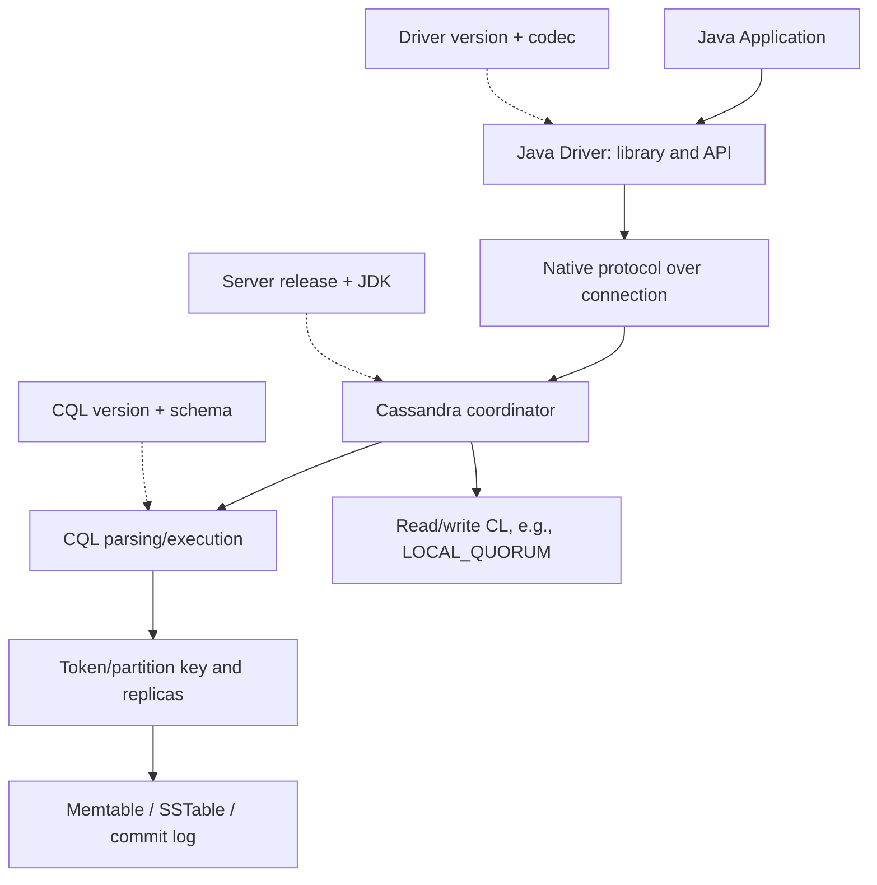

# Identifying Server, CQL, Native Protocol, and Java Driver Versions

> **Chapter:** Upgrades and Compatibility  
> **Scope:** Apache Cassandra, a *wide-column* distributed database, along with applications using CQL and the Cassandra Java Driver. This lesson distinguishes the versions of the **Cassandra server**, **CQL language**, **native transport protocol**, and **Java driver library** to prepare for upgrades, diagnose connection issues, and verify compatibility.
>
> **Learning Outcomes:** Collect the right four version types at each layer; understand the difference between **the protocol version supported by the server** and **the version actually negotiated by the driver on a connection**; check mixed-version status in a cluster; build a compatibility matrix, baseline, and testing runbook before upgrading Cassandra/Java.

## 1. The Problem: What Does "Cassandra Version 4" Mean?

A Java application is reading data by partition key with `LOCAL_QUORUM`. After swapping the driver library, some requests fail during the connection phase, while old CQL queries still run in `cqlsh`.

The operations team asks:

- Are the Cassandra nodes running **the same server version**, or are there nodes that have not been upgraded yet?
- Which **CQL version** does the server advertise?
- Is the native protocol supported by the server **v4, v5, or another version**?
- Is the application actually running **Java Driver 3.x, 4.x, or another artifact**?
- Does the **negotiated native protocol version** on the Java connection match the string reported by `system.local`?
- Are the application and server JDKs still supported by that driver/Cassandra version?

These six questions can yield **six different answers without any contradiction**.

Hypothetical example:

```text
Server node:                Apache Cassandra 4.1.x
CQL specification:          3.x
Native protocol on server:  v4/v5 depending on release and configuration
Java Driver artifact:       4.x line
Application JDK:            a Java version supported by the driver
Protocol on connection:     negotiated by client and server

The number 4 appears in multiple places
but does not represent the same version type.
```

These values only illustrate the **type of information**, not a fixed compatibility table. Do not infer that `Java Driver 4.x` must necessarily use `native protocol v4` or `CQL 4`.

## 2. Four Version Layers and Two Additional Layers

| Layer | What does it represent? | Primary verification source | Must not be equated with |
| --- | --- | --- | --- |
| **Cassandra server release** | Cassandra software running on each node | `nodetool version`, `system.local.release_version` | Driver version or CQL |
| **CQL version** | CQL language/parser specification version reported by the server | `system.local.cql_version`, `SHOW VERSION` in `cqlsh` | `cqlsh` version or Cassandra release |
| **Native protocol version** | Binary client ↔ server protocol for sending CQL and exchanging data | `system.local.native_protocol_version`, `SHOW VERSION`, connection info | Java driver library version |
| **Java driver version** | Library version in the application, API/config/codec/retry/load balancing | Dependency graph, build manifest, SBOM/runtime metadata | Server version |
| **Negotiated protocol** | Protocol version **a specific connection** uses after handshake | Logs/diagnostics of the exact driver and connection | Server-advertised value alone as sufficient proof |
| **JDK/runtime version** | JVM running Cassandra or the Java application | `java -version` in the exact process/container, runtime inventory | CQL/native protocol |

In addition, there are:

- **`cqlsh` version**: the Python client program controlling CQL, with its own lifecycle.
- **`nodetool`/tooling version**: administrative tools that may be run from a different installation than the node being connected to.

**Principle:** every compatibility conclusion must specify **the layer, node/client, evidence source, and measurement timestamp**.

## 3. Communication Map from Java to Cassandra



The layers have distinct responsibilities:

1. **Java driver** opens connections, selects a coordinator based on the local datacenter, encodes statements/values, sends requests, and manages timeouts.
2. **Native protocol** defines message framing and how both sides exchange data over a connection.
3. **Cassandra server** parses CQL, checks permissions/schema, selects replicas by token, and executes the read/write path.
4. **CQL version** describes a layer of language syntax/semantics, though feature support also depends on the release, feature gates, and running services.
5. **JDK** determines the execution environment, encryption capabilities, TLS, GC, and binary compatibility.

If a `CREATE TABLE` statement runs via `cqlsh` but the Java driver fails to connect, the cause may lie in **handshake/protocol, TLS, authentication, codec, or driver runtime** rather than CQL syntax.

## 4. Collecting Directly from CQL: `system.local`

The `system.local` system table contains information about **the node serving that system query**. This is a useful way to retrieve server-side version strings when the appropriate read permissions are available.

Example in `cqlsh`:

```cql
SELECT release_version,
       cql_version,
       native_protocol_version,
       cluster_name,
       data_center,
       rack,
       partitioner
FROM system.local
WHERE key = 'local';
```

Fields to understand:

| Column | Meaning |
| --- | --- |
| `release_version` | Cassandra server release on the queried node |
| `cql_version` | CQL version reported by the node |
| `native_protocol_version` | Native protocol version advertised by the node's metadata |
| `cluster_name` | Cluster name, used to detect connecting to the wrong environment |
| `data_center` | Datacenter identified by topology/snitch |
| `rack` | Rack according to topology |
| `partitioner` | Algorithm for computing tokens from partition keys |
| `key` | Special key for the local record, usually `'local'` |

These columns are **operational metadata**, not an API guaranteeing that all CQL-compatible services share the exact same schema. For other distributions or releases, verify with `DESCRIBE TABLE system.local`/permitted metadata.

### Why Does the Result Only Reflect One Node?

`system.local` is not a replicated data table that returns one record per node in the cluster. When an application connects through multiple coordinators, a single SELECT does not produce a cluster-wide inventory.

To know **the version of each server**, you must:

- Collect information from each node using an authorized administrative tool; or
- Use a collector designed for node-level metrics/version inventory; or
- Combine peer metadata and re-verify directly on critical nodes.

**Do not conclude "the entire cluster is on 5.x" from a single `release_version` row of one coordinator.**

### Record the Timestamp and Queried Target

A good inventory record includes at least:

```text
observed_at_utc:
cluster:
coordinator/node endpoint:
datacenter / rack:
release_version:
cql_version:
native_protocol_version:
partitioner:
source = system.local:
```

If there is DNS/load balancing or multiple contact points, record the **actual host** connected to as well. Recording only the release string without the host makes it hard to find leftover nodes during a rolling upgrade.

## 5. Quick Observation with `cqlsh`

When connecting to an authorized node using an appropriate `cqlsh` version:

```bash
cqlsh 192.0.2.10 9042
```

`192.0.2.10` is a documentation-reserved address and must be replaced with a real node. In a `cqlsh` session that supports meta commands:

```text
SHOW VERSION;
SHOW HOST;
```

`SHOW VERSION` usually provides information about the **Cassandra server**, **CQL specification**, **native protocol**, and sometimes the tool's own version. `SHOW HOST` helps confirm which node is serving the connection session.

Depending on the version/distribution, the output, command names, and level of detail may vary. Observe the actual output in the lab; do not write a rigid parser relying on word order in the banner.

### Distinguishing `cqlsh --version` and `SHOW VERSION`

```bash
cqlsh --version
```

This command mainly identifies **the version of the `cqlsh` program** on the calling machine. It does **not** prove the Cassandra server has been upgraded, nor is it the version of the Java driver.

Conversely, `SHOW VERSION` in a connected session may reflect **the server and protocol that `cqlsh` is using**. It does not tell you the negotiated native protocol of **another Java application**.

### Why a Working `cqlsh` Connection Is Not Enough

- The Java driver may only support a different set of native protocols.
- The Java driver may use different TLS or authentication settings.
- The application may configure a different local DC, contact points, retry policy, and load balancing.
- `cqlsh` might connect to one healthy node while the driver routes across other mixed-version nodes.

**Always test with the exact client stack and workload that will run in production.**

## 6. Retrieving the Server Version with `nodetool`

On an authorized node:

```bash
nodetool version
nodetool status
nodetool describecluster
```

How to interpret them:

- `nodetool version`: release information of **the queried node** via the appropriate administrative interface.
- `nodetool status`: nodes/DCs, `UN`/`DN` status, and general token ownership; **not a complete version table**.
- `nodetool describecluster`: cluster description, including some schema/cluster information; **not a direct substitute for per-node versions**.

Some `nodetool` builds support specifying a host via the `-h` flag; syntax, JMX/TLS/auth, and permissions can differ by release. Before automating, read the help of **the exact tool**:

```bash
nodetool help
nodetool help version
```

### Note on the Version of `nodetool` Itself

If a laptop has tools installed from release A and uses them to talk to a node on release B, some commands may work while others may be incompatible or print different output.

**Do not guess the server version solely from the `nodetool` installation path on a laptop.** You must know the actual JMX target and the result returned from that node. Use matching tooling in upgrade runbooks.

### Permissions and Security

Checking versions is an observation activity, but JMX and administrative accounts can still expose sensitive information or dangerous privileges. Only allow access over a protected management network; do not disable authentication or expose the JMX port publicly just to run `nodetool version`.

## 7. Identifying Versions of Other Nodes: `system.peers` and `peers_v2`

Information about peers can be viewed from system tables maintained by Cassandra. For versions supporting `system.peers`:

```cql
SELECT peer, data_center, rack, release_version, schema_version
FROM system.peers;
```

Some newer releases provide `system.peers_v2` with richer endpoint/port metadata:

```cql
-- Run only when the table/columns exist in the current release.
SELECT peer, peer_port, data_center, rack, release_version
FROM system.peers_v2;
```

**Do not treat these two queries as immutable default syntax.** Table/column names vary across releases; verify the system schema before using `peers_v2`.

### Peer Metadata Is Not Absolute Proof

- It reflects **what the current node knows or has received**, which can lag during topology changes.
- Nodes that left the cluster, are being replaced, or have gossip issues can make the inventory incomplete or stale.
- It does not by itself prove that a specific server process is currently running or serving CQL.
- The local node is not visible in `system.peers` the same way other peers are.

Therefore, use peer inventory to **spot potentially mismatched nodes**, then verify directly per node at critical steps.

### Cluster Version Table Template

| Node | DC | Rack | Server release | CQL version | Native metadata | Status | Source |
| --- | --- | --- | --- | --- | --- | --- | --- |
| N1 | dc1 | r1 | 4.1.x (illustrative) | 3.x | actual protocol | UN | `nodetool` + local |
| N2 | dc1 | r2 | 4.1.x | 3.x | actual protocol | UN | local |
| N3 | dc1 | r3 | 4.0.x (illustrative) | 3.x | actual protocol | UN | peer + direct |
| N4 | dc2 | r1 | 4.1.x | 3.x | actual protocol | UN | local |

If N3 is found on a different release, that may be an **intentional rolling upgrade** or a missed node. Cross-check against the upgrade plan; do not automatically assume an error or proceed with new schema updates.

## 8. CQL Version Is a Language Specification, Not a Feature Matrix

Cassandra uses CQL to describe keyspaces, tables, partition keys, clustering columns, and queries. Example:

```cql
CREATE TABLE IF NOT EXISTS lab.events_by_device_day (
    device_id text,
    event_day date,
    event_time timestamp,
    event_id uuid,
    payload text,
    PRIMARY KEY ((device_id, event_day), event_time, event_id)
) WITH CLUSTERING ORDER BY (event_time DESC, event_id ASC);
```

This is a **basic CQL** example assuming the `lab` keyspace already exists. Having `system.local.cql_version` in the same `3.x` line on two servers **does not mean all features and syntax are equivalent**.

Examples of capabilities that may depend on server release/config:

- Data types, aggregates, UDFs, or UDAs.
- Secondary indexes, Storage-Attached Indexes (SAI), and related query behaviors.
- Materialized views, CDC, `VECTOR`, or features added in newer releases.
- Administrative/schema syntax and compaction/TTL options.
- Security rules, authentication, and UDF enablement.

**Do not conclude "same CQL version ⇒ new CQL statement will definitely run on all nodes."** Check release notes, server capabilities/feature flags, and run integration tests on a cluster with matching topology.

### Testing Syntax Without Risking Production

In a lab environment:

```cql
DESCRIBE KEYSPACE lab;
DESCRIBE TABLE lab.events_by_device_day;
```

Then run representative queries by partition key, rather than starting with `ALTER TABLE` or enabling new features on a live serving cluster.

If a driver has a codec that does not yet support a new type, the server may accept the DDL while **the Java client still fails when decoding values**. Thus, adopting new CQL features may require updating the driver/codecs and testing data round-trips.

## 9. Native Protocol: Definition and Where Negotiation Occurs

The native transport protocol is the protocol clients such as `cqlsh`, the Java Driver, and other language drivers use to talk to Cassandra over a network connection. The protocol version is used on a **connection**, not as the library's name.

```text
Java Driver 4.x
      |
      | TCP/TLS, startup/handshake,
      | authentication, protocol negotiation
      v
Cassandra native transport
      |
      +--> CQL requests
      +--> prepared statements / bindings
      +--> results / errors / metadata
```

Key points:

- A **server release** supports a set of protocol versions appropriate to it.
- A **driver release** supports a different set of protocol versions; driver library v4 does not mean protocol v4.
- When opening a connection, both sides must use a mutually supported protocol according to the driver's negotiation behavior.
- **The version actually used** may differ from the highest/advertised value on the server.
- In a **mixed-version** cluster, the common protocol set may be constrained by older nodes.

### "Server Advertises Protocol v5" Does Not Prove Java Is Using v5

The query:

```cql
SELECT release_version, native_protocol_version
FROM system.local
WHERE key = 'local';
```

is only **metadata on the queried server**. It does not prove that a Java connection selected that protocol. You must collect evidence from **the exact client/connection** via diagnostics/logs supported by that driver release.

If `SHOW VERSION` shows the native protocol used by `cqlsh`, that is still the **`cqlsh` connection**, not the Java connection.

### Why Must the Native Protocol Be Checked During Upgrades?

Protocol changes can affect:

- Framing and how responses/errors are interpreted.
- Transmission of metadata, prepared statements, and parameters.
- Codec support for new data types.
- Ability to connect to older nodes during a rolling upgrade.
- Driver behavior when a connection encounters an unsupported version.

Upgrading a server release does not automatically require changing the native protocol immediately. Nor does keeping an old protocol forever remain compatible with every new feature.

## 10. Obtaining Evidence of the Java Driver's Negotiated Protocol

There are three levels of confidence:

| Evidence | Valid conclusion | Cannot be concluded |
| --- | --- | --- |
| Server `native_protocol_version` | Node-side protocol metadata | Which protocol the Java connection chose |
| `cqlsh SHOW VERSION` | Reported/active protocol of that `cqlsh` session | Java driver protocol |
| **Java Driver diagnostics/connection logs** | Negotiated protocol on a specific connection/host when logged by the driver | All other connections if not observed |

How to proceed:

1. Identify the actual Java Driver artifact/version packaged.
2. Record the server releases on **the hosts the driver will connect to**.
3. Consult the documentation/logging configuration of that exact driver release to enable **short-term diagnostic logging** for handshake/protocol.
4. Open a new session in **lab/canary**, and confirm the negotiated protocol per host.
5. Disable verbose logging once sufficient data is collected to avoid overhead or information exposure.

**Do not guess logger names or write custom API calls to fetch the negotiated protocol if the release in use does not clearly provide it.** Some driver versions allow pinning a protocol version via configuration, but only force a version when compatibility has been tested and the consequences are understood.

### Distinguishing Similar-Looking Errors

- **Unsupported protocol version**: may occur because the server/driver protocol sets have no overlap.
- **TLS handshake failure**: trust store/cipher/TLS policy error, not native protocol.
- **Authentication failure**: mismatched credentials/method, not a CQL version mismatch.
- **No node available**: the driver has no valid hosts or lost connectivity; insufficient by itself to prove a protocol mismatch.
- **Invalid query/unprepared**: may be due to schema, prepared statement cache, or CQL features, not necessarily protocol.
- **Codec error**: the driver cannot encode/decode a specific type even though the connection works.

Investigate based on **the full exception, coordinator/host, server/driver logs, and timestamp**; do not change protocol settings immediately whenever a timeout occurs.

## 11. Java Driver Version: Do Not Naively Infer from `pom.xml`

If the application uses Java Driver 4.x, the API namespace is typically:

```java
import com.datastax.oss.driver.api.core.CqlSession;
```

The Java Driver 3.x line uses a different legacy API, for example the package:

```java
import com.datastax.driver.core.Cluster;
```

This is an **API line indicator**, not sufficient proof of the runtime patch version. The artifact may have its version overridden by dependency management, bundled into a fat JAR, or replaced by another distribution.

### Three Places to Check

1. **Build declaration:** the intended version in Maven/Gradle.
2. **Resolved dependency graph:** the version actually selected by the dependency solver, including transitive dependencies/BOMs.
3. **Artifact/runtime:** the library inside the container/JAR actually loaded by the JVM.

A build file stating driver 4.15 while dependency management resolves 4.17, or a deployment still running an old image, can lead to wrong version conclusions.

### Maven Example

```bash
mvn dependency:tree
```

Filter by the Java driver artifact/namespace after verifying the corresponding group ID in the version used. For Java Driver 4.x, different distributions/releases use different Maven coordinates; **do not assume an old group ID is invariant across all releases**.

In CI/CD, store **dependency locks/SBOMs, artifact checksums, and image digests** to trace the exact deployed version.

### Gradle Example

```bash
./gradlew dependencies --configuration runtimeClasspath
./gradlew dependencyInsight --dependency java-driver-core \
    --configuration runtimeClasspath
```

These two commands are examples for learners to inspect an appropriate project; output depends on multi-module structure, plugins, and configuration names. This lesson does not require running a build inside the assigned repository.

### When the Build Is a Fat JAR or Container

Also inspect:

- Is the driver library shaded/relocated?
- Are there multiple JARs with duplicate classes on the classpath?
- Does the production artifact match the CI digest?
- Are service instances across both DCs/regions running the same version?
- Is the Java runtime loading classes from the expected JAR?

**Changing the version in source code does not prove the deployment has changed.**

## 12. Java Driver 4.x: Reading Server Metadata and Runtime Library

Complete example for a **lab** environment using a contact point in `dc1`. The cluster/keyspace/user must be prepared beforehand; `192.0.2.10` is a documentation-reserved address.

```java
import java.net.InetSocketAddress;
import java.util.Map;
import java.util.UUID;

import com.datastax.oss.driver.api.core.CqlSession;
import com.datastax.oss.driver.api.core.cql.ResultSet;
import com.datastax.oss.driver.api.core.cql.Row;
import com.datastax.oss.driver.api.core.metadata.Node;

public final class CassandraVersionInventory {

    public static void main(String[] args) {
        try (CqlSession session = CqlSession.builder()
                .addContactPoint(
                    new InetSocketAddress("192.0.2.10", 9042))
                .withLocalDatacenter("dc1")
                .build()) {

            // JAR manifest metadata; may be null if build/shading
            // does not preserve Implementation-Version.
            Package driverPackage = CqlSession.class.getPackage();
            String runtimeDriverVersion =
                driverPackage == null
                    ? null
                    : driverPackage.getImplementationVersion();

            System.out.println(
                "Driver JAR implementation-version: " +
                (runtimeDriverVersion == null
                    ? "unknown - inspect dependency graph/SBOM"
                    : runtimeDriverVersion));

            // system.local is server/coordinator-side metadata.
            // Does not prove all nodes in the cluster are on the same version.
            ResultSet result = session.execute(
                "SELECT release_version, cql_version, " +
                "native_protocol_version, data_center, rack " +
                "FROM system.local WHERE key = 'local'");

            Row row = result.one();
            Node coordinator =
                result.getExecutionInfo().getCoordinator();

            if (row == null) {
                throw new IllegalStateException(
                    "system.local did not return local metadata");
            }

            System.out.println(
                "Server release: " + row.getString("release_version"));
            System.out.println(
                "CQL version: " + row.getString("cql_version"));
            System.out.println(
                "Server protocol metadata: " +
                row.getString("native_protocol_version"));
            System.out.println(
                "Server DC: " + row.getString("data_center"));
            System.out.println(
                "Server rack: " + row.getString("rack"));
            System.out.println(
                "Coordinator: " +
                (coordinator == null
                    ? "unknown"
                    : coordinator.getEndPoint()));

            // Driver metadata of discovered nodes;
            // information may be stale during a rolling upgrade.
            for (Map.Entry<UUID, Node> entry :
                    session.getMetadata().getNodes().entrySet()) {
                Node node = entry.getValue();
                System.out.printf(
                    "node=%s dc=%s serverVersion=%s%n",
                    node.getEndPoint(),
                    node.getDatacenter(),
                    node.getCassandraVersion());
            }
        }
    }
}
```

This snippet uses the **Java Driver 4.x API**; declare the appropriate dependency and configure authentication/TLS per environment, without storing passwords in source code. It demonstrates collecting **server release, CQL, server protocol metadata, JAR version, and peer metadata** — **it does not measure the negotiated protocol of each connection**.

### Limitations of the Example

- `getImplementationVersion()` may return `null` if the JAR omits manifest attributes or is shaded; fall back to **resolved dependencies/SBOM**.
- `system.local` reports metadata of the node serving the request, not every node.
- `getMetadata().getNodes()` reflects **nodes discovered by the driver and currently cached metadata**, not necessarily the authoritative inventory while gossip/mixed-version states are changing.
- `getCassandraVersion()` may be missing/stale for a newly joined or unreachable node.
- Java connections typically do not attempt to pick every remote DC just to read versions. For specific nodes, use direct administrative inventory methods.
- The session in the example does not automatically check plugins, indexes, feature flags, or advanced CQL features.
- Configuring `withLocalDatacenter("dc1")` only guides coordinator selection by the driver; **it does not change RF or token placement**.

### Why Not Use `SELECT * FROM system.local` in Code?

Selecting explicit columns clarifies the measurement contract and makes it easier to detect if a column is no longer supported; `SELECT *` can read unnecessary metadata and depends on release-specific schema. For manual diagnostics, `SELECT *` is occasionally handy, but permissions and scope should be restricted.

## 13. Connection Protocol and Driver Release: Practical Testing

A protocol verification plan should use **the exact driver and production configuration** in a canary:

```text
Driver artifact/version
     |
     +--> CqlSession in dc1
            |
            +--> connect N1 (server release A)
            +--> connect N2 (server release B)
            |
            +--> protocol negotiated (per logs)
            +--> auth/TLS successful
            +--> prepared SELECT succeeds
            +--> idempotent INSERT/UPDATE test
            +--> read/write CL satisfied
```

One query succeeding without error is not enough; you need to test:

- Connection pool when **opening new connections** to each server release.
- Prepared statements after reconnect/restart.
- Paging across partitions and clustering ranges.
- Collections/UDTs/decimals/timestamps used by the application.
- Retries, idempotency, timeouts, and exception mapping.
- Failover when a node is restarted in **lab**.
- Request routing by local DC, especially in multi-datacenter clusters.

A driver may share a common supported protocol yet **a specific codec or query feature remains incompatible**. Test both **wire compatibility and application behavior**.

## 14. Distinguishing Driver Native Protocol and Java/JDK Versions

Two sides run Java:

1. **Server JVM** running Cassandra.
2. **Application JVM** running the Java driver.

The two JVMs do not have to run the exact same version. However, both have support requirements dictated by the Cassandra release/driver release and distribution in use.

Measure the runtime in the exact place it runs:

```bash
java -version
```

With containers/Kubernetes, running the command on the **host** does not tell you the JVM version inside the container. Verify the actual image/container or process/JVM metrics.

### Wrong JDK Causes Different Failures Than Wrong Native Protocol

| Symptom | Candidate cause |
| --- | --- |
| `UnsupportedClassVersionError` | Bytecode compiled for a newer Java than the current runtime |
| TLS handshake/cipher failure | JDK crypto policy, trust store, certificate, driver/TLS config |
| Driver fails to initialize due to missing class | Dependency version/conflict or incomplete packaged artifact |
| Connects successfully but decodes UDT incorrectly | Codec/schema version or server/driver feature mismatch |
| Server fails to start after upgrade | JVM flags/GC/JDK unsupported by the Cassandra release |
| Native protocol unsupported | Client/server protocols have no common version or misconfiguration |

Do not try to fix `UnsupportedClassVersionError` by changing the CQL version. That is a **binary/JVM runtime** error at a different layer.

## 15. Identifying Mixed-Version States in Rolling Upgrades

Some Cassandra upgrade procedures allow nodes to run **two supported releases simultaneously for a short period**. That does not mean any pair of versions can safely operate together indefinitely.

Example:

```text
Before upgrade:
  N1 = release A
  N2 = release A
  N3 = release A

Mid rolling upgrade (if this upgrade path is supported):
  N1 = release B
  N2 = release A
  N3 = release A

After upgrade:
  N1 = release B
  N2 = release B
  N3 = release B

Every step must verify cluster health,
CQL/native protocol, and Java clients.
```

### What Must Be Verified During Mixed-Version Operation

- The upgrade path A → B **is supported by the release documentation**, without arbitrary version jumps.
- Upgraded nodes have matching **schema version** and no gossip/messaging errors.
- Drivers can connect to **both A and B nodes** with an appropriate negotiated protocol.
- No new features/schemas requiring all nodes on B are enabled while nodes on A remain.
- Bootstrap, repair, streaming, SSTable upgrades, and backup/restore follow the **version-specific runbook**.
- Every DC/rack is inventoried so no node is missed.
- Whether rollback is supported after format/metadata changes have occurred.

**A rolling upgrade is a conditional temporary state, not a general compatibility certificate.**

### Why `schema_version` Is Not Server Release

`schema_version` is a schema metadata identifier, usually used to tell whether nodes agree on the schema. Two nodes on the same server release can have different schema versions; two nodes on different releases during an upgrade window may still have compatible schema metadata.

Therefore, never treat `schema_version` as `release_version`.

## 16. Compatibility Matrix: Evidence Required per Pair

A solid decision matrix must record **specific versions**, not vague labels like "latest":

| Component | Current | Target | Questions to verify |
| --- | --- | --- | --- |
| Cassandra server | Release A + patch | Release B + patch | Supported upgrade path? Required JDK? SSTable format? |
| CQL/schema | Current CQL metadata and DDL | Desired DDL features | Are syntax/types supported by all nodes? |
| Native protocol | Current metadata + negotiated logs | Driver-supported range | Is there a common protocol on every connection? |
| Java Driver | Resolved artifact version X | Version Y | Compatible with servers A/B and Java runtime? |
| Application JDK | Java X | Java Y | Supported by driver and TLS libraries? |
| Server JDK | Java S | Java T | Supported by Cassandra release and GC flags? |
| Security | Current auth/TLS | Target policy | Do driver handshake/auth still work? |
| Topology | RF/DC/rack/token ranges | Planned nodes | Enough replicas for CL in every phase? |

Populate cells from **the release notes and compatibility documentation of the exact distribution**, plus **test results on a staging cluster**. Do not approve critical system upgrades using a version table written from memory.

### Compatibility Evidence Should Come from Three Sources

1. **Vendor/project commitments and limits:** documented supported versions, upgrade paths, config/JDK requirements.
2. **Inventory from the actual cluster and artifacts:** versions actually running, not intended versions.
3. **Reproducible integration test results:** matching schema, data types, CL, topology, driver build, and workload.

If any source is missing, explicitly mark it **"unverified"**; never turn it into a PASS automatically.

## 17. What Changes When Upgrading Java Driver 3.x to 4.x?

Java Driver 3.x and 4.x differ in API, configuration, metadata, policies, and driver internals. Moving from 3 → 4 **is not just changing a version number in dependencies**.

| Item | Driver 3.x (conceptual) | Driver 4.x (conceptual) |
| --- | --- | --- |
| Initialization | Legacy `Cluster`/`Session` API | `CqlSession`, builder/context |
| Common namespace | `com.datastax.driver.core` | `com.datastax.oss.driver.api.core` |
| Local DC/load balancing | Legacy API and policies | `withLocalDatacenter` or 4.x config |
| Config | Legacy format/options | Different 4.x configuration |
| Codec/customization | 3.x codec API | 4.x codec/type API |
| Async/reactive API | Separate interfaces | 4.x interfaces, requiring code migration |
| Metrics/retries | 3.x policies | 4.x config/instrumentation |

This table shows **API architectural differences**, not a complete migration guide. For code using UDTs, custom codecs, custom load balancing, speculative retries, or manual timestamps, inspect each API call rather than doing a find-and-replace on package names.

### A Misleading Sign

Source code imports `CqlSession`, yet the runtime packages two conflicting library sets via transitive dependencies; or CI builds version Y while the deployed image still contains version X.

Hence you must have **build dependency verification + runtime artifact verification + integration tests**.

## 18. Query-Driven CQL Schema and Version Change Impact

Example of a wide-column table:

```cql
CREATE TABLE IF NOT EXISTS lab.orders_by_customer_day (
    customer_id uuid,
    order_day date,
    created_at timestamp,
    order_id uuid,
    status text,
    total decimal,
    PRIMARY KEY ((customer_id, order_day), created_at, order_id)
) WITH CLUSTERING ORDER BY (created_at DESC, order_id ASC);
```

A valid partition-key query:

```cql
SELECT created_at, order_id, status, total
FROM lab.orders_by_customer_day
WHERE customer_id = aaaaaaaa-aaaa-4aaa-8aaa-aaaaaaaaaaaa
  AND order_day = '2026-11-21'
LIMIT 20;
```

Even when server and driver are "compatible to connect," ensure that:

- Prepared statements still bind `uuid`, `date`, `timestamp`, and `decimal` accurately.
- Partition keys are encoded properly, preserving token-aware routing.
- The driver's local DC is correct; coordinators are not routed to another DC unintentionally.
- `LOCAL_QUORUM` CL is preserved properly in the application.
- Paging, timestamps, TTL, and null/`UNSET` retain intended semantics after upgrading the driver.
- Queries do not accidentally degrade into broad filters or rely on unsupported new schema features.

**Protocol compatibility alone does not guarantee correct business results.** A buggy driver codec can corrupt read values even when connections succeed.

## 19. Verifying Read/Write Consistency in Multi-DC Environments

Suppose RF=3 in `dc1` and RF=3 in `dc2`:

- `LOCAL_QUORUM` at a `dc1` coordinator requires two **dc1** replicas.
- `LOCAL_QUORUM` at a `dc2` coordinator requires two **dc2** replicas.
- Cluster-wide `QUORUM` with total RF 6 typically requires four responses.
- `EACH_QUORUM` applies to writes per DC quorum, not as a standard read consistency level.

Upgrading the driver can alter coordinator selection due to config/load-balancing changes; if the local DC is misconfigured, the application may cross the WAN or fail to select valid hosts.

### Minimum Verification Suite

1. Record RF/DC, cluster name, and actual coordinator DC.
2. Read a partition with `LOCAL_QUORUM` in each intended DC.
3. Record p95/p99 and errors per DC while restarting a lab node.
4. Run a well-defined idempotent prepared write, then perform a verification read.
5. Ensure ongoing repair/streaming does not skew conclusions about the driver.
6. Do not evaluate cross-DC correctness from a single SELECT in `dc1`.

Two `LOCAL_QUORUM` operations in different DCs have no mandatory replica overlap; therefore, **reading immediately in another DC** may not yet see a local write that was just ACKed, even when both server and driver are compatible.

## 20. Layered Test Matrix: Connection → Feature → Workload

| Level | Checks | Pass criteria |
| --- | --- | --- |
| **T0: Inventory** | Exact release of all nodes, CQL/protocol metadata, JDK, and driver | All node/app artifacts inventoried |
| **T1: Connect** | TCP/TLS, authentication, driver startup, metadata discovery | Session opens cleanly to required hosts |
| **T2: Protocol** | Negotiated protocol in canary per host/version | Common supported protocol, no handshake mismatch |
| **T3: CQL** | `SELECT`/`INSERT`/`UPDATE` on real schema, prepared statements | No syntax/type/codec errors |
| **T4: Consistency** | CL and local DC, replication, node failure simulation | Reads/writes meet semantics and failure budget |
| **T5: Features** | UDTs, collections, LWT, TTL, indexes/SAI if used | Specific features work correctly |
| **T6: Performance** | p95/p99, CPU, GC, disk, driver in-flight/retries | Meets SLO under representative load |
| **T7: Recovery** | Reconnect, rolling restart, repair/streaming interaction | System recovers per runbook |
| **T8: Deployment** | Artifact digest, SBOM, effective config, per-DC rollout | Production runs the exact approved version |

If UDF/SAI/LWT are unused, do not invent new feature usage just to "complete a checklist"; instead explicitly mark them **not applicable**. If the application uses UDTs/large collections, prioritize testing them since complex types commonly expose codec bugs.

## 21. Pre-Upgrade Inventory Collection Example

A simple inventory manifest:

```yaml
# Illustrative report structure, not cassandra.yaml.
observed_at_utc: "2026-11-21T09:00:00Z"
cluster: "lab-upgrade"
server_nodes:
  - node: "N1"
    dc: "dc1"
    release_version: "A"
    cql_version: "CQL-reported"
    native_protocol_metadata: "server-reported"
    source: "system.local + nodetool"
  - node: "N2"
    dc: "dc1"
    release_version: "B"
    cql_version: "CQL-reported"
    native_protocol_metadata: "server-reported"
    source: "system.local + nodetool"
applications:
  - service: "orders-api"
    driver_library_version: "resolved-runtime-artifact"
    application_jdk: "runtime-version"
    configured_local_dc: "dc1"
    negotiated_protocol:
      verification: "driver-connection-logs"
      value: "measured-per-connection"
compatibility_decision: "PENDING"
```

Values like A/B/`server-reported` are placeholders, not real versions. In a rigorous rollout, include **host ID**, endpoint, rack, source timestamp, Cassandra patch version, driver artifact coordinates, and paths to log evidence.

Do not store passwords, tokens, private keys, or customer data in the manifest.

### Completeness Checklist Template

- How many nodes are in the ring? How many were measured directly?
- How many applications/language clients connect to the cluster?
- Are there batch/ETL/backup/monitoring components also using the native protocol?
- Do any regions still have old images or old driver configs?
- Are there `cqlsh`/admin tool clients incompatible with the new server version?
- Which features depend on a specific release?

**An inventory is complete only when infrequent clients are accounted for**, such as month-end import jobs and backup tools.

## 22. Upgrading Along Two Axes: Server and Driver

Avoid changing the server major version, Java Driver major version, JDK, and CQL schema all at once and merely checking "does it still run."

An accountable testing sequence:

```text
BASELINE
  |
  +--> Inventory server/CQL/protocol/driver/JDK
  |
  +--> Build lab/staging matching topology and representative data
  |
  +--> Test target driver against current server
  |       -> connection, codec, CL, p99
  |
  +--> Test target server against current driver
  |       -> within compatibility matrix?
  |
  +--> Test supported mixed-version state
  |       -> reconnect, rolling restart, no new features
  |
  +--> Test target server + target driver together
  |       -> full integration + failover + recovery
  |
  +--> Choose rollout order, fallback, and rollback
  |
  +--> Production canary -> per rack/DC -> verification
```

Actual order **depends on supported upgrade paths**; this diagram is a testing methodology, not a rule to always upgrade the driver before the server.

### When Should You Keep the Old Driver Temporarily?

Only when **that driver is confirmed compatible with both the old and target servers** during the rolling upgrade window. Not every driver major supports every Cassandra major.

### When Should You Change the Driver First?

When the currently used driver **does not support the target server**, while an intermediate/newer driver supports both sides and the application has completed API migration. You still need to test protocol, codecs, auth, JDK, and performance.

**Do not jump major versions based solely on local dev connecting successfully.**

## 23. Server Upgrade: What Must Stay Stable

During a supported rolling upgrade, it is usually necessary to keep serving requests across nodes on different releases.

Safety principles:

1. Take verified snapshots/backups and have a restore plan.
2. Ensure replication factor, node health, and capacity can tolerate one node temporarily down.
3. Read release-specific procedures on node order, rack/DC order, SSTable formats, and compaction.
4. Do not enable new CQL/schema features while older nodes that lack support remain.
5. Monitor streaming/repair, `tpstats`, GC, disk headroom, and read/write p99.
6. After each node, verify version directly, gossip, schema agreement, and CQL from Java.
7. Avoid running unnecessary bootstraps/rebuilds/major repairs in the same change window.
8. Once all nodes are on the target release, run post-upgrade steps **strictly per release documentation**.
9. Confirm whether rollback mechanisms remain valid after schema or SSTable format changes.
10. Conclude only when all application/ETL clients remain compatible and meet SLOs.

**Do not rely on a single generic upgrade runbook across arbitrary versions.** Mandatory or forbidden steps can differ between major releases.

## 24. Diagnosing 8 Typical Incidents

### A — `cqlsh` Works but the Java Driver Cannot Connect

**Check:** resolved/runtime driver version, supported native protocols, JDK, TLS, auth, contact points, local DC, and the actual exception.

**Note:** a working `cqlsh` on node X does not prove all hosts the driver selects are compatible.

### B — `system.local.release_version` Is Right, but Old Nodes Remain in the Cluster

**Possible causes:** querying only one coordinator, stale peer metadata, or an incomplete rolling upgrade.

**Action:** list nodes from topology, check each node directly, and record evidence per DC/rack.

### C — Banner Says Native Protocol v4 While Driver Package Is 4.x

**Explanation:** these are two distinct entities. There is no contradiction just because the numbers match or differ.

**Action:** find the negotiated protocol on the exact connection and cross-check the compatibility matrix.

### D — Driver 4.x Is Declared, but Runtime Still Reports Old Driver

**Possibilities:** dependency management override, fat JAR/shading, stale container image, or duplicate JARs on classpath.

**Action:** check dependency graph, artifact hash, image digest, runtime manifest/SBOM, and rollout inventory.

### E — Java Worked Before Upgrade, but Fails Codec on a New Type

**Possibilities:** server supports the new type while the current driver version/codec cannot encode/decode it; UDT/schema mismatch.

**Action:** inspect the specific type, prepared query/bindings, driver release support, and schema. Do not cast data arbitrarily.

### F — Mixed-Version Cluster Reports Protocol Errors on Some Hosts

**Possibilities:** driver lacks support for old/new node protocols or connection policy changed after restart.

**Action:** verify versions per host, inspect driver diagnostics per connection, and verify supported upgrade paths. Halt rollout if compatibility path is unverified.

### G — After Driver Upgrade, p99 Increases While Server Version Is Unchanged

**Possibilities:** local DC, load balancing, pooling, timeouts, speculative execution, retries, or prepared statements configured differently.

**Action:** compare driver effective config, coordinator distribution, CL, and in-flight requests/retries; re-measure under the same workload.

### H — Cassandra Still Reports CQL 3.x After a Server Major Upgrade

**Explanation:** CQL version numbers are an independent layer; they do not have to bump with server major releases. Do not treat this as a failed upgrade.

**Action:** verify `release_version` directly, consult compatibility docs, and run feature tests instead of expecting `cql_version` to equal server major.

## 25. Misconceptions to Avoid

**"Cassandra 4.x ⇒ Java Driver 4.x ⇒ native protocol v4."** False. The three numbers belong to three separate layers and must be checked individually.

**"CQL version equals `cqlsh` version."** False. `cqlsh` is a client; `cql_version` reported by the server is the language specification.

**"`SHOW VERSION` in `cqlsh` proves the Java Driver uses the same protocol."** False. Those are two different clients/connections.

**"A single row from `system.local` represents the whole cluster."** False. It reflects the queried node.

**"`system.peers` is enough to prove all servers run the right version."** False. Peer metadata can lag or be incomplete; verify directly for critical changes.

**"Sharing a native protocol guarantees every CQL feature is supported."** False. Features depend on release, schema, codecs, and configuration.

**"The driver version in `pom.xml` is definitely what the JVM loads."** False if there is dependency resolution, shading, stale deployed images, or classpath conflicts.

**"Changing driver major only requires bumping group/artifact version."** False. APIs, configuration, and runtime semantics can differ.

**"Same CQL version means new features can be enabled on mixed-version nodes."** False. You need the feature matrix of the oldest serving release.

**"`nodetool status` showing `UN` means the upgrade is complete."** False. Ring status does not report releases, schema agreement, protocols, or SLOs.

**"The host's JDK is the Cassandra container's JDK."** False. Measure the runtime inside the process/container.

**"A newer driver automatically fixes schema and partition keys for the application."** False. Schema and wide-column modeling remain separate responsibilities.

**"`LOCAL_QUORUM` ensures native protocol compatibility across DCs."** False. CL is not a protocol negotiation mechanism.

**"Upgrading the server first and checking Java clients afterward is fine."** High risk. Verify beforehand in staging and canary.

**"One successful SELECT is enough for compatibility."** False. Test prepared statements, codecs, writes/reads, failures, retries, p99, and all DCs.

## 26. Self-Check Exercises

1. Distinguish `release_version`, `cql_version`, `native_protocol_version`, and Java driver artifact version.
2. A node reports server 4.1.x and `cql_version` 3.x. Is that a contradiction?
3. Can `SHOW VERSION` in `cqlsh` confirm the protocol used by the Java Driver? Why or why not?
4. Write the CQL query to inspect the three version fields in `system.local`.
5. Why must inventory be collected on every node rather than only the first coordinator?
6. When are `system.peers`/`peers_v2` helpful, and what are their limitations?
7. Does `nodetool version` return the server or client version? What else must be recorded to avoid confusing nodes?
8. Why can `mvn dependency:tree` be more reliable than reading a single dependency declaration line?
9. When `Package.getImplementationVersion()` returns null, what sources should you use to verify the Java driver runtime?
10. Compare the two API lines `com.datastax.driver.core.Cluster` and `com.datastax.oss.driver.api.core.CqlSession`.
11. A driver connects successfully but cannot read a new UDT. At which layers could the cause lie?
12. Why must new CQL features be tested while the cluster is still in a mixed-version state (or blocked until completed)?
13. Propose an inventory table containing release, CQL, protocol metadata, DC/rack, and observation source.
14. Explain why `schema_version` is not `release_version`.
15. A new release requires a different JDK. Why is this not purely a native protocol issue?
16. When the Java Driver reports an unsupported protocol, what signs distinguish it from TLS and authentication failures?
17. What test proves the driver preserves local DC and `LOCAL_QUORUM` after an upgrade?
18. With RF=3 dc1 + RF=3 dc2, why might `LOCAL_QUORUM` reads in the two DCs not immediately see the same recent write?
19. Name at least four feature groups beyond simple SELECTs that must be tested when upgrading driver/server.
20. Write a go/no-go checklist for a Cassandra/Java Driver rolling upgrade.
21. Why should a fixed protocol version not be forced in production without testing?
22. Describe how to verify an app has deployed the right driver patch version across all regions.
23. How do you audit "forgotten clients in inventory" such as batch ETL or backup jobs?
24. Why must p99/timeouts and throughput be measured during an upgrade even after handshakes succeed?
25. Node N3 has not been upgraded, while N1/N2 are on the new release. What evidence would you gather before allowing a new CQL type?

## 27. Short Runbook: Before, During, and After Upgrade

### Before Upgrade

- [ ] Record each node's version (`release_version`, CQL, native protocol metadata) and RF/DC/rack topology.
- [ ] Record each application's resolved/runtime Java Driver version, JDK, and actual canary protocol.
- [ ] Check supported upgrade paths and official compatibility matrices for **the specific version pair**.
- [ ] Take snapshots/backups and test restore; document rollback limits imposed by SSTable/schema changes.
- [ ] Test CQL, prepared statements, codecs, LWT/TTL/UDT/indexes (if used).
- [ ] Lock in SLOs, baseline metrics, abort criteria, and recovery steps.

### During Upgrade

- [ ] Change one approved scope of nodes/apps at a time, avoiding multi-layer changes simultaneously when possible.
- [ ] After each change, measure the actual version on the node/instance rather than relying on tickets.
- [ ] Verify protocol handshakes, auth/TLS, local DC coordinator routing, and CL.
- [ ] Check schema agreement, node health, read/write p99, and compaction/streaming.
- [ ] Halt rollout if any node fails to support a protocol/feature or impacts SLOs.

### After Upgrade

- [ ] Confirm no nodes or app artifacts remain outside the target versions.
- [ ] Run regression/integration tests and verify data correctness by partition key.
- [ ] Verify the negotiated protocol of representative canary connections.
- [ ] Compare p95/p99, timeouts, errors, driver retries, and resource headroom against baseline.
- [ ] Archive the final inventory, release/driver coordinates, JDKs, configs, and evidence.
- [ ] Do not enable new CQL features until all relevant servers and clients have been verified.

## 28. Decision Flowchart

```text
   Need to know if cluster and application are compatible?
                        |
                        v
             Measure server on EACH node
             nodetool version / system.local
                        |
                        v
             Measure cql_version and
             native_protocol_version
                        |
                        v
             Measure dependency and runtime
             Java Driver / application JDK
                        |
                        v
            Verify negotiated protocol
            via driver diagnostics per host
                        |
                        v
             Check official compatibility
             + supported upgrade path
                        |
                    +---+---+
                    |       |
                 Unclear   Supported
                    |       |
               Do not       v
               roll out  Lab + canary:
                    |    connect/TLS/auth,
                    |    prepared CQL, codec,
                    |    CL, errors, p99
                    |       |
                    +---+---+
                        |
                Pass with rollback?
                    |          |
                   No         Yes
                    |          |
                 No-go     Controlled
                            rollout
                               |
                           Verify each
                           node + app
```

**Remember:** **Cassandra server**, **CQL**, **native protocol**, and **Java Driver** versions are four distinct concepts; the protocol version **negotiated on a connection** is yet another separate measurement. Collect `release_version`/`cql_version`/`native_protocol_version` from the server, verify the Java Driver via **resolved dependencies and runtime artifacts**, and inspect the protocol on the actual client connection. When upgrading, consider compatibility achieved only when **all required nodes and applications** are on a supported path, **schemas/codecs/CLs are accurate**, and **business queries continue meeting SLOs**.
