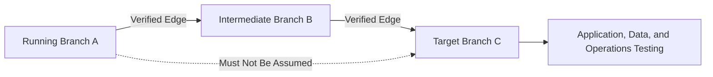

# Supported Upgrade Paths and Version-Skipping Conditions in Apache Cassandra

## 1. Upgrading Cassandra Is a Distributed-System Change

Apache Cassandra is a **wide-column** database: each partition is located via its **partition key**, stored across multiple replicas according to its replication factor (RF), and served to applications through CQL. In module `DATABASE_ENGINE_WIDE_COLUMN_CASSANDRA`, query-driven table design, read/write consistency, compaction, repair, error handling, and Java connectivity are all directly affected during an upgrade.

Unlike swapping a library inside an application, upgrading Cassandra can cause **nodes on multiple versions to run simultaneously for a period**. During that time, nodes must exchange compatible messages, interpret schema metadata, accept streamed data, and continue satisfying the replica counts required by consistency levels. Alongside Cassandra Server, there are Java/JDK, the Java Driver, the native protocol, SSTable formats, the OS, security configuration, and backup tools.

For example, an operations team runs a two-DC cluster, each DC with RF=3. They want to update the software without stopping the Java API. If they swap binaries on three nodes in the same DC simultaneously, `LOCAL_QUORUM` queries can fail even though every software installation step "succeeded." If they upgrade to a version without a **supported direct transition path**, starting a node can cause errors that cannot be fixed simply by downgrading the binary.

This lesson focuses on **how to identify supported upgrade paths and the conditions under which skipping intermediate versions is allowed**. There is no rule that "any newer target version is upgradeable."

### Target Outcomes

After this lesson, you will be able to:

1. Distinguish **patch upgrades**, **minor/feature upgrades**, and **major upgrades**, while reading upgrade prerequisites for a *source–target version pair*.
2. Build a graph of valid upgrade steps, knowing when **direct jumping** is permitted and when an intermediate release is mandatory.
3. Verify requirements across Java/JDK, driver, protocol, SSTables, schema, replication, and cluster health.
4. Design a rolling upgrade runbook with limits on offline replicas, pre/post-node gates, and stop conditions on failure.
5. Distinguish **continuing forward**, **rolling back application config**, **binary downgrade**, and **restoring from backup**; never conflating them as one action.

## 2. What Does "Supported" Mean?

An *upgrade path* is a pair or sequence of **Cassandra Server versions** that the vendor/project and deployment distribution document as convertible through a defined procedure. Validity must be verified from **the upgrade guide and release notes for the exact source version, target version, distribution, and operational architecture**.

Separate three questions:

| Question | Example | Required conclusion |
| --- | --- | --- |
| **Is there a direct upgrade path?** | From branch A to branch C | Does documentation allow A → C or require going through B? |
| **What upgrade style is allowed?** | Zero-downtime rolling upgrade | Does documentation allow temporary mixed-version operation and specify operation order? |
| **Does the current system meet prerequisites?** | Unrepaired nodes, old JDK, incompatible driver | The path is valid in theory, yet preflight may still need to block |

A "supported" upgrade path **does not automatically guarantee** that the cluster is healthy, backups are sufficient, the Java version is supported, all plugins are compatible, or rollback remains possible. It is merely the starting point for planning.

### Version Tiers

Suppose version names follow `X.Y.Z`. Major/minor/patch classification aligns with each Cassandra line's release policy, so read release notes rather than inferring solely from digits:

- **Bug-fix releases within the same release branch:** typically have fewer compatibility changes, yet still require checking warnings, config fixes, JDK limits, and restart procedures.
- **Moving between release branches:** can change JVM requirements, protocols, CQL options, schema handling, SSTable formats, or operational features.
- **Jumping across multiple branches:** valid only when documentation **explicitly states direct support**; otherwise, build a path through supported intermediate branches.

Examples of branch names you may encounter in Cassandra history include `3.11`, `4.0`, `4.1`, and `5.0`. **Listing these names does not assert that all pairs between them can upgrade directly.** A path from `3.11` to `5.0`, for instance, **must not be inferred** just because both are Cassandra releases; you must confirm official guidance and any mandatory intermediate hops.

## 3. Upgrade Graph: Traverse Only Verified Edges

Represent releases as vertices in a directed graph. Only add edge `A → B` after verifying documentation explicitly supports that pair under stated conditions.



This diagram is a **decision model**, not a compatibility statement for any specific Cassandra branch.

### 3.1. Per-Edge Verification Procedure

For every planned source–target pair:

1. **Pin exact version numbers** on each node (including patch version), not just labels like "Cassandra 4" or image tag `latest`.
2. **Identify the distribution**: standard Apache Cassandra, managed service, or bundled product may have distinct schedules and constraints.
3. **Read the upgrade guide for the target version itself** plus release notes for all affected branches. Look for *Supported upgrade paths*, *Upgrading*, *Breaking changes*, *Prerequisites*, *Java compatibility*, *SSTable upgrades*, and *Mixed-version operation*.
4. **Check whether the source is in the allowed list**; if docs only permit a subset of source versions or require a minimum patch floor, record every condition.
5. **Check procedures:** is there a requirement to patch up to the latest source branch release, change configs, run repair, run conversion tools, or finish upgrading the whole cluster before the next hop?
6. **Build a test run:** mirror representative topology and workload, upgrade from compatible data/snapshots, and observe Java application behavior.
7. **Record evidence:** doc source, revision/access date, release notes, reviewer, and test outcomes. Only then add `A → B` to the rollout plan.

If **no official statement is found** confirming `A → C` is directly supported, mark it `NOT_VERIFIED` and **do not skip**. Never use a blog post or "node started in lab" to replace production upgrade-path certification.

### 3.2. Decision Matrix (Template to Populate from Real Documentation)

| Source–target pair | Direct support confirmed | Mandatory prerequisites | Action |
| --- | --- | --- | --- |
| `A.Z1 → A.Z2` (same branch) | `VERIFIED / NOT_VERIFIED` | Patch floor, JDK, restarts, and release notes | Upgrade when gates pass |
| `A → B` (next branch) | `VERIFIED / NOT_VERIFIED` | Rolling procedure, mixed-version, schema/SSTables | Test staging then roll |
| `A → C` (skip branch B) | `VERIFIED` only if explicitly documented | Skip conditions and features banned during mixed phase | If evidence is missing, go via B |
| `B → C` | `VERIFIED / NOT_VERIFIED` | Complete post-upgrade on B before advancing | Wait for all prerequisites before opening next hop |

**This matrix is a control template, not a list of upgrade paths guaranteed by Apache Cassandra.** Operators must substitute real releases for A/B/C and attach the corresponding documentation.

### 3.3. When Must You Never Skip an Intermediate Version?

Never skip if **any** of the following applies:

- Documentation states you must go through an intermediate branch or only supports sources in an explicit allowlist.
- The target requires schema/storage migrations that can only be performed using the intermediate version's workflow.
- Mixed-version operation on the direct path is disallowed by documentation.
- The source version is older than the required patch floor.
- Compatible JDK, Java Driver, auth/encryption plugins, monitoring, or SSTable tools are unavailable.
- Backup/restore and acceptable data-loss limits cannot be verified.
- The cluster has unhealthy nodes, prolonged schema disagreement, active streaming/topology changes, or compaction debt pushing risk above threshold.

Conversely, **skipping may be considered** only when the source–target pair is explicitly documented as supported, all prerequisites are met, and staging tests pass. "Fewer restarts" **is not** a valid reason to skip a mandatory step.

## 4. Inventory Current Versions Before Choosing a Path

In practice, you cannot chart an accurate path if the cluster already has mixed node versions left over from an incomplete prior rollout.

Inspect via trusted administrative channels on each node or through a verified orchestration tool:

```bash
# On an authorized Cassandra node:
nodetool version
nodetool status
nodetool describecluster

# Gather additional health context to cross-check:
nodetool info
nodetool netstats
nodetool compactionstats
```

Commands may require different JMX/connection options depending on the environment. `nodetool status` and `describecluster` report topology/schema status from the queried node's perspective; do not treat one random node's output as proof that every node is healthy.

In `cqlsh`, you can read metadata from the connected coordinator:

```sql
SELECT release_version, schema_version
FROM system.local;
```

`system.local` is **local** node information; a CQL connection through a load balancer can land on a different coordinator. Record the target node explicitly when inventorying. Different Cassandra versions also have different peer table schemas; avoid rigid scripts assuming a single `system.peers` layout without checking the version.

### Preflight Manifest to Archive

| Field | Meaning |
| --- | --- |
| `cluster_id`, environment, UTC time | Avoid targeting the wrong cluster and detect out-of-window changes |
| Node, DC, rack, host ID | Define topology and rolling order |
| Exact `source_version` per node | Detect half-upgraded nodes or uneven patching |
| Cassandra distribution / package / image digest | Avoid mixing incompatible software builds |
| Actual JDK and OS | Validate runtime prerequisites |
| Keyspace RF, target consistency | Calculate allowable offline replicas |
| Schema versions, schema agreement state | Block schema drift/disagreement before upgrading |
| SSTable format and disk capacity | Determine conversion/compaction limits and workload |
| Driver versions, protocol, TLS/auth plugins | Verify Java application connectivity |
| Backup ID, restore test, RPO/RTO | Determine whether a reliable recovery point exists |
| Repair/streaming/compaction state | Check for ongoing data/topology churn or missing headroom |

For containerized environments, record **image digests** and persistent volume configurations. Changing only an image tag can bring unexpected JDK, entrypoint, file ownership, or default configuration changes beyond the Cassandra version itself.

## 5. Compatibility Is More Than Just Server Version

Jumping to a new branch requires satisfying all compatibility domains below.

### 5.1. Java/JDK, OS, and Runtime

Cassandra Server runs on the JVM. A target release may require or support different JDK lines than the source; libraries, GC options, heap tuning, TLS ciphers, and startup scripts can also change.

**Right approach:**

1. Check target docs for **supported JDKs**, minimum versions, and configuration limits.
2. Check the actual vendor/build on nodes; do not equate "Java starts" with production compatibility.
3. Test the exact combination **target Cassandra + target JDK + OS/container base image** in staging.
4. If both JDK and Cassandra must change, determine an order supported by **both source and target** at each step, or use a node replacement strategy guided by the distribution.
5. Audit removed/unsupported JVM flags, filesystem permissions, TLS keystores/truststores, and GC monitoring.

`java -version` is a quick host check, but inspect the JVM that **the Cassandra process actually executes** (Java binary path, launch scripts, container).

### 5.2. Native Protocol, Java Driver, and CQL

The Java Driver connects to Cassandra over the native protocol. Newer servers may change supported protocols/capabilities, while the driver must also parse metadata, schema events, token maps, paging, and CQL data types.

Before upgrading:

- Check the **support matrix for the exact Java Driver** and target Cassandra release, including the application's Java runtime level.
- Test prepared/bound statements, paging, batches, LWTs, consistency levels, and retry policies while the cluster runs mixed-version.
- Confirm local datacenter names, contact points, TLS, authentication/authorization, and schema refreshes.
- Avoid enabling **target-only** CQL features before all relevant nodes/servers/drivers are ready.
- Never lower `LOCAL_QUORUM` to `ONE` to mask compatibility errors or missing replicas during rolling upgrades.

Java Driver 4.x example creating a session with verified version-aware settings:

```java
import java.net.InetSocketAddress;
import com.datastax.oss.driver.api.core.CqlSession;
import com.datastax.oss.driver.api.core.DefaultConsistencyLevel;
import com.datastax.oss.driver.api.core.cql.PreparedStatement;
import com.datastax.oss.driver.api.core.cql.BoundStatement;

import java.util.UUID;

public final class UpgradeSmokeTest {
    public static void run(CqlSession session, UUID orderId) {
        PreparedStatement prepared = session.prepare(
            "SELECT order_id, status FROM commerce.orders_by_id WHERE order_id = ?");
        BoundStatement query = prepared.bind(orderId)
            .setConsistencyLevel(DefaultConsistencyLevel.LOCAL_QUORUM);
        session.execute(query).one();
    }

    // Illustrates only how to build a test session in a configured environment.
    public static CqlSession connect() {
        return CqlSession.builder()
            .addContactPoint(new InetSocketAddress("127.0.0.1", 9042))
            .withLocalDatacenter("dc1")
            .build();
    }
}
```

This snippet is a **read smoke test** against a hypothetical `commerce.orders_by_id` table in a lab; it does **not** prove Driver 4.x compatibility with every current or future Cassandra version. In production, configure proper credentials/TLS, reuse sessions, include write tests on test data, and compare business results before and after the upgrade.

### 5.3. SSTables and On-Disk Data Formats

SSTables are Cassandra's immutable data files, compacted and snapshotted per node. A newer server branch may **read older SSTable formats** within documented limits, but that does not mean an older server version can read SSTables written by the newer server.

**Distinguish clearly:**

- **Upgrading binary and starting the node:** the target server must read existing data to serve traffic.
- **Upgrading SSTable format:** `nodetool upgradesstables` may be used when required/recommended by the target guide, typically after all cluster nodes have finished binary upgrades.
- **Compaction during normal operation:** can produce SSTables in the new format, impacting the ability to revert to the old version.
- **Restoring snapshots:** requires file-loading procedures, schemas, and tools compatible with the target version; old snapshots do not guarantee restore onto a new version automatically.

```bash
# Check syntax on a node of the exact version before considering execution:
nodetool help upgradesstables
```

**Do not run `nodetool upgradesstables` across nodes during the mixed-version phase** unless documentation explicitly allows it. Rewriting SSTables consumes heavy I/O, CPU, and disk, and eliminates already limited downgrade options. Execute only in the verified sequence for the source–target pair.

### 5.4. Schema, Replication, and Table Options

Cassandra schemas propagate across the cluster. During a rolling upgrade, nodes on different versions may handle metadata or new options differently. Therefore:

- Avoid unnecessary `CREATE/ALTER/DROP KEYSPACE/TABLE` statements during mixed-version periods.
- Do not enable new options/features (compaction, indexes, table features, protocol features) until the target release is deployed cluster-wide and all relevant clients support them.
- Confirm consistency of critical keyspaces against actual RF and DCs; swapping binaries is **not** the time to simultaneously change partition keys or RF without a separate plan.
- If `NetworkTopologyStrategy` or topology changes are needed, handle them in an independent migration window with streaming/repair and validation.

Metadata-level schema agreement **does not guarantee** business data is replicated or repaired; those are two distinct concerns.

### 5.5. External Tools and Integrations

Beyond server/driver, evaluate `cqlsh`, `nodetool`, backup/snapshot tools, CDC pipelines, metrics exporters, security/auth/audit plugins, IaC operators, and deployment scripts. These tools may change CLI arguments, metrics scraping, `system_*` tables, or file layouts across versions.

**Do not rely completely on an old operational tool** just because it can still invoke a few `nodetool` commands after an upgrade.

## 6. Availability During Rolling Upgrades by RF and Consistency

A rolling upgrade swaps versions **one node or bounded group at a time**, keeping remaining replicas serving queries. Fault tolerance depends on RF, CL, topology, and live replica availability—not total cluster node count alone.

With `RF=3` in **one DC**, `LOCAL_QUORUM` requires two replicas per partition. If one replica is unavailable in that DC, by count two remain so CL **can** be satisfied; if two replicas are unavailable, it cannot. This assumes both remaining replicas are healthy with normal networking/latency.

| RF in DC | Replicas required for LOCAL_QUORUM | Max absent replicas by raw count |
| --- | ---: | ---: |
| 1 | 1 | 0 |
| 2 | 2 | 0 |
| 3 | 2 | 1 |
| 5 | 3 | 2 |

This is a **mathematical limit**, not a recommendation to upgrade two replicas simultaneously at RF=5: leave margin for unexpected failures, GC pauses, network partitions, or cold nodes warming up. Systems using `ALL`, `EACH_QUORUM`, LWT, or cross-DC consistency levels have stricter conditions and must be evaluated separately.

### Orchestration Principles

1. Upgrade **one node at a time** unless there is a tested reason to parallelize; never take down replicas serving the same partition past the point where CL fails.
2. Follow a **per-rack/DC** order supported by the distribution, grounded in RF and risk tolerance. Never assume "upgrade all of DC1 then DC2" is safe for every consistency level.
3. Wait until the node finishes starting, shows `UN` in `nodetool status`, serves CQL cleanly, and exhibits stable metrics; do not rely solely on process ID.
4. Do not proceed to the next node if the previous node still has unexpected streaming, unexplained schema disagreement, rising error rates, or client timeouts breaching gates.
5. Restrict other heavy operations such as bulk loads, RF changes, decommissions, rebuilds, and manual major compactions during the rolling window.

An RF=3 cluster that already has one `DN` node **no longer** has the fault budget of a healthy cluster. Preflight checks must block upgrading affected replicas if doing so breaks CL satisfaction.

## 7. Rolling-Supported Two-Branch Upgrade Runbook

The runbook below is an **orchestration skeleton**, not a substitute for the exact version-pair guide. Specific package, config, JVM, and post-upgrade steps must come from target documentation.

### Phase A — Lock Plan and Recovery Point

1. Record **exact source versions** of every node, target branch, package source/image digests, and the list of supported upgrade edges.
2. Verify patch floor, JDK, OS, driver, TLS/auth, config, plugins, schema, and SSTable prerequisites.
3. Read release notes and behavioral changes: CQL, compaction, tombstones/TTL, metrics, repair, and removed options.
4. Inspect `nodetool status`, schema, repair cadence, hinted handoff, compaction backlog, free disk, and node-complete backups/snapshots.
5. Take **verified backups** and test a restore plan covering schema, data SSTables, and auth/role metadata if needed. Never treat a single node snapshot as a cluster backup.
6. Set SLOs and stop conditions: e.g., timeout/unavailable rates, p99 query latency, dropped mutations, GC pauses, `DOWN` replica count, and maximum node startup duration.
7. Schedule operators, notify application/on-call teams, and assign go/no-go approvers.

### Phase B — Upgrade One Canary Node

Example sequence **on the chosen node during an approved maintenance window**:

```text
PRECHECK_NODE
  -> VERIFY_REPLICA_BUDGET_AND_CLUSTER_GATES
  -> DRAIN_OR_GRACEFUL_STOP_BY_VERSION_RUNBOOK
  -> STOP_CASSANDRA_SERVICE
  -> INSTALL_VERIFIED_TARGET_BINARY_AND_JDK
  -> MIGRATE_CONFIGURATION_AS_REQUIRED
  -> START_CASSANDRA_SERVICE
  -> WAIT_FOR_NODE_UP_AND_NATIVE_PROTOCOL_READY
  -> CHECK_SCHEMA_AND_LOGS
  -> RUN_CQL_AND_JAVA_SMOKE_TESTS
  -> OBSERVE_METRICS
  -> APPROVE_NEXT_NODE
```

Some runbooks use `nodetool drain` before stopping the service to flush memtables and stop accepting new writes on the node. **Follow the exact source/target guide**, as shutdown steps in managed/containerized systems can differ. Do not run `drain` experimentally on production.

Useful **read-only** commands after the node returns:

```bash
nodetool version
nodetool status
nodetool describecluster
nodetool netstats
nodetool compactionstats
nodetool tpstats
```

Watch Cassandra logs and Java application telemetry: successful connections, partition-key queries, prepared statements, test reads/writes at target CL, p95/p99 latency, and timeouts.

### Phase C — Roll Remaining Nodes

After canary:

- Open the next node only when the prior node's gates pass.
- Record per-node timeline: `STARTED`, `STOPPED`, `TARGET_RUNNING`, `SMOKE_PASS`, `VERIFIED`.
- Keep total absent replicas within workload tolerance, factoring in any unexpected independent node failures.
- If errors occur, **halt the rolling chain and investigate**; never increase upgrade concurrency just to "stay on schedule."
- Continuously log schema state, per-node active versions, and health across both DCs.

Do not alter schemas, enable new features, or assume protocol bumps during mixed-version operation unless explicitly permitted by docs. Keep the mixed-version window **reasonably short without sacrificing verification gates**.

### Phase D — Cluster Completion and Post-Upgrade

1. Confirm **every planned node** runs the target version, `UP` replicas match expectations, and the cluster is no longer mixed-version.
2. Confirm schema metadata and read/write availability in each DC at actual CLs.
3. Run CQL/Java Driver regression tests, verifying latency, error rates, sample data, and LWT/batch/paging flows.
4. Execute **documented mandatory post-upgrade steps**: config updates, metric adjustments, standard repairs, or SSTable upgrades if required. Schedule and check disk space before rewriting data.
5. Only **after** the full cluster and clients are compatible should you consider enabling target-version features; isolate them into a separate change if possible.
6. Archive version records, release notes, manifests, executed commands, resolved issues, before/after metrics, and completion timestamp.

If another hop is required, **do not start immediately** once the last node boots. Complete all post-upgrade gates of the previous hop first, including data/storage normalization and fresh backups required by the next source–target edge.

## 8. Testing Java and CQL Features During Mixed-Version States

Example orders table:

```sql
CREATE TABLE commerce.orders_by_id (
  order_id uuid PRIMARY KEY,
  customer_id uuid,
  status text,
  updated_at timestamp
);
```

In staging, use synthetic data with clear expectations and run these test groups with **the exact actual driver/version**:

| Group | Checks | Risks uncovered |
| --- | --- | --- |
| Connectivity | TLS, authentication, contact points, and local DC | Inability to handshake or open sessions |
| Partition-key reads | `SELECT ... WHERE order_id = ?` using service CL | Schema/protocol errors, timeouts, unavailable replicas |
| Idempotent writes | `INSERT`/`UPDATE` on test records, read-back verification | Non-convergent data or CQL failures |
| Prepared statements | Prepare then execute across multiple coordinators | `UNPREPARED`, inconsistent metadata |
| Paging | Multi-page reads from test table | Page-state/compatibility bugs or unusual latency |
| LWT/conditional updates | `UPDATE ... IF version = ?` if used by business logic | CAS contention, serial CL conditions, or functional bugs |
| Special types | UDTs, collections, TTL/tombstones if applicable | Behavioral shifts on data types |
| Background jobs | Repair, backup/snapshot, metrics exporters | Incompatible operational integrations |

Never test destructive deletes or irreversible schema migrations as "production smoke tests." Keep test suites in staging, or use approved test keys/tables with cleanup procedures.

### Do Not Bundle Server Upgrades with Wide-Column Remodeling

If you simultaneously change partition keys or migrate `orders_by_id` into `orders_by_customer`, attributing failures to the binary upgrade versus data migration becomes difficult. A safer approach:

1. Complete **compatible schema changes** independently before or after.
2. Upgrade the cluster along the supported path, keeping queries and CLs identical to baseline.
3. Verify stability.
4. Execute data migration separately with backfills, dual-writes, reconciliation, bounded concurrency, and app rollback.

This equally applies to changing RF, compaction strategies, or TTLs: a complex upgrade needs as few moving variables as possible.

## 9. When Errors Occur: Where to Stop and Can You Downgrade?

**Binary rollback does not equate to data recovery.** Once a node starts on the new version, it may write new-format SSTables, update metadata, or apply changes incompatible with the old version. **Downgrade** paths often have strict preconditions or are **completely unsupported**.

### 9.1. Four Distinct Remediation Paths

| Path | When to use | Conditions |
| --- | --- | --- |
| **Pause/repair forward** | One new node fails while the cluster remains healthy | Halt further upgrades, inspect logs/config/JDK/protocol, fix, and re-test |
| **Continue upgrade after fix** | Environmental issue resolved and path remains valid | Canary and cluster gates pass again |
| **Revert app/config version** | Failure caused by driver feature flags or app incompatibility | Old schema/CQL still supported; do not assume server downgrade |
| **Restore from backup** | Data/schema cannot safely revert | Verified complete backups; separate restore workflow, clear RPO/RTO |

Some configuration errors can be fixed by adjusting parameters and restarting the node **on the same target version**. Never blindly downgrade Cassandra Server to the old binary just because a node failed to start.

### 9.2. Mandatory Stop Gates

Stop upgrading subsequent nodes if one or more signs appear:

- `Unavailable`/timeout rates, p99, or cross-DC latency exceed agreed limits.
- Additional nodes fail to stay `UP` or DC replica counts drop below CL requirements.
- Unexplained schema disagreement or protocol/driver connectivity failures occur.
- Upgraded nodes crash-loop, suffer excessive GC, near-full disks, or abnormally long compactions.
- Recovery snapshots/backups cannot be verified while a data incident is underway.
- New configs, plugins, or JDKs behave differently from staging tests.

Keeping a cluster in a prolonged mixed-version state also carries risk; when blocked, establish a remediation decision with an accountable owner, timebox, and evidence before resuming.

### 9.3. Design the Recovery Path Before Upgrade Day

Minimum dossier required:

- **Pre-upgrade** cluster backups covering SSTables and required metadata/schema, stored externally with tested restores.
- Source and target binary/JDK/config packages, checksums, and instructions to rebuild nodes **along supported paths**.
- Timeline of events, migrations, SSTable rewrites, compactions, and any features enabled post-upgrade.
- Runbook to provision a fresh cluster and load data on a compatible version if direct downgrade is unsupported.
- Rules ensuring writes occurring after the snapshot are reconciled/replayed or accepted within RPO loss bounds.

**Never promise a "5-minute rollback" solely because old installer files were kept.** Tested recovery drills and measured RPO/RTO are the only reliable proof.

## 10. Conditions for Advancing Past an Intermediate Release

Suppose documentation verifies `A → B → C` and **does not verify** `A → C`. You must finish A→B completely before evaluating B→C.

At milestone B, verify:

1. **Uniform version:** every node runs B at the required patch level; no node remains on A.
2. **Cluster health:** nodes `UP`, valid schema agreement, no unexpected streaming/topology changes, no dangerous backlogs.
3. **Data compatibility:** mandatory post-upgrade tasks, repairs/rebuilds, or SSTable migrations for B are completed and verified.
4. **Application safety:** Java Driver, native protocol, auth/TLS, and active CQL queries passed regression tests.
5. **Correct config:** JDK options, `cassandra.yaml`, compaction, caches, and metrics/monitoring match B.
6. **Fresh backups:** verified recovery points captured at state B if required by the plan/next path.
7. **Evidence for B→C edge:** target C documentation permits starting from current B/patch with no skipped preprocessing steps.

Only when all conditions pass should you open the next phase. If the target requires **a minimum patch level** on branch B, patch to that floor first even if B is already on the right minor/major branch.

### Simple Decision Pseudocode

```text
input: source_version, target_version, distribution, cluster_facts

if any_node_version_is_unknown_or_inconsistent:
    BLOCK("Inventory and stabilize cluster")

edges = verified_direct_upgrade_edges_from_official_docs(
    distribution, source_version, target_version
)

path = find_supported_path(edges, source_version, target_version)
if path is missing:
    BLOCK("No verified supported upgrade path")

for hop in path:
    if not prerequisites_satisfied(hop, cluster_facts):
        BLOCK("JDK/driver/schema/SSTable/health/backup gate")
    test_hop_in_staging(hop)
    rolling_upgrade_with_per_node_gates(hop)
    verify_cluster_complete(hop)
    complete_required_post_upgrade_steps(hop)
    verify_application_and_restore_readiness(hop)

SUCCESS("All hops verified; release record preserved")
```

This is **workflow orchestration pseudocode**, not a Cassandra API or a replacement for version-specific runbooks.

## 11. Scenario Exercise: Upgrading a Multi-DC Cluster

A Cassandra cluster has:

- `dc1`: `a1`, `a2`, `a3`; `RF(dc1)=3`.
- `dc2`: `b1`, `b2`, `b3`; `RF(dc2)=3`.
- The Java application reads and writes with `LOCAL_QUORUM` in its local DC; one worker uses LWTs.
- Nodes are on version `A`, and the team wants to reach branch `C`. Verified docs **only confirm** A→B and B→C, **not** direct A→C.
- One node in `dc1` currently has a large compaction backlog, and the latest remote backup has not been checksum-verified.

**Answer the following:**

1. May they upgrade directly from A to C to shorten maintenance time? Why or why not?
2. Which gates must block deployment given the pending compaction and unverified backup?
3. With RF=3 and `LOCAL_QUORUM` per DC, why should two nodes in the same DC not be upgraded simultaneously?
4. Once the first node reaches B and is `UP`, can another node immediately jump to C? What conditions are missing?
5. When is `nodetool upgradesstables` used, and why must it not be run arbitrarily mid mixed-version?
6. If server B runs fine yet the Java app hits protocol errors, what factors should you inspect before considering a downgrade?
7. If B already wrote some SSTables in a new format, why is simply copying binary A back dangerous?
8. Which fields would you archive to audit that each hop completed validly?

**Solution hints:**

- Take only **A→B→C** because no verified A→C edge exists; an unconfirmed path is not something to "try in production."
- Resolve baseline cluster health, compaction I/O/disk headroom, and **restore-ready verified backups** before starting.
- With RF=3, `LOCAL_QUORUM` needs two replicas; taking two down in the same DC leaves only one, breaking consistency for affected queries.
- Finish upgrading **the entire cluster to B**, post-upgrade steps, schema/driver/data validation, and B→C prerequisites before the second hop.
- SSTable upgrades follow target docs—usually after leaving mixed-version state and with sufficient disk/I/O headroom.
- Check native protocol, driver version, app JDK, TLS/auth, prepared statements, schemas, and logs before touching the server.
- Old binaries may fail to read new data/metadata; rollback requires a **verified supported path or restore**.
- Audit logs should capture source/target patch versions, nodes/DCs, release notes, prerequisites, staging proof, backup manifests, gate outcomes, and approvers.

## 12. Pre-Approval Upgrade Checklist

- [ ] Identified exact source/target versions on **every node**, distribution, and image/package digests.
- [ ] Consulted official docs/release notes to verify **each direct upgrade edge** and patch floor; never inferred from version digits.
- [ ] Evaluated **mixed-version** feasibility and rolling order per target guidance.
- [ ] Verified JDK, JVM options, OS, driver, native protocol, TLS, auth, and plugin compatibility.
- [ ] Checked schema/table options, per-DC RF, actual CLs, topology, and repair/streaming state.
- [ ] Calculated maximum unavailable replica budget with margin for unexpected failures.
- [ ] Tested the upgrade in staging with representative data, topology, and workload.
- [ ] Captured backups/snapshots across **all nodes**, schema/metadata, off-cluster storage, and restore test results.
- [ ] Documented canary/rolling node order, observation windows, and quantitative stop conditions.
- [ ] Prepared smoke/regression tests for Java APIs, CQL, paging, LWTs, and critical paths.
- [ ] Separated server upgrades from partition key, RF, schema, and major compaction migrations wherever possible.
- [ ] Documented post-upgrade steps: SSTable format, repair/validation, logging, and metrics per official guide.
- [ ] Defined failure remediation **that does not depend on unsupported downgrades**.
- [ ] Archived per-node/per-hop results, approvers, and the go/no-go record.

**Conclusion:** A supported Cassandra upgrade path is **a sequence of steps backed by version evidence**, not a numerical comparison. "Skipping versions" is permitted only when **the source–target pair is explicitly documented as directly supported** and all JDK, driver, protocol, schema, SSTable, replica, backup, mixed-version, and staging gates pass. Roll node-by-node with clear gates, complete post-upgrade tasks before starting the next hop, and rely on **tested restores**—not copying old binaries—as the foundation for safe recovery.
