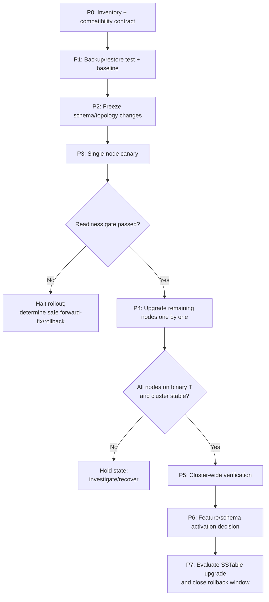

# Running a Mixed-Version Cluster During Transition

**Chapter:** Upgrades and Compatibility  
**Module:** `DATABASE_ENGINE_WIDE_COLUMN_CASSANDRA` — Apache Cassandra

An Apache Cassandra cluster typically cannot stop every node simultaneously just to install a new version. During a *rolling upgrade*, there is a window where node A already runs the target version while nodes B/C still run the source version. This state is called a **mixed-version cluster** — a **controlled transitional state**, not a long-term architecture for operating multiple Cassandra generations side by side.

Seeing all nodes in state `UN` and the application still reading/writing **is not sufficient proof** that an upgrade succeeded. You must verify **the official upgrade path**, internode messaging/gossip compatibility, CQL protocol, schema, JDK, Java driver, SSTables, replication/consistency levels, and rollback feasibility. Enabling a new feature or rewriting file formats too early can close the rollback window even while the cluster remains healthy.

This lesson connects Apache Cassandra's distributed architecture and wide-column model, partition keys, query-driven table design, consistency levels, replication, compaction, repair, error handling, and Java connectivity into an **upgrade runbook with clear stop gates**.

> **Scope limit:** There is no rule that "every pair of Cassandra versions supports a direct rolling upgrade." Support conditions vary by major/minor release, distribution, JDK, and configuration. These examples use hypothetical node names and versions; before any real upgrade, read the **upgrade notes and compatibility matrix for your exact source/target versions**, including intermediate releases if mandatory. Never run stop or upgrade commands on production solely based on lesson examples.

## 1. Learning Objectives

After this lesson, you will be able to:

1. Explain the **mixed-version** state, distinguishing binary version, internode messaging, native CQL protocol, schema, and SSTable format.
2. Understand why **rolling upgrade support for the specific version pair** is a prerequisite; never infer it from adjacent version numbers.
3. Plan node-by-node transitions while preserving replica availability at the consistency level required by applications.
4. Define the sequence **backup → baseline → canary → per-node rolling → verification → closing the rollback window**.
5. Read `nodetool status`, `version`, `describecluster`, `tpstats`, `netstats`, and version-appropriate `system.local`/`system.peers_v2` data.
6. State why **schema/new feature changes must be frozen** and SSTable format rewrites avoided until rollback feasibility is clear.
7. Analyze relationships among JDK, Java driver, TLS, authentication/authorization, client protocol, and old/new nodes.
8. Design CQL smoke tests at `LOCAL_QUORUM`/`ALL` during node maintenance without confusing timeouts with data loss.
9. Set stop conditions for p95/p99, `Unavailable`/timeout errors, schema agreement, disk, GC, and incompatibility logs.
10. Author a rollback/forward-fix runbook keyed to **which milestones have completed**, rather than assuming downgrading the binary is always safe.

## 2. "Version" in Cassandra Has Multiple Layers

### 2.1. More Than a Single Release Number

| Layer | Conceptual example | Why it must be checked |
| --- | --- | --- |
| **Server binary** | Node A runs new release, B/C run old release | Determines code, features, data handling, and internode traffic |
| **Internode messaging/gossip** | Nodes exchange membership, mutations, streaming | New and old nodes must have a **version-supported** compatibility mechanism |
| **Native CQL protocol** | Java Driver connects to CQL port, negotiates protocol | Driver must support the set of server versions; separate protocol from internode |
| **Schema/features** | Table options, indexes, role permissions, UDTs, functions | New features can create metadata that older nodes cannot parse |
| **SSTable format** | Files written by old/new binaries | Can determine whether the old binary can still read data after rollback |
| **Commit log/system metadata** | Local state, bootstrap metadata, log replay | Certain post-boot changes can restrict downgrade options |
| **Java/JDK** | Runtime permitted for Cassandra server | Unsupported JDKs may fail to start or cause GC/crypto bugs |
| **Client/driver** | Java Driver 4.x, configuration/TLS | Must work against both old and new coordinators |

These layers interact but **are not synonymous**. A client connecting on port `9042` does not prove two server nodes have compatible internode messaging. Conversely, nodes may gossip cleanly while a new CQL feature is rejected during mixed-version operation.

### 2.2. What Is Mixed-Version?

Suppose an upgrade plan moves from version **S** to version **T** on a single-DC RF=3 cluster:

```text
Before change:
  A: S  UN       B: S  UN       C: S  UN

After canary:
  A: T  UN       B: S  UN       C: S  UN   <- mixed-version

After second node:
  A: T  UN       B: T  UN       C: S  UN   <- mixed-version

After final node:
  A: T  UN       B: T  UN       C: T  UN   <- uniform binary version
```

While A is stopped and upgraded, A may temporarily be `DN`; B/C keep serving requests if RF, CL, and actual health permit. These transitions are valid only if **S → T is a supported rolling upgrade path**. Do not take the S/T example as proof for arbitrary release pairs.

**Completion requires more than matching binaries:** you must verify that schema, reads/writes, metadata, repairs, authentication, clients, SSTable upgrade policy, and operational docs meet target criteria. Some post-upgrade tasks may continue after the last node runs T.

### 2.3. Mixed-Version Is Not a "Desired" Steady State

During this window:

- Do not enable features/DDLs exclusive to T while node S may still process them.
- Do not linger in mixed-version for weeks just because applications still run.
- Do not assume cluster-wide maintenance jobs introducing new formats/metadata are safe.
- Do not upgrade multiple nodes simultaneously if doing so breaks quorum for critical replica sets.
- Do not assume reverting the binary back to S is safe once T has written data/files/metadata.
- Do not run concurrent topology changes (adding a DC/replacing multiple nodes) unless allowed and controlled by the version-pair runbook.

**Goal:** minimize time spent in mixed-version while keeping enough verification time after each node. Rushing causes multiple failures at once and obscures which node triggered the issue.

## 3. Mandatory Prerequisite: Verify the Upgrade Path

### 3.1. There Is No "Default" Compatibility Matrix

Some upgrade paths require an intermediate release or **do not support rolling upgrades**; certain version pairs also impose specific requirements on repairs, SSTable formats, auth, JDK, or configs. Therefore, before touching binaries:

1. Record **the exact current version** of every node, including patch release/distribution.
2. Record **the exact target version**, upgrade rationale, and features planned after upgrading.
3. Locate vendor/project-supported upgrade notes for **the source → target pair**.
4. Confirm intermediate versions if mandatory; do not skip them merely because both endpoints are "stable."
5. Check OS/JDK, CPU architecture, GC, disk formats, TLS libraries, JMX, and exporters.
6. Check Java driver/CQL compatibility and backup/repair/operator tools.
7. Document **the exact per-node stop/start procedure** and post-upgrade steps.
8. Identify **until which point** rollback remains valid, and when only forward-fix or restore applies.

If no documentation confirms the version pair is supported, its status is **BLOCKER**—never "test a canary on production to see if it runs."

### 3.2. Compatibility Contract Template

| Component | Required pre-maintenance values | PASS condition |
| --- | --- | --- |
| Server source/target | `S_full_version → T_full_version` | Supported by release notes |
| Upgrade path | Direct or via intermediate release | Approved sequence |
| Internode messaging | Mixed-version support conditions | No known incompatibilities |
| JDK runtime | JDK versions for S and T | Valid runtime for every step |
| OS/packages | Repo/image, systemd/Helm/operator | Package rollback method and checksum verification |
| Java Driver | Driver version, native protocol, TLS | Tested against both S and T nodes |
| Schema/features | Active and planned DDLs/options | Incompatible features frozen |
| SSTable format | Old/new file read rules | Plan to avoid premature rewrites |
| Security | Auth, roles, certificates, JMX | Login and RBAC work throughout all phases |
| Maintenance | Repair, streaming, backups, snapshots | Tasks scheduled appropriately |
| Replica health | RF, CL, node/rack/DC | Enough replicas at every step |
| Rollback | Valid milestone, data source, backups | No promise of simple downgrade past milestone |

Do not replace this table with intuition like "it's just a minor release." Even a patch release can have breaking issues affecting a specific workload; read the release notes and check the live cluster.

## 4. Replicas and Consistency Levels Determine Availability

### 4.1. Example: RF=3 with One Node Temporarily Offline

Suppose `NetworkTopologyStrategy` has RF=3 in `dc1` and A/B/C each hold a replica of the partition in question. While A is stopped for upgrade:

| CL at coordinator in `dc1` | Replicas required | When A is down, B/C healthy |
| --- | ---: | --- |
| `ONE` / `LOCAL_ONE` | 1 | Can satisfy |
| `LOCAL_QUORUM` | 2 | Can satisfy if both B and C are healthy |
| `QUORUM` (single DC RF=3 only) | 2 | Can satisfy |
| `ALL` | 3 | Cannot satisfy while A is down |
| `EACH_QUORUM` for writes with 1 DC | Quorum of relevant DC | Depends on replicas and actual requirements |

**Do not assume 3 nodes in a cluster means every partition has RF=3.** With multiple DCs and NTS, compute replica placement/total RF separately; with `LOCAL_QUORUM`, quorum is calculated only from **the local DC's RF**.

Once A reaches version T and returns as `UN`, it is not guaranteed to have received every mutation missed while Down if the outage was long or B/C diverged. Hinted handoff/repair and replica readiness must be evaluated against outage duration and operational schedules.

### 4.2. Scenarios That Cannot Be Treated as Zero-Downtime

- **RF=1:** stopping the sole replica makes its owned ranges unavailable.
- **RF=2 + `LOCAL_QUORUM`:** requires both replicas; stopping one causes unavailability.
- **RF=3 with one replica already Down before maintenance:** stopping another replica of the same partition breaks quorum.
- **`ALL`:** even one replica temporarily Down causes reads/writes to fail CL.
- **Multi-DC with `EACH_QUORUM` writes:** requires quorum in every DC; issues in one DC block writes.
- **Active replace/bootstrap/heavy repair:** resources and replica health may lack headroom.

Never arbitrarily lower the application's CL just to "get through" an upgrade window; that changes **read/write guarantees** and must be approved as a product/durability decision.

### 4.3. Why Upgrade Only One Node at a Time?

In an RF=3 replica set, two copies remain to satisfy local quorum when one node is absent. If A and B are upgraded together, only C remains: quorum fails. Racks, vnodes, DCs, and replication placement also cause one node to participate in many replica sets; the safe procedure is usually **one node at a time** (or a level of parallelism proven by the runbook not to overlap replica sets).

**Do not rely on "two nodes are still Up in the cluster"** when the cluster spans multiple token ranges/replication settings; inspect topology and live availability of the relevant replicas.

## 5. Rolling Upgrade Phase Map



Each milestone requires **a record and an approver**; never jump automatically to P7 simply because the last package install returned exit code 0.

## 6. P0 — Inventory the Entire Cluster and Workload

### 6.1. Collect Release Info from Running Nodes

```bash
nodetool status
nodetool version
nodetool describecluster
nodetool info
nodetool tpstats
nodetool netstats
nodetool compactionstats
```

Run these on all necessary nodes, not just one coordinator. `nodetool version` output reflects the server the tool connects to, whereas the installed binary package version may differ if the service has not restarted yet. During an upgrade, **verify the running process**, not just image/container manifests.

In `cqlsh` on the corresponding node:

```sql
SELECT cluster_name, release_version, schema_version
FROM system.local;

SELECT data_center, rack, host_id
FROM system.local;
```

To inspect peer metadata on supported versions:

```sql
-- Check the schema of system.peers_v2 before running:
SELECT peer, data_center, rack, release_version, schema_version
FROM system.peers_v2;
```

**Note:** `system.peers_v2` and certain columns/addresses can differ across Cassandra 4.x/5.x or distributions. It is **one node's** gossip/peer view and may update slowly; do not use it as a substitute for verifying `nodetool version` directly on each process.

### 6.2. Baseline Load and Dependencies

Record these evidence groups:

| Group | What to record before change |
| --- | --- |
| Node/DC/rack | Name, endpoint, host ID, tokens/ownership, current version |
| Data | Keyspaces, NTS RF, tables/indexes/UDTs, SSTable size, compaction |
| Availability | App CLs, read/write p50/p95/p99, timeouts, unavailable, error rates |
| Health | CPU, heap/GC, native memory, free disk, I/O wait, network |
| Repair/backup | Repair schedule, snapshot/restore status, tombstones/grace, node downtime |
| Security | Authentication/authorization, `system_auth` RF, TLS/JMX certificates |
| Client | Java Driver version, JDK, native protocol, contact points, local DC |
| Ops tools | Monitoring/exporters, backup agents, repair scheduler, deployment operator |
| Active operations | Streaming, compaction, rebuild, topology changes, schema migrations |

Do not upgrade while the cluster has an unexplained Down node, prolonged repair failures, or near-full disks. The goal is to avoid "changing versions" on top of an existing fault that could break quorum.

### 6.3. Capacity Questions to Answer

- With one node down, do replica sets in every DC still satisfy CL?
- Is there enough disk headroom for node restarts, flushes, compactions, and new-format files?
- Are any alerts already muted or firing before starting?
- Is expected per-node downtime approaching hint/tombstone policy limits?
- Can the driver connect when the first contact point is upgraded while peers are not yet upgraded?
- Can backups restore to **the required recovery version**, or do snapshots only live on the same volume?
- Are any `ALTER KEYSPACE`, `CREATE INDEX`, `nodetool repair`, bootstrap, or replace tasks pending that should be postponed?

If unanswered, mark **unverified** and treat as a pre-maintenance blocker—never fill in "PASS" by default.

## 7. P1 — Backups, Recoverability, and Rollback

### 7.1. Snapshots and Independent Backups

`nodetool snapshot` can create SSTable checkpoints on each node using version-supported syntax. However, same-disk snapshots are insufficient if the disk fails; proper backups need off-node storage, metadata/schemas, checksums, and tested restores.

Example on a lab node:

```bash
nodetool help snapshot

# Only after verifying syntax/version on the environment:
nodetool snapshot -t pre_mixed_upgrade_20261121

nodetool listsnapshots
```

On multi-node/multi-DC clusters, a snapshot on one node **does not automatically capture all replicas**. A rollback/restore backup set needs a coordinated plan covering timing, data still in commit logs, schemas, replication, and TTLs/tombstones. Never treat `snapshot` returning success as an RPO/RTO guarantee.

### 7.2. Distinguish Rollback Levels

| Level | Meaning | Conditions |
| --- | --- | --- |
| **Halt rollout** | Stop upgrading remaining nodes, hold cluster in current state | Must verify active versions remain compatible; no dangerous step in progress |
| **Restore service/routing** | Change contact points/traffic or fix config/driver so apps run | Does not necessarily alter binaries or data |
| **Downgrade one node binary** | Revert T to S on the upgraded node | **Only** when downgrade/rollback is supported by release notes and data/system metadata remain compatible |
| **Restore node/cluster** | Rebuild data from backups/snapshots | Requires verified restore workflow and clear data-loss/RPO assessment |
| **Forward-fix** | Fix config/patch or advance forward per runbook | Often safer than downgrading after format/schema changes |

Explicitly document **the point where simple rollback becomes impossible**. For example, new SSTable formats or new schema features may not be readable by the old binary. **Never promise** that `apt install old-version`/`docker rollback` alone will recover a node.

### 7.3. Never Copy System Metadata to "Preserve Identity"

During rollback, never copy `system.local`, host IDs, tokens, or another node's entire data directory hoping the old member comes back. Host identity, token ownership, and topology/gossip metadata must follow version-specific procedures. Once a node has undergone replace/removenode or metadata changes, it is no longer a simple binary rollback.

## 8. P2 — Freeze Schema, Topology, and New Features

During mixed-version operation, the two biggest risks are **new features** and **schema/metadata states unknown to older nodes**.

### 8.1. Establish a Change-Window "Freeze List"

| Item | Default policy in mixed-version | Reason |
| --- | --- | --- |
| `CREATE/ALTER TABLE` | Postpone unless emergency fix permitted by matrix | Older nodes may not understand new options/metadata |
| New indexes/views/features | Do not enable before full-cluster gate | Versions may handle them differently |
| `ALTER KEYSPACE ... replication` | Postpone RF/DC changes unless mandatory | Triggers streaming/repair and availability risk |
| Add/remove/replace node/DC | Postpone or follow dedicated runbook | Mixes topology and version variables |
| Compaction strategy migration | Postpone unless compatibility verified | SSTable rewrites/disk cost |
| `nodetool upgradesstables` | **Do not run early** | May write SSTable format impacting rollback |
| Repair/rebuild/scrub | Do not run reflexively; check version-pair guide | I/O, streaming, and compatibility errors |
| New driver/protocol features | Keep disabled/compatible config | Clients may hit older-version nodes |
| Auth/JMX/TLS policy changes | Postpone independent changes unless security-mandatory | Hard to separate access errors from upgrade errors |

This is a **recommended safety policy**, not a claim that Cassandra bans all DDL during mixed-version operation. If a migration can wait, defer it; if urgent, verify the exact version pair and rollback for that migration separately.

### 8.2. Schema Agreement Is Not Decorative

Cassandra distributes schema across peers. During version transitions, **schema disagreement** can break prepared queries, coordinator routing, or DDLs. Verify schema agreement through metrics, logs, and `nodetool describecluster`/appropriate metadata.

```bash
nodetool describecluster
nodetool status
```

A `UN` response does not prove all nodes share the same schema. Conversely, brief schema version differences for a few seconds immediately after a change do not automatically mean data corruption; evaluate persistence/timing and client errors.

### 8.3. SSTable Format and Compaction

SSTables are immutable files on replicas. Once the binary moves to T, older SSTables may be read compatibly; newly created SSTables from flushes/compactions may use formats supported by T. Therefore:

- Do not run `nodetool upgradesstables` while S nodes remain or while easy rollback is still desired.
- After full-cluster upgrade, check the runbook on whether manual format upgrades are required.
- Do not assume **skipping `upgradesstables` guarantees safe rollback**: flushes/compactions or new metadata may still render downgrade unsupported.
- Take appropriate backups and check the rollback window before deciding to rewrite formats.
- Never rename SSTable files to fake an older format.

## 9. P3 — Upgrade One Canary Node

### 9.1. Choosing a Sensible Canary Node

A canary should:

- Belong to a DC/rack capable of tolerating one Down node under actual CLs.
- Have healthy disk/CPU/GC/compaction, with no active repair/streaming.
- Have direct metrics, logs, and observability.
- Serve representative traffic, yet not be the sole node for critical workloads.
- Not carry unusual maintenance duties simultaneously.
- Have clean paths back to a stable state if packaging/startup fails.

Do not pick a node simply because it has "low traffic" without knowing which token ranges or replica sets are affected.

### 9.2. Single-Node Sequence (Model, Not Production Script)

```text
Step 1: record cluster p99, errors, disk, GC, and node health
Step 2: verify remaining replicas satisfy CL
Step 3: place canary node into maintenance per runbook
Step 4: drain if required by version/infrastructure
Step 5: stop Cassandra and verify process actually stopped
Step 6: install binary/JDK/config T per supported path
Step 7: start node, inspect startup logs and mixed-version warnings
Step 8: verify node T joins ring, schema and CQL work
Step 9: monitor load, hints/repair needs, p99, and error rate
Step 10: proceed to next node only when gates pass
```

On a Linux/systemd lab, illustrative commands:

```bash
# While running Cassandra S, before node maintenance:
nodetool status
nodetool version
nodetool tpstats
nodetool compactionstats

# If required by the version-pair runbook:
nodetool drain

# Stop service on the selected node:
sudo systemctl stop cassandra

# Verify no Cassandra process still holds the data directory open:
pgrep -af 'org.apache.cassandra.service.CassandraDaemon'

# Package/image/JDK replacement here must use the approved procedure.
# There is no single generic install command for T across all systems.

# After installing the approved version and config:
sudo systemctl start cassandra

# Only after the server has started cleanly:
nodetool version
nodetool status
nodetool describecluster
nodetool tpstats
nodetool netstats
```

**Note:** `nodetool drain` does not mean the process has stopped; `pgrep` must be interpreted in the appropriate namespace/container. For Kubernetes/operators, never paste `systemctl` into pods: use the operator's maintenance/rolling upgrade mechanism while ensuring readiness and replica safety.

### 9.3. Verify T Is Running, Not Just Installed

- `nodetool version` on the canary shows the expected target release.
- Startup logs contain no unhandled incompatibility/unknown table format/serialization exceptions.
- Peers see the node as `UN` with stable gossip/schema.
- Existing and new CQL data sources remain readable.
- Reads/writes at approved CLs succeed without timeouts/errors exceeding thresholds.
- GC/CPU/disk/compaction show no abnormal pressure.
- JMX/exporters, TLS/auth, and backup/health checks continue operating.

If the canary fails to start, **halt the rollout**. Never delete the data directory, force-replace the node, or reinstall the old version without verifying downgrade support.

## 10. CQL Practice in an RF=3 Lab Cluster

The lab has three nodes A/B/C in `dc1`, all on S before starting. Proceed with the canary from the previous section only when a **supported upgrade path** and disposable cluster are in place. The following CQL statements require only a healthy lab cluster; they establish a read/write baseline during maintenance.

### 10.1. Create Keyspace/Table and Three Verification Keys

```sql
CREATE KEYSPACE IF NOT EXISTS lab_upgrade
WITH replication = {
  'class': 'NetworkTopologyStrategy',
  'dc1': 3
}
AND durable_writes = true;

CREATE TABLE IF NOT EXISTS lab_upgrade.orders_by_id (
    order_id uuid PRIMARY KEY,
    customer_id uuid,
    state text,
    amount_cents bigint,
    updated_at timestamp
);

CONSISTENCY ALL

INSERT INTO lab_upgrade.orders_by_id
    (order_id, customer_id, state, amount_cents, updated_at)
VALUES (
    20000000-0000-4000-8000-000000000401,
    10000000-0000-4000-8000-000000000001,
    'CREATED',
    100000,
    '2026-11-21T01:00:00Z'
);

INSERT INTO lab_upgrade.orders_by_id
    (order_id, customer_id, state, amount_cents, updated_at)
VALUES (
    20000000-0000-4000-8000-000000000402,
    10000000-0000-4000-8000-000000000002,
    'CREATED',
    150000,
    '2026-11-21T01:00:00Z'
);

INSERT INTO lab_upgrade.orders_by_id
    (order_id, customer_id, state, amount_cents, updated_at)
VALUES (
    20000000-0000-4000-8000-000000000403,
    10000000-0000-4000-8000-000000000003,
    'CREATED',
    190000,
    '2026-11-21T01:00:00Z'
);
```

Proceed only if **all three INSERTs are ACKed at `ALL`** before stopping any node. If a write times out, it is unknown exactly which replicas received the mutation; fix the environment and generate fresh keys for a clean baseline. An ACK at `ALL` proves replica responsiveness at that CL at that moment; it does not replace backups/repairs.

### 10.2. While A Is Down, Choose CL Deliberately

While A is stopped for maintenance, test on the lab cluster from coordinator B or C:

```sql
CONSISTENCY LOCAL_QUORUM

UPDATE lab_upgrade.orders_by_id
SET state = 'PAID',
    updated_at = '2026-11-21T01:05:00Z'
WHERE order_id = 20000000-0000-4000-8000-000000000401;

SELECT order_id, state, amount_cents
FROM lab_upgrade.orders_by_id
WHERE order_id = 20000000-0000-4000-8000-000000000401;
```

With RF=3 in `dc1` and B/C healthy, local quorum = 2, so operations can succeed despite A being Down. That **does not** prove A received the mutation. Once A returns, observe backlog/hints/repair policies and ensure data converges as planned.

Do not run `CONSISTENCY ALL` while A is Down and conclude "Cassandra T is broken" when the request fails: that is the exact semantics of CL. Likewise, never drop to `ONE` just to make a test pass and call it consistency verification.

### 10.3. After A Reaches T and `UN`

```sql
CONSISTENCY LOCAL_QUORUM

SELECT order_id, state, amount_cents
FROM lab_upgrade.orders_by_id
WHERE order_id = 20000000-0000-4000-8000-000000000401;

SELECT order_id, state, amount_cents
FROM lab_upgrade.orders_by_id
WHERE order_id = 20000000-0000-4000-8000-000000000402;
```

Expect row 401 to have `state='PAID'` (assuming no competing writes); row 402 remains `CREATED`. Once all three replicas are healthy, you may verify `ALL` **for the sample key set**:

```sql
CONSISTENCY ALL

SELECT order_id, state
FROM lab_upgrade.orders_by_id
WHERE order_id = 20000000-0000-4000-8000-000000000401;
```

One successful `SELECT` at `ALL` does not prove every partition across the entire cluster is physically identical. Nor does a timed-out `SELECT` prove data loss by itself: inspect availability, latency, and coordinator/replica state first.

## 11. P4 — Continue Node by Node and Control Mixed-Version State

Once the canary passes its gates, proceed sequentially to B then C (or the order approved by topology/runbook), repeating **all** verifications. At the end of each step, explicitly record the count of S/T nodes:

| Milestone | A | B | C | Advancement condition |
| --- | --- | --- | --- | --- |
| T0 | S/UN | S/UN | S/UN | Baseline/backup/compatibility contract met |
| T1 | Down | S/UN | S/UN | B/C maintain quorum, client SLO preserved |
| T2 | T/UN | S/UN | S/UN | Canary logs/reads/writes/security/metrics pass |
| T3 | T/UN | Down | S/UN | A/C maintain quorum |
| T4 | T/UN | T/UN | S/UN | No mixed-version errors, schema stable |
| T5 | T/UN | T/UN | Down | A/B maintain quorum |
| T6 | T/UN | T/UN | T/UN | Full-cluster smoke tests pass |
| T7 | T/UN | T/UN | T/UN | Feature/schema/SSTable decisions per runbook |

This table illustrates **a single-DC three-node RF=3 cluster**, not the right order for every multi-DC/rack cluster. If the canary must revert to S yet rollback is disallowed, **stop and escalate** per the incident procedure; do not push forward on B/C assuming "matching versions will make it go away."

### 11.1. Observing Old–New Communication

While A=T and B/C=S, watch for:

- Gossip/membership: do nodes flap Down erratically?
- Internode logs: handshake/serialization/messaging errors, unsupported protocol messages.
- CQL coordinator: do requests routed to A versus B/C yield equivalent results and timings?
- Native protocol: do drivers emit errors during handshake or statement preparation?
- Hints/repair: does backlog grow due to A's Down/Up cycle or due to incompatibility?
- Schema versions: is there persistent disagreement?
- TLS/auth: are certificates, cipher suites, and security providers compatible?

If errors occur only when A talks to B/C, distinguish between **network/TLS** and **internode version compatibility**. Never alter cipher suites or disable encryption arbitrarily to bypass errors.

### 11.2. What Should Stay Fixed

Within the same change window, avoid changing simultaneously:

- Replication factor, snitch/DC/rack, token allocation.
- Consistency level or application retry policies.
- Compaction strategy, TTL, `gc_grace_seconds`.
- Authenticator/authorizer, role manager, or JMX mode.
- Cache tuning, memtable/GC/heap sizes unless required by the target version.
- Schema/DDL and new features.
- Java Driver version and application release, unless the upgrade plan intentionally separates phases and verifies them.

If changing JDK/config alongside the binary is unavoidable, record it as **a mandatory variable in the compatibility contract** and verify its impact separately via canary/staging. Never mask risk by saying "we only changed Cassandra."

## 12. Java Driver: One Application Talking to Both S and T Nodes

### 12.1. Native CQL Protocol Needs Separate Verification

Java Driver 4.x includes native protocol negotiation and topology discovery, yet **not every driver version supports every server version**. During mixed-version deployment:

1. Identify driver version, application JDK, transport TLS/auth.
2. Check the driver support matrix against **both S and T**.
3. Test prepared statements, paging, batch semantics, UDTs, and business tables in the lab.
4. Keep new CQL features **unused** until the full cluster reaches T and the driver supports them.
5. Watch protocol negotiation errors, unavailable errors, read/write timeouts, and connection churn.
6. Set `localDatacenter` to the right DC and prevent unintended remote coordinators.
7. Avoid changing driver and server simultaneously if fault attribution is hard; separate them into two approved compatibility phases.

The CQL native protocol is for **client ↔ coordinator**; internode messaging is a separate protocol. A driver negotiating cleanly with A=T does not prove A communicates cleanly with B/C=S across all write/streaming paths.

### 12.2. Java Driver 4.x Smoke Test Code

This example assumes `lab_upgrade.orders_by_id` was created per Section 10. `CqlSession` should be created **once per service lifecycle** with environment-appropriate contact points, TLS, auth, and local DC.

```java
import com.datastax.oss.driver.api.core.CqlSession;
import com.datastax.oss.driver.api.core.DefaultConsistencyLevel;
import com.datastax.oss.driver.api.core.cql.PreparedStatement;
import com.datastax.oss.driver.api.core.cql.Row;

import java.time.Instant;
import java.util.UUID;

public final class MixedVersionSmokeTest {
    public static void check(CqlSession session) {
        UUID id = UUID.fromString(
            "20000000-0000-4000-8000-000000000401"
        );

        PreparedStatement read = session.prepare(
            "SELECT order_id, state, amount_cents, updated_at " +
            "FROM lab_upgrade.orders_by_id WHERE order_id = ?"
        );

        Instant startedAt = Instant.now();
        long startNanos = System.nanoTime();

        try {
            Row row = session.execute(
                read.bind(id).setConsistencyLevel(
                    DefaultConsistencyLevel.LOCAL_QUORUM)
            ).one();

            double elapsedMs =
                (System.nanoTime() - startNanos) / 1_000_000.0;

            if (row == null) {
                System.out.println(
                    "ABSENT at " + startedAt +
                    ", elapsedMs=" + elapsedMs
                );
            } else {
                System.out.println(
                    "FOUND at " + startedAt +
                    ", state=" + row.getString("state") +
                    ", cents=" + row.getLong("amount_cents") +
                    ", elapsedMs=" + elapsedMs
                );
            }
        } catch (RuntimeException ex) {
            double elapsedMs =
                (System.nanoTime() - startNanos) / 1_000_000.0;
            System.err.println(
                "READ_ERROR at " + startedAt +
                ", elapsedMs=" + elapsedMs +
                ", type=" + ex.getClass().getSimpleName()
            );
        }
    }
}
```

**How to interpret:**

- `LOCAL_QUORUM` with local DC RF=3 needs two replicas; if the lab cluster has RF=1, maintenance behavior is completely different.
- `ABSENT` differs from `READ_ERROR`. Never record timeouts/unavailable errors as "row deleted."
- `elapsedMs` measures one end-to-end request, not Cassandra CPU time.
- A single request does not produce meaningful p99; use multi-sample metrics/benchmarks to evaluate SLOs.
- The session may pick different coordinators per driver routing; to compare A vs. B/C, instrument request/coordinator/DC rather than inferring from the first contact point.
- Never use one passing smoke test to prove correctness across all protocol features or all replicas.

### 12.3. Prepared Statements in Mixed-Version State

Prepared statement metadata/caching can reside across multiple coordinators. After restarting/upgrading a node, the driver may need to re-prepare statements on the new node. Watch for:

- `UNPREPARED` and the driver's re-prepare behavior.
- Result set/column type metadata changes caused by unintended schema updates.
- Timeout spikes during node warm-up.
- Cache/JIT/GC warm-up differences on node T versus node S.
- Paging state/protocol support for multi-page queries, especially across differing server/driver versions.

Do not attempt to reuse paging state from an incompatible context or rewrite prepared query syntax to T-only features while S nodes remain.

## 13. Schema, Indexes, LWTs, and Data Semantics

### 13.1. Schema Changes Can Cause Hard-to-Roll-Back Errors

New table/index options should only be evaluated once the entire cluster runs T. During mixed-version operation, if a schema feature is created via node T that node S cannot understand, schema disagreement or query failures may result. Freezing DDL both protects safety and separates **version incidents** from **migration incidents**.

Specifically check:

- Active primary keys and clustering orders.
- Secondary indexes, materialized views, custom index implementations.
- UDTs/functions/aggregates and custom serializers.
- TTL, tombstones, counter tables.
- Auth/role permissions metadata.
- Batch/LWT/conditional updates and consistency semantics.
- CDC, commit logs, or virtual tables if used by the workload.

This list is a **testing checklist**, not a claim that these features break during upgrades.

### 13.2. Avoid Introducing T-Only Features During Rolling Phase

If T introduces new indexes/compaction/schema features, split into two distinct phases:

1. **Upgrade binary:** the cluster runs T end-to-end while existing schemas and app features continue working.
2. **Adopt feature:** assess driver, data, and rollback compatibility, then enable the new feature in a separate change window.

Never mix both events into the same canary; if errors arise, isolating server binary vs. schema feature becomes difficult.

### 13.3. LWTs and Conditional Writes Require Dedicated Testing

For workloads using `IF NOT EXISTS`, `IF state = ...`, or counters, verify behavior across the compatibility path and relevant consistency levels. Normal `INSERT` requests passing do not prove LWT/Paxos paths operate properly across versions.

Lab example using a dedicated key to avoid altering baseline data:

```sql
INSERT INTO lab_upgrade.orders_by_id (
    order_id, customer_id, state, amount_cents, updated_at
) VALUES (
    20000000-0000-4000-8000-000000000499,
    10000000-0000-4000-8000-000000000099,
    'CREATED', 50000, '2026-11-21T01:10:00Z'
) IF NOT EXISTS;
```

Inspect the `[applied]` result and log CL/latency. In production, LWTs have specific overhead/consistency behavior and version-specific procedures; never conclude from a single call that the entire conditional path is sound.

## 14. Maintenance Operations in Mixed-Version State

### 14.1. Repair, Hints, and Streaming

After a node restarts, missed mutations may need reconciliation. Hinted handoff and repair depend on replica state, TTL/tombstones, and version mechanisms. Although Cassandra can operate mixed-version on supported upgrade paths, **do not assume every heavy repair/streaming job is safe at all times**.

Procedure:

1. Record repair/hints/streaming status before the canary.
2. Do not launch parallel repairs alongside the upgrade unless required by the runbook.
3. After node T starts, inspect `nodetool netstats`, logs, and replica metrics.
4. On errors, halt the upgrade and distinguish missing replicas vs. I/O/network vs. version compatibility.
5. Schedule anti-entropy repair after full-cluster upgrade per version docs and the cluster's repair cadence.

A completed repair does not replace backups and cannot restore historical mutations if all replicas of a partition lost data.

### 14.2. Compaction and SSTable Upgrades

Compaction is normal work to reconcile SSTables. Do not disable all compactions to "preserve old formats" unless a version-specific runbook permits it; prolonged disabling degrades read p99 and disk headroom.

`nodetool upgradesstables` is used in some post-upgrade workflows to rewrite older SSTables. Typically you should:

- Wait until **all nodes are on T** and the cluster is stable.
- Confirm whether rollback is still needed or the window is closed.
- Read version-pair docs regarding formats and rewrite timing.
- Run per node/table with disk headroom and backups.
- Monitor compaction/p99 and avoid rewriting across multiple fault domains simultaneously.

**Do not use `upgradesstables` to fix SSTable corruption.** Corrupt files require separate verify/scrub/restore workflows; `scrub` can drop rows and requires evaluating replica sources.

### 14.3. Snapshots, Restores, and Backup Tools

A snapshot taken on S is not guaranteed to restore directly onto T, or vice versa, if schemas/formats/versions differ. Backup manifests must record version, schema, snapshot timestamp, token/host metadata, and verified restore procedures.

Besides Cassandra server, backup/repair agents using JMX/native protocol may require compatible upgrades. Do not test only the application driver while overlooking operational tools.

## 15. P5 — Cluster-Wide Verification After the Final Node

Once all nodes run T, verify across multiple layers:

### 15.1. Topology and Binaries

```bash
nodetool status
nodetool version
nodetool describecluster
nodetool tpstats
nodetool netstats
nodetool compactionstats
```

Repeat across every node/DC or via a trusted inventory tool. Every running process must report version T; never treat package deployment success as proof the process restarted.

### 15.2. Read/Write Path and Data

- Baseline keys read accurately at specified CLs.
- Post-upgrade writes are ACKed and read back per application requirements.
- Updates, `DELETE`/TTL, and LWTs (if used by the workload) are tested explicitly.
- No prolonged schema disagreement.
- No mutation serialization errors or server/client incompatibility in logs.
- Replica/offline/repair states evaluated, not inferred from a single `SELECT` at `ONE`.
- Java Driver, TLS/auth, application metrics, and query p99 are stable.

### 15.3. Resources and Operations

- CPU, heap/GC, free disk, and read/write p95/p99 return to baseline range or approved SLOs.
- Compaction backlog, SSTables/read, and read/write timeouts do not grow unchecked.
- Repair/backup/snapshot scheduling, monitoring exporters, JMX, and alerting operate properly.
- No nodes ended up in wrong DC/rack/tokens after restart.
- No operational jobs remain unintentionally pinned in mixed-version mode.
- Logs and incident timeline are complete for the entire change.

**A `UN` node is not a compatibility certificate.** Combine readiness across nodes, coordinators/clients, data, and infrastructure.

## 16. Per-Step Readiness Gate Table

| Gate | Required evidence | If failed |
| --- | --- | --- |
| G0 — Path | Official upgrade notes confirm S → T and JDK | Do not start |
| G1 — Health | All required replicas satisfy quorum, no lingering incidents | Postpone |
| G2 — Backup | Independent backup and restore plan verified | Do not upgrade |
| G3 — Frozen scope | DDL/topology/features/maintenance controlled | Freeze changes or split change |
| G4 — Canary startup | Process T running, no fatal errors, node UN | Halt rollout, investigate |
| G5 — Messaging | No unhandled gossip/internode/serialization errors | Halt rollout |
| G6 — Schema | Stable agreement, compatible metadata | Halt and protect data |
| G7 — Clients | Driver, auth/TLS, prepared queries, and p99 pass | Stop advancing |
| G8 — Data | Baseline read/write/LWT sample passes at chosen CL | Investigate/revert plan |
| G9 — Capacity | Disk/GC/CPU/compaction/repairs stable | Shed load/postpone |
| G10 — Whole cluster | All nodes on T, logs/SLOs/ranges pass | Do not close change |
| G11 — Post-upgrade | Explicit decision on SSTable format, feature activation, and rollback | Do not enable features or rewrite early |

Thresholds for p99/error rate/free disk must be **workload-specific numerical values**. Writing "did not increase much" is insufficient for an auditable gate.

## 17. Rollback: Decide Based on Actual Data State

### 17.1. Example: Canary Just Failed

A has T installed but cannot connect internode to B/C. Causes could be network/TLS config, wrong JDK, or missing protocol support. Before deciding:

1. Record T's binary/JDK/config, error timestamp, logs, and peer versions.
2. Confirm rollout has stopped completely; B/C remain untouched.
3. Determine which new SSTables/commit logs/system metadata A wrote and any downgrade restrictions.
4. Read rollback/downgrade notes for the version pair.
5. If **supported**, roll back A per the verified runbook.
6. If **unsupported**, evaluate forward-fix/restore/replace with clear owner and plan.
7. Never flip A back and forth between versions repeatedly, delete system metadata, or edit SSTables manually.

### 17.2. Do Not Confuse "Pausing P4" with Cluster-Wide Rollback

If A=T and B/C=S while client SLOs remain met, **halting further upgrades** and holding mixed-version temporarily to investigate within **the window supported by the version pair** is viable. However, do not leave it indefinitely. Set a decision deadline, owner, and path back to a supported state.

### 17.3. After Enabling New Features or Rewriting Formats

Once schema/format has transitioned to a T-only state, returning to S may require restoring or following a specialized downgrade workflow (if one exists). Never start binary S on a data directory written by T without confirming compatibility. If any data loss/RPO exposure exists, declare and evaluate it before acting.

### 17.4. Things to Strictly Avoid

- Deleting the `system` keyspace so Cassandra "forgets its version."
- Copying host IDs/tokens between nodes to mask mismatches.
- Downgrading Cassandra by swapping Docker image tags before assessing formats/metadata.
- Forcing repair/compaction/scrub across multiple nodes to silence unexplained warnings.
- Lowering RF/CL or disabling authentication/TLS to bypass upgrade errors.
- Changing schema/DDL to write new data before confirming the rollback window.

## 18. Diagnostic Scenarios

### A. Node T Is `UN` but S Peers Report Serialization Errors

**Possibilities:** unsupported version pair, wrong binary/JDK, internode compatibility bug, or misconfiguration. Check official upgrade notes, startup/gossip logs, TLS/ciphers, and per-process versions. **Halt further upgrades**; do not enable new schema features to try "fixing the protocol."

### B. `nodetool version` Shows S Despite Installing Package T

The service may not have restarted, may invoke a different binary, or the command targeted another node. Verify process PID, service/container image digest, JDK, and `nodetool` target. Never mark complete just because the deployment console reports success.

### C. CQL Client Gets `UNPREPARED` After Upgrading A

Restarting the node clears old prepared statement caches; drivers typically auto-re-prepare if version-compatible. Inspect driver metrics, retry counts, schema metadata, native protocol support, and timestamps. Do not grant extra DDL permissions or alter schema to chase prepare errors.

### D. While A Is Down, `CONSISTENCY ALL` Fails

This may simply be the normal semantics of `CL=ALL` requiring every replica. Check which RF/CL applications actually use; do not mistake this test failure for data corruption or a T bug. If production truly uses `ALL`, plan an explicit maintenance window/outage.

### E. After A Reaches T, Local Quorum Reads Succeed While Peers Still Hold Hints for A

B/C may have ACKed mutations while A was Down and stored hints for the absent replica. A must catch up missed data through proper mechanisms. Monitor hints/repairs/latency—do not infer from passing `LOCAL_QUORUM` that all SSTables on A have converged. Plan anti-entropy per version guidance.

### F. One T Node Shows Sharp GC Pause Spikes

JDK, GC flags, heap/native memory, or server implementation changes can contribute. Compare against baseline under the same workload using permitted JFR/GC logs, CPU/compaction, and cgroup metrics. Do not change heap sizes cluster-wide before diagnosing the canary.

### G. Team Wants to Enable a New Index/Compaction Feature After Canary

Wait. Binary T on A does not mean B/C=S understand the corresponding metadata/queries. Enable features only after all nodes run T, driver/backup tools support them, and rollback implications are evaluated.

### H. `upgradesstables` Already Ran on Some Nodes, Now Downgrade Is Needed

Inspect per-node formats, binary S's ability to read those files, backups, and downgrade notes. Do not swap binary S blindly to test. This is a classic case where rollback depends on **data file state**, not just package versions.

### I. Multi-DC Cluster Has One Down Node in `dc2`

Do not start a rolling upgrade in `dc2` just because `dc1` is healthy. With `NetworkTopologyStrategy` and `LOCAL_QUORUM`, each client-facing DC needs its own quorum. Verify `dc2` RF/placement/replica health first.

### J. CQL Auth Succeeds on S but Is Rejected on T

Inspect `system_auth` RF/repair, role/permission caches, authenticator/authorizer configs, TLS certs, JDK crypto policies, and logs. Never enable `AllowAllAuthenticator` on T for a "quick check"; that introduces severe security risk.

### K. p99 Jumps Sharply While `UN` Node Count Is Unchanged

A newly restarted node may still be warming caches/JIT/GC, clearing compaction/streaming backlogs, or awaiting driver connection rebalancing. Compare request routing, disk, heap/GC, SSTables/read, and compaction—not just ring membership.

### L. Repair Job Fails Only When Spanning Old and New Nodes

Record exact versions, commands/options, source/target ranges, and logs. Never assume identical repair CLI flags behave identically between S and T. Defer large jobs, check repair compatibility in release notes, and run only approved scopes.

## 19. Rollout Log and UTC Milestones

Reusable record template:

```text
CHANGE_ID:
CLUSTER / ENVIRONMENT:
SOURCE_CASSANDRA_VERSION:
TARGET_CASSANDRA_VERSION:
SUPPORTED_UPGRADE_PATH / DOCUMENTATION:
SOURCE_JDK / TARGET_JDK:
DRIVER_VERSION / SUPPORTED_NATIVE_PROTOCOL:
NODE / DC / RACK / HOST_ID:
KEYSPACE_RF / CLIENT_READ_CL / CLIENT_WRITE_CL:
BACKUP_ID / RESTORE_TEST:
SCHEMA_FREEZE_START_UTC:
FEATURE_FREEZE_RULES:
NODE_STOP_START_UTC:
NODE_DRAINED / SERVICE_STOPPED_VERIFIED:
BINARY_INSTALLED / PROCESS_VERSION_VERIFIED:
NODE_UN_AT_UTC:
SCHEMA_AGREEMENT:
GOSSIP / INTERNODE_WARNINGS:
DRIVER_ERRORS / AUTH_ERRORS:
CQL_BASELINE_KEYS / EXPECTED_VALUES:
READ_P95_P99 / WRITE_P95_P99:
CPU / GC_PAUSE / DISK_FREE / COMPACTION:
HINTS / REPAIR / STREAMING_STATUS:
CANARY_GATE_RESULT:
ROLLBACK_ELIGIBLE_AT_CURRENT_STATE:
REMAINING_NODES_S / T:
POST_UPGRADE_REPAIR_PLAN:
SSTABLE_FORMAT_UPGRADE_DECISION:
FEATURE_ACTIVATION_DECISION:
APPROVAL / INCIDENT / NEXT_ACTION:
```

Use UTC or explicit offsets; clocks must be synchronized to correlate old/new node logs with client metrics. Mark unmeasured fields **"not observed"**; never write "ok" or 0 as if measured.

### 19.1. Per-Node Status Template

| Milestone | State | Evidence |
| --- | --- | --- |
| Before stop | S/UN, peers healthy | Version, status, CL availability |
| Stopped | Down as planned | Process stopped, logs, replica quorum |
| After start | T/joining | Startup logs, process version |
| Ready | T/UN | Schema, gossip, JMX, driver smoke tests |
| Post-canary | SLO stable | p99, errors, GC/disk, hints/repairs |
| Decision | GO / HOLD / ROLLBACK-REVIEW | Approval, remaining risk |

## 20. Quorum Calculation and Rollout Decision Exercises

### Scenario 1: Single-DC RF=3, Read/Write `LOCAL_QUORUM`

A is Down, B/C healthy. Local quorum=2, satisfied. However, if B develops a disk issue, the safety margin breaks: **halt maintenance and recover B** before upgrading further.

### Scenario 2: Single-DC RF=2, CL=`LOCAL_QUORUM`

Local quorum=2; stopping one replica leaves many partitions without quorum. A rolling upgrade cannot be called zero-downtime if the workload mandates this CL without additional capacity.

### Scenario 3: NTS `dc1:3`, `dc2:3`, Apps Use `LOCAL_QUORUM` in Each DC

Each DC needs 2 replicas. One replica in a DC can undergo maintenance **when remaining replicas are healthy**; availability in the other DC must also be assessed independently. Cluster-wide `QUORUM` at total RF=6 requires 4 responses, unlike local quorum=2.

### Scenario 4: NTS `dc1:3`, `dc2:3`, Writer Uses `EACH_QUORUM`

Writes need quorum in **every DC**. If one DC already lacks replicas, upgrading nodes in the other DC does not fix failures caused by the first DC; writes may become unavailable. Deliberate maintenance/CL planning is needed.

### Scenario 5: Just Upgraded A=T, Team Wants Major Compaction to Reduce File Count

Do not treat compaction as a risk-free "cleanup before B/C." It can generate new SSTables, spike disk I/O, and change rollback eligibility. Follow only the runbook/version matrix with sufficient headroom and backups.

### Scenario 6: Canaries Pass Without a Restore Test

Fails P1/G2. If format/metadata unexpectedly changes and the old binary cannot read it, unverified backups do not constitute a complete rollback plan. Defer rollout until an approved recovery plan exists.

### Scenario 7: Client Connects to A=T but Reads Rows on Replica B=S

This is normal reading in a supported mixed-version cluster; coordinator A may coordinate with replica B over internode messaging. Native CQL connection success is only part of the picture; test both coordinator→replica paths and read/write correctness.

### Scenario 8: Cassandra T Is Up but Exporter/Backup Agent Fails

The upgrade is not operationally complete. Observability and recoverability are prerequisites: continuing node-by-node without metrics/backups compounds risk. Fix operational tool compatibility and verify before GO.

## 21. Self-Check Questions

1. What is a mixed-version state? Why should it not be maintained long-term?
2. How do binary version, native protocol, internode messaging, and SSTable format differ?
3. Why must you never assume every major/minor upgrade path supports rolling upgrades?
4. Should JDK and Java driver compatibility be checked before or after upgrading the canary? Why?
5. Single-DC RF=3 and CL=`LOCAL_QUORUM`: when one replica is Down, how many replicas must respond? What condition can still cause a write to fail?
6. RF=2 and CL=`LOCAL_QUORUM`: what is the impact of stopping one node?
7. Is `ALL` suitable for testing while one replica is intentionally Down for maintenance?
8. Why does a `UN` node not prove schema agreement, data convergence, or protocol compatibility?
9. With one T node and two S nodes, should you enable a schema/index feature exclusive to T?
10. When should `nodetool upgradesstables` be run? Why must you not rush into it before evaluating rollback?
11. Does skipping `upgradesstables` guarantee binary downgrade is always safe?
12. How do hinted handoff, repair, and streaming relate to a newly upgraded node?
13. Why does a `SELECT` at `LOCAL_QUORUM` not prove every replica holds identical SSTable bytes?
14. What is the difference between "halting rollout" and "rolling back to binary S"?
15. When a node fails to start after an upgrade, why must you never delete the data directory or copy `system.local`?
16. Which operations should be frozen during the mixed-version phase?
17. Why should driver, keyspace RF, and compaction strategy not be changed alongside a binary upgrade?
18. Do tests for LWTs and prepared statements differ in purpose from simple INSERT/SELECT tests?
19. How do you verify the Cassandra process is actually running T rather than trusting package/image tags?
20. When p99 spikes while nodes remain `UN`, which metrics should you inspect?
21. What are the risks for backups/snapshots once SSTable formats or schemas have changed?
22. Outline a UTC timeline and readiness gates for three nodes A/B/C with a supported S→T path.
23. In a two-DC RF3/RF3 cluster, by how many replica ACKs does `QUORUM` differ from `LOCAL_QUORUM`? Why?
24. When should forward-fix/restore be chosen over binary downgrade?
25. Why can repeatedly restarting S/T nodes without verifying data make matters worse?

### Checklist Before Signing Off on Rolling Upgrade Completion

- [ ] Evidence confirms the version pair and entire upgrade path are supported.
- [ ] JDK, OS, Java Driver, TLS, JMX, and backup tools are compatible.
- [ ] Application RF/CLs and per-DC/rack replica placement are clearly mapped.
- [ ] No Down nodes, pending incidents, or unresolved disk pressure exist.
- [ ] Independent backups, schema/metadata, and verified restore plans exist.
- [ ] Unnecessary schema/new feature/topology/maintenance changes are frozen.
- [ ] One canary was selected and upgraded per approved procedure without concurrent multi-replica drops.
- [ ] Canary process truly runs T, peers report `UN`, and no unhandled internode errors occur.
- [ ] Schema agreement, TLS/auth, and client protocols operate cleanly in mixed-version state.
- [ ] CQL/Java smoke tests pass at target CLs; LWT/index/counter tests pass if used by workload.
- [ ] Monitored GC, disk I/O, SSTables, p95/p99, timeouts, repair/hints/streaming.
- [ ] Each subsequent node upgraded only after prior gate passage and approval.
- [ ] All nodes across all DCs run version T, with zero S binaries remaining.
- [ ] Verified backups, monitoring, JMX, repair scheduler, and routine operations.
- [ ] Explicit decision documented on timing for new feature adoption and SSTable format rewrites.
- [ ] Rollback window, downgrade limits, and forward-fix/restore procedures documented.
- [ ] Change record distinguishes verified test outcomes from unverified risks.

**Remember:** **A mixed-version cluster is strictly an intermediate state of a supported rolling upgrade.** Upgrading one node at a time must protect quorum, metadata, internode protocols, CQL drivers, and data durability; every step requires metrics, smoke tests, and stop gates. Never mistake **all nodes `UN`** for **upgrade complete**, and never alter schemas or SSTable formats before understanding rollback boundaries.

## Pre-Operations Reference Documentation

- [Apache Cassandra — Documentation, select the exact server version](https://cassandra.apache.org/doc/).
- [Apache Cassandra — Managing clusters and operational tasks](https://cassandra.apache.org/doc/latest/cassandra/managing/operating/).
- [Apache Cassandra — `nodetool` commands](https://cassandra.apache.org/doc/latest/cassandra/managing/tools/nodetool/).
- [Apache Cassandra — Compatibility/upgrade information by release](https://cassandra.apache.org/_/download.html).
- [Apache Cassandra — Upgrade SSTables](https://cassandra.apache.org/doc/latest/cassandra/managing/tools/nodetool/upgradesstables.html).

These links are starting points for finding documentation. **Only official documentation for your exact version pair and running distribution** determines which upgrade/rollback paths are supported; never treat this educational example as compatibility certification.
