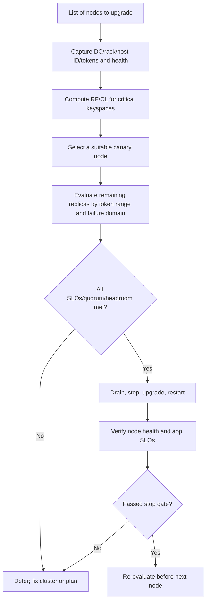
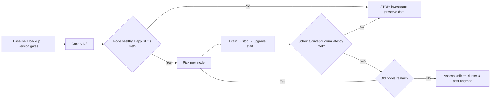
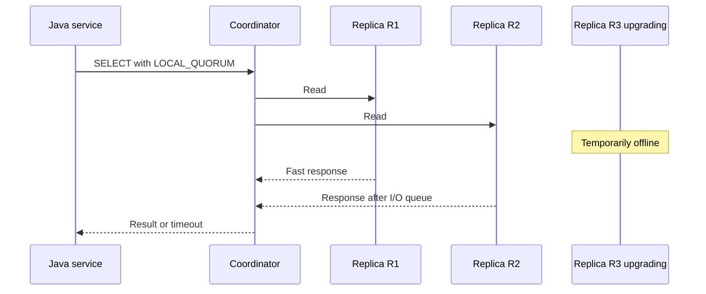

# Node Upgrade Order and Protecting Active Replicas in Apache Cassandra

## 1. The Problem: Upgrading Versions While Preserving Quorum

Apache Cassandra is a **distributed wide-column** database: the **partition key** determines which replicas own a partition, data is replicated according to the **replication factor (RF)**, and CQL queries are acknowledged only when the application-requested **consistency level (CL)** is satisfied. A cluster may span multiple racks, availability zones (AZs), and datacenters (DCs).

When upgrading Cassandra software, administrators typically stop, swap binaries/configs, and restart nodes one by one. Meanwhile, the stopped node **cannot serve requests**; remaining replicas must absorb its share of traffic. Stopping the wrong node or upgrading nodes holding the same partition simultaneously can cause Java applications to hit `UnavailableException`, read/write timeouts, or severe p99 spikes even when zero data is lost.

**A rolling upgrade is not simply "upgrade N1 → N2 → N3 in sequence."** It requires maintaining all of these simultaneously:

1. **A supported upgrade path:** source/target versions, JDK, configs, SSTable formats, schema, and drivers.
2. **Sufficient replica counts for every CL and DC** while one node is offline.
3. **Sufficient real capacity on remaining replicas:** disk/CPU/network/GC, read/write latency, and background load.
4. **A controlled mixed-version window:** old and new nodes coexist only within the scope supported by version documentation.
5. **Stop gates and a recovery plan:** never advance to the next node merely because the previous node now shows `UN`.

> Principle: *Each node may leave service only after proving remaining replicas satisfy application CLs and SLOs; move to the next node only once the previous node is genuinely healthy again.*

## 2. Node Upgrades Differ from Topology Changes

| Operation | Goal | Consequence for ownership |
| --- | --- | --- |
| **Rolling upgrade/restart** | Temporarily stop a node and bring that same node back on the new version | Token ownership is usually preserved; node is offline during upgrade window |
| **Bootstrap/scale out** | Add a node to the cluster | Changes membership and streams data |
| **Decommission** | Cleanly remove a live node from the cluster | Transfers ownership/ranges per procedure |
| **Removenode** | Remove membership of a dead node under version rules | Not a standard upgrade operation |
| **Replace node** | Replace a host/disk or unrecoverable node | Has its own identity/token/streaming workflow |
| **Repair** | Reconcile and synchronize replicas | Does not replace binary upgrades or backups |

**Do not decommission a node merely to install a new binary.** A normal rolling upgrade brings the same member back rather than arbitrarily altering partition ownership.

Likewise, `nodetool drain` prepares a node for shutdown—it is **not a command to permanently "leave the ring."** After restart, verify the node has rejoined, serves CQL, and shows no startup/recovery errors.

## 3. Required Active Replicas Depend on RF, CL, and Partition

Suppose keyspace `shop` uses `NetworkTopologyStrategy` with `RF(dc1)=3`. Each partition has three replicas in `dc1`, say R1, R2, R3. Minimum required responses vary by CL:

| Common CL | Responses needed for RF3 in one DC | When one replica is stopped |
| --- | ---: | --- |
| `ONE` | 1 | 2 replicas remain; can serve if healthy |
| `LOCAL_ONE` | 1 in the local DC | 2 local replicas remain; can serve |
| `LOCAL_QUORUM` | `floor(3/2)+1 = 2` in the local DC | Exactly 2 remain; zero second-fault margin |
| `QUORUM` | 2 for a keyspace with RF3 in one DC only | Exactly 2 remain |
| `ALL` | 3 | Cannot satisfy while one replica is stopped |

This is purely a **headcount calculation**; it does not guarantee the two remaining replicas have enough data, capacity, networking, and response speed. If R2 is Up yet experiencing GC pauses or extreme disk latency, a `LOCAL_QUORUM` request can still time out while R3 is offline.

### Pre-Stop Decision Table for a Node

| RF in DC | Application CL | Replicas required | Remaining when one stops | Assessment |
| ---: | --- | ---: | ---: | --- |
| 3 | `LOCAL_QUORUM` | 2 | 2 | **Can** roll if both remaining replicas are healthy |
| 3 | `LOCAL_ONE` | 1 | 2 | More count margin, though weaker consistency guarantees |
| 3 | `ALL` | 3 | 2 | **Fails CL** |
| 2 | `LOCAL_QUORUM` | 2 | 1 | **Fails CL** |
| 1 | `ONE` | 1 | 0 | Partitions become unavailable |
| 5 | `LOCAL_QUORUM` | 3 | 4 | Tolerates one offline node; still check other faults |

**Never lower CL from `LOCAL_QUORUM` to `ONE` just for a "zero-downtime upgrade"** when business correctness depends on quorum. If RF2 is configured alongside mandatory `LOCAL_QUORUM`, plan a maintenance outage window, add capacity properly, or change architecture; changing RF also requires streaming/repair and verification, never editing metadata and assuming replicas already hold the data.

### How Dangerous Are Two Concurrent Down Faults?

```text
RF(dc1) = 3, LOCAL_QUORUM = 2

State A: R1 Up, R2 Up, R3 Up  → 3 replicas available.
Upgrading R3: R1 Up, R2 Up, R3 Down → exactly 2 remain.
R2 also fails: R1 Up, R2 Down, R3 Down → only 1 remains.

Conclusion: Quorum fails even though maintenance only stopped R3 intentionally.
```

Upgrading **consumes the fault budget**. While one replica is offline, an independent failure on another replica causes every partition in that group to fail CL.

## 4. Calculate per DC, Not Just Cluster-Wide Node Count

Suppose a keyspace has:

```sql
CREATE KEYSPACE IF NOT EXISTS upgrade_multidc_example
WITH replication = {
    'class': 'NetworkTopologyStrategy',
    'dc1': 3,
    'dc2': 3
}
AND durable_writes = true;
```

With total RF = 6:

- `LOCAL_QUORUM` from a coordinator in `dc1` needs **2/3 `dc1` replicas**.
- `LOCAL_QUORUM` from a coordinator in `dc2` needs **2/3 `dc2` replicas**.
- Cluster-wide `QUORUM` needs **floor(6/2)+1 = 4 replicas**.
- `EACH_QUORUM` for standard writes requires quorum **in every DC** (e.g., 2 in `dc1` and 2 in `dc2`).
- `ALL` requires every replica, so stopping a single replica breaks requests using this CL.

| State | `LOCAL_QUORUM` dc1 | `LOCAL_QUORUM` dc2 | Cluster-wide `QUORUM` | `EACH_QUORUM` write |
| --- | --- | --- | --- | --- |
| 3 healthy replicas in both DCs | Satisfied | Satisfied | Satisfied | Satisfied |
| Stop one `dc1` replica; `dc2` healthy | 2 left, satisfied | 3 left, satisfied | 5 left, satisfied | 2+3 left, satisfied |
| Stop two `dc1` replicas; `dc2` healthy | **Insufficient** | 3 left, satisfied | 4 total left, may satisfy some request paths | **Insufficient `dc1` quorum** |
| Entire `dc2` lost; `dc1` has 3 | Satisfied in `dc1` | **Insufficient** | Only 3, **less than 4** | **Insufficient `dc2`** |

This matrix assumes live replicas actually hold data and have working networking. Never treat raw live-node arithmetic as proof that all partitions/CLs work: placement, node health, and coordinator DC still govern outcomes.

### With LWT/CAS

LWTs use **serial consistency** such as `SERIAL` or `LOCAL_SERIAL` alongside standard CL for their phases. LWT availability/latency cannot be inferred from simple `LOCAL_QUORUM` read/write headcounts while ignoring Paxos. During upgrade windows, test APIs using `IF NOT EXISTS`, `IF`, or conditional logic explicitly.

## 5. Choosing Node Order Based on Failure Domains and Token Ownership

A multi-node cluster does not always follow a fixed "every partition sits on R1, R2, R3" layout. With vnodes, each node owns multiple tokens; **each partition has its own replica set** determined by token placement and topology.



### Factors to Consider When Ordering Nodes

- **Traffic-serving DC:** if applications use `LOCAL_QUORUM`, never assume another healthy DC can cover missing local replicas.
- **Independent racks/AZs:** avoid concurrent maintenance across failure domains that would strip quorum from shared partitions.
- **Token ranges and vnodes:** one node serves many partition sets; do not test just a single sample key.
- **Application role:** nodes frequently used as contact points/coordinators can trigger heavy driver rerouting when taken offline.
- **Load and headroom:** a "low-CPU" node may still be a poor canary if remaining replicas for its token ranges are already saturated.
- **Unhealthy nodes:** never treat Down or Joining/Leaving/Moving nodes as healthy backup capacity.
- **Hardware/config differences:** choose a canary representative of the hardware/config class being upgraded to catch issues early.

**Do not pick node order solely by ascending IP or row order in `nodetool status`.** Re-evaluate each node and update the plan after every turn as replica health and load shift.

### One Node at a Time Is a Safer Default, Yet Not Enough

Under RF3 + `LOCAL_QUORUM`, stopping one node leaves exactly two replicas for affected ranges. Therefore, **never begin stopping a second node while the first is only "booting."** The first node must actively serve data and meet SLOs; if heavy streaming/compaction/recovery is occurring, wait for load to stabilize.

Parallel upgrades should happen only when capacity and quorum coverage **are proven across all token ranges and workloads**, backed by an official runbook and reliable automation/stop gates. Never use "they are in different racks" as sufficient proof without inspecting replica sets.

## 6. Upgrade Paths and Mixed-Version Rules Are the First Guardrail

Before installing binaries, verify **the vendor/project-supported upgrade path** for the exact source → target pair. Never infer from version digits that jumping arbitrarily from 3.x to 5.x or switching across distributions works.

### Pre-Upgrade Matrix to Build

| Item | Questions to verify | What goes wrong if missed? |
| --- | --- | --- |
| Cassandra source/target | Is direct upgrade supported? Are intermediate versions required? | Node cannot join or cannot roll back |
| Mixed-version window | How long and under what rules can old and new nodes coexist? | Gossip/schema/protocol incompatibility |
| JDK/JVM | Which Java version does each Cassandra release require, and which GC flags remain valid? | JVM fails to start, GC/memory regressions |
| `cassandra.yaml` and configs | Which options were renamed, removed, or given new defaults? | Unintended auth/compaction/network changes |
| SSTables/commit logs | Can files be read by new and old versions? | Downgrade blocked; node requires restore from backup |
| Native protocol/CQL | Can clients negotiate an appropriate protocol version? | Java Driver hits connection/prepare/query errors |
| Java Driver and codecs | Does the active Driver 4.x release support the server/version? | Metadata/UDT/collection/serial consistency failures |
| Auth/TLS | Are cipher suites, certificates, tokens, roles/permissions, and ports compatible? | All new clients rejected |
| Operational tools | Do `nodetool`/JMX, backup agents, exporters, and operators support it? | Wrong metrics or broken automation |
| New schema/features | Have target-only features been enabled prematurely? | Old-version nodes fail to read metadata or new queries |

**Never declare compatibility merely because one target node booted cleanly.** A valid upgrade requires checking release notes, compatibility matrices, and testing in a lab with matching versions/distribution.

### Why Restrict DDL During Mixed-Version Operation?

Some new schema/index/storage features exist only in the target version. Creating tables, types, indexes, or options while old nodes remain can cause:

- Old nodes failing to parse the new metadata or CQL.
- Client prepared statements/codecs receiving inconsistent schemas.
- Rollback becoming difficult or unsupported.

During mixed-version periods, **freeze unrelated schema changes** and enable new features only after the entire cluster reaches the state verified by release documentation.

## 7. Capacity Headroom: Quorum May Hold While the Cluster Slows Down

When one node goes offline, coordinators route requests to available nodes. With three equivalent replicas, remaining replicas can see a substantial traffic increase depending on workload. Avoid a rigid rule like "load always increases 50%" for every cluster, because:

- Token ownership and client routing vary.
- Reads at `ONE`, `LOCAL_QUORUM`, and writes place different loads on replicas.
- Hot partitions can bottleneck a single node.
- Caches, SSTable layouts, tombstones, compaction, and GC differ across nodes.
- Startup/recovery can add background I/O immediately after the node returns.

### Quantitative Headroom Example

Suppose total useful work across three equal nodes is 180 units/sec, split evenly:

```text
Before upgrade:
  N1 = 60, N2 = 60, N3 = 60 (work units/sec)

While N3 is offline:
  N1 + N2 must absorb 180 units/sec if total traffic stays constant.
  If split evenly, each handles ~90 instead of 60 = +50% increase.
```

This is purely an **idealized load model**, not a Cassandra QPS or IOPS forecast. When nodes already run near saturation, this jump can spike disk await, read/write queues, and p99. Build in load limits, the ability to shed non-essential ingest, or shift the maintenance window.

### Key Metrics Before Stopping a Node

| Group | What to measure | Condition to halt rollout |
| --- | --- | --- |
| CQL/API | Read/write p95/p99, timeouts, unavailable, failed attempts | SLO breached |
| Replica health | Up/Normal, DC/rack, local latency, queues | A required replica is unhealthy |
| Disk | Free space, read/write latency, IOPS/bandwidth | Insufficient headroom or disk errors |
| JVM | Heap, GC pauses, CPU, pending tasks | Prolonged pauses or CPU saturation |
| Background storage | Flushes, pending compactions, repair/streaming | Heavy background I/O contention |
| Driver | Reconnections, pool saturation, retries/speculation | Retry storms, connections failing to failover |

Replica-count quorum is a **necessary**, not **sufficient**, condition for zero-disruption upgrades.

## 8. Cluster-Wide Preflight Before the Upgrade Window

### 8.1. Lock Plan and Capture Baseline

- Record source/target versions, JDKs, package/image checksums, and supported upgrade paths.
- Record each node's host ID, IP, DC/rack, tokens/ownership, status, and planned order.
- Record RF/CL per keyspace and critical endpoints; flag any `ALL` or LWT requests separately.
- Define the maintenance window, accountable owners, stop conditions, and incident channels.
- Capture backups/snapshots/commit logs per policy and **test restores** beforehand on critical data.
- Archive versioned configs, certificates, roles/schemas, and related application artifacts.
- Verify free disk headroom for flushes, startup, SSTables, and compaction.

Do not treat snapshots as off-node backups if files stay on the same disk as the node being upgraded. And **backups taken on an older version are not automatically restorable onto an arbitrary target version**; use compatible procedures.

### 8.2. Pre-Selection Observations

On relevant nodes:

```bash
nodetool version
nodetool status
nodetool describecluster
nodetool netstats
nodetool tpstats
nodetool compactionstats
```

`nodetool status` shows membership/Up-Normal from the queried node's perspective; it **does not verify every partition directly**. `nodetool netstats`/`compactionstats` help identify streaming/repair/backlog activity that could compete for I/O during upgrades.

### 8.3. Test Representative Queries

In `cqlsh` through an appropriate coordinator:

```text
CONSISTENCY LOCAL_QUORUM;
```

Run sample reads/writes **on dedicated lab/health-check keys** and record latency; repeat across active DCs. In production, probes must use stable keys with TTL/cleanup and never alter real business records.

One successful `SELECT` **does not prove all token ranges or CLs are safe**. Real application telemetry and cluster metrics must drive decisions.

## 9. Defining a "Healthy Node" Before and After Upgrade

Seeing `UN` is not enough. A newly booted node still replaying commit logs, running heavy compaction, stabilizing schema, or experiencing network drops may not yet handle production traffic.

### Minimum Readiness Criteria

1. **Process:** Cassandra boots cleanly without crash-looping.
2. **Membership:** node reports Up/Normal with accurate DC/rack and host identity.
3. **Schema:** no prolonged schema disagreement; no metadata/DDL errors.
4. **Data path:** sample reads/writes at required CLs succeed across multiple representative partitions.
5. **Replica path:** coordinator reaches necessary replicas without spiking timeouts.
6. **Storage:** disk free space/latency, flush/compaction, and startup logs show no errors.
7. **Clients:** Java Driver connects cleanly; prepared statements/UDTs/auth/TLS are compatible.
8. **SLOs:** p95/p99, retries, unavailable counts, and error rates return within acceptable bounds long enough to confirm stability.

Do not check only at a single instant. After restart, warming caches and streaming/repair can cause metric swings; **a stabilization window** is a criterion defined by SLOs/runbooks.

## 10. Single-Node Rolling Upgrade Runbook

The commands below are **illustrative for lab environments or change-approved production**. Software installation commands, service managers, and package names depend on OS/cluster management, so no single `apt upgrade` or `systemctl` command is presented as universal.

### Step 1 — Select Node and Verify Quorum

For example, upgrading N3 in `dc1` while N1/N2 serve RF3 local quorum. Confirm **N1/N2 are genuinely healthy** for partitions where N3 is a replica and have CPU/disk/network headroom.

```bash
nodetool status
nodetool describecluster
nodetool tpstats
nodetool compactionstats
```

If another required node is Down or Joining/Leaving/Moving, **defer upgrading N3**. Never introduce a second outage when the cluster has already lost fault tolerance.

### Step 2 — Control Traffic and Background Work

Ensure the Java Driver has backup contact points/routing to other nodes, check load balancers if any, and pause non-urgent ingest/scans if required by the runbook. Do not trigger multiple bootstraps/rebuilds/repairs in the same window just to "check."

Never lower consistency levels to hide issues. If coordinator traffic must shift proactively, use mechanisms supported by **the driver/operator** and verify pooling/reconnection effects.

### Step 3 — Drain Node Before Planned Shutdown

On the exact target node:

```bash
nodetool help drain
nodetool drain
```

`drain` prepares the node for shutdown and flushes necessary memtables per version behavior. **Running a separate `nodetool flush` before `drain` is unnecessary** unless specified by the runbook. Draining does not raise RF, transfer ownership, or guarantee other replicas can carry the load.

Check the exit code and logs; if `drain` fails, **halt the upgrade** and inspect disk/commit log/flush health. Never treat a hung command as success, and never use `kill -9` as a routine shortcut.

### Step 4 — Stop, Swap Binaries, and Update Config per Version

Once `drain` succeeds, use the service manager/operator to stop the process. Update binary/JDK/config **according to the exact version-pair upgrade guide**:

- Preserve data directories, commit logs, host identity, tokens, and DC/rack layout.
- Diff old vs. new configs; never overwrite the new template with an old `cassandra.yaml` without reviewing changes.
- Verify TLS/truststores, passwords/roles, file permissions, and JMX.
- Never delete SSTables/commit logs/system tables to "start clean."
- Never run `decommission`, `removenode`, or `cleanup` as a routine part of a rolling upgrade.

### Step 5 — Start and Verify Compatibility

Start the service per runbook, watch logs, and check:

```bash
nodetool version
nodetool status
nodetool info
nodetool describecluster
nodetool netstats
nodetool tpstats
nodetool compactionstats
```

Verify the version is accurate, the node keeps its DC/rack/identity, and no schema mismatches or SSTable/commit log/protocol errors appear. Test reads/writes and authentication using the actual Java Driver version, **not just `cqlsh`**.

### Step 6 — Compare SLOs to Baseline and Gate the Next Node

Monitor for an adequate stabilization window:

- Quorum and CQL availability across critical CLs.
- API p95/p99 and timeouts/unavailable errors versus baseline.
- Driver reconnects/retries/connection pools; zero protocol/codec errors.
- Disk headroom, pending compactions, streaming/repair, and GC.
- Node actively serves traffic under normal load rather than merely sitting "Up but unready."

**Open the next node (e.g., N4/N2) only after every criterion passes.** If any metric degrades, halt the rollout and execute the incident playbook.

## 11. Cluster-Wide Order and Mixed-Version Limits

No single fixed DC/rack sequence fits every Cassandra version pair and topology. Rollouts must follow **the version-supported upgrade guide**, using quorum and capacity to order nodes.

### Common Conservative Strategy

1. **Canary:** pick one representative node, upgrade it, and observe long enough to catch regressions.
2. **One node at a time:** proceed within the evaluated DC/rack scope, never pulling another replica until the prior node is healthy.
3. **Re-evaluate before each turn:** the just-upgraded node can shift replica/cache behavior or uncover unexpected workloads.
4. **Multi-DC:** order based on traffic duties, WAN latency, and CL semantics; never assume `dc2` can absorb all `dc1` traffic automatically.
5. **Exit mixed-version:** confirm the whole cluster runs the target version with stable schemas and drivers.
6. **Post-upgrade work:** SSTable format rewrites, tuning, or new features occur only when **permitted by the guide** with capacity and rollback plans ready.



**Keep the mixed-version window short per runbook, yet never shorten it by skipping verification.** If the canary fails, do not bulk-upgrade remaining nodes to "sync versions faster." If the cluster must stay mixed-version longer than planned, re-evaluate support/recovery posture and restrict incompatible features.

### Never Upgrade Two Nodes in Parallel When Only Exact Quorum Remains

Under RF3 local quorum, stopping one node leaves two replicas. If another node is drained before the first recovers, some partitions drop to one responding replica, causing unavailable errors. **Same rack or different rack cannot save this scenario if too many replicas are pulled.**

## 12. Multi-DC Scenario with Traffic and WAN

Suppose two geographic DCs:

```text
Keyspace RF: dc1=3, dc2=3
Clients in dc1: LOCAL_QUORUM
Clients in dc2: LOCAL_QUORUM
Some batch jobs: cluster-wide QUORUM
Some writes: EACH_QUORUM
```

While upgrading one `dc1` node:

- `LOCAL_QUORUM` APIs in `dc1` retain **2 local replicas** under healthy conditions.
- `LOCAL_QUORUM` APIs in `dc2` continue using `dc2` replicas without waiting on WAN for local quorum.
- `QUORUM` batch jobs need **4 replicas across the keyspace**; assess WAN/quorum and live replicas.
- `EACH_QUORUM` writes need quorum in **both `dc1` and `dc2`**; WAN/DC faults can fail writes even when `dc1` has local quorum.

**Do not choose a `dc2` node as a canary while `dc1` lacks quorum** just because "the other DC still has three nodes." That can break global `QUORUM`/`EACH_QUORUM` jobs, and failover capacity depends on Java Driver/failover policies.

### If WAN Splits Between the Two DCs

Local quorums can keep operating independently inside each DC, yet **cross-DC visibility of new writes** is not guaranteed as when the network is intact. Never infer cluster-wide synchronization from successful local reads.

Before resuming upgrades after WAN recovery, check hints/anti-entropy repairs per policy and confirm lagging replicas can serve. Do not launch mass repairs concurrently with node upgrades without a clear capacity runbook.

## 13. Post-Upgrade Actions: Avoid Breaking Rollback Options

Some upgrade paths include SSTable format steps after binary upgrades, commonly run via tools like:

```bash
nodetool help upgradesstables
```

**Do not run `nodetool upgradesstables` indiscriminately out of habit.** Whether, when, on which version, and across which tables to run it must follow **the exact upgrade guide**. Converting file formats can:

- Consume heavy disk read/write bandwidth and grow compaction backlogs.
- Require extra disk headroom to write new SSTables before releasing old files.
- Make binary rollback **no longer simple or supported** because the old binary may fail to read the new format.

Similarly, do not enable target-only SAI, UCS, or schema/index features while old nodes remain or before testing. **Separate binary upgrades from new-feature rollouts** to isolate variables and preserve the rollback window.

### Snapshots Are Not an Unconditional Time Machine

Pre-upgrade backups are critical protection, yet restoring may require standing up nodes/clusters on a compatible version, preserving host identity/tokens, and reconciling mutations written after the backup. Never copy old SSTable directories straight into a node running a newer version and call it a valid rollback.

## 14. When Upgrades Fail: Stop Gates and Rollback Options

| Symptom | Causes to check | First action |
| --- | --- | --- |
| Node fails to start after binary swap | JDK/config/JVM flags, file permissions, version path | Keep node offline, inspect logs/compatibility, do not upgrade other nodes |
| Node Up but `nodetool status` is not `UN` | Gossip, tokens, DC/rack, bootstrap/rejoin | Halt rollout, inspect identity/topology |
| Prolonged schema disagreement | Mixed version, unsynced DDL, faulty node | Freeze DDL and further upgrades; inspect schema/cluster logs |
| `ReadTimeout` spikes | Remaining replicas overloaded, cold caches, disk/GC/network | Shed load, compare per-replica/driver p99 |
| `Unavailable` spikes | CL unmet due to missing replicas or DC | Check RF/CL/partition ownership first |
| Java `AllNodesFailedException` | Auth/TLS/protocol/routing or network | Inspect per-node root causes; do not guess one cause |
| Startup fails reading SSTables/commit logs | Data format, corruption, config/version mismatch | Do not delete data; use recovery guide and backups |
| Free disk drops rapidly | Flushes/compaction/streaming/`upgradesstables` | Stop extra tasks, restore headroom |
| GC/CPU climbs after upgrade | New runtime config, JVM/heap/GC regressions | Compare flags/JDK and metrics against baseline |

### When Can You Revert to the Old Binary?

**There is no universal answer like "just reinstall the old version."** Rollback depends on the version pair, written file/schema formats, configuration changes, protocols, and post-upgrade steps already executed.

Sound decision-making:

1. Read the rollback/downgrade policy for the exact source/target pair before rollout day.
2. Determine which SSTable, commit log, or schema formats the node wrote after booting the new version.
3. Verify whether reverting to the old binary **is supported** or whether rebuilding from compatible backups/snapshots is required.
4. If an upgrade cannot roll back safely, prioritize **keeping the node safe, protecting the remaining cluster, and following the recovery runbook**.
5. Never run `rm` on data directories, commit logs, or `system` tables to "force a downgrade."

**Never attempt rollback by deleting offending files.** A node on the wrong version with intact data stands a far better chance of recovery than a node missing pieces of its storage engine.

## 15. CQL Practice on a Three-Node Lab Cluster

Isolated lab example with DC `dc1` and at least three nodes to support RF3. Labs are not meant to prove production safety from one partition; the goal is observing CL behavior clearly when a replica drops.

### Create a Partition-Keyed Table

```sql
CREATE KEYSPACE IF NOT EXISTS upgrade_lab
WITH replication = {
    'class': 'NetworkTopologyStrategy',
    'dc1': 3
}
AND durable_writes = true;

CREATE TABLE IF NOT EXISTS upgrade_lab.orders_by_id (
    order_id uuid PRIMARY KEY,
    status text,
    updated_at timestamp
);
```

In `cqlsh`:

```text
CONSISTENCY LOCAL_QUORUM;
```

Sample write and read:

```sql
INSERT INTO upgrade_lab.orders_by_id (
    order_id, status, updated_at
) VALUES (
    11111111-1111-4111-8111-111111111111,
    'READY',
    '2026-11-20 10:00:00+0000'
);

SELECT status, updated_at
FROM upgrade_lab.orders_by_id
WHERE order_id = 11111111-1111-4111-8111-111111111111;
```

### Observe One Node Temporarily Offline

In the lab, after confirming remaining replicas are healthy, simulate **draining/stopping one node per runbook**, then from a live coordinator:

```bash
nodetool status
nodetool tpstats
nodetool compactionstats
```

Re-run `LOCAL_QUORUM` queries across several test partitions. With RF3, two healthy replicas remain so requests can continue; however, p99 may climb and losing a second node breaks quorum.

**Do not stop a second node just to demonstrate `Unavailable` in a shared environment.** To illustrate RF2/quorum failure, use an isolated test cluster or diagram the topology on paper.

### Verify After the Node Returns

After restarting:

```bash
nodetool version
nodetool status
nodetool describecluster
nodetool netstats
nodetool tpstats
```

Verify data with `SELECT` and inspect logs. State `UN` and a single readable row **do not prove all token ranges have converged**; if downtime was long or mutations were missed, apply appropriate hints/repair procedures before concluding.

## 16. Java Driver 4.x: Probe at Real CL, Never Mask Errors with Retries

Java Driver 4.x supports multiple contact points and local DC selection. This repository example probes CQL with a **prepared statement**; contact points represent lab addresses, and the session is managed at the application layer.

```java
import java.util.UUID;
import java.util.concurrent.TimeUnit;

import com.datastax.oss.driver.api.core.CqlSession;
import com.datastax.oss.driver.api.core.DefaultConsistencyLevel;
import com.datastax.oss.driver.api.core.cql.BoundStatement;
import com.datastax.oss.driver.api.core.cql.PreparedStatement;
import com.datastax.oss.driver.api.core.cql.Row;

public final class UpgradeReadProbe {
    private final CqlSession session;
    private final PreparedStatement select;

    public UpgradeReadProbe(CqlSession session) {
        this.session = session;
        this.select = session.prepare(
            "SELECT status, updated_at FROM upgrade_lab.orders_by_id " +
            "WHERE order_id = ?"
        );
    }

    public ProbeResult check(UUID orderId) {
        BoundStatement statement = select.bind(orderId)
            .setConsistencyLevel(DefaultConsistencyLevel.LOCAL_QUORUM)
            .setIdempotent(true);

        long startNanos = System.nanoTime();
        Row row = session.execute(statement).one();
        long elapsedMillis = TimeUnit.NANOSECONDS.toMillis(
            System.nanoTime() - startNanos
        );

        return new ProbeResult(
            row != null ? row.getString("status") : null,
            elapsedMillis
        );
    }

    public static final class ProbeResult {
        public final String status;
        public final long latencyMillis;

        public ProbeResult(String status, long latencyMillis) {
            this.status = status;
            this.latencyMillis = latencyMillis;
        }
    }
}
```

This example is only a **read probe**, not a replacement for load testing or verifying writes/LWTs across all tables. In real apps, initialize the session with **redundant contact points, `withLocalDatacenter(...)`, TLS/auth, and environment-appropriate timeouts**.

When a node version is incompatible with native protocol or certificates, Java may throw connection/`AllNodesFailedException` errors before reaching `ReadTimeoutException`. Therefore:

- Count **logical requests and attempts** separately, tracking retries/speculative executions.
- Distinguish server-side `Unavailable`, `ReadTimeout`/`WriteTimeout` from client-side driver timeouts.
- Never configure unbounded retries when a node is offline; retry storms can overload the two remaining replicas.
- Keep application CLs consistent before and after upgrades so benchmark comparisons stay valid.
- Tag metrics by query template, cluster/DC, and driver/server versions—never place sensitive partition keys into metric labels.

### Probes Must Not Corrupt Business Data

For write health checks, create a dedicated test table/keyspace with appropriate TTL/cleanup, use deterministic `operation_id`s, and inspect write-timeout outcomes. Never run `INSERT` into live order data just to monitor a rolling upgrade—especially avoid non-idempotent counters/LWTs getting retried.

## 17. Tracing the Path: Which Request Is Slow and Where?



Simplified diagram; coordinators select data vs. digest requests and read behaviors differently across versions. The takeaway is that **two living replicas can still trigger timeouts if one replica responds slower than the deadline**.

### Telemetry Source Matrix

| Tool/source | What to look for? | Limitation |
| --- | --- | --- |
| `nodetool status` | Up/Down, DC, rack, token state | `UN` does not prove latency/CL |
| `nodetool describecluster` | Cluster/schema/version metadata per version output | Not a CQL transaction check |
| `nodetool tpstats` | Active/pending/dropped messages | Must watch rates over time |
| `nodetool compactionstats` | Active/pending compactions | Pending task count does not equal bytes |
| `nodetool tablestats` | SSTables, memtables, local latency | Local to one node/table |
| `nodetool tablehistograms` | Tail read/write latency, partition/SSTable stats | Estimated percentiles, not API p99 |
| `nodetool netstats` | Streaming/hints/network state | Output depends on version |
| JVM/OS | GC, CPU, disk await, free space, network | Must correlate timestamps and nodes |
| Driver/API | p95/p99, timeouts, retries, connection failures | Does not pinpoint bad SSTable or replica directly |

### Distinguishing Availability from Latency

An upgrade can log `0 unavailable` yet still breach p99 because remaining nodes saturate. Conversely, a `LOCAL_ONE` API may remain fast while an `ALL` API fails. **Dashboards must break down by CL, query template, and DC**, not just aggregate service error counts.

## 18. Six Self-Assessment Scenarios

### Scenario A — RF3 with One Replica Already Down

App uses `LOCAL_QUORUM`, R1/R2 Up, R3 Down. Operations wants to upgrade R2 first because it handles less traffic.

**Guided answer:** No. Stopping R2 leaves only R1 for shared partitions, breaking local quorum. Fix/recover R3 first or redesign maintenance; "low traffic" does not strip R2 of its replica responsibilities.

### Scenario B — RF2 with `LOCAL_QUORUM`

Two nodes hold replicas in `dc1`; the team wants a zero-downtime rolling upgrade without changing RF or architecture.

**Guided answer:** `LOCAL_QUORUM` at RF2 requires both replicas. Stopping one fails CL for owned partitions. Plan an appropriate availability window; never promise zero-downtime rolling upgrades at these replica counts.

### Scenario C — Node Just Reached `UN`

N1 finished upgrading and reports `UN`, yet disk await is high and log replay/compaction are heavy; API read p99 rose from 40 ms to 350 ms. Can we move to N2?

**Guided answer:** No. `UN` is merely a membership prerequisite; wait until the node handles load cleanly, p99/timeouts stabilize, and remaining replicas are verified.

### Scenario D — Two DCs, One Batch Job Uses Global `QUORUM`

Keyspace RF3+RF3. `dc2` is completely lost while `dc1` is healthy. Java in `dc1` succeeds with `LOCAL_QUORUM`, but a `QUORUM` batch job hits timeouts/unavailable.

**Guided answer:** `dc1` local quorum needs 2/3, whereas global quorum needs 4/6. `dc1` only holds 3—insufficient for global quorum. Do not proceed with node upgrades while missing a DC unless an approved availability/recovery plan is in effect.

### Scenario E — Enabling a New Schema Feature Immediately on the Canary

N1 just moved to the target version supporting a new index/DDL, while N2/N3 remain on the old version. The app team wants to create the new index to test queries on production.

**Guided answer:** Do not enable target-dependent features before passing compatibility gates and bringing the whole cluster to the supported state. Test separately in a lab; freeze unnecessary DDL and changes during mixed-version windows.

### Scenario F — Planning Binary Rollback After Upgrading SSTables

The entire cluster runs the target version; some nodes already ran `upgradesstables`, and p99 degraded. An operator wants to reinstall the old binary on one node and boot it.

**Guided answer:** Not automatically safe. File formats/schemas may lack backward compatibility; read the exact version's downgrade/rollback guide, verify backups, and plan recovery first. Never delete SSTables to force the old binary to start.

### Scenario G — Client Configured with a Single IP

RF3/`LOCAL_QUORUM` has enough replicas, yet all Java pods point only to a single contact point—the node being upgraded—with no prior topology metadata/routing. When that node stops, the app loses connectivity.

**Guided answer:** Having enough server replicas is not enough; you need proper Java Driver session/topology discovery, redundant contact points, valid TLS/auth, and client failover tests. Never confuse server-side availability with client reachability.

## 19. Checklist Before, During, and After Rolling Upgrade

**Before upgrading**

- [ ] Verified upgrade/rollback path is **officially supported by the version/distribution**; recorded source, target, JDK, and Java Driver.
- [ ] Tested matching schema, SSTables/protocol/auth/TLS, client/UDTs, and workload profile in staging.
- [ ] Captured backups/snapshots and verified restores; saved configs, certs, roles/schemas, and node identities.
- [ ] Listed keyspaces, per-DC RF, CLs, `ALL` APIs, and LWTs.
- [ ] Checked token ranges/replica placement, DC/rack layout, and health of remaining nodes.
- [ ] Confirmed sufficient replicas for CL **plus CPU/disk/network headroom** when one node goes offline.
- [ ] Avoided ongoing bootstraps/decommissions/heavy repairs, schema changes, and active fault-domain incidents.
- [ ] Established baselines for p95/p99, timeouts/unavailable, driver retries, compaction, GC, disk, and network.
- [ ] Assigned canary, stop gates, owners, maintenance window, and failure/recovery runbooks.

**During each turn**

- [ ] Stop the selected node only after quorum/headroom checks PASS.
- [ ] Drain the exact target node; verify completion before stopping.
- [ ] Update binary/JDK/config for the target version while preserving host identity/tokens/DC/rack.
- [ ] Never run `decommission`/`removenode`/`cleanup` or delete commit logs as routine upgrade steps.
- [ ] Start, read logs, and verify version, `UN`, schema, CQL, and Java connectivity.
- [ ] Watch p95/p99, timeouts, pending compactions, disk, GC, and driver errors across a stabilization window.
- [ ] **Do not advance to the next node** if the prior node just booted, still logs errors, or lacks headroom.
- [ ] Do not enable DDL/new features while mixed-version unless explicitly allowed by the guide.

**After completion**

- [ ] Confirmed every node runs the right target version with stable schemas and drivers.
- [ ] Tested reads/writes and LWTs at required CLs from every relevant DC.
- [ ] Compared p95/p99/error rates against baseline during both steady state and peak load.
- [ ] Evaluated repair/catch-up for nodes offline longer than normal per runbook, without blindly triggering cluster-wide repairs.
- [ ] Ran `upgradesstables` or adopted new configs/features only per upgrade guide and I/O budget.
- [ ] Archived rollout report: node order, downtime, SLOs, errors, versions, and config changes.
- [ ] Re-evaluated backup/restore and recovery drills on the target version.

**Remember:** A Cassandra rolling upgrade is safe only when **each step pulls fewer replicas than the CL fault margin**, remaining replicas have capacity to hold p99, and the version pair supports mixed-version operation during the window. **Node order must be grounded in tokens/replicas, DC/rack, and real health**, not hostnames. Drain, restart, and `UN` are necessary steps, yet **quorum, driver compatibility, data integrity, and application SLOs** govern when to advance.
