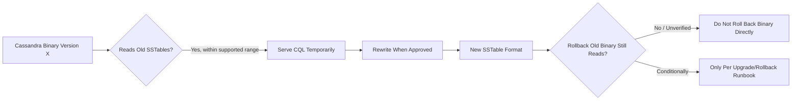
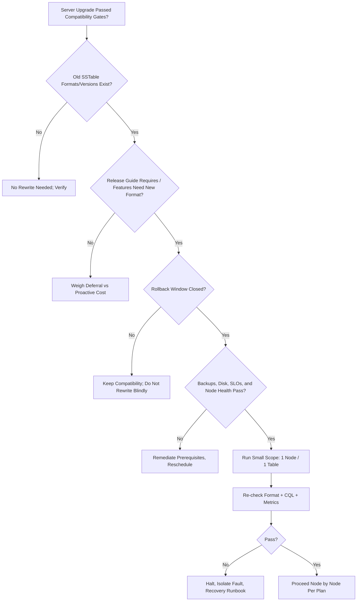
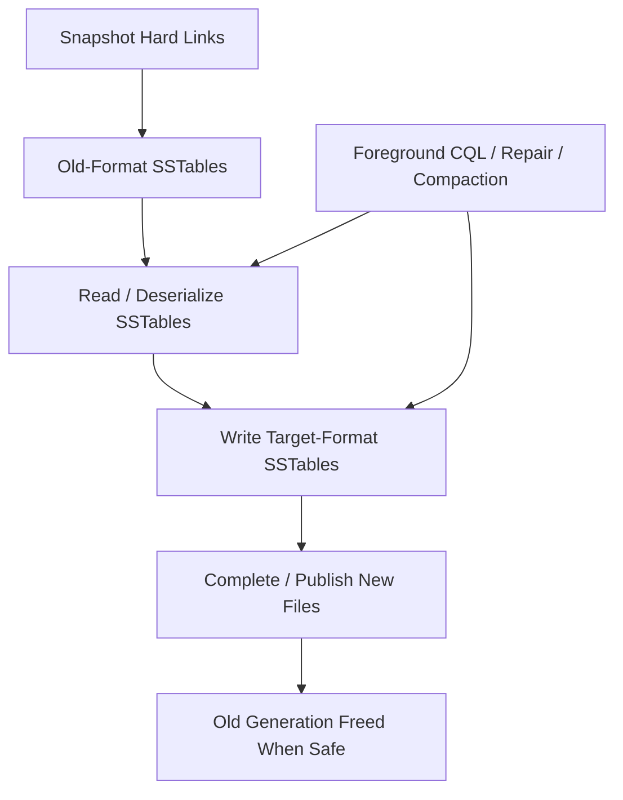

# SSTable Format Compatibility and When `upgradesstables` Is Needed

## 1. Context: Upgrading Cassandra Does Not Upgrade Every Data File Automatically

Apache Cassandra is a **distributed wide-column** database storing partitions by partition-key token on natural replicas determined by the replication strategy. Each replica writes mutations to the commitlog, updates memtables, and flushes them into **immutable SSTables**. CQL reads may reconcile data across memtables and multiple SSTables, while compaction builds new SSTables from older ones.

When moving from one Cassandra version to another, distinguish:

1. **Binary/server version:** the Cassandra code running on each node.
2. **SSTable version and format family:** how data, indexes, and metadata are laid out on disk.
3. **Compatibility mode and new features:** limits on formats/protocols/features a cluster can use while nodes remain on different versions.
4. **Java/driver and CQL application version:** which consistency levels, schemas, and query contracts clients still rely on.

Swapping binaries may allow the new node to **read old SSTables** within supported bounds while those files keep their old format. Rewriting remaining files to the format used by the new version is handled by `nodetool upgradesstables`; it **reads and rewrites SSTables**, not "upgrades software" and not a file-rename shortcut.

This lesson belongs to the **Upgrades and Compatibility** chapter of module `DATABASE_ENGINE_WIDE_COLUMN_CASSANDRA`. Its scope connects wide-column modeling, partition keys, query-driven table design, CQL, replication/consistency, compaction/repair, error handling, and Java application access.

After this lesson, learners can:

- Identify SSTable **format/version** and distinguish on-disk format from server version.
- Decide **when to run, defer, or skip** `upgradesstables` per the upgrade guide for **the exact source/target versions**.
- Understand `-a`, `-j`, keyspace/table scope, and boundaries with the offline `sstableupgrade` tool.
- Plan backups, temporary disk headroom, CPU/disk I/O, rollback windows, per-node rollout, and CQL data verification.
- Evaluate impacts on read/write p95/p99, errors, compaction, repair, and Java Driver behavior during rewrites.

## 2. An SSTable Is a Set of Components, Not a Single File

Cassandra uses an **LSM-tree** architecture. Mutations pass through commitlog/memtables; flushes produce SSTables on disk; SSTables are never mutated in place, instead replaced by new file generations after compaction or rewrites.

A typical BIG SSTable contains components with suffixes like:

| Component | Conceptual role | Upgrade significance |
| --- | --- | --- |
| `Data.db` | Holds partitions, rows/cells, and tombstones per format layout | Large volume read/written; must preserve logical content |
| `Index.db` or equivalent index component | Helps locate partition/row positions | Layout differs between BIG/BTI format families |
| `Summary.db` | Index summary for fast lookups | Can be rebuilt per version rules |
| `Filter.db` | Bloom filter for partition lookups | Affects false-positive rate / read I/O depending on format |
| `Statistics.db` | Metadata: timestamps, tombstones, repaired state, etc. | Several SSTable version changes live in metadata |
| `CompressionInfo.db` | Compression chunk metadata if table uses compression | Must match compression codecs and config |
| `TOC.txt`/checksum components | Component list/checksums | Never delete or rename manually to "upgrade" |

**Exact component lists vary by version and format.** For instance, BTI organizes indexes differently from BIG; never assume every format includes the exact components above. Inspect **the descriptor and metadata of the running version**, rather than grepping one suffix.

### Reading Filenames

Illustrative examples:

```text
nb-142-big-Data.db
│   │   │    └── SSTable component
│   │   └────── Format family BIG
│   └────────── Generation ID
└────────────── SSTable version code

oa-221-big-Data.db       # example 5.0-generation BIG
da-317-bti-Data.db       # illustrative 5.0-generation BTI
```

Do not confuse **generation ID** with Cassandra version. Two files with different generations can share the same format/version; conversely, one table directory can hold **both old and new SSTables simultaneously**.

## 3. Format Milestones to Remember: BIG and BTI

Per Apache Cassandra's SSTable version catalog, notable milestones include:

| Cassandra line | Representative SSTable format/version | Key takeaway |
| --- | --- | --- |
| Cassandra 3.x | BIG family, e.g., `mc`, `md`, `me` depending on 3.x patch | No single prefix covers all 3.x releases |
| Cassandra 4.0/4.1 | BIG `nb` on corresponding releases | 4.1 **does not automatically** mint a new format prefix just for a minor bump |
| Cassandra 5.0 | BIG `oa` | Metadata/semantic fields updated for 5.0 |
| Cassandra 5.0 | **BTI `da`** | New trie-indexed SSTable family, used only when version/config enables it |

These are **illustrative version IDs**, not a complete compatibility matrix for moving files across arbitrary releases. Some prefixes change across patch releases; always verify against documentation for **the exact version** and inspect live files.

Cassandra 5.0 can write BIG or BTI depending on configuration. Illustrative config snippet:

```yaml
# cassandra.yaml excerpt for 5.0 supporting BTI.
# DO NOT change during mixed-version/production without approval.
sstable:
  selected_format: bti
```

With standard compatibility configs, BIG may remain the default; **running Cassandra 5.0 does not automatically mean every SSTable is BTI**. Moving from BIG to BTI must be treated as **a dedicated format decision** with benchmarking and compatible rollback planning. Never assume BTI suits every workload merely because it is newer.

**Format milestones also gate features:** for example, certain timestamp/tombstone improvements and extended TTLs rely on newer format/protocol components. When compatibility mode intentionally preserves older standards, features requiring the new format may remain disallowed.

## 4. Distinguishing Four Concepts of "Compatibility"



| Compatibility type | Technical question | Must not be inferred |
| --- | --- | --- |
| **Binary ↔ old SSTable** | Which older releases' files can the new Cassandra binary still read? | Does not mean **every** historical format is supported |
| **Old binary ↔ new SSTable** | After rewriting, can the pre-upgrade binary still read files? | Never assume yes; rollback may be blocked |
| **Node ↔ node in rolling upgrade** | Do messaging/streaming/feature flags support the planned mixed versions? | Do not infer from reading old files; SSTables are not wire protocols |
| **Snapshot/restore ↔ target** | Can an old-format snapshot load into the target cluster? Is offline conversion needed? | Not automatically solved by `nodetool upgradesstables` on the target |
| **CQL/Java Driver ↔ schema** | Do legacy queries, CLs, and result mappings remain accurate? | SSTable rewrites do not prove API correctness |

**Golden rule:** "newer binary reads older files" **does not imply** "older binary reads newer files." Once the new format appears in the data directory, reverting the binary to an earlier release can prevent the node from booting or reading data.

## 5. When Should `nodetool upgradesstables` Be Run?

There is no rule that "it is mandatory after every patch/minor upgrade." The decision depends on **the supported upgrade path**, existing SSTable formats, new feature requirements, performance goals, and release-specific guidance.

| Scenario | Preliminary conclusion | What must be verified |
| --- | --- | --- |
| Freshly installed cluster, all SSTables already in target format | **Usually no rewrite needed** | Actual format/version, not just binary version |
| Patch upgrade within same branch, format unchanged | **Usually not needed** | Check release notes for metadata fixes or forced rewrites |
| Major upgrade changes format and guide requires on-disk data upgrade | **Schedule** after upgrade compatibility gates | Source/target path, disk headroom, rollback, per node |
| New binary reads old SSTables, all features/SLAs met | **Can defer** if guide allows | Old format deprecation timeline, known bugs, cost of waiting |
| Many cold SSTables stay in old format long-term | **Consider proactive rewrite** | Normal compaction may not touch them for a long time |
| Switching BIG → BTI on 5.0 | **Test separately**; may require rewriting existing SSTables | `selected_format`, compatibility mode, version-specific `-a` usage |
| Mid major rolling upgrade with old-binary nodes remaining | **Do not rewrite prematurely** just because binaries updated | Official compatibility/rollback guidance first |
| Disk near full or compaction overloaded | **Defer** unless special remediation workflow applies | Temp space, job concurrency limits, p99, availability |
| Trying to fix bad partition key or `ALLOW FILTERING` queries | **Wrong tool** | Needs query-driven table redesign / data migration |
| Trying to fix diverged data across replicas | **Not anti-entropy repair** | Use repair/reconciliation per runbook; SSTable upgrades do not compare replicas |

### Decision Tree



**This does not replace the upgrade guide.** Some upgrade paths require converting SSTables to finish the upgrade; others let the server keep reading older formats. Official docs and deployed packages are the final authority.

## 6. Cassandra 5.0: Compatibility Mode Must Be Evaluated Together with SSTable Format

In 5.0 releases supporting `storage_compatibility_mode`, configuration can constrain SSTable, commitlog, hints, and related feature versions. 5.0 documentation describes these values:

| Mode | Meaning | Risk if misunderstood |
| --- | --- | --- |
| `CASSANDRA_4` | Maintains format/feature compatibility needed with Cassandra 4.x during supported transition | Cannot assume new features depending on 5.0 formats are usable |
| `UPGRADING` | Phase where the system tracks node versions and enables compatibility rules per upgrade policy | Incurs validation checks; must follow documented rolling restart sequence |
| `NONE` | Enables target-version behaviors/features without maintaining legacy compatibility guards | Direct rollback to 4.x can no longer be treated as safe |

A **typical sequence documented for 5.0**: rolling upgrade in compatibility mode → rolling restart into `UPGRADING` → once complete per docs, rolling restart with `NONE`. This is not a universal recipe for every Cassandra version; each branch has its own syntax and rules.

**Separate the two choices:** `storage_compatibility_mode` governs staged read/write/feature compatibility; `sstable.selected_format` chooses the supported BIG/BTI family. Never enable `selected_format: bti` while older nodes that do not understand BTI remain in the cluster just to benchmark prematurely.

### Why Not Rewrite Immediately After the First Node Boots on 5.0?

A cluster mid rolling upgrade still has older nodes. New files or features can break rollback on the upgraded node; meanwhile, SSTable bytes on a node are **local storage**, and streaming/repair paths may impose stricter compatibility rules than local reads. One new node booting cleanly **is not permission** for the whole system to convert formats. Record an explicit "old-binary rollback accepted as closed" milestone before switching formats.

## 7. `nodetool upgradesstables`: Right Purpose and Right Scope

Per Cassandra 5.0 `nodetool` docs, `upgradesstables` **rewrites SSTables not currently on the running version** for specified keyspaces/tables. It executes via **JMX against a running node**.

### Illustrative Syntax

```bash
# Find exact syntax of the binary on a LAB node:
nodetool version
nodetool help upgradesstables

# Read-only node/table status checks:
nodetool status
nodetool netstats
nodetool compactionstats
nodetool tablestats migration_lab_ks.events_by_device

# Rewrite step ONLY in lab or change-approved maintenance:
nodetool upgradesstables -j 1 migration_lab_ks events_by_device
```

The final command **modifies data on disk**. Never run it straight on production merely because it appears in documentation. It is not a "dry-run."

### Options to Understand

| Option | Purpose | Warning |
| --- | --- | --- |
| Omit keyspace/table | Per docs, can process multiple keyspaces/tables on the node | **Extremely broad scope**; never use for initial tests |
| `<keyspace> <table> ...` | Limits scope to specific tables in the keyspace on the connected node | Does not mean other replicas across the cluster are upgraded |
| `-j N` / `--jobs N` | Number of SSTables processed concurrently up to thread limits | Higher N demands more disk I/O, CPU, and headroom |
| `-j 0` | Uses all available compaction threads per tool description | **Not a safe "fastest" mode** during busy production hours |
| `-a` / `--include-all-sstables` | Includes SSTables **already on the current version** | Can trigger massive rewrites; never use "just to be sure" |
| `-t` / `--max-timestamp` (where supported) | Filters SSTables by local creation timestamp in certain releases | **Not** a filter on mutation writetime; check binary units/syntax |
| `-h`/`-p`/JMX credentials | Targets admin node and authentication credentials | Distinct from CQL port 9042; protect JMX/TLS/secrets |

**Note on `-a` when moving BIG/BTI:** some format transitions require rewriting files already on the current version number that still belong to the prior format family. Yet `-a` alone **does not guarantee** conversion to BTI if `selected_format`/compatibility mode is wrong. Test in a matching-release lab and inspect descriptors rather than guessing from flag names.

### Targeting Another Node

```bash
# -h specifies the JMX host. Real systems may need -p, -u, -pwf, and TLS.
nodetool -h cassandra-node-d upgradesstables -j 1 migration_lab_ks events_by_device
```

Run **one node at a time**, or in small batches aligned with operational guidance and RF/CL, so remaining replicas absorb read/write traffic while one node handles heavy I/O. Never run in parallel across all replicas of a partition when SLOs depend on them.

## 8. `nodetool upgradesstables` Differs from `sstableupgrade` (Offline)

These two tools are **easy to confuse yet have distinct safety boundaries**:

| Criterion | `nodetool upgradesstables` | `sstableupgrade` |
| --- | --- | --- |
| Mode | Administers a **running Cassandra node** via JMX | **Offline** SSTable utility |
| Unit | Keyspace/table on the node | SSTables of a specified table/snapshot |
| Mechanism | Server schedules rewrites like compaction tasks | Utility runs on files using the shipped Cassandra version |
| When used | Post-upgrade when runbook permits online file conversion | Special offline tasks, upgrading old snapshots, or documented format changes |
| Safety preconditions | Disk headroom, healthy node, SLOs, backups, bounded concurrency | **Stop Cassandra** on target data directory first; never run alongside live process |
| Risks | I/O/CPU load and new format blocking binary rollback | Touches files/snapshots directly; can break hard links or bloat snapshot disk usage |

Cassandra 5.0's `sstableupgrade` documentation states explicitly that **Cassandra must be stopped before running**; never invoke it on a data directory actively served by a running node. Even though offline docs describe limited SSTable downgrade abilities, **that is not a cluster-wide rollback guarantee**, since commitlogs, system keyspaces, schemas, new features, and protocols may have changed. Never treat offline tools as emergency recovery without a tested version-compatibility runbook.

### Snapshots and Hard Links

Cassandra snapshots typically rely on SSTable hard links. Rewriting live SSTables creates new file generations while snapshots **pin** old inodes/files, preventing disk usage from dropping as expected. Upgrading a snapshot directly with an offline tool is documented as **breaking hard links with live SSTables**, causing the snapshot to consume independent disk space.

Therefore, before changing formats:

1. Capture backups **off-node/outside the fault domain** and test restore.
2. Track which snapshots pin old SSTables, retention, and backup uploads.
3. Never run `clearsnapshot` carelessly just to reclaim free disk.
4. When restoring old snapshots onto a new target, verify **supported format conversion/version paths** in isolation.

## 9. Resource Impact: Rewriting Is Not Renaming Files

Rewriting must **read old SSTables and write new SSTables** while Cassandra continues serving foreground reads and writes.



### Where Costs Occur

- **Disk read/write I/O:** reading old data, writing new files, plus generating new indexes/filters/metadata.
- **Temporary space:** old and new SSTables coexist temporarily; snapshots keep old inodes pinned.
- **CPU and allocation/GC:** deserialization, decompression/recompression, checksums, and index construction; cost depends on codecs, SSTable count, and workload.
- **Compaction contention:** rewrites share compaction executors/resources; pending compactions can climb.
- **CQL latency:** p95/p99 can rise even while nodes report `UN`; quorum CLs await responses from replicas.
- **Storage topology:** unbalanced multiple data directories/volumes; the busiest disk dictates safety rather than average free space.

### Estimating Headroom (Illustrative, Not a Guarantee)

Suppose a table on a node has **400 GiB** of SSTables to rewrite and **180 GiB** total free disk. If the job writes one or more output SSTables before freeing corresponding input files, is 180 GiB enough?

**You cannot tell** from those two numbers alone. Feasibility also depends on:

1. Rewriting one SSTable at a time versus multiple concurrently (`-j`).
2. Size of **the largest single SSTable**, compression ratio, and output format.
3. Whether snapshots pin old hard links or backups share the same volume.
4. Concurrent flushes, compaction/repair, hints, commitlog, and write growth.
5. Free disk **per mount/data directory**, not merely summed across volumes.

Budget conservatively for **peak temporary bytes** and enforce policy stop thresholds. "Enough space for the final new dataset" **does not mean** enough space while old and new coexist.

### What `-j` Value Should You Pick?

There is no universal optimal number. Start at **1** on a small table/canary node, measure rewrite throughput and CQL p99; increase jobs only when disk headroom and latency hold steady without overlapping major repair/streaming. `upgradesstables` documentation defines `-j 0` as using all compaction threads: that easily causes resource contention and is not a safe default.

## 10. Observing Before, During, and After Format Conversion

### Minimum Measurements

| Layer | Before | During | After |
| --- | --- | --- | --- |
| **SSTable inventory** | Version/format family, file count, disk bytes per table/node | New SSTables created, old/new coexisting | Inventory of any remaining old SSTables |
| **Cluster** | `UN`, schema agreement, DC/rack, RF/CL | No lost quorum/replicas; no abnormal topology shifts | Returned to normal steady state |
| **Compaction/rewrite** | Active/pending compactions and validation | Rewrite jobs, byte progress if exporters/logs report | Backlogs back to target range |
| **Host disk** | Free bytes per volume, IOPS, disk await | Peak read/write, temporary headroom | Reasonable free space/SSTable counts |
| **CPU/JVM** | CPU/GC baselines | CPU throttling, heap/GC pauses | No lingering GC or CPU drift |
| **CQL/client** | p50/p95/p99, errors/timeouts, throughput | Tail latency and timeouts per query/CL | Compare same workload/CL before vs. after |
| **Repair/backup** | Repair schedule, backup manifests, snapshot links | Avoid overlapping heavy jobs | Confirm next backup/repair runs error-free |

**Read-only** commands on the node:

```bash
nodetool version
nodetool status
nodetool describecluster
nodetool netstats
nodetool compactionstats
nodetool tpstats
nodetool tablestats migration_lab_ks.events_by_device
nodetool listsnapshots
```

**Define metric scopes clearly:** `proxyhistograms` measures from the coordinator's perspective, `tablestats` is local to the queried node, and Java Driver p99 measures end-to-end application latency. Never combine percentiles across sources or judge solely from the canary node while other replicas struggle.

### Inspecting Descriptors on a Lab Host (Read-Only)

There is no single standard CQL query returning exact "versions of all SSTable files" like querying `system_schema`. Combine **metadata/filesystem inventory** on the exact node with the binary's SSTable utilities:

```bash
# Linux example in a LAB environment. Path depends on data_file_directories.
# Never run chmod/mv/rm on SSTable directories!
find /var/lib/cassandra/data/migration_lab_ks/ -type f -name '*-Data.db'

# Example inspection using offline utility on a file/snapshot copy
# once you have verified the utility's requirement to stop Cassandra:
sstablemetadata --help
```

To read version codes, parse **descriptors per version and format family**. Files inside `snapshots/` and `backups/` are not live SSTables; count them separately. Never infer "seeing only `oa` in one folder" means the whole node/cluster has converted formats.

## 11. Node-by-Node Format Upgrade Runbook

### Gate 0 — Lock Upgrade Path and Rollback Authority

Record source/target Cassandra/JDK, driver versions, compatibility settings, existing SSTable versions, active schemas/features, per-DC RF, application CLs, and healthy nodes/racks. Consult **the exact release's upgrade guide** to check rolling upgrade order and when rewrites are permitted.

**If old-binary rollback policy remains active**, do not issue rewrite commands producing formats the old binary cannot read.

### Gate 1 — Backups/Restores and Capacity Sizing

- Off-node backups completed with checksums/manifests and **restore tested**.
- Track which snapshots pin old SSTables; never delete them to "free temporary space."
- Size disk headroom **per node and per data volume**, accounting for the largest SSTable and expected write growth.
- Confirm RPO/RTO/rollback paths if a rewrite aborts mid-way—not just "reinstall the binary."
- List large tables, cold partitions, SSTable counts, and Java application SLA targets.

### Gate 2 — Complete Rolling Server Upgrade per Guide

Upgrade binaries in the release's supported order and compatibility rules; verify `UN`, gossip, schema agreement, metrics, CLs, and CQL correctness. Maintain compatibility mode per procedure while older nodes remain.

Do not treat `nodetool upgradesstables` as something to run early on arbitrary nodes: **run it only when allowed by the target release runbook**, after rollback/compatibility windows are settled.

### Gate 3 — Small-Scope Canary

Pick **one node and one lab or low-risk table**, measuring baseline p99/CPU/disk first. Check the exact binary's help:

```bash
nodetool help upgradesstables

# WARNING: live rewrite, run only after Gates 0–2 in approved LAB/maintenance:
nodetool upgradesstables -j 1 migration_lab_ks events_by_device
```

Watch `compactionstats`, logs, host I/O, free disk, CQL timeouts, and new SSTable descriptors; keep other tables and nodes as a control group. If no old SSTables exist, the tool may have nothing to rewrite; never pass `-a` just to generate lab load.

### Gate 4 — Post-Canary Verification

1. Confirm the job finished **with zero errors**, check new-format SSTable metadata, and count remaining old-version SSTables.
2. Re-read sample partition keys plus TTL/tombstone/collection fields and compare against baseline.
3. Check p95/p99, successful throughput, and read/write timeouts under matching workload.
4. Ensure free disk, pending compactions, and CPU/GC have stabilized.
5. Verify repair, backup, and restore workflows remain compatible with the new format.

**If the canary fails:** halt rollout, inspect logs/formats/repairs/backups; **never manually rename file prefixes or downgrade binaries**.

### Gate 5 — Expand Node by Node

Schedule one node at a time (or small units per RF/CL/upgrade guide), waiting for completion and SLO pass before advancing. In multi-DC setups, evaluate each DC/rack, WAN, and backup independently; avoid saturating all replicas of hot partitions simultaneously.

### Gate 6 — Cluster-Wide Inventory and Change Closure

Record percentage of SSTables/bytes in the target format **per node/table/DC**, release versions and configs, restored data verification, and latency/throughput stats. Verify scheduled tasks like repair/compaction/backups succeed on the new SSTables. Close the ticket only when **the entire committed scope passes**, not when one node's command exits 0.

## 12. Lab Practice: Verifying Data Before and After Rewrite

Example using a Cassandra lab cluster on an approved source/target upgrade path with one DC `dc1` of three nodes for RF3. Keyspace/table names are isolated from production.

### 12.1. CQL Fixture

```sql
CREATE KEYSPACE migration_lab_ks
WITH replication = {'class': 'NetworkTopologyStrategy', 'dc1': 3}
AND durable_writes = true;

CREATE TABLE migration_lab_ks.events_by_device (
    device_id text,
    bucket_day date,
    event_ts timestamp,
    event_id uuid,
    event_type text,
    payload text,
    PRIMARY KEY ((device_id, bucket_day), event_ts, event_id)
) WITH CLUSTERING ORDER BY (event_ts DESC, event_id DESC);

INSERT INTO migration_lab_ks.events_by_device
    (device_id, bucket_day, event_ts, event_id, event_type, payload)
VALUES (
    'synthetic-device-007', '2026-11-21',
    '2026-11-21T08:00:00+0000',
    11111111-2222-4333-8444-555555555555,
    'HEARTBEAT', 'sample-A'
);

INSERT INTO migration_lab_ks.events_by_device
    (device_id, bucket_day, event_ts, event_id, event_type, payload)
VALUES (
    'synthetic-device-007', '2026-11-21',
    '2026-11-21T08:05:00+0000',
    22222222-3333-4444-8555-666666666666,
    'ALERT', 'sample-B'
);
```

To test retention/tombstones, use **a separate lab table and pre-calculated TTL policies**, without needing outages or mass `DELETE`s. The two rows above serve only correctness smoke testing; they do not represent production I/O or SLAs.

### 12.2. Record Baseline

```sql
CONSISTENCY LOCAL_QUORUM
PAGING 1

SELECT event_ts, event_id, event_type, payload
FROM migration_lab_ks.events_by_device
WHERE device_id = 'synthetic-device-007'
  AND bucket_day = '2026-11-21'
LIMIT 10;
```

With `PAGING 1`, the two fixture rows return across multiple pages; you must verify **both rows**, not just the first page. Record key/row sets and values. If some nodes only answer at CL `ONE` yet fail `LOCAL_QUORUM`, that is an availability/replica fault—never call it "format upgrade succeeded."

### 12.3. Flush SSTables in the Lab to Observe Versions

```bash
# Lab only; never flush entire production clusters just for practice.
nodetool flush migration_lab_ks events_by_device

# Inspect on each authorized node:
nodetool status migration_lab_ks
nodetool tablestats migration_lab_ks.events_by_device
nodetool compactionstats
```

**Proper lab sequence:** create a dataset on the source Cassandra version → upgrade binaries in lab per guide → inventory remaining old SSTable versions → once safe, run `upgradesstables`. If you insert and flush fixtures **after** upgrading the server, files may already be in the current format so the tool has nothing to do.

### 12.4. Canary Rewrite (Not Read-Only)

```bash
# Must verify server/compatibility, backups, disk headroom, and rollback rules.
# Never run on production purely for learning.
nodetool help upgradesstables
nodetool upgradesstables -j 1 migration_lab_ks events_by_device

# Afterward, inspect remaining tasks:
nodetool compactionstats
nodetool tablestats migration_lab_ks.events_by_device
```

Do not use `nodetool upgradesstables -a` in this exercise unless your specific goal is testing full-table rewrites with spare disk and downtime/SLO budget. Never delete old files or snapshots manually, and never run offline `sstableupgrade` while the node is running.

### 12.5. Post-Verification

Repeat the exact `LOCAL_QUORUM` query, read both pages, and compare keys/values. Evaluate:

\[
\mathrm{correctness} =
\bigl(\mathrm{keys}_{before}=\mathrm{keys}_{after}\bigr)
\land
\bigl(\mathrm{values}_{before}=\mathrm{values}_{after}\bigr)
\]

This is a **fixture verification definition**, not proof that the whole cluster lost zero mutations. Under real traffic, verify across many partitions, TTL/tombstone records, and concurrent reads/writes during compaction/repair.

## 13. Verifying Through a Java Driver 4.x Application

This snippet uses Java Driver 4.x, assuming `CqlSession session` is connected to local DC `dc1`, the role has `SELECT` permission, and all imports are present. It **reads before/after data to verify the API contract**, without calling JMX/`nodetool` directly.

```java
PreparedStatement ps = session.prepare(
    "SELECT event_ts, event_id, event_type, payload " +
    "FROM migration_lab_ks.events_by_device " +
    "WHERE device_id = ? AND bucket_day = ? LIMIT 10"
);

BoundStatement request = ps.bind(
    "synthetic-device-007",
    LocalDate.of(2026, 11, 21)
).setConsistencyLevel(DefaultConsistencyLevel.LOCAL_QUORUM)
 .setPageSize(1);

long start = System.nanoTime();
ResultSet rows = session.execute(request);
long firstPage = System.nanoTime();

List<String> fingerprint = new ArrayList<>();
for (Row r : rows) {
    // No PII in lab; for real data, hash/redact safely.
    fingerprint.add(
        r.getInstant("event_ts") + "|" +
        r.getUuid("event_id") + "|" +
        r.getString("event_type") + "|" +
        r.getString("payload"));
}
long completed = System.nanoTime();

System.out.printf(
    "rows=%d firstPageMs=%.2f fullResultMs=%.2f%n",
    fingerprint.size(),
    (firstPage - start) / 1_000_000.0,
    (completed - start) / 1_000_000.0);
// Compare fingerprint against the fixed baseline from the previous step.
```

Typical imports: `java.time.LocalDate`, `java.util.List/ArrayList`, and Driver classes `PreparedStatement`, `BoundStatement`, `ResultSet`, `Row`, `DefaultConsistencyLevel`.

**Interpreting measurements accurately:**

- `firstPageMs` does not represent full query time if results are paged.
- `fullResultMs` covers all pages plus client-side processing time.
- A single read cannot compute p99; gather histograms across many operations under equal load alongside error/timeout rates.
- Never alter CL or page size between before/after to "lower latency" while still claiming an unchanged contract.
- When reading/writing concurrently during an upgrade, check timeouts and correctness per node/coordinator, not only the canary.
- The sample fingerprint uses synthetic data only; on real data, never log raw payloads or partition keys into benchmarks or tickets.

## 14. Losing Compatibility on Rollback: Mistakes That Cause Major Outages

**Hypothetical scenario:** cluster upgrades from 4.x to 5.0; nodes run the new binary cleanly. An operator runs `upgradesstables`, converting some files to the new version/format family, then discovers a severe CQL bug and immediately reinstalls the 4.x binary.

What can happen:

1. The old binary **cannot understand** the new SSTables and fails to open data.
2. Commitlogs/hints/metadata, schemas, or feature flags may also be incompatible.
3. Some nodes rewrote files while others did not → a state much harder to recover than a rolling upgrade stopped before rewriting.
4. Backups taken right before the rewrite may **not cover mutations ACKed afterward**.
5. If snapshots are only same-disk hard links, data has no off-host copy if a disk dies.

**The right handling plan** must be built prior to change:

- Confirm **the point of no rollback** for binaries, formats, and features per the upgrade guide.
- If rollback is still required, choose a **rebuild/restore** strategy from compatible backups and compute RPO/RTO.
- Never rename `oa` suffixes to `nb` or copy new-format files into old nodes to "force it to run."
- Never infer from offline `sstableupgrade` having a downgrade mode that the entire cluster supports lossless downgrades.
- Log exact timestamps of backups, rewrites, last ACKed writes, and acceptable recovery points.

### Comparing Rollback Feasibility by Phase

| Phase | Old binary rollback | Conditions |
| --- | --- | --- |
| Before rolling upgrade | Usually per standard plan | Data still in source format; backups/restore ready |
| Mixed-version on supported path | Conditionally **possible** | Governed by guide; no incompatible features/formats used yet |
| Whole cluster on new binary, compatibility still preserves old format | Conditionally **possible** | Must check commitlogs/schemas/metadata, not just SSTables |
| SSTables rewritten to new format | **Never assume safe** | Requires tested restore/downgrade runbook to target |
| Format-dependent new features enabled | Risk of direct rollback being impossible | Must verify system-wide compatibility/backups/correctness |

No single rule promises "Cassandra can always be downgraded." Upgrade and fallback paths must be approved by operators from exact version documentation.

## 15. Distinguishing Format Errors from Consistency/Replication Errors

| Symptom | Hypothesis to check | Diagnostic action |
| --- | --- | --- |
| New server fails reading SSTables at startup | Unsupported format, corrupt file, missing codec/component | Inspect logs for descriptor/version info and checksums against upgrade guide |
| One table still holds many old-format files | Not rewritten yet; cold data untouched by compaction | Inventory versions per node/table; determine if rewrite is needed |
| `upgradesstables` runs with no files changed | Files already on current version, wrong node/table, or compatibility holds old format | Inspect output, descriptors, `selected_format`, and scope |
| Disk nears full during rewrite | Old/new files coexisting, snapshots, flushes/compactions | Pause rollout, check per-volume disk headroom; never delete SSTables manually |
| p99 climbs and `LOCAL_QUORUM` times out | Replicas hit I/O/GC contention; too slow to reply in time | Check host disk await, ClientRequest latency, and `compactionstats` on all replicas |
| Node is `UN` yet CQL returns wrong results | Data mismatch, CL, TTL/tombstones, query, or bug | Compare keys/values and trace; `UN` does not prove data accuracy |
| Repair streaming fails in mixed-version | Compatibility/messaging bug, network, or format | Check release matrix and logs; avoid blaming disk reflexively |
| Old snapshot fails to restore onto new release | Snapshot format too old, missing schema/config | Offline test/upgrade snapshot per docs; leave live files untouched |
| Major compaction writes new SSTables yet old files remain | Some tables uncompacted or snapshots pin old files | Inventory per table rather than concluding from one directory |
| Java Driver connects only to some nodes | Node version/health, TLS, metadata/routing, auth | Separate connection failures, unsupported protocol, and SSTable errors |

### Never Misuse These Commands

- `nodetool repair`: reconciles data between replicas; **does not** rewrite all SSTables into a new format.
- `nodetool compact`: forces compaction on a scope with its own cost; **not** a synonym for `upgradesstables`.
- `nodetool refresh`: loads properly placed SSTables per rules; does not magically translate formats from arbitrary versions.
- `nodetool cleanup`: removes data outside a node's token ranges after topology changes; **does not** upgrade formats.
- `sstableupgrade`: offline utility requiring Cassandra stopped; **never** run against live data directories.

## 16. Change Management Checklist for Operations Teams

- [ ] Source/target Cassandra versions, Java/JDK/driver versions, and official upgrade path verified.
- [ ] Inventoried SSTable versions and BIG/BTI formats per node/table/DC; identified snapshot files separately.
- [ ] Compatibility mode/selected format approved; no irreversible features enabled yet.
- [ ] Off-node backups verified with checksums and restore-tested into an isolated environment.
- [ ] Budgeted disk headroom for peak rewrite **per data volume**, counting snapshot links and write growth.
- [ ] Locked `-j`, keyspace/table scope, node order, and p99/error/disk/GC stop thresholds.
- [ ] Avoided overlapping repairs, bootstraps, streams, backups, and heavy compactions unless budgeted.
- [ ] Captured baseline successful QPS, p50/p95/p99, timeouts, GC, disk I/O, and SSTable counts.
- [ ] Used a single-node/single-table canary, re-checked descriptors/versions and data fixtures, and measured SLOs before expanding.
- [ ] Confirmed all nodes healthy and critical keyspaces still meet serving RF/CL.
- [ ] Rollback document **explicitly states when direct binary downgrade is impossible**, along with RPO/RTO.
- [ ] Logged post-checks for backups/restores, repairs, and data correctness after format conversion completed.

## 17. Scenario Exercises and Self-Check

### Scenario A — Upgraded Without Rewriting

A cluster upgraded from 4.x to 5.0 along a supported path; all nodes run 5.0, while many old-version BIG files remain on a rarely read table. Answer:

1. Does the upgraded binary automatically prove all SSTables are in the new format?
2. When can `upgradesstables` be deferred, and when does the release guide require it?
3. What format inventory, compatibility mode, and disk headroom must be checked to decide?

### Scenario B — Switching to BTI

Cassandra 5.0 currently uses `selected_format: big`. A team wants to enable BTI and run `upgradesstables -a` on every node simultaneously to benchmark performance. List the risks:

- Binary/config prerequisites unmet, especially if the cluster is still mixed-version.
- Rewriting every SSTable already on the current version burns heavy disk/CPU.
- For a hot partition at RF3, all replicas can saturate disk I/O at once.
- Before/after A/B benchmarks may differ in cache/compaction state; identical workloads and measurement methods are required.

Propose an improved plan using a lab format benchmark, per-node canary, and clear SLO/disk gates.

### Scenario C — Rollback After Rewrite

After format conversion, a Java app encounters data decoding errors. Why should you **not** immediately reinstall the old binary? Present the required evidence on SSTable versions, commitlogs/features, backups, ACKed writes, and verified recovery paths.

### Scenario D — Full Disk

A node has 120 GiB free, a table has many SSTables of tens of GiB each, and snapshots pin old links. An operator wants to pass `-j 0` to finish faster. Explain why this choice raises data-loss/outage risk, and which stop thresholds should be set.

### Short Questions

1. How does SSTable version differ from Cassandra binary version? Can one directory hold multiple versions at once?
2. What do BIG `nb`, BIG `oa`, and BTI `da` represent in the referenced Cassandra versions?
3. Why does "newer version reads old SSTables" not imply "older version reads new SSTables"?
4. Does `nodetool upgradesstables` perform anti-entropy repair?
5. What is the difference between `-j 1`, `-j 0`, and `-a`?
6. When should the offline `sstableupgrade` utility be used, and why must Cassandra be stopped first?
7. How can snapshot hard links change disk consumption while rewriting live SSTables?
8. Why must inventory run per node/table/DC rather than a single check on a coordinator?
9. Which shared resources can drive Java Driver p99 spikes during rewrites?
10. How does compatibility mode interact with SSTable versions, commitlogs/hints, and rollback feasibility?
11. Does a passing CQL smoke test at CL `ONE` confirm an RF3/`LOCAL_QUORUM` cluster is safe?
12. Design three gates that must PASS before starting, after the canary node, and before closing the change.

**Completion criteria:** learners distinguish binary upgrades, format rewrites, and protocol compatibility; identify versioned BIG/BTI SSTables; decide `upgradesstables` usage per release guide rather than blindly after every upgrade; measure I/O/disk/compaction/latency, verify CQL/Java data correctness, and write rollback plans grounded in **whether the new format can actually be read**.

## 18. References

- [Apache Cassandra 5.0 — Storage Engine and SSTable versions](https://cassandra.apache.org/doc/latest/cassandra/architecture/storage-engine.html): LSM, BIG version IDs (3.x/4.x/5.0), BTI `da`, and `selected_format`.
- [Apache Cassandra 5.0 — `nodetool upgradesstables`](https://cassandra.apache.org/doc/latest/cassandra/managing/tools/nodetool/upgradesstables.html): rewrite behavior, keyspace/table scope, `-a`, `-j`, `-t`.
- [Apache Cassandra 5.0 — offline `sstableupgrade`](https://cassandra.apache.org/doc/latest/cassandra/managing/tools/sstable/sstableupgrade.html): differences from `nodetool`; requires Cassandra stopped, upgrading snapshots, and hard-link risks.
- [Apache Cassandra 5.0 — `cassandra.yaml`](https://cassandra.apache.org/doc/latest/cassandra/managing/configuration/cass_yaml_file.html): `sstable.selected_format` and `storage_compatibility_mode`; always verify against actual config.
- [Apache Cassandra — `nodetool`](https://cassandra.apache.org/doc/latest/cassandra/managing/tools/nodetool/nodetool.html): `version`, `status`, `compactionstats`, `tablestats`, and `listsnapshots`.
- [Apache Cassandra — Backups](https://cassandra.apache.org/doc/latest/cassandra/managing/operating/backups.html): snapshot/SSTable hard links, offsite backups, and restores.
- [Apache Cassandra — Repair](https://cassandra.apache.org/doc/latest/cassandra/managing/operating/repair.html): distinguishing anti-entropy from format rewrites.
- [Apache Cassandra Java Driver 4.x](https://apache.github.io/cassandra-java-driver/4.18.1/): measuring CQL latency, availability, and CLs in Java post-upgrade.

**Conclusion:** **Upgrading binaries, converting SSTable formats, and enabling new features are three separate decisions.** Cassandra can temporarily read older SSTables without immediate rewrites, yet how long older formats stay supported and when `nodetool upgradesstables` must run depend on the official upgrade path. Treat every rewrite as a real storage operation: **prepare backups/rollback plans, size disk headroom, throttle jobs, canary node-by-node, verify CQL/Java correctness and p99**, and only then expand across the cluster. Never trade away safe rollback just to get a newer prefix on every file.
