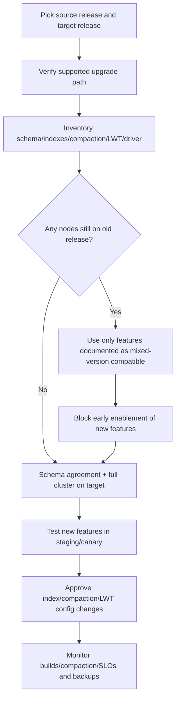
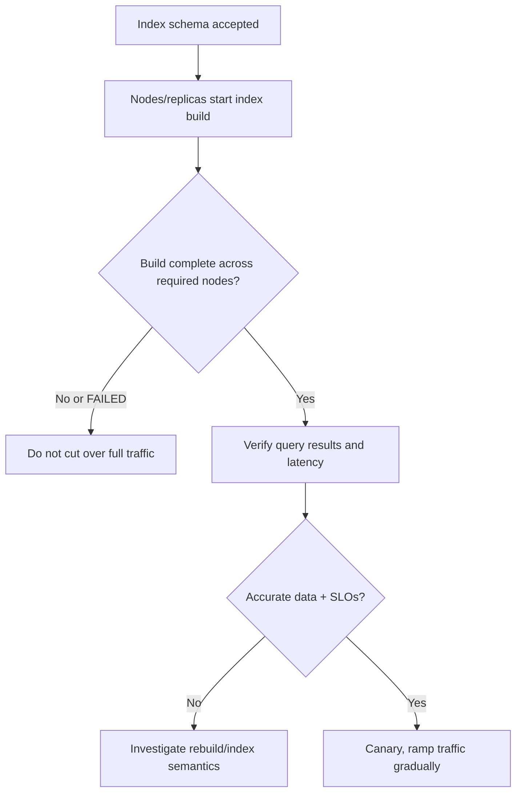
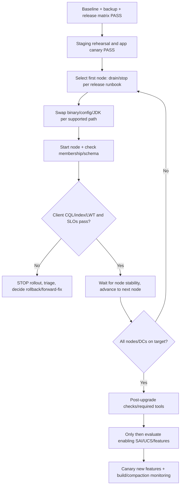

# Comparing Indexes, Compaction Strategies, LWTs, and Features Across Apache Cassandra Releases

## 1. The Problem: Node Upgrades Succeed, Yet Do Queries and Transactions Remain Correct?

An Apache Cassandra cluster runs a Java application with three workload patterns:

- Reading orders by tenant and status using an index.
- Writing TTL-bound events with a time-oriented compaction strategy.
- Transitioning order states via conditional `UPDATE ... IF ...` statements, i.e., **lightweight transactions (LWTs)**.

The operations team plans a rolling upgrade of Cassandra, one node at a time, to avoid downtime. Before swapping versions, they notice the new release introduces **Storage-Attached Indexing (SAI)**, **Unified Compaction Strategy (UCS)**, and optimizations along the LWT path. The question is not merely "does the new version have that feature?", but also:

1. Which indexes/compactions/LWTs is the cluster **currently** using, on which tables and applications?
2. If a feature exists in the **target release**, is it supported while the cluster runs **multiple versions simultaneously**?
3. When switching index implementations or compaction strategies, is **build/rebuild/index backfill/compaction** required, and how much disk/network headroom is needed?
4. Do conditional transactions preserve **exact truth semantics** across Java Driver code paths and retries?
5. After adopting new schemas/features, is **binary rollback** still feasible, or has the cluster crossed the point of no safe downgrade?

This lesson belongs to the **Upgrades and Compatibility** chapter of module `DATABASE_ENGINE_WIDE_COLUMN_CASSANDRA`. It bridges distributed architecture, the wide-column model, query-driven table design, consistency, CQL, replication, compaction, repair, error handling, and the Java Driver. The emphasis is **verifying compatibility per release and validating real workloads**, rather than equating upgrade success with `nodetool status` reporting `UN`.

### Learning Objectives

After this lesson, you will be able to:

1. Build a **feature inventory** and comparison matrix across source → target → mixed-version phases.
2. Evaluate **legacy secondary indexes (2i)**, **SAI**, **SASI**, and index build/migration concerns across releases.
3. Evaluate **STCS, LCS, TWCS, and UCS**, compaction costs, and fit for TTL/write/read workloads.
4. Verify **LWT/Paxos, `SERIAL`/`LOCAL_SERIAL`, CAS contention, and retry semantics** through a rolling upgrade.
5. Author a runbook covering preflight → canary → rolling upgrade → post-upgrade enablement → validation → rollback decisions.
6. Validate via CQL, `system_schema`, `nodetool`, and Java Driver 4.x with baseline/after metrics and GO/NO-GO gates.

## 2. Three Compatibility Layers That Must Be Separated

| Layer | Question | Example risk |
| --- | --- | --- |
| **Binary/cluster compatibility** | Are old and new release nodes permitted to communicate along the upgrade path? | Gossip, messaging, on-disk formats, and mixed-version restrictions |
| **Schema/feature compatibility** | Do all nodes reading/writing schemas/indexes/SSTables understand the enabled features? | Enabling SAI/UCS while older nodes still lack support |
| **Application/protocol compatibility** | Do the driver, CQL statements, and business guarantees still function? | Driver negotiation, LWT retries, paging, timeouts, error mapping |

A cluster can **upgrade binaries in exact order** and still break apps via driver/statement issues, or stay healthy while index read p99 spikes because index builds are incomplete. Conversely, a CQL query succeeding on a new coordinator **does not guarantee** older replicas understand a newly enabled feature.

### 2.1. "Available in Release" Does Not Mean "Usable Mid Rolling Upgrade"



**Safe operating rule:** keep active schemas and features unchanged during a rolling upgrade unless official documentation for **that exact version path** permits changes. Enable new features only after all relevant nodes reach the minimum version and mandatory post-upgrade steps finish.

## 3. Read Release Notes Along the Upgrade Path, Not from a Blog Post

Every change must identify four milestones:

1. **SOURCE**: current Cassandra version; e.g., a specific 4.x release.
2. **TARGET**: planned Cassandra version; e.g., a specific 5.x release.
3. **MIXED**: window where old and new binaries coexist; which features are restricted?
4. **AFTER**: once the whole cluster hits target, are there SSTable upgrades, index rebuilds, driver updates, or config changes?

**Never assume** a 3.x → 5.x path can run in one hop just because both versions exist. Upgrade order, compatibility windows, JDK requirements, drivers, native protocols, tools, and rollback rules must come from **the upgrade guide/release notes for your exact source–target pair**. Never pick "latest" blindly and apply it across arbitrary sources.

### 3.1. Release-Aware Matrix Template

| Item | Source | Target | Mixed-version | Evidence to record |
| --- | --- | --- | --- | --- |
| Binary/JDK | Exact patch + running JDK | Exact patch + supported JDK | Allowed to run side-by-side? | Upgrade guide, Java compatibility |
| Protocol/driver | Driver version, native protocol | Supported driver/protocol | Negotiation and exception mapping | Driver compatibility test |
| 2i | Index names/kinds/options | Supported? Build changes? | No unscheduled changes | `system_schema.indexes` + test queries |
| SAI | Unused / in use? | Does release include SAI? | **Block early enable** unless docs allow | Staging DDL + index build |
| SASI | Optional implementation present? | Supported/deprecated? | Inspect carefully | DDL/config/migration plan |
| STCS/LCS/TWCS | Current table-level compaction | Compatibility/semantics | Keep strategy while mixed | `system_schema.tables`, disk/latency |
| UCS | N/A if source lacks it | Does release include UCS? | Enable only after cluster compatibility | Config + capacity + compaction tests |
| LWT/Paxos | LWT query shapes, `SERIAL` CL | Correctness/latency behavior | Verify cross-node interaction | CAS contention tests |
| SSTable format | Current on-disk versions | Supported readers/writers | Format limits while mixed | SSTable/upgrade guide |
| Auth/security | `system_auth` RF, role settings, TLS | Auth configs/caches | Fresh logins, role changes | Security canary |

This matrix is a **template to fill out**, not a claim that all Cassandra 4.x/5.x builds share identical migration paths. Features and option names vary by major/minor release and commercial distributions.

## 4. Gather Cluster State Without Modifying Data

Before upgrading, capture an inventory **across all nodes/DCs**, not just the first node reached over SSH.

```bash
# Read-only status commands, run on each inspected node.
nodetool version
nodetool status
nodetool describecluster
nodetool tpstats
nodetool proxyhistograms
nodetool compactionstats
nodetool netstats

# Exact option usage varies by version.
nodetool help
```

In CQL, query metadata:

```sql
-- Connected (local) node; collect across representative nodes.
SELECT release_version, cluster_name, partitioner
FROM system.local;

-- Replication for application keyspace and system_auth.
SELECT keyspace_name, replication
FROM system_schema.keyspaces
WHERE keyspace_name IN ('upgrade_lab', 'system_auth');

-- Inspect indexes on a table.
SELECT index_name, kind, options
FROM system_schema.indexes
WHERE keyspace_name = 'upgrade_lab'
  AND table_name = 'orders_by_tenant';

-- Inspect compaction map of the table.
SELECT keyspace_name, table_name, compaction
FROM system_schema.tables
WHERE keyspace_name = 'upgrade_lab'
  AND table_name = 'orders_by_tenant';
```

`system.local` describes only the responding node. In mixed-version environments, **collect per-node versions** via inventory/`nodetool version` and cluster metadata—never treat one row of `system.local.release_version` as the whole cluster's version.

### 4.1. What Must the Inventory Contain?

| Group | What to record |
| --- | --- |
| **Cluster/topology** | Exact version per node, DC/rack, seeds/snitch, RF, UN/DN states, active topology jobs |
| **CQL schema** | Keyspaces/tables, partition/clustering keys, indexes, materialized views, UDTs/UDFs, table options |
| **Index workload** | Index types/kinds, CQL query shapes, read/write RPS, selectivity, index size/build state |
| **Compaction workload** | Per-table strategy, SSTable counts/sizes, tombstones, TTL distribution, pending compactions |
| **LWT** | `IF` statements, contention rates, `SERIAL`/`LOCAL_SERIAL`, retries/timeouts, concurrent writers |
| **Java** | Driver version, local DC, native protocol/TLS, retry/speculation, request timeouts, paging, idempotence |
| **Safety** | Backup/restore tests, free disk/headroom, p95/p99, error rates, outstanding repair/streaming |

Do not dump secret-bearing configs into tickets. Record **effective configuration**, versions, and sources, redacting hosts/passwords/tokens when sharing.

## 5. Index Types: 2i, SAI, and SASI Differ in Capabilities and Operations

In Cassandra, indexes do not change how data is distributed by **partition key**. They provide an alternate lookup path at the cost of extra writes, reads, disk, compaction/merges, or builds.

| Type | Concept | What to check before upgrading |
| --- | --- | --- |
| **Legacy secondary index (2i)** | Node-local index on column values; long supported in Cassandra | Selectivity, cluster fan-out, index build/rebuild, read p99, writes |
| **Storage-Attached Index (SAI)** | Index integrated with SSTable storage lifecycle; introduced in Apache Cassandra 5.0 | Target release support, syntax/class, index build/backfill, disk/CPU, mixed-version restrictions |
| **SASI** | Optional/experimental index implementation in supported releases | Support boundaries, production warnings, deprecations, and replacement path |
| **Materialized view** | Derived/denormalized structure maintained from a base table | Not a secondary index; verify release support and separate rebuilds/repairs |
| **Query-driven table** | Explicitly maintained table whose partition key matches the query | Often yields predictable routing/latency, though writes must stay synchronized |

**Never claim SAI is always faster than 2i for every query.** Performance depends on cardinality, selectivity, predicates, partition count, combined index filters, size, compression, hardware, and version. Not every data type or predicate shares identical support.

### 5.1. Legacy 2i: Compatible, Yet Fan-Out Must Be Measured

Lab example:

```sql
CREATE KEYSPACE IF NOT EXISTS upgrade_lab
WITH replication = {
    'class': 'NetworkTopologyStrategy',
    'dc1': 3
};

CREATE TABLE IF NOT EXISTS upgrade_lab.orders_by_tenant (
    tenant_id text,
    order_id uuid,
    status text,
    amount decimal,
    updated_at timestamp,
    PRIMARY KEY ((tenant_id), order_id)
);

-- Illustrative legacy secondary index.
CREATE INDEX IF NOT EXISTS orders_status_2i
ON upgrade_lab.orders_by_tenant (status);
```

If a query asks for all orders with `status='PAID'` **across all tenants**, the index may fan out across many nodes and is rarely cheap. With low cardinality, status values appear in many partitions; concurrent fan-out queries can drive heavy load. Fixed per-tenant access patterns are often better served by a table keyed on `(tenant_id, status)` when the workload fits, paired with denormalized write maintenance.

**Common mistake:** adding an index to "avoid choosing a partition key" without measuring bandwidth, quorum, selectivity, or behavior when a node drops.

### 5.2. SAI: Release-Specific Feature Requiring a Feature Gate

Apache Cassandra **5.0** includes **Storage-Attached Indexing (SAI)**; other Cassandra distributions may provide SAI in different releases. The syntax below is **illustrative only for supporting releases**:

```sql
-- Run only after all relevant nodes support SAI.
-- Never create on production simultaneously just to test syntax.
CREATE CUSTOM INDEX IF NOT EXISTS orders_status_sai
ON upgrade_lab.orders_by_tenant (status)
USING 'StorageAttachedIndex';
```

Before running real DDL, confirm the exact class name and index options in **documentation for your running version**. Avoid keeping two redundant indexes on the same column long-term just to "compare," as each carries distinct disk/write/build overhead.

**Questions to resolve when adopting SAI:**

1. Which nodes/replicas during rolling upgrade do not yet understand this index type?
2. Does the index need to **build over historical data**, how long will it take, and how much disk/CPU/I/O will it consume?
3. Does the table have many SSTables, tombstones, TTLs, or huge partitions?
4. Do real queries filter/sort using predicates supported by SAI, and is selectivity sufficient?
5. Could index build/rebuild tasks fail after restarts or during node streaming/repair?
6. If rollback is needed, can the old release still read the new index schema/format?

**Safety policy:** never enable SAI inside the **mixed-version window** unless explicitly allowed by the upgrade guide; test in staging first once the whole cluster reaches the target release.

### 5.3. SASI: Do Not Confuse with SAI

**SASI** and **SAI** differ in implementation and support scope. SASI was provided as an optional/experimental index in certain Cassandra releases; never treat it as an automatic stepping stone to SAI or a default production choice.

If inventory finds indexes using SASI classes/options:

- Check **deprecation/support status** in both source and target releases.
- Re-benchmark `LIKE`/range/prefix queries relying on SASI capabilities.
- Design a migration path to SAI, query-driven tables, or an external search engine based on real requirements.
- Never swap `USING 'SASI'` to `USING 'StorageAttachedIndex'` by directly editing system metadata tables.

## 6. Index Compatibility Is More Than `CREATE INDEX` Succeeding

An index can be created cleanly yet **not be ready to serve historical data** across newly building or rebuilding replicas. Especially when adding an index to an already populated table, watch closely:



### 6.1. Three Verification Dimensions

| Check | Question | Evidence |
| --- | --- | --- |
| **Schema** | Is the index defined identically cluster-wide? | `system_schema.indexes`, schema agreement |
| **Storage/build** | Did index builds/rebuilds finish on historical SSTables per release? | Build state/logs, node metrics, disk, failures |
| **Query correctness/SLO** | Do old/new/deleted/TTL records return accurately with p99 inside budget? | Golden dataset, Java canary, sampling across nodes/DCs |

**Schema agreement ≠ index build complete.** Nor does one passing `SELECT` prove the index built on **every** replica/token range. Verify correctness, build status, and behavior across node restarts/failures.

### 6.2. Avoid New Query Syntax While Rollback Remains Required

Drivers/apps might issue queries an older coordinator cannot parse. Until the entire cluster stabilizes, keep CQL queries within **the intersection supported by both source and target releases**. Use feature flags or compatibility profiles; enable new features only after the rolling upgrade and post-upgrade validation finish.

## 7. What Is Compaction and Why Does Strategy Matter During Upgrades?

Memtable flushes produce **immutable SSTables**. Compaction merges selected SSTables, reclaims safe redundant/expired data, and manages read amplification, disk usage, and TTL/tombstones. Every strategy trades off **write amplification, read amplification, space amplification, I/O, and data age**.

Core strategies:

- **STCS (SizeTieredCompactionStrategy):** groups similarly sized SSTables; often suits write-heavy patterns yet requires merge disk headroom and read amplification varies with file count.
- **LCS (LeveledCompactionStrategy):** organizes SSTables into levels to curb read amplification on many workloads, trading higher compaction/write amplification and heavier I/O.
- **TWCS (TimeWindowCompactionStrategy):** buckets SSTables by time windows, useful for **TTL/time-series** event tables with aligned write-time distributions; avoid mixing old and new timestamps in one SSTable.
- **UCS (UnifiedCompactionStrategy):** next-generation strategy introduced in **Apache Cassandra 5.0**, offering flexible workload trade-off tuning; verify version support, tuning, and mixed-cluster compatibility.

**No single strategy is "best" for every table.** Evaluate query shapes, read/write ratios, TTL/deletes, partition sizes, and disk/CPU/network capacity.

## 8. STCS, LCS, TWCS, and UCS Migration Matrix

| Strategy | Typical workloads | Expected benefit | Upgrade risks / conditions |
| --- | --- | --- | --- |
| **STCS** | Steady writes, append-heavy, no strict ultra-low read amplification | Size-based merges, moderate write overhead | SSTable counts and merge space amplification; read p99 if files accumulate |
| **LCS** | Read-heavy, minimizing SSTables touched per read | Leveled SSTables with non-overlapping ranges per level | High write amplification/compaction I/O; long transition when switching strategies |
| **TWCS** | TTL time-series where data arrives roughly in-window | Efficient whole-SSTable TTL expiration/compaction when aligned | Late writes/upserts into old data, overly huge/tiny windows, mixed TTLs |
| **UCS** | Tables needing tunable read/write/space trade-offs where supported | Flexible tuning of read/write/space costs | Release-specific feature, changing tuning/options, never enable early during mixed-version |

### 8.1. TWCS: Do Not Pick It Just Because the Schema Has a Timestamp Column

TWCS works when **write timestamps**, TTLs, and deletion patterns align with time windows; simply having an `event_time timestamp` column is insufficient proof. A client writing historical events with old write timestamps, updating very old rows, or running backfills with skewed timestamps can spread data across unwanted windows in the same SSTables.

Before selecting TWCS, verify:

- Distribution of actual **write timestamps** and TTLs, not just event time.
- Rates of late arrivals, backfills, updates, deletes, and retention periods.
- Whether **entire SSTables** can expire cleanly when a window ages out.
- `gc_grace_seconds` and repair schedules to prevent zombie data.
- Disk headroom during strategy transitions/SSTable rewrites.

### 8.2. UCS: Do Not Copy Options from Another Release

When the target release supports UCS, take **exact class names, scaling parameters, options, and defaults** from documentation for that exact release. Never copy UCS configs from a blog covering a different distribution without verifying.

**A new node understanding the class name does not mean older nodes understand it.** Never alter STCS/LCS/TWCS tables to UCS while older nodes remain unless docs permit mixed-mode operation. Split **binary upgrade** and **compaction strategy migration** into two gated changes.

## 9. CQL to Inspect and Change Compaction on a Lab Table

`system_schema.tables.compaction` shows the declared strategy/options:

```sql
SELECT table_name, compaction
FROM system_schema.tables
WHERE keyspace_name = 'upgrade_lab'
  AND table_name = 'orders_by_tenant';
```

In a lab running a release supporting STCS and LCS, you can alter options on **a test table** as a separate step once safety gates pass:

```sql
-- Staging example, NOT a mandatory step during binary upgrades.
ALTER TABLE upgrade_lab.orders_by_tenant
WITH compaction = {
    'class': 'LeveledCompactionStrategy'
};
```

**Changing compaction schema does not reorganize all old SSTables instantly.** Background compaction processes gradually per policy; switching strategies can spike read/write/disk I/O, temporary SSTable counts, and p99. In production, verify capacity headroom, track migration progress, halt if SLOs breach, and understand rollback rules.

### 9.1. How to Observe

```bash
nodetool tablestats upgrade_lab.orders_by_tenant
nodetool tablehistograms upgrade_lab orders_by_tenant
nodetool compactionstats
nodetool tpstats
nodetool proxyhistograms
```

| Metric | What to watch |
| --- | --- |
| SSTable count / SSTables per read | Read amplification per node and table |
| Pending compactions / bytes remaining | Background load and convergence speed of the new strategy |
| Disk used/free, I/O latency | Headroom while writing new SSTables and freeing old files |
| Java-side read/write p95/p99 | End-to-end SLO, not just local table latency |
| Tombstones scanned / TTL expired | Query/delete cost and strategy effectiveness |
| Successful RPS / timeouts / retries | Avoid "pretty" p99 caused by requests failing early |

**Do not** force major compactions or SSTable rewrite tools just to "finish strategy migration faster" without a version-approved procedure and disk/rollback plan.

## 10. LWTs: Compatibility Means More Than Just Parsing `IF` Statements

Cassandra lightweight transactions (LWTs) use **Paxos/compare-and-set (CAS)** to apply conditional updates within a single partition under Cassandra semantics. They carry different costs and retry paths than regular writes.

Example:

```sql
-- Table already holds key (tenant_id, order_id) with row status='NEW'.
UPDATE upgrade_lab.orders_by_tenant
SET status = 'PAID', updated_at = '2026-11-21T09:00:00Z'
WHERE tenant_id = 'tenant_lab'
  AND order_id = 11111111-1111-1111-1111-111111111111
IF status = 'NEW';
```

LWT results include the `[applied]` column. When `[applied]=true`, the condition succeeded and applied; when `false`, Cassandra returns current state so the application decides next steps. On **timeout**, never assume the condition failed to apply: replicas may have committed it even though the response never reached the client.

### 10.1. Constraints to Preserve Across Upgrades

- **CAS correctness:** two competing requests must never both believe they transitioned `NEW → PAID` in violation of the contract.
- **Serial consistency:** `SERIAL` and `LOCAL_SERIAL` have different scopes in multi-DC clusters; never switch arbitrarily to cut latency.
- **Regular consistency:** LWTs also use regular CL for their read/write phases; record both regular and serial CLs.
- **Contention:** multiple writers hammering one partition cause retries/latency; binary optimizations cannot cure a hot partition key.
- **Idempotency/retries:** apps and drivers must handle unknown outcomes and `[applied]` states without infinite or blind retries.
- **Mixed-version:** Paxos/schema protocols and release improvements must obey the upgrade guide, including config/feature warnings.

LWTs are **partition-scoped**. They do not replace distributed transactions across multiple partitions, tables, or clusters.

## 11. `SERIAL` and `LOCAL_SERIAL` Across DCs

| CL type | High-level role | What to verify |
| --- | --- | --- |
| `SERIAL` | Serial consistency spanning all replicas for the LWT condition | WAN latency, DC outage tolerance, full-cluster support |
| `LOCAL_SERIAL` | Serial consistency scoped to the local datacenter executing the operation | Business validity with multi-DC writers, local DC routing, failure modes |
| `LOCAL_QUORUM`/`QUORUM` | Regular consistency for CQL read/write phases | Never substitutes for serial consistency in the CAS phase |

**A broken example:** an app requires a single global state across DC1 and DC2, yet operations switches from `SERIAL` to `LOCAL_SERIAL` to reduce p99 without analyzing concurrent writers across DCs. Queries still succeed, yet the operation's consistency guarantee silently broke.

**Right approach:** document business invariants, replica sets/CLs, network partition behavior, and run contention tests across coordinators/DCs. Switch only if the product accepts the new semantics and version docs confirm support.

## 12. LWT Costs and Upgrade Verification

LWTs exchange more messages and round trips than regular writes. Across releases, Paxos implementations/optimizations and metrics can change. Never hardcode a fixed RTT count across all versions.

### 12.1. Metrics to Collect

| Metric | Why |
| --- | --- |
| LWT attempts/s and `[applied]` true/false | Separates business success from CAS contention |
| CAS contention/timeouts/unavailable | Measures real contention and failures, including server-side |
| Java p50/p95/p99 for LWT statements alone | Isolates from normal SELECT/INSERT p99 |
| Retries/speculative attempts | Detects attempt amplification and unknown outcomes |
| Coordinator and replica CPU/GC/network | Measures protocol overhead |
| Regular/serial CL and local DC | Explains multi-DC differences |
| Business invariant violations | Correctness outweighs latency |

### 12.2. Two Contention Cases

**Case A — strictly one winner:** two clients both send `IF status='NEW'` attempting different target states. With valid schema/CL and no external mutations, only one applies per contract; the other observes `[applied]=false` or an error needing reconciliation.

**Case B — unknown timeout:** client A times out after sending CAS, and client B later sees the status already changed. A **must not** blindly fire an unconditional mutation to "compensate," as that can break invariants. Read back using approved CL/serial semantics and resolve via operation IDs / state machines.

Test across **steady state, one slow replica, node restarts, and mixed-version state** per safety guidelines. Never inject chaos network faults in production without formal approval.

## 13. Java Driver 4.x: Testing LWTs and `[applied]` Outcomes

Java 17+ example with DataStax/Apache Cassandra Java Driver 4.x. Assumes `CqlSession session` is configured with local DC, TLS/auth, and lifecycle management:

```java
import com.datastax.oss.driver.api.core.DefaultConsistencyLevel;
import com.datastax.oss.driver.api.core.cql.BoundStatement;
import com.datastax.oss.driver.api.core.cql.PreparedStatement;
import com.datastax.oss.driver.api.core.cql.ResultSet;
import com.datastax.oss.driver.api.core.cql.Row;
import java.time.Instant;
import java.util.UUID;

PreparedStatement cas = session.prepare("""
    UPDATE upgrade_lab.orders_by_tenant
    SET status = ?, updated_at = ?
    WHERE tenant_id = ? AND order_id = ?
    IF status = ?
    """);

BoundStatement statement = cas.boundStatementBuilder()
    .setString(0, "PAID")
    .setInstant(1, Instant.parse("2026-11-21T09:00:00Z"))
    .setString(2, "tenant_lab")
    .setUuid(3, UUID.fromString("11111111-1111-1111-1111-111111111111"))
    .setString(4, "NEW")
    .setConsistencyLevel(DefaultConsistencyLevel.LOCAL_QUORUM)
    .setSerialConsistencyLevel(DefaultConsistencyLevel.SERIAL)
    .build();

long startedNs = System.nanoTime();
try {
    ResultSet rs = session.execute(statement);
    Row row = rs.one();
    long elapsedNs = System.nanoTime() - startedNs;

    if (row != null && row.getBoolean("[applied]")) {
        // CAS applied; record latency and business state.
    } else {
        // CAS not applied; this is a valid contention outcome,
        // not a Cassandra transport failure.
    }
} catch (RuntimeException error) {
    // Error/timeout => outcome may be UNKNOWN.
    // Do not retry the mutation unconditionally.
    throw error;
}
```

**Reading the example accurately:**

- Regular CL and serial CL are **two distinct settings**.
- `SERIAL` is chosen here to illustrate cross-replica coordination; apps may use `LOCAL_SERIAL` if scoped and verified properly.
- Column `[applied]` exists only on conditional statement results; never read it on plain `INSERT`s.
- If `row` is null or a timeout occurs, this snippet throws/exits without guessing; production needs a state machine handling unknown outcomes and tracing.
- Never enable automatic retries/speculative execution on all CAS statements just because p99 climbed; account for driver policies, idempotence, and contention semantics.

### 13.1. One Java Test Does Not Prove Whole-Cluster Correctness

Running this snippet against one upgraded coordinator cannot replace testing from **every DC and across multiple node versions** during an upgrade. Track canary distributions by coordinator, application build, and query fingerprint, logging actual executing node Cassandra versions where available.

## 14. Separate Correctness Tests from Performance Tests

A solid test suite covers two groups:

### Correctness

1. **Legacy indexes:** index queries return expected old/new records across updates, `DELETE`s, and TTLs.
2. **SAI:** test only once release/build is compatible; verify supported predicates, query results, and index build phases.
3. **TWCS/compaction:** no resurrected deleted rows, no lost live rows, TTLs expire accurately by timestamp.
4. **LWT:** zero conflicting double winners; timeouts classified as UNKNOWN; `[applied]` handled properly.
5. **Clients:** prepared statements, types, codecs/UDTs, paging, and TLS/auth work on the target native protocol.

### Performance

- Read/write/LWT p50/p95/p99 per query shape—**never** lump them all into one chart.
- Successful RPS, offered RPS, timeouts, unavailable counts, read failures, and CAS contention.
- SSTables per read, disk I/O, compaction backlog, heap/GC, and network.
- Index build progress, resource overhead, and read p99 during builds/rebuilds.
- Recovery/rack/node outage behavior where staging supports drills.

**Correctness is mandatory**; faster p99 cannot compensate for an index query dropping rows or a CAS letting conflicting updates both win.

## 15. Preparing a Golden Dataset for Compatibility Testing

Build a reproducible, representative dataset:

| Data group | Purpose |
| --- | --- |
| Pre-upgrade records | Existing indexes and SSTables still read accurately |
| Post-upgrade records | New write path introduces zero result discrepancies |
| Same-partition `UPDATE` | Indexes update old/new values accurately |
| `DELETE`/TTL | Tombstones and expiry cause no stale/zombie rows |
| Large partitions/many SSTables | Measures latency/compaction under read amplification |
| Distributed tenants/keys | Tests load balancing/replica placement |
| LWT contended keys | Verifies single winner and CAS latency/behavior |
| Multi-DC or lost replica (staging) | Checks CL, failover, timeouts, and error recovery |

CQL example initializing an LWT test case:

```sql
INSERT INTO upgrade_lab.orders_by_tenant
    (tenant_id, order_id, status, amount, updated_at)
VALUES (
    'tenant_lab',
    11111111-1111-1111-1111-111111111111,
    'NEW', 120.50, '2026-11-21T08:00:00Z'
);

SELECT status, amount, updated_at
FROM upgrade_lab.orders_by_tenant
WHERE tenant_id = 'tenant_lab'
  AND order_id = 11111111-1111-1111-1111-111111111111;
```

Run source/target tests with identical datasets, CLs, and query loads. Assert expected values by **business primary key**, not just `COUNT(*)`. Never test real PII outside approved environments.

## 16. Rolling Upgrade Preflight: NO-GO Conditions

Before upgrading any node, verify:

1. **Supported upgrade path:** exact source/target patches, intermediate versions, Java/JDK, SSTable formats, driver, native protocol, release notes, and bug fixes.
2. **Cluster health:** no unresolved down nodes, conflicting bootstraps/decommissions/replaces/repairs, or schema disagreements.
3. **Data and backups:** verified snapshots/off-host backups, rollback/restore drill, sufficient disk headroom, and preserved old SSTables as needed.
4. **Indexes:** complete inventory; know which indexes need time to build/rebuild or have API changes.
5. **Compaction:** strategies/options and pending compactions; never upgrade mid-major-compaction or short on disk.
6. **LWT:** list of CAS statements, `SERIAL`/`LOCAL_SERIAL` CLs, contention p99, and app retry semantics.
7. **Security:** proper `system_auth` RF, fresh logins/TLS, and working permission canaries.
8. **Application:** driver/version compatibility, CQL statement compatibility, and new feature flags disabled.
9. **Capacity:** headroom to survive draining/restarting one node, plus traffic shedding/backpressure if needed.
10. **Observability:** metrics, logs, alerts, clear GO/NO-GO owners, and stop conditions.

If any critical item is unverified, record **NO-GO**. Never let "node shows UN" override backups, schema/index compatibility, or CAS correctness.

## 17. Checkpoint-Gated Rolling Upgrade Workflow



**Note:** exact `drain`, service stop/start, package/JDK updates, and SSTable tools depend on the version's upgrade guide. This lesson avoids prescribing a single `systemd` snippet that could cause outages if misapplied to a different cluster.

### 17.1. After Every Node

| What to verify | Evidence |
| --- | --- |
| Process/version, DC/rack, and node state | `nodetool version`, `status`, startup logs |
| Schema agreement | `describecluster`, schema metadata/node logs |
| Read/write at configured CL | Java canary by partition key and query shape |
| Index queries | Golden keys, query results, and errors |
| LWT | Accurate `[applied]`, CAS contention/timeouts, and uniqueness |
| Resources | CPU/heap/GC/disk, compaction, pending queues |
| Connectivity | Driver contact points/local DC, fresh TLS/auth sessions |
| Rollout safety | No additional node/replica capacity lost outside budget |

### 17.2. A Newly `UN` Node Does Not Mean the Cluster Is Ready

`UN` means Up/Normal in membership at measurement time. The node may still have active index builds, compactions, streaming, cold caches, or elevated p99. Test **real queries at real CLs** and workloads, not just status flags.

## 18. Mixed-Version Window: What to "Freeze"

While Cassandra nodes span multiple releases:

- **Do not add SAI/UCS or new CQL syntax** unless explicitly permitted by the upgrade guide.
- Avoid simultaneously altering **RF/topology**, compaction strategies, index implementations, and binaries.
- Do not run target-release **SSTable rewrite** tools on data belonging to nodes that might still roll back unless specifically instructed.
- Keep Java Driver 4.x at config/native protocol levels supported by both sides, verifying feature negotiation.
- Preserve CL/LWT invariants and test requests against both old and new nodes.
- Monitor index/compaction/repair backlogs; never rely on benchmarks from an empty node.

**Why is rollback difficult?** New nodes may write SSTable/metadata/feature formats the old binary cannot read. Some upgrade paths only support halting and restoring from backups or forward-fixing rather than direct downgrades. Rollback decisions must reflect source–target docs and actual data state—not "reinstall the old package."

## 19. After the Full Cluster Upgrades: Evaluate Feature Enablement Separately

### 19.1. Migrating 2i → SAI

This is **not renaming an index class**. Procedure:

1. Check release support, supported column types/predicates, and compatibility.
2. Establish old-index query baselines: correctness, p50/p95/p99, write throughput, index size.
3. Create the SAI index in staging with comparable data/volume; measure index build, compaction, and resources.
4. Implement feature flags/query compatibility in the app; run golden query tests.
5. For production migration, create the new index in a controlled rollout and **wait for build completion**, verifying every node/replica.
6. Canary reads, compare data and p99; only after passing should the old index be dropped per plan.
7. Assess rollback: once the old index is dropped, rebuilding it consumes time and I/O.

In production, avoid keeping duplicate indexes long-term just to compare: both index builds and write amplification degrade SLOs.

### 19.2. Migrating STCS/LCS/TWCS → UCS

Similar workflow, primarily impacting SSTables and disk:

1. Lock down read/write/TTL/late-write patterns and target read/write/space amplification.
2. Record current compaction options, histograms, and SSTables per read.
3. In staging, test exact target-release UCS options.
4. Measure disk headroom, pending compactions, CPU, and p99 during transition and after stabilization.
5. Approve per table with bounded parallelism.
6. If rolling back compaction strategy, account for how much SSTable rewriting already occurred; reverting the schema option does not undo prior I/O cost.

### 19.3. LWT/Paxos Improvements

Even when a new release optimizes Paxos, applications should not alter semantics just to chase speed. Keep CLs, invariant tests, retry policies, and metrics steady; change config/protocol modes only when documented as supported and after testing contention, mixed-version safety, and failover.

## 20. Java Driver 4.x: Diagnosing Version/Protocol Compatibility

Java CQL paths traverse **the native protocol**, driver load balancing, and prepared statement caches. Mixed-version clusters may need compatible protocol negotiation; upgrading the server does not force upgrading the driver in the exact same step, yet **the support matrix must be verified**.

### 20.1. Errors to Classify

| Symptom | Hypothesis to check | Evidence |
| --- | --- | --- |
| Cannot open new session | Protocol/auth/TLS, node discovery, local DC | Driver errors, handshake logs, versions |
| Prepared statements fail after node restart | Stale prepared metadata/cache or schema change | App logs, schema, re-prepare metrics |
| Index query returns CQL error | Old coordinator release lacks feature/predicate support | Coordinator version, query text, feature flag |
| LWT timeouts rise | Contention, node/WAN latency, Paxos behavior, retries | CAS metrics, per-node versions |
| Paging fails | Incompatible schema/query/page state | Query fingerprint, page size, protocol version |
| p99 degrades while nodes stay `UN` | Build/compaction, I/O, coordinator skew | `tpstats`, `compactionstats`, driver metrics |

**Do not hastily change retry policies or lower CL** just to quiet alerts. LWT semantics, stale reads, and consistency guarantees could silently break.

### 20.2. Per-Request CQL Audit Template

```text
application_build / java_driver_version:
cluster_id / coordinator_DC / coordinator_version (if known):
query_fingerprint / table / index_type:
bind_types / partition_alias:
regular_CL / serial_CL / page_size:
started_at_UTC / elapsed_monotonic_ms:
success_or_error / error_class / retry_count:
business_assertion / expected_key_state:
```

Use partition aliases/HMACs instead of raw PII when exporting diagnostic data. Never log passwords/credentials or raw `system_auth` data.

## 21. Difference Between Release Features and Data Migration

Some feature upgrades trigger background work not obvious from metadata changes alone:

| Change | Affected metadata | Additional data/work required |
| --- | --- | --- |
| Create 2i/SAI | Index schema | Build index from historical SSTables per release |
| Change compaction strategy | Table options | Background compaction/rewrites and disk headroom |
| Upgrade SSTable format | Storage format/node version | Version-specific upgrade tools and data verification |
| Change RF | Keyspace replication map | Full repair/replica placement backfill, not an index build |
| Change partition key for query tuning | New table/data model | App backfill by token/bucket, CDC/dual-write, cutover |
| Change LWT behavior/CL | Statement/driver/config | Correctness, conflict/timeout/unknown outcome tests |

Never run `nodetool repair` expecting it to build a new-release SAI index or remodel tables. **Replica repair, index builds, compaction, and application backfills are distinct tasks.**

## 22. Rollback: Distinguish "Reverting Binary" from "Business Recovery"

Rollback must be designed **before** the first node upgrades.

### 22.1. Before Enabling New Features

If the release supports binary rollback and **on-disk formats/schemas have not crossed compatibility bounds**, a documented downgrade path may exist. Never assume it blindly. Keep backups, old configs/JDKs, and verify the exact path from **the current patch**.

### 22.2. After Enabling SAI/UCS or Converting SSTable Formats

Downgrading binaries may be **unsafe or unsupported**. Prefer options such as:

- Halt rollout / turn off the app feature flag and stay on the legacy query path if still intact.
- Forward-fix on the new release, rebuild indexes, or tune compaction per official guidance.
- Restore from **verified backups** into a compatible environment.
- Retain source/backup data long enough and state RPO/RTO clearly, including writes occurring after the snapshot.

**Never** directly delete SSTable/index components or swap table UUIDs to "force old Cassandra to read it." A compatibility bug can become permanent data loss.

## 23. GO / NO-GO / ROLLBACK Decision Matrix

| Scenario | Decision | Reason |
| --- | --- | --- |
| Official upgrade path unconfirmed | **NO-GO** | Mixed-version/on-disk compatibility unknown |
| Unhealthy node or schema disagreement | **NO-GO** | Cannot assure quorum or clean rollback |
| Backups exist without restore drill | **NO-GO** for high-risk changes | Recovery path unproven |
| First node upgraded, p99 and CAS correctness pass | **Conditional GO** | Continue monitoring before next node |
| SAI query works on new node while old nodes remain | **NO-GO enable** unless docs allow | Mixed-version feature support unproven |
| Index build incomplete on a replica | **NO-GO cutover** | Historical data may return incomplete results |
| Pending compaction/disk exceeds headroom | **PAUSE** | Risk of disk exhaustion and timeouts |
| LWT produces two winners violating invariant | **STOP/ESCALATE** | Correctness takes priority over latency |
| New SSTable format unreadable by old binary | **Do not roll back binary blindly** | Forward-fix/restore per guide |
| Whole cluster on target, golden tests/SLOs pass | **GO evaluate new features separately** | Binary upgrade and feature enablement are two changes |

## 24. Verifiable Upgrade Runbook

### Phase A — Preparation

1. Record exact source/target releases, upgrade guides, JDK/driver, protocol, and SSTable formats.
2. Inventory indexes/compaction/LWT statements with per-table owners, traffic, and SLOs.
3. Capture schemas, configs, off-host backups, restore drills, and repair/topology states.
4. Stand up staging with matching features and representative data; run correctness/performance baselines.
5. Lock stop conditions: p99, errors, CAS contention, free disk, compaction/index build, node health.

### Phase B — Rolling Binary

1. Pick the first node per approved DC/rack/failure budget.
2. Drain/stop/upgrade per version documentation without mixing schema/index changes.
3. Boot and verify node version, membership, schema agreement, and client handshakes.
4. Run CQL golden tests, Java index reads, LWT CAS tests, and inspect SLOs/resources.
5. On FAIL, stop; choose forward-fix/restore/downgrade **strictly** per supported path.
6. On stable PASS, repeat node by node while preserving quorum and availability.

### Phase C — Post-Upgrade

1. Confirm all nodes run the target release and the mixed-version window is closed.
2. Execute documented mandatory post-upgrade steps, yet **do not run SSTable rewrites** without approval.
3. Evaluate SAI/UCS or new features in **a separate change** with staging/canary/rollback.
4. Monitor index builds, compaction, LWT contention, data correctness, and all SLOs.
5. Archive before/after report, known gaps, and accountable owners.

## 25. Release Inventory Template

```yaml
upgrade_id: cassandra-release-a-to-b
service: DATABASE_ENGINE_WIDE_COLUMN_CASSANDRA
language: en
environment: staging
source_release: "RECORD_EXACT_VERSION"
target_release: "RECORD_EXACT_VERSION"
upgrade_path_verified_against_official_docs: false
java_runtime:
  source: "RECORD_ACTUAL_JDK"
  target_supported: "VERIFY_FROM_RELEASE_NOTES"
driver:
  version: "RECORD_ACTUAL_DRIVER"
  protocol_compatibility: "UNVERIFIED"
mixed_version:
  permitted: "UNVERIFIED"
  blocked_features: [SAI, UCS, new_CQL_syntax]
keyspace:
  name: upgrade_lab
  replication: "NTS dc1=3, verify actual"
tables:
  - name: orders_by_tenant
    indexes_current: [orders_status_2i]
    indexes_proposed: [orders_status_sai]
    index_build_status: "NOT_STARTED"
    compaction_current: "RECORD_ACTUAL_STRATEGY"
    compaction_proposed: "NO_CHANGE_DURING_BINARY_ROLLOUT"
    lwt_statement_count: "MEASURE_ACTUAL"
    serial_cl: SERIAL
checks:
  schema_agreement: "PENDING"
  backup_restore_test: "PENDING"
  index_correctness: "PENDING"
  lwt_invariants: "PENDING"
  read_write_p99: "PENDING"
  disk_headroom: "PENDING"
decision: NO_GO
```

**This template is illustrative guidance**, not verified values. In practice, fill out every table/DC/node, owner, source artifact, UTC timestamps, feature flags, metrics, and release-path doc links. Never put secrets or TLS private keys inside reports.

## 26. Scenario Exercises

### Exercise A — SAI in a Mixed-Version Window

A six-node cluster is upgrading from an older release to one with SAI. Two nodes are upgraded, four remain old. A developer wants to create an SAI index because tests on a new node ran fast.

1. Why is "new node created the index cleanly" insufficient to enable it in production?
2. Which feature support/mixed-version limits and index builds must be verified across which nodes?
3. Draft a canary GO/NO-GO gate and fallback criteria.
4. Why should the existing 2i not be dropped simultaneously before verification finishes?

### Exercise B — Migrating TWCS to UCS

A 30-day TTL event table uses TWCS, frequently sees late writes, and occasionally backfills historical data. After upgrading Cassandra, a DBA wants to switch to UCS based on fast read benchmarks.

1. Which metrics and data distributions must be measured before comparing?
2. Why do late writes complicate TWCS evaluation?
3. Does switching strategies immediately rewrite every SSTable?
4. If p99 improves while temporary disk usage doubles, what safety criteria are required?

### Exercise C — LWT Correctness During Rolling Upgrade

Two Java writers concurrently execute `IF status='NEW'` on one order. One gets success while the other times out; later, the app logs two "transitioned" messages.

1. Why does a timeout not guarantee `[applied]=false`?
2. Can two client messages alone prove Cassandra allowed two CAS operations to apply?
3. Design a test separating a retry/logging bug from a real invariant violation.
4. How should regular CL and `SERIAL`/`LOCAL_SERIAL` be logged?

### Exercise D — Compaction Bottleneck After Binary Upgrade

After upgrading the first node, pending compactions and SSTables per read rise; Java p99 degrades even though `nodetool status` stays `UN`.

1. Why does membership not substitute for SLOs?
2. Should you immediately trigger major compaction to "clean up"?
3. How should baseline read/write p99, disk/GC, and table histograms be compared?
4. When must you pause rollout?

### Exercise E — Rollback After Enabling New Features

Operations finishes upgrading the whole cluster, enables new index/compaction features, and then hits a query correctness bug. They want to revert binaries to the old release within an hour.

1. Which questions must be answered about on-disk/schema compatibility?
2. When should feature flags/forward-fix be preferred over downgrade?
3. What evidence must the backup/restore drill have produced before the change?
4. Why must index/SSTable files never be deleted manually?

## 27. Self-Check Questions

1. How do binary, schema-feature, and application-protocol compatibility differ?
2. Why should new-release CQL syntax not be adopted mid mixed-version window?
3. How do 2i, SAI, and SASI differ in implementation and support lifecycle?
4. Does creating an index cleanly prove all historical data is already indexed?
5. When is a query-driven table better than a secondary index?
6. How do STCS/LCS/TWCS/UCS trade off read/write/space amplification?
7. Does TWCS depend on write timestamps/TTLs or only an `event_time` column?
8. Does changing compaction strategy rewrite every SSTable immediately?
9. Why might UCS require a release-specific feature gate?
10. How does `SERIAL` differ in scope from `LOCAL_SERIAL`?
11. Why must `[applied]=false` be handled differently from an LWT timeout?
12. Can a single LWT execute a transaction spanning multiple distinct partitions?
13. Why does p99 on one upgraded coordinator not prove the mixed cluster is stable?
14. When is binary rollback possible, and when is forward-fix/restore required?
15. What is the minimum evidence needed to mark an upgrade COMPLETED?

## 28. Documentation and Reference Principles

Consult documentation **for your exact source/target releases**, not merely "Cassandra":

- [Apache Cassandra Documentation](https://cassandra.apache.org/doc/latest/): architecture, release notes, upgrading, CQL, indexes, and operations.
- [Apache Cassandra — Secondary Indexes](https://cassandra.apache.org/doc/latest/cassandra/developing/indexing/indexing-concepts.html): indexing fundamentals and query boundaries.
- [Apache Cassandra — Storage-Attached Indexing](https://cassandra.apache.org/doc/latest/cassandra/developing/indexing/sai/sai-overview.html): SAI, query predicates, and build semantics.
- [Apache Cassandra — Compaction](https://cassandra.apache.org/doc/latest/cassandra/managing/operating/compaction/index.html): STCS/LCS/TWCS/UCS by release.
- [Apache Cassandra — Lightweight transactions](https://cassandra.apache.org/doc/latest/cassandra/developing/cql/dml.html): `IF` conditions, LWTs, and CQL semantics.
- [Apache Cassandra Java Driver 4.x](https://docs.datastax.com/en/developer/java-driver/4.17/): prepared/bound statements, consistency, retries, protocols, codecs, and version-specific migration notes.

Documentation URLs vary by version and vendor; for production upgrades, verify against **official release notes and upgrade guides** for **your exact source/target patches** and internal policies. Never rely on a blog post or benchmark to enable mixed-version features.

## 29. Conclusion

**Upgrading Cassandra touches binaries, protocols, on-disk storage, and available features—yet not all of those changes should be deployed at once.** `2i/SAI/SASI` indexes, `STCS/LCS/TWCS/UCS` compaction strategies, and `LWT/Paxos` transactions have distinct lifecycles, costs, and per-release support boundaries. A feature appearing in the target release **is not automatically safe while the cluster runs mixed-version**; an accepted schema change **does not prove** index builds or compaction have converged.

For a controlled upgrade, build a **release matrix + workload inventory**, verify paths/JDK/driver/SSTables upfront, keep the feature set frozen while rolling, and verify **index query correctness, LWT invariants, p95/p99, disk/compaction, and replica availability** after each node. Enable SAI/UCS or adjust semantics only after the full cluster reaches target and **a separate change** passes canary validation. If downgrade paths are not clearly supported, never revert binaries blindly; rely on backups/restore or forward-fixes. **Technical success means applications still serve accurate data within SLOs—not merely that nodes run a newer version.**
