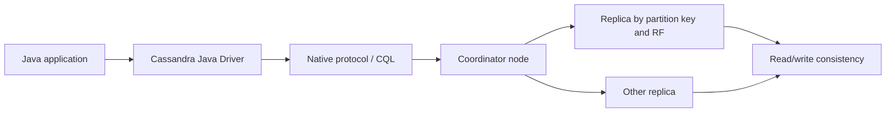

# Driver for Apache Cassandra: Dependency Coordinates and Packages by Version

## 1. Why Distinguish Java Driver Versions?

In the **DATABASE_ENGINE_WIDE_COLUMN_CASSANDRA** module, Apache Cassandra is approached as a distributed **wide-column** database: data is distributed by **partition key**, replicated across nodes, read/written with consistency levels, and administered through CQL, compaction, repair, and backup. When a Java application connects to Cassandra, the component that directly creates sessions, prepares queries, routes requests, and processes results is the **Java Driver**.

A common source of confusion when starting a project or upgrading libraries is: **the Cassandra server version, the Java Driver version, the Maven/Gradle coordinates, and the Java package name to `import` are not the same thing**.

For example, when moving from Java Driver **3.x** to **4.x**, you cannot simply change `<version>` in `pom.xml` and keep `import com.datastax.driver.core.Cluster`. And in **4.x** releases published under a different artifact group, the Java package name **does not necessarily change along with `groupId`**.

This lesson focuses on three exact questions:

1. **Which driver** should a Java application use to communicate with Apache Cassandra?
2. **How to declare the exact dependency** based on the driver branch/distribution?
3. **Which package to import and call APIs from** so that Java code compiles and connects?

After this lesson, you will be able to distinguish legacy/modern APIs, read artifact coordinates, configure `CqlSession`, run a prepared query, and diagnose errors related to dependencies, packages, protocol, or datacenters.

## 2. Where Does the Java Driver Sit in Cassandra Architecture?



The Java Driver provides these core capabilities:

- **Creating and maintaining connections** to cluster nodes over the native protocol.
- **Discovering metadata** about nodes, keyspaces, tokens, and routing information.
- **Sending CQL** with simple statements and prepared/bound statements; mapping CQL data types to Java types.
- **Orchestrating requests** with load balancing, datacenter-aware policies, timeouts, and retries within configured limits.
- **Synchronous or asynchronous execution**, handling pagination, and returning errors/execution info to the application.
- **Setting the consistency level** for each operation according to the business contract.

The driver does **not** replace:

- Table design based on query patterns and partition key selection.
- Cluster replication, repair, compaction, and data recovery.
- Server-side authorization/roles; the driver only supplies credentials and requests.
- RDBMS-style transactions across multiple partitions or multiple tables.
- Business backpressure, idempotency management, or duplicate-write prevention logic on timeouts.

**Distinguishing from other tools:** `cqlsh` is a command-line tool for running CQL, not the Java Driver. `java-driver-core` is a client library for Java, **not a JDBC driver** following `java.sql.Connection`. If a project uses Spring Data Cassandra, that framework has its own abstraction layer and you must also check which driver version the framework supports.

## 3. Four Easily Confused Version Layers

| Layer | Example | What It Determines |
| --- | --- | --- |
| **Cassandra Server** | 3.x, 4.x, or 5.x branch | CQL/schema/features/data formats and protocol provided by the server |
| **Java Driver** | Driver 3.x or 4.x | Java API, session configuration, exceptions, mapping, and request dispatch logic |
| **Dependency coordinates** | `groupId:artifactId:version` | Which exact artifact Maven/Gradle downloads |
| **Java package** | `com.datastax.driver.core` or `com.datastax.oss.driver.api` | The `import` statements and classes/methods in source code |

Two projects may both say "using Java Driver 4", yet one pulls the artifact from the old coordinate group and the other uses an Apache-distributed release. **Do not infer the package from the artifact publisher name**.

Beyond the four layers above, also check the **JDK runtime**, Spring Boot/Spring Data if present, native protocol, TLS, authentication, and driver transitive dependencies. These are independent constraints in an upgrade inventory.

## 4. Dependency Coordinate and Package Matrix

The following table lists **historically/API-line meaningful coordinate examples**, **not a statement of the latest version or a server compatibility matrix**. Choose **one driver line** according to your project's support matrix and confirm the actual version available in your artifact repository before locking the dependency.

| Java Driver Line | Illustrative Maven/Gradle Coordinates | Main Java Package | Session Concept |
| --- | --- | --- | --- |
| DataStax Java Driver **3.x** (legacy API) | `com.datastax.cassandra:cassandra-driver-core:3.11.5` | `com.datastax.driver.core.*` | `Cluster` and `Session` |
| DataStax OSS Java Driver **4.x** | `com.datastax.oss:java-driver-core:4.17.0` | `com.datastax.oss.driver.api.*` | `CqlSession` |
| Apache Cassandra Java Driver **4.x** | `org.apache.cassandra:java-driver-core:4.18.1` | `com.datastax.oss.driver.api.*` | `CqlSession` |

Key points to remember:

- **3.x → 4.x**: changes the artifact, Java package, and many APIs; this is a **source code migration**, not a simple version bump.
- **DataStax OSS 4.x → Apache-distributed 4.x**: may change `groupId` while keeping the `com.datastax.oss.driver.api.*` Java package; check the release notes and compatibility level of the specific version before switching.
- **Server 4.x does not mean Driver 4.x is the only choice.** Use the official compatibility matrix of the driver and server; do not treat matching major numbers as a rule.
- **Do not declare two `java-driver-core` artifacts from two 4.x groups in the same runtime** "just in case a class is missing": they can provide duplicate class names, causing classpath conflicts and linkage errors.

In the Cassandra ecosystem, artifact names, released versions, and JDK requirements can evolve. Document the exact `groupId`, `artifactId`, `version`, and published compatibility source in your project's release documentation.

### 4.1. 3.x Release: Legacy Package

Typical Driver 3.x code pattern:

```java
import com.datastax.driver.core.Cluster;
import com.datastax.driver.core.Session;

// Illustrative 3.x API example; do not mix with 4.x CqlSession.
try (Cluster cluster = Cluster.builder()
        .addContactPoint("127.0.0.1")
        .build();
     Session session = cluster.connect()) {
    session.execute("SELECT release_version FROM system.local");
}
```

The classes `Cluster`, `Session`, `ResultSet`, and `PreparedStatement` belong to `com.datastax.driver.core.*` in this line. In Driver 4.x, these classes are no longer in the same package/API.

### 4.2. 4.x Release: New API Package

With Driver 4.x, the basic pattern is:

```java
import com.datastax.oss.driver.api.core.CqlSession;
import com.datastax.oss.driver.api.core.cql.ResultSet;

try (CqlSession session = CqlSession.builder()
        .withLocalDatacenter("dc1")
        .build()) {
    ResultSet rows = session.execute(
        "SELECT release_version FROM system.local");
}
```

The configuration above only illustrates the API and relies on the driver finding contact points from an appropriate configuration source. In the hands-on section, we will provide explicit contact points so the code is easily reproducible in a lab environment.

**Still `import com.datastax.oss.driver.api...` when using the corresponding 4.x `org.apache.cassandra:java-driver-core` artifact.** Do not change imports to `org.apache.cassandra.driver.api...` just because the new `groupId` contains `org.apache.cassandra`.

## 5. Maven Declaration: Choose Exactly One Coordinate

For a plain Java project or Maven module, add **one** appropriate core dependency. For example, if the project chooses the Apache-distributed Driver 4.x line:

```xml
<dependencies>
    <dependency>
        <groupId>org.apache.cassandra</groupId>
        <artifactId>java-driver-core</artifactId>
        <version>4.18.1</version>
    </dependency>
</dependencies>
```

Alternative example for the earlier DataStax OSS 4.x line:

```xml
<!-- Choose this snippet INSTEAD OF the Apache dependency above; do not add both. -->
<dependencies>
    <dependency>
        <groupId>com.datastax.oss</groupId>
        <artifactId>java-driver-core</artifactId>
        <version>4.17.0</version>
    </dependency>
</dependencies>
```

If the project actually uses the 3.x API:

```xml
<!-- Only for 3.x API projects whose compatibility has been verified. -->
<dependency>
    <groupId>com.datastax.cassandra</groupId>
    <artifactId>cassandra-driver-core</artifactId>
    <version>3.11.5</version>
</dependency>
```

**The versions above are fixed examples to show coordinate structure**, not a recommendation for the latest version at the time you deploy. When preparing for production, verify release notes, security fixes, server support, JDK, and your organization's upgrade policy. Pin a specific tested version; avoid dynamic auto-updating notations like `LATEST` or uncontrolled version ranges.

### 5.1. Meaning of Each Coordinate Part

```text
org.apache.cassandra  :  java-driver-core  :  4.18.1
|                        |                    |
groupId                  artifactId           version
```

- `groupId`: Maven namespace identity of the **published artifact**, not the Java package name.
- `artifactId`: library module name (core, query builder, mapper, etc.).
- `version`: build resolved by Maven/Gradle, which may differ from the Cassandra Server version.

When imports fail, **check all three parts and the dependency tree**, not just `version`.

### 5.2. Extension Modules: Core, Query Builder, Mapper

Beyond core, Driver 4.x has modules/features you can choose based on need:

| Module/Extension | When to Use | Notes |
| --- | --- | --- |
| `java-driver-core` | Connections, CQL, `CqlSession`, prepared statements, sync/async | Base component |
| `java-driver-query-builder` | Building structured CQL using a Java API | Does not automatically optimize partition keys or fix bad queries |
| `java-driver-mapper-runtime` | Mapping CQL rows to Java objects via the mapper | Check processor/configuration requirements |
| `java-driver-mapper-processor` | Generating mapper code at compile time | Usually placed on the annotation-processor path, not added blindly to runtime |

Maven example for query builder from the **same chosen release line**:

```xml
<dependency>
    <groupId>org.apache.cassandra</groupId>
    <artifactId>java-driver-query-builder</artifactId>
    <version>4.18.1</version>
</dependency>
```

**Do not mix a 4.x module from the Apache group with a 4.x core from the old group** and assume they are compatible. Optional modules must match the group and version of the chosen release suite; check release notes when a module has changed names, packaging, or is absent in the selected release.

Frameworks like Spring Data Cassandra may manage the driver version via their BOM/dependency management. If so, inspect the **effective dependency graph** before overriding a version directly, to avoid classpath errors.

## 6. Gradle Declaration

### 6.1. Gradle Groovy DSL

Example with the Apache-distributed Driver 4.x artifact:

```groovy
dependencies {
    implementation 'org.apache.cassandra:java-driver-core:4.18.1'
}
```

If the project uses the earlier DataStax OSS Driver 4.x, use it **instead**, do not keep both:

```groovy
dependencies {
    implementation 'com.datastax.oss:java-driver-core:4.17.0'
}
```

### 6.2. Gradle Kotlin DSL

```kotlin
dependencies {
    implementation("org.apache.cassandra:java-driver-core:4.18.1")
}
```

In Gradle, `implementation` is the application dependency configuration; if you are writing a library exposing an API to other modules, using `api`/`implementation` must follow that module's design.

**Do not include both groups at the same time** just because the IDE does not yet recognize `CqlSession`. When resolving IDE errors, refresh Gradle/Maven and inspect the actual classpath first, rather than adding multiple artifacts.

## 7. Safe Dependency Selection Process

Before adding `java-driver-core` to a production system, gather at least the following information:

| Information | What to Confirm |
| --- | --- |
| Cassandra Server | Exact version on nodes, Apache/managed distribution |
| Driver | 3.x or 4.x line, exact release version |
| Artifact coordinates | `groupId:artifactId:version` from a trusted repository |
| JDK | Application JDK version and JDK supported by the driver |
| Framework | Spring Boot/Spring Data, dependency management/BOM, bundled driver version |
| Native protocol | Protocol negotiation capability with source/target servers |
| CQL features | UDT, collections, LWT, paging, query builder, mapper, new features |
| Auth/TLS | Authentication options, trust material, ciphers, and security policy |
| Deployment | Final classpath, dependency tree, shaded/uber-JAR packaging |
| Test | Smoke test for connection, real reads/writes by CL, failover, and query timeout |

**A driver/server pair may connect successfully yet still fail to support certain APIs or features.** Compatibility must be evaluated for the exact versions and workload, especially when a cluster runs mixed versions during a rolling upgrade.

### Diagnosing the Dependency Tree

With Maven, in an actual project you can run:

```bash
mvn dependency:tree
```

With Gradle:

```bash
./gradlew dependencies --configuration runtimeClasspath
```

The commands above are for the learner's sample project, **not steps to run automatically in this lesson**. Look for unexpected `java-driver-core` and `cassandra-driver-core` artifacts, conflicting Netty/SLF4J libraries, or a driver pulled in by a framework but overridden by a manual declaration.

If deploying as a fat JAR/shaded JAR, inspect the packaged output and service/config resources. Successful compilation alone does not guarantee avoiding `NoSuchMethodError` or `ClassNotFoundException` at runtime when dependency conflicts exist.

## 8. Driver 4.x Hands-On: CQL, Maven, and Java Package

### 8.1. Preparing the Test Cluster

Assume the lab Cassandra has datacenter `dc1` and keyspace `commerce`. If the lab has only one node, adjust RF accordingly (e.g., RF=1) so test queries do not require more replicas than actually exist. Do not copy test configuration as a production standard.

Initialization CQL:

```sql
-- Example for a lab with at least three nodes in dc1.
CREATE KEYSPACE IF NOT EXISTS commerce
WITH replication = {
    'class': 'NetworkTopologyStrategy',
    'dc1': 3
};

CREATE TABLE IF NOT EXISTS commerce.orders_by_id (
    order_id uuid PRIMARY KEY,
    customer_id uuid,
    status text,
    updated_at timestamp
);

INSERT INTO commerce.orders_by_id
    (order_id, customer_id, status, updated_at)
VALUES (
    11111111-1111-1111-1111-111111111111,
    22222222-2222-2222-2222-222222222222,
    'CREATED',
    toTimestamp(now())
);
```

Record the actual datacenter before configuring the Java Driver, for example in `cqlsh`:

```sql
SELECT data_center, release_version FROM system.local;
```

`system.local` describes **the coordinator that cqlsh is connected to**; if the cluster has multiple DCs, confirm the full topology using the appropriate operational tools. Java code must use the exact local DC name, which is case-sensitive according to the environment metadata.

### 8.2. Dependency for the Example

Choose **one** Driver 4.x coordinate in `pom.xml`. For example:

```xml
<dependency>
    <groupId>org.apache.cassandra</groupId>
    <artifactId>java-driver-core</artifactId>
    <version>4.18.1</version>
</dependency>
```

Even though `groupId` here is `org.apache.cassandra`, **Java imports still start with `com.datastax.oss.driver.api`**.

### 8.3. Reading by Partition Key with a Prepared Statement

The following code compiles with the corresponding Driver 4.x once the dependency is resolved, the Cassandra lab is running, and environment variables are set. We use **a single shared session** within `try-with-resources`. In a production service, `CqlSession` is typically created once for the application lifecycle and closed at shutdown, not created per HTTP request.

```java
import java.net.InetSocketAddress;
import java.time.Duration;
import java.util.UUID;

import com.datastax.oss.driver.api.core.CqlSession;
import com.datastax.oss.driver.api.core.DefaultConsistencyLevel;
import com.datastax.oss.driver.api.core.cql.BoundStatement;
import com.datastax.oss.driver.api.core.cql.PreparedStatement;
import com.datastax.oss.driver.api.core.cql.ResultSet;
import com.datastax.oss.driver.api.core.cql.Row;

public final class ReadOrderDemo {

    public static void main(String[] args) {
        String host = requireEnv("CASSANDRA_HOST");
        String datacenter = requireEnv("CASSANDRA_DC");
        String username = requireEnv("CASSANDRA_USERNAME");
        String password = requireEnv("CASSANDRA_PASSWORD");

        try (CqlSession session = CqlSession.builder()
                .addContactPoint(new InetSocketAddress(host, 9042))
                .withLocalDatacenter(datacenter)
                .withAuthCredentials(username, password)
                .build()) {

            PreparedStatement select = session.prepare(
                "SELECT order_id, status, updated_at " +
                "FROM commerce.orders_by_id WHERE order_id = ?");

            UUID orderId = UUID.fromString(
                "11111111-1111-1111-1111-111111111111");

            BoundStatement bound = select.bind(orderId)
                .setConsistencyLevel(DefaultConsistencyLevel.LOCAL_QUORUM)
                .setTimeout(Duration.ofSeconds(2));

            ResultSet result = session.execute(bound);
            Row row = result.one();

            if (row == null) {
                System.out.println("Order not found");
            } else {
                System.out.println(
                    row.getUuid("order_id") + ": " +
                    row.getString("status"));
            }
        }
    }

    private static String requireEnv(String name) {
        String value = System.getenv(name);
        if (value == null || value.isBlank()) {
            throw new IllegalStateException("Missing environment: " + name);
        }
        return value;
    }
}
```

**Limitations of the example:**

- The snippet assumes the cluster **has username/password authentication enabled**; if the lab uses `AllowAllAuthenticator`, omit `withAuthCredentials` and adjust the environment variables for that setup. Production should enable authentication, authorization, and TLS.
- `LOCAL_QUORUM` is only suitable when RF/topology has enough replicas in the local DC and business requirements dictate this CL. In a **single-node RF=1 lab**, `LOCAL_QUORUM` requires one replica and remains valid; with RF=3 and only one node, the query will fail due to insufficient replicas.
- Connecting to `127.0.0.1:9042` or `CASSANDRA_HOST:9042` must reach the actual native protocol endpoint; inside a container, the application's `localhost` is not necessarily Cassandra's address.
- The example does not configure TLS to keep focus on dependency/API. In production, **never transmit passwords over plaintext connections**; configure driver SSL/TLS and proper trust material.
- `String.isBlank()` is from JDK 11+; if your driver/build supports an older JDK and requires JDK 8, replace it with `value.trim().isEmpty()` and check compatibility for the chosen driver/JDK. Do not confuse **the example program's JDK** with the Cassandra Server version.

**Why use a prepared statement?** The fixed CQL string is prepared once; the `order_id` value is bound as a `UUID` type. This avoids concatenating untrusted input into CQL strings, reduces repeated parsing overhead, and allows the driver to leverage statement metadata. In a real service, retain and reuse `PreparedStatement` rather than preparing on every request.

### 8.4. Run Proper Queries, Do Not Treat Tables Like an RDBMS

With table `orders_by_id`:

```sql
-- Query by partition key: matches the designed table.
SELECT order_id, status
FROM commerce.orders_by_id
WHERE order_id = 11111111-1111-1111-1111-111111111111;
```

Conversely, a query filtering only on `customer_id` does not match the current primary key and may be rejected by Cassandra without a corresponding structure/index. If the application needs to list by `customer_id`, design a table for that query, such as `orders_by_customer`, along with a data synchronization/reconciliation strategy.

**The right driver version cannot fix a bad data model.** Query predicates, partition cardinality, tombstones, compaction, and resource limits remain the responsibility of Cassandra design and operations.

## 9. Synchronous and Asynchronous Execution in the 4.x API

In 4.x, `CqlSession` provides both synchronous and asynchronous APIs. Choose based on the application's concurrency model; async does not magically create infinite throughput.

### 9.1. Synchronous

```java
ResultSet rs = session.execute(bound);
Row first = rs.one();
```

Simple, suited for small programs or bounded background threads. On a web server with an event loop, do not use blocking `execute` on event-loop threads if the framework requires non-blocking behavior.

### 9.2. Asynchronous

```java
import java.util.Iterator;
import java.util.concurrent.CompletionStage;

import com.datastax.oss.driver.api.core.cql.AsyncResultSet;
import com.datastax.oss.driver.api.core.cql.Row;

// session and bound are the objects created in the previous example.
CompletionStage<String> statusStage =
    session.executeAsync(bound).thenApply((AsyncResultSet result) -> {
        Iterator<Row> rows = result.currentPage().iterator();
        return rows.hasNext() ? rows.next().getString("status") : null;
    });
```

This snippet reads the **current result page**; querying by a single `order_id` in the example returns at most one row. For multi-page queries, handle `hasMorePages()`/`fetchNextPage()` in a controlled manner, avoiding fetching all pages concurrently and holding unbounded data in RAM.

Production practices should:

- **Limit in-flight requests** with a semaphore/bulkhead or appropriate request throttling; do not fire tens of thousands of async queries just because they do not block a thread.
- Define a **timeout budget** based on the API deadline and the actual latency of read/write consistency.
- Handle exceptions at service boundaries, returning appropriate error codes rather than swallowing errors as "not found".
- **Do not retry all writes after a timeout**: Cassandra may have already applied the write even though the client did not see the response. Design idempotency and verify outcomes for side-effecting/LWT operations.
- Do not call `CompletionStage.join()` on an event loop, which turns an async query into a blocking call.

## 10. Linking Dependencies with Security and Consistency

The Java Driver is only a client; secure connectivity requires designing the whole system:

### 10.1. Authentication and Authorization

The Java application should connect using a `LOGIN=true`, `SUPERUSER=false` role with least-privilege permissions on the required tables:

```sql
-- Example run by an authorized administrative principal.
GRANT SELECT ON TABLE commerce.orders_by_id TO orders_api;
```

This statement assumes the role `orders_api` already exists. Do not use the default `cassandra`/superuser credentials as an application account. The fact that the Java Driver can log in does not mean the role has been granted `SELECT` or `MODIFY`.

### 10.2. TLS and Secret Management

- Use TLS between the application and Cassandra endpoints per cluster policy, verifying truststore/certificate hostnames.
- Provision credentials from a secret manager or equivalent mechanism; restrict read permissions on environment variables/process secrets.
- Never log passwords, URIs containing secrets, or raw authentication details.
- Separate accounts for reading apps, write workers, migrations, and operational tools. Secret rotation must account for open sessions.
- Verify that the TLS/auth plugins support the exact driver/server versions and running JDK.

### 10.3. Business-Driven Consistency Levels

| Example Requirement | Consideration | Key Takeaway |
| --- | --- | --- |
| Catalog allowing stale reads | `LOCAL_ONE` within an appropriate architecture | Lower latency does not guarantee reading the latest data |
| Reads/writes requiring overlap in a single RF=3 DC | `LOCAL_QUORUM` for both reads and writes | Two replicas on each side; still need to account for concurrency/failures |
| Conditional writes with `IF` | CL and serial consistency appropriate for LWT | CAS is not a transaction across all partitions |
| Multi-DC | `LOCAL_*` vs cross-DC CL | Account for replica latency and cross-DC data requirements |

Do not set `LOCAL_QUORUM` simply because the example uses it; choose based on business contracts, RF, topology, and operations. If a query fails with `Unavailable`, do not blindly lower the CL in code without evaluating consistency requirements.

## 11. Comparison Table When Migrating from 3.x to 4.x

These are common API changes when an older project migrates to Java Driver 4.x. Read the migration guide for the **actual driver version**, because configuration, error handling, schema metadata, and serialization also have many differences.

| Concept | Driver 3.x | Driver 4.x |
| --- | --- | --- |
| Core artifact | `com.datastax.cassandra:cassandra-driver-core` | `java-driver-core` under DataStax OSS or Apache depending on release |
| Root package | `com.datastax.driver.core` | `com.datastax.oss.driver.api` |
| Connection | `Cluster` + `Session` | `CqlSession` |
| Session initialization | `Cluster.builder()` and `cluster.connect()` | `CqlSession.builder()` |
| Configuration | 3.x `QueryOptions`/policies and configuration API | 4.x driver configuration and statement/session API |
| Prepared statement | `com.datastax.driver.core.PreparedStatement` | `com.datastax.oss.driver.api.core.cql.PreparedStatement` |
| Statement with bound values | 3.x bound API | 4.x `BoundStatement` under `core.cql` |
| Consistency constants | `com.datastax.driver.core.ConsistencyLevel` | `com.datastax.oss.driver.api.core.DefaultConsistencyLevel` |
| Async result return | 3.x futures mechanism | `CompletionStage<AsyncResultSet>` |
| Metadata/metrics | 3.x APIs | New APIs; integration code must be updated |
| Mapper | 3.x driver mapper | 4.x mapper runtime/processor if used |

Do not rely on wildcard imports to "run both 3.x and 4.x". Perform a **tested migration**, updating configuration, logging/metrics, exception mapping, query paging, and proper session lifecycle closure.

### Safe Dependency Migration Process

1. Inventory code/imports/`dependency:tree` and any driver pulled in by frameworks.
2. Select one target driver with **exact coordinates**, checking the support matrix against Cassandra Server and JDK.
3. Update imports from `com.datastax.driver.core.*` to the corresponding API in `com.datastax.oss.driver.api.*`, and **redesign initialization/session management**.
4. Migrate policies/configuration according to the migration guide, avoiding copying old configs under the assumption that key names match.
5. Run unit/integration tests covering prepared statements, paging, UDTs, collections, LWT, consistency, auth/TLS, and errors.
6. Verify in staging with representative topology and latency before rolling deployment.
7. Remove unnecessary 3.x/4.x dependencies from the runtime classpath and verify the final packaged artifact.

Where Spring Data Cassandra manages the driver, **check framework upgrade support** before forcing a newer driver version, as the APIs called by the framework may not be compatible.

## 12. Common Errors and Root-Cause Identification

| Symptom | Possible Cause | Check/Resolution |
| --- | --- | --- |
| `package com.datastax.oss.driver.api.core does not exist` | Using 3.x artifact, 4.x dependency not resolved, or source set not recognizing it | Check `pom.xml`/Gradle, refresh dependencies and dependency tree |
| `package com.datastax.driver.core does not exist` | 3.x code but only Driver 4.x is present | Migrate API or choose the driver matching the code |
| `NoClassDefFoundError` / `NoSuchMethodError` at runtime | Version/module conflict or packaging missing classes | Check runtime classpath, BOM, and shaded/JAR build |
| Driver 4.x present but `org.apache.cassandra.driver.api...` not found | Confusing Java package with Maven `groupId` | Use `com.datastax.oss.driver.api.*` for the corresponding 4.x line |
| Cannot connect to contact point | Wrong host, port 9042, firewall, network/container | Check native protocol, reachability, DNS, and actual endpoint |
| Driver reports unknown local DC or routing failure | Missing/wrong datacenter name, contact points do not match metadata | Check `system.local.data_center`, load-balancing config |
| Authentication failure | Mismatched credentials/role/`LOGIN` or authenticator | Check role permissions, secrets, auth and TLS configuration |
| Unauthorized on `SELECT` | Role lacks `SELECT` on table/keyspace | Check `GRANT`/membership; do not use superuser to bypass |
| `Unavailable` at `LOCAL_QUORUM` | RF/replicas in DC do not satisfy CL | Check `nodetool status`, topology, RF, consistency |
| Timeout despite active connection | Hot partition, compaction, GC, network, CL, request overload | Check p99, in-flight requests, driver/server metrics, query design |
| `InvalidQuery`/unknown column | Schema not deployed/no agreement, invalid CQL, or app/code and DDL mismatch | Review schema migration and CQL statements against partition key |
| Prepared request fails after failover | Coordinator/schema change, improper request retry/batching | Check driver logs, prepared behavior, and retry limits |
| Build fails after changing group | Two competing 4.x core coordinates or mismatched optional modules | Keep only one consistent set of artifacts, pin versions |

**Layered debugging approach:** check **actual loaded dependencies** → Java imports/API → native protocol connectivity and DC → authentication/TLS → CQL/schema → replicas/CL → performance. This avoids "fixing" a missing-class error by adding connections or lowering consistency.

## 13. Hands-On Exercise: Identifying Versions from Coordinates and Imports

Consider three hypothetical projects:

**Project A** has:

```xml
<dependency>
  <groupId>com.datastax.cassandra</groupId>
  <artifactId>cassandra-driver-core</artifactId>
  <version>3.11.5</version>
</dependency>
```

**Project B** has:

```groovy
implementation 'com.datastax.oss:java-driver-core:4.17.0'
```

**Project C** has:

```kotlin
implementation("org.apache.cassandra:java-driver-core:4.18.1")
```

Answer the following:

1. Which project uses `com.datastax.driver.core.Cluster`? Which projects use `com.datastax.oss.driver.api.core.CqlSession`?
2. Why does Project C **not** change its import to `org.apache.cassandra.driver.api.core.CqlSession`?
3. If Project C also pulls in `com.datastax.oss:java-driver-core:4.17.0`, what risk arises on the classpath?
4. Project B wants to migrate to C: what must be confirmed besides changing `groupId`?
5. A Java service has two contact points and a misconfigured local DC. Why is increasing the timeout not the right solution?
6. For table `orders_by_id` with partition key `order_id`, why does `WHERE customer_id = ?` not become a good query just by adding the query builder?
7. Write a chosen 4.x Maven dependency snippet and the minimal `import` statements to execute a `PreparedStatement` using `CqlSession`.
8. Distinguish between a **compile-time missing package** error, a **runtime linkage error**, and a **CQL Unauthorized** error. Which three layers do they belong to?

**Self-check hints:**

- **A** uses `Cluster`/`Session` in the 3.x package; **B** and **C** use `CqlSession` from the 4.x API.
- `groupId` is a Maven coordinate, **not** a Java namespace; the Apache Driver 4.x artifact still exposes the `com.datastax.oss.driver.api` API.
- Two 4.x core artifacts from different groups can contain duplicate classes and cause the runtime to load an unexpected version.
- Migrating B → C requires reading release notes, verifying server/JDK compatibility, checking optional modules and frameworks, and running integration tests.
- Local DC must match the cluster; the driver needs to route to the right replica/coordinator. Long timeouts only delay failures.
- Query builder does not change the partition key or token ownership.
- Missing package belongs to the **dependency/source code** layer; linkage error belongs to the **runtime classpath**; Unauthorized belongs to **server RBAC** after authentication.

## 14. Checklist Before Deploying the Java Driver to Production

- [ ] Distinguished **Cassandra Server** version, **Java Driver** version, Maven/Gradle coordinates, and Java package.
- [ ] Selected **one** consistent core driver and extension module suite without mixing DataStax OSS/Apache 4.x arbitrarily.
- [ ] Verified supported driver/server/JDK/framework combination and pinned a specific tested version.
- [ ] Inspected `dependency:tree` or Gradle `runtimeClasspath` and checked the final fat JAR/runtime artifact.
- [ ] Properly migrated 3.x code when choosing the 4.x API: `CqlSession`, imports, statements, config, paging.
- [ ] Configured contact points, local datacenter, and native protocol endpoint for the target environment.
- [ ] Enabled authentication, TLS, and secure secret handling; application principal has least privilege.
- [ ] Used prepared statements, appropriate bound types, reused the session, and closed it according to lifecycle.
- [ ] Selected CL based on RF/DC/read-write contract without lowering CL to mask operational errors.
- [ ] Bounded concurrency, timeouts/retries, protected non-idempotent writes, and monitored driver errors.
- [ ] Tested reads/writes, paging, LWT, failover, schema changes, and unavailable nodes in staging.
- [ ] Separated driver upgrades from unnecessary partition key, table option, or server upgrades.
- [ ] Added metrics/logs to distinguish classpath, connectivity, TLS/auth, CQL/schema, and Cassandra overload errors.

**Key takeaway:** **`groupId:artifactId:version`** identifies the artifact downloaded by the build tool; **`package`** identifies the Java classes being `import`ed. Driver **3.x** typically uses `com.datastax.driver.core` and `Cluster/Session`; **4.x** uses `com.datastax.oss.driver.api` and `CqlSession`, even when the artifact has `groupId` `org.apache.cassandra`. Choosing the right coordinates is only the first step: the application also needs proper datacenter configuration, credentials/TLS, partition-key-aligned CQL, consistency levels, and testing against the actual server version.
