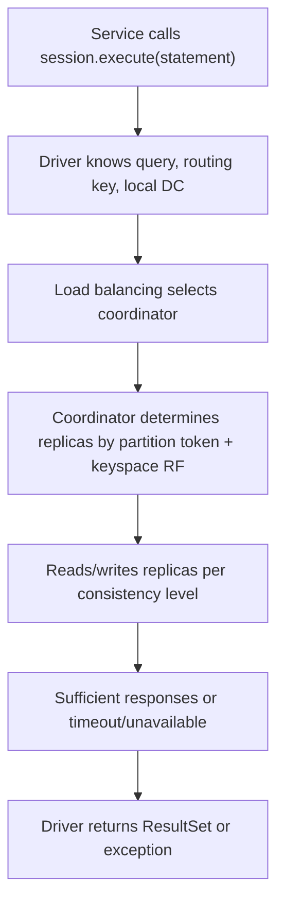
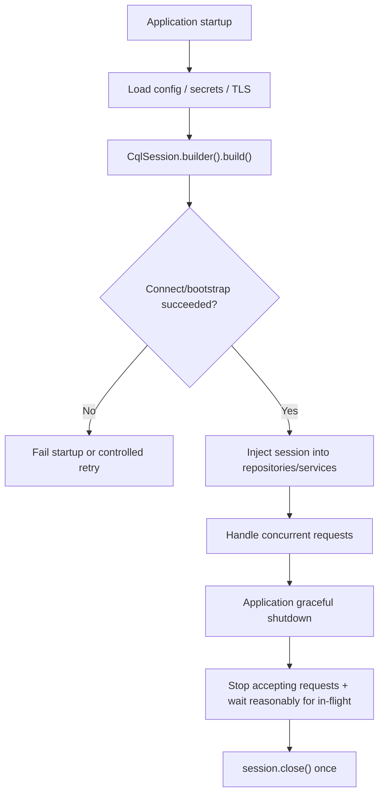

# CqlSession as the Entry Point and Shared Scope per Cluster

> **Chapter:** Java Driver Basics  
> **Module:** `DATABASE_ENGINE_WIDE_COLUMN_CASSANDRA` — learn Apache Cassandra as a distributed wide-column database: partition keys, query-driven table design, consistency levels, CQL, replication, compaction, repair, error handling, and connecting from Java.  
> **Focus:** The role of `CqlSession` in Apache Cassandra Java Driver 4.x; how to create, share, and configure it per cluster, manage its lifecycle, and use it safely in multi-threaded Java applications.

A Java application serving 1,000 HTTP requests/second should not open **1,000 new Cassandra connections every second**. The standard usage pattern is to create **one shared `CqlSession` per Cassandra cluster and per application connection/authentication context**, then share it across repositories, services, and request handlers in the same process. The driver handles node discovery, connection pool management, coordinator selection, and CQL execution.

First mental model:

```text
Java application (one process / one service instance)
    ├── AccountRepository ───┐
    ├── EventRepository ─────┤
    ├── OrderService ────────┼──> Shared CqlSession
    └── BackgroundWorker ────┘      │
                                   ├── Driver metadata / topology
                                   ├── Load balancing / token awareness
                                   ├── Connections to appropriate nodes
                                   ├── Prepared statements / execution
                                   └── Cassandra cluster: dc1, dc2...
```

Key point: **`CqlSession` is not a single socket and not a traditional SQL transaction session**. It is the driver's **application-level entry point**, safe for concurrent use across multiple threads; each statement still has its own partition key, consistency level, timeout, paging, and semantics.

## 1. Learning Objectives

After this lesson, you will be able to:

1. Explain what `CqlSession` is and how it relates to Cassandra nodes, connection pools, metadata, coordinators, and Java threads.
2. Create a `CqlSession` using `CqlSession.builder()` with contact points, local datacenter, and an optional keyspace.
3. Choose the right scope—**one shared session per cluster + security/configuration context**—instead of opening a session per request or per table.
4. Distinguish **contact points** from the list of nodes discovered by the driver; understand why `withLocalDatacenter` matters.
5. Distinguish a session's **default keyspace** from the keyspace actually queried, and understand why `USE` should not be used to switch keyspaces in a multi-threaded application.
6. Leverage **prepared statements** and **bound statements**, controlling consistency level and idempotency per operation.
7. Execute CQL synchronously/asynchronously, understanding the limits of paging, timeouts, and retries.
8. Manage session lifecycle via dependency injection, application startup/shutdown, tests, and health checks.
9. Identify authentication, TLS, local DC, connectivity, quorum, and schema errors without reacting by creating additional sessions.
10. Write a simple Java application that connects to Cassandra, writes data, queries by partition key, and safely shares a session.

## 2. What Does CqlSession Actually Represent?

### 2.1. A Cluster-Level Abstraction, Not a TCP Connection

In Java Driver 4.x, `CqlSession` is the central interface to:

- Execute CQL with `execute(...)` and `executeAsync(...)`.
- Prepare CQL with `prepare(...)` and `prepareAsync(...)`.
- Access driver metadata via `getMetadata()`.
- Access configuration/runtime context and metrics if enabled.
- Hold the driver resources needed to connect to the cluster.
- Close resources when the application no longer uses the session.

A single session can manage **multiple network connections** to multiple nodes. The driver typically provides topology discovery, a load-balancing policy, token-aware routing, and per-node connection pools; configuration details and connection counts vary by driver version and workload.

**Do not equate**:

| Concept | Meaning | Should It Be Created per CQL Request? |
|---|---|---|
| `CqlSession` | Driver entry point and cluster connection lifecycle | **No** |
| Physical connection | A TCP/native protocol connection to a node | Managed by the driver |
| Coordinator | Node handling a CQL request, selecting/communicating with replicas | May differ per request |
| Replica | Node storing a partition copy per token/RF/keyspace | Not "owned" by the session |
| `PreparedStatement` | Prepared CQL template and binding metadata | Typically cached/reused |
| `BoundStatement` | A single binding of parameters/options for a prepared statement | Created per operation |
| `ResultSet` | Result of a single execution, capable of fetching pages | Do not share arbitrarily across threads |
| Keyspace | CQL namespace with a replication strategy | One session can query multiple keyspaces |
| SQL transaction/session | Transaction mechanism holding state across multiple queries | **Not `CqlSession`** |

### 2.2. Session Initialization Is Expensive

At initialization, the driver may need to:

1. Open connections to one or more contact points.
2. Perform the protocol handshake, TLS if enabled, and authentication if configured.
3. Discover topology, datacenter, token map, and schema metadata.
4. Initialize connection pools, event loops, and internal resources.
5. Prepare state required for load balancing, request execution, and reconnection.

Doing this on every HTTP request can cause:

- Connection churn and increased CPU/TLS handshake overhead.
- Too many file descriptors/sockets on both the app and Cassandra.
- Higher initialization latency compared to a single query's latency.
- Loss of connection pool and prepared statement reuse benefits.
- Increased GC/memory usage and unnecessary pressure on the native transport.
- Difficulty shutting down the application cleanly if some sessions are left unclosed.

Therefore, a practical guideline is to **create the session at startup, keep it for the process/service lifecycle, and close it at shutdown**.

### 2.3. A Session Does Not Wrap a Transaction

For example:

```java
session.execute(updateA);
session.execute(updateB);
```

These two lines do **not** automatically belong to the same multi-table ACID transaction like a JDBC transaction. Each statement has its own Cassandra semantics, consistency level, and failure modes.

`CqlSession` is a **connection entry point**, not a transaction boundary. When business atomicity/idempotency is required, it must be designed using Cassandra semantics (partitions, LWT when appropriate, event logs, and retry policies). Switching sessions or grouping multiple CQL statements in a Java method does not change that.

## 3. Why Share One in a Multi-Threaded Application?

### 3.1. CqlSession Is Designed for Concurrent Use

In Driver 4.x, `CqlSession` can be shared safely across request-handling threads. For example:

```text
Thread HTTP-1: SELECT account_id = A ─┐
Thread HTTP-2: SELECT account_id = B ─┤
Thread HTTP-3: INSERT event = C ──────┼──> Shared CqlSession
Thread worker:  UPDATE account = D ───┘      │
                                            └── Driver multiplexes requests,
                                                pools connections per node
```

The application does not need a separate session for each:

- HTTP request.
- Thread in an executor.
- DAO/repository.
- PreparedStatement.
- Keyspace, if on the same cluster with matching auth/config.
- Domain object such as tenant, order, or account.

**Distinguish thread-safety of the session from thread-safety of external data**. A repository holding a shared mutable list/result iterator can still race even if the session itself is shared safely.

### 3.2. One Session per Cluster Is a Practical Rule, Not "One for the Whole Company"

Recommended scope:

> **One shared session per application instance, Cassandra cluster, and consistent group of connection/security/configuration requirements.**

Multiple sessions are valid when:

- The application talks to **two different Cassandra clusters**.
- Two parts of the application require **different CQL credentials/roles**, policies, or TLS identities.
- Workloads require strict isolation of driver configuration, resource budgets, or lifecycles.
- A dual-cluster migration needs a **source** session and a **target** session.
- A test suite connects to clusters/containers with different lifecycles.

However, creating multiple sessions **for the same cluster, credentials, and configuration** just so "each repository manages its own session" is usually wasteful.

### 3.3. Example with Multiple Microservice Instances

If there are 10 pods of a Java service and each pod owns one `CqlSession`, the system has roughly **10 application-level sessions**, each with its own connection pools. It is not a single global session sharing memory across 10 pods.

As pod count scales, the connection count on each Cassandra node can also increase. Budget for **app instances × connections per session × nodes** rather than measuring query load alone.

## 4. Creating a Minimal CqlSession

### 4.1. Example with One Lab Contact Point

```java
import com.datastax.oss.driver.api.core.CqlSession;
import java.net.InetSocketAddress;

public final class HelloCassandraSession {
    public static void main(String[] args) {
        try (CqlSession session = CqlSession.builder()
                .addContactPoint(
                    new InetSocketAddress("127.0.0.1", 9042))
                .withLocalDatacenter("dc1")
                .build()) {

            System.out.println(
                "Session connected and ready to send CQL.");
            session.execute(
                "SELECT release_version FROM system.local"
            ).forEach(row ->
                System.out.println(
                    row.getString("release_version")));
        }
    }
}
```

Assumptions:

- A lab Cassandra node is listening for CQL on `127.0.0.1:9042`.
- The configured datacenter is actually named `dc1`.
- The cluster allows connections under the corresponding authentication/TLS setup. If security is enabled, the builder needs appropriate configuration.
- `system.local` returns information about the node serving the query; reading it **does not prove all replicas or keyspaces are healthy**.

`try-with-resources` calls `close()` when the block exits. This is appropriate for **short-lived CLI/tests**. In a long-running web service, keep the session open for the application lifecycle; do not wrap `try-with-resources` around **each request**.

### 4.2. Two Contact Points Improve Bootstrap Resilience

```java
CqlSession session = CqlSession.builder()
    .addContactPoint(
        new InetSocketAddress("10.10.1.11", 9042))
    .addContactPoint(
        new InetSocketAddress("10.10.1.12", 9042))
    .withLocalDatacenter("dc1")
    .build();
```

Contact points are **the starting point for cluster discovery**, not the exclusive list of nodes the session is allowed to use. The driver typically reads topology metadata from the cluster and then establishes connections matching its load-balancing policy and local DC.

This also means:

- You do not need to list every node just to query the cluster.
- You should provide a few reliable contact points to reduce startup failures when one node is down.
- Contact points must belong to the intended cluster with proper routing/DNS/TLS.
- If a contact point is a load balancer/proxy, understand how real node addresses are discovered; do not assume every topology works correctly through a single proxy address.
- If the driver receives node metadata with IPs unreachable from the app, connecting to the first contact point **is not enough**.

### 4.3. Local Datacenter Is a Critical Part of Connection Context

`withLocalDatacenter("dc1")` specifies the local DC preferred by the driver under the active policy. This is the **actual Cassandra DC name**, not an arbitrary cloud region name or display label.

If the cluster uses `dc-east` and the code configures `dc1`:

- The driver may fail to select suitable local nodes.
- Session creation or queries may fail depending on policy/version.
- The application may route over the WAN if the policy is misconfigured, increasing latency and cost.
- The meaning of `LOCAL_QUORUM` is misunderstood if the actual coordinator is not in the expected DC.

Verify using:

```bash
nodetool status
```

or metadata observed by the driver, rather than guessing the DC from hostnames.

## 5. A Session's Default Keyspace Is Not a Separate Session

### 5.1. Declaring a Default Keyspace

You can create a session with a default keyspace:

```java
import com.datastax.oss.driver.api.core.CqlIdentifier;
import com.datastax.oss.driver.api.core.CqlSession;
import java.net.InetSocketAddress;

CqlSession session = CqlSession.builder()
    .addContactPoint(
        new InetSocketAddress("127.0.0.1", 9042))
    .withLocalDatacenter("dc1")
    .withKeyspace(CqlIdentifier.fromCql("lab_driver"))
    .build();
```

Then the statement:

```sql
SELECT account_id, email
FROM accounts_by_id
WHERE account_id = 'user-001';
```

can be resolved within `lab_driver` if the context/schema matches. However, setting a default keyspace **does not restrict the session to reading only one keyspace**.

### 5.2. Querying Tables in Other Keyspaces

The same session can run:

```sql
SELECT account_id, email
FROM lab_driver.accounts_by_id
WHERE account_id = 'user-001';

SELECT keyspace_name
FROM system_schema.keyspaces;
```

To avoid context dependence and keep code explicit, large applications typically use **fully qualified table names** `keyspace.table` in query strings. Access permissions are still governed by the CQL authenticator/authorizer.

### 5.3. Do Not Use USE to Switch Keyspaces per Arbitrary Request

An anti-pattern:

```java
// DO NOT: mutate keyspace state then run a query
// assuming a "private connection" dedicated to this request.
session.execute("USE tenant_a");
session.execute("SELECT * FROM orders WHERE order_id = ?");
```

The issue: the driver manages multiple connections and concurrent requests. `USE` is not a mechanism to isolate a per-thread transaction/keyspace in Java Driver 4.x; furthermore, prepared statements need the proper keyspace context for binding/routing.

Instead:

- Use `withKeyspace(...)` if the application has a fixed default keyspace.
- Use **fully-qualified table names** when querying multiple keyspaces.
- Set statement keyspace context via the appropriate API when needed, especially for prepared statements.
- Do not create a new session per tenant just because each tenant has a table/keyspace, unless there is a specific security/configuration reason.
- If there are thousands of keyspaces per tenant, multi-tenant Cassandra design must evaluate **schema/metadata overhead**, not just session count.

### 5.4. Keyspaces Are Designed via CQL; Sessions Do Not Create Replication

`CqlSession` does not change `NetworkTopologyStrategy`, `replication_factor`, or replica state. This is an important boundary:

- The Java Driver decides **which coordinator receives the request**.
- Cassandra server decides **which replicas hold a partition** based on token + keyspace replication.
- Consistency level decides **the ACK/read requirement** for the request.
- One session can send queries to multiple keyspaces with different RFs.

## 6. CqlSession, Coordinator, and Replica Placement

### 6.1. From Statement to Result



The diagram above illustrates the main interaction, not the full read repair, speculative execution, and retry algorithms of each Cassandra version.

### 6.2. Token-Aware Routing Starts with the Partition Key

A prepared statement like:

```sql
SELECT account_id, email
FROM lab_driver.accounts_by_id
WHERE account_id = ?;
```

normally gives the driver enough metadata to compute the **routing key** from the bound value, preferring an appropriate coordinator in the local DC when the policy supports token-aware routing.

Conversely:

```sql
SELECT COUNT(*)
FROM lab_driver.accounts_by_id;
```

has no partition key restriction and may scan very broadly; reusing the session **does not make this query cheap**. Optimizing query shape remains the responsibility of query-driven table design.

### 6.3. A Coordinator Is Not a Fixed Session Socket

Do not assume:

> "The application created the session via node A, so every SELECT reads from node A."

Contact point A helps bootstrap. The driver may route requests to node B or C depending on load balancing, partition key, node health, and policy. CQL CL determines how many replicas participate, rather than turning the session into "read only one fixed replica".

### 6.4. A Session During Topology Changes

When a cluster bootstraps/decommissions/replaces a node, the driver can receive topology events and update metadata/connection pools. However:

- Metadata may temporarily not have converged.
- A newly Joining node may not have finished streaming.
- Prepared statements may need to be re-prepared on new nodes.
- A request may time out during the transition window.
- The app still needs monitoring for retries, latency, failed coordinators, and server-side repair/streaming.

**Do not initialize a new session on every transient error** to "force the driver to rediscover". The driver already has reconnection/topology handling; if metadata stays stale, investigate the root cause and driver config.

## 7. Using CqlSession with Prepared Statements

### 7.1. Why Prepare Once and Reuse?

A prepared statement contains CQL with `?` placeholders, and the driver/server retain binding metadata. When a query is invoked thousands of times, preparing on every call:

- Causes unnecessary network round trips and metadata work.
- Increases CPU usage and allocations.
- Complicates the code.
- Can put pressure on the prepared statement cache.

Recommended pattern:

```java
PreparedStatement findAccount = session.prepare(
    "SELECT account_id, email, account_state " +
    "FROM lab_driver.accounts_by_id " +
    "WHERE account_id = ?"
);

BoundStatement statement = findAccount.bind("user-001");
ResultSet result = session.execute(statement);
```

Create `PreparedStatement` during startup/lazy initialization and reuse it across all matching requests; create a new `BoundStatement` when binding values.

### 7.2. PreparedStatement Is the Template; BoundStatement Is the Invocation

| Object | Purpose | Recommended Lifecycle |
|---|---|---|
| `CqlSession` | Cluster connectivity/metadata/execution | Matches application lifecycle |
| `PreparedStatement` | CQL template and bind variables | Reused in repository |
| `BoundStatement` | Template + bound values/consistency/idempotence for a request | Created per operation |
| `ResultSet` | Result of a single execution | Consume and release reference |

In Driver 4.x, the statement API uses an immutable/copy-on-write design where `set...` methods return a new instance. Do not assume calling `stmt.setConsistencyLevel(...)` mutates the old instance if you discard the return value.

Example:

```java
BoundStatement base = findAccount.bind("user-001");
BoundStatement localRead = base.setConsistencyLevel(
    DefaultConsistencyLevel.LOCAL_QUORUM);

session.execute(localRead);
```

A `PreparedStatement` can be shared across threads; each thread binds its own statement. Avoid storing the last request's bound values in a shared mutable field on a singleton repository.

### 7.3. Keep Prepared Statements Aligned with Session/Schema Lifecycle

When the schema changes or the session closes:

- Do not cache `PreparedStatement` beyond the session lifecycle and reuse it with a new session without considering metadata/bindings.
- Changes to keyspace/table/column names or data types can invalidate the statement.
- After a server restart or when a node does not recognize a prepared ID, the driver can re-prepare via its built-in mechanism; do not treat every `UNPREPARED` as a reason to create a new session.
- Schema migrations require their own deployment/compatibility strategy and sometimes re-preparing.

## 8. Consistency Level Is a Request Property, Not a Session Singleton

### 8.1. Example Reading at LOCAL_QUORUM

```java
BoundStatement read = findAccount.bind("user-001")
    .setConsistencyLevel(
        DefaultConsistencyLevel.LOCAL_QUORUM);

session.execute(read);
```

With `NetworkTopologyStrategy` RF=3 in the local DC, `LOCAL_QUORUM` requires the local quorum of replicas (typically 2 of 3 full replicas). It does not automatically guarantee all replicas or remote DCs are instantaneously synchronized.

### 8.2. One Session Executes Multiple CLs

Within the same session:

- A critical read can use `LOCAL_QUORUM`.
- A diagnostic/best-effort query can use `ONE` if semantics permit.
- A write can balance availability/consistency with `LOCAL_QUORUM`.
- LWT requires understanding a separate **serial consistency**.

You do not need a new session to change CL. Configuration can set an application default CL, while **statement-level overrides** make each operation's contract explicit.

### 8.3. RF/CL and Unavailable Errors

If a keyspace has RF=3 and two replicas are down:

- The session can still exist and connect to a coordinator.
- A `SELECT` at `LOCAL_QUORUM` may lack enough replicas and fail with unavailable/timeout.
- Opening another session does not create more replicas.

Distinguish **"the Java session can connect"** from **"the query can be served at the desired CL"**.

### 8.4. SERIAL and LWT Are Not Global Session Properties

With `IF NOT EXISTS` or CAS conditions, Cassandra uses LWT/Paxos, which carries higher coordination cost than regular writes. Normal consistency and serial consistency must be configured per statement/policy; reusing a session does not reduce LWT coordination overhead.

Do not "test LWT by enabling SERIAL on every query in the session" when the application does not need it.

## 9. Synchronous and Asynchronous Queries

### 9.1. `execute()` Is Synchronous

```java
ResultSet rs = session.execute(
    findAccount.bind("user-001")
);
Row row = rs.one();
```

The calling thread blocks until the driver returns the operation's result (and may fetch additional pages as you iterate). Suitable for moderate concurrency, CLIs, or frameworks with appropriately sized thread pools.

Do not run synchronous blocking queries on an event-loop thread where the framework requires non-blocking execution, as this can stall other service requests.

### 9.2. `executeAsync()` Returns a CompletionStage

```java
import com.datastax.oss.driver.api.core.cql.AsyncResultSet;
import com.datastax.oss.driver.api.core.cql.Row;
import java.util.concurrent.CompletionStage;

CompletionStage<AsyncResultSet> future =
    session.executeAsync(findAccount.bind("user-001")
        .setConsistencyLevel(
            DefaultConsistencyLevel.LOCAL_QUORUM));

CompletionStage<String> emailStage =
    future.thenApply(result -> {
        Row row = result.one();
        return row == null ? null : row.getString("email");
    });
```

This is a simple example processing **a single row**. For multi-page results, `AsyncResultSet` only provides the current page and an API to fetch the next one; do not assume `one()` on a single page represents all data.

### 9.3. Async Does Not Mean Infinite Concurrency

If an application fires 100,000 queries simultaneously without limits:

- Connection pools, in-flight request slots, and driver event loops can overload.
- Cassandra thread pools, memtables, GC, and disks can saturate.
- Timeout/retry storms make the situation worse.
- Memory can spike from holding thousands of futures/results.

Enforce **max in-flight requests**, backpressure mechanisms, caller timeouts, per-workload bulkheads, and retry policies. A shared session helps the driver manage connections, **it does not automatically make unbounded workloads safe**.

### 9.4. Do Not Block in Callbacks Running on Driver I/O Threads

Inside `CompletionStage` callbacks:

- Do not perform blocking I/O or long CPU-heavy work.
- Do not call `join()` to wait on a future that depends on the same callback/event loop, risking deadlock.
- Use `thenApplyAsync`/`thenComposeAsync` with an **application-controlled executor** for heavy work.
- Attach proper exception handling, timeouts, and cancellation semantics.
- Remember to shut down application executors when the service shuts down.

Treat driver threads as a finite resource; do not turn them into a worker pool for large CSV/JSON serialization.

## 10. Paging Does Not Change the Session, but Affects Load

### 10.1. One ResultSet Can Fetch Multiple Pages

Example using an events table by account/day:

```java
PreparedStatement selectEvents = session.prepare(
    "SELECT event_id, event_type FROM " +
    "lab_driver.events_by_account_day " +
    "WHERE account_id = ? AND event_day = ?"
);

BoundStatement stmt = selectEvents.bind(
        "user-001", java.time.LocalDate.of(2026, 11, 21))
    .setPageSize(200)
    .setConsistencyLevel(
        DefaultConsistencyLevel.LOCAL_QUORUM);

for (Row row : session.execute(stmt)) {
    System.out.println(row.getUuid("event_id"));
}
```

`setPageSize(200)` requests a driver/protocol page size limit of 200 rows; it does **not** mean the query only reads 200 rows total. Iterating through the entire `ResultSet` can fetch many pages.

### 10.2. LIMIT Differs from Page Size

| Mechanism | Effect |
|---|---|
| `LIMIT 20` in CQL | Caps total rows returned by query semantics |
| `setPageSize(200)` | Tunes the size of each fetched page |
| Partition/clustering restrictions | Narrows the actual data that must be read |
| Backpressure/rate limit | Caps requests or bytes over time |
| TTL | Automatically expires data by timestamp |

To avoid full-table scans, prefer queries with a complete **partition key** instead of relying on paging for "optimization".

### 10.3. Do Not Collect Every ResultSet into a Giant List

A synchronous `ResultSet` can automatically fetch pages while iterating. Collecting all rows of a large table into a single `List` before processing can still exhaust RAM. Keep memory bounded by streaming per page/chunk, while evaluating required row/byte counts.

## 11. Driver Configuration: Separate from Business Code

### 11.1. Defaults and Overrides

Java Driver 4.x supports configuration via HOCON (`application.conf`) and programmatic APIs. Example:

```hocon
datastax-java-driver {
  basic {
    load-balancing-policy.local-datacenter = dc1
    request {
      consistency = LOCAL_QUORUM
      timeout = 3 seconds
      page-size = 500
    }
  }
}
```

These values **are lab examples**; not every system should use a 3-second timeout or a page size of 500. Option names and syntax may vary across driver patches/versions/distributions; verify against the corresponding driver reference.

Benefits of externalized configuration:

- Easy to adjust timeouts per workload without modifying DAOs.
- Configuration can be separated by environment and service.
- Supports connection pools, SSL engine factory, speculative execution, retries, and metrics.
- Reduces the risk of hardcoding credentials/certificates.
- Easier to audit driver configuration changes.

### 11.2. Request Profiles for Different Workloads

A single session can apply **execution profiles** with different request options when supported by the framework/driver version. Conceptual examples:

- `interactive`: short deadline, small page size, p99-focused.
- `batch-ingest`: different timeout, write CL, and controlled concurrency budget.
- `background-export`: job-appropriate page size/rate and deadline, with guardrails.

Execution profiles do not create new sessions, nor do they replace resource isolation when a heavy job saturates cluster resources. Concurrency and client SLOs still need measurement.

### 11.3. A Session Is a Configuration Boundary

Within one session, session-level settings such as:

- Contact points/cluster.
- Authentication credentials.
- TLS trust/key material.
- Base local datacenter/load balancing.
- Driver metrics/event loops/pools.
- Schema/token metadata source.

are shared across multiple repositories. One repository **cannot assume** it shares the session while having a different identity/TLS/cluster. If isolation of those factors is mandatory, create **another session deliberately**, rather than creating one per DAO by habit.

## 12. TLS, Authentication, and Authorization in a Session

### 12.1. Credential Configuration Example

```java
String user = System.getenv("CASSANDRA_USERNAME");
String password = System.getenv("CASSANDRA_PASSWORD");

if (user == null || password == null) {
    throw new IllegalStateException("Missing CQL credentials");
}

CqlSession session = CqlSession.builder()
    .addContactPoint(
        new InetSocketAddress("node-a.dc1.internal", 9042))
    .withLocalDatacenter("dc1")
    .withAuthCredentials(user, password)
    .build();
```

This works only if the cluster uses compatible username/password authentication. If the application uses mTLS or another authenticator, configure per policy. Never hardcode passwords in source control and never log credentials.

### 12.2. TLS Is a Distinct Layer from CQL Authentication

When TLS is enabled:

- The driver **verifies the Cassandra node certificate** via truststore/hostname validation.
- Cassandra may request a client certificate if mTLS is enabled.
- Cassandra may then require CQL auth credentials.
- CQL roles/permissions govern access to keyspaces/tables.

Session bootstrap can fail due to a missing CA or SAN mismatch even when username/password are correct. Conversely, a successful TLS handshake followed by a rejected CQL login or `SELECT` is a different layer issue.

### 12.3. A Valid Contact Point Does Not Mean Every Discovered Node Passes TLS

A driver connects successfully to `node-a.dc1.internal`, but metadata discovers node B via IP `10.10.1.12`. If certificate B only has a DNS SAN and lacks an IP SAN, requests routed to B may fail hostname verification.

Therefore, issue certificates covering **every endpoint used by the driver**, not just the first contact point.

### 12.4. One Session Does Not Represent Every Cassandra Role

CQL statements sent through one session typically share **a single authentication context**. If a multi-tenant service requires user A to read only keyspace A and user B only keyspace B, sharing one session with a privileged account's credentials can break database permission boundaries.

A shared session is appropriate when a **service account** and policy authorize it to serve those requests. If per-user database credentials are required, design clear session/auth boundaries while considering overhead and scalability.

## 13. Session Lifecycle in a Web Application

### 13.1. Create at Startup, Close at Shutdown



The session must stay alive **at least** as long as any code using it. Closing the session before all in-flight futures/DAO tasks complete will produce errors.

### 13.2. Repository Receives Session via Constructor

```java
import com.datastax.oss.driver.api.core.CqlSession;
import com.datastax.oss.driver.api.core.DefaultConsistencyLevel;
import com.datastax.oss.driver.api.core.cql.BoundStatement;
import com.datastax.oss.driver.api.core.cql.PreparedStatement;
import com.datastax.oss.driver.api.core.cql.Row;

public final class AccountRepository {
    private final CqlSession session;
    private final PreparedStatement findById;

    public AccountRepository(CqlSession session) {
        this.session = session;
        this.findById = session.prepare(
            "SELECT account_id, email, account_state " +
            "FROM lab_driver.accounts_by_id " +
            "WHERE account_id = ?");
    }

    public String findEmail(String accountId) {
        BoundStatement query = findById.bind(accountId)
            .setConsistencyLevel(
                DefaultConsistencyLevel.LOCAL_QUORUM);
        Row row = session.execute(query).one();
        return row == null ? null : row.getString("email");
    }
}
```

This repository **does not own** the session, so it does not call `session.close()` after a method completes. The session is owned by the application/bootstrap component and closed **once** at shutdown.

### 13.3. Framework-Free Wiring Example

```java
import com.datastax.oss.driver.api.core.CqlSession;
import java.net.InetSocketAddress;

public final class AppMain {
    public static void main(String[] args) {
        try (CqlSession session = CqlSession.builder()
                .addContactPoint(
                    new InetSocketAddress("127.0.0.1", 9042))
                .withLocalDatacenter("dc1")
                .build()) {

            AccountRepository accountRepository =
                new AccountRepository(session);

            OrderService orderService =
                new OrderService(session); // Same session.

            System.out.println(
                accountRepository.findEmail("user-001"));
            // Invoke application workflows here.
        }
    }
}

final class OrderService {
    private final CqlSession session;

    OrderService(CqlSession session) {
        this.session = session;
    }
}
```

In a real web server, `try-with-resources` typically wraps the **entire server lifecycle**, not individual request logic. A framework can manage `CqlSession` as a singleton bean/resource and invoke close in a shutdown hook.

### 13.4. Spring-Style Dependency Injection

**Illustrative** example for a Spring Boot application:

```java
@Configuration
public class CassandraConfig {
    @Bean(destroyMethod = "close")
    public CqlSession cqlSession() {
        return CqlSession.builder()
            .addContactPoint(new InetSocketAddress(
                "node-a.dc1.internal", 9042))
            .withLocalDatacenter("dc1")
            .build();
    }
}

@Repository
public class AccountDao {
    private final CqlSession session;

    public AccountDao(CqlSession session) {
        this.session = session;
    }
}
```

Corresponding Spring and Java Driver imports are required in the project. If Spring Data Cassandra or Spring Boot auto-configuration **already creates a session bean**, do not accidentally create a duplicate bean; use the existing bean or intentionally override via configuration. Initialize/close resources once following the application context lifecycle.

## 14. One CqlSession Serving Multiple Repositories and Keyspaces

Suppose an app has:

```text
Cluster prod
├── keyspace accounts_ks
│   └── accounts_by_id
├── keyspace orders_ks
│   └── orders_by_tenant_day
└── keyspace audit_ks
    └── events_by_tenant_day
```

With the same authorized service account, repositories can run:

```java
PreparedStatement accountQuery = session.prepare(
    "SELECT email FROM accounts_ks.accounts_by_id " +
    "WHERE account_id = ?");

PreparedStatement ordersQuery = session.prepare(
    "SELECT order_id, order_state " +
    "FROM orders_ks.orders_by_tenant_day " +
    "WHERE tenant_id = ? AND order_day = ?");
```

**You do not need three sessions** just because there are three keyspaces. However:

- Each keyspace may have a different RF/replication strategy.
- Each CQL write can have a request-specific CL.
- Permissions of the shared role must follow the principle of least privilege.
- If `audit_ks` requires a different identity for compliance, a separate session with different credentials may be needed.
- Prepared metadata/routing keys must match the exact types and partition key order of each table.

## 15. One CqlSession Should Not Serve Two Different Clusters

### 15.1. Source and Target in a Migration

When an application moves data from cluster A to cluster B, **two deliberate sessions** are needed:

```text
Migration application
    ├── sourceSession → Cluster A, dc=source-dc
    └── targetSession → Cluster B, dc=target-dc
```

Skeleton example:

```java
try (CqlSession source = CqlSession.builder()
        .addContactPoint(new InetSocketAddress(
            "source-node.internal", 9042))
        .withLocalDatacenter("source-dc")
        .build();
     CqlSession target = CqlSession.builder()
        .addContactPoint(new InetSocketAddress(
            "target-node.internal", 9042))
        .withLocalDatacenter("target-dc")
        .build()) {

    // source.execute(select...)
    // target.execute(insert...)
    // Note: there is no atomic transaction across 2 clusters.
}
```

Two clusters can differ in schema, partitioner, tokens, RF, TLS truststore, and credentials. Do not use one session and change contact points or keyspaces to "point at the other cluster".

### 15.2. Cross-DC Failover Is Not Arbitrary Cluster Switching

A Cassandra cluster with multiple DCs is still **one cluster**. The driver usually prefers the local DC; the application sets `LOCAL_QUORUM` relative to the coordinator's DC. When failing over to another DC, verify:

- Whether the new local DC already has the required RF and data.
- Whether driver policy, contact points, endpoints, and TLS for the new DC are valid.
- That data in the new DC may lag behind writes acknowledged only in the old DC.
- Whether cluster metadata has converged.
- Quorum and application read-your-write semantics after failover.

Reconfiguring/initializing a session for the new DC may be required as part of a controlled failover procedure. Do not assume merely adding a remote contact point automatically gives safe cross-DC failover.

## 16. CQL Lab: Preparing a Cluster for Java Connectivity

### 16.1. Prerequisites

The lab assumes:

- Cassandra is installed and running on `127.0.0.1:9042` or an actual contact point.
- Snitch/datacenter name is `dc1`.
- At least **three full replicas in dc1** exist if choosing RF=3.
- An appropriate Java runtime/JDK and Apache Cassandra Java Driver 4.x.
- The learner has permission to create keyspaces/tables in the lab environment.

If the lab has only **one node**, lower RF to 1 strictly for practicing syntax, while keeping in mind that `LOCAL_QUORUM` examples do not simulate RF=3 in that setup.

### 16.2. CQL to Create the Keyspace

```sql
CREATE KEYSPACE IF NOT EXISTS lab_driver
WITH replication = {
    'class': 'NetworkTopologyStrategy',
    'dc1': 3
};
```

`NetworkTopologyStrategy` defines replicas per DC. `CqlSession` does not override keyspace replication; it only sends requests for the cluster to execute.

### 16.3. Tables by Partition Key

```sql
CREATE TABLE IF NOT EXISTS lab_driver.accounts_by_id (
    account_id text PRIMARY KEY,
    email text,
    account_state text,
    updated_at timestamp
);

CREATE TABLE IF NOT EXISTS lab_driver.events_by_account_day (
    account_id text,
    event_day date,
    event_id uuid,
    event_type text,
    PRIMARY KEY ((account_id, event_day), event_id)
);
```

- `accounts_by_id` is optimized for queries by account ID.
- `events_by_account_day` is optimized for queries of one account on a given day, with `(account_id, event_day)` as the composite partition key.
- `event_id uuid` accepts `UUID.randomUUID()`; unlike `timeuuid`, which requires a valid version-1 UUID.

### 16.4. Sample Data

In `cqlsh`:

```sql
CONSISTENCY LOCAL_QUORUM;

INSERT INTO lab_driver.accounts_by_id (
    account_id, email, account_state, updated_at
) VALUES (
    'user-001', 'user001@example.invalid', 'ACTIVE',
    '2026-11-21 08:00:00+0000'
);

INSERT INTO lab_driver.events_by_account_day (
    account_id, event_day, event_id, event_type
) VALUES (
    'user-001', '2026-11-21',
    11111111-1111-4111-8111-111111111111,
    'LOGIN'
);

SELECT email, account_state
FROM lab_driver.accounts_by_id
WHERE account_id = 'user-001';
```

`CONSISTENCY` is a `cqlsh` command, **not** a SQL/CQL statement to copy directly into `session.prepare()`. In Java, use `setConsistencyLevel(...)` on the statement or driver configuration.

## 17. Complete Java Example: Create One Session and Reuse It

### 17.1. Lab Application

The example below uses a single `CqlSession` in `main`, prepares two CQL statements once, and invokes them multiple times. It matches the `lab_driver` schema above.

```java
import com.datastax.oss.driver.api.core.CqlSession;
import com.datastax.oss.driver.api.core.DefaultConsistencyLevel;
import com.datastax.oss.driver.api.core.cql.BoundStatement;
import com.datastax.oss.driver.api.core.cql.PreparedStatement;
import com.datastax.oss.driver.api.core.cql.Row;

import java.net.InetSocketAddress;
import java.time.Instant;
import java.util.UUID;

public final class SharedCqlSessionDemo {
    public static void main(String[] args) {
        try (CqlSession session = CqlSession.builder()
                .addContactPoint(
                    new InetSocketAddress("127.0.0.1", 9042))
                .withLocalDatacenter("dc1")
                .build()) {

            PreparedStatement upsert = session.prepare(
                "INSERT INTO lab_driver.accounts_by_id " +
                "(account_id, email, account_state, updated_at) " +
                "VALUES (?, ?, ?, ?)"
            );

            PreparedStatement findById = session.prepare(
                "SELECT account_id, email, account_state " +
                "FROM lab_driver.accounts_by_id " +
                "WHERE account_id = ?"
            );

            // Different bound statements use the SAME session.
            writeAccount(session, upsert, "user-001",
                "a@example.invalid");
            writeAccount(session, upsert, "user-002",
                "b@example.invalid");

            readAccount(session, findById, "user-001");
            readAccount(session, findById, "user-002");

            System.out.println(
                "Reused one CqlSession and two prepared statements.");
        }
    }

    private static void writeAccount(
            CqlSession session,
            PreparedStatement upsert,
            String id,
            String email) {

        BoundStatement stmt = upsert.bind(
                id, email, "ACTIVE", Instant.now())
            .setConsistencyLevel(
                DefaultConsistencyLevel.LOCAL_QUORUM);

        session.execute(stmt);
    }

    private static void readAccount(
            CqlSession session,
            PreparedStatement findById,
            String id) {

        BoundStatement stmt = findById.bind(id)
            .setConsistencyLevel(
                DefaultConsistencyLevel.LOCAL_QUORUM);

        Row row = session.execute(stmt).one();
        if (row == null) {
            System.out.println(id + ": NOT FOUND");
            return;
        }

        System.out.println(
            row.getString("account_id") + " => " +
            row.getString("email") + ", " +
            row.getString("account_state"));
    }
}
```

### 17.2. Step-by-Step Explanation

1. `CqlSession.builder()` accepts bootstrap addresses and local DC.
2. `build()` initializes the session and required driver resources.
3. `session.prepare(...)` creates metadata for two query patterns; it does **not** create another session.
4. `upsert.bind(...)` creates a new `BoundStatement` for each account.
5. `setConsistencyLevel(LOCAL_QUORUM)` applies to the **invocation**, without mutating global session state.
6. `session.execute(stmt)` executes via the driver to a selected coordinator.
7. `ResultSet.one()` reads one row if present.
8. `try-with-resources` closes the **single session** when the CLI application finishes.

### 17.3. What If It Runs 10,000 Times?

Do not write:

```java
for (int i = 0; i < 10000; i++) {
    // WRONG: open, query, and close a session 10,000 times.
    try (CqlSession s = CqlSession.builder()
            .addContactPoint(
                new InetSocketAddress("127.0.0.1", 9042))
            .withLocalDatacenter("dc1")
            .build()) {
        s.execute(/* query */);
    }
}
```

Instead, create **one session** outside the loop, use prepared statements, and manage concurrency/backpressure. Measure driver pooling, latency, and client SLOs; do not blindly launch 10,000 concurrent requests as a benchmark.

## 18. Example: Using One Session Across Multiple Threads

```java
import com.datastax.oss.driver.api.core.CqlSession;
import com.datastax.oss.driver.api.core.DefaultConsistencyLevel;
import com.datastax.oss.driver.api.core.cql.PreparedStatement;

import java.net.InetSocketAddress;
import java.util.ArrayList;
import java.util.List;
import java.util.concurrent.Callable;
import java.util.concurrent.ExecutorService;
import java.util.concurrent.Executors;
import java.util.concurrent.Future;

public final class SharedSessionConcurrentReads {
    public static void main(String[] args) throws Exception {
        ExecutorService pool =
            Executors.newFixedThreadPool(4);

        try (CqlSession session = CqlSession.builder()
                .addContactPoint(new InetSocketAddress(
                    "127.0.0.1", 9042))
                .withLocalDatacenter("dc1")
                .build()) {

            PreparedStatement lookup = session.prepare(
                "SELECT email FROM lab_driver.accounts_by_id " +
                "WHERE account_id = ?");

            List<Callable<String>> tasks = new ArrayList<>();
            for (int i = 1; i <= 20; i++) {
                final String key = "user-" + String.format("%03d", i);
                tasks.add(() -> {
                    var row = session.execute(
                        lookup.bind(key)
                            .setConsistencyLevel(
                                DefaultConsistencyLevel.LOCAL_QUORUM)
                    ).one();
                    return key + "=" +
                        (row == null ? "(none)" : row.getString("email"));
                });
            }

            // Threads share PreparedStatement and CqlSession;
            // each task binds its own statement and gets its own ResultSet.
            List<Future<String>> answers = pool.invokeAll(tasks);
            for (Future<String> answer : answers) {
                System.out.println(answer.get());
            }
        } finally {
            pool.shutdown();
        }
    }
}
```

**Note:** `var` in this snippet requires Java 10+. The example uses at most 4 application threads for clarity, not to define a production concurrency target. To address real latency/throughput, prefer async execution and measured backpressure rather than creating multiple sessions or unbounded threads.

## 19. Exception Handling and Retries: A Shared Session Does Not Eliminate Errors

### 19.1. Common Error Classes

| Symptom | Potential Cause | How to Investigate |
|---|---|---|
| Session fails to build | Wrong contact points, local DC, TLS/auth, network, protocol version | Driver + Cassandra logs, endpoints, certificates |
| `AllNodesFailedException` or no eligible node found | Nodes unreachable, load balancing, TLS/connection | Per-node error list and individual node causes |
| CQL authentication failure | Wrong credentials/role, authenticator policy | Auth logs, service identity |
| `InvalidQueryException` | Schema/column mismatch, invalid query | `DESCRIBE` schema, prepared statement |
| `UnavailableException` | Not enough replicas to satisfy CL | `nodetool status`, RF/CL/DC |
| Read/write timeout | Slow coordinator/replica, high load, disk/GC/network | p99, queues, compaction, node health |
| Driver request timeout | Client-side deadline expired before response | Driver timeout + server workload |
| `UNPREPARED` after restart | Node lacks the prepared ID | Driver reprepare policy/logs |
| `RejectedExecutionException` in app | Executor/scheduler shut down or overloaded | Lifecycle and concurrency |
| `ClosedSessionException`/closed resource | App closed session while requests remain | Bean lifecycle, shutdown ordering |

Exception class names vary by driver version, but the classification matters: **network, authentication, query semantics, replica availability, timeout, or lifecycle** each require a different response.

### 19.2. Timeout Does Not Always Mean the Write Did Not Happen

When `session.execute(insert)` times out:

- The coordinator might not have sent the mutation.
- Some replicas might have written it.
- Enough replicas might have written it, while the response to the client was lost.
- Retrying can produce duplicate events/counter increments or overwrite with a different timestamp.

This is why statement **idempotence** and primary key/version modeling matter. Never catch every exception and **create a new session and blindly resend the write**.

### 19.3. Idempotence Is an Operation Property

An upsert on the same primary key with the same value/timestamp can be idempotent under its designed semantics. A CQL counter `UPDATE count = count + 1`, an operation with external side effects, or a write using a fresh timestamp on retry may not be idempotent.

```java
BoundStatement safeRead = lookup.bind("user-001")
    .setConsistencyLevel(
        DefaultConsistencyLevel.LOCAL_QUORUM)
    .setIdempotent(true);
```

`setIdempotent(true)` merely **informs the driver** that the application has determined the operation can be safely retried; it does not make a non-idempotent mutation idempotent. Retry/speculative execution policies also depend on driver configuration.

### 19.4. Backoff and Retry Budget

For sustained incidents:

- Cap the number of attempts/retry window.
- Avoid retrying all requests simultaneously (thundering herd).
- Use a circuit breaker/bulkhead suitable for the service.
- Track error metrics by node/DC/keyspace.
- Do not lower consistency level to `ONE` just to "make requests succeed" if the business requires `LOCAL_QUORUM`.
- After a node restart/topology change, let driver reconnection work and apply controlled backoff.

**One long-lived session + proper retries** is very different from **opening a new session on every retry**. The latter usually worsens network incidents.

## 20. Health Checks and Observability of CqlSession

### 20.1. "Session Built" Does Not Mean the Cluster Is Healthy

A successful application startup only proves the driver could initialize under those conditions. Later:

- A DC can go down.
- RF/CL may be insufficient for writes to a business keyspace.
- A table schema change can break queries.
- p99 can spike even while TCP stays alive.
- Some replicas may miss data and require repair.

Separate **readiness**, **liveness**, and **business SLOs**.

### 20.2. Inspecting Discovered Metadata

Example:

```java
session.getMetadata().getNodes().forEach(
    (nodeId, node) -> System.out.println(
        "node=" + node.getEndPoint()
        + " dc=" + node.getDatacenter()
        + " rack=" + node.getRack()
    )
);
```

Driver metadata is the **client's point-in-time view**; it can be temporarily stale during topology changes. Do not use the driver's node count alone as proof that the whole cluster has healthy repair/replica coverage.

### 20.3. Driver Metrics and Cassandra Metrics Differ

| Side | Example Metrics | Question Answered |
|---|---|---|
| Java Driver | In-flight requests, connected nodes, request latency, errors/retries | What is the app experiencing? |
| Cassandra node | Client request read/write latency, timeouts, dropped messages | What load is the server bearing? |
| Storage | SSTables, pending compactions, tombstone scans, disk latency | Are reads/writes bottlenecked by LSM? |
| Replication | Node Up/Down, streaming/repair, RF/CL | Are enough replicas up and data synchronized? |
| Application | HTTP p99, error budget, domain success | Is the business actually healthy? |

`CqlSession.getMetrics()` provides access to driver metrics **if configured/enabled**, though not every metric is enabled by default or exported automatically to Prometheus. Check the metrics library and actual driver configuration.

### 20.4. Which Query Should a Health Check Run?

You can check:

```sql
SELECT release_version FROM system.local;
```

to verify a coordinator responds. However, a real application should separately verify a query **representative of its business keyspace and CL**:

```sql
SELECT account_id
FROM lab_driver.accounts_by_id
WHERE account_id = 'health-sentinel';
```

If the row does not exist, the query can succeed while returning empty; that still verifies the request shape/CL can be executed, though it does not prove critical data correctness. Never run a full-table `COUNT(*)` as a health check: it is expensive and unnecessary.

### 20.5. Warning Signs of a Broken Session Lifecycle

Symptoms:

- Connection count grows with HTTP request count rather than app instance count.
- Repeated TLS handshakes and authentication events continuously.
- Driver event loops/threads grow uncontrollably.
- Application logs show `Session already closed` after a request.
- HTTP p99 spikes sharply on session creation.
- Cassandra native transport is overloaded despite modest application QPS.

How to investigate: count actual `CqlSession.builder().build()` invocations, check bean scopes, test resource leaks, and closure paths, rather than just tweaking server timeouts.

## 21. Common Anti-Patterns

### 21.1. Creating a CqlSession per Request

```java
public String getEmail(String id) {
    try (CqlSession s = openSession()) {
        return s.execute(/* query */).one().getString("email");
    }
}
```

This is an anti-pattern due to expensive setup/teardown, excessive connections, and degraded p99. Replace it by injecting a singleton session tied to the app lifecycle.

### 21.2. Creating a New Session per Repository

If `AccountRepository`, `OrderRepository`, and `AuditRepository` target the same cluster with the same credentials, share **one session**. Avoid implicit resource ownership where closing the session from one repository breaks the others.

### 21.3. Switching Keyspaces with USE Across Threads

Do not use `USE` as per-request context state. Use fully qualified names or proper statement/session keyspace context.

### 21.4. Creating a New Session After Every Timeout

A timeout may stem from replicas/disk/CL, not a "broken" session. Creating a new session triggers a reconnect storm. Investigate root cause and enforce a retry budget.

### 21.5. Caching a BoundStatement Containing Request Data

`PreparedStatement` should be reused; `BoundStatement` represents one request's values/options. Do not store/reuse a shared mutable holder across threads that overwrite each other's values, and do not retain sensitive bound values unnecessarily.

### 21.6. Using One Session for Two Clusters Regardless of Config

Each session carries cluster/topology/auth context. Source→target migrations need two sessions, not "swapping contact points" on a running session.

### 21.7. Assuming Local Datacenter Is an Arbitrary Region Name

`withLocalDatacenter("asia")` only works if the Cassandra snitch actually names the DC `asia`. A wrong name leads to no available nodes or bad routing.

### 21.8. Assuming Session Connect Success Guarantees Every Query Succeeds

It does not. Schema, RF/CL, permissions, partition design, and replica health can still fail. Define proper readiness checks and SLOs.

### 21.9. Calling Sync Execute on Every Event-Loop Thread

This can block web framework I/O threads. For high-concurrency workloads, use the async driver with backpressure or an appropriate dedicated thread model.

### 21.10. Increasing Page Size to Fix Full-Table Queries

Page size only adjusts fetch/response chunking; a query without a partition key can still scan huge amounts of data. Fix the schema/query first.

### 21.11. Treating Prepared Statements as Permanently Cached Data

Prepared metadata depends on schema and server state. Server restarts or table alters can require re-preparing or updating queries. Maintain a proper schema evolution policy.

### 21.12. Disabling TLS Verification Because the Session Won't Connect

Fix the truststore, SANs, endpoint discovery, and configuration; never disable hostname validation or trust chain checks just to "make the session start".

## 22. Design Checklist for a Cassandra Java Service

### Phase A — Connection Design

- [ ] Identify target cluster, local DC, real contact points, and network paths.
- [ ] Confirm Cassandra/driver versions and JDK compatibility.
- [ ] Select authentication, TLS, truststore/keystore per policy.
- [ ] Designate one session owner in the application lifecycle.
- [ ] Estimate pods × pools/connections and server capacity.
- [ ] Separate clusters/roles that genuinely require distinct sessions.

### Phase B — Query Design

- [ ] Schema is query-driven with clear partition keys.
- [ ] Prepared statements are created and reused.
- [ ] Bind values use proper types (UUID/date/timestamp/text).
- [ ] CL, TTL, idempotency, and retry semantics are defined per operation.
- [ ] No reliance on `ALLOW FILTERING`/full-table `COUNT` on hot read paths.
- [ ] Page size/limits/backpressure are configured for multi-row queries.

### Phase C — Application Lifecycle

- [ ] Session is initialized once at startup.
- [ ] Session is injected into repositories; repositories do not close shared resources.
- [ ] Clear startup policy if session build fails (fail fast or bounded retry).
- [ ] Async tasks/in-flight requests are drained before shutdown.
- [ ] Session is closed once when the application exits.
- [ ] Tests do not create duplicate sessions or leak sessions across cases.

### Phase D — Operations

- [ ] Driver request/connection/retry metrics are collected.
- [ ] Cassandra node status, compaction, repair, GC, and disk latency are monitored.
- [ ] Readiness checks critical keyspace/CL, not only open TCP ports.
- [ ] TLS/auth/permission errors are categorized separately.
- [ ] Topology/bootstrap/replace/failover procedures have runbooks and reconnect tests.
- [ ] Global timeout/CL are not altered merely to mask a bad query.

## 23. Practice Exercises

### Exercise 1 — Lifecycle

A REST endpoint serves 500 requests/second. Each request creates a `CqlSession`, runs a `SELECT`, and closes it. List at least four unnecessary costs and describe how to refactor.

### Exercise 2 — Sharing Scope

An app has three repositories targeting the same Cassandra cluster and CQL service account. Does it need three sessions? When would three sessions be a valid choice?

### Exercise 3 — Contact Points

A session is created via `node-a`. Why can subsequent requests go to `node-c`? If `node-a` goes down after startup, will the session always break?

### Exercise 4 — Keyspace

Does `withKeyspace("accounts_ks")` mean the session cannot query `orders_ks`? If not, show CQL syntax that avoids relying on a default keyspace.

### Exercise 5 — Local DC

Cluster snitch reports `dc1`, but the builder uses `withLocalDatacenter("prod-west")`. What symptoms might appear? What needs fixing?

### Exercise 6 — Prepared Statements

A service calls the same `SELECT WHERE account_id=?` 50,000 times/day. Should it call `prepare` 50,000 times or reuse? What should be created fresh per request?

### Exercise 7 — Consistency

A keyspace has RF=3 in dc1, and one replica is down. How many replicas must respond for `LOCAL_QUORUM`? Does creating an extra session help achieve quorum?

### Exercise 8 — Async

A web event-loop thread calls `session.execute()` and blocks for 2 seconds. Why does this affect other HTTP requests? What is a better structure?

### Exercise 9 — Timeout

The Java Driver reports a write timeout. Why shouldn't you blindly retry every CQL counter increment or create a new session? Which invariants must be protected?

### Exercise 10 — Multi-Cluster Migration

An application needs to read data from cluster A and write to cluster B. How many sessions should be created? Why don't two `LOCAL_QUORUM` CLs create a transaction across clusters?

### Exercise 11 — Spring

Spring Boot already auto-configures a `CqlSession` bean. A new repository calls `CqlSession.builder().build()` on its own. Explain the risk and the fix.

### Exercise 12 — Queries and Paging

With `pageSize=200`, a `for (Row row : resultSet)` loop processes 2 million rows. Does Cassandra only read 200 rows? How do you reduce total load instead of just lowering page size?

### Exercise 13 — Health Check

Session build succeeds and `SELECT release_version FROM system.local` passes, yet a business `SELECT` at `LOCAL_QUORUM` times out. Is there a contradiction? Why?

### Exercise 14 — Security

The application connects successfully to the first contact point but fails when the driver selects the second node due to a missing IP SAN. Should you disable hostname validation? What is the proper fix?

### Suggested Answers

1. TLS/auth/metadata handshakes, pools, CPU/GC, sockets, latency, leaks; create one session for the app lifecycle and inject it into handlers/repositories.
2. Usually one; multiple sessions are for distinct clusters, CQL credentials/TLS identities, configurations, or deliberate isolation/lifecycle boundaries.
3. Contact points only bootstrap; the driver discovers nodes and load-balances. It can continue using other nodes if topology/health allow.
4. No. Use `orders_ks.orders_by_tenant_day` in queries with a role that has permissions.
5. No local nodes or startup/query errors; use the exact DC name from Cassandra topology/snitch.
6. Prepare once/cache, and create a new `BoundStatement` per request with its own values/options.
7. Two local full replicas; a session cannot create replicas or resolve quorum failures.
8. It stalls the web event loop; use the async driver + backpressure or an appropriate executor.
9. The write may have partially or fully succeeded; enforce idempotency, timestamps/versions, retry budgets, and reconciliation.
10. Two sessions for A/B; the two operations are independent with no cross-cluster atomic commit.
11. Avoid duplicate sessions/pool churn; inject the managed bean and close it at app shutdown.
12. No; page size limits a single fetch, not total rows; narrow partition/clustering keys, apply appropriate `LIMIT`, and rate-limit.
13. No; one coordinator answering `system.local` does not prove keyspace RF/CL health or good p99.
14. No; issue SANs matching advertised IP/DNS or fix endpoint discovery/routing, keeping identity verification intact.

## 24. References

- [Apache Cassandra Java Driver 4.x — Core manual](https://apache.github.io/cassandra-java-driver/4.19.0/).
- [Apache Cassandra Java Driver — CqlSession and session lifecycle](https://apache.github.io/cassandra-java-driver/4.19.0/core/).
- [Apache Cassandra Java Driver — Connection/init, load balancing, and local DC](https://apache.github.io/cassandra-java-driver/4.19.0/core/load_balancing/).
- [Apache Cassandra Java Driver — Prepared statements](https://apache.github.io/cassandra-java-driver/4.19.0/core/statements/prepared/).
- [Apache Cassandra Java Driver — Async programming](https://apache.github.io/cassandra-java-driver/4.19.0/core/async/).
- [Apache Cassandra Java Driver — Driver configuration](https://apache.github.io/cassandra-java-driver/4.19.0/core/configuration/).
- [Apache Cassandra Java Driver — SSL and hostname validation](https://apache.github.io/cassandra-java-driver/4.19.0/core/ssl/).
- [Apache Cassandra — CQL Reference and data modeling](https://cassandra.apache.org/doc/latest/cassandra/developing/cql/).
- [Apache Cassandra — Replication, consistency, nodetool, and monitoring](https://cassandra.apache.org/doc/latest/cassandra/).

URLs may change across documentation versions. In real deployments, verify the **exact 4.x driver artifact group/version, JDK, Cassandra version, API, and configuration**; the examples here illustrate session usage and do not replace project-specific integration/build guides.

## 25. Conclusion and Key Takeaways

- **`CqlSession` is the driver entry point per cluster/configuration context**, not a TCP connection, a CQL transaction, or an object to instantiate per request.
- **Create the session once at application startup, inject and share it across repositories/threads, and close it at shutdown**. In multi-pod microservices, each process typically owns its own session.
- **Contact points only initiate discovery**; the driver retrieves topology and selects coordinators based on local DC/routing. `withLocalDatacenter` must match the real DC name.
- **One session can query multiple keyspaces** within the same cluster/credentials; use fully qualified names or proper keyspace context. Avoid `USE` as per-HTTP-request state.
- **PreparedStatement is reused; BoundStatement is bound per invocation.** Each statement carries appropriate CL, idempotency, paging, and timeout settings.
- **Synchronous and asynchronous APIs share the same session**, but async still requires backpressure and must not block driver I/O threads.
- **Connection success does not prove query correctness/quorum/data freshness**. Monitor driver errors, CQL p99, node availability, RF/CL, compaction, repair, and TLS/auth.
- **Opening a new session does not fix schema bugs, wide scans, down replicas, or non-idempotent timeouts**; investigate the proper error layer.
- **Only create extra sessions intentionally** when clusters, security principals, TLS/configurations, or isolation/lifecycles truly differ.
- The goal of good driver architecture is **stable connectivity, low overhead, partition-key- and CL-aligned queries, clear lifecycle management, bounded load, and verifiable error handling**.
