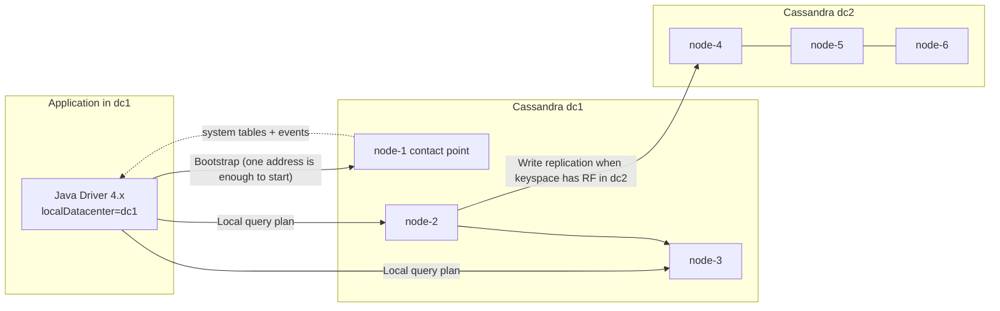
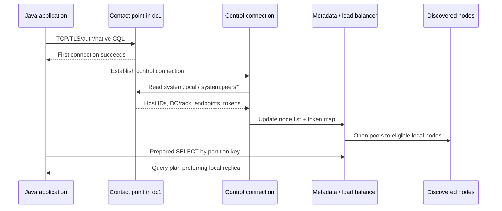
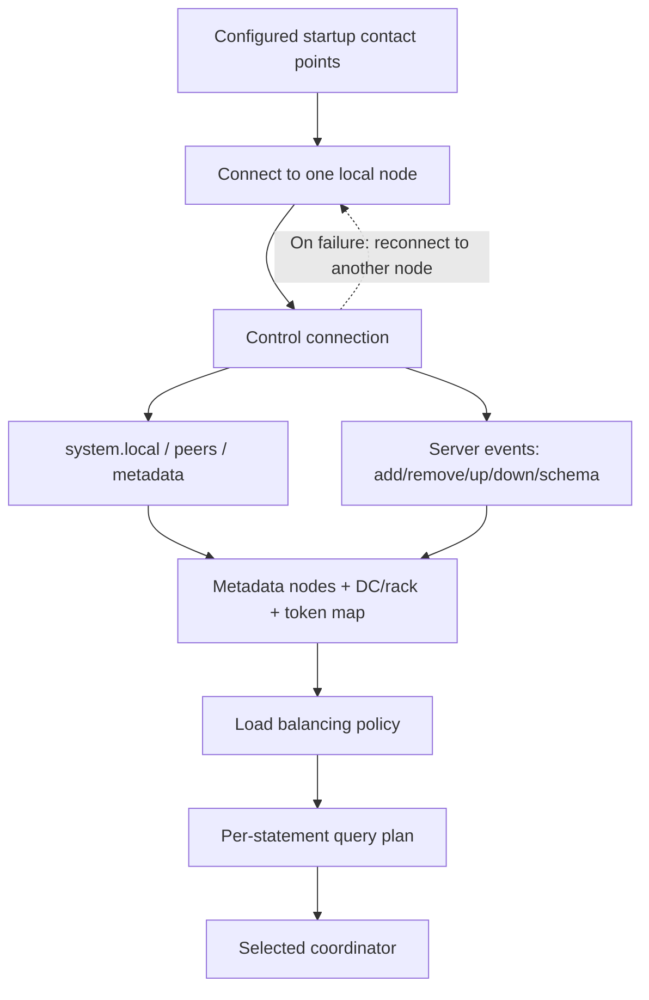
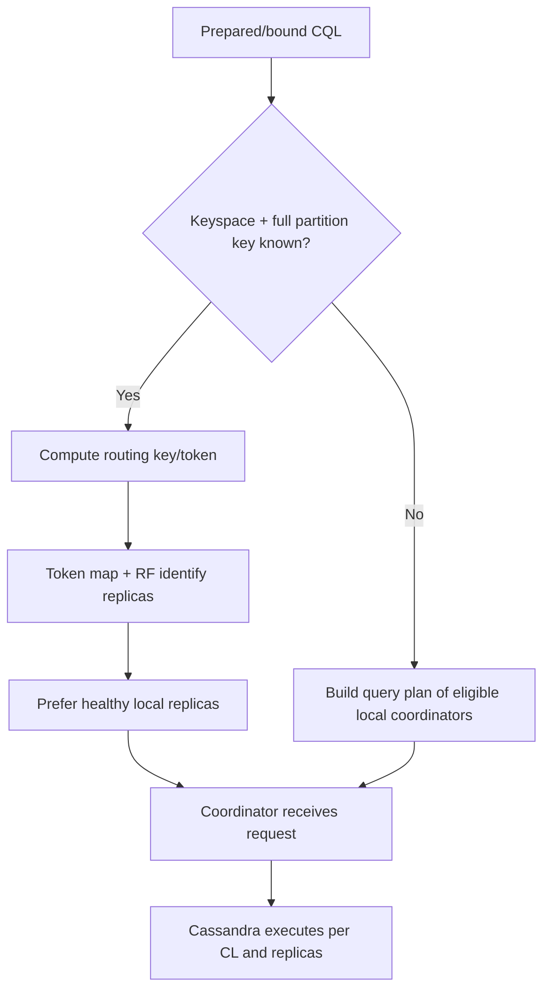
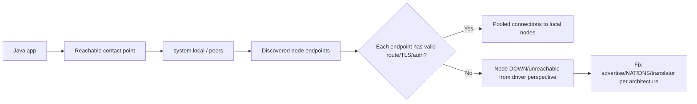
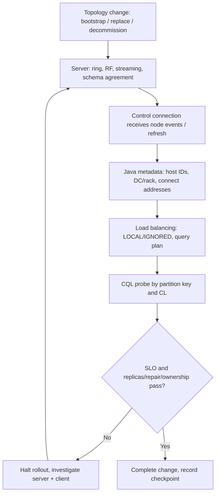

# Contact Points, Local Datacenter, and Topology Discovery

> **Chapter:** Java Driver Basics  
> **Module:** `DATABASE_ENGINE_WIDE_COLUMN_CASSANDRA` — Apache Cassandra

A Java application connecting to Apache Cassandra typically starts with only a few initial IP addresses or hostnames. However, Cassandra is a **distributed cluster**, not a single SQL server: nodes belong to **data centers (DCs)**, racks, and token ranges; each partition is replicated according to a replication strategy; and coordinators and replicas may be different nodes. Java Driver 4.x must know **where to connect at startup**, **which DC is closest to the application**, and **which nodes currently exist in the cluster** in order to pick a good coordinator for each query.

Three frequently confused concepts:

- **Contact point:** seed address *for the driver to start cluster discovery*—not a complete list of every node, not a load balancer by default, and does not determine the replication factor.
- **Local datacenter:** the DC name the application treats as **closest**; with `DefaultLoadBalancingPolicy`, the driver prefers and by default only uses nodes in this DC as coordinators.
- **Topology discovery:** the driver uses a **control connection**, system tables, and server events from Cassandra to identify and track node status, DC/rack, and token metadata **after the initial connection succeeds**.

**Critical pitfall:** Setting `LOCAL_QUORUM` on a statement will not fix a driver configured with the wrong DC. On the other hand, choosing the right local DC avoids cross-WAN client queries, yet for a keyspace replicated across multiple DCs, **writes are still sent to replicas in other DCs**; local routing does not disable replication.

This lesson uses the Java Driver **4.x** API (e.g., the 4.17 branch with package `com.datastax.oss.driver.api`), CQL, and `nodetool` to configure, inspect, troubleshoot, and design safe connectivity. Starting from Java Driver 4.18, the driver project is maintained by the Apache Software Foundation; when applying to 4.18+ or managed/cloud environments, cross-check documentation for the **exact driver branch and connection method**.

**Objectives**

1. Explain the bootstrap sequence from contact points and why multiple contact points do not mean the driver only uses those addresses.
2. Configure `withLocalDatacenter` and `application.conf` with the exact DC name.
3. Inspect driver metadata and distinguish **discovered** nodes, `UP` nodes, `IGNORED` nodes, and nodes with active connections.
4. Understand how the control connection, load balancing, token awareness, and topology events relate to partition keys and CL.
5. Distinguish node discovery from **cross-DC failover**, its default boundaries, and version-specific conditions.
6. Troubleshoot startup failures, unreachable nodes, stale metadata, and incompatible NAT/Kubernetes configurations.
7. Design labs and runbooks after adding, replacing, or decommissioning cluster nodes.

## 1. Concept Map: Client, Coordinator, Replica, DC

Consider a cluster with two DCs, three nodes per DC, and a keyspace using `NetworkTopologyStrategy` with RF=3 in each DC. Application `app-dc1` is deployed near dc1, and `app-dc2` near dc2.



The diagram only illustrates logical communication paths, not exact WAN copy counts or a fixed replica list. In practice, the coordinator may be node-1, node-2, or node-3; topology and tokens determine the replicas for each partition, while the load balancing policy chooses the coordinator. Sending a request to a **coordinator** does not require the coordinator to be a **replica for the partition**, though token-aware routing usually tries to pick a local replica when enough information is available.

To avoid confusion, separate these questions:

| Question | Answering Component | Do Not Confuse With |
| --- | --- | --- |
| Where can the driver open its first CQL session? | **Contact points**, native transport port, TLS/auth | The full replica list |
| Which DC is closest to the application? | **Local datacenter** and load balancing policy | `LOCAL_QUORUM` consistency level |
| Which nodes currently exist in the cluster? | **Topology metadata**, system tables, and events | Initial configured contact points list |
| Which node will be tried for this request? | **Query plan** from the load balancing policy | Every discovered node having a connection |
| Which replicas hold partition X? | Partition key → token map + keyspace RF/strategy | The first IP address in config |
| How many replica ACKs must be awaited? | **Consistency level** and RF, scoped to coordinator's DC for local CLs | Number of contact points |
| Will it auto-switch to DC2 if DC1 fails? | Dedicated **failover policy**, not automatic from discovery | Discovering DC2 nodes in metadata |

## 2. Contact Points Are Bootstrap Seeds, Not a Fixed Topology List

### 2.1. Bootstrap Sequence

In the Java Driver 4.x API:

1. The application initializes `CqlSession` with the specified contact points.
2. The driver attempts to connect to those contact points (it may shuffle/try them sequentially, not strictly in written order).
3. One address accepts a connection, completes TCP/TLS/auth/protocol negotiation, and becomes the starting point for the **control connection**.
4. The driver queries metadata from system tables to learn the remaining nodes, DC/rack, host IDs, and topology; it does not just keep the two addresses entered.
5. The load balancing policy classifies nodes by distance, opens the required connection pools, and builds query plans for requests.
6. When nodes join/leave or change state, the driver processes topology events and refreshes metadata accordingly.



**A contact point is not a Cassandra gossip seed node.** In `cassandra.yaml`, the `seeds` list is the mechanism for **Cassandra nodes** to find one another in the ring. `basic.contact-points` is a **Java Driver client** setting for opening CQL connections. They may share IPs, but they do not play the same role. Nor does a contact point need to own data for every partition.

### 2.2. How Many Contact Points Should Be Configured?

For typical production applications, choose **two or three stable, reachable addresses belonging to the local DC**, ideally spread across racks/availability zones. There is no Cassandra rule requiring all nodes to be listed. The goal is to prevent a single down address from blocking **new sessions from bootstrapping**.

This does not replace topology discovery, nor does it mean connections stay pinned only to contact points:

- **Single contact point:** sufficient for labs, but a single startup point of failure if that node goes down right as the service starts.
- **Multiple contact points in the same DC:** improves bootstrap odds, though discovered nodes must still have **client-reachable addresses**.
- **Contact points across multiple DCs:** incompatible with default `DefaultLoadBalancingPolicy` + explicit local DC; Driver 4.x expects configured contact points to belong to the local DC and may warn or fail initialization on mismatch.
- **Contact point behind a generic load balancer:** can hide node identities, native addresses, and required discovery metadata. Only use a proxy/LB when it is an **officially supported platform or driver connection model**, rather than putting a VIP in front and assuming token-aware routing/discovery still works.
- **DNS names:** DNS can provide stable entry points, but `A/AAAA` records, TTLs, and IP changes do not guarantee the driver can reach all nodes if the addresses Cassandra advertises are unreachable.

A contact point can **disappear** after initialization and the session will keep running if the driver remains connected to other nodes. Conversely, when **creating a new session** and every contact point is unreachable, healthy nodes elsewhere in the cluster **cannot save bootstrap** if the driver has not learned their addresses yet.

### 2.3. What Happens If No Contact Point Is Declared?

In Java Driver 4.x, when **no** contact points are specified, the default is `127.0.0.1:9042`. This is primarily intended for developer machines/labs running Cassandra on localhost; the driver can derive the local DC name from the localhost node for convenience.

In production, **declare explicit contact points and local datacenter**. Do not rely on localhost convenience to mask missing DNS, service discovery, or environment variable configuration.

## 3. Local Datacenter: Pick the Right Name for the Application Side

### 3.1. Definition

`localDatacenter` is **the DC name the application considers local** so the load balancing policy can select eligible coordinators. It is not necessarily the largest DC, the first DC in the RF definition, or the closest by IP address on paper. Usually, pick the DC **co-located in the same network region/zone** as the application to minimize RTT, cross-DC transfer fees, and WAN dependencies.

With the default `DefaultLoadBalancingPolicy`:

- Local nodes are included in query plans and have appropriate connection pools.
- Nodes in other DCs may still appear in **metadata** but are typically marked **`IGNORED`** and excluded as coordinators by default.
- If a remote DC has RF>0, Cassandra still replicates writes to replicas in that DC; local routing **does not turn off WAN replication**.
- `LOCAL_ONE`/`LOCAL_QUORUM` on a request is evaluated relative to the **coordinator's DC**, so a misconfigured local DC changes the actual semantics and performance of queries.

### 3.2. Where to Find the DC Name?

Use read-only operational tools on a Cassandra node:

```bash
nodetool status
nodetool describecluster
```

In `cqlsh`, inspect a node:

```sql
SELECT data_center, rack, host_id
FROM system.local;
```

`system.local` reflects **the node receiving the query**; if `cqlsh` is connected to a node in dc2, it will report dc2. On Cassandra versions with `system.peers`/`peers_v2`, the peer list supplies DC/rack/host IDs for discovering other nodes; do not confuse the **snitch DC name** with an arbitrary cloud region name invented by the application.

For example, if `nodetool status` shows `Datacenter: dc1`, the Java Driver must use the exact string `dc1`—not `DC1` or `datacenter1` unless the cluster advertises those names. The DC name is a topology identifier, **not a human-readable label to localize**.

### 3.3. Two-DC Scenario

Suppose:

```sql
-- Only create in a lab with enough nodes for each DC's RF.
CREATE KEYSPACE IF NOT EXISTS telemetry
WITH replication = {
    'class': 'NetworkTopologyStrategy',
    'dc1': 3,
    'dc2': 3
};
```

- Service running in dc1: `withLocalDatacenter("dc1")`.
- Service running in dc2: `withLocalDatacenter("dc2")`.
- A shared artifact/config package may deploy to both regions, but the **local DC value must come from each region's deployment config**, not a single hardcoded value across all instances.
- `LOCAL_QUORUM` with RF=3 in the coordinator's DC requires a majority of local replicas (2 in this example), rather than summing 3+3 into 4 as keyspace-wide `QUORUM` does.
- A local ACK received by an app in dc1 does not guarantee an app in dc2 immediately reads the latest write; evaluate cross-DC semantics, repair/hints, and business requirements.

## 4. Two Ways to Configure Java Driver 4.x

### 4.1. Programmatic Builder

Example for **Apache Cassandra direct native protocol** using documentation-reserved IPs `192.0.2.0/24`—replace with real endpoints and the exact DC name:

```java
import java.net.InetSocketAddress;
import com.datastax.oss.driver.api.core.CqlSession;

public final class CassandraSessions {
    private CassandraSessions() {}

    public static CqlSession openDc1() {
        return CqlSession.builder()
            .addContactPoint(new InetSocketAddress("192.0.2.11", 9042))
            .addContactPoint(new InetSocketAddress("192.0.2.12", 9042))
            .withLocalDatacenter("dc1")
            .build();
    }
}
```

In a real application, host/port and DC name should come from controlled configuration, credentials from a secret manager, and TLS per security policy. Never hardcode usernames/passwords in source code. The example omits those parameters purely to focus on **contact points + local DC**.

A `CqlSession` is designed as a **shared, thread-safe** object within an application/service. Create it at startup, reuse it across requests, and close it on shutdown. **Do not** build a new session per HTTP request: initialization repeatedly connects, reads topology, and sets up pools, adding unnecessary load.

### 4.2. `application.conf` (HOCON)

Java Driver 4.x can load configuration from `application.conf` on the classpath:

```hocon
datastax-java-driver {
  basic {
    contact-points = [
      "192.0.2.11:9042",
      "192.0.2.12:9042"
    ]
    load-balancing-policy.local-datacenter = dc1
  }
}
```

Equivalent to the builder above for these two settings. Maintain a single consistent configuration path; if both the file and the builder specify settings, **the programmatic local DC takes precedence** per driver documentation. This easily breaks production when deployment updates the config file while code still calls `withLocalDatacenter("dc1")`.

**Startup verification:** log a safe startup event containing the app/deployment region, **selected local DC**, and metadata node count; never print credentials or raw query values. If a managed environment/secure connect bundle has specific requirements, do not mix IP/port builder patterns when the provider specifies a different connection mechanism.

### 4.3. Authenticated and Encrypted Connections

Cassandra supports native transport TLS and authentication; the driver must be configured to match. A TLS/truststore, hostname verification, or credential error can prevent connecting even when **contact points are alive**.

Never disable TLS or certificate verification just to "fix" a startup error. In real operations, verify the CA/truststore, SAN/hostname, authentication mechanism, certificate expiration, and system clocks. If proxies/NAT/SNI are involved, ensure host/port design follows the supported connection scheme.

## 5. Topology Discovery: Control Connection and Metadata

### 5.1. What Is the Control Connection?

After successfully connecting to a contact point, the Java Driver maintains a **control connection**—a dedicated connection for metadata management:

- Queries `system.local` and `system.peers` (or the equivalent mechanism, including `peers_v2` on supported versions) to learn host IDs, endpoints, DC/rack, version, tokens, and schema.
- Receives **topology events** (node added/removed), **status events** (UP/DOWN), and **schema events** over the Cassandra protocol.
- Triggers refreshes of the node list/token map/schema, and checks schema agreement after DDL when appropriate.
- If the control node goes down, locates another node according to its reconnect policy and query plan instead of forcing the app to create a new session.

The control connection is **separate from** the pooled connections used to execute CQL. Metadata can be known to the driver even when no pooled connection is open to every node; conversely, a down or ignored node can remain listed in metadata.



### 5.2. Does the Driver Really "Auto-Discover Every New Node"?

**Automatic discovery exists**, but not unconditionally:

- Cassandra must advertise reachable node addresses and accurate topology metadata.
- The new node must appear in system metadata/events with an endpoint the driver can resolve.
- If the node is outside the local DC, the default policy may mark it **`IGNORED`**; discovery does not imply querying it.
- If the advertised endpoint is a private IP unreachable from the app, the driver may **know the node exists yet fail to open a pooled connection**.
- If the control connection is interrupted, metadata can lag until the driver reconnects/refreshes. Check logs and metrics instead of assuming instantaneous consistency.
- The driver is not an independent source of truth for the ring: `nodetool status`, snitch, system tables, and network reachability still require verification.

**You do not need to restart the Java service every time the cluster adds a node** if discovery and networking work properly. However, after major topology changes, verify the driver sees the new node and request routing/CL behave as expected, rather than relying solely on Cassandra showing `UN`.

### 5.3. Topology Events Do Not Replace Repair

Bootstrap, decommission, replace, and move operations alter token ownership/replicas. The driver learning about a new node does **not** prove all token ranges have finished streaming, have been repaired, or can serve the required CL. Those belong to Cassandra administration: `nodetool status/netstats/repair` and readback probes on sample partitions.

Hence two verification layers are needed:

1. **Server layer:** nodes/ring/schema/streaming/repair are healthy.
2. **Client layer:** driver metadata shows accurate nodes/DC/rack, endpoints are reachable, connection pools are healthy, and prepared query p99 and CL meet targets.

## 6. Inspecting Topology Directly in Java

Java Driver 4.x exposes `session.getMetadata().getNodes()`. This list includes nodes that are **known but down** or **ignored**. `Node.getDistance()` reflects the load balancing policy, not physical distance in kilometers.

```java
import java.net.InetSocketAddress;
import java.util.Map;

import com.datastax.oss.driver.api.core.CqlSession;
import com.datastax.oss.driver.api.core.metadata.Node;

public final class TopologyInspector {
    private TopologyInspector() {}

    public static void printMetadata(CqlSession session) {
        Map<InetSocketAddress, Node> nodes =
            session.getMetadata().getNodes();

        System.out.println("Discovered nodes=" + nodes.size());
        for (Node node : nodes.values()) {
            // Production: route to authorized metrics/logs, avoid exposing IPs/host IDs.
            System.out.printf(
                "hostId=%s connect=%s dc=%s rack=%s state=%s " +
                "distance=%s connections=%d%n",
                node.getHostId(),
                node.getConnectAddress(),
                node.getDatacenter(),
                node.getRack(),
                node.getState(),
                node.getDistance(),
                node.getOpenConnections()
            );
        }
    }
}
```

**Interpreting the fields:**

| Field | Interpretation | Pitfall |
| --- | --- | --- |
| `Host ID` | Cassandra node identifier known to the driver | Do not infer from IP; replacing a node may reuse an IP while changing the host ID. |
| `Connect address` | Endpoint the driver uses to connect to native transport | May differ from broadcast/rpc address in deployment due to NAT/translator/proxy. |
| `Datacenter/Rack` | Topology supplied by server/snitch | Wrong DC/rack leads to flawed load balancing/replication assumptions. |
| `NodeState.UP/DOWN` | How the **driver** views node state | Not always identical to `nodetool status` across all servers at any instant. |
| `Distance.LOCAL` | In the local node set eligible for the policy | Does not guarantee the node holds the partition for every query. |
| `Distance.IGNORED` | Policy does not actively connect to the node | **Not necessarily an error**; typically remote DC nodes under the default policy. |
| `OpenConnections` | Number of connections the driver currently has open to the node | The control connection can give the control node one extra connection beyond regular pool size. |

**Note on metadata snapshots:** the map returned by `getNodes()` is an **immutable membership snapshot at the moment of capture**, though individual `Node` objects update their state. To see nodes added or removed later, call `session.getMetadata().getNodes()` again rather than holding onto an old map forever. Do not iterate all metadata on normal API requests; collect periodically via metrics/diagnostics when needed.

### 6.1. Listening to Node Changes with the Public API

The driver provides `NodeStateListener` and the helper class `NodeStateListenerBase`, allowing you to listen for changes without using **internal driver APIs**. Example:

```java
import com.datastax.oss.driver.api.core.metadata.Node;
import com.datastax.oss.driver.api.core.metadata.NodeStateListenerBase;

public final class NodeEvents extends NodeStateListenerBase {
    @Override
    public void onAdd(Node node) {
        System.out.println("Node added: " + node.getHostId());
    }

    @Override
    public void onUp(Node node) {
        System.out.println("Node up: " + node.getHostId());
    }

    @Override
    public void onDown(Node node) {
        System.out.println("Node down: " + node.getHostId());
    }

    @Override
    public void onRemove(Node node) {
        System.out.println("Node removed: " + node.getHostId());
    }
}
```

Register when building the session:

```java
CqlSession session = CqlSession.builder()
    .addContactPoint(new InetSocketAddress("192.0.2.11", 9042))
    .withLocalDatacenter("dc1")
    .addNodeStateListener(new NodeEvents())
    .build();
```

The snippet assumes `CqlSession` and `InetSocketAddress` are imported as in the earlier example. The listener may receive events **while the session is still initializing**, before `build()` returns, and callbacks may execute across **multiple threads**. Notably, `node.getHostId()` **can return `null` on the initial `onUp`** before the driver finishes reading metadata; do not assume host ID is always populated during initialization callbacks. Avoid heavy work, re-entering Cassandra queries, or depending on an uninitialized session inside callbacks. Push short events to a bounded queue/metrics if asynchronous handling is required. For cases needing events only after the session is ready, check `SafeInitNodeStateListener` in your driver branch.

**Do not overreact to `DOWN` events:** a node may be marked down by gossip from one observer while the driver still holds active pooled connections; or the driver never connects to an ignored node so it never reports `UP` like a health check. Inspect query results and logs/metrics rather than turning a single event into an automated command to remove a node from Cassandra.

## 7. Load Balancing, Token Awareness, and Consistency Level

### 7.1. A Discovered Node Is Not Guaranteed to Be a Coordinator

`DefaultLoadBalancingPolicy` builds a query plan for each request. By default, it considers eligible **local** nodes; for queries with sufficient routing information, the **token-aware** policy prioritizes **local replicas** of that partition. If routing information is missing, the driver may distribute requests round-robin across eligible local nodes.



**Requirements for token-aware routing typically include:**

- The driver has **token metadata** and keyspace replication metadata.
- The statement has a keyspace and a determinable **routing key**, typically via `PreparedStatement`/`BoundStatement` with all partition key components bound.
- The token-owning node is known, not ignored/down, and reachable.
- For batches, a query can span multiple partitions; do not assume it routes as accurately as a single-partition prepared statement.

Token awareness **picks an efficient coordinator**, not a single-node query, nor does it alter RF. Wide scans with `ALLOW FILTERING` or missing partition keys can still trigger substantial fan-out even when the local DC is right.

### 7.2. CQL Illustrating a Query with a Clear Routing Key

```sql
-- Keyspace 'telemetry' created in Section 3 for the LAB.
CREATE TABLE IF NOT EXISTS telemetry.sensor_events_by_day (
    sensor_id text,
    event_day date,
    event_id uuid,
    payload text,
    PRIMARY KEY ((sensor_id, event_day), event_id)
);

INSERT INTO telemetry.sensor_events_by_day
    (sensor_id, event_day, event_id, payload)
VALUES (
    'sensor-07', '2026-11-21',
    11111111-1111-4111-8111-111111111111,
    'demo'
);

SELECT payload
FROM telemetry.sensor_events_by_day
WHERE sensor_id = 'sensor-07'
  AND event_day = '2026-11-21'
  AND event_id = 11111111-1111-4111-8111-111111111111;
```

The complete partition key is `(sensor_id, event_day)`; `event_id` is a clustering column. The driver can compute the routing key for the prepared statement given valid schema and bind values. If the client provides only `event_id`, it cannot reliably derive the partition token and the query may also be rejected for lacking the partition key.

### 7.3. Java Driver 4.x Example Executing a Prepared Statement

```java
import java.time.LocalDate;
import java.util.UUID;

import com.datastax.oss.driver.api.core.CqlSession;
import com.datastax.oss.driver.api.core.DefaultConsistencyLevel;
import com.datastax.oss.driver.api.core.cql.PreparedStatement;
import com.datastax.oss.driver.api.core.cql.Row;

public final class SensorEventReader {
    private final CqlSession session;
    private final PreparedStatement read;

    public SensorEventReader(CqlSession session) {
        this.session = session;
        this.read = session.prepare(
            "SELECT payload FROM telemetry.sensor_events_by_day " +
            "WHERE sensor_id = ? AND event_day = ? AND event_id = ?");
    }

    public String find(String sensorId, LocalDate day, UUID eventId) {
        Row row = session.execute(
            read.bind(sensorId, day, eventId)
                .setConsistencyLevel(DefaultConsistencyLevel.LOCAL_QUORUM)
                .setIdempotent(true)
        ).one();

        return row == null ? null : row.getString("payload");
    }
}
```

- `CqlSession` is created once, with local datacenter matching the deployment.
- The query targets an exact partition and clustering key, fitting a scoped read path.
- `DefaultConsistencyLevel.LOCAL_QUORUM` is a consistency choice; it does not enable/change token awareness or node discovery.
- `setIdempotent(true)` fits this `SELECT`; do not copy that flag onto `+1` counters or non-idempotent operations just to allow retries.
- The driver can select a local replica as coordinator; Cassandra still contacts other replicas as needed to satisfy CL.
- Do not expose sensitive `sensorId`/payload values in diagnostic logs or metric labels.

### 7.4. Avoiding Confusion Around "Local"

There are at least **three distinct "local" layers**:

| "Local" | Where Is It Defined? | Impact |
| --- | --- | --- |
| **Java Driver's Local DC** | `withLocalDatacenter("dc1")` / load balancing policy | Set of coordinators preferred/connected by the driver. |
| **`LOCAL_*` consistency level** | CQL request and keyspace RF | Number of replicas in the **coordinator's DC** that must acknowledge. |
| **Local replica/partition owner** | Token map + keyspace RF + node DC/rack | Where copies of a partition are stored. |

These three concepts are related but do not replace each other. An app using `LOCAL_QUORUM` with a misconfigured local DC may achieve quorum in an **unexpected DC**, increasing WAN latency/cost while breaking data residency and recovery assumptions.

## 8. Multi-DC Failover: Topology Discovery Does Not Auto-Switch DCs

Scenario: all three nodes in dc1 are down while dc2 is healthy. The `app-dc1` driver may have discovered dc2 nodes via metadata, yet **by default it does not fail queries over to dc2** merely because dc2 exists.

**Java Driver 4.x default:** `DefaultLoadBalancingPolicy` uses only the local DC, typically marking remote nodes `IGNORED`. This is intentional to prevent unexpected WAN traffic and let application infrastructure orchestrate failover cleanly.

**Important version difference:** starting in Java Driver **4.10**, the built-in policy provides a **cross-DC failover** option, **disabled** by default. Versions 4.0–4.9 do not offer this feature via the same mechanism.

Example **purely to identify the options**, not recommended as a default setting:

```hocon
datastax-java-driver {
  advanced.load-balancing-policy.dc-failover {
    # Default is 0: do not select remote nodes for failover.
    max-nodes-per-remote-dc = 0
    # When actually using LOCAL_* across remote nodes, additional condition applies.
    # allow-for-local-consistency-levels = false
  }
}
```

When `max-nodes-per-remote-dc` is set greater than 0 in supported versions, the driver can open pools to some remote nodes and include them **after local nodes** in the query plan. However, **failover for local consistency levels** such as `LOCAL_ONE`, `LOCAL_QUORUM`, and `LOCAL_SERIAL` is also disabled by default; enabling it requires `allow-for-local-consistency-levels = true` and careful evaluation of consequences.

**Why is this risky?** `LOCAL_QUORUM` is evaluated against **the DC of the actual coordinator chosen**. If dc1 has RF=3 and dc2 has RF=1, local quorum in dc1 requires 2 confirmations, whereas with a coordinator in dc2 it requires only 1. That changes consistency and availability in non-obvious ways. On top of that come WAN RTT, egress fees, security, data residency, and the risk of reading stale remote data.

| Scenario | Default Behavior | Operational Approach |
| --- | --- | --- |
| One dc1 node down, other dc1 nodes healthy | Driver routes to other local nodes in query plan/reconnect | Inspect topology, pools, latency, CL, and repair per runbook. |
| All configured contact points down **before session startup** | Cannot bootstrap if no contact point is reachable | Provide multiple independent local contact points and proper service discovery. |
| First contact point down **after driver discovered other nodes** | Session usually continues operating via remaining connected nodes | Verify control connection failover, metadata, and request success. |
| Entire dc1 lost, dc2 healthy | **No auto-failover** under default local-only policy | Usually prefer **app/infra-tier failover to app-dc2** using a dc2-local session. |
| Remote failover enabled on 4.10+ | Can use remote coordinators per config, watch `LOCAL_*` carefully | Enable only after rehearsing RF/CL, WAN/latency, data residency, and RTO/RPO. |

**Recommended practice:** deploy **the application in every DC**, each instance group with its own local DC; infrastructure traffic management can shift users to the healthy DC's app group and Cassandra nodes. This is usually cleaner than having an app in a degraded region query across the WAN.

## 9. Why Does Discovery Find Nodes Yet Connections Fail?

Topology discovery relies on **addresses advertised by Cassandra**. The driver might connect to a contact point via a public endpoint, read system peers, and discover **private IP** addresses unreachable from where the application runs.

Example:

```text
Application outside the VPC:
  Public/proxy contact point:   203.0.113.10:9042  -> connects OK
  system.peers advertises:      10.0.4.21:9042     -> client cannot route
  system.peers advertises:      10.0.4.22:9042     -> client cannot route

Result:
  - Bootstrap/control connection may succeed
  - Node list may be complete
  - Pooled connections to other nodes still fail
  - Query plan/availability is degraded or requests time out
```

**Fix goal:** every endpoint the driver intends to use must be **reachable from the application** over the native CQL protocol, with matching TLS/auth and hostname validation. Check:

- `listen_address` is for **internode communication**, not necessarily the CQL endpoint.
- `rpc_address`/`broadcast_rpc_address` (or the version's native address setting) governs the CQL endpoint advertised/read in metadata.
- `native_transport_port` (usually 9042) and network ACLs/firewalls/security groups must be open in the right direction; do not confuse gossip/internode ports with the CQL port.
- DNS for contact points and discovered endpoints resolves to addresses valid on the client's actual network.
- On Kubernetes, container/Pod IPs, Service ClusterIPs, node addresses, and headless services have different lifecycles; **advertised cluster endpoints** require a compatible service discovery/address translation solution.
- With NAT, proxies, cloud secure connect bundles, or SNI routing, use an **address translator/connection strategy supported by the driver or provider**, rather than arbitrarily rewriting IPs in CQL or disabling token metadata.



If an endpoint is detected to belong to a **different cluster** or wrong protocol, the driver may mark it `FORCED_DOWN`/ignore it to avoid sending requests to the wrong destination. Never force a node `UP` via internal APIs to mask a configuration bug.

## 10. Monitoring Topology and Connectivity with Two Metric Layers

### 10.1. Java Driver Side

| Metric/Signal | What It Asks | Abnormal Sign |
| --- | --- | --- |
| Session initialization failures | Can the app bootstrap? | Failing on contact points even though other Cassandra nodes are healthy. |
| Metadata node count per DC | Did the driver discover the right topology? | New nodes missing or wrong DC/rack. |
| `NodeState`, `NodeDistance` | Which local nodes are UP/DOWN/IGNORED? | dc1 nodes unexpectedly `IGNORED`; remote DC used against policy. |
| `getOpenConnections()` / pool metrics | Does the driver have pools to needed nodes? | Node exists in metadata but pool won't open; frequent reconnects. |
| Request timeouts/unavailable/retries | Are users hitting connection/CL errors? | Retry storms, rising p99, timeouts tied to specific coordinators. |
| Coordinator distribution and query plans | Are requests spread across local nodes? | All traffic hitting one node or unexpected remote coordinators. |
| Token-aware routing | Does the driver have routing keys and prefer local replicas? | Queries missing partition key or token metadata disabled/stale. |
| Control connection status/reconnects | Can discovery keep updating? | Control connection repeatedly reconnecting; stale topology. |

**Cardinality warning:** never put unbounded partition keys, tenant IDs, or event IDs into metric labels. Stick to bounded labels like `cluster`, `dc`, `node`/host ID, `operation`, and `query-template-id`. Startup logs may contain infrastructure-sensitive IPs/host IDs; restrict access appropriately.

### 10.2. Cassandra and Infrastructure Side

```bash
# Read-only on a Cassandra node; does not modify the ring.
nodetool status
nodetool describecluster
nodetool netstats
nodetool tpstats
```

```sql
-- On the node handling cqlsh connection:
SELECT data_center, rack, host_id FROM system.local;

-- On Cassandra versions with system.peers:
SELECT peer, data_center, rack, host_id FROM system.peers;
```

On versions with `system.peers_v2`, cross-check the endpoints/ports stored there; do not assume all versions share the exact same columns and format. Combine with TCP/TLS checks from **the Java host itself**, not just testing ports from another Cassandra node.

**Perspective note:** `nodetool status` reflects gossip state from a server; driver `NodeState` reflects state **from the application**. A DC may see a node as `UN` while external apps cannot route to its native address; or an app client may still hold a connection to a node that peers suspect. Inspect both perspectives before concluding a Cassandra node is truly dead.

## 11. Connectivity and Topology Discovery Incident Runbook

### RB-01 — Cannot Initialize `CqlSession`

**Symptoms:** service startup fails, driver cannot establish session, connect timeout/refused, authentication/TLS exception, or missing local DC error.

**Diagnosis:**

1. Inspect the **effective configuration** (redacting credentials): explicit contact points? Is `withLocalDatacenter` or `basic.load-balancing-policy.local-datacenter` accurate?
2. Test network routing and the native port from the app host to **each** contact point, not just from Cassandra servers.
3. Check TLS truststore, certificate SAN/hostname, auth roles/permissions, and whether native transport is enabled.
4. Use `nodetool status`/`system.local` to confirm target DC name and status.
5. Verify whether all contact points belong to the local DC or one points to dc2.
6. If all configured contact points are unreachable while the cluster is healthy, add/update **working local addresses** via controlled config.

**Do not:** remove `withLocalDatacenter` hoping the driver "auto-picks the closest DC" with explicit contact points; disable TLS; or add a random remote DC just to let the service boot. **Closure:** a new app instance creates a session cleanly across at least two redundant contact points, metadata discovers local nodes, and queries at CL succeed.

### RB-02 — Initial Session Connects but Only Sees One Node

**Symptoms:** Java has one active pool, `getMetadata().getNodes()` omits servers already `UN`.

**Diagnosis:** inspect control connection and system tables, server gossip, topology events, and metadata refresh/reconnection logs. Check whether the driver uses a special proxy/SNI/cloud connection model; those models can have different discovery semantics from direct clusters.

**Action:** verify `system.peers`/`peers_v2` are up to date, the source node belongs to the right cluster, and driver/server versions are compatible; fix metadata or advertised endpoint configuration. **Do not** force Java to reconnect every request or manually hardcode all nodes as a substitute for topology discovery.

**Closure:** the node list matches the cluster, DC/rack are accurate, and coordinator load is distributed properly.

### RB-03 — Node Discovered but `DOWN`/No Pool

**Symptoms:** `nodetool status` shows `UN` yet Java sees the node as `DOWN` or reconnects fail.

**Diagnosis:** inspect `Node.getConnectAddress()`, client network routes, DNS/NAT, firewalls, TLS/hostname, native port, and connection metrics. If the node is in a remote DC with distance `IGNORED`, **do not** treat it as a pool failure: the default policy intentionally avoids remote connections.

**Action:** fix endpoint advertising/translator and client networking—do not run token/repair commands to "open a port". If servers advertise IPs unreachable across Kubernetes/NAT, update the connection architecture properly. **Closure:** required local nodes have healthy pools and error/timeout rates drop.

### RB-04 — Application Accidentally Hits a Remote DC

**Symptoms:** p99 increases, WAN/egress bandwidth spikes, actual coordinators reside in dc2 when the app is in dc1.

**Diagnosis:** compare `withLocalDatacenter` against Cassandra DC names and contact points; check custom load balancing/`dc-failover` config; trace the source of `application.conf`; check for per-profile overrides.

**Action:** fix local DC for the deployment, remove remote contact points in direct setups, canary, and re-measure coordinator distribution; disable unapproved remote failover. **Do not** simply lower CL to hide WAN latency. **Closure:** normal queries pick local coordinators, network cost and SLOs recover, and RF/CL are accurate.

### RB-05 — Node Added/Replaced but Java Has Not Picked It Up

**Symptoms:** cluster shows the new node `UN`, Java metadata is stale or queries still target a removed host ID.

**Diagnosis:** check control connection health, topology notifications, system peers, new addresses, cached old IPs, DNS, TLS, and load balancing; verify whether the node is `UJ/UL` or truly `UN` and whether streaming/ownership completed.

**Action:** allow reasonable refresh time, fix network/metadata source, or roll back the topology change if administration requires. If a fresh session succeeds while an old session stays stuck, investigate refresh/control connection before resorting to mass app restarts. **Closure:** membership/host IDs are accurate, no routing targets the removed node, and post-bootstrap/replace read/write probes pass.

### RB-06 — Local DC Down, App Still Running and Wants Failover

**Symptoms:** `NoNodeAvailableException` or unavailable requests in app-dc1 while dc2 stays healthy.

**Diagnosis:** check network state, node health, RF/CL, whether `dc-failover` exists in the active driver version, and whether the app has a dc2 deployment with traffic management. Clarify RTO/RPO targets and visibility of incompletely replicated writes.

**Preferred action:** shift user traffic to the healthy application deployment in dc2 with its matching local DC per infrastructure plan, verifying consistency and replication lag. Enable driver remote failover on supported versions only after evaluating **`LOCAL_*` semantics**, security, WAN, and failure testing; never enable it ad hoc during an incident. **Closure:** service runs cleanly on the approved DC, latency/errors stabilize, and a repair/hints plan is ready when the old DC recovers.

## 12. Verification Sequence After Topology Changes

When operators perform a node bootstrap/decommission/replace, the Java Driver is only **one verification layer**.



**Pre-change checkpoints**

- Capture baseline `nodetool status`, keyspace RF/CL, host IDs, endpoints, and Java metadata.
- Check whether any contact points will be changed/removed; keep alternative local addresses available for bootstrapping new sessions.
- Verify driver version, server version, certs/TLS, rolling upgrade compatibility, networking, and sufficient streaming capacity.
- Define read/write probes covering **keys existing prior to the change** and **newly written keys afterward**, across multiple token ranges and each critical DC.
- Document STOP conditions: missing metadata, `UN` node unreachable, insufficient quorum, or latency/errors breaching SLO.

**Post-bootstrap checkpoints**

- New node appears in `nodetool status`, streaming progresses/completes, and ownership matches plan.
- Java `getNodes()` reflects the new host ID/endpoint; `getDistance()` is `LOCAL` for dc1.
- Connection pool to the new node establishes cleanly without TLS/auth/routing errors.
- Query probes by partition key and CL succeed; do not infer from `getNodes()` alone that all SSTables finished streaming.

**Post-replace/decommission checkpoints**

- Old host ID is gone or properly replaced, and the driver does not attempt queries to the old endpoint.
- Configured contact points no longer point exclusively to departed nodes; update inventory/secrets/deployment configs.
- Replica ownership, repair/cleanup, and read-after-write at CL are verified by the Cassandra team.
- Monitor p95/p99, retries, reconnects, hinted handoff, streaming, and disk/compaction after the change.

## 13. End-to-End Verification Hands-On

### Lab: 2 DCs, 3 Nodes per DC, Java Service in dc1

**Prerequisites:** Cassandra running in an isolated lab with `NetworkTopologyStrategy` RF=3 in dc1/dc2, native CQL reachable from the Java host, Driver 4.x, accounts and TLS per policy. IPs/ports below are documentation placeholders.

**Phase A — Verify Server**

```bash
nodetool status
nodetool describecluster
```

```sql
SELECT data_center, rack, host_id FROM system.local;
SELECT keyspace_name, replication
FROM system_schema.keyspaces
WHERE keyspace_name = 'telemetry';
```

**Phase B — Initialize One Session and Inspect Metadata**

- Choose two contact points in **dc1**.
- `withLocalDatacenter("dc1")`.
- Call `TopologyInspector.printMetadata(session)` after `build()` completes.
- Confirm dc1 and dc2 nodes appear in metadata (if the cluster publishes full metadata); dc2 nodes show `IGNORED` by default, not Cassandra down.
- Note that the control node may have one extra connection; judge pool/errors solely via proper metrics.

**Phase C — Read by Partition Key**

Run `SensorEventReader.find(...)` against demo data. If `SELECT` succeeds with `LOCAL_QUORUM`, that proves basic endpoint/client/CL operation—**not** that every replica or dc2 is instantaneously synchronized.

**Phase D — Observe Temporary Node Loss (Lab Only)**

- Using an approved lab/chaos tool, make **one contact point** unreachable while other local nodes remain healthy.
- Verify the running session continues serving requests via other local nodes, and **a new session** can bootstrap via the backup contact point.
- Use `NodeEvents`/metrics to observe state changes, without automatically running `nodetool removenode`.
- Restore the node and verify reconnect, metadata, and CL; hints/repair may be required per procedure.

**Phase E — Test a New or Replaced Node**

- Change topology following the lab's Cassandra runbook and wait for streaming/ownership.
- Confirm Java automatically learns the new node with proper DC/rack and reachable native address.
- Run old/new data probes from clients in the appropriate DC.
- No need to add the newly joined node to `basic.contact-points` if seeds remain sufficient and discovery works; update contact points only if startup addresses become obsolete.

### Sample Verification Table

| Test | Expected Result | Assessment |
| --- | --- | --- |
| Startup with CP1 healthy, CP2 down | Session still bootstraps using CP1 | PASS if connection and metadata are stable |
| Startup when both CP1 and CP2 are down | Session cannot know a third node before bootstrap | Failure condition requiring design fix |
| dc2 nodes present in metadata | Visible, but distance is `IGNORED` | Normal default behavior |
| New dc1 node joins | Driver updates membership and opens pools when reachable | Monitor events/refresh |
| Query missing partition key | No routing key; may be rejected by CQL or scan widely | Not a topology error |
| Local node unreachable from app | Node in metadata, but connection fails | Investigate network/advertise/TLS |
| All dc1 down, only dc2 healthy | No remote failover by default | Failover at infra/design layer |

## 14. Production Deployment Checklist

| Item | PASS When |
| --- | --- |
| **Driver/server versions** | Driver 4.x and Cassandra/protocol compatibility verified; version-specific options known. |
| **Contact points** | 2–3 reachable local DC endpoints across failure domains, not relying on IPs scheduled for removal. |
| **Local DC** | Matches snitch and deployment region exactly; not overridden incorrectly by builder. |
| **CQL native port** | Port/firewall/TLS/auth reachable **from the Java host**, not just from Cassandra nodes. |
| **Topology metadata** | Node count/host ID/DC/rack accurate; system tables/events accessible and updating. |
| **Address translation** | NAT/Kubernetes/proxy/cloud uses a supported endpoint strategy. |
| **Load balancing** | Local coordinators selected; remote `IGNORED` unless failover is explicitly approved. |
| **Token awareness** | Prepared/bound statements include partition key; schema/token metadata accurate. |
| **Consistency** | RF and `LOCAL_QUORUM`/CL understood relative to coordinator DC. |
| **Session lifecycle** | Session reused and closed at shutdown; never created per request. |
| **Failover policy** | RTO/RPO, backup region, local-only default, and 4.10+ opt-in documented. |
| **Metrics** | Startup failures, pool/reconnects, driver node status, coordinator distribution, errors/p99 tracked. |
| **Topology changes** | Pre/post checkpoints for node add/replace/decommission; read/write probes on old/new data. |
| **Security** | Secrets via vault, TLS/hostname validation enabled, metadata/IP logs access-controlled. |

## 15. Scenario Questions and Self-Check

**Question 1.** An application configures only one contact point, `node-1`. After the session is running and has discovered `node-2`/`node-3`, `node-1` goes down. Must the session stop immediately? What can happen to **a new session** at that moment?

**Question 2.** Why should the `contact-points` list not be mistaken for the complete list of Cassandra nodes?

**Question 3.** An app in dc1 uses `withLocalDatacenter("dc2")`. `LOCAL_QUORUM` queries succeed, yet WAN p99 rises. Where is the bug and why doesn't CL fix it?

**Question 4.** Java metadata lists six nodes, yet pools only exist to three nodes in dc1. Can you conclude dc2 is down?

**Question 5.** When no explicit contact points are configured, where does Driver 4.x usually connect? Why is this only suited for certain labs?

**Question 6.** You have a `PreparedStatement` and full `(sensor_id, event_day)`. How can the token-aware policy help? What happens if a query only supplies `event_id`?

**Question 7.** A public contact point allows bootstrap, but the driver discovers 10.0.x.x IPs unreachable from the app container. At which layer must this be fixed?

**Question 8.** All of dc1 is lost while dc2 is alive, and dc2's `NodeDistance` is `IGNORED`. Why doesn't the driver automatically switch DCs? What option is supported from 4.10+ and what are its risks?

**Question 9.** With dc1 RF=3 and dc2 RF=1, failing a `LOCAL_QUORUM` client over from a dc1 coordinator to dc2 changes the required ACK count how?

**Question 10.** `getMetadata().getNodes()` was called once before a new node joined the cluster. Why might keeping that `Map` fail to show the new node?

**Question 11.** A node shows `UN` in `nodetool status`, yet the driver marks it `DOWN`. Name at least four layers to check before deciding to restart Cassandra.

**Question 12.** The Java Driver received an event adding a new node. Is that enough to declare bootstrap/streaming/repair and data on the new node complete? What evidence is required?

<details>
<summary>Suggested Answers</summary>

1. Not necessarily: the driver can continue using discovered nodes and fail over the control connection. A new session needs a **reachable configured contact point** to bootstrap; if only CP1 was configured and it is down, startup can fail.
2. They are bootstrap seeds; the control connection queries system tables and processes events to learn membership, DC/rack, and the token map.
3. The misconfigured local DC makes load balancing pick dc2 coordinators. `LOCAL_QUORUM` is evaluated in the coordinator's DC and does not override load balancing decisions.
4. No. The default policy marks remote nodes `IGNORED`; metadata tracks them without opening pools to them.
5. `127.0.0.1:9042`; production hosts rarely run Cassandra on localhost and require an explicit local DC.
6. The driver computes the routing key/token and prefers local replicas; having only clustering column `event_id` cannot determine the partition token, and the query may even be rejected.
7. Cassandra's advertised endpoint, network routes, NAT/DNS/translator, or a compatible proxy/cloud mechanism. Do not fix by raising timeouts or forcing nodes `UP`.
8. Local-only default prevents unexpected WAN traffic and consistency shifts. From 4.10+ there is an opt-in dc-failover config; evaluate `LOCAL_*` semantics, RF, cost, and security.
9. In dc1 (RF=3), local quorum needs 2; in dc2 (RF=1), local quorum needs only 1. That is a significant semantic change.
10. The membership map is an immutable snapshot from capture time; call `getNodes()` again or use a `NodeStateListener`.
11. Advertised CQL IP/broadcast endpoint, native port/firewall, TLS/auth, DNS/NAT, driver policy, control connection, or differing node vs. app visibility.
12. Not yet. Verify `nodetool status/netstats`, ownership/repair/streaming coverage, Java metadata/connection pools, and read/write probes from the proper DC/CL.

</details>

## Key Takeaways

- **Contact points help the Java Driver start up**, not a complete node list and not Cassandra gossip seeds.
- **Local datacenter governs local coordinators in load balancing**; it must match the snitch DC name and be set per deployment.
- **Topology discovery via control connection + system metadata/events** lets the driver learn new nodes without manually adding IPs to contact points; however, advertised endpoints must be **reachable from the client**.
- Driver 4.x defaults to **local-only and token-aware**; remote nodes may be known yet **`IGNORED`** with no pools.
- **Cross-DC failover is off by default**; from Driver 4.10+ an opt-in exists carrying risks around `LOCAL_*` consistency, WAN, and per-DC RF.
- `LOCAL_QUORUM`, the driver's local DC, and local replicas are three distinct concepts. Picking the right local DC **does not disable WAN replication**.
- Cross-check **Java metadata + nodetool/server + network reachability + SLOs** to verify topology, especially after node bootstrap/replace/decommission.

### Official References

- [DataStax Java Driver 4.17 — Core: contact points and local datacenter](https://docs.datastax.com/en/developer/java-driver/4.17/manual/core/index.html)
- [Apache Cassandra Java Driver 4.18 — Load balancing, token-aware routing, and cross-DC failover](https://apache.github.io/cassandra-java-driver/4.18.0/core/load_balancing/)
- [DataStax Java Driver 4.17 — Control connection](https://docs.datastax.com/en/developer/java-driver/4.17/manual/core/control_connection/index.html)
- [DataStax Java Driver 4.17 — Node metadata and state](https://docs.datastax.com/en/developer/java-driver/4.17/manual/core/metadata/node/index.html)
- [DataStax Java Driver 4.17 — Reference configuration](https://docs.datastax.com/en/developer/java-driver/4.17/manual/core/configuration/reference/index.html)
- [DataStax Java Driver 4.17 — NodeStateListener Javadoc](https://docs.datastax.com/en/drivers/java/4.17/com/datastax/oss/driver/api/core/metadata/NodeStateListener.html)
- [Apache Cassandra — Dynamic snitch / topology](https://cassandra.apache.org/doc/stable/cassandra/managing/operating/snitch.html)
- [Apache Cassandra — nodetool status](https://cassandra.apache.org/doc/stable/cassandra/managing/tools/nodetool/status.html)
