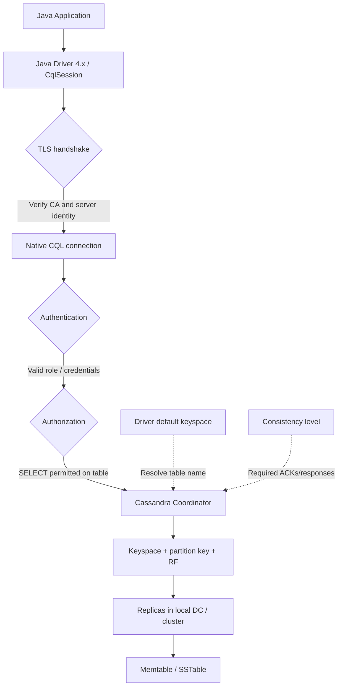

# Configuring Keyspace, Authentication, and TLS

> **Chapter:** Java Driver Basics  
> **Scope:** Connecting a Java application to Apache Cassandra with **Java Driver 4.x** to read/write CQL on a distributed *wide-column* database. This lesson focuses on keyspace selection, identity authentication, authorization, and TLS security for client–server connections.
>
> **Learning Objectives:** Distinguish **keyspace**, **local datacenter**, **authentication**, **authorization**, and **TLS**; configure a `CqlSession` with a default keyspace, credentials, and SSL context; verify CA/certificate/hostname; test least-privilege permissions with CQL; diagnose connection failures; and build a safe change procedure.

## 1. Scenario: Connecting Does Not Automatically Mean Connecting Correctly and Safely

A Java order-processing service needs to read a record by `order_id` from Cassandra. A minimal test session initialization snippet:

```java
try (CqlSession session = CqlSession.builder().build()) {
    // ...
}
```

This code is **insufficient as a deployment configuration** because it does not specify:

- **Which cluster/datacenter** is the application connecting to?
- Without a default keyspace, where is `SELECT ... FROM orders_by_id` resolved?
- Which identity is used to log in? Does that role have `SELECT` permission?
- Is the password transmitted over a **TLS-encrypted** connection?
- Does the application verify a **trusted CA and the hostname** in the certificate?
- With multiple replicas, which consistency level is used for reads/writes?

A minimal setup works in a lab to learn the API. In a real system, missing any of the items above can cause `Unauthorized` errors, connecting to the wrong environment, or sending traffic over an unencrypted network.

### Expected Outcome After This Lesson

We want a session configured with:

```text
Cluster endpoints:    cassandra-1.internal:9042, cassandra-2.internal:9042
Local datacenter:     dc1
Default keyspace:     lab
Login identity:       lab_reader
Authorization:        SELECT on the exact table being read
Transport:            TLS verifying server identity via trusted CA
CQL consistency:      LOCAL_QUORUM for demo queries, if local RF matches
Lifecycle:            one reused CqlSession, closed on application shutdown
```

These hosts and roles are **examples**, not values to copy to production. Concrete settings must match your real cluster's RF, node endpoints, certificates, and security policy.

## 2. Connection Map and Distinct Control Layers



**Each layer answers a different question:**

| Component | Question It Answers | What It Does Not Do Automatically |
| --- | --- | --- |
| **Contact points** | Which hosts should the driver start discovering the cluster from? | Restrict the app to connecting to only one host |
| **Local datacenter** | Which DC's coordinators should the driver prefer? | Change token ownership or RF |
| **Keyspace** | Which namespace does a table belong to, and how is replication configured? | Log in or grant permissions |
| **Authentication** | Which identity/role is the client presenting? | Prove the role can read every table |
| **Authorization** | Is the role permitted to operate on this resource? | Encrypt network traffic |
| **TLS** | Is the connection encrypted and certificate identity verified? | Grant `SELECT`/`MODIFY` permissions |
| **Consistency level** | How many replicas must respond per RF/DC? | Add permissions or provide TLS security |

For example, an encrypted and authenticated connection can still have `SELECT` denied. That is **correct security behavior**, not a TLS bug.

## 3. What Is a Keyspace in Cassandra?

A keyspace is a namespace for tables and related CQL objects. More importantly, a keyspace defines the **replication strategy** and **replication factor** for the data in its tables.

In Cassandra:

- **Partition key** determines the token and the replica set storing a partition.
- **Replication strategy/RF** in the keyspace governs replica placement across datacenters.
- **Clustering key** orders rows **within a partition**.
- **Consistency level** per request dictates response requirements based on RF/replicas.
- **Java session keyspace** is simply the default namespace when writing unqualified CQL table names.

Therefore, `CqlSession.withKeyspace("lab")` **does not change** replication settings and **does not elevate** client permissions. It allows `FROM orders_by_id` to resolve to `FROM lab.orders_by_id` when compatible with the schema.

### How Does a Keyspace Differ from an RDBMS Database?

In an RDBMS, learners are accustomed to a "database/schema" containing tables with foreign-key joins. Cassandra designs tables around **queries**, often **denormalizing** data across multiple tables. A keyspace does not provide foreign keys, joins, or default multi-partition ACID transactions.

Think of a keyspace as a **namespace with replication settings**, while "is this query fast?" depends primarily on the **partition key, clustering key, and read/write patterns**.

## 4. Creating a Keyspace and Table on a Lab Cluster

The commands in this section are for a **learning environment**, executed by an administrative role permitted to create schema. Assume the lab cluster actually has a datacenter named `dc1` and at least three nodes suitable for RF=3.

```cql
CREATE KEYSPACE IF NOT EXISTS lab
WITH replication = {
    'class': 'NetworkTopologyStrategy',
    'dc1': 3
}
AND durable_writes = true;
```

Key points:

- `NetworkTopologyStrategy` is appropriate when replica placement must be DC/rack-aware.
- `'dc1': 3` means the keyspace keeps three replicas in DC1; it does not restrict Java sessions to running only in DC1.
- `durable_writes = true` is the right durability choice for most workloads; never disable it to "speed things up" without understanding the risk.
- `IF NOT EXISTS` does not alter an existing keyspace. Always **inspect the actual configuration**.

If your lab has only one node or a different topology name, **do not copy RF=3/dc1**. Adjust to your allowed cluster and test goals; the consistency levels in later examples must also align with local RF.

Create a table serving order lookups by ID:

```cql
CREATE TABLE IF NOT EXISTS lab.orders_by_id (
    order_id uuid PRIMARY KEY,
    customer_id uuid,
    status text,
    total decimal,
    updated_at timestamp
);
```

In this example, `order_id` is the partition key. Looking up an order by ID queries a single deterministic partition.

Insert sample data (using a role with `MODIFY` permission):

```cql
INSERT INTO lab.orders_by_id (
    order_id, customer_id, status, total, updated_at
) VALUES (
    11111111-1111-4111-8111-111111111111,
    aaaaaaaa-aaaa-4aaa-8aaa-aaaaaaaaaaaa,
    'PAID',
    250.00,
    '2026-11-21T08:00:00Z'
);
```

Read to verify:

```cql
SELECT order_id, status, total
FROM lab.orders_by_id
WHERE order_id = 11111111-1111-4111-8111-111111111111;
```

### Why Use Fully Qualified Table Names in Administrative CQL?

`lab.orders_by_id` explicitly specifies the keyspace. This avoids an administrative session sitting in a different keyspace accidentally operating on a homonymous table.

Outside Java, a `cqlsh` user can run:

```cql
USE lab;

SELECT order_id, status, total
FROM orders_by_id
WHERE order_id = 11111111-1111-4111-8111-111111111111;
```

However, **`USE` in a `cqlsh` session does not set the default keyspace for a Java application**. The two clients maintain separate connection/session state.

## 5. Configuring a Default Keyspace in Java Driver 4.x

A Java Driver 4.x `CqlSession` can be built with a default keyspace:

```java
import com.datastax.oss.driver.api.core.CqlIdentifier;
import com.datastax.oss.driver.api.core.CqlSession;

CqlSession session = CqlSession.builder()
    .withKeyspace(CqlIdentifier.fromCql("lab"))
    .build();
```

This only illustrates the **keyspace selection API**; it does not specify contact points, local DC, authentication, or TLS. Do not use it standalone as a production template.

After opening the session, you can inspect it:

```java
String keyspace = session.getKeyspace()
    .map(CqlIdentifier::asInternal)
    .orElse("<none>");

System.out.println("Default keyspace = " + keyspace);
```

Meaning:

- `withKeyspace(...)` selects the default keyspace for unqualified table names.
- `getKeyspace()` returns the session's active default keyspace, if any.
- The session does not create the keyspace; **the keyspace must already exist** on the server.
- The role still needs appropriate permissions on the table.
- CQL statements explicitly writing `lab.orders_by_id` can still be used to avoid ambiguity.

### Querying With and Without a Default Keyspace

When the session is set to `lab`, both statements target the same table:

```cql
SELECT status FROM orders_by_id WHERE order_id = ?;
```

```cql
SELECT status FROM lab.orders_by_id WHERE order_id = ?;
```

`?` is a prepared statement placeholder when executed through the driver. In `cqlsh`, use CQL syntax with concrete values or tool-supported bindings.

Without a default keyspace, a query writing only `FROM orders_by_id` will fail because the namespace cannot be resolved; the fully qualified query remains unambiguous.

## 6. Are Keyspaces Case-Sensitive?

**Unquoted** CQL identifiers are normally normalized to lowercase. Identifiers enclosed in **double quotes** preserve case and special characters.

Example illustrating identifier differences:

```cql
-- Standard keyspace, normalized to lowercase:
CREATE KEYSPACE IF NOT EXISTS lab
WITH replication = {'class': 'NetworkTopologyStrategy', 'dc1': 3};

-- If a system already created a quoted keyspace with a special name,
-- that exact name must be referenced verbatim.
-- Do not create extra quoted keyspaces just to test in production.
```

In Java:

```java
CqlIdentifier ordinary = CqlIdentifier.fromCql("lab");
CqlIdentifier quoted = CqlIdentifier.fromCql("\"LabCase\"");
```

`ordinary` and `quoted` are not the same name. `CqlIdentifier.fromCql(...)` takes a **CQL identifier**, where a quoted string follows CQL syntax. Do not blindly call `toLowerCase()` on arbitrary user-supplied identifiers.

### Multi-Tenant: Never Concatenate Keyspace Names Directly from Requests

An anti-pattern:

```java
// DO NOT use this code with untrusted input:
String query = "SELECT * FROM " + tenantName
    + ".orders_by_id WHERE order_id = ?";
```

Prepared statements **do not bind keyspace/table names the way they bind UUID values**. Table/keyspace names must come from a **controlled allowlist/tenant config**, validated and properly quoted via CQL identifier APIs or approved CQL strings.

If an application uses multiple keyspaces, decide cleanly:

- One session/default keyspace with fully qualified queries when targeting others; or
- Per-environment/tenant sessions managed with proper pool bounds and lifecycles.

Never create a new `CqlSession` for **each request** just to switch keyspaces. Sessions hold connection pools, metadata, and background resources and must be **reused**.

## 7. Authentication and Authorization Are Two Distinct Steps

### Authentication: "Who Are You?"

Cassandra can be configured with an authenticator such as `PasswordAuthenticator` to verify roles using username/password. In other environments, custom plugins/authenticators may use different mechanisms.

Successful authentication means the server verified the identity under its configured mechanism—it does **not** prove the role is permitted to access data.

### Authorization: "What Are You Allowed to Do?"

When Cassandra uses `CassandraAuthorizer` or another authorization mechanism, a role can be restricted by:

- `SELECT`: reading data.
- `MODIFY`: inserting/updating/deleting data within resource scope.
- `CREATE`, `ALTER`, `DROP`: managing schema and relevant resources.
- `AUTHORIZE`: granting/revoking permissions per resource and context.
- Other permissions such as `EXECUTE` for functions depending on version and resource type.

Not every permission applies to every resource. For this lesson, the API only reads one table, so `SELECT ON TABLE lab.orders_by_id` is far cleaner than granting superuser.

### Server-Side Security Config Must Exist First

In some Apache Cassandra versions, the related configuration looks like:

```yaml
# CONCEPTUAL snippet for lab only, not a complete configuration.
authenticator: PasswordAuthenticator
authorizer: CassandraAuthorizer
```

Options, fully qualified class names, defaults, superuser bootstrap procedures, caches, and restarts depend on the Cassandra version/distribution. **Never enable authentication/authorization in production by editing two lines and restarting**: administrative roles, credential rotation, JMX/ops permissions, application rollouts, and rollback plans must be ready to avoid locking yourself out of the cluster.

## 8. Creating a Read-Only Role and Granting Least Privilege in the Lab

The commands below are executed by an authorized administrative role **after authentication/authorization are properly configured**.

```cql
-- Lab only. Replace demo password with a random secret.
CREATE ROLE IF NOT EXISTS lab_reader
WITH PASSWORD = 'LAB_ONLY_CHANGE_ME'
AND LOGIN = true;
```

Never use example passwords outside a lab, and never put real passwords into documentation, source code, pull requests, logs, or shell history. In production, use an approved secret generation/rotation workflow.

Grant only the required permission:

```cql
GRANT SELECT ON TABLE lab.orders_by_id TO lab_reader;
```

Inspect permissions using an identity authorized to view metadata:

```cql
LIST ALL PERMISSIONS OF lab_reader;
```

Permissions can be inherited from other roles; **do not look only at a single direct grant line** when auditing least privilege.

### Negative Testing Is Crucial

Log in as `lab_reader` and test:

```cql
SELECT order_id, status
FROM lab.orders_by_id
WHERE order_id = 11111111-1111-4111-8111-111111111111;
```

Expected: read succeeds if role and data match.

Next, attempt an operation the role is not permitted to perform:

```cql
-- Run in the lab to verify permission denial.
UPDATE lab.orders_by_id
SET status = 'SHIPPED'
WHERE order_id = 11111111-1111-4111-8111-111111111111;
```

Expected: **rejected due to missing `MODIFY`**. If this succeeds, check superuser flags, role inheritance, broad keyspace-level grants, and the active authorizer.

Never run a test `UPDATE` against real mutable production data.

### Separating Read vs. Write Permissions

A service that needs to write to the table can be granted:

```cql
-- Only when the role genuinely needs write access to this table:
GRANT MODIFY ON TABLE lab.orders_by_id TO lab_writer;
```

Assume `lab_writer` was already created through the proper procedure. **Never share one superuser account across all microservices**; separate read, write, schema, and operational privileges.

## 9. What Does TLS Protect?

**TLS (Transport Layer Security)** protects the network channel between clients and Cassandra when native transport TLS is enabled. It provides key guarantees:

1. **Encryption in transit:** third parties on the network cannot easily read CQL payloads or credentials.
2. **Integrity:** detects tampering with data in transit.
3. **Server authentication:** the client verifies the certificate to confirm it is talking to a trusted server.
4. **Mutual TLS (mTLS), if configured:** the server also verifies the client certificate.

TLS is not a CQL authorization mechanism. The server can still enforce `PasswordAuthenticator` and `CassandraAuthorizer` behind TLS.

### Client–Server TLS Differs from Internode TLS

```text
Java Driver --TLS/native transport--> Cassandra coordinator
                                         |
                                         | internode communication
                                         | (separate TLS configuration)
                                         v
                                      Other replica
```

Enabling TLS in **`client_encryption_options`** does not automatically prove **internode** traffic is encrypted. Cassandra has separate configuration for internode encryption depending on release. A security review must evaluate both paths whenever data traverses untrusted networks.

### TLS Also Does Not Encrypt Data at Rest

SSTables, commit logs, snapshots, and backups reside on disk/object storage under separate protection policies. TLS covers **in transit**; encryption at rest and filesystem/backup permissions are distinct controls.

## 10. Truststore, Keystore, and mTLS

A standard TLS connection uses a **server certificate** so the Java client can verify Cassandra's identity.

| Component | Who Owns It? | Role |
| --- | --- | --- |
| **Server certificate** | Cassandra node or authorized TLS endpoint | Proves server identity |
| **Server private key** | Server side, strictly protected | Completes server-side TLS handshake |
| **CA certificate/chain** | Trusted per PKI policy | Enables certificate chain validation |
| **Client truststore** | Java application | Holds trusted CAs/certificates |
| **Client keystore** | Java application **if mTLS** | Holds client certificate and private key |
| **Client certificate** | Client identity at TLS layer for mTLS | Presented for server validation |
| **Cassandra username/password** | Role/secret store | CQL-layer authentication; not a TLS private key |

**Truststore and keystore serve different roles**: the truststore answers "which CAs/certificates do I trust?", while the client keystore (in mTLS) answers "which certificate/key do I present to identify myself?".

### Not Every mTLS Setup Replaces Password Authentication

Even when the server requires a client certificate, Cassandra may still require username/password at the native protocol layer. Automatic mapping of a certificate to a Cassandra role only happens if a **compatible authenticator** supports it and is explicitly configured.

**Do not remove `withAuthCredentials`** merely because `require_client_auth=true` is set when the server still uses `PasswordAuthenticator`.

## 11. Conditions for Server Certificate Verification

A secure TLS client must verify multiple properties:

- The certificate is signed by a **trusted CA** with a valid chain.
- The certificate is **not expired** and is valid at the current system time.
- The **hostname** the driver connects to matches the certificate identity, typically in SANs.
- Certificate/key usage and TLS versions/ciphers comply with organizational policy.
- **Endpoints discovered by the driver after the contact point** also present valid matching certificates.

Example driver topology:

```text
Contact point: cassandra-1.internal
Discovered peer: cassandra-2.internal
Other peer: cassandra-3.internal
```

If `cassandra-2.internal`'s certificate only has a SAN for `cassandra-1.internal`, a client properly performing hostname verification will **refuse to connect** to node 2, even though node 1 connects cleanly.

### IPs in Contact Points vs. DNS SANs

If the driver connects by IP `10.x.x.x` while the certificate only lists DNS SAN `cassandra-1.internal`, identity verification may fail depending on the SSL engine configuration.

The right fix is issuing certificates with **SANs matching the exact addresses/hostnames used**, aligning endpoint advertisement and DNS policy—not disabling hostname verification.

### SSLContext Does Not Always Mean Hostname Verification

In Java, an `SSLContext` with trust managers validates the certificate chain. However, **hostname/SAN** enforcement also depends on `SSLEngine`/the driver SSL engine factory and release configuration.

**Important:** the Java example below shows loading a CA/truststore. In production, **verify and enable endpoint/hostname identity verification as supported by your Java Driver release**, and run a negative test with a mismatched hostname. Never use "trust-all certificates" or disable hostname verification to wave handshakes through.

## 12. Cassandra-Side Configuration: Client Encryption

In Apache Cassandra versions with corresponding client encryption settings, operators may see a block like:

```yaml
# CONFIGURATION SKETCH - do not copy directly to production.
client_encryption_options:
    enabled: true
    optional: false
    keystore: /secure/path/server-keystore
    keystore_password: <server-keystore-secret>
    require_client_auth: false
```

Conceptual meaning:

- `enabled` turns on TLS for native transport per the release's mechanism.
- `optional: false` (where supported with that meaning) ensures **plaintext clients are rejected** on that listener.
- `keystore` and server private key/certificate must be protected with OS permissions/secrets.
- `require_client_auth` controls requiring client certificates for mTLS.

**Keys, defaults, store formats, TLS versions, and restart/rolling-upgrade behavior vary across Cassandra releases/distributions**. This example illustrates structure only, not a complete `cassandra.yaml` or an immediate config change recommendation.

Before enabling real TLS, verify:

1. Server certificates and CA have proper SANs for all node endpoints.
2. Java apps, `cqlsh`, ETL, backup/monitoring clients, and batch jobs all have the new TLS configuration.
3. There is a **zero-downtime transition plan from plaintext to TLS**.
4. Ports, firewalls, load balancers, and node advertisement are correct.
5. Rollback is ready and operator accounts remain able to connect.
6. Private keys, secrets, and personal data are never logged.

## 13. Preparing the Truststore on the Java Side

In enterprise environments, CAs may be distributed as PEM, JKS, or PKCS#12. Java can use PKCS#12 to hold trusted CAs/certificates.

A safe workflow:

1. Obtain the **CA certificate through a verified channel**, never trusting a certificate grabbed off an untrusted connection.
2. Verify the CA fingerprint against a trusted source; confirm the CA belongs to the intended cluster/environment.
3. Create the **client truststore** in a secret/config store with least-privilege permissions.
4. Supply the truststore path and password via a secret manager or mounted secret.
5. Grant read access on the truststore only to the **service process** that needs it.
6. Automate rotation before certificates expire.

Example command to **inspect** a provided PKCS#12 truststore:

```bash
keytool -list \
  -storetype PKCS12 \
  -keystore /run/secrets/cassandra-truststore.p12
```

The command can prompt interactively for the password; **never pass real passwords on the command line**. It shows the file is readable and lists its entries, but **does not itself prove the certificate is trusted for the true Cassandra identity**.

### Public CA vs. Internal CA?

- If the server certificate is signed by a CA trusted in the default JVM truststore, a custom truststore may not be needed, depending on deployment.
- With an internal CA/self-managed PKI, the application needs the corresponding trust anchor.
- **Never turn an arbitrary certificate pulled off the network into a trusted CA**. Adding a trust anchor is a security decision requiring approval.

### Using a Dedicated Truststore

A dedicated truststore narrows the trusted CAs for the Cassandra service compared to the broad JVM default truststore. However, if it holds only an old CA, CA rotation can break connections. Plan CA overlap during transitions per policy.

## 14. Testing the TLS Endpoint Before Running the Application

When network testing from the client environment is permitted, you can run:

```bash
openssl s_client \
  -connect cassandra-1.internal:9042 \
  -servername cassandra-1.internal \
  -verify_hostname cassandra-1.internal \
  -verify_return_error \
  -CAfile /secure/path/cassandra-ca.pem
```

Explanation:

- `-connect`: TLS-protected Cassandra socket/port.
- `-servername`: SNI server name when required by the endpoint.
- `-verify_hostname`: enforces hostname verification as supported by the OpenSSL version.
- `-verify_return_error`: returns a non-zero error if verification fails.
- `-CAfile`: CA obtained from a trusted channel, not an unverified CA.

**Never print private keys or passwords**, and never force the client to skip verification just to see "CONNECTED". A successful TLS handshake still does not prove CQL authentication/permissions or all other endpoints work.

### Common Error Symptoms

| Symptom | Investigation Path |
| --- | --- |
| `certificate verify failed` | Untrusted CA/chain or missing intermediate certificate |
| `hostname mismatch` | SAN does not include the DNS/IP the driver actually connects to |
| `certificate expired` | Expired cert, clock skew, or missed rotation |
| `handshake failure` | TLS version/cipher, client certificate, server config, or wrong port |
| `connection refused` | Host/port, firewall, or native transport not ready |
| TLS succeeds but CQL auth fails | Username/password or authenticator, **not the CA** |

OpenSSL uses different trust settings from Java. A passing `s_client` command alone does not prove the **Java process's truststore** is correct.

## 15. Setting Up the Java Driver 4.x Dependency

In your Java project, add the **Java Driver 4.x** library from the distribution supported by your environment. Maven coordinates/group IDs, JDK support, and maintenance status vary by release line; choose a specific version from a **verified compatibility matrix** with your Cassandra server.

Illustrative Maven dependency:

```xml
<!-- Example for a Java Driver 4.x artifact line.
     Replace version with the exact approved version in your project. -->
<dependency>
    <groupId>com.datastax.oss</groupId>
    <artifactId>java-driver-core</artifactId>
    <version>4.x.y</version>
</dependency>
```

`4.x.y` is a placeholder, **not a valid version to build**. On other distributions or newer versions, coordinates may differ; follow the actual release guide.

Inspect the resolved dependency on your own dev/CI machine:

```bash
mvn dependency:tree
```

Or with Gradle:

```bash
./gradlew dependencyInsight \
    --dependency java-driver-core \
    --configuration runtimeClasspath
```

Never assume production runs version X just because the build file declares X; dependency resolution, fat JARs, stale images, or classpath conflicts can alter runtime behavior.

## 16. Complete Java Example: Selecting Keyspace, Logging In, and Using a TLS Truststore

This example uses **Java 11+** and Java Driver 4.x. Assume:

- Keyspace `lab` and table `lab.orders_by_id` already exist.
- The real cluster runs native TLS on `cassandra-1.internal:9042` and `cassandra-2.internal:9042`.
- Both hosts belong to the same cluster and present valid certificates.
- Driver local DC must be `dc1` per topology.
- Role `lab_reader` has `SELECT` permission on the table.
- A PKCS#12 truststore sits at the environment-provided path.

**Do not copy hosts/credentials to production.** Paths and environment variables are supplied by deployment/secret managers, never hardcoded in code.

```java
import java.io.InputStream;
import java.net.InetSocketAddress;
import java.nio.file.Files;
import java.nio.file.Path;
import java.security.KeyStore;
import java.security.SecureRandom;
import java.util.Arrays;
import java.util.UUID;

import javax.net.ssl.SSLContext;
import javax.net.ssl.TrustManagerFactory;

import com.datastax.oss.driver.api.core.CqlIdentifier;
import com.datastax.oss.driver.api.core.CqlSession;
import com.datastax.oss.driver.api.core.DefaultConsistencyLevel;
import com.datastax.oss.driver.api.core.cql.BoundStatement;
import com.datastax.oss.driver.api.core.cql.PreparedStatement;
import com.datastax.oss.driver.api.core.cql.ResultSet;
import com.datastax.oss.driver.api.core.cql.Row;
import com.datastax.oss.driver.api.core.metadata.Node;

public final class SecureCassandraReadDemo {

    private static String requiredEnv(String name) {
        String value = System.getenv(name);
        if (value == null || value.isBlank()) {
            throw new IllegalStateException(
                "Missing required environment variable: " + name);
        }
        return value;
    }

    private static SSLContext loadTlsContext(
            Path truststorePath, char[] truststorePassword)
            throws Exception {

        KeyStore trustStore = KeyStore.getInstance("PKCS12");
        try (InputStream input =
                 Files.newInputStream(truststorePath)) {
            trustStore.load(input, truststorePassword);
        }

        TrustManagerFactory tmf = TrustManagerFactory.getInstance(
            TrustManagerFactory.getDefaultAlgorithm());
        tmf.init(trustStore);

        SSLContext context = SSLContext.getInstance("TLS");
        context.init(null, tmf.getTrustManagers(), new SecureRandom());
        return context;
    }

    public static void main(String[] args) throws Exception {
        String username = requiredEnv("CASSANDRA_USERNAME");
        String password = requiredEnv("CASSANDRA_PASSWORD");
        Path truststorePath = Path.of(
            requiredEnv("CASSANDRA_TRUSTSTORE_PATH"));

        char[] truststorePassword =
            requiredEnv("CASSANDRA_TRUSTSTORE_PASSWORD").toCharArray();

        SSLContext sslContext;
        try {
            sslContext = loadTlsContext(
                truststorePath, truststorePassword);
        } finally {
            Arrays.fill(truststorePassword, '\0');
        }

        // Production requirement: configure/verify hostname verification
        // in the SSL engine factory for your exact Java Driver release.
        // SSLContext holds trust anchors but does not itself guarantee
        // every connection enforces SAN/hostname checks.

        try (CqlSession session = CqlSession.builder()
                .addContactPoint(new InetSocketAddress(
                    "cassandra-1.internal", 9042))
                .addContactPoint(new InetSocketAddress(
                    "cassandra-2.internal", 9042))
                .withLocalDatacenter("dc1")
                .withKeyspace(CqlIdentifier.fromCql("lab"))
                .withAuthCredentials(username, password)
                .withSslContext(sslContext)
                .build()) {

            String keyspace = session.getKeyspace()
                .map(CqlIdentifier::asInternal)
                .orElse("<none>");

            System.out.println("Session keyspace: " + keyspace);

            // Never use string concatenation with user-supplied UUIDs.
            PreparedStatement prepared = session.prepare(
                "SELECT order_id, status, total " +
                "FROM orders_by_id WHERE order_id = ?"
            );

            BoundStatement statement = prepared.bind(
                UUID.fromString(
                    "11111111-1111-4111-8111-111111111111"))
                .setConsistencyLevel(
                    DefaultConsistencyLevel.LOCAL_QUORUM)
                .setIdempotent(true);

            ResultSet result = session.execute(statement);
            Row row = result.one();
            Node coordinator =
                result.getExecutionInfo().getCoordinator();

            System.out.println(
                "Coordinator: " +
                (coordinator == null
                    ? "unknown" : coordinator.getEndPoint()));

            if (row == null) {
                System.out.println("Order not found");
            } else {
                System.out.println("Order status: " +
                    row.getString("status"));
                System.out.println("Order total: " +
                    row.getBigDecimal("total"));
            }
        }
    }
}
```

### What Did This Code Do?

1. **Read sensitive config from the environment** instead of writing passwords in source.
2. **Loaded the PKCS#12 truststore** and built a `TrustManagerFactory`.
3. **Initialized `SSLContext`** with trusted trust managers.
4. **Specified contact points and local DC**, avoiding reliance on default localhost assumptions.
5. **Selected keyspace `lab`** using `CqlIdentifier`.
6. **Provided credentials** as required by native server authentication.
7. Used a prepared statement, bound a UUID, and selected `LOCAL_QUORUM`.
8. Read the result and printed the coordinator endpoint to diagnose routing.
9. Closed the session via `try-with-resources` when the program exited.

### What This Demo Code Does **Not** Guarantee Yet

- **Hostname/SAN verification:** must be verified and configured specifically for your Java Driver's SSL engine factory as noted in the code. Never treat `withSslContext` alone as complete security hardening.
- **Perfect secret isolation:** `withAuthCredentials` takes `String`, so sensitive data still resides in process memory; secret provisioning must comply with runtime policy.
- **Production monitoring:** printing status to stdout is for teaching only; production needs structured metrics without logging PII, credentials, or sensitive queries.
- **High availability via two contact points:** contact points only start discovery while the driver also connects to peers; valid TLS/SANs are needed on **every endpoint** used.
- **Sufficient replicas:** `LOCAL_QUORUM` works only when local DC RF and replica health satisfy it.
- **Broad permissions:** connecting does not prove the role has permissions on other tables.
- **Appropriate timeouts:** driver request timeouts, retries, and pools must match real SLOs; do not treat defaults as guarantees for every workload.

## 17. Setting Up mTLS (Client Certificate) When Required

Some clusters require a **client certificate** at the TLS layer. In that case, beyond the truststore for validating the server, the client needs a keystore containing its private key and certificate.

In Java, `SSLContext` is then initialized with both a **KeyManagerFactory** and a **TrustManagerFactory**:

```java
import java.io.InputStream;
import java.nio.file.Files;
import java.nio.file.Path;
import java.security.KeyStore;
import java.security.SecureRandom;

import javax.net.ssl.KeyManagerFactory;
import javax.net.ssl.SSLContext;
import javax.net.ssl.TrustManagerFactory;

public final class MutualTlsContext {

    public static SSLContext create(
            Path truststorePath, char[] truststorePassword,
            Path clientKeystorePath, char[] clientKeystorePassword)
            throws Exception {

        KeyStore trustStore = KeyStore.getInstance("PKCS12");
        try (InputStream in =
                 Files.newInputStream(truststorePath)) {
            trustStore.load(in, truststorePassword);
        }

        TrustManagerFactory tmf = TrustManagerFactory.getInstance(
            TrustManagerFactory.getDefaultAlgorithm());
        tmf.init(trustStore);

        KeyStore clientStore = KeyStore.getInstance("PKCS12");
        try (InputStream in =
                 Files.newInputStream(clientKeystorePath)) {
            clientStore.load(in, clientKeystorePassword);
        }

        KeyManagerFactory kmf = KeyManagerFactory.getInstance(
            KeyManagerFactory.getDefaultAlgorithm());
        kmf.init(clientStore, clientKeystorePassword);

        SSLContext context = SSLContext.getInstance("TLS");
        context.init(
            kmf.getKeyManagers(),
            tmf.getTrustManagers(),
            new SecureRandom());
        return context;
    }
}
```

Protect `char[]` passwords throughout their actual lifecycle and never log them. In demo code, the caller should zero out the char arrays once no longer needed. Furthermore:

- The client certificate must be accepted by the server per its CA/mTLS policy.
- Client certs have expiration dates, rotation schedules, and private key access controls.
- **mTLS does not automatically replace CQL RBAC**.
- **Server** hostname/SANs must still be verified.
- If Cassandra requires password authentication in addition to mTLS, still supply valid credentials.

Never enable `require_client_auth` on serving nodes before all clients/ops tools are prepared and canary-tested.

## 18. Configuring the Java Driver via Files Instead of Hardcoding

Java Driver 4.x can read configuration from files like `application.conf` via the driver config loader, decoupling endpoints/keyspace/DC from source code.

Example **secret-free** HOCON snippet:

```hocon
datastax-java-driver {
  basic {
    contact-points = [
      "cassandra-1.internal:9042",
      "cassandra-2.internal:9042"
    ]
    load-balancing-policy.local-datacenter = "dc1"
    session-keyspace = "lab"
  }
}
```

This config is **not yet sufficient for TLS/authentication**; sensitive parts should come from a secret manager or approved provider. Driver config path names can vary by release/config loader; verify which file is actually loaded.

The builder can supplement it:

```java
CqlSession session = CqlSession.builder()
    .withAuthCredentials(username, password)
    .withSslContext(sslContext)
    .build();
```

Here, contact points/local DC/keyspace come from the deployed default driver configuration, though you should inspect the effective configuration and avoid duplicate conflicting overrides.

### When to Choose Config Files vs. Builder?

| Approach | Useful When | Caution |
| --- | --- | --- |
| Builder in Java | Demos, small services, readable tests | Never hardcode production secrets/endpoints |
| HOCON/`application.conf` | Multi-environment operations, deployment-managed | Never commit passwords or truststore private keys |
| Secret provider/custom config loader | Secret rotation, enterprise policy | Must test behavior when secrets/certs rotate |
| Secure connect bundle if supported | Managed Cassandra with dedicated connection mechanism | Do not mix arbitrarily with self-managed native TLS settings |

**No single config snippet works for every CQL-compatible service**. Managed providers may require bundles, ports, auth/tokens, and TLS setups different from self-managed Apache Cassandra.

## 19. Session Lifecycle: Do Not Create a Session per Request

`CqlSession` maintains metadata, connection pools, and shared driver components. It is relatively expensive compared to preparing/binding a statement.

Anti-pattern:

```java
// DO NOT design each HTTP request to create/close a session.
public String getOrderStatus(String orderId) {
    try (CqlSession session = CqlSession.builder().build()) {
        // Repeatedly runs connect/TLS/auth handshakes.
        return "...";
    }
}
```

Recommended flow:

```text
Application startup
  |
  +--> Load config, truststore, and credentials
  +--> Create one verified CqlSession
  +--> Prepare frequently used queries
  |
Incoming requests
  |
  +--> Bind statements / execute with shared session
  +--> Measure latency, timeouts, coordinator/DC
  |
Application shutdown
  |
  +--> Drain per policy and close session
```

A long-lived session reduces handshake overhead and leverages pooling. When rotating certificates/credentials, check whether **the driver reloads secrets/SSL context on new connections or requires a new session**, depending on release and configuration. Do not assume replacing a truststore file on disk updates already-open connections.

## 20. Keyspace, Local DC, and Consistency Level Must Align

Suppose keyspace `lab` uses `NetworkTopologyStrategy` with RF=3 in `dc1` and RF=3 in `dc2`.

| Setting | Role |
| --- | --- |
| `withKeyspace("lab")` | Selects default namespace for CQL statements |
| `withLocalDatacenter("dc1")` | Directs the driver to prefer coordinators in dc1 |
| `LOCAL_QUORUM` | Waits for a replica quorum in the coordinator's DC |
| RF `dc1: 3` | Three replicas per keyspace partition in dc1 |
| RF `dc2: 3` | Three replicas in dc2 per keyspace topology |

With RF=3 in the coordinator's DC, `LOCAL_QUORUM` requires **two local replicas** to respond under consistency rules. It does not restrict the keyspace to dc1.

### A Common Multi-DC Configuration Mistake

An app in dc2 uses `.withLocalDatacenter("dc1")` because someone copied the config file from dc1. Consequences include:

- The driver sends requests to coordinators in a remote datacenter.
- Latency rises due to WAN hops and networking.
- Failover or routing no longer matches intent.
- Read/write p99 and consistency become confusing to diagnose.

**Do not treat keyspace name as a datacenter selector.** Keyspace defines replication; local DC is driver routing configuration.

### Verify Peer Addresses and Certificates in Every DC

In a multi-DC cluster, the driver needs matching contact points/local DC and reachable endpoints. Certificate SANs must cover the exact names/IPs the driver uses to connect, including peers discovered after handshake. An endpoint in dc2 with a bad certificate cannot be "fixed" by changing keyspace.

## 21. Prepared Statements, User Input, and Security Boundaries

A role holding `SELECT` on a table does not mean the application should accept arbitrary user CQL.

Safe pattern:

```java
PreparedStatement statement = session.prepare(
    "SELECT order_id, status, total " +
    "FROM lab.orders_by_id WHERE order_id = ?"
);

BoundStatement bound = statement.bind(orderUuid)
    .setConsistencyLevel(
        DefaultConsistencyLevel.LOCAL_QUORUM)
    .setIdempotent(true);
```

Use bind parameters for **data values**. Never concatenate raw input into CQL strings to construct `WHERE` clauses, table names, or keyspaces. Any dynamic identifiers must come from a controlled allowlist.

### Avoid `SELECT *` When Unneeded

A Cassandra table can store large payloads, collections, PII, or columns irrelevant to the endpoint. Standard Cassandra `SELECT` grants scope at the table/resource level, so the application should still select **only the business columns needed**, rather than relying solely on roles to prevent leaking sensitive fields through an API.

### Timeouts and Retries Do Not Fix Auth/TLS Errors

If authentication fails, the driver lacks permissions, or the CA is untrusted, increasing `basic.request.timeout` or retries will not solve the root cause. Separate configuration errors from load/replica errors before tuning timeouts.

## 22. Layer-by-Layer End-to-End Verification

A practical checklist works **bottom-up**.

### Layer 1 — DNS and Network

- Do hosts/ports resolve and reach from the **application container**?
- Do firewalls permit connections to contact points **and** peers selected by the driver?
- Is there a TLS proxy/load balancer in the path? Whose certificate does the endpoint present?
- Does the driver's local DC match the actual topology name?

### Layer 2 — TLS

- Are the certificate chain, CA, SANs, expiry, and TLS policy valid?
- Is the right truststore file/version mounted into the process?
- Is the Java SSL engine actually **verifying hostnames**?
- If using mTLS, are the client certificate and private key valid and unexpired?

### Layer 3 — Authentication

- Has the server enabled the expected authenticator?
- Does the role have `LOGIN=true` and valid credentials?
- Has credential rotation reached every app instance and ETL client?
- Is the driver sending credentials over TLS rather than plaintext?

### Layer 4 — Authorization

- Does the role have `SELECT ON TABLE lab.orders_by_id`?
- Could permissions be missing because a different keyspace/table is actually targeted?
- Is role inheritance or a superuser flag granting unintended permissions?
- Does a negative write test without `MODIFY` get rejected?

### Layer 5 — Keyspace/Query

- Does `lab` exist with the expected schema?
- Does the query include the full `order_id` partition key?
- Do RF and local DC support `LOCAL_QUORUM`?
- Are the prepared statement and driver datatype codecs aligned?

### Layer 6 — Performance

- What are p95/p99, timeouts, auth errors, and TLS failures?
- Are connection pools stable without re-handshaking on every HTTP request?
- Are coordinators in the right DC?
- Are GC, disk I/O, or compaction/repair slowing requests?

One passing `SELECT` against a single node cannot substitute for testing **other endpoints**, reconnect behavior, and post-rotation state.

## 23. Common Error Table: Pinpointing the Root Cause

| Symptom | Suspected Layer | Verification Step |
| --- | --- | --- |
| `Unknown keyspace` / unresolved table | Namespace/schema | `DESCRIBE KEYSPACE`, `session.getKeyspace()` |
| `Invalid query: unconfigured table` | Schema/keyspace/case | Fully qualified CQL, quoted identifiers |
| `Authentication failed` | Username/password/role/login/authenticator | Actual role, secret, server auth logs |
| `Unauthorized` | RBAC | `GRANT SELECT`, role graph, authorizer |
| `PKIX path building failed` | Truststore/CA | Proper trust anchor/chain in Java runtime |
| `No subject alternative DNS name` | Hostname/SAN | Compare actual endpoint with SAN; never disable verification |
| `SSL handshake_failure` | TLS version/cipher or mTLS | Server/client config, certificates, cipher support |
| `Connection refused` | Host/port/service | Native transport, firewall, network route |
| `No node available` / `AllNodesFailed` | Aggregated connection failures | Read per-host failure causes; do not guess from wrapper name |
| `Unsupported protocol` | Native protocol/driver compatibility | Server release, driver artifact, negotiated protocol |
| `LOCAL_QUORUM` query timeout | Replicas/CL/load | RF, `nodetool status`, p99, disk/GC/network |
| Only one node connects over TLS | Peer certificate/advertised address | Check SAN, CA, and endpoint per peer |
| Scattered app failures after cert rotation | Old/new sessions, truststore/cert version | Image/config digest, connection age, rollout |
| Java app sends queries to remote DC | Local DC/driver policy | Effective driver config, coordinator metadata |

**Never log passwords, tokens, or keystore passwords while debugging.** TLS error logs usually include hostname, chain, or metadata sufficient for investigation; protect logs per organizational policy.

## 24. Scenario Diagnosis A — TLS Handshake Succeeds, SELECT Is Rejected

### Signals

- `openssl s_client` verifies `cassandra-1.internal`'s certificate cleanly.
- The Java driver opens a session and logs in.
- `SELECT` on `lab.orders_by_id` fails with `Unauthorized`.

### Reasoning

TLS and authentication likely **PASSED**; the failure is at **authorization**. No need to change CAs or disable TLS. Check:

1. Which exact role is the application using?
2. Does that role have `SELECT` on the exact table?
3. Could a missing `withKeyspace` be resolving a different keyspace?
4. Is a custom authorizer policy active?

If a grant is missing, apply least-privilege approval and re-run positive/negative tests.

## 25. Scenario Diagnosis B — Contact Point Connects, Another Peer Fails Cert Check

### Signals

- Application starts up cleanly.
- Later, when the driver connects to another peer, it hits `hostname mismatch` or chain validation failure.
- Perhaps only some queries or timeouts spike.

### Likely Cause

The contact point presents a valid certificate, but the peer advertises a different DNS/IP or lacks a standard CA/certificate; load balancing sends the driver to that peer.

### Actions

1. Inventory actual endpoints discovered by the driver.
2. Compare SANs and certificate chains for **each node**.
3. Check whether certificate rotation completed consistently across DC/racks.
4. Fix PKI/DNS/endpoint advertisement; do not disable hostname verification.
5. Canary reconnects and failover tests in the lab before widening traffic.

## 26. Scenario Diagnosis C — Password Changed, Yet Some Pods Still Work

### Signals

- Pod A still runs `SELECT` successfully.
- Pod B restarts and fails authentication.
- The password was recently rotated.

### Explanation

Existing connections, auth caching/driver session lifecycle, and new secret propagation can produce different behavior between old and new pods. Never assume new credentials propagate immediately to every running process.

### Actions

- Check the secret version and app image/config version on each pod.
- Inspect rotation timing, role login/password, and connection age.
- Execute a rolling rotation plan with overlap where supported.
- Verify **every instance can open fresh connections**, not just reuse old ones.
- Revoke the old credential only after canary verification and rollback readiness.

Never turn on debug logging to print passwords "just to compare quickly".

## 27. Scenario Diagnosis D — Wrong Local DC or RF After Keyspace Change

### Signals

Session selects `lab`, yet `LOCAL_QUORUM` queries time out while `LOCAL_ONE` occasionally succeeds.

### Likely Causes

- Keyspace `lab` has a lower local RF than assumed.
- Local replica nodes are down/bootstrapping/streaming.
- Driver local datacenter is misconfigured or coordinators are in the wrong DC.
- Cluster overload/GC/I/O/slow network.

### Actions

Inspect:

```cql
DESCRIBE KEYSPACE lab;
```

And on an administrative node:

```bash
nodetool status
nodetool tpstats
nodetool netstats
```

Cross-check RF, node health, and coordinators. **Never "fix" timeouts by disabling authentication/TLS or dropping CL to `ONE`** if the business requires `LOCAL_QUORUM`. Address replica/routing/capacity issues and evaluate consistency trade-offs intentionally.

## 28. Credential and Certificate Protection Policy

Recommended baseline:

| Asset | Minimum Policy |
| --- | --- |
| Password/role credentials | Randomly generated, stored in secret manager, rotated, scoped per service |
| Truststore/CA | Trust only approved CAs, tracked ownership/version, rotation procedure |
| Client private key (mTLS) | Strictest file permissions, never committed to Git/public images |
| Server private key | Readable only by appropriate server process/operators, audited |
| Driver config | No plaintext passwords in repositories |
| TLS endpoint | Hostname/SAN verification, release-appropriate TLS versions/ciphers |
| Cassandra roles | `LOGIN` only when needed, table-scoped grants, never superuser for apps |
| Observability | Audit login/permission failures where supported; never log secrets |
| Backups | Protect data, snapshots, and secret backups separately |

### Role of TLS When Using Passwords

When using username/password, native authentication **does not replace transport encryption**. Passwords and data must travel over secure connections per policy. Inside an internal network, a "private subnet" is not sufficient reason to skip TLS when security policies apply.

### Are Secrets in Environment Variables Secure Enough?

Environment variables avoid hardcoding in source, but are not an absolute vault: they can leak via crash dumps, debug tools, or container inspect permissions. Production should prefer a managed secret manager/secret mount with least-privilege process permissions. Demo code uses env vars for simplicity and cloud neutrality.

## 29. Connection Observability and Monitoring Preparation

To confirm connection configuration stays healthy, collect:

- **Connection/session failure counts** by category: TLS handshake, auth, authorization, timeout.
- **Driver requests in flight**, connection pool utilization, and reconnects.
- **CQL p95/p99**, timeouts, and retry rates per operation.
- Selected coordinator host/DC, to catch local DC drift.
- Certificate expiry and CA/truststore version per deployment.
- Instance counts using expected credential/secret versions.
- Node health, `tpstats` pending/dropped, CPU/GC/disk to distinguish driver errors from replica issues.
- Canary results after cert/secret rotation and node departures.

Never tag metrics with **usernames/passwords, `order_id` values, tokens**, or sensitive customer data. Coordinator/DC labels are helpful but require cardinality control and topology metadata protection per policy.

### Do Not Confuse Configuration Errors with Performance Errors

A wrong certificate SAN typically triggers a **handshake failure** on connect; a slow cluster disk can trigger a **read timeout** after handshake/auth already succeeded. The two require different remediation workflows.

## 30. Controlled Testing in the Lab

A useful lab builds a **positive/negative matrix** instead of running just one successful `SELECT`.

| Test | Setup | Expected Outcome |
| --- | --- | --- |
| T1: valid keyspace | Session in `lab` | `FROM orders_by_id` resolves |
| T2: missing default keyspace | Session without keyspace, unqualified query | Query fails due to unresolved table |
| T3: valid credentials | `lab_reader`, correct password | Authentication passes |
| T4: wrong password | Wrong demo credential | Authentication fails; no password logged |
| T5: read-only role | `SELECT` granted | `SELECT` passes |
| T6: read-only role `INSERT`/`UPDATE` | No `MODIFY` | Authorization rejects mutation |
| T7: valid CA + valid SAN | Valid truststore/endpoint | TLS handshake and server identity verification pass |
| T8: wrong CA | Truststore does not trust server chain | TLS verification fails |
| T9: wrong hostname | Endpoint does not match SAN | TLS hostname verification must fail |
| T10: mTLS missing client cert | Server requires cert, client lacks one | TLS handshake rejected |
| T11: wrong local DC | Config specifies DC not matching topology | Routing/connectivity fails design criteria |
| T12: node restart | Restart one node **in the lab** | Driver reconnects per policy; measurable SLO |
| T13: certificate rotate | Issue new cert with valid chain/SAN | New sessions connect cleanly; no verify bypass needed |
| T14: service scale-out | Multiple pods reuse sessions properly | No per-HTTP-request handshake storm |

For T8/T9, confirm the driver **actually enforces hostname verification**. If a mismatched hostname test still PASSES, that indicates an insecure SSL engine configuration, **not a success**.

### Ordered Lab Walkthrough

1. Create the keyspace/table on a lab cluster with valid RF.
2. Enable and verify authentication/authorization per lab runbook.
3. Create role `lab_reader` and grant `SELECT` only on the table.
4. Configure native TLS on the lab server; issue CA and certificates with accurate SANs.
5. Provision the truststore to the Java app and configure endpoint/hostname verification.
6. Run the Java sample with credentials and default keyspace.
7. Execute positive/negative tests T1–T10.
8. Simulate a node restart or cert rotation in the lab and observe reconnects.
9. Measure baseline p99 for future change comparisons.
10. Record results alongside Cassandra release, Java driver patch, JDK, and related config.

Never run TLS toggle tests or restarts on a production cluster without a change/recovery plan.

## 31. Production Deployment Procedure

### Before Deployment

1. Record cluster name, contact point addresses, local datacenter, and peer endpoint list.
2. Confirm keyspace/table exist with proper RF/DC.
3. Verify `LOGIN` role, required `SELECT`/`MODIFY` permissions, and no superuser usage.
4. Confirm Cassandra server release, driver artifact version, and JDK compatibility.
5. Issue server certificates with accurate SANs and valid CA chain; prepare truststore/mTLS if needed.
6. Confirm hostname verification policy and TLS cipher/minimum version settings.
7. Configure secrets, mount permissions, and rotation/rollback plans.
8. Prepare canary tests for authentication, authorization, prepared CQL, and local DC.

### During Canary Rollout

9. Deploy a limited set of app instances and verify fresh connections from scratch.
10. Confirm both default keyspace and fully qualified CQL queries behave properly.
11. Run `SELECT` with the application role and validate negative tests as appropriate.
12. Measure CQL p95/p99, retries, TLS/auth failures, request timeouts, and coordinator DC.
13. Test reconnect/failover within approved bounds.
14. Halt rollout if hostname validation fails, secrets are wrong, or queries breach SLOs.

### After Deployment

15. Verify all instances run the approved image/secret/truststore versions.
16. Revoke temporary roles/credentials and ensure no overly broad grants remain.
17. Record certificate expiration dates and rotation ownership.
18. Monitor emerging auth/TLS errors, pool health, node/DC routing, and SLOs.
19. Archive config changes, verification evidence, rollback plans, and operational owners.

**You do not need the application role's password to verify its `SELECT` grant**: an admin role can inspect grants; login tests are conducted through controlled secure channels.

## 32. Common Misconceptions

**"`withKeyspace("lab")` creates the keyspace."** False. It selects the default namespace; it does not create schema.

**"Setting local DC to `dc1` means the keyspace only stores data in dc1."** False. RF/DC belong to the replication strategy, while local DC belongs to routing policy.

**"Having `SELECT` lets Java `INSERT` into the table."** False. Writes require appropriate permissions such as `MODIFY`.

**"Cassandra has authentication, so TLS is unnecessary."** False. Identity authentication and transport encryption are two separate layers.

**"With TLS, authorization is unnecessary."** False. TLS does not replace role permissions.

**"The truststore holds the client's private key."** Not standard usage: the truststore holds trust anchors; the client keystore holds the client certificate/private key in mTLS.

**"Creating an `SSLContext` guarantees hostname verification."** Do not assume that. Verify the SSL engine factory and endpoint identity validation.

**"Disabling hostname verification stabilizes connections while staying safe."** False. It weakens server identity verification; fix SANs/DNS and configuration instead.

**"One working contact point proves TLS is valid across the whole cluster."** False. The driver still discovers and connects to other peers.

**"mTLS automatically turns a client certificate into a Cassandra role."** Not by default; depends on the configured authenticator and mapping.

**"`CqlSession` should be created per query to avoid reusing old connections."** False. Pools/sessions are built for reuse; rotation requires a dedicated strategy.

**"`LOCAL_QUORUM` is a TLS option."** False. It is a consistency level based on RF/replicas.

**"Adding contact points equal to the node count configures RF."** False. Contact points serve discovery, not replication settings.

**"Updating the CA on disk means open Java connections now use the new CA."** Never assume this. Inspect SSL context/connection lifecycles.

**"If `cqlsh` can log in, the Java Driver is guaranteed to log in too."** Not always: the two clients have separate TLS/truststore/hostname/credential/config setups.

**"Putting passwords in `application.conf` inside a private repo is safe enough."** Violates sound security policy; use secret management and access controls.

## 33. Questions and Exercises

1. How does a keyspace differ from a partition key and a local datacenter?
2. Explain why `withKeyspace("lab")` neither grants `SELECT` permission nor changes RF.
3. With RF=3 in dc1, how many local replicas must respond for `LOCAL_QUORUM`?
4. If Java sets no default keyspace, can `FROM lab.orders_by_id` still work?
5. Why use `CqlIdentifier` instead of string-concatenating a user-supplied keyspace name?
6. Distinguish authentication from authorization in `Authentication failed` vs. `Unauthorized` errors.
7. Create a role in the lab with CQL that only has `SELECT` on `lab.orders_by_id`.
8. Design a negative test proving that role cannot `UPDATE` the table.
9. How do a truststore and a client keystore differ? When are both needed?
10. Why is CA verification insufficient if hostname/SAN verification is missing?
11. A client connects by IP while the certificate holds a DNS SAN; what options should be evaluated?
12. Why must every peer endpoint have a valid certificate, not only the first contact point?
13. Does `client_encryption_options` automatically encrypt internode traffic?
14. Does mTLS automatically replace `PasswordAuthenticator` and `CassandraAuthorizer`?
15. Java code uses `withSslContext`, yet a mismatched hostname still connects: what does that indicate?
16. Why should username/password never be sent over plaintext connections?
17. A role has valid `LOGIN` but lacks `SELECT`; what test distinguishes auth from RBAC?
18. During password rotation, why might running pods stay healthy while restarted pods fail?
19. Why should you not create a `CqlSession` per HTTP request?
20. If the driver's local DC is wrong, what effects appear on latency and coordinators?
21. If `LOCAL_QUORUM` queries time out after a successful TLS handshake, what do you investigate first?
22. Why can't a prepared statement use `?` to bind table/keyspace names?
23. An application uses mTLS and its client certificate expires: what is the safe remediation flow?
24. How do you distinguish a TLS cipher mismatch from a native protocol mismatch?
25. Write a go/no-go checklist for migrating Cassandra clients from plaintext to mandatory TLS.

## 34. Summary Diagram

```text
            JAVA SERVICE NEEDS CASSANDRA ACCESS
                             |
                 Identify cluster/DC/port
                             |
                             v
                  DOES KEYSPACE EXIST?
                       |           |
                      No          Yes
                       |           |
              Create schema via    v
              authorized role    TLS CONFIG VALID?
                                   |       |
                                  No      Yes
                                   |       |
                             Fix CA/SAN/   v
                             SSL safely  AUTHENTICATION?
                                           |        |
                                         Fail     Pass
                                           |        |
                                      Check role   v
                                      & secrets  AUTHORIZATION?
                                                     |      |
                                                   Fail   Pass
                                                     |      |
                                              Least-privilege
                                                   grant    v
                                            CqlSession + local DC
                                            + default keyspace
                                                            |
                                                            v
                                            Prepared SELECT by
                                            partition key + CL
                                                            |
                                                            v
                                              Measure p99, errors,
                                              reconnects, cert expiry
```

**Key takeaway:** For a Java application to connect to Cassandra safely, you must configure **the right keyspace for CQL**, **the right local datacenter for coordinator selection**, **the right CQL identity and permissions**, and **TLS verifying both the CA and server name**. `withKeyspace` only selects the namespace, `withAuthCredentials` handles login, and `withSslContext` configures TLS trust managers; none of these replaces another layer. A `CqlSession` should be reused, paired with prepared statements, configured with an RF-aligned consistency level, and validated with **positive/negative tests, all peer endpoints, p95/p99 metrics, and rotation checks** before deployment.
